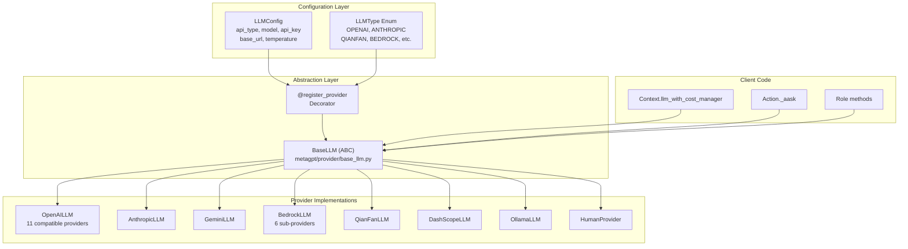
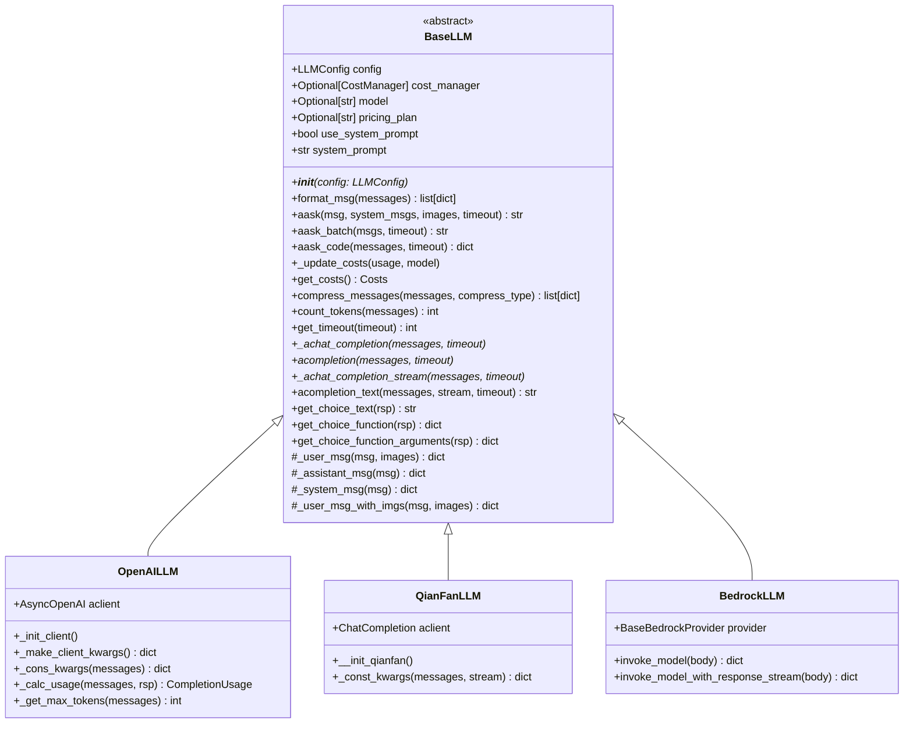
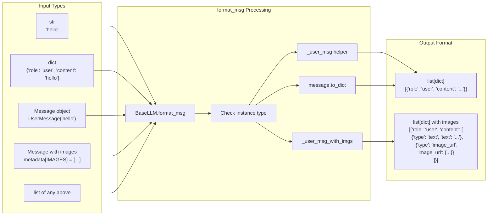
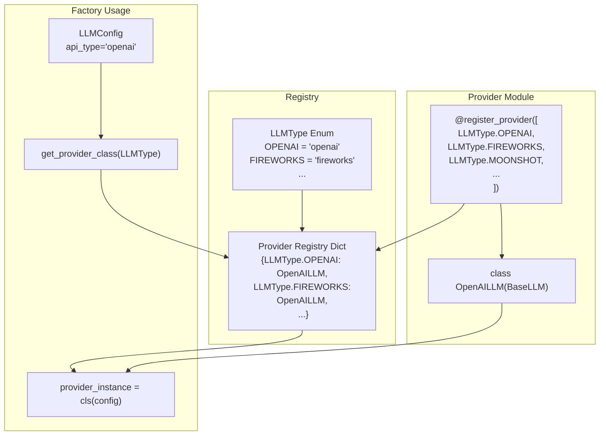
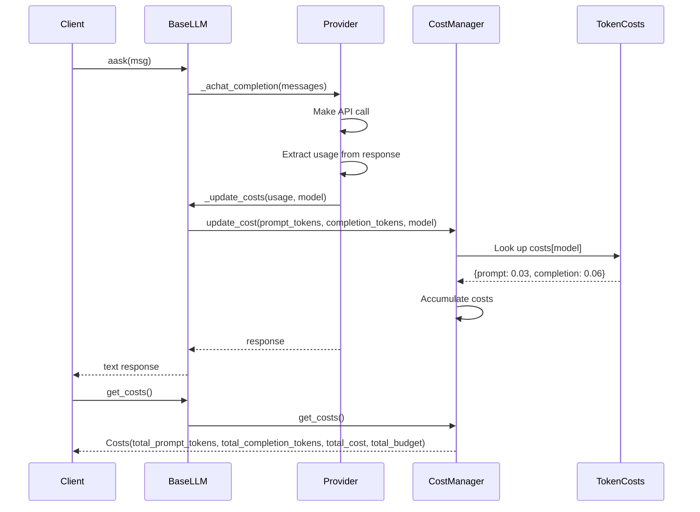
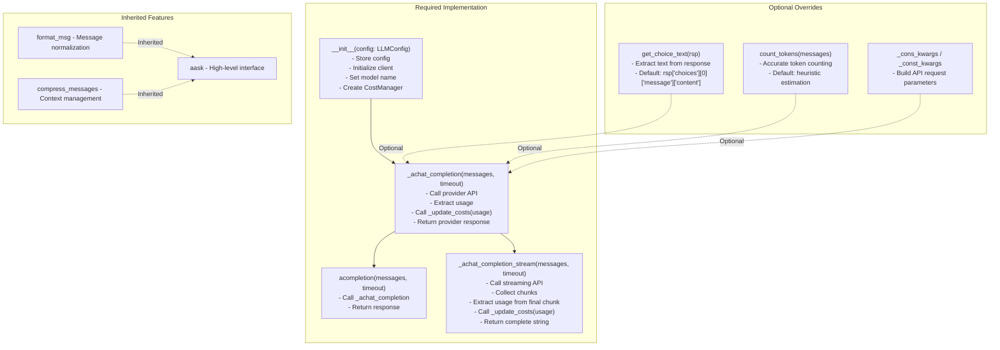
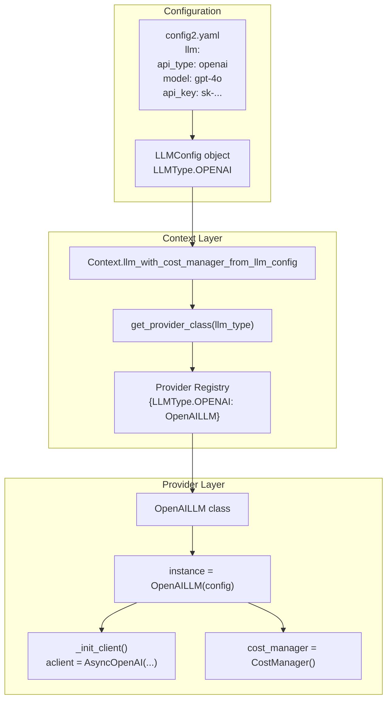

<!-- source: DeepWiki mcp.deepwiki.com · repo FoundationAgents/MetaGPT · page 3.1 BaseLLM and Provider Registry · fetched 2026-10-30 -->

# BaseLLM and Provider Registry

<details>
<summary>Relevant source files</summary>

The following files were used as context for generating this wiki page:

- [metagpt/provider/base_llm.py](metagpt/provider/base_llm.py)
- [metagpt/provider/dashscope_api.py](metagpt/provider/dashscope_api.py)
- [metagpt/provider/human_provider.py](metagpt/provider/human_provider.py)
- [metagpt/provider/openai_api.py](metagpt/provider/openai_api.py)
- [metagpt/provider/qianfan_api.py](metagpt/provider/qianfan_api.py)
- [tests/metagpt/provider/mock_llm_config.py](tests/metagpt/provider/mock_llm_config.py)
- [tests/metagpt/provider/req_resp_const.py](tests/metagpt/provider/req_resp_const.py)
- [tests/metagpt/provider/test_base_llm.py](tests/metagpt/provider/test_base_llm.py)
- [tests/metagpt/provider/test_bedrock_api.py](tests/metagpt/provider/test_bedrock_api.py)
- [tests/metagpt/provider/test_openai.py](tests/metagpt/provider/test_openai.py)

</details>


## Purpose and Scope

This page documents the LLM provider abstraction layer in MetaGPT, which enables the framework to work with 15+ different LLM services through a unified interface. The `BaseLLM` abstract class defines the standard interface, while the provider registry system enables automatic provider discovery and instantiation based on configuration.

For information about cost management and token counting, see [Token Management and Cost Control](#3.5). For message processing strategies like compression, see [Message Processing and Streaming](#3.6). For specific provider implementations, see [OpenAI-Compatible Providers](#3.2), [Specialized Providers](#3.3), and [AWS Bedrock Integration](#3.4).

---

## Core Architecture

The provider system uses an abstract factory pattern with decorator-based registration:



**Sources:** [metagpt/provider/base_llm.py:35-62](), [metagpt/provider/openai_api.py:43-58](), [metagpt/provider/qianfan_api.py:23-24]()

---

## BaseLLM Abstract Interface

The `BaseLLM` class at [metagpt/provider/base_llm.py:35-413]() defines the standard interface all providers must implement. It provides both abstract methods (must be overridden) and concrete utility methods (can be used as-is or overridden).

### Class Structure



**Sources:** [metagpt/provider/base_llm.py:35-413](), [metagpt/provider/openai_api.py:58-328](), [metagpt/provider/qianfan_api.py:24-137]()

### Key Methods

| Method | Type | Description | Returns |
|--------|------|-------------|---------|
| `__init__(config)` | Abstract | Initialize provider with LLMConfig | None |
| `aask(msg, system_msgs, images, timeout)` | Concrete | High-level async ask with system prompts | str |
| `aask_batch(msgs, timeout)` | Concrete | Sequential questioning with context | str |
| `aask_code(messages, timeout)` | Concrete | Request code via function calling | dict |
| `_achat_completion(messages, timeout)` | Abstract | Low-level completion (non-streaming) | Provider-specific |
| `acompletion(messages, timeout)` | Abstract | Standard completion interface | Provider-specific |
| `_achat_completion_stream(messages, timeout)` | Abstract | Low-level streaming completion | str |
| `acompletion_text(messages, stream, timeout)` | Concrete | Completion returning text with retry logic | str |
| `format_msg(messages)` | Concrete | Normalize messages to list[dict] | list[dict] |
| `compress_messages(messages, compress_type)` | Concrete | Compress context by token/message limit | list[dict] |
| `get_choice_text(rsp)` | Concrete | Extract text from response | str |
| `get_choice_function_arguments(rsp)` | Concrete | Extract function arguments | dict |

**Sources:** [metagpt/provider/base_llm.py:60-413]()

### Abstract Methods Contract

All provider implementations must override these three methods:

1. **`__init__(config: LLMConfig)`** [metagpt/provider/base_llm.py:61-62](): Initialize the provider with configuration, set up client, and configure cost manager.

2. **`_achat_completion(messages: list[dict], timeout)`** [metagpt/provider/base_llm.py:230-232](): Core non-streaming completion. Must return provider-specific response format.

3. **`acompletion(messages: list[dict], timeout)`** [metagpt/provider/base_llm.py:234-243](): Standard OpenAI-compatible completion interface. Should call `_achat_completion`.

4. **`_achat_completion_stream(messages: list[dict], timeout)`** [metagpt/provider/base_llm.py:246-247](): Streaming completion. Must return complete response string after streaming.

**Sources:** [metagpt/provider/base_llm.py:60-247]()

---

## Message Format Standardization

The `format_msg` method [metagpt/provider/base_llm.py:94-116]() normalizes various input types into the standard OpenAI message format:



**Message Helper Methods:**

- **`_user_msg(msg, images)`** [metagpt/provider/base_llm.py:64-69](): Creates user role message, delegates to `_user_msg_with_imgs` if images present.
- **`_assistant_msg(msg)`** [metagpt/provider/base_llm.py:85-86](): Creates assistant role message.
- **`_system_msg(msg)`** [metagpt/provider/base_llm.py:88-89](): Creates system role message.
- **`_user_msg_with_imgs(msg, images)`** [metagpt/provider/base_llm.py:71-83](): Creates multi-modal message with images as URLs or base64.

**Multi-Modal Support:**

The `support_image_input()` method [metagpt/provider/base_llm.py:91-92]() checks if the current model supports image inputs by matching against `MULTI_MODAL_MODELS` constant [metagpt/provider/constant.py](). Models like `gpt-4o`, `gpt-4-vision`, `claude-3`, and `gemini-1.5` are supported.

**Sources:** [metagpt/provider/base_llm.py:64-116](), [tests/metagpt/provider/test_base_llm.py:169-201]()

---

## Provider Registry System

The provider registry enables automatic provider discovery and instantiation based on `LLMType` enum values. Providers register themselves using the `@register_provider` decorator.

### Registration Mechanism



**Registration Example from OpenAILLM:**

```python
# metagpt/provider/openai_api.py:43-58
@register_provider(
    [
        LLMType.OPENAI,
        LLMType.FIREWORKS,
        LLMType.OPEN_LLM,
        LLMType.MOONSHOT,
        LLMType.MISTRAL,
        LLMType.YI,
        LLMType.OPEN_ROUTER,
        LLMType.DEEPSEEK,
        LLMType.SILICONFLOW,
        LLMType.OPENROUTER,
        LLMType.LLAMA_API,
    ]
)
class OpenAILLM(BaseLLM):
    ...
```

**Single Provider Registration:**

```python
# metagpt/provider/qianfan_api.py:23-24
@register_provider(LLMType.QIANFAN)
class QianFanLLM(BaseLLM):
    ...
```

The decorator accepts either a single `LLMType` or a list of `LLMType` values, allowing one implementation to serve multiple provider types (especially useful for OpenAI-compatible APIs).

**Sources:** [metagpt/provider/openai_api.py:43-58](), [metagpt/provider/qianfan_api.py:23-24](), [metagpt/provider/dashscope_api.py:156-157]()

---

## Cost Management Integration

The `BaseLLM` class integrates with the `CostManager` to track token usage and costs across all LLM requests.

### Cost Tracking Flow



### _update_costs Method

The `_update_costs` method [metagpt/provider/base_llm.py:124-140]() is called by provider implementations after each completion:

```python
def _update_costs(self, usage: Union[dict, BaseModel], model: str = None, local_calc_usage: bool = True):
    """Update each request's token cost
    Args:
        model (str): model name or endpoint
        local_calc_usage (bool): some models don't calculate usage, overrides LLMConfig.calc_usage
    """
    calc_usage = self.config.calc_usage and local_calc_usage
    model = model or self.pricing_plan or self.model
    usage = usage.model_dump() if isinstance(usage, BaseModel) else usage
    if calc_usage and self.cost_manager and usage:
        try:
            prompt_tokens = int(usage.get("prompt_tokens", 0))
            completion_tokens = int(usage.get("completion_tokens", 0))
            self.cost_manager.update_cost(prompt_tokens, completion_tokens, model)
        except Exception as e:
            logger.error(f"{self.__class__.__name__} updates costs failed! exp: {e}")
```

**Key Features:**

1. **Flexible Usage Input:** Accepts dict or Pydantic BaseModel (from different providers)
2. **Configurable Calculation:** Respects `config.calc_usage` flag
3. **Model Fallback Chain:** Uses `model` parameter, then `pricing_plan`, then `self.model`
4. **Error Handling:** Logs errors without disrupting the response flow

**Provider-Specific Usage Calculation:**

Some providers (like OpenAI) return usage in the response. Others require local calculation:

```python
# metagpt/provider/openai_api.py:269-280
def _calc_usage(self, messages: list[dict], rsp: str) -> CompletionUsage:
    usage = CompletionUsage(prompt_tokens=0, completion_tokens=0, total_tokens=0)
    if not self.config.calc_usage:
        return usage
    
    try:
        usage.prompt_tokens = count_message_tokens(messages, self.pricing_plan)
        usage.completion_tokens = count_output_tokens(rsp, self.pricing_plan)
    except Exception as e:
        logger.warning(f"usage calculation failed: {e}")
    
    return usage
```

**Sources:** [metagpt/provider/base_llm.py:124-145](), [metagpt/provider/openai_api.py:269-280](), [metagpt/provider/qianfan_api.py:101-105]()

---

## Provider Implementation Pattern

### Minimum Implementation Requirements

To create a new provider, you must:

1. **Inherit from BaseLLM**
2. **Implement the abstract methods**
3. **Register with @register_provider**
4. **Initialize client and cost manager**

### Implementation Template



### OpenAILLM Example

The `OpenAILLM` class [metagpt/provider/openai_api.py:58-328]() demonstrates the complete pattern:

**1. Class Declaration with Registration:**
```python
# Lines 43-58
@register_provider([LLMType.OPENAI, LLMType.FIREWORKS, ...])
class OpenAILLM(BaseLLM):
```

**2. Initialization:**
```python
# Lines 61-72
def __init__(self, config: LLMConfig):
    self.config = config
    self._init_client()
    self.auto_max_tokens = False
    self.cost_manager: Optional[CostManager] = None

def _init_client(self):
    self.model = self.config.model
    self.pricing_plan = self.config.pricing_plan or self.model
    kwargs = self._make_client_kwargs()
    self.aclient = AsyncOpenAI(**kwargs)
```

**3. Abstract Method Implementations:**

- **`_achat_completion`** [metagpt/provider/openai_api.py:156-160](): Non-streaming completion
- **`acompletion`** [metagpt/provider/openai_api.py:162-163](): Wrapper for standard interface
- **`_achat_completion_stream`** [metagpt/provider/openai_api.py:92-136](): Streaming with chunk collection

**4. Helper Methods:**

- **`_cons_kwargs`** [metagpt/provider/openai_api.py:138-154](): Build request parameters
- **`_make_client_kwargs`** [metagpt/provider/openai_api.py:74-81](): Client configuration
- **`_calc_usage`** [metagpt/provider/openai_api.py:269-280](): Local token counting fallback

**5. Response Parsing:**

- **`get_choice_text`** [metagpt/provider/openai_api.py:265-267](): Extract text from ChatCompletion
- **`get_choice_function_arguments`** [metagpt/provider/openai_api.py:230-263](): Parse function call arguments

**Sources:** [metagpt/provider/openai_api.py:43-328](), [metagpt/provider/base_llm.py:35-413]()

---

## Provider-Specific Features

### OpenAI-Compatible Providers

The `OpenAILLM` class supports 11 different providers that use OpenAI-compatible APIs:

| LLMType | Description | Notes |
|---------|-------------|-------|
| `OPENAI` | Official OpenAI API | Full feature support |
| `FIREWORKS` | Fireworks.ai | Includes usage in chunks |
| `MOONSHOT` | Moonshot AI | Usage in choice object |
| `MISTRAL` | Mistral AI | No `n` parameter |
| `YI` | Yi models | OpenAI-compatible |
| `DEEPSEEK` | DeepSeek | Includes reasoning_content |
| `SILICONFLOW` | Silicon Flow | OpenAI-compatible |
| `OPEN_LLM` | Open source models | May lack usage data |
| `OPEN_ROUTER` | OpenRouter aggregator | OpenAI-compatible |
| `OPENROUTER` | Alternate spelling | OpenAI-compatible |
| `LLAMA_API` | Llama API service | OpenAI-compatible |

**Streaming Variance Handling:**

Different services return usage information in different locations within streaming responses [metagpt/provider/openai_api.py:100-125]():

```python
# Fireworks: usage as chunk attribute
if chunk_has_usage:
    usage = CompletionUsage(**chunk.usage)
    
# Moonshot: usage in choice object
elif hasattr(choice0, "usage"):
    usage = CompletionUsage(**choice0.usage)
    
# OpenAI/OpenLLM: no usage, calculate locally
if not usage:
    usage = self._calc_usage(messages, full_reply_content)
```

**Sources:** [metagpt/provider/openai_api.py:43-57](), [metagpt/provider/openai_api.py:92-136]()

### Chinese LLM Providers

**QianFanLLM (Baidu):**

[metagpt/provider/qianfan_api.py:24-137]() implements Baidu's Qianfan (Wenxin Yiyan) API with:

- **Authentication:** Supports both access_key/secret_key (system-level) and api_key/secret_key (application-level)
- **System Prompt Support:** Only ERNIE-Bot series models support system prompts [qianfan_api.py:57-69]()
- **Endpoint vs Model:** Can specify either `model` name or `endpoint` identifier
- **Custom Cost Tables:** Uses `QIANFAN_MODEL_TOKEN_COSTS` and `QIANFAN_ENDPOINT_TOKEN_COSTS`

**DashScopeLLM (Alibaba):**

[metagpt/provider/dashscope_api.py:157-233]() implements Alibaba's DashScope API with:

- **System Prompt Support:** Qwen, Llama2, Baichuan2-7b, ChatGLM3 models [dashscope_api.py:171-179]()
- **Async Generator Pattern:** Custom `AGeneration` class for async streaming [dashscope_api.py:107-154]()
- **Incremental Output:** Enables `incremental_output=True` for streaming [dashscope_api.py:193]()

**Sources:** [metagpt/provider/qianfan_api.py:24-137](), [metagpt/provider/dashscope_api.py:157-233]()

### Special Provider: HumanProvider

The `HumanProvider` [metagpt/provider/human_provider.py:14-57]() replaces LLM calls with human input:

```python
async def aask(self, msg: str, ...) -> str:
    logger.info("It's your turn, please type in your response.")
    rsp = input(msg)
    if rsp in ["exit", "quit"]:
        exit()
    return rsp
```

**Use Cases:**
- Debugging agent workflows with human-in-the-loop
- Testing role interactions without LLM costs
- Hybrid human-AI collaboration scenarios

**Sources:** [metagpt/provider/human_provider.py:14-57]()

---

## Configuration and Instantiation

### LLMConfig Structure

The `LLMConfig` class (from [metagpt/configs/llm_config.py]()) drives provider selection:

| Field | Type | Purpose |
|-------|------|---------|
| `api_type` / `llm_type` | str | Maps to LLMType enum value |
| `model` | str | Model name (e.g., "gpt-4o", "claude-3-opus") |
| `api_key` | str | Authentication key |
| `base_url` | Optional[str] | Custom endpoint URL |
| `temperature` | float | Sampling temperature (default: 0.0) |
| `max_token` | int | Max completion tokens |
| `calc_usage` | bool | Enable cost tracking (default: True) |
| `timeout` | int | Request timeout in seconds |
| `proxy` | Optional[str] | HTTP proxy URL |

### Instantiation Flow



**Context Integration:**

The `Context` class provides factory methods for LLM instantiation with cost tracking:

```python
# From Context class
def llm_with_cost_manager_from_llm_config(self, llm_config: LLMConfig) -> BaseLLM:
    """Create LLM with attached CostManager"""
    provider_class = get_provider_class(llm_config.api_type)
    llm_instance = provider_class(llm_config)
    llm_instance.cost_manager = self.cost_manager
    return llm_instance
```

**Sources:** [metagpt/provider/openai_api.py:61-72](), [tests/metagpt/provider/mock_llm_config.py:11-19]()

---

## Testing Infrastructure

### MockLLM Pattern

The test suite uses a `MockBaseLLM` class [tests/metagpt/provider/test_base_llm.py:26-44]() to verify interface compliance without making real API calls:

```python
class MockBaseLLM(BaseLLM):
    def __init__(self, config: LLMConfig = None):
        self.config = config or mock_llm_config

    async def _achat_completion(self, messages: list[dict], timeout=3):
        pass

    async def acompletion(self, messages: list[dict], timeout=3):
        return get_part_chat_completion(name)

    async def _achat_completion_stream(self, messages: list[dict], timeout: int = 3) -> str:
        pass

    async def acompletion_text(self, messages: list[dict], stream=False, timeout=3) -> str:
        return default_resp_cont
```

### Response Fixtures

The test suite provides standardized response fixtures [tests/metagpt/provider/req_resp_const.py]():

| Function | Purpose | Format |
|----------|---------|--------|
| `get_openai_chat_completion(name)` | Full ChatCompletion object | OpenAI format |
| `get_openai_chat_completion_chunk(name)` | Streaming chunk | OpenAI format |
| `get_qianfan_response(name)` | QfResponse object | Qianfan format |
| `get_dashscope_response(name)` | GenerationResponse | DashScope format |
| `get_anthropic_response(name, stream)` | Message or events | Anthropic format |

**Patching Strategy:**

Tests patch specific methods to avoid real API calls [tests/metagpt/provider/test_openai.py:156-168]():

```python
async def mock_openai_acompletions_create(self, stream: bool = False, **kwargs):
    if stream:
        class Iterator(object):
            async def __aiter__(self):
                yield default_resp_chunk
        return Iterator()
    else:
        return default_resp

mocker.patch("openai.resources.chat.completions.AsyncCompletions.create", 
             mock_openai_acompletions_create)
```

**Sources:** [tests/metagpt/provider/test_base_llm.py:26-109](), [tests/metagpt/provider/test_openai.py:144-168](), [tests/metagpt/provider/req_resp_const.py:40-95]()

---

## Summary

The BaseLLM and Provider Registry system provides a robust abstraction layer for multi-provider LLM support:

1. **Unified Interface:** `BaseLLM` defines standard methods for completion, streaming, and function calling
2. **Automatic Registration:** `@register_provider` decorator enables provider discovery via `LLMType` enum
3. **Message Standardization:** `format_msg` normalizes diverse input types to OpenAI format
4. **Cost Tracking:** Integrated `CostManager` tracks token usage across all providers
5. **Flexible Implementation:** Concrete and abstract methods balance consistency with provider-specific features
6. **Extensive Coverage:** Supports 15+ providers including OpenAI-compatible APIs, Chinese services, and AWS Bedrock

This architecture enables MetaGPT to seamlessly switch between providers by changing configuration, without modifying agent or action code.

---

