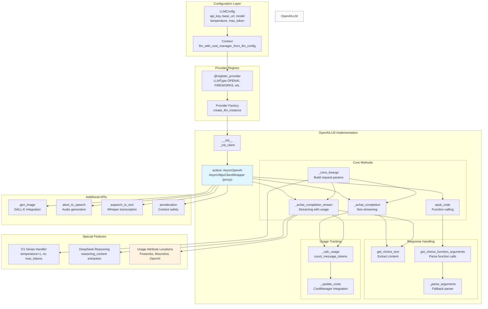
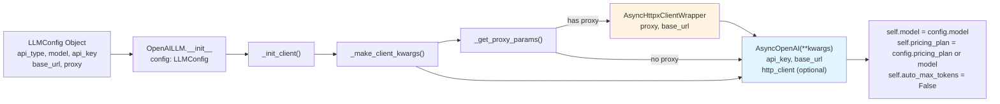
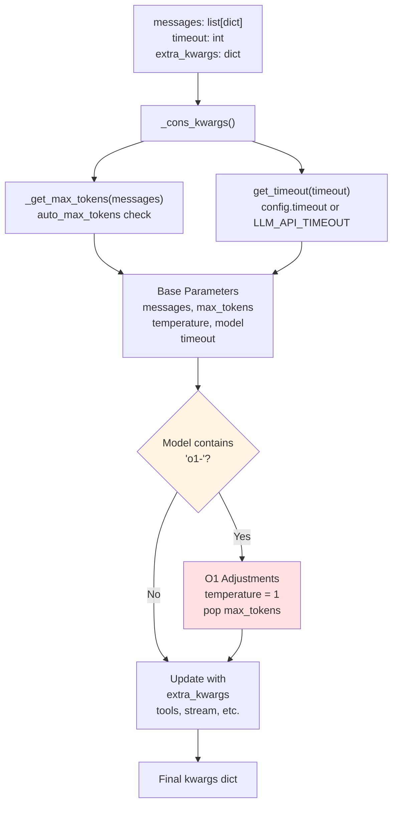
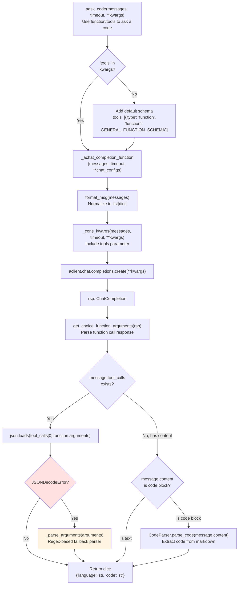
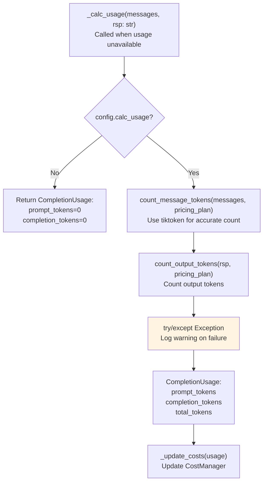
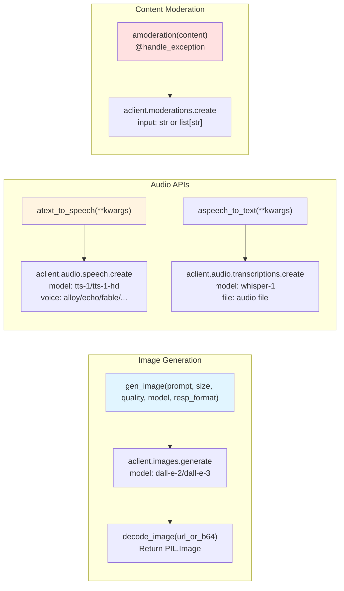
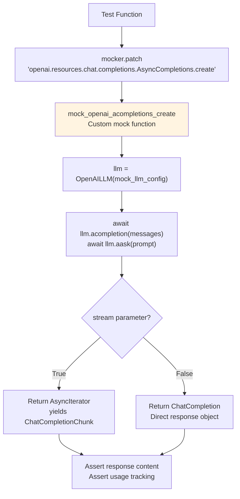

<!-- source: DeepWiki mcp.deepwiki.com · repo FoundationAgents/MetaGPT · page 3.2 OpenAI-Compatible Providers · fetched 2026-10-30 -->

# OpenAI-Compatible Providers

<details>
<summary>Relevant source files</summary>

The following files were used as context for generating this wiki page:

- [metagpt/provider/base_llm.py](metagpt/provider/base_llm.py)
- [metagpt/provider/dashscope_api.py](metagpt/provider/dashscope_api.py)
- [metagpt/provider/human_provider.py](metagpt/provider/human_provider.py)
- [metagpt/provider/openai_api.py](metagpt/provider/openai_api.py)
- [metagpt/provider/qianfan_api.py](metagpt/provider/qianfan_api.py)
- [tests/metagpt/provider/mock_llm_config.py](tests/metagpt/provider/mock_llm_config.py)
- [tests/metagpt/provider/req_resp_const.py](tests/metagpt/provider/req_resp_const.py)
- [tests/metagpt/provider/test_base_llm.py](tests/metagpt/provider/test_base_llm.py)
- [tests/metagpt/provider/test_bedrock_api.py](tests/metagpt/provider/test_bedrock_api.py)
- [tests/metagpt/provider/test_openai.py](tests/metagpt/provider/test_openai.py)

</details>


## Purpose and Scope

This page documents the `OpenAILLM` provider implementation, which serves as the primary LLM interface for OpenAI's API and 10+ API-compatible services including Fireworks, Moonshot, Mistral, DeepSeek, and others. This provider handles standard chat completion, streaming, function calling, and multi-modal capabilities through a unified interface.

For information about the provider abstraction layer and registry system, see [BaseLLM and Provider Registry](#3.1). For specialized providers like Anthropic, Gemini, and Chinese LLMs, see [Specialized Providers](#3.3). For AWS Bedrock integration, see [AWS Bedrock Integration](#3.4).

---

## Supported Provider Types

The `OpenAILLM` class is registered to handle 11 distinct LLM types through the `@register_provider` decorator, all sharing OpenAI's API specification:

| LLM Type | Service | Base URL Pattern |
|----------|---------|------------------|
| `OPENAI` | OpenAI | `https://api.openai.com/v1` |
| `FIREWORKS` | Fireworks AI | `https://api.fireworks.ai/inference/v1` |
| `OPEN_LLM` | Generic OpenAI-compatible | Configurable |
| `MOONSHOT` | Moonshot AI | `https://api.moonshot.cn/v1` |
| `MISTRAL` | Mistral AI | `https://api.mistral.ai/v1` |
| `YI` | Yi (01.AI) | `https://api.01.ai/v1` |
| `OPEN_ROUTER` | OpenRouter | `https://openrouter.ai/api/v1` |
| `DEEPSEEK` | DeepSeek | `https://api.deepseek.com` |
| `SILICONFLOW` | SiliconFlow | `https://api.siliconflow.cn/v1` |
| `OPENROUTER` | OpenRouter (alias) | `https://openrouter.ai/api/v1` |
| `LLAMA_API` | Llama API | `https://api.llama-api.com` |

**Sources:** [metagpt/provider/openai_api.py:43-57]()

---

## Architecture Overview



**OpenAI-Compatible Provider Architecture**

The architecture consists of five layers: configuration management through `LLMConfig`, provider registration via decorators, the core `OpenAILLM` implementation with `AsyncOpenAI` client, specialized handling for provider variations, and additional API features. The provider handles both standard OpenAI endpoints and compatible services by adapting to their specific response formats and usage reporting patterns.

**Sources:** [metagpt/provider/openai_api.py:58-328](), [metagpt/provider/base_llm.py:35-413]()

---

## Client Initialization and Configuration

### Initialization Flow



**Client Initialization Flow**

The `OpenAILLM` initialization creates an `AsyncOpenAI` client with configuration from `LLMConfig`. When a proxy is specified, an `AsyncHttpxClientWrapper` is injected to route requests through the proxy server. The `pricing_plan` attribute determines which token cost database to use for usage tracking.

**Sources:** [metagpt/provider/openai_api.py:61-91]()

### Configuration Parameters

The `_make_client_kwargs()` method constructs client initialization parameters:

```python
# Core parameters
{
    "api_key": self.config.api_key,        # Provider API key
    "base_url": self.config.base_url,      # Service endpoint URL
    "http_client": AsyncHttpxClientWrapper # Optional proxy wrapper
}
```

**Proxy Configuration:** When `config.proxy` is set, the method creates proxy parameters and wraps them in `AsyncHttpxClientWrapper` for OpenAI v1 compatibility:

```python
proxy_params = {
    "proxy": self.config.proxy,           # e.g., "http://localhost:8080"
    "base_url": self.config.base_url      # Original base URL preserved
}
```

**Sources:** [metagpt/provider/openai_api.py:74-90]()

---

## Request Parameter Construction

### Standard Request Flow



**Request Parameter Construction Flow**

The `_cons_kwargs()` method builds request parameters from configuration and runtime inputs. It handles model-specific requirements, most notably the OpenAI O1 series which requires `temperature=1` and omits `max_tokens`. The method also enforces token limits and applies configured timeouts.

**Sources:** [metagpt/provider/openai_api.py:138-154](), [metagpt/provider/openai_api.py:282-287]()

### Parameter Details

| Parameter | Source | Notes |
|-----------|--------|-------|
| `messages` | Input | Formatted message list |
| `max_tokens` | `_get_max_tokens()` | Capped at 4096 for compatibility |
| `temperature` | `config.temperature` | Overridden to 1 for O1 models |
| `model` | `self.model` | Provider-specific model ID |
| `timeout` | `get_timeout(timeout)` | Config → param → default (180s) |
| `tools` | `extra_kwargs` | Function calling schemas |
| `stream` | `extra_kwargs` | Streaming mode flag |

**Token Limit Calculation:** The `_get_max_tokens()` method uses `get_max_completion_tokens()` from the token counter utility, but caps the result at 4096 to work around provider limitations:

```python
# FIXME: https://community.openai.com/t/why-is-gpt-3-5-turbo-1106-max-tokens-limited-to-4096/494973/3
return min(get_max_completion_tokens(messages, self.model, self.config.max_token), 4096)
```

**Sources:** [metagpt/provider/openai_api.py:282-287]()

---

## Streaming and Non-Streaming Completion

### Response Flow Comparison

```mermaid
graph TB
    subgraph "Non-Streaming Path"
        NC1["_achat_completion(messages, timeout)"]
        NC2["aclient.chat.completions.create<br/>**_cons_kwargs(messages, timeout)<br/>stream=False"]
        NC3["rsp: ChatCompletion<br/>choices[0].message.content<br/>usage: CompletionUsage"]
        NC4["_update_costs(rsp.usage)"]
        NC5["Return ChatCompletion"]
        
        NC1 --> NC2
        NC2 --> NC3
        NC3 --> NC4
        NC4 --> NC5
    end
    
    subgraph "Streaming Path"
        SC1["_achat_completion_stream(messages, timeout)"]
        SC2["aclient.chat.completions.create<br/>**_cons_kwargs(messages, timeout)<br/>stream=True"]
        SC3["response: AsyncStream[ChatCompletionChunk]<br/>async for chunk in response"]
        
        SC4{"chunk.choices?"}
        
        SC5["choice0 = chunk.choices[0]<br/>choice_delta = choice0.delta"]
        
        SC6{"Has reasoning_content?<br/>(DeepSeek)"}
        
        SC7["Collect reasoning_content<br/>self.reasoning_content"]
        
        SC8["chunk_message = choice_delta.content<br/>log_llm_stream(chunk_message)<br/>collected_messages.append"]
        
        SC9{"finish_reason?"}
        
        SC10["Extract usage from:<br/>chunk.usage (Fireworks)<br/>choice0.usage (Moonshot)<br/>_calc_usage() (OpenAI)"]
        
        SC11["_update_costs(usage)"]
        SC12["Return ''.join(collected_messages)"]
        
        SC1 --> SC2
        SC2 --> SC3
        SC3 --> SC4
        SC4 -->|"Yes"| SC5
        SC4 -->|"No"| SC3
        SC5 --> SC6
        SC6 -->|"Yes"| SC7
        SC6 -->|"No"| SC8
        SC7 --> SC3
        SC8 --> SC9
        SC9 -->|"Yes"| SC10
        SC9 -->|"No"| SC3
        SC10 --> SC11
        SC11 --> SC12
    end
    
    style SC6 fill:#fff4e1
    style SC10 fill:#ffe1e1
```



**Streaming vs Non-Streaming Response Handling**

Non-streaming completion returns a single `ChatCompletion` object with usage information included. Streaming completion iterates through `ChatCompletionChunk` objects, aggregating content while handling provider-specific variations: DeepSeek returns reasoning content in `choice_delta.reasoning_content`, Fireworks includes usage in `chunk.usage`, Moonshot in `choice0.usage`, and OpenAI requires manual calculation.

**Sources:** [metagpt/provider/openai_api.py:92-136](), [metagpt/provider/openai_api.py:156-178]()

### Provider-Specific Usage Handling

The streaming implementation handles three distinct usage reporting patterns:

**Pattern 1: Chunk-Level Usage (Fireworks)**
```python
if chunk_has_usage:
    usage = CompletionUsage(**chunk.usage) if isinstance(chunk.usage, dict) else chunk.usage
```

**Pattern 2: Choice-Level Usage (Moonshot)**
```python
elif hasattr(choice0, "usage"):
    usage = CompletionUsage(**choice0.usage)
```

**Pattern 3: Manual Calculation (OpenAI, OpenLLM)**
```python
if not usage:
    usage = self._calc_usage(messages, full_reply_content)
```

**DeepSeek Reasoning Content:** For models with reasoning capabilities, the provider extracts intermediate reasoning steps:
```python
if hasattr(choice_delta, "reasoning_content") and choice_delta.reasoning_content:
    collected_reasoning_messages.append(choice_delta.reasoning_content)
    continue  # Skip adding to main content
```

**Sources:** [metagpt/provider/openai_api.py:106-136]()

---

## Function Calling and Code Generation

### Function Calling Architecture



**Function Calling Flow for Code Generation**

The `aask_code()` method implements a robust function calling pipeline with multiple fallback strategies. It first attempts standard OpenAI function calling with `GENERAL_FUNCTION_SCHEMA`, then falls back to regex-based argument parsing if JSON decoding fails, and finally handles cases where the LLM returns code directly in the message content instead of function arguments.

**Sources:** [metagpt/provider/openai_api.py:189-263]()

### Response Parsing Strategies

**Strategy 1: Standard Function Call Response**
```python
message.tool_calls[0].function.arguments
# {"language": "python", "code": "print('Hello, World!')"}
```

**Strategy 2: Invalid JSON Fallback**
When `json.loads()` fails due to malformed JSON (e.g., mixed quotes), the `_parse_arguments()` method uses regex patterns:
```python
# Extract language
language_pattern = r'["\']?language["\']?\s*:\s*["\']([^"\']+?)["\']'
# Extract code
code_pattern = r'(["\'`]{3}|["\'`])([\s\S]*?)\1'
```

**Strategy 3: Direct Code Response**
Some models return code directly in `message.content` wrapped in markdown code blocks:
```python
if message.content.startswith("```") and message.content.endswith("```"):
    code = CodeParser.parse_code(text=message.content)
    return {"language": "python", "code": code}
```

**Strategy 4: Plain Text Response**
When the response is explanatory text rather than code:
```python
return {"language": "markdown", "code": self.get_choice_text(rsp)}
```

**Sources:** [metagpt/provider/openai_api.py:205-263]()

### GENERAL_FUNCTION_SCHEMA

The default function schema for code generation is defined in `metagpt.provider.constant.GENERAL_FUNCTION_SCHEMA`:

```python
{
    "name": "execute",
    "description": "Execute code and return the result",
    "parameters": {
        "type": "object",
        "properties": {
            "language": {
                "type": "string",
                "description": "Programming language (e.g., python, javascript)"
            },
            "code": {
                "type": "string",
                "description": "The code to execute"
            }
        },
        "required": ["language", "code"]
    }
}
```

**Sources:** [metagpt/provider/constant.py](), [metagpt/provider/openai_api.py:200-201]()

---

## Token Counting and Cost Management

### Token Counting Flow



**Token Counting and Cost Tracking Flow**

The provider calculates token usage when the API doesn't provide it (OpenAI, OpenLLM). It uses `count_message_tokens()` from the token counter utility, which leverages `tiktoken` for accurate token counting based on the model's tokenizer. The `pricing_plan` attribute (defaulting to `self.model`) determines which cost database to consult.

**Sources:** [metagpt/provider/openai_api.py:269-280](), [metagpt/utils/token_counter.py:36-40]()

### Cost Manager Integration

The `_update_costs()` method inherited from `BaseLLM` integrates with the `CostManager`:

```python
def _update_costs(self, usage: Union[dict, BaseModel], model: str = None, local_calc_usage: bool = True):
    calc_usage = self.config.calc_usage and local_calc_usage
    model = model or self.pricing_plan or self.model
    
    if calc_usage and self.cost_manager and usage:
        prompt_tokens = int(usage.get("prompt_tokens", 0))
        completion_tokens = int(usage.get("completion_tokens", 0))
        self.cost_manager.update_cost(prompt_tokens, completion_tokens, model)
```

The cost manager looks up pricing in `TOKEN_COSTS` dictionary using the model/pricing_plan as the key:

```python
# Example pricing structure
TOKEN_COSTS = {
    "gpt-4": {"prompt": 0.03, "completion": 0.06},       # per 1K tokens
    "gpt-3.5-turbo": {"prompt": 0.0015, "completion": 0.002},
    "claude-3-opus": {"prompt": 0.015, "completion": 0.075},
    # ... OpenAI-compatible services often use same pricing
}
```

**Sources:** [metagpt/provider/base_llm.py:124-140](), [metagpt/utils/cost_manager.py]()

---

## Additional API Features

### Multi-Modal and Audio APIs

The `OpenAILLM` implementation provides direct access to OpenAI's additional API endpoints beyond chat completion:



**Additional API Features**

The provider wraps OpenAI's specialized endpoints for image generation (DALL-E), text-to-speech (TTS), speech-to-text (Whisper), and content moderation. These features are typically available only for the native OpenAI service, not for compatible providers.

**Sources:** [metagpt/provider/openai_api.py:290-321]()

### Image Generation Details

The `gen_image()` method supports DALL-E 2 and DALL-E 3 with configurable parameters:

| Parameter | Values | Default |
|-----------|--------|---------|
| `size` | "1024x1024", "1792x1024", "1024x1792" | "1024x1024" |
| `quality` | "standard", "hd" | "standard" |
| `model` | "dall-e-2", "dall-e-3" | Uses `self.model` |
| `resp_format` | "url", "b64_json" | "url" |

The method returns a list of `PIL.Image` objects, handling both URL and base64 responses:

```python
for item in res.data:
    img_url_or_b64 = item.url if resp_format == "url" else item.b64_json
    imgs.append(decode_image(img_url_or_b64))  # Returns PIL.Image
return imgs
```

**Sources:** [metagpt/provider/openai_api.py:302-321]()

### Audio API Usage

**Text-to-Speech Example:**
```python
resp = await llm.atext_to_speech(
    model="tts-1",
    voice="alloy",  # alloy, echo, fable, onyx, nova, shimmer
    input="Text to convert to speech"
)
# resp.response.status_code == 200
```

**Speech-to-Text Example:**
```python
audio_file = open("audio.mp3", "rb")
resp = await llm.aspeech_to_text(
    file=audio_file,
    model="whisper-1"
)
# resp.text contains transcription
```

**Sources:** [metagpt/provider/openai_api.py:294-300](), [tests/metagpt/provider/test_openai.py:40-55]()

---

## Testing and Mocking

### Mock LLM Configuration

The test suite uses mock configurations to test provider behavior without making real API calls:

```python
# From tests/metagpt/provider/mock_llm_config.py
mock_llm_config = LLMConfig(
    llm_type="mock",
    api_key="mock_api_key",
    base_url="mock_base_url",
    model="mock_model",
)

mock_llm_config_proxy = LLMConfig(
    llm_type="mock",
    api_key="mock_api_key",
    base_url="mock_base_url",
    proxy="http://localhost:8080",  # Proxy configuration
)
```

**Sources:** [tests/metagpt/provider/mock_llm_config.py:11-27]()

### Response Mocking Strategy



**Mocking Strategy for OpenAI API**

Tests mock the `AsyncCompletions.create` method to return pre-defined `ChatCompletion` or `ChatCompletionChunk` objects. The mock function detects streaming mode and returns an async iterator for streaming tests or a single response object for non-streaming tests.

**Sources:** [tests/metagpt/provider/test_openai.py:144-167]()

### Test Response Fixtures

The test suite defines standard response objects:

```python
# Non-streaming response
default_resp = ChatCompletion(
    id="cmpl-a6652c1bb181caae8dd19ad8",
    model="xx/xxx",
    choices=[
        Choice(
            finish_reason="stop",
            message=ChatCompletionMessage(role="assistant", content="I'm AI assistant")
        )
    ],
    usage=CompletionUsage(prompt_tokens=92, completion_tokens=110, total_tokens=202)
)

# Streaming response chunk
default_resp_chunk = ChatCompletionChunk(
    id="cmpl-a6652c1bb181caae8dd19ad8",
    choices=[
        AChoice(
            delta=ChoiceDelta(role="assistant", content="I'm AI assistant"),
            finish_reason="stop"
        )
    ],
    usage={"completion_tokens": 110, "prompt_tokens": 92, "total_tokens": 202}
)
```

**Sources:** [tests/metagpt/provider/req_resp_const.py:58-95]()

### Testing Function Calling Edge Cases

The test suite includes fixtures for testing function calling error handling:

**Test Case 1: Tool Calls Response**
```python
tool_calls = [ChatCompletionMessageToolCall(
    type="function",
    id="call_0",
    function=Function(
        arguments='{\n"language": "python",\n"code": "print(\'hello world\')"}',
        name="execute"
    )
)]
```

**Test Case 2: JSON Decode Error (Mixed Quotes)**
```python
function_rsp = Function(
    arguments='{\n"language": \'python\',\n"code": "print(\'hello world\')"}',  # Invalid JSON
    name="execute"
)
# Tests _parse_arguments() fallback
```

**Test Case 3: Code in Content (Bug Workaround)**
```python
message = ChatCompletionMessage(
    content="```python\nprint('hello world')```",  # Code in content, not tool_calls
    role="assistant",
    tool_calls=None
)
# Tests CodeParser.parse_code() fallback
```

**Sources:** [tests/metagpt/provider/test_openai.py:59-129]()

---

## Configuration Examples

### Basic OpenAI Configuration

```yaml
# config/config2.yaml
llm:
  api_type: "openai"
  model: "gpt-4"
  api_key: "sk-..."
  base_url: "https://api.openai.com/v1"
  temperature: 0.7
  max_token: 4096
  calc_usage: true
```

### Compatible Provider Configurations

**Fireworks:**
```yaml
llm:
  api_type: "fireworks"
  model: "accounts/fireworks/models/llama-v3-70b-instruct"
  api_key: "fw_..."
  base_url: "https://api.fireworks.ai/inference/v1"
```

**Moonshot:**
```yaml
llm:
  api_type: "moonshot"
  model: "moonshot-v1-8k"
  api_key: "sk-..."
  base_url: "https://api.moonshot.cn/v1"
```

**DeepSeek:**
```yaml
llm:
  api_type: "deepseek"
  model: "deepseek-chat"
  api_key: "sk-..."
  base_url: "https://api.deepseek.com"
```

**OpenRouter:**
```yaml
llm:
  api_type: "openrouter"
  model: "anthropic/claude-3-opus"
  api_key: "sk-or-..."
  base_url: "https://openrouter.ai/api/v1"
```

**SiliconFlow (Chinese Market):**
```yaml
llm:
  api_type: "siliconflow"
  model: "deepseek-ai/DeepSeek-Coder-V2-Instruct"
  api_key: "sk-..."
  base_url: "https://api.siliconflow.cn/v1"
```

**Sources:** [metagpt/configs/llm_config.py]()

### Proxy Configuration

For providers behind corporate proxies or in regions requiring VPN:

```yaml
llm:
  api_type: "openai"
  model: "gpt-4"
  api_key: "sk-..."
  base_url: "https://api.openai.com/v1"
  proxy: "http://proxy.company.com:8080"
```

The proxy configuration creates an `AsyncHttpxClientWrapper` with the proxy settings, ensuring all requests route through the specified proxy server.

**Sources:** [metagpt/provider/openai_api.py:78-89](), [tests/metagpt/provider/mock_llm_config.py:22-27]()

---

## Integration with MetaGPT Framework

### Usage in Actions and Roles

Actions access the OpenAI-compatible provider through the inherited LLM instance:

```python
from metagpt.actions import Action
from metagpt.llm import LLM

class WriteCode(Action):
    async def run(self, context: str):
        prompt = f"Write Python code for: {context}"
        code = await self.llm.aask(prompt)
        return code
```

The LLM instance is automatically configured based on `config2.yaml` and injected through the `Context` system:

```python
# In metagpt.context
context.llm_with_cost_manager_from_llm_config(llm_config)
# Returns OpenAILLM instance with attached CostManager
```

**Sources:** [metagpt/provider/openai_api.py:1-328](), [metagpt/actions/action.py]()

### Token Limit and Compression

When messages exceed the model's context window, the provider applies compression strategies configured in `config2.yaml`:

```yaml
llm:
  compress_type: "POST_CUT_BY_TOKEN"  # or POST_CUT_BY_MSG, PRE_CUT_BY_TOKEN, PRE_CUT_BY_MSG
```

The `compress_messages()` method from `BaseLLM` handles compression before calling the provider's completion methods. For OpenAI-compatible providers, token limits are looked up in `TOKEN_MAX`:

```python
TOKEN_MAX = {
    "gpt-4": 8192,
    "gpt-4-32k": 32768,
    "gpt-3.5-turbo": 4096,
    "gpt-3.5-turbo-16k": 16385,
    # ...
}
```

**Sources:** [metagpt/provider/base_llm.py:340-412](), [metagpt/utils/token_counter.py:54-85]()

---

## Summary of Key Classes and Methods

| Class/Method | Purpose | File |
|--------------|---------|------|
| `OpenAILLM` | Main provider implementation for OpenAI-compatible APIs | [openai_api.py:58-328]() |
| `_init_client()` | Initialize AsyncOpenAI client with proxy support | [openai_api.py:67-72]() |
| `_make_client_kwargs()` | Construct client configuration including proxy | [openai_api.py:74-81]() |
| `_cons_kwargs()` | Build request parameters with model-specific handling | [openai_api.py:138-154]() |
| `_achat_completion()` | Non-streaming completion | [openai_api.py:156-160]() |
| `_achat_completion_stream()` | Streaming completion with usage extraction | [openai_api.py:92-136]() |
| `aask_code()` | Function calling for code generation | [openai_api.py:189-203]() |
| `get_choice_function_arguments()` | Parse function call responses with fallbacks | [openai_api.py:230-263]() |
| `_parse_arguments()` | Regex-based fallback parser for malformed JSON | [openai_api.py:205-227]() |
| `_calc_usage()` | Calculate token usage when unavailable | [openai_api.py:269-280]() |
| `gen_image()` | DALL-E image generation | [openai_api.py:302-321]() |
| `atext_to_speech()` | Text-to-speech API | [openai_api.py:294-296]() |
| `aspeech_to_text()` | Speech-to-text API (Whisper) | [openai_api.py:298-300]() |
| `amoderation()` | Content moderation API | [openai_api.py:290-292]() |

**Sources:** [metagpt/provider/openai_api.py:1-328]()

---

