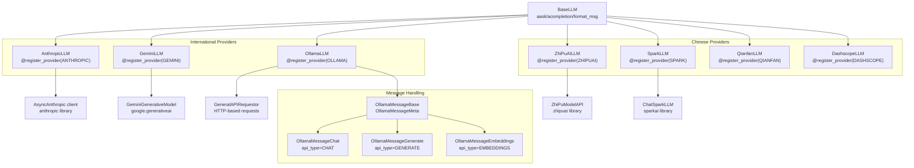
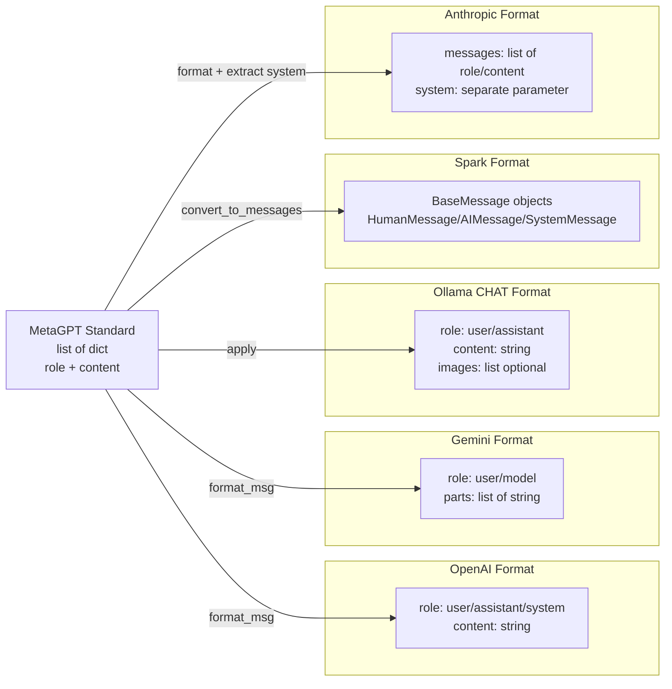
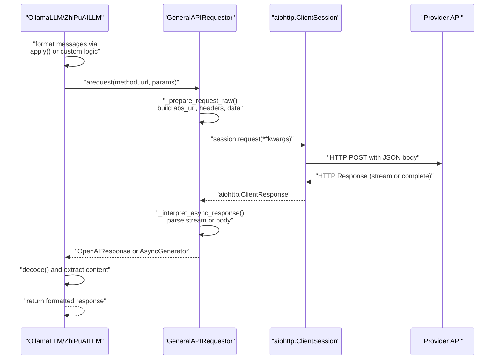

<!-- source: DeepWiki mcp.deepwiki.com · repo FoundationAgents/MetaGPT · page 3.3 Specialized Providers · fetched 2026-10-30 -->

# Specialized Providers

<details>
<summary>Relevant source files</summary>

The following files were used as context for generating this wiki page:

- [examples/llm_vision.py](examples/llm_vision.py)
- [metagpt/provider/general_api_base.py](metagpt/provider/general_api_base.py)
- [metagpt/provider/general_api_requestor.py](metagpt/provider/general_api_requestor.py)
- [metagpt/provider/google_gemini_api.py](metagpt/provider/google_gemini_api.py)
- [metagpt/provider/ollama_api.py](metagpt/provider/ollama_api.py)
- [metagpt/provider/spark_api.py](metagpt/provider/spark_api.py)
- [metagpt/provider/zhipuai/async_sse_client.py](metagpt/provider/zhipuai/async_sse_client.py)
- [metagpt/provider/zhipuai/zhipu_model_api.py](metagpt/provider/zhipuai/zhipu_model_api.py)
- [metagpt/provider/zhipuai_api.py](metagpt/provider/zhipuai_api.py)
- [tests/metagpt/provider/test_anthropic_api.py](tests/metagpt/provider/test_anthropic_api.py)
- [tests/metagpt/provider/test_google_gemini_api.py](tests/metagpt/provider/test_google_gemini_api.py)
- [tests/metagpt/provider/test_ollama_api.py](tests/metagpt/provider/test_ollama_api.py)
- [tests/metagpt/provider/test_qianfan_api.py](tests/metagpt/provider/test_qianfan_api.py)
- [tests/metagpt/provider/test_spark_api.py](tests/metagpt/provider/test_spark_api.py)
- [tests/metagpt/provider/test_zhipuai_api.py](tests/metagpt/provider/test_zhipuai_api.py)

</details>


This document covers specialized LLM provider implementations that require custom integration logic beyond OpenAI API compatibility. These providers have unique authentication methods, message formats, or API structures that necessitate dedicated implementations.

**Scope**: This page documents AnthropicLLM, GeminiLLM, OllamaLLM, ZhiPuAILLM, SparkLLM, and references to Chinese providers (QianfanLLM, DashscopeLLM). For OpenAI-compatible providers, see [OpenAI-Compatible Providers](#3.2). For AWS Bedrock providers, see [AWS Bedrock Integration](#3.4). For base abstractions and registry mechanics, see [BaseLLM and Provider Registry](#3.1).

---

## Overview of Specialized Providers

Specialized providers implement the `BaseLLM` interface but require custom message formatting, authentication, or API interaction patterns. Each provider is registered via the `@register_provider` decorator and implements provider-specific logic.

### Provider Summary

| Provider | LLMType | Key Features | Primary Use Case |
|----------|---------|--------------|------------------|
| AnthropicLLM | `ANTHROPIC` | AsyncAnthropic client, system messages in API | Claude models |
| GeminiLLM | `GEMINI` | Google generativeai, role/parts format | Gemini models, vision support |
| OllamaLLM | `OLLAMA`, `OLLAMA_GENERATE`, `OLLAMA_EMBED`, `OLLAMA_EMBEDDINGS` | Self-hosted, multiple API modes, metaclass message handling | Local model deployment |
| ZhiPuAILLM | `ZHIPUAI` | ZhiPuModelAPI, Chinese GLM models | ChatGLM-3/4 series |
| SparkLLM | `SPARK` | ChatSparkLLM, Xunfei platform | Xunfei Spark models |
| QianfanLLM | `QIANFAN` | Baidu Qianfan platform | ERNIE-Bot series |
| DashscopeLLM | `DASHSCOPE` | Alibaba Tongyi models | Qwen series |

Sources: [metagpt/provider/ollama_api.py:1-333](), [metagpt/provider/google_gemini_api.py:1-165](), [metagpt/provider/zhipuai_api.py:1-90](), [metagpt/provider/spark_api.py:1-96]()

---

## Provider Architecture Diagram



Sources: [metagpt/provider/ollama_api.py:189-333](), [metagpt/provider/google_gemini_api.py:42-56](), [metagpt/provider/zhipuai_api.py:26-43](), [metagpt/provider/spark_api.py:22-42]()

---

## AnthropicLLM (Claude Models)

### Implementation

`AnthropicLLM` provides integration with Anthropic's Claude models via the `anthropic` Python library. It uses `AsyncAnthropic` for asynchronous API calls.

**Key characteristics**:
- Registered as `LLMType.ANTHROPIC`
- System messages passed separately via `system` parameter in API calls
- Response format: `Message` object with `content` list containing `TextBlock` objects
- Streaming support via async iteration

**Configuration**: Requires `api_key` in `LLMConfig`. Optional `base_url` for custom endpoints.

**Message format**: Standard OpenAI format internally, converted to Anthropic's structure:
```python
# System message extracted separately
system_text: str = "system prompt"

# User/assistant messages
messages: list[dict] = [
    {"role": "user", "content": "..."},
    {"role": "assistant", "content": "..."}
]
```

Sources: [tests/metagpt/provider/test_anthropic_api.py:1-47]()

---

## GeminiLLM (Google Gemini Models)

### Implementation

`GeminiLLM` integrates Google's Gemini models via the `google.generativeai` library. It implements custom message formatting and token counting.

**Key characteristics**:
- Registered as `LLMType.GEMINI`
- Uses `role` and `parts` message structure (not standard OpenAI format)
- No system prompt support (`use_system_prompt = False`)
- Custom token counting via `count_tokens()` and `count_tokens_async()`
- Proxy support via environment variables

### Message Format

Gemini requires a distinct message structure:

```python
# User message
{"role": "user", "parts": ["message content"]}

# Assistant message (called "model" in Gemini)
{"role": "model", "parts": ["response content"]}
```

The `format_msg()` method [metagpt/provider/google_gemini_api.py:75-99]() converts between MetaGPT's standard format and Gemini's format:
- Maps `"user"` role → `"user"`
- Maps `"assistant"` role → `"model"`
- Wraps content in `"parts"` list

### Token Counting

`GeminiGenerativeModel` extends `GenerativeModel` to provide token counting:

```python
# Synchronous
resp: glm.CountTokensResponse = llm.count_tokens(contents=contents)
tokens: int = resp.total_tokens

# Asynchronous
resp: glm.CountTokensResponse = await llm.count_tokens_async(contents=contents)
tokens: int = resp.total_tokens
```

Implementation at [metagpt/provider/google_gemini_api.py:27-40]().

### Streaming

Streaming responses iterate over chunks, handling potential `BlockedPromptException` for content policy violations [metagpt/provider/google_gemini_api.py:139-157]().

Sources: [metagpt/provider/google_gemini_api.py:1-165](), [tests/metagpt/provider/test_google_gemini_api.py:1-82]()

---

## OllamaLLM (Self-Hosted Models)

### Architecture

`OllamaLLM` provides integration with self-hosted Ollama models, which are **not** OpenAI API compatible. It implements a sophisticated message handling system using metaclasses to support multiple API modes.

### Message Handling System

Ollama supports four distinct API modes, each with different message formats:

```mermaid
graph TB
    OllamaMessageBase["OllamaMessageBase<br/>Abstract base class"]
    OllamaMessageMeta["OllamaMessageMeta<br/>Metaclass registry"]
    
    subgraph "API Types"
        CHAT["OllamaMessageAPI.CHAT<br/>/chat endpoint"]
        GENERATE["OllamaMessageAPI.GENERATE<br/>/generate endpoint"]
        EMBED["OllamaMessageAPI.EMBED<br/>/embed endpoint"]
        EMBEDDINGS["OllamaMessageAPI.EMBEDDINGS<br/>/embeddings endpoint"]
    end
    
    OllamaMessageMeta -->|"registers"| CHAT
    OllamaMessageMeta -->|"registers"| GENERATE
    OllamaMessageMeta -->|"registers"| EMBED
    OllamaMessageMeta -->|"registers"| EMBEDDINGS
    
    subgraph "Concrete Implementations"
        OllamaMessageChat["OllamaMessageChat<br/>api_type=CHAT<br/>messages array"]
        OllamaMessageGenerate["OllamaMessageGenerate<br/>api_type=GENERATE<br/>single prompt"]
        OllamaMessageEmbeddings["OllamaMessageEmbeddings<br/>api_type=EMBEDDINGS<br/>prompt string"]
        OllamaMessageEmbed["OllamaMessageEmbed<br/>api_type=EMBED<br/>input array"]
    end
    
    OllamaMessageBase --> OllamaMessageChat
    OllamaMessageBase --> OllamaMessageGenerate
    OllamaMessageBase --> OllamaMessageEmbeddings
    OllamaMessageBase --> OllamaMessageEmbed
    
    OllamaLLM["OllamaLLM<br/>_llama_api_inuse property"]
    OllamaGenerate["OllamaGenerate<br/>LLMType.OLLAMA_GENERATE"]
    OllamaEmbeddingsLLM["OllamaEmbeddings<br/>LLMType.OLLAMA_EMBEDDINGS"]
    OllamaEmbedLLM["OllamaEmbed<br/>LLMType.OLLAMA_EMBED"]
    
    OllamaLLM -->|"uses"| OllamaMessageChat
    OllamaGenerate -->|"uses"| OllamaMessageGenerate
    OllamaEmbeddingsLLM -->|"uses"| OllamaMessageEmbeddings
    OllamaEmbedLLM -->|"uses"| OllamaMessageEmbed
```



Sources: [metagpt/provider/ollama_api.py:18-187]()

### Metaclass Registration Pattern

The `OllamaMessageMeta` metaclass automatically registers message handler classes:

```python
class OllamaMessageMeta(type):
    registed_message = {}
    
    def __init__(cls, name, bases, attrs):
        # Auto-register based on api_type attribute
        api_type = attrs["api_type"]
        OllamaMessageMeta.registed_message[api_type] = cls
    
    @classmethod
    def get_message(cls, input_type: OllamaMessageAPI):
        return cls.registed_message[input_type]
```

Each concrete message class inherits from `OllamaMessageBase` with `metaclass=OllamaMessageMeta` and defines:
- `api_type`: The API mode (CHAT, GENERATE, etc.)
- `api_suffix`: The URL endpoint path
- `apply(messages)`: Converts MetaGPT messages to Ollama format
- `get_choice(response_dict)`: Extracts text from response

Implementation at [metagpt/provider/ollama_api.py:59-74]().

### Message Format Transformation

#### CHAT Mode (`/chat` endpoint)

Transforms messages into Ollama's chat format with support for multi-modal content:

```python
# Input: OpenAI-style message
[{"role": "user", "content": [
    {"type": "text", "text": "Describe this image"},
    {"type": "image_url", "url": "data:image/jpeg;base64,..."}
]}]

# Output: Ollama format
{
    "model": "llava",
    "messages": [
        {"role": "user", "content": "Describe this image", "images": ["base64_data"]}
    ]
}
```

Implementation at [metagpt/provider/ollama_api.py:76-112]().

#### GENERATE Mode (`/generate` endpoint)

Single-turn generation without conversation history:

```python
# Input: message list
[{"role": "user", "content": "Write a poem"}]

# Output: Ollama format
{
    "model": "llama2",
    "prompt": "Write a poem",
    "images": []  # if any images present
}
```

Implementation at [metagpt/provider/ollama_api.py:114-143]().

### Provider Variants

Four registered provider classes share the base implementation:

| Class | LLMType | API Mode | Purpose |
|-------|---------|----------|---------|
| `OllamaLLM` | `OLLAMA` | CHAT | Conversational chat |
| `OllamaGenerate` | `OLLAMA_GENERATE` | GENERATE | Single-turn generation |
| `OllamaEmbeddings` | `OLLAMA_EMBEDDINGS` | EMBEDDINGS | Text embeddings |
| `OllamaEmbed` | `OLLAMA_EMBED` | EMBED | Alternative embedding API |

Each variant overrides `_llama_api_inuse` property to specify its API mode [metagpt/provider/ollama_api.py:283-333]().

### HTTP Transport

All Ollama variants use `GeneralAPIRequestor` for HTTP-based communication:

```python
self.client = GeneralAPIRequestor(base_url=config.base_url, key=config.api_key)

resp, _, _ = await self.client.arequest(
    method="post",
    url=self.ollama_message.api_suffix,  # e.g., "/chat"
    params=self.ollama_message.apply(messages=messages),
    request_timeout=timeout,
    stream=stream
)
```

Implementation at [metagpt/provider/ollama_api.py:195-256]().

### Streaming Support

Streaming responses are handled via async generator [metagpt/provider/ollama_api.py:263-280]():

```python
async for chunk in response:
    # Extract content until done=True
    if not chunk.get("done", False):
        content = self.ollama_message.get_choice(chunk)
        collected_content.append(content)
    else:
        # Final chunk contains usage stats
        usage = self.get_usage(chunk)
```

Sources: [metagpt/provider/ollama_api.py:1-333](), [tests/metagpt/provider/test_ollama_api.py:1-54]()

---

## ZhiPuAILLM (Chinese GLM Models)

### Implementation

`ZhiPuAILLM` integrates with Zhipu AI's ChatGLM models (glm-3-turbo, glm-4) via the `zhipuai` library.

**Key characteristics**:
- Registered as `LLMType.ZHIPUAI`
- Supports system prompts
- Uses `ZhiPuModelAPI` wrapper for async operations
- Custom streaming implementation via `AsyncSSEClient`

### API Wrapper

`ZhiPuModelAPI` extends the `ZhipuAI` client to provide async methods:

```python
class ZhiPuModelAPI(ZhipuAI):
    async def acreate(self, **kwargs) -> dict:
        # Async non-streaming completion
        
    async def acreate_stream(self, **kwargs) -> AsyncSSEClient:
        # Async streaming via SSE
```

The wrapper uses `GeneralAPIRequestor` to make HTTP requests to Zhipu's API [metagpt/provider/zhipuai/zhipu_model_api.py:14-55]().

### Configuration

```python
# In config2.yaml
llm:
  api_type: zhipuai
  api_key: "your_key"
  model: "glm-4"  # or "glm-3-turbo"
```

### Usage Tracking

Response includes usage information:

```python
resp: dict = await llm.acompletion(messages)
usage = resp.get("usage", {})
# {
#     "prompt_tokens": 100,
#     "completion_tokens": 50,
#     "total_tokens": 150
# }
```

Implementation at [metagpt/provider/zhipuai_api.py:26-90]().

### Streaming with AsyncSSEClient

The `AsyncSSEClient` wraps the async event source to maintain compatibility with Zhipu's SSE format [metagpt/provider/zhipuai/async_sse_client.py:10-32]():

```python
async for chunk in response.stream():
    # Each chunk is a dict with:
    # {"choices": [{"delta": {"content": "...", "role": "assistant"}}]}
    
    finish_reason = chunk.get("choices")[0].get("finish_reason")
    if finish_reason == "stop":
        usage = chunk.get("usage", {})
    else:
        content = chunk["choices"][0]["delta"]["content"]
```

Sources: [metagpt/provider/zhipuai_api.py:1-90](), [metagpt/provider/zhipuai/zhipu_model_api.py:1-55](), [metagpt/provider/zhipuai/async_sse_client.py:1-32](), [tests/metagpt/provider/test_zhipuai_api.py:1-64]()

---

## SparkLLM (Xunfei Spark Models)

### Implementation

`SparkLLM` integrates with Xunfei's (iFlytek) Spark models via the `sparkai` library.

**Key characteristics**:
- Registered as `LLMType.SPARK`
- Uses `ChatSparkLLM` client from `sparkai.llm.llm`
- Message conversion via `sparkai.core.messages` utilities
- Domain-based model specification (not model names)
- Custom token costs via `SPARK_TOKENS`

### Configuration

Spark requires multiple authentication parameters:

```python
# In config2.yaml
llm:
  api_type: spark
  base_url: "wss://spark-api.xf-yun.com/v3.5/chat"
  app_id: "your_app_id"
  api_key: "your_api_key"
  api_secret: "your_api_secret"
  domain: "generalv3.5"  # Model domain, not model name
```

Note: `domain` field specifies the model version (e.g., `generalv3.5`, `generalv3`) instead of a traditional model name [metagpt/provider/spark_api.py:28-42]().

### Message Conversion

Spark uses `BaseMessage` objects from the `sparkai` library:

```python
from sparkai.core.messages import convert_to_messages, _convert_to_message

# Convert string to SystemMessage/HumanMessage/AIMessage
message: BaseMessage = _convert_to_message(msg)

# Convert list[dict] to list[BaseMessage]
messages: list[BaseMessage] = convert_to_messages(messages)
```

The `BaseLLM` message format methods are overridden to return `BaseMessage` types [metagpt/provider/spark_api.py:44-51]().

### Streaming

Streaming returns `AIMessageChunk` objects:

```python
response = await self.client.astream(messages)
async for chunk in response:
    content = chunk.content  # String content
    if hasattr(chunk, "additional_kwargs"):
        usage = chunk.additional_kwargs.get("token_usage", {})
```

Implementation at [metagpt/provider/spark_api.py:72-85]().

### Token Costs

Spark uses a custom token cost structure defined in `SPARK_TOKENS` [metagpt/utils/token_counter.py]():

```python
cost_manager = CostManager(token_costs=SPARK_TOKENS)
```

Sources: [metagpt/provider/spark_api.py:1-96](), [tests/metagpt/provider/test_spark_api.py:1-56]()

---

## Chinese Providers (Qianfan, DashScope)

### QianfanLLM (Baidu ERNIE-Bot)

Integrates with Baidu's Qianfan platform for ERNIE-Bot models.

**Key characteristics**:
- Uses `qianfan` library
- Registered as `LLMType.QIANFAN`
- Supports ERNIE-Bot, ERNIE-Bot-turbo series
- Custom token cost database `QIANFAN_MODEL_TOKEN_COSTS`

**Authentication**: Requires `api_key` and `secret_key` from Baidu AI Cloud.

Sources: [tests/metagpt/provider/test_qianfan_api.py:1-57]()

### DashscopeLLM (Alibaba Tongyi)

Integrates with Alibaba's DashScope platform for Qwen models.

**Key characteristics**:
- Uses `dashscope` library
- Registered as `LLMType.DASHSCOPE`
- Supports Qwen series models
- Custom token cost database `DASHSCOPE_TOKEN_COSTS`

**Authentication**: Requires API key from Alibaba Cloud.

---

## Message Format Comparison



Sources: [metagpt/provider/google_gemini_api.py:75-99](), [metagpt/provider/ollama_api.py:83-104](), [metagpt/provider/spark_api.py:44-51]()

---

## HTTP Request Flow for Non-SDK Providers



Sources: [metagpt/provider/general_api_requestor.py:37-141](), [metagpt/provider/general_api_base.py:236-582]()

---

## Cost Management

Each specialized provider implements usage tracking via `_update_costs()` inherited from `BaseLLM`:

### Token Extraction Patterns

**GeminiLLM**: Explicit token counting via API
```python
usage = {
    "prompt_tokens": prompt_resp.total_tokens,
    "completion_tokens": completion_resp.total_tokens
}
self._update_costs(usage)
```

**OllamaLLM**: Extract from response
```python
usage = {
    "prompt_tokens": resp.get("prompt_eval_count", 0),
    "completion_tokens": resp.get("eval_count", 0)
}
self._update_costs(usage)
```

**ZhiPuAILLM**: Standard usage field
```python
usage = resp.get("usage", {})
# {"prompt_tokens": X, "completion_tokens": Y, "total_tokens": Z}
self._update_costs(usage)
```

**SparkLLM**: From message metadata
```python
usage = message.additional_kwargs.get("token_usage", {})
self._update_costs(usage)
```

Sources: [metagpt/provider/google_gemini_api.py:108-120](), [metagpt/provider/ollama_api.py:219-220](), [metagpt/provider/zhipuai_api.py:63-67](), [metagpt/provider/spark_api.py:56-61]()

---

## Vision Support

### GeminiLLM

Gemini natively supports multi-modal input via the `parts` list structure. Images can be included directly in parts.

### OllamaLLM

Ollama supports vision through the `images` field in CHAT and GENERATE modes:

```python
# Multi-modal message parsing
def _parse_input_msg(self, msg: dict) -> Tuple[Optional[str], Optional[str]]:
    if msg["type"] == "text":
        return msg["text"], None
    elif msg["type"] == "image_url":
        # Strip data:image/jpeg;base64, prefix
        return None, msg["image_url"]["url"][self._image_b64_rms:]
```

Implementation at [metagpt/provider/ollama_api.py:46-56]().

Images are collected and added to the request:
```python
{
    "model": "llava",
    "messages": [
        {"role": "user", "content": "prompt", "images": ["base64_1", "base64_2"]}
    ]
}
```

Sources: [metagpt/provider/ollama_api.py:83-104](), [examples/llm_vision.py:1-24]()

---

## Testing Specialized Providers

### Mock Patterns

Each provider has dedicated test files with provider-specific mocks:

**Gemini**: Mock `generate_content` and `count_tokens`
```python
@pytest.mark.asyncio
async def test_gemini_acompletion(mocker):
    mocker.patch("metagpt.provider.google_gemini_api.GeminiGenerativeModel.count_tokens", ...)
    mocker.patch("google.generativeai.generative_models.GenerativeModel.generate_content", ...)
```

**Ollama**: Mock `GeneralAPIRequestor.arequest`
```python
async def mock_ollama_arequest(self, stream: bool = False, **kwargs):
    if stream:
        # Return async generator
    else:
        return OpenAIResponse(json.dumps(response).encode(), {})
```

**ZhiPuAI**: Mock `ZhiPuModelAPI` methods
```python
mocker.patch("metagpt.provider.zhipuai.zhipu_model_api.ZhiPuModelAPI.acreate", ...)
mocker.patch("metagpt.provider.zhipuai.zhipu_model_api.ZhiPuModelAPI.acreate_stream", ...)
```

**Spark**: Mock `ChatSparkLLM.agenerate` and `astream`
```python
async def mock_spark_acreate(self, messages, stream):
    if stream:
        return chunk_iterator(chunks)
    else:
        return LLMResult(generations=[...])
```

Sources: [tests/metagpt/provider/test_google_gemini_api.py:55-82](), [tests/metagpt/provider/test_ollama_api.py:23-54](), [tests/metagpt/provider/test_zhipuai_api.py:22-57](), [tests/metagpt/provider/test_spark_api.py:39-56]()

---

## Configuration Examples

### config2.yaml Examples

**Anthropic (Claude)**:
```yaml
llm:
  api_type: anthropic
  api_key: sk-ant-...
  model: claude-3-opus-20240229
  max_token: 4096
```

**Google Gemini**:
```yaml
llm:
  api_type: gemini
  api_key: AIza...
  model: gemini-pro
  proxy: http://proxy:8080  # Optional
```

**Ollama (Self-Hosted)**:
```yaml
llm:
  api_type: ollama
  base_url: http://localhost:11434
  model: llama2
```

**ZhiPu AI (ChatGLM)**:
```yaml
llm:
  api_type: zhipuai
  api_key: ...
  model: glm-4
  max_token: 2048
```

**Xunfei Spark**:
```yaml
llm:
  api_type: spark
  base_url: wss://spark-api.xf-yun.com/v3.5/chat
  app_id: ...
  api_key: ...
  api_secret: ...
  domain: generalv3.5
```

Sources: [metagpt/provider/google_gemini_api.py:48-62](), [metagpt/provider/ollama_api.py:195-217](), [metagpt/provider/zhipuai_api.py:33-43](), [metagpt/provider/spark_api.py:28-42]()

---

