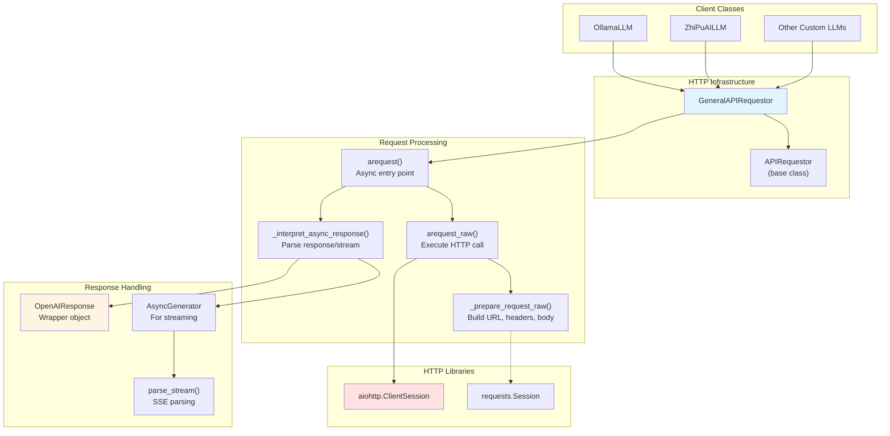
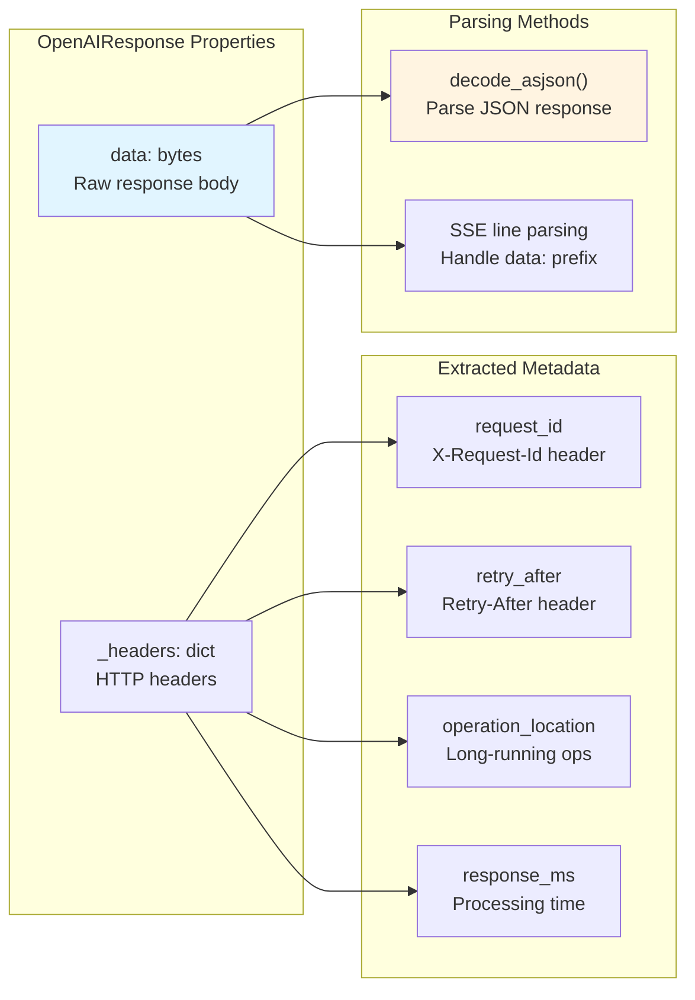
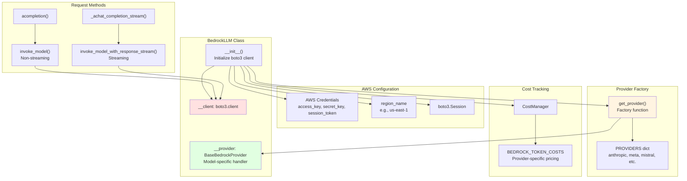
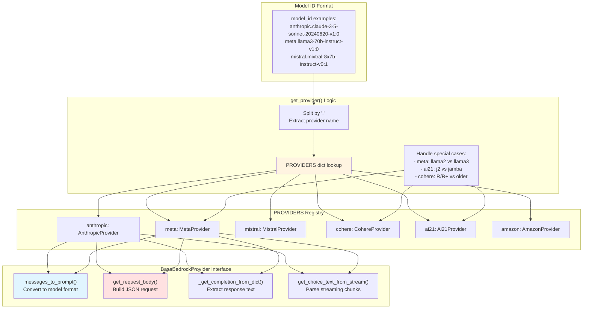
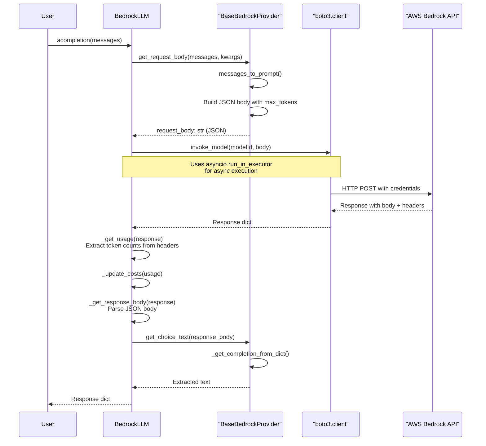

<!-- source: DeepWiki mcp.deepwiki.com · repo FoundationAgents/MetaGPT · page 3.4 AWS Bedrock Integration · fetched 2026-10-30 -->

# HTTP Infrastructure and Bedrock Integration

<details>
<summary>Relevant source files</summary>

The following files were used as context for generating this wiki page:

- [metagpt/configs/llm_config.py](metagpt/configs/llm_config.py)
- [metagpt/provider/__init__.py](metagpt/provider/__init__.py)
- [metagpt/provider/anthropic_api.py](metagpt/provider/anthropic_api.py)
- [metagpt/provider/bedrock/__init__.py](metagpt/provider/bedrock/__init__.py)
- [metagpt/provider/bedrock/base_provider.py](metagpt/provider/bedrock/base_provider.py)
- [metagpt/provider/bedrock/bedrock_provider.py](metagpt/provider/bedrock/bedrock_provider.py)
- [metagpt/provider/bedrock/utils.py](metagpt/provider/bedrock/utils.py)
- [metagpt/provider/bedrock_api.py](metagpt/provider/bedrock_api.py)
- [metagpt/utils/token_counter.py](metagpt/utils/token_counter.py)

</details>


## Purpose and Scope

This document details MetaGPT's HTTP-based LLM integration infrastructure, focusing on two primary components: the `GeneralAPIRequestor` for providers without official Python SDKs, and the AWS Bedrock integration with its provider factory pattern. For general LLM provider architecture and registration mechanisms, see [LLM Provider System](#3.1). For cost tracking across all providers, see [Token Management and Cost Control](#3.2).

The HTTP infrastructure enables MetaGPT to integrate LLM providers that expose HTTP/REST APIs without requiring vendor-specific SDKs, while the Bedrock integration provides a unified interface for AWS Bedrock's diverse model families (Anthropic Claude, Meta Llama, Mistral, Cohere, Amazon Titan, AI21 Jurassic/Jamba).

---

## GeneralAPIRequestor Architecture

### Core HTTP Client

The `GeneralAPIRequestor` class provides a generic HTTP client for LLM providers that lack official Python SDKs or when direct HTTP control is preferred. It extends the legacy `APIRequestor` base class from OpenAI SDK 0.x, adapting its request/response handling for arbitrary HTTP-based LLM APIs.



**Sources:** [metagpt/provider/general_api_requestor.py:37-141](), [metagpt/provider/general_api_base.py:236-563]()

### Request Flow

The request lifecycle follows a multi-stage pipeline:

| Stage | Method | Responsibility |
|-------|--------|----------------|
| 1. Entry | `arequest()` | Initialize aiohttp session context, dispatch to raw request |
| 2. Preparation | `_prepare_request_raw()` | Build absolute URL, validate headers, serialize params to JSON |
| 3. Execution | `arequest_raw()` | Execute HTTP call via `aiohttp.ClientSession.request()` |
| 4. Interpretation | `_interpret_async_response()` | Detect streaming vs non-streaming, wrap in `OpenAIResponse` |
| 5. Cleanup | Context manager | Close aiohttp session after response consumption |

**Example usage pattern:**

```python
# From OllamaLLM implementation
requester = GeneralAPIRequestor(base_url=config.base_url, key=config.api_key)
resp, _, _ = await requester.arequest(
    method="post",
    url="/chat",
    params={"model": self.model, "messages": messages},
    request_timeout=timeout,
    stream=True
)
```

The `_prepare_request_raw()` method [metagpt/provider/general_api_base.py:441-475]() handles URL construction, parameter encoding, and header generation:
- GET/DELETE requests: URL-encodes params into query string
- POST/PUT requests: JSON-encodes params into request body with `Content-Type: application/json`
- Injects authentication headers via `request_headers()` [metagpt/provider/general_api_base.py:389-419]()

**Sources:** [metagpt/provider/general_api_requestor.py:37-141](), [metagpt/provider/general_api_base.py:346-387](), [metagpt/provider/general_api_base.py:522-562]()

### OpenAIResponse Wrapper

The `OpenAIResponse` class [metagpt/provider/general_api_base.py:124-160]() wraps raw HTTP response bytes and headers, providing a consistent interface regardless of the underlying HTTP library (aiohttp or requests):



The `decode_asjson()` method [metagpt/provider/general_api_base.py:153-159]() handles both standard JSON responses and Server-Sent Events (SSE) format by detecting the `data:` prefix and stripping it before JSON parsing.

**Sources:** [metagpt/provider/general_api_base.py:124-160]()

### Streaming Response Handling

MetaGPT supports two streaming formats via content-type detection in `_interpret_async_response()` [metagpt/provider/general_api_requestor.py:100-140]():

1. **Server-Sent Events (SSE)** - `Content-Type: text/event-stream`
2. **Newline-Delimited JSON (NDJSON)** - `Content-Type: application/x-ndjson`

The streaming parser [metagpt/provider/general_api_requestor.py:15-27]() extracts data from SSE frames:

```python
def parse_stream_helper(line: bytes) -> Optional[bytes]:
    if line and line.startswith(b"data:"):
        line = line[len(b"data: "):] if line.startswith(b"data: ") else line[len(b"data:"):]
        if line.strip() == b"[DONE]":
            return None  # End of stream
        return line
    return None
```

When streaming is detected, `_interpret_async_response()` returns an `AsyncGenerator[OpenAIResponse, None]` that yields parsed chunks as they arrive. Non-streaming responses return a single `OpenAIResponse` after reading the full body via `await result.read()`.

**Streaming consumption pattern (from OllamaLLM):**

```python
async for raw_chunk in ag_openai_resp:
    chunk = self.ollama_message.decode(raw_chunk)
    if not chunk.get("done", False):
        content = self.ollama_message.get_choice(chunk)
        collected_content.append(content)
        log_llm_stream(content)
    else:
        usage = self.get_usage(chunk)
```

**Sources:** [metagpt/provider/general_api_requestor.py:15-140](), [metagpt/provider/ollama_api.py:263-280]()

---

## Bedrock Integration Architecture

### BedrockLLM Overview

The `BedrockLLM` class [metagpt/provider/bedrock_api.py:22-170]() provides the entry point for AWS Bedrock, which acts as a meta-provider hosting multiple model families. Unlike direct API providers, Bedrock requires AWS credentials and uses boto3 for authentication.



**Key initialization steps:**

1. **AWS Client Setup** [metagpt/provider/bedrock_api.py:34-45](): Creates boto3 client for `bedrock-runtime` service using credentials from environment variables or `LLMConfig`
2. **Provider Selection** [metagpt/provider/bedrock_api.py:27-29](): Calls `get_provider(model_id)` to instantiate the appropriate model-specific provider
3. **Cost Manager** [metagpt/provider/bedrock_api.py:30](): Initializes `CostManager` with `BEDROCK_TOKEN_COSTS` pricing table

**Sources:** [metagpt/provider/bedrock_api.py:22-45](), [metagpt/utils/token_counter.py:358-405]()

### Provider Factory Pattern

The Bedrock provider factory [metagpt/provider/bedrock/bedrock_provider.py:188-217]() maps model IDs to provider classes, enabling model family-specific request formatting and response parsing:



**Provider selection algorithm** [metagpt/provider/bedrock/bedrock_provider.py:198-217]():

```python
def get_provider(model_id: str, reasoning: bool = False, reasoning_max_token: int = 4000):
    arr = model_id.split(".")
    if len(arr) == 2:
        provider, model_name = arr
    elif len(arr) == 3:
        _, provider, model_name = arr  # Handle us.anthropic.* format
    
    if provider == "meta":
        return MetaProvider(model_name[:6])  # "llama2" or "llama3"
    elif provider == "ai21":
        return Ai21Provider(model_name.split("-")[0])  # "j2" or "jamba"
    elif provider == "cohere":
        return CohereProvider(model_name)  # Distinguish R/R+ models
    return PROVIDERS[provider](reasoning=reasoning, reasoning_max_token=reasoning_max_token)
```

**Sources:** [metagpt/provider/bedrock/bedrock_provider.py:188-217]()

### Model-Specific Providers

Each provider class inherits from `BaseBedrockProvider` [metagpt/provider/bedrock/base_provider.py:6-35]() and customizes request/response handling for its model family:

#### AnthropicProvider

Handles Claude models with extended thinking support for reasoning models:

| Feature | Implementation |
|---------|----------------|
| System messages | Extracted to separate `system` field [metagpt/provider/bedrock/bedrock_provider.py:26-34]() |
| Request format | JSON with `messages`, `anthropic_version`, `system`, `max_tokens` [metagpt/provider/bedrock/bedrock_provider.py:41-50]() |
| Reasoning mode | Adds `thinking` field with budget tokens [metagpt/provider/bedrock/bedrock_provider.py:38-39]() |
| Response parsing | Extracts `content[0].text` or `content[0].thinking` + `content[1].text` [metagpt/provider/bedrock/bedrock_provider.py:52-55]() |
| Streaming | Detects `content_block_delta` events, separates reasoning/text deltas [metagpt/provider/bedrock/bedrock_provider.py:57-76]() |

**Sources:** [metagpt/provider/bedrock/bedrock_provider.py:21-77]()

#### MetaProvider (Llama)

Handles Llama 2/3 with different chat templates:

```python
class MetaProvider(BaseBedrockProvider):
    def __init__(self, llama_version: Literal["llama2", "llama3"]):
        self.llama_version = llama_version
    
    def messages_to_prompt(self, messages: list[dict]):
        if self.llama_version == "llama2":
            return messages_to_prompt_llama2(messages)  # <s>[INST]...[/INST]
        else:
            return messages_to_prompt_llama3(messages)  # <|begin_of_text|>...
```

**Llama 2 template** [metagpt/provider/bedrock/utils.py:105-124]():
```
<s>[INST]<<SYS>>
{system_message}
<</SYS>>

{user_message}[/INST]{assistant_message}
```

**Llama 3 template** [metagpt/provider/bedrock/utils.py:127-140]():
```
<|begin_of_text|><|start_header_id|>system<|end_header_id|>

{system_message}<|eot_id|><|start_header_id|>user<|end_header_id|>

{user_message}<|eot_id|><|start_header_id|>assistant<|end_header_id|>
```

**Sources:** [metagpt/provider/bedrock/bedrock_provider.py:116-132](), [metagpt/provider/bedrock/utils.py:105-140]()

#### CohereProvider

Handles Command and Command R/R+ models with different message formats:

| Model Type | Message Format | Notes |
|------------|---------------|-------|
| Command R/R+ | `[{"role": "USER"/"CHATBOT", "message": "text"}]` | Uses chat_history parameter |
| Command (older) | Plain text: `"user: text\nassistant: text"` | Concatenated string format |

**Sources:** [metagpt/provider/bedrock/bedrock_provider.py:79-113]()

#### Ai21Provider

Supports both Jurassic-2 and Jamba model families:

| Model | max_tokens field | Request format | Response extraction |
|-------|-----------------|----------------|-------------------|
| j2 (Jurassic-2) | `maxTokens` | `{"prompt": "...", "maxTokens": 2048}` | `completions[0].data.text` |
| jamba | `max_tokens` | `{"messages": [...], "max_tokens": 2048}` | `choices[0].message.content` |

**Sources:** [metagpt/provider/bedrock/bedrock_provider.py:134-168]()

### Bedrock Request/Response Flow



**Non-streaming invocation** [metagpt/provider/bedrock_api.py:73-81]():

```python
async def invoke_model(self, request_body: str) -> dict:
    loop = asyncio.get_running_loop()
    response = await loop.run_in_executor(
        None, 
        partial(self.client.invoke_model, modelId=self.model, body=request_body)
    )
    usage = self._get_usage(response)  # Extract from x-amzn-bedrock-*-token-count headers
    self._update_costs(usage, self.model)
    response_body = self._get_response_body(response)
    return response_body
```

**Token usage extraction** [metagpt/provider/bedrock_api.py:161-169]():

```python
def _get_usage(self, response) -> dict[str, int]:
    headers = response.get("ResponseMetadata", {}).get("HTTPHeaders", {})
    prompt_tokens = int(headers.get("x-amzn-bedrock-input-token-count", 0))
    completion_tokens = int(headers.get("x-amzn-bedrock-output-token-count", 0))
    return {"prompt_tokens": prompt_tokens, "completion_tokens": completion_tokens}
```

**Sources:** [metagpt/provider/bedrock_api.py:73-169]()

### Streaming Support in Bedrock

Bedrock streaming uses `invoke_model_with_response_stream()` which returns a `botocore.eventstream.EventStream`. The provider's `get_choice_text_from_stream()` method parses each event:

**AnthropicProvider streaming** [metagpt/provider/bedrock/bedrock_provider.py:57-76]():

```python
def get_choice_text_from_stream(self, event) -> Union[bool, str]:
    rsp_dict = json.loads(event["chunk"]["bytes"])
    if rsp_dict["type"] == "content_block_delta":
        reasoning = False
        delta_type = rsp_dict["delta"]["type"]
        if delta_type == "text_delta":
            completions = rsp_dict["delta"]["text"]
        elif delta_type == "thinking_delta":
            completions = rsp_dict["delta"]["thinking"]
            reasoning = True  # Signal this is reasoning content
        return reasoning, completions
    elif rsp_dict["type"] == "message_stop":
        # Extract final usage from metadata
        self.usage = {
            "prompt_tokens": rsp_dict.get("amazon-bedrock-invocationMetrics", {}).get("inputTokenCount", 0),
            "completion_tokens": rsp_dict.get("amazon-bedrock-invocationMetrics", {}).get("outputTokenCount", 0),
        }
    return False, ""
```

The `BedrockLLM._get_stream_response_body()` [metagpt/provider/bedrock_api.py:143-159]() consumes the event stream in a thread executor and separates reasoning content from regular content:

```python
async def _get_stream_response_body(self, stream_response) -> List[str]:
    def collect_content() -> str:
        collected_content = []
        collected_reasoning_content = []
        for event in stream_response["body"]:
            reasoning, chunk_text = self.__provider.get_choice_text_from_stream(event)
            if reasoning:
                collected_reasoning_content.append(chunk_text)
            else:
                collected_content.append(chunk_text)
                log_llm_stream(chunk_text)
        if collected_reasoning_content:
            self.reasoning_content = "".join(collected_reasoning_content)
        return collected_content
    
    loop = asyncio.get_running_loop()
    return await loop.run_in_executor(None, collect_content)
```

**Model streaming support matrix** [metagpt/provider/bedrock/utils.py:4-100]():

| Model Family | Streaming Support | max_tokens |
|-------------|------------------|------------|
| Claude 3/3.5/3.7 | ✅ Yes | 4096-131072 |
| Llama 2/3/3.1/3.2 | ✅ Yes | 2048 |
| Mistral | ✅ Yes | 4096-8192 |
| Command R/R+ | ✅ Yes | 4096 |
| Titan Text | ✅ Yes | 3072-8192 |
| Jamba | ✅ Yes | 4096 |
| Jurassic-2 Mid/Ultra | ❌ No | 8191 |

**Sources:** [metagpt/provider/bedrock_api.py:83-159](), [metagpt/provider/bedrock/bedrock_provider.py:57-76](), [metagpt/provider/bedrock/utils.py:4-100]()

### Reasoning Model Support

Both `BedrockLLM` and individual providers support extended thinking for reasoning models like Claude 3.7 Sonnet with thinking mode:

**Configuration** [metagpt/configs/llm_config.py:112-114]():
```python
reasoning: bool = False
reasoning_max_token: int = 4000  # Budget for reasoning tokens
```

**AnthropicProvider reasoning injection** [metagpt/provider/bedrock/bedrock_provider.py:37-39]():
```python
if self.reasoning:
    generate_kwargs["temperature"] = 1  # Required for thinking mode
    generate_kwargs["thinking"] = {"type": "enabled", "budget_tokens": self.reasoning_max_token}
```

**Response separation** [metagpt/provider/bedrock/bedrock_provider.py:52-55]():
```python
def _get_completion_from_dict(self, rsp_dict: dict) -> dict[str, Tuple[str, str]]:
    if self.reasoning:
        return {
            "reasoning_content": rsp_dict["content"][0]["thinking"], 
            "content": rsp_dict["content"][1]["text"]
        }
    return rsp_dict["content"][0]["text"]
```

The reasoning content is stored separately in `BedrockLLM.reasoning_content` [metagpt/provider/bedrock_api.py:110-112]() for inspection while the main content flows through normal channels.

**Sources:** [metagpt/provider/bedrock_api.py:27-29,107-112](), [metagpt/provider/bedrock/bedrock_provider.py:37-55](), [metagpt/configs/llm_config.py:112-114]()

---

## Usage Patterns

### Integrating a New HTTP-Based Provider

To add a provider without an official SDK:

1. **Create provider class inheriting from `BaseLLM`** [metagpt/provider/ollama_api.py:190-202]():
```python
@register_provider(LLMType.YOUR_PROVIDER)
class YourProviderLLM(BaseLLM):
    def __init__(self, config: LLMConfig):
        self.client = GeneralAPIRequestor(base_url=config.base_url, key=config.api_key)
        self.config = config
        self.model = config.model
        self.http_method = "post"
```

2. **Implement `_achat_completion()`** [metagpt/provider/ollama_api.py:222-234]():
```python
async def _achat_completion(self, messages: list[dict], timeout: int = USE_CONFIG_TIMEOUT) -> dict:
    resp, _, _ = await self.client.arequest(
        method=self.http_method,
        url="/your/api/endpoint",
        params=self.format_request(messages),
        request_timeout=self.get_timeout(timeout),
    )
    if isinstance(resp, AsyncGenerator):
        return await self._processing_openai_response_async_generator(resp)
    elif isinstance(resp, OpenAIResponse):
        return self._processing_openai_response(resp)
```

3. **Handle response format** [metagpt/provider/ollama_api.py:257-261]():
```python
def _processing_openai_response(self, openai_resp: OpenAIResponse):
    resp = json.loads(openai_resp.data.decode("utf-8"))
    usage = self.get_usage(resp)
    self._update_costs(usage)
    return resp
```

**Sources:** [metagpt/provider/ollama_api.py:190-281](), [metagpt/provider/zhipuai_api.py:26-90]()

### Bedrock Configuration

Configure Bedrock in `config2.yaml`:

```yaml
llm:
  api_type: bedrock
  model: anthropic.claude-3-5-sonnet-20240620-v1:0
  region_name: us-east-1
  # Credentials from AWS_ACCESS_KEY_ID, AWS_SECRET_ACCESS_KEY env vars
  # Or specify directly:
  access_key: YOUR_ACCESS_KEY
  secret_key: YOUR_SECRET_KEY
  max_token: 4096
  temperature: 0.3
  
  # For reasoning models
  reasoning: true
  reasoning_max_token: 4000
```

**Credential resolution order** [metagpt/provider/bedrock_api.py:37-42]():
1. Environment variables (`AWS_ACCESS_KEY_ID`, `AWS_SECRET_ACCESS_KEY`, `AWS_SESSION_TOKEN`, `AWS_DEFAULT_REGION`)
2. LLMConfig fields (`access_key`, `secret_key`, `session_token`, `region_name`)

**List available models** [metagpt/provider/bedrock_api.py:55-71]():
```python
bedrock_llm = BedrockLLM(config)
bedrock_llm.list_models()
# Output:
# ai21.jamba-instruct-v1:0                    Support Streaming:True
# anthropic.claude-3-5-sonnet-20240620-v1:0   Support Streaming:True
# meta.llama3-70b-instruct-v1:0               Support Streaming:True
# ...
```

**Sources:** [metagpt/provider/bedrock_api.py:23-71](), [metagpt/configs/llm_config.py:97-114]()

---

