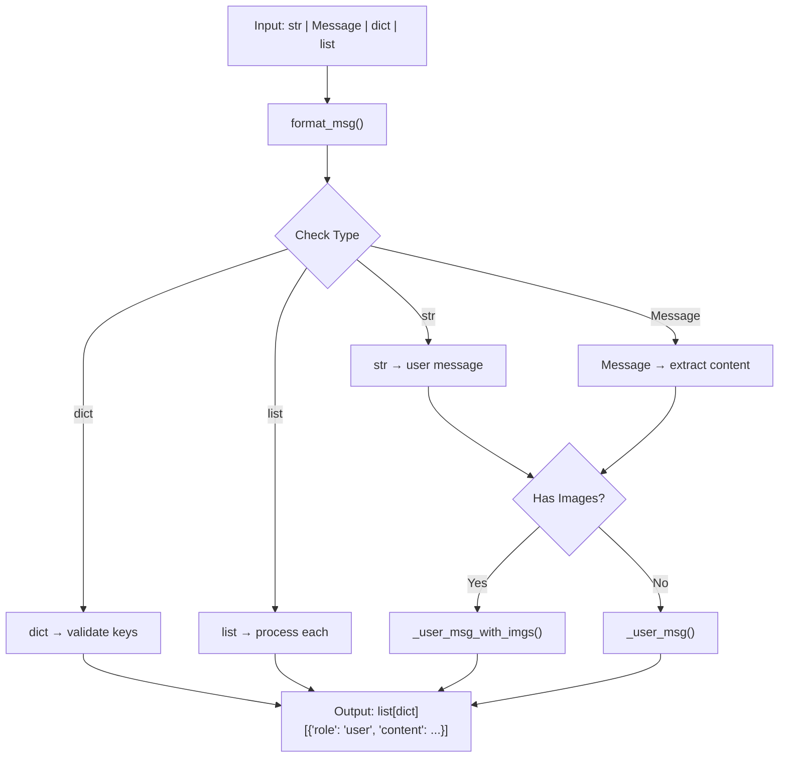
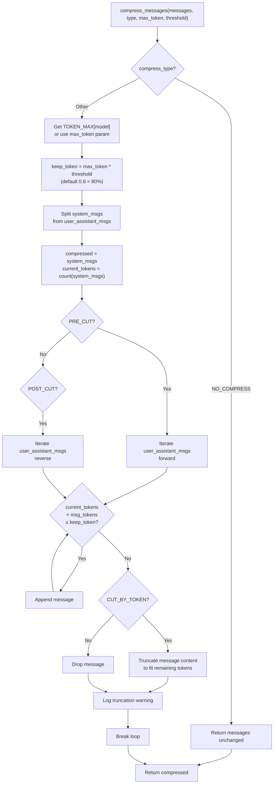
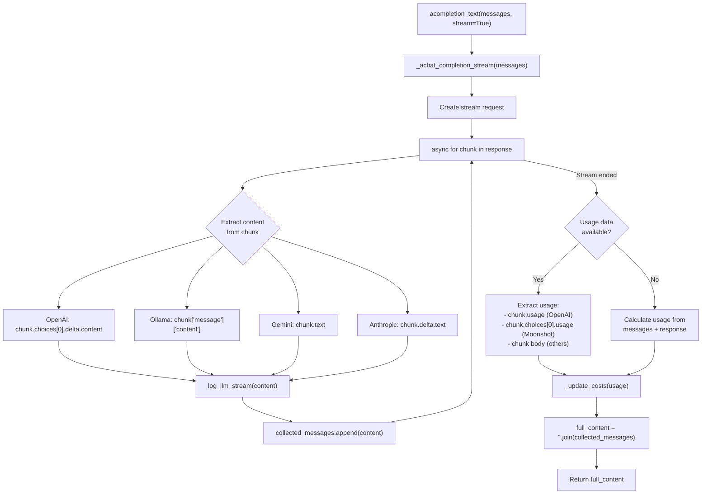
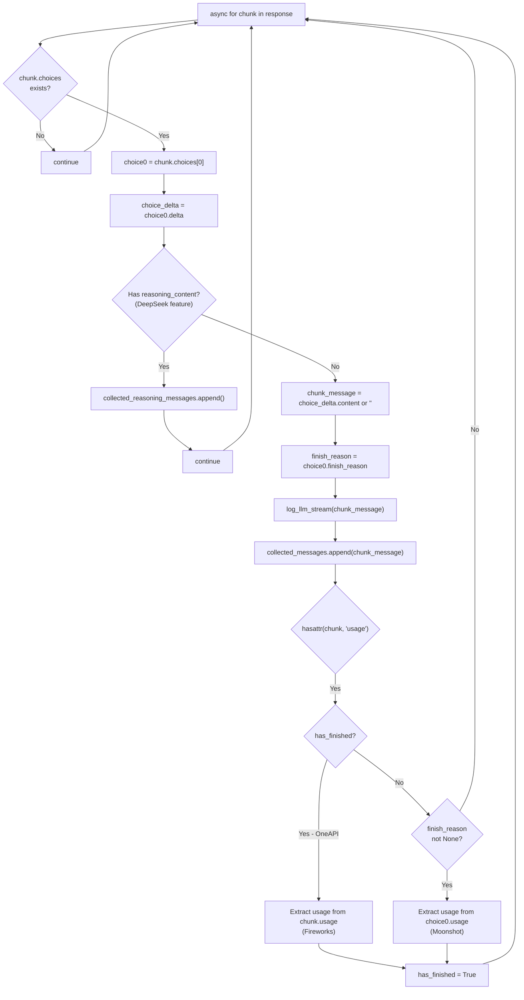
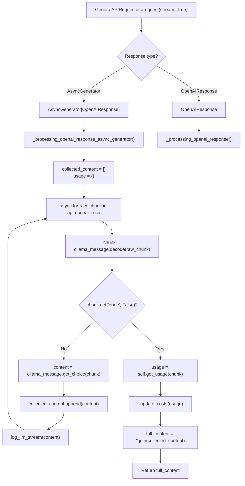
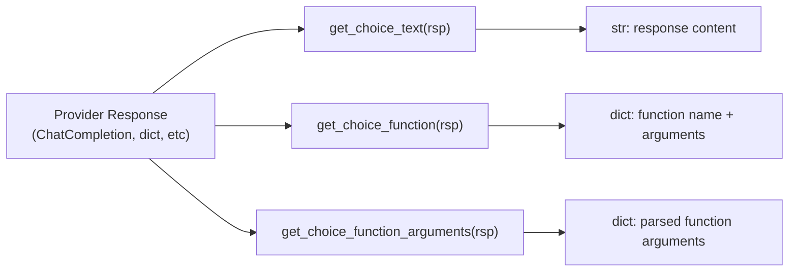
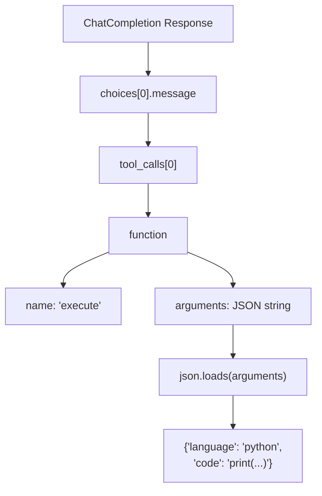
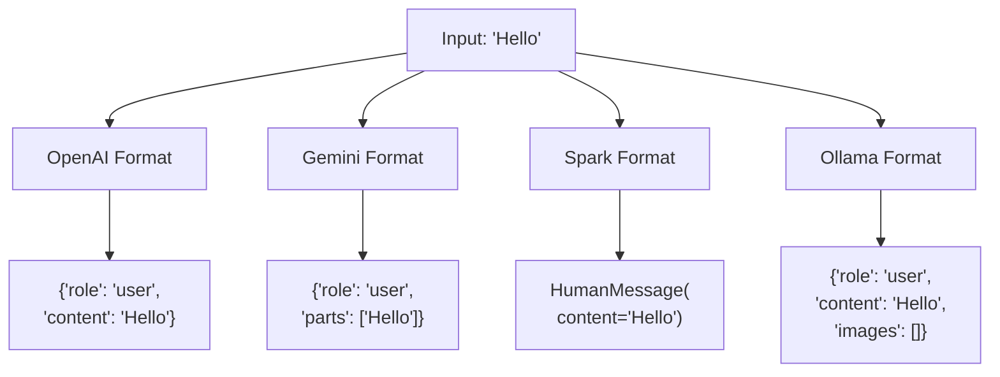
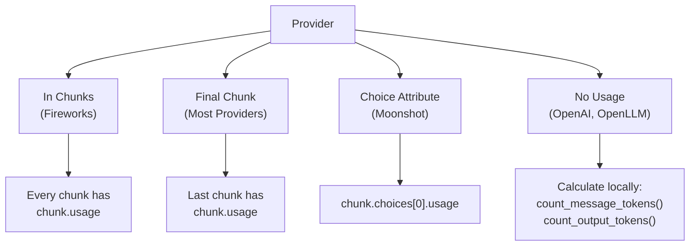

<!-- source: DeepWiki mcp.deepwiki.com · repo FoundationAgents/MetaGPT · page 3.6 Message Processing and Streaming · fetched 2026-10-30 -->

# Message Processing and Streaming

<details>
<summary>Relevant source files</summary>

The following files were used as context for generating this wiki page:

- [examples/llm_vision.py](examples/llm_vision.py)
- [metagpt/provider/base_llm.py](metagpt/provider/base_llm.py)
- [metagpt/provider/dashscope_api.py](metagpt/provider/dashscope_api.py)
- [metagpt/provider/general_api_base.py](metagpt/provider/general_api_base.py)
- [metagpt/provider/general_api_requestor.py](metagpt/provider/general_api_requestor.py)
- [metagpt/provider/google_gemini_api.py](metagpt/provider/google_gemini_api.py)
- [metagpt/provider/human_provider.py](metagpt/provider/human_provider.py)
- [metagpt/provider/ollama_api.py](metagpt/provider/ollama_api.py)
- [metagpt/provider/openai_api.py](metagpt/provider/openai_api.py)
- [metagpt/provider/qianfan_api.py](metagpt/provider/qianfan_api.py)
- [metagpt/provider/spark_api.py](metagpt/provider/spark_api.py)
- [metagpt/provider/zhipuai/async_sse_client.py](metagpt/provider/zhipuai/async_sse_client.py)
- [metagpt/provider/zhipuai/zhipu_model_api.py](metagpt/provider/zhipuai/zhipu_model_api.py)
- [metagpt/provider/zhipuai_api.py](metagpt/provider/zhipuai_api.py)
- [tests/metagpt/provider/mock_llm_config.py](tests/metagpt/provider/mock_llm_config.py)
- [tests/metagpt/provider/req_resp_const.py](tests/metagpt/provider/req_resp_const.py)
- [tests/metagpt/provider/test_anthropic_api.py](tests/metagpt/provider/test_anthropic_api.py)
- [tests/metagpt/provider/test_base_llm.py](tests/metagpt/provider/test_base_llm.py)
- [tests/metagpt/provider/test_bedrock_api.py](tests/metagpt/provider/test_bedrock_api.py)
- [tests/metagpt/provider/test_google_gemini_api.py](tests/metagpt/provider/test_google_gemini_api.py)
- [tests/metagpt/provider/test_ollama_api.py](tests/metagpt/provider/test_ollama_api.py)
- [tests/metagpt/provider/test_openai.py](tests/metagpt/provider/test_openai.py)
- [tests/metagpt/provider/test_qianfan_api.py](tests/metagpt/provider/test_qianfan_api.py)
- [tests/metagpt/provider/test_spark_api.py](tests/metagpt/provider/test_spark_api.py)
- [tests/metagpt/provider/test_zhipuai_api.py](tests/metagpt/provider/test_zhipuai_api.py)

</details>


This document describes the message processing pipeline in MetaGPT's LLM provider abstraction layer, covering message format normalization, compression strategies, streaming response handling, and response parsing. For information about the provider registry and LLM configuration, see [3.1](#3.1). For token counting and cost management, see [3.5](#3.5).

## Purpose and Scope

The message processing system standardizes how messages flow through different LLM providers, handling:
- Conversion of various input formats to provider-specific message schemas
- Token-aware message compression when context limits are exceeded
- Streaming response collection and aggregation
- Response parsing and structured output extraction
- Multi-modal content (text + images) processing

---

## Message Format Normalization

### Overview

The `format_msg` method in `BaseLLM` converts diverse input types into the standardized `list[dict]` format expected by LLM APIs.

**Supported Input Types:**
- `str`: Single user message
- `dict`: Pre-formatted message with "role" and "content" keys
- `Message` object: MetaGPT schema object with metadata
- `list` of any of the above

### Message Format Normalization Flow



Sources: [metagpt/provider/base_llm.py:94-116]()

### Implementation Details

**Basic Message Construction:**

| Method | Purpose | Output Format |
|--------|---------|---------------|
| `_user_msg(msg, images)` | User message with optional images | `{"role": "user", "content": ...}` |
| `_assistant_msg(msg)` | Assistant response | `{"role": "assistant", "content": msg}` |
| `_system_msg(msg)` | System prompt | `{"role": "system", "content": msg}` |

**Multi-Modal Message Handling:**

When images are present, `_user_msg_with_imgs` creates a structured content array:

```python
{
    "role": "user",
    "content": [
        {"type": "text", "text": msg},
        {"type": "image_url", "image_url": {"url": "data:image/jpeg;base64,..."}}
    ]
}
```

The method supports:
- Single image (string) or multiple images (list)
- HTTP(S) URLs or base64-encoded data
- Automatic URL prefix handling for base64 data

Sources: [metagpt/provider/base_llm.py:64-83]()

### Provider-Specific Overrides

Different providers override format methods to match their API schemas:

**Gemini Format:**
```python
# Gemini uses "parts" instead of "content"
{"role": "user", "parts": [msg]}  # user
{"role": "model", "parts": [msg]}  # assistant
```

**Spark Format:**
```python
# Uses Spark SDK's message types
HumanMessage(content=msg)
AIMessage(content=msg)
SystemMessage(content=msg)
```

Sources: [metagpt/provider/google_gemini_api.py:64-94](), [metagpt/provider/spark_api.py:44-51]()

### Base64 Image Masking

For logging purposes, `mask_base64_data` replaces long base64 strings with placeholders:

```python
# Original
{"type": "image_url", "image_url": {"url": "data:image/jpeg;base64,iVBORw0KG..."}}

# Masked for logging
{"type": "image_url", "image_url": {"url": "<Image base64 data has been omitted>"}}
```

Sources: [metagpt/provider/base_llm.py:147-177]()

---

## Message Compression Strategies

### Overview

The `compress_messages` method automatically truncates message history when token counts exceed model context limits. This enables long-running conversations without manual context management.

### Compression Types

MetaGPT supports four compression strategies via `CompressType` enum:

| Type | Behavior | Use Case |
|------|----------|----------|
| `NO_COMPRESS` | No compression | Default for short contexts |
| `PRE_CUT_BY_TOKEN` | Keep earliest messages, truncate last | Preserve conversation start |
| `PRE_CUT_BY_MSG` | Keep earliest messages, drop last | Preserve conversation start |
| `POST_CUT_BY_TOKEN` | Keep latest messages, truncate first | Preserve recent context |
| `POST_CUT_BY_MSG` | Keep latest messages, drop first | Preserve recent context |

### Compression Algorithm



Sources: [metagpt/provider/base_llm.py:340-412]()

### Implementation Details

**Step 1: Token Limit Calculation**

```python
max_token = TOKEN_MAX.get(self.model, max_token)  # From TOKEN_MAX dict or parameter
keep_token = int(max_token * threshold)           # Reserve 20% for completion by default
```

**Step 2: System Message Preservation**

System messages are always kept and exempt from compression:
```python
system_msgs = [msg for msg in messages if msg["role"] == "system"]
user_assistant_msgs = [msg for msg in messages if msg["role"] != "system"]
compressed.extend(system_msgs)
```

**Step 3: Compression Loop**

For `POST_CUT` (most common):
```python
for i, msg in enumerate(reversed(user_assistant_msgs)):
    token_count = self.count_tokens([msg])
    if current_token_count + token_count <= keep_token:
        compressed.insert(len(system_msgs), msg)  # Insert after system messages
        current_token_count += token_count
    else:
        # Handle truncation or drop
        break
```

**Step 4: Truncation vs. Dropping**

- `*_BY_TOKEN`: Truncate the last message to fit exactly within limit
- `*_BY_MSG`: Drop the entire message if it doesn't fit

Sources: [metagpt/provider/base_llm.py:376-410]()

### Token Counting

Token counting varies by provider:

**Accurate Counting (OpenAI):**
```python
from metagpt.utils.token_counter import count_message_tokens
tokens = count_message_tokens(messages, model="gpt-4o")
```

**Heuristic Counting (Other Providers):**
```python
# Fallback in BaseLLM: ~0.5 tokens per character
sum([int(len(msg["content"]) * 0.5) for msg in messages])
```

Sources: [metagpt/provider/base_llm.py:332-338](), [metagpt/provider/openai_api.py:269-280]()

### Usage Example

```python
# Configured via LLMConfig
llm.config.compress_type = CompressType.POST_CUT_BY_TOKEN

# Automatic compression during aask
compressed_messages = llm.compress_messages(
    messages, 
    compress_type=llm.config.compress_type
)
rsp = await llm.acompletion_text(compressed_messages)
```

Sources: [metagpt/provider/base_llm.py:207](), [tests/metagpt/provider/test_openai.py:203-212]()

---

## Streaming Response Handling

### Overview

Streaming allows real-time token-by-token display of LLM responses. All providers implement `_achat_completion_stream` to handle streaming responses uniformly.

### Streaming Architecture



Sources: [metagpt/provider/openai_api.py:92-136](), [metagpt/provider/ollama_api.py:242-280](), [metagpt/provider/google_gemini_api.py:139-157]()

### OpenAI Streaming Implementation

The OpenAI provider handles multiple streaming variants and edge cases:

**Stream Response Processing:**



Sources: [metagpt/provider/openai_api.py:92-136]()

**Key Features:**

1. **DeepSeek Reasoning Content:** Lines 106-108 handle special `reasoning_content` field for DeepSeek models that support chain-of-thought reasoning.

2. **Multiple Usage Formats:**
   - **Fireworks:** `chunk.usage` as dict or CompletionUsage object (lines 116-121)
   - **Moonshot:** `choice0.usage` attribute (lines 122-124)
   - **OneAPI:** Separate usage chunk after finish (lines 114-117)
   - **OpenAI/OpenLLM:** No usage data, calculate locally (lines 131-133)

3. **Empty Content Handling:** Uses `content or ""` to handle None values (line 109)

4. **Finish Reason Detection:** Tracks when streaming completes (line 110)

Sources: [metagpt/provider/openai_api.py:100-133]()

### Ollama Streaming Implementation

Ollama uses a custom message handling system with provider-specific formats:

**Message Processing Pipeline:**



Sources: [metagpt/provider/ollama_api.py:242-280]()

**Ollama Message Types:**

Ollama supports multiple API endpoints with different message formats:

| API Type | Endpoint | Message Format |
|----------|----------|----------------|
| CHAT | `/chat` | `{"role": "user", "content": ..., "images": [...]}` |
| GENERATE | `/generate` | `{"prompt": "...", "images": [...]}` |
| EMBEDDINGS | `/embeddings` | `{"prompt": "..."}` |
| EMBED | `/embed` | `{"input": [...]}` |

Each type has a dedicated class inheriting from `OllamaMessageBase`:
- `OllamaMessageChat`
- `OllamaMessageGenerate`
- `OllamaMessageEmbeddings`
- `OllamaMessageEmbed`

Sources: [metagpt/provider/ollama_api.py:18-187]()

### Gemini Streaming Implementation

Gemini uses Google's GenerativeAI SDK with custom async handling:

**Stream Processing:**

```python
resp = await self.llm.generate_content_async(**self._const_kwargs(messages, stream=True))
collected_content = []
async for chunk in resp:
    try:
        content = chunk.text
    except Exception as e:
        logger.warning(f"messages: {messages}\nerrors: {e}\n{BlockedPromptException(str(chunk))}")
        raise BlockedPromptException(str(chunk))
    log_llm_stream(content)
    collected_content.append(content)
```

**Key Features:**
- Exception handling for blocked prompts
- Uses `chunk.text` to extract content
- Post-stream usage calculation via `aget_usage`

Sources: [metagpt/provider/google_gemini_api.py:139-157]()

### Stream Protocol Handling

The `GeneralAPIRequestor` provides low-level stream parsing:

**SSE (Server-Sent Events) Parsing:**

```python
def parse_stream_helper(line: bytes) -> Optional[bytes]:
    if line and line.startswith(b"data:"):
        if line.startswith(b"data: "):
            line = line[len(b"data: "):]
        else:
            line = line[len(b"data:"):]
        if line.strip() == b"[DONE]":
            return None  # End of stream
        else:
            return line
    return None
```

**Content Type Detection:**

```python
content_type = result.headers.get("Content-Type", "")
if stream and ("text/event-stream" in content_type or "application/x-ndjson" in content_type):
    # Return generator
    return (
        self._interpret_response_line(line, result.status, result.headers, stream=True)
        async for line in result.content
    ), True
```

Sources: [metagpt/provider/general_api_requestor.py:15-27](), [metagpt/provider/general_api_requestor.py:113-123]()

---

## Response Parsing

### Overview

Response parsing extracts structured data from LLM provider responses. Each provider implements format-specific parsers while adhering to common interfaces.

### Standard Response Methods



Sources: [metagpt/provider/base_llm.py:265-314]()

### Text Extraction

**OpenAI Format:**
```python
def get_choice_text(self, rsp: ChatCompletion) -> str:
    return rsp.choices[0].message.content if rsp.choices else ""
```

**Dictionary Format (Base):**
```python
def get_choice_text(self, rsp: dict) -> str:
    message = rsp.get("choices")[0]["message"]
    if "reasoning_content" in message:
        self.reasoning_content = message["reasoning_content"]
    return message["content"]
```

**Provider-Specific:**
- **Gemini:** `resp.text` (direct attribute access)
- **QianFan:** `resp.get("result", "")`
- **DashScope:** `output.get("choices", [{}])[0].get("message", {}).get("content", "")`
- **Ollama:** `ollama_message.get_choice(rsp)` (delegated to message handler)

Sources: [metagpt/provider/openai_api.py:265-267](), [metagpt/provider/base_llm.py:265-270](), [metagpt/provider/google_gemini_api.py:105-106](), [metagpt/provider/qianfan_api.py:107-108](), [metagpt/provider/dashscope_api.py:200-201](), [metagpt/provider/ollama_api.py:236-237]()

### Function Call Parsing

Function calling enables structured output extraction for code generation and tool use.

**Function Call Structure:**



Sources: [metagpt/provider/openai_api.py:230-263]()

**Implementation:**

```python
def get_choice_function_arguments(self, rsp: ChatCompletion) -> dict:
    message = rsp.choices[0].message
    if (
        message.tool_calls is not None
        and message.tool_calls[0].function is not None
        and message.tool_calls[0].function.arguments is not None
    ):
        try:
            return json.loads(message.tool_calls[0].function.arguments, strict=False)
        except json.decoder.JSONDecodeError as e:
            logger.error(f"Got JSONDecodeError for \n{message.tool_calls[0].function.arguments}, {str(e)}")
            return self._parse_arguments(message.tool_calls[0].function.arguments)
    # Fallback: content as code
    elif message.tool_calls is None and message.content is not None:
        if message.content.startswith("```") and message.content.endswith("```"):
            code = CodeParser.parse_code(text=message.content)
            return {"language": "python", "code": code}
        return {"language": "markdown", "code": self.get_choice_text(rsp)}
```

**Fallback Parsing:**

When JSON parsing fails, `_parse_arguments` uses regex:

```python
def _parse_arguments(self, arguments: str) -> dict:
    # Match language
    language_pattern = re.compile(r'[\"\']?language[\"\']?\s*:\s*["\']([^"\']+?)["\']', re.DOTALL)
    language_match = language_pattern.search(arguments)
    language_value = language_match.group(1) if language_match else "python"
    
    # Match code (handles quotes/backticks)
    code_pattern = r'(["\'`]{3}|["\'`])([\s\S]*?)\1'
    code_value = re.findall(code_pattern, arguments)[-1][-1]
    
    return {"language": language_value, "code": code_value}
```

Sources: [metagpt/provider/openai_api.py:205-227]()

### Response Format Table

| Provider | Text Method | Function Method | Special Fields |
|----------|-------------|-----------------|----------------|
| OpenAI | `rsp.choices[0].message.content` | `tool_calls[0].function.arguments` | `reasoning_content` (DeepSeek) |
| Gemini | `rsp.text` | N/A | N/A |
| Anthropic | `rsp.content[0].text` | N/A | N/A |
| QianFan | `rsp.get("result")` | N/A | N/A |
| DashScope | `output.choices[0].message.content` | N/A | N/A |
| ZhiPuAI | `rsp["choices"][0]["message"]["content"]` | N/A | N/A |
| Spark | `rsp.generations[0][0].text` | N/A | N/A |
| Ollama | `ollama_message.get_choice()` | N/A | Delegated to message handler |

Sources: [metagpt/provider/openai_api.py:265-267](), [metagpt/provider/google_gemini_api.py:105-106](), [metagpt/provider/qianfan_api.py:107-108](), [metagpt/provider/dashscope_api.py:200-201](), [metagpt/provider/zhipuai_api.py:63-67](), [metagpt/provider/spark_api.py:53-54](), [metagpt/provider/ollama_api.py:236-237]()

---

## Provider-Specific Message Formats

### Overview

Different LLM providers require different message schemas. MetaGPT abstracts these differences through provider-specific implementations of format methods.

### Message Format Comparison



Sources: [metagpt/provider/base_llm.py:64-89](), [metagpt/provider/google_gemini_api.py:64-73](), [metagpt/provider/spark_api.py:44-51](), [metagpt/provider/ollama_api.py:83-104]()

### OpenAI/Compatible Format

The standard format used by OpenAI and compatible providers (Fireworks, Moonshot, Mistral, etc.):

**Text Message:**
```python
{"role": "user", "content": "Hello"}
{"role": "assistant", "content": "Hi there"}
{"role": "system", "content": "You are a helpful assistant."}
```

**Multi-Modal Message:**
```python
{
    "role": "user",
    "content": [
        {"type": "text", "text": "What's in this image?"},
        {
            "type": "image_url",
            "image_url": {
                "url": "data:image/jpeg;base64,/9j/4AAQSkZJRg..."
            }
        }
    ]
}
```

Sources: [metagpt/provider/base_llm.py:64-83](), [metagpt/provider/openai_api.py:58-328]()

### Gemini Format

Google Gemini uses "parts" instead of "content":

**Format Methods:**
```python
def _user_msg(self, msg: str, images=None) -> dict:
    return {"role": "user", "parts": [msg]}

def _assistant_msg(self, msg: str) -> dict:
    return {"role": "model", "parts": [msg]}

def _system_msg(self, msg: str) -> dict:
    return {"role": "user", "parts": [msg]}  # No native system role
```

**Message Validation:**
```python
def format_msg(self, messages):
    # ...
    elif isinstance(msg, dict):
        assert set(msg.keys()) == set(["role", "parts"])
        processed_messages.append(msg)
```

**Role Mapping:**
- User → "user"
- Assistant → "model" (not "assistant")
- System → "user" (no native support)

Sources: [metagpt/provider/google_gemini_api.py:64-99]()

### Spark Format

iFlytek Spark uses SDK-specific message objects:

**SDK Message Types:**
```python
from sparkai.core.messages import HumanMessage, AIMessage, SystemMessage

def _user_msg(self, msg: str, **kwargs) -> HumanMessage:
    return _convert_to_message(msg)

def _assistant_msg(self, msg: str) -> AIMessage:
    return _convert_to_message(msg)

def _system_msg(self, msg: str) -> SystemMessage:
    return _convert_to_message(msg)
```

**Conversion:**
```python
# Before API call
messages = convert_to_messages(messages)  # List[dict] → List[BaseMessage]

# In response
rsp.generations[0][0].text  # Extract text from LLMResult
```

Sources: [metagpt/provider/spark_api.py:44-95]()

### Ollama Format

Ollama supports multiple API types with different formats:

**CHAT API (default):**
```python
{
    "model": "llama2",
    "messages": [
        {
            "role": "user",
            "content": "Hello",
            "images": ["base64_data"]  # Optional
        }
    ]
}
```

**GENERATE API:**
```python
{
    "model": "llama2",
    "prompt": "Hello",
    "images": ["base64_data"]  # Optional
}
```

**Message Handler Selection:**

```python
class OllamaLLM(BaseLLM):
    @property
    def _llama_api_inuse(self) -> OllamaMessageAPI:
        return OllamaMessageAPI.CHAT  # Or GENERATE, EMBED, EMBEDDINGS
    
    def __init_ollama(self, config: LLMConfig):
        ollama_message = OllamaMessageMeta.get_message(self._llama_api_inuse)
        self.ollama_message = ollama_message(model=self.model, **self._llama_api_kwargs)
```

**Image Handling:**

```python
def _parse_input_msg(self, msg: dict) -> Tuple[Optional[str], Optional[str]]:
    if msg["type"] == "text":
        return msg["text"], None
    elif msg["type"] == "image_url":
        # Strip "data:image/jpeg;base64," prefix
        return None, msg["image_url"]["url"][len("data:image/jpeg;base64,"):]
```

Sources: [metagpt/provider/ollama_api.py:18-333]()

### QianFan Format

Baidu QianFan uses standard format but with special system prompt handling:

**System Prompt Extraction:**

```python
def _const_kwargs(self, messages: list[dict], stream: bool = False) -> dict:
    kwargs = {"messages": messages, "stream": stream}
    
    if self.use_system_prompt:  # Only some models support
        if messages[0]["role"] == "system":
            kwargs["messages"] = messages[1:]  # Remove from messages
            kwargs["system"] = messages[0]["content"]  # Pass separately
    
    return kwargs
```

**Supported Models:**
- ERNIE-Bot-4
- ERNIE-Bot-8k
- ERNIE-Bot
- ERNIE-Bot-turbo
- ERNIE-Speed
- EB-turbo-AppBuilder

Sources: [metagpt/provider/qianfan_api.py:81-99]()

### DashScope Format

Alibaba DashScope follows OpenAI format but with model-specific system prompt support:

**System Prompt Check:**

```python
def __init_dashscope(self):
    support_system_models = [
        "qwen-",      # All Qwen models
        "llama2-",    # All Llama2 models
        "baichuan2-7b-chat-v1",
        "chatglm3-6b",
    ]
    for support_model in support_system_models:
        if support_model in self.model:
            self.use_system_prompt = True
```

Sources: [metagpt/provider/dashscope_api.py:171-179]()

---

## Usage Tracking in Streaming

### Overview

Usage tracking in streaming mode is challenging because providers report token counts at different points in the stream. MetaGPT handles multiple patterns uniformly.

### Usage Reporting Patterns



Sources: [metagpt/provider/openai_api.py:113-133]()

### Usage Extraction Logic

**OpenAI Streaming Usage Handling:**

```python
async for chunk in response:
    # ... extract content ...
    
    chunk_has_usage = hasattr(chunk, "usage") and chunk.usage
    
    if has_finished:
        # Handle OneAPI pattern: usage chunk AFTER finish
        if chunk_has_usage:
            usage = CompletionUsage(**chunk.usage) if isinstance(chunk.usage, dict) else chunk.usage
    
    if finish_reason:
        if chunk_has_usage:
            # Fireworks: usage in chunk
            usage = CompletionUsage(**chunk.usage) if isinstance(chunk.usage, dict) else chunk.usage
        elif hasattr(choice0, "usage"):
            # Moonshot: usage in choice
            usage = CompletionUsage(**choice0.usage)
        has_finished = True

# After loop: fallback calculation
if not usage:
    usage = self._calc_usage(messages, full_reply_content)
```

**Local Calculation:**

```python
def _calc_usage(self, messages: list[dict], rsp: str) -> CompletionUsage:
    usage = CompletionUsage(prompt_tokens=0, completion_tokens=0, total_tokens=0)
    if not self.config.calc_usage:
        return usage
    
    try:
        usage.prompt_tokens = count_message_tokens(messages, self.pricing_plan)
        usage.completion_tokens = count_output_tokens(rsp, self.pricing_plan)
    except Exception as e:
        logger.warning(f"usage calculation failed: {e}")
    
    return usage
```

Sources: [metagpt/provider/openai_api.py:113-136](), [metagpt/provider/openai_api.py:269-280]()

### Provider-Specific Usage Extraction

**Ollama:**
```python
def get_usage(self, resp: dict) -> dict:
    return {
        "prompt_tokens": resp.get("prompt_eval_count", 0),
        "completion_tokens": resp.get("eval_count", 0)
    }

# In stream: usage in final chunk
async for chunk in response:
    if chunk.get("done", False):
        usage = self.get_usage(chunk)
```

**Gemini:**
```python
# Post-stream calculation
async def aget_usage(self, messages: list[dict], resp_text: str) -> dict:
    req_text = messages[-1]["parts"][0] if messages else ""
    prompt_resp = await self.llm.count_tokens_async(
        contents={"role": "user", "parts": [{"text": req_text}]}
    )
    completion_resp = await self.llm.count_tokens_async(
        contents={"role": "model", "parts": [{"text": resp_text}]}
    )
    return {
        "prompt_tokens": prompt_resp.total_tokens,
        "completion_tokens": completion_resp.total_tokens
    }
```

**Spark:**
```python
def get_usage(self, response: LLMResult):
    message = response.generations[0][0].message
    if hasattr(message, "additional_kwargs"):
        return message.additional_kwargs.get("token_usage", {})
    return {}

# In stream: usage in final chunk
async for chunk in response:
    if hasattr(chunk, "additional_kwargs"):
        usage = chunk.additional_kwargs.get("token_usage", {})
```

Sources: [metagpt/provider/ollama_api.py:219-220](), [metagpt/provider/google_gemini_api.py:115-120](), [metagpt/provider/spark_api.py:56-61]()

### Cost Update

After usage extraction, all providers call `_update_costs`:

```python
def _update_costs(self, usage: Union[dict, BaseModel], model: str = None, local_calc_usage: bool = True):
    calc_usage = self.config.calc_usage and local_calc_usage
    model = model or self.pricing_plan or self.model
    usage = usage.model_dump() if isinstance(usage, BaseModel) else usage
    
    if calc_usage and self.cost_manager and usage:
        try:
            prompt_tokens = int(usage.get("prompt_tokens", 0))
            completion_tokens = int(usage.get("completion_tokens", 0))
            self.cost_manager.update_cost(prompt_tokens, completion_tokens, model)
        except Exception as e:
            logger.error(f"{self.__class__.__name__} updates costs failed! exp: {e}")
```

This enables unified cost tracking across all providers. For more on cost management, see [3.5](#3.5).

Sources: [metagpt/provider/base_llm.py:124-140]()

---

## Stream Logging

### Overview

MetaGPT provides unified logging for streaming responses via the `log_llm_stream` utility function.

### Implementation

```python
from metagpt.logs import log_llm_stream

# In streaming loop
async for chunk in response:
    content = extract_content(chunk)
    log_llm_stream(content)  # Print without newline
    collected_messages.append(content)

log_llm_stream("\n")  # Final newline
```

**Behavior:**
- Prints chunks immediately to stdout without buffering
- Uses `print(..., end="", flush=True)` for real-time display
- Controlled by logging configuration

**Usage Across Providers:**
- OpenAI: Line 111
- Ollama: Line 272
- Gemini: Line 150
- ZhiPuAI: Line 83
- Spark: Line 78
- QianFan: Line 130
- DashScope: Line 227

Sources: [metagpt/provider/openai_api.py:111](), [metagpt/provider/ollama_api.py:272](), [metagpt/provider/google_gemini_api.py:150](), [metagpt/provider/zhipuai_api.py:83](), [metagpt/provider/spark_api.py:78](), [metagpt/provider/qianfan_api.py:130](), [metagpt/provider/dashscope_api.py:227]()

---

This document covered the complete message processing pipeline in MetaGPT's LLM provider layer, from input normalization through streaming response handling to structured output extraction. For information about selecting and configuring providers, see [3.1](#3.1). For cost tracking details, see [3.5](#3.5).

---

