<!-- source: DeepWiki mcp.deepwiki.com · repo FoundationAgents/MetaGPT · page 4 Dynamic Agent System (RoleZero) · fetched 2026-10-30 -->

# Dynamic Agent System (RoleZero)

<details>
<summary>Relevant source files</summary>

The following files were used as context for generating this wiki page:

- [metagpt/environment/mgx/mgx_env.py](metagpt/environment/mgx/mgx_env.py)
- [metagpt/prompts/di/data_analyst.py](metagpt/prompts/di/data_analyst.py)
- [metagpt/prompts/di/engineer2.py](metagpt/prompts/di/engineer2.py)
- [metagpt/prompts/di/role_zero.py](metagpt/prompts/di/role_zero.py)
- [metagpt/prompts/di/team_leader.py](metagpt/prompts/di/team_leader.py)
- [metagpt/roles/di/data_analyst.py](metagpt/roles/di/data_analyst.py)
- [metagpt/roles/di/engineer2.py](metagpt/roles/di/engineer2.py)
- [metagpt/roles/di/role_zero.py](metagpt/roles/di/role_zero.py)
- [metagpt/roles/di/team_leader.py](metagpt/roles/di/team_leader.py)
- [metagpt/strategy/experience_retriever.py](metagpt/strategy/experience_retriever.py)
- [metagpt/strategy/thinking_command.py](metagpt/strategy/thinking_command.py)
- [metagpt/tools/libs/editor.py](metagpt/tools/libs/editor.py)
- [metagpt/tools/libs/index_repo.py](metagpt/tools/libs/index_repo.py)
- [metagpt/tools/libs/linter.py](metagpt/tools/libs/linter.py)
- [metagpt/utils/file.py](metagpt/utils/file.py)
- [tests/metagpt/environment/mgx_env/run_mgx_env.py](tests/metagpt/environment/mgx_env/run_mgx_env.py)
- [tests/metagpt/roles/di/run_engineer2.py](tests/metagpt/roles/di/run_engineer2.py)
- [tests/metagpt/tools/libs/test_editor.py](tests/metagpt/tools/libs/test_editor.py)

</details>


## Purpose and Scope

This document describes the **RoleZero** dynamic agent system in MetaGPT, which provides a flexible, tool-based agent architecture for complex task execution. Unlike the standard role-based system (see [Core Multi-Agent Framework](#2)) that follows predefined SOPs with sequential handoffs, RoleZero enables agents to dynamically select and execute tools, manage plans, and adapt to new information through a think-act-react cycle.

**Covered in this document:**
- RoleZero base class architecture and execution flow
- Tool integration system (Editor, Browser, Terminal, Planner)
- Specialized RoleZero agents (TeamLeader, Engineer2, DataAnalyst, SWEAgent)
- Experience retrieval and learning mechanisms
- Message orchestration through MGXEnv

**For related systems, see:**
- [Action System](#2.2) - For standard SOP-driven actions
- [LLM Provider Integration](#3) - For underlying LLM abstraction
- [Tool Integration System](#4.2) - For detailed tool architecture
- [Project Repository and Artifact Management](#6) - For file operations and storage

Sources: [metagpt/roles/di/role_zero.py:1-492]()

---

## RoleZero Core Architecture

### Class Structure and Initialization

The `RoleZero` class extends the base `Role` class with dynamic tool execution capabilities. Key attributes define the agent's behavior:

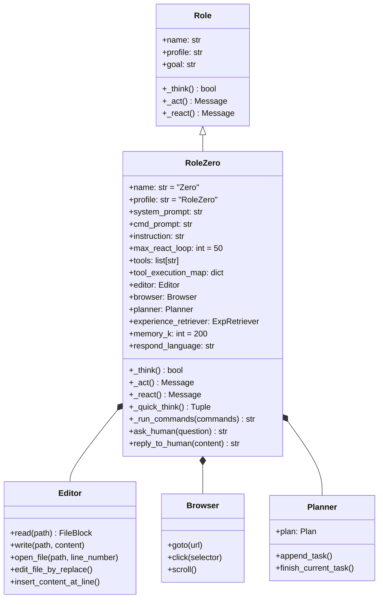

**Initialization Flow:**

1. **Tool Setup** (`set_plan_and_tool`): Configures react mode, initializes `BM25ToolRecommender` if tools are specified, and sets up the `Planner` with auto-run enabled
2. **Tool Execution Map** (`set_tool_execution`): Builds a dictionary mapping command names to callable functions for Plan operations, Editor operations, Browser operations, and custom operations
3. **Long-term Memory** (`set_longterm_memory`): Optionally sets up `RoleZeroLongTermMemory` with vector-based retrieval if `config.role_zero.enable_longterm_memory` is True

Sources: [metagpt/roles/di/role_zero.py:54-194]()

---

### Think-Act-React Cycle

The core execution loop differs from standard roles by maintaining continuous observation within `_react`:

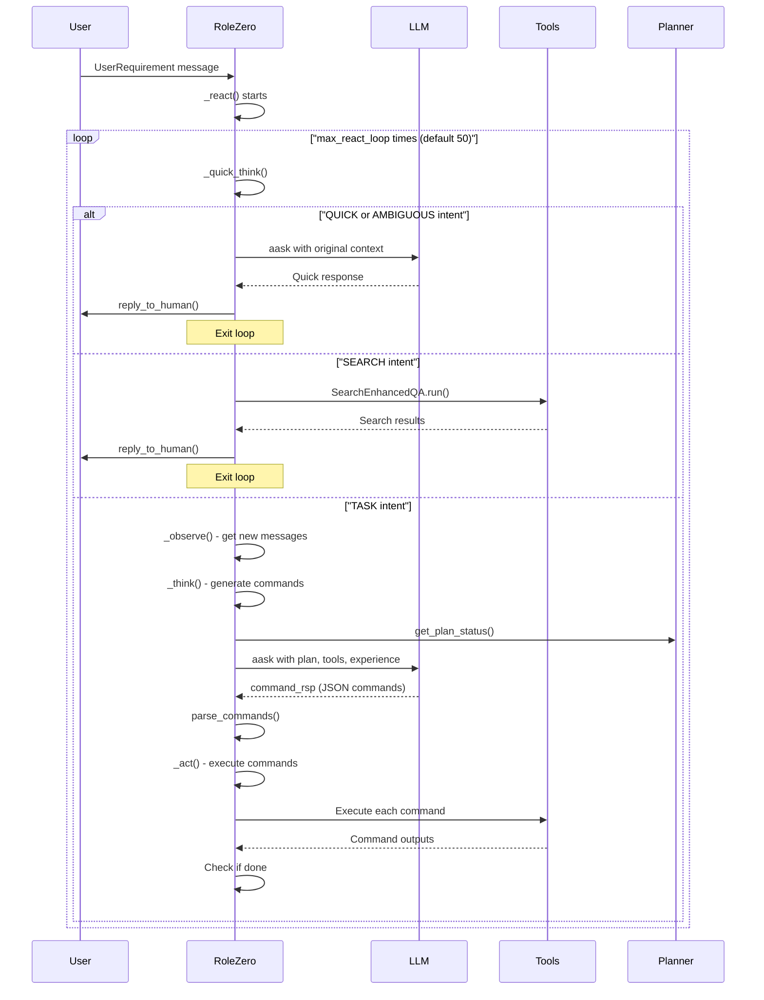

**Key Differences from Standard Roles:**

| Aspect | Standard Role | RoleZero |
|--------|--------------|----------|
| State Management | `_set_state(0)` once per run | `_set_state(0)` on each `_react()` entry |
| Observation | Once before thinking | Continuous within react loop |
| Action Selection | Fixed SOP sequence | Dynamic tool selection via LLM |
| Loop Control | `max_react_loop` for iterations | `max_react_loop` for total actions |
| Memory Usage | All history | Configurable `memory_k` (default 200) |

Sources: [metagpt/roles/di/role_zero.py:198-336]()

---

### Quick Think Intent Classification

Before entering the full think-act cycle, RoleZero performs intent classification to handle simple queries efficiently:

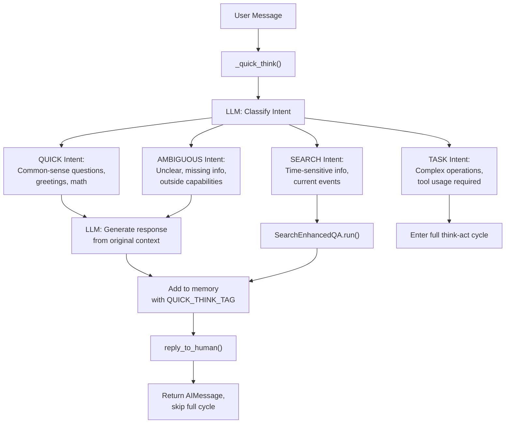

**Intent Categories:**

- **QUICK**: Straightforward questions answerable directly (common-sense, legal/logical, basic math, greetings, casual chat, team inquiries)
- **SEARCH**: Queries requiring up-to-date information (current events, weather, time-sensitive questions)
- **TASK**: Requests involving tool usage or multiple steps (software development, project planning, computer operations)
- **AMBIGUOUS**: Unclear requests lacking critical details, vague scope, or missing files

The classification uses `QUICK_THINK_PROMPT` and `QUICK_THINK_SYSTEM_PROMPT` with examples to guide the LLM. If misclassification occurs (e.g., QUICK response contains "command_name"), it's corrected to TASK.

Sources: [metagpt/roles/di/role_zero.py:342-383](), [metagpt/prompts/di/role_zero.py:148-234]()

---

### Command Execution System

Commands are generated as JSON arrays by the LLM and parsed into executable operations:

**Command Structure:**
```json
[
    {
        "command_name": "ClassName.method_name",
        "args": {"arg_name": "arg_value"}
    }
]
```

**Command Parsing Flow:**

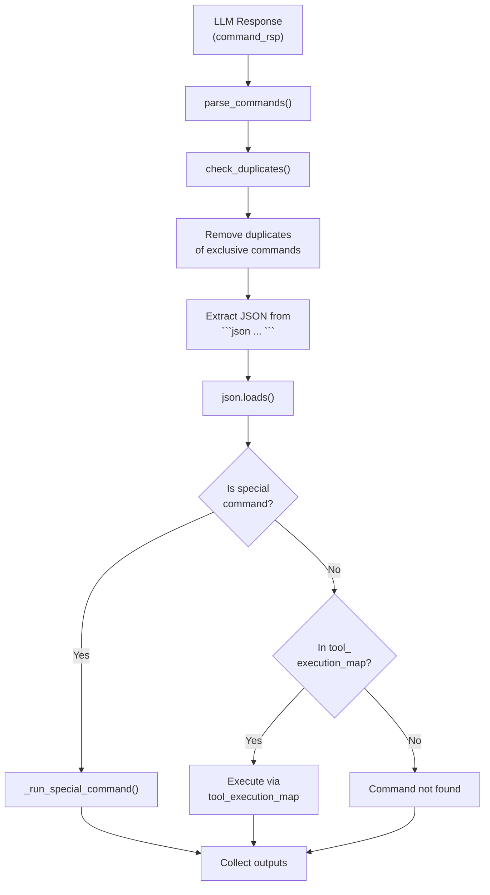

**Special Commands:**

| Command | Handler | Description |
|---------|---------|-------------|
| `Plan.finish_current_task` | Inline | Marks current task complete, moves to next task |
| `end` | `_end()` | Terminates execution, optionally summarizes |
| `Terminal.run_command` | `format_terminal_output()` | Decorates bash output for visibility |
| `RoleZero.ask_human` | `ask_human()` | Requests human input, can trigger `end` if response includes "stop" |

**Exclusive Tool Commands:**

Multiple instances of these commands in a single response are deduplicated, keeping only the first occurrence:
- `Editor.edit_file_by_replace`
- `Editor.insert_content_at_line`
- `Editor.append_file`
- `Editor.open_file`

This prevents line number conflicts when editing the same file multiple times in one turn.

Sources: [metagpt/roles/di/role_zero.py:280-415](), [metagpt/utils/role_zero_utils.py:1-200]()

---

### Experience Caching

RoleZero uses the `@exp_cache` decorator to memoize LLM calls and reuse successful patterns:

```python
@exp_cache(context_builder=RoleZeroContextBuilder(), serializer=RoleZeroSerializer())
async def llm_cached_aask(self, *, req: list[dict], system_msgs: list[str], **kwargs) -> str:
    """Use `exp_cache` to automatically manage experiences.
    
    The `RoleZeroContextBuilder` attempts to add experiences to `req`.
    The `RoleZeroSerializer` extracts essential parts of `req` for the experience pool,
    trimming lengthy entries to retain only necessary parts.
    """
    return await self.llm.aask(req, system_msgs=system_msgs)
```

**Experience Workflow:**

1. **Context Building**: `RoleZeroContextBuilder` adds relevant past experiences to the request based on similarity
2. **LLM Call**: Execute the LLM request with augmented context
3. **Serialization**: `RoleZeroSerializer` extracts and stores the essential request-response pair for future retrieval

For details on experience retrieval strategies, see [Experience Retrieval and Learning](#4.6).

Sources: [metagpt/roles/di/role_zero.py:267-274](), [metagpt/exp_pool/context_builders.py:1-100](), [metagpt/exp_pool/serializers.py:1-100]()

---

## Tool Integration System

### Tool Execution Map

The `tool_execution_map` is a dictionary that maps command names (strings) to callable functions or methods. This map is built during initialization and can be extended by subclasses.

**Default Tool Execution Map:**

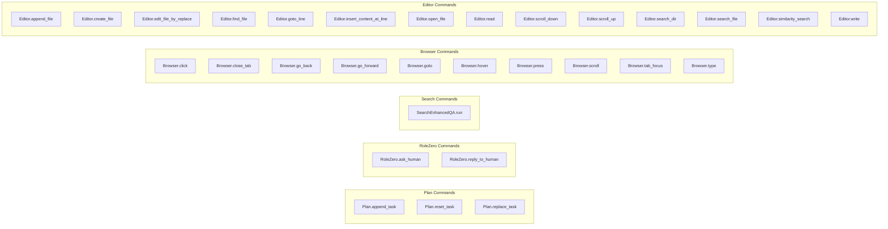

**Tool Registration:**

Tools are registered using the `@register_tool` decorator with an `include_functions` list:

```python
@register_tool(include_functions=["ask_human", "reply_to_human"])
class RoleZero(Role):
    ...
```

This decorator enables:
1. Automatic tool discovery by `ToolRecommender`
2. Schema generation for LLM prompts
3. Function signature extraction for documentation

Sources: [metagpt/roles/di/role_zero.py:118-171](), [metagpt/tools/tool_registry.py:1-100]()

---

### Editor Tool

The `Editor` tool provides file manipulation capabilities with automatic linting and safety features.

**Core Operations:**

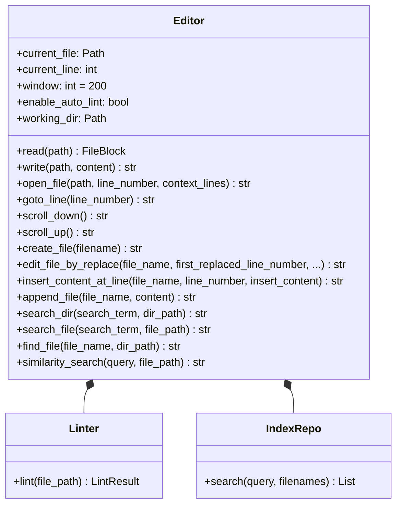

**File Editing with Safety:**

The `_edit_file_impl` method uses temporary files and linting to ensure safe edits:

1. **Backup**: Original file content is copied to a temporary backup file
2. **Lint Original**: If `enable_auto_lint=True`, run linter on original file to establish baseline errors
3. **Apply Edit**: Write new content to a temporary file
4. **Atomic Move**: Replace original file with temporary file using `shutil.move`
5. **Lint Result**: Run linter on modified file
6. **Error Detection**: Compare new errors against baseline; if new syntax errors are introduced, restore from backup and return detailed error message with:
   - Linter error output
   - Window showing modified code
   - Window showing original code
   - Indentation guidance

**Line Number Display:**

All file reading operations display line numbers in the format `NNN|content` (e.g., `001|def main():`). This is critical for the `edit_file_by_replace` and `insert_content_at_line` operations to specify exact locations.

**Semantic Search Integration:**

The `similarity_search` method uses `IndexRepo` to perform vector-based search across files:

```python
async def similarity_search(self, query: str, file_path: str = None) -> str:
    """
    Semantic search using vector embeddings.
    Returns relevant code snippets ranked by similarity.
    """
```

This enables agents to find relevant code without knowing exact file names or locations.

Sources: [metagpt/tools/libs/editor.py:1-1000](), [metagpt/tools/libs/linter.py:1-234](), [metagpt/tools/libs/index_repo.py:1-450]()

---

### Browser Tool

The `Browser` tool provides web automation capabilities through Playwright integration.

**Key Methods:**

| Method | Signature | Description |
|--------|-----------|-------------|
| `goto` | `goto(url: str)` | Navigate to URL |
| `click` | `click(selector: str)` | Click element matching selector |
| `scroll` | `scroll(direction: str = "down")` | Scroll page |
| `type` | `type(selector: str, text: str)` | Type text into input field |
| `press` | `press(key: str)` | Press keyboard key |
| `hover` | `hover(selector: str)` | Hover over element |
| `tab_focus` | `tab_focus(index: int)` | Switch to tab by index |
| `close_tab` | `close_tab()` | Close current tab |
| `go_back` | `go_back()` | Navigate back |
| `go_forward` | `go_forward()` | Navigate forward |

**Memory Augmentation:**

The `parse_browser_actions` utility enriches browser command outputs in memory by capturing page content:

```python
async def parse_browser_actions(memory, browser):
    """
    For messages caused by browser commands, append current page content
    to help LLM understand what was displayed.
    """
```

This ensures the LLM has context about what the browser displayed after each action.

Sources: [metagpt/tools/libs/browser.py:1-500](), [metagpt/utils/role_zero_utils.py:1-200]()

---

### Terminal Tool

The `Terminal` tool executes shell commands with working directory management:

```python
class Terminal:
    def __init__(self, cwd: str = None):
        self.cwd = cwd or os.getcwd()
    
    async def run_command(self, cmd: str, timeout: int = 60) -> str:
        """
        Execute shell command in the configured working directory.
        Returns stdout + stderr combined.
        """
```

**Output Formatting:**

Terminal outputs are wrapped with decorative markers to ensure visibility, especially for commands with minimal output:

```python
def format_terminal_output(cmd: dict, raw_output: str) -> str:
    """
    Wraps terminal output in a clear format:
    ========== Command ==========
    $ {command}
    ========== Output ===========
    {raw_output}
    =============================
    """
```

This prevents the LLM from overlooking empty or brief outputs.

Sources: [metagpt/tools/libs/terminal.py:1-100](), [metagpt/utils/role_zero_utils.py:100-200]()

---

### Planner Tool

The `Planner` manages task decomposition and execution order:

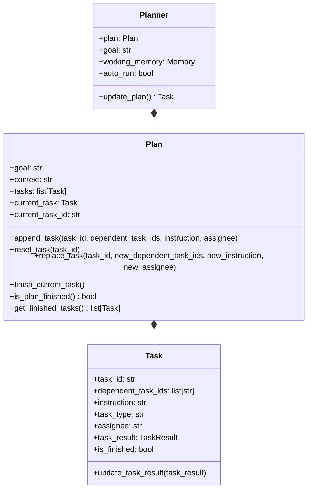

**Plan Status Reporting:**

The `get_plan_status` utility generates a formatted string showing plan progress:

```python
def get_plan_status(planner: Planner) -> Tuple[str, str]:
    """
    Returns:
        (plan_status: str, current_task: str)
    
    plan_status format:
    ## Finished Tasks
    - task_id: 1, assignee: Alice, instruction: Create PRD, result: PRD created
    
    ## Waiting Tasks
    - task_id: 2, assignee: Bob, instruction: Design architecture
    
    current_task format:
    task_id: 1, assignee: Alice, instruction: Create PRD
    """
```

This status is included in the command prompt to help the LLM decide next actions.

Sources: [metagpt/strategy/planner.py:1-300](), [metagpt/utils/role_zero_utils.py:200-300]()

---

## Specialized RoleZero Agents

### TeamLeader

The `TeamLeader` orchestrates multi-agent collaboration by assigning tasks to specialized team members.

**Team Structure:**

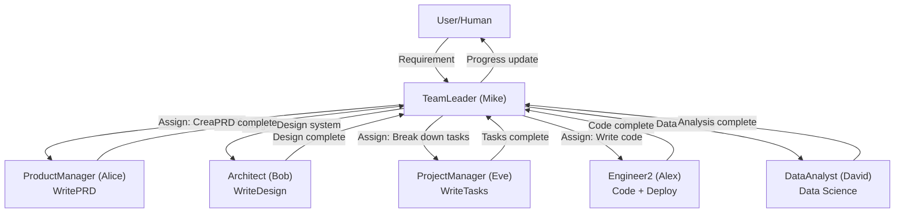

**Key Responsibilities:**

1. **Task Routing**: Determines which team member is best suited for each requirement
2. **Plan Management**: Creates, tracks, and updates the plan based on team feedback
3. **Information Bridging**: Ensures team members have necessary context (paths, links, requirements)
4. **Progress Reporting**: Keeps user informed via `reply_to_human` after each milestone

**Assignment Logic:**

The `TL_INSTRUCTION` prompt guides task assignment:

| Requirement Type | Assignment | Decomposition |
|------------------|------------|---------------|
| Data-related (analysis, ML, web scraping) | Single task to DataAnalyst | None - analyst handles internally |
| Software development (XS-S complexity) | Direct to Engineer | Optional PRD/Design skipped |
| Software development (M-XL complexity) | Multi-step process | PM→Arch→PM→Engineer sequence |
| Common-sense/logical questions | No assignment | TeamLeader answers directly |
| Ambiguous requirements | No assignment | Ask human for clarification |

**Complexity Estimation (T-shirt sizing):**

- **XS**: Snake game, static homepage, basic calculator
- **S**: Photo gallery, file upload, feedback form
- **M**: Menu ordering, news aggregator
- **L**: Booking system, inventory management
- **XL**: Social media, e-commerce, multiplayer game

**Message Publishing:**

```python
def publish_team_message(self, content: str, send_to: str):
    """
    Publish a message to a team member. This triggers their work start.
    DONT omit any necessary info (path, link, environment, programming language,
    framework, requirement, constraint) because you are their sole info source.
    """
```

The TeamLeader includes full original requirements plus additional context in messages.

Sources: [metagpt/roles/di/team_leader.py:1-91](), [metagpt/prompts/di/team_leader.py:1-64](), [metagpt/strategy/experience_retriever.py:471-614]()

---

### Engineer2

`Engineer2` specializes in software development with deployment capabilities.

**Enhanced Capabilities:**

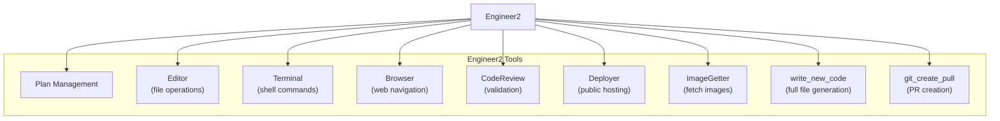

**State Awareness:**

Engineer2 dynamically updates its instruction with current state:

```python
async def _format_instruction(self):
    """
    Display the current terminal and editor state.
    This information will be dynamically added to the command prompt.
    """
    current_directory = (await self.terminal.run_command("pwd")).strip()
    self.editor._set_workdir(current_directory)
    state = {
        "editor_open_file": self.editor.current_file,
        "current_directory": current_directory,
    }
    self.cmd_prompt_current_state = CURRENT_STATE.format(**state).strip()
```

This ensures the agent always knows:
- Current working directory
- Currently open file in editor

**Code Writing Method:**

`write_new_code` generates complete files using a specialized prompt:

```python
async def write_new_code(self, path: str, file_description: str = "") -> str:
    """
    Write a new code file.
    
    Args:
        path: Absolute path for the file
        file_description: Brief description and important notes (optional)
    """
    plan_status, _ = get_plan_status(planner=self.planner)
    prompt = WRITE_CODE_PROMPT.format(
        user_requirement=self.planner.plan.goal,
        plan_status=plan_status,
        file_path=path,
        file_description=file_description,
        file_name=os.path.basename(path),
    )
    memory = self.rc.memory.get(self.memory_k)[:-1]
    context = self.llm.format_msg(memory + [UserMessage(content=prompt)])
    
    rsp = await self.llm.aask(context, system_msgs=[WRITE_CODE_SYSTEM_PROMPT])
    code = CodeParser.parse_code(text=rsp)
    await awrite(path, code)
    return f"The file {path} has been successfully created"
```

This method is preferred over `Editor.write` for new files as it uses a specialized system prompt emphasizing completeness and production-readiness.

**Deployment Integration:**

```python
async def _deploy_to_public(self, dist_dir):
    """
    Deploy web project to public hosting.
    
    Args:
        dist_dir: Absolute path to dist directory after build
    """
    if not Path(dist_dir).is_absolute():
        dist_dir = self.editor._try_fix_path(dist_dir)
    return await self.deployer.deploy_to_public(dist_dir)
```

After building a web project (typically Vite + React/Vue), Engineer2 can deploy the `dist/` folder to public hosting.

**Evaluation Mode:**

When `run_eval=True`, Engineer2 modifies behavior for benchmarking:
- `Terminal.run_command` intercepts git operations (pull/push/commit) and triggers `_end()`
- `ask_human` and `reply_to_human` trigger `_end()`

This ensures evaluation runs terminate at natural stopping points.

Sources: [metagpt/roles/di/engineer2.py:1-172](), [metagpt/prompts/di/engineer2.py:1-105]()

---

### DataAnalyst

`DataAnalyst` handles data science workflows including EDA, preprocessing, feature engineering, model training, and evaluation.

**Workflow Cycle:**

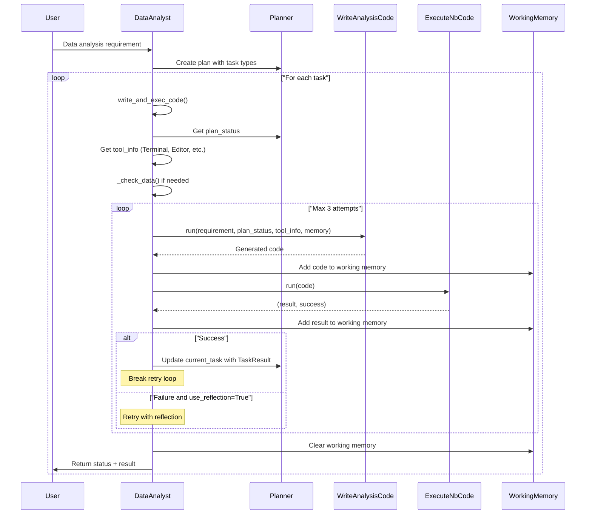

**Task Types:**

The `TASK_TYPE_DESC` defines specialized prompts for each data science phase:

| Task Type | Description |
|-----------|-------------|
| `EDA` | Exploratory data analysis: check missing values, distributions, correlations, outliers |
| `DATA_PREPROCESS` | Data preprocessing: handle missing values, encoding, normalization |
| `FEATURE_ENGINEERING` | Feature engineering: create/select features to improve model |
| `MODEL_TRAIN` | Model training: train on training set, tune hyperparameters |
| `MODEL_EVALUATE` | Model evaluation: evaluate on test set, generate metrics/visualizations |

**Code Execution Context:**

`ExecuteNbCode` maintains a persistent Jupyter kernel for the entire plan:

```python
async def init_code(self):
    """Initialize IPython kernel for interactive execution"""
    self.kernel_manager = AsyncKernelManager()
    await self.kernel_manager.start_kernel()
    self.kernel_client = self.kernel_manager.client()
    self.kernel_client.start_channels()

async def run(self, code: str) -> Tuple[str, bool]:
    """
    Execute code in the persistent kernel.
    Returns: (output, success)
    """
```

This allows variables and imports to persist across tasks, mimicking a real data science workflow.

**Reflection:**

After the first failed execution, `use_reflection=True` is passed to `WriteAnalysisCode`, which includes the previous failure in the prompt to help the LLM correct mistakes.

**Data Info Updates:**

Between tasks, `_check_data()` runs a generated code snippet to print current data info (shape, columns, dtypes). This is added to working memory so subsequent tasks know the current data state.

Sources: [metagpt/roles/di/data_analyst.py:1-155](), [metagpt/prompts/di/data_analyst.py:1-27](), [metagpt/actions/di/write_analysis_code.py:1-300]()

---

### SWEAgent

`SWEAgent` (not shown in provided files but referenced in diagrams) specializes in GitHub issue resolution:

**Capabilities:**
1. **Issue Navigation**: Uses Browser to read GitHub issue page
2. **Repository Operations**: Clones repo, creates branch, makes fixes
3. **Git Workflow**: Commits changes, pushes branch
4. **PR Creation**: Creates pull request with fixes

The workflow follows standard SWE-bench benchmarks for automated bug fixing.

Sources: Referenced in [metagpt/roles/di/engineer2.py:82-94]() via git_create_pull tool

---

## Experience Retrieval and Learning

### ExpRetriever Interface

The `ExpRetriever` base class defines the interface for experience retrieval:

```python
class ExpRetriever(BaseModel):
    """Interface for experience retriever"""
    
    def retrieve(self, context: str = "") -> str:
        raise NotImplementedError
```

**Implementation Hierarchy:**

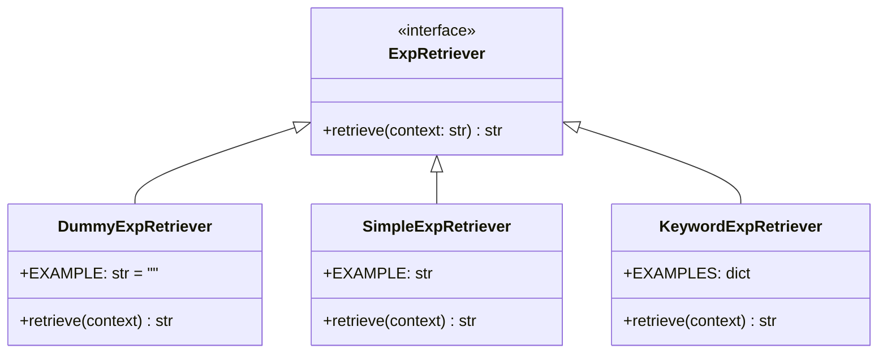

Sources: [metagpt/strategy/experience_retriever.py:1-20]()

---

### DummyExpRetriever

Returns no examples (empty string). Used as default for `RoleZero`:

```python
class DummyExpRetriever(ExpRetriever):
    """A dummy experience retriever that returns empty string."""
    
    def retrieve(self, context: str = "") -> str:
        return self.EXAMPLE
    
    EXAMPLE: str = ""
```

Sources: [metagpt/strategy/experience_retriever.py:13-20]()

---

### SimpleExpRetriever

Returns a fixed example regardless of context. Used by `TeamLeader`:

```python
class SimpleExpRetriever(ExpRetriever):
    def retrieve(self, context: str = "") -> str:
        return self.EXAMPLE
    
    EXAMPLE: str = """
## example 1
User Requirement: Create a cli snake game.
Explanation: The requirement is about software development. Assign each tasks 
to a different team member based on their expertise.
```json
[
    {
        "command_name": "Plan.append_task",
        "args": {
            "task_id": "1",
            "dependent_task_ids": [],
            "instruction": "Create a product requirement document (PRD)",
            "assignee": "Alice"
        }
    },
    ...
]
```
"""
```

The example demonstrates the expected JSON command format and assignment logic.

Sources: [metagpt/strategy/experience_retriever.py:471-614]()

---

### KeywordExpRetriever

Performs keyword-based matching to select relevant examples. Used by `DataAnalyst`:

```python
class KeywordExpRetriever(ExpRetriever):
    EXAMPLES: dict = {
        "web_scraping": WEB_SCRAPING_EXAMPLE,
        "machine_learning": ML_EXAMPLE,
        "data_analysis": DATA_ANALYSIS_EXAMPLE,
        ...
    }
    
    def retrieve(self, context: str = "") -> str:
        """
        Match keywords in context to select appropriate example.
        Returns most relevant example or empty string.
        """
        for keyword, example in self.EXAMPLES.items():
            if keyword.lower() in context.lower():
                return example
        return ""
```

This helps provide task-specific guidance for different data science scenarios.

Sources: [metagpt/strategy/experience_retriever.py:615-800]()

---

### RoleZeroContextBuilder and Serializer

The `@exp_cache` decorator uses two components for experience management:

**RoleZeroContextBuilder:**
- Receives the current request (`req`) before LLM call
- Searches experience pool for similar past requests
- Injects relevant experiences into system prompt or user message
- Returns augmented request

**RoleZeroSerializer:**
- Receives the request and response after LLM call
- Extracts essential components (plan status, current task, tool info)
- Trims lengthy memory entries to save storage
- Returns serialized experience for storage

Together, they create a feedback loop where successful patterns are learned and reused.

Sources: [metagpt/roles/di/role_zero.py:267-274](), [metagpt/exp_pool/context_builders.py:1-100](), [metagpt/exp_pool/serializers.py:1-100]()

---

## Message Orchestration (MGXEnv)

### MGXEnv Architecture

`MGXEnv` extends the base `Environment` to provide team-based message routing:

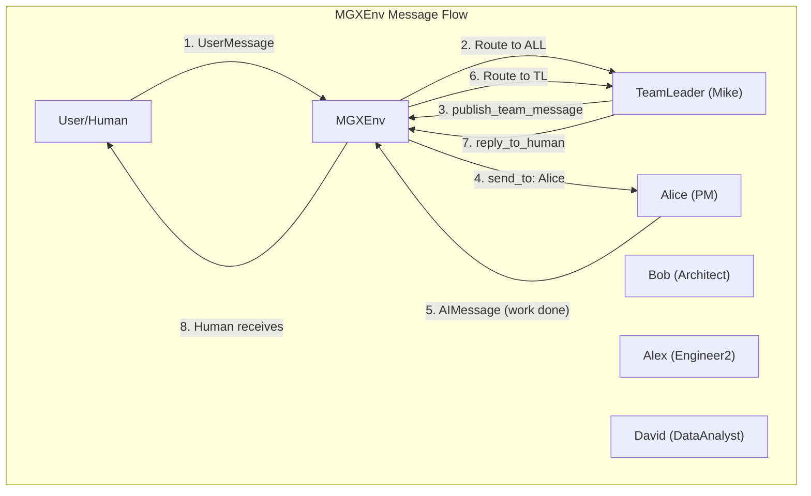

**Key Features:**

1. **Message Routing**: All messages go through TeamLeader unless direct chat is initiated
2. **Direct Chat**: User can directly address a role using `@role_name`; TeamLeader is bypassed
3. **Public vs Private**: `is_public_chat` flag controls whether messages are broadcast
4. **Message Formatting**: `move_message_info_to_content` converts metadata to content

Sources: [metagpt/environment/mgx/mgx_env.py:1-100]()

---

### Message Info Conversion

`move_message_info_to_content` transforms message metadata into human-readable content:

```python
def move_message_info_to_content(self, message: Message) -> Message:
    """
    Two things here:
    1. Convert role, since role field must be reserved for LLM API
    2. Add sender and recipient info to content
    """
    converted_msg = message.model_copy(deep=True)
    if converted_msg.role not in ["system", "user", "assistant"]:
        converted_msg.role = "assistant"
    
    sent_from = converted_msg.metadata[AGENT] if AGENT in converted_msg.metadata else converted_msg.sent_from
    
    # Display routing: <all> -> Mike; {Alice} -> Alice; {Alice, <all>} -> Alice
    if converted_msg.send_to == {MESSAGE_ROUTE_TO_ALL}:
        send_to = TEAMLEADER_NAME
    else:
        send_to = ", ".join({role for role in converted_msg.send_to if role != MESSAGE_ROUTE_TO_ALL})
    
    converted_msg.content = f"[Message] from {sent_from or 'User'} to {send_to}: {converted_msg.content}"
    return converted_msg
```

**Example Transformation:**

Before:
```python
Message(
    content="Create a snake game",
    sent_from="User",
    send_to={"<all>"},
    role="user"
)
```

After:
```python
Message(
    content="[Message] from User to Mike: Create a snake game",
    sent_from="User",
    send_to={"<all>"},
    role="user"
)
```

This ensures the LLM sees sender and recipient information in the content, as it cannot access metadata.

Sources: [metagpt/environment/mgx/mgx_env.py:73-89]()

---

### Human Interaction

`MGXEnv` provides two methods for human interaction:

```python
async def ask_human(self, question: str, sent_from: Role = None) -> str:
    """Request input from human user"""
    rsp = await get_human_input(question)
    return "Human response: " + rsp

async def reply_to_human(self, content: str, sent_from: Role = None) -> str:
    """Send message to human user"""
    return "SUCCESS, human has received your reply. Refrain from resending duplicate messages. If you no longer need to take action, use the command 'end' to stop."
```

These methods can be overridden in remote settings (e.g., web UI) to provide custom interaction channels.

Sources: [metagpt/environment/mgx/mgx_env.py:64-72]()

---

### Direct Chat Mode

When a user directly addresses a role with `@role_name`, MGXEnv enters direct chat mode:

```python
if user_defined_recipient:
    # User starts a new direct chat with a certain role
    for role_name in message.send_to:
        if self.get_role(role_name).is_idle:
            # Expecting a direct chat response from the role
            self.direct_chat_roles.add(role_name)
    self._publish_message(message)
```

In direct chat mode:
- TeamLeader is bypassed (does not receive or process the message)
- The addressed role responds directly to the user
- Other roles in the environment are not involved
- When the role finishes its response, it's removed from `direct_chat_roles`

This enables focused interaction for debugging or specific guidance without team-wide coordination.

Sources: [metagpt/environment/mgx/mgx_env.py:24-62]()

---

### Multi-Modal Support

`MGXEnv` attaches images to messages for vision-capable models:

```python
def attach_images(self, message: Message) -> Message:
    if message.role == "user":
        images = extract_and_encode_images(message.content)
        if images:
            message.add_metadata(IMAGES, images)
    return message
```

The `extract_and_encode_images` utility:
1. Searches message content for image paths or URLs
2. Reads image files as binary data
3. Base64 encodes the images
4. Attaches to message metadata

This enables roles to process visual information when available.

Sources: [metagpt/environment/mgx/mgx_env.py:91-96](), [metagpt/utils/common.py:500-600]()

---

## Prompt Engineering

### System Prompt Structure

The RoleZero system prompt follows a structured format:

```python
SYSTEM_PROMPT = """
# Basic Info
{role_info}

# Data Structure
class Task(BaseModel):
    task_id: str = ""
    dependent_task_ids: list[str] = []
    instruction: str = ""
    task_type: str = ""
    assignee: str = ""

# Available Task Types
{task_type_desc}

# Available Commands
{available_commands}
Special Command: Use {{"command_name": "end"}} to indicate completion.

# Example
{example}

# Instruction
{instruction}
"""
```

**Components:**

| Component | Source | Purpose |
|-----------|--------|---------|
| `role_info` | `_get_prefix()` | Name, profile, goal, current time |
| `task_type_desc` | `self.task_type_desc` | Available task types (for DataAnalyst) |
| `available_commands` | `tool_recommender.recommend_tools()` | Recommended tool schemas based on context |
| `example` | `experience_retriever.retrieve()` | Relevant past successful examples |
| `instruction` | `self.instruction` | Role-specific behavioral guidelines |

Sources: [metagpt/prompts/di/role_zero.py:25-50]()

---

### Command Prompt Structure

The command prompt (CMD_PROMPT) is used during the `_think` phase:

```python
CMD_PROMPT = """
# Past Experience
{EXPERIENCE_MASK}

# Tool State
{current_state}

# Current Plan
{plan_status}

# Current Task
{current_task}

# Response Language
you must respond in {respond_language}.

Pay close attention to the Example provided, you can reuse the example for your current situation if it fits.
If you open a file, the line number is displayed at the front of each line.
You may use any of the available commands to create a plan or update the plan.
If you finish current task, use Plan.finish_current_task, DON'T append a new task.
Using Editor.insert_content_at_line and Editor.edit_file_by_replace more than once is forbidden.
In your response, include at least one command.

# Your commands in a json array:
```json
[
    {{
        "command_name": "ClassName.method_name",
        "args": {{"arg_name": arg_value}}
    }},
    ...
]
```
Notice: your output JSON data section must start with **```json [**
"""
```

**Dynamic Components:**

- `current_state`: Current directory and open file (Engineer2 only)
- `plan_status`: Formatted plan with finished/waiting tasks
- `current_task`: The task currently being worked on
- `respond_language`: Detected language for user-facing messages

Sources: [metagpt/prompts/di/role_zero.py:57-93]()

---

### Quick Think Prompts

Quick think uses a separate system prompt optimized for intent classification:

```python
QUICK_THINK_SYSTEM_PROMPT = """
{role_info}
Your role is to determine the appropriate response category for the given request.

# Response Categories
## QUICK: 
For straightforward questions or requests that can be answered directly.

## SEARCH
For queries that require retrieving up-to-date or detailed information.

## TASK
For requests that involve tool utilizations, computer operations, multiple steps.

## AMBIGUOUS
For requests that are unclear, lack sufficient detail, or are outside capabilities.

{examples}
"""
```

The prompt includes examples of each category to guide the LLM in classification.

Sources: [metagpt/prompts/di/role_zero.py:148-176]()

---

### Role-Specific Instructions

Each specialized role overrides the `instruction` attribute:

**Engineer2:**
```python
ENGINEER2_INSTRUCTION = ROLE_INSTRUCTION + """
You are an autonomous programmer
The special interface consists of a file editor that shows you 100 lines at a time.
You can use terminal commands by calling Terminal.run_command.
NOTE ABOUT THE EDIT COMMAND: Indentation really matters!
When using Editor.edit_file_by_replace, ensure proper indentation.
When planning, initially list the files for coding, then outline all tasks.
Write only one code file each time and provide its full implementation.
The priority to select technology stacks: System Design > Vite, React, MUI, Tailwind
...
"""
```

**DataAnalyst:**
```python
EXTRA_INSTRUCTION = """
6. Carefully consider how you handle web tasks:
 - Use SearchEnhancedQA for general information searching
 - Use Browser for reading, navigating, or in-domain searching
 - Use write_and_execute_code for web scraping
7. When making plan, append all tasks in first response
7.1. When inquiring about a document, read it first WITHOUT a plan
...
"""
```

**TeamLeader:**
```python
TL_INSTRUCTION = """
You are a team leader, responsible for drafting tasks and routing to team members.
Your team member:
{team_info}
You should NOT assign consecutive tasks to the same team member.
When drafting tasks, ALWAYS include necessary info (path, link, environment).
If requirement is DATA-RELATED, DON'T decompose it, assign to Data Analyst directly.
If requirement is software development, decompose into: PRD → Design → Tasks → Code.
...
"""
```

These instructions encode domain-specific best practices and constraints.

Sources: [metagpt/prompts/di/engineer2.py:6-71](), [metagpt/prompts/di/data_analyst.py:3-15](), [metagpt/prompts/di/team_leader.py:3-40]()

---

### Output Format Enforcement

All prompts enforce JSON output format with explicit markers:

```
# Your commands in a json array:
```json
[
    {{
        "command_name": "ClassName.method_name",
        "args": {{"arg_name": arg_value}}
    }}
]
```
Notice: your output JSON data section must start with **```json [**
```

The parsing function `parse_commands` uses regex to extract JSON between these markers, providing robustness against LLM output variations.

If JSON parsing fails, `JSON_REPAIR_PROMPT` is used to ask the LLM to fix the format:

```python
JSON_REPAIR_PROMPT = """
## json data
{json_data}

## json decode error
{json_decode_error}

Help check if there are any formatting issues with the JSON data?
Do not use escape characters in json data, particularly within file paths.
Output the JSON data in a format that can be loaded by json.loads().
"""
```

Sources: [metagpt/prompts/di/role_zero.py:131-146](), [metagpt/utils/role_zero_utils.py:1-100]()

---

## Summary

The RoleZero dynamic agent system provides:

1. **Flexible Tool Execution**: Dynamic command generation and execution through `tool_execution_map`
2. **Adaptive Thinking**: Quick think for simple queries, full think-act cycle for complex tasks
3. **Specialized Roles**: TeamLeader for orchestration, Engineer2 for development, DataAnalyst for data science
4. **Learning Capabilities**: Experience retrieval and caching for pattern reuse
5. **Robust Editing**: Editor tool with automatic linting and safety features
6. **Team Coordination**: MGXEnv for message routing and multi-agent collaboration

The system enables agents to tackle diverse tasks through:
- Dynamic tool selection based on context
- Plan management with task dependencies
- Human-in-the-loop interaction when needed
- Multi-modal input support for vision tasks
- Continuous observation and adaptation within execution loops

For standard SOP-driven workflows, see [Core Multi-Agent Framework](#2). For details on LLM integration, see [LLM Provider Integration](#3). For structured output generation, see [ActionNode and Structured Output](#7).

Sources: [metagpt/roles/di/role_zero.py:1-492](), [metagpt/environment/mgx/mgx_env.py:1-100](), [metagpt/prompts/di/role_zero.py:1-268]()

---

