<!-- source: DeepWiki mcp.deepwiki.com · repo FoundationAgents/MetaGPT · page 4.1 RoleZero Core Architecture · fetched 2026-10-30 -->

# RoleZero Core Architecture

<details>
<summary>Relevant source files</summary>

The following files were used as context for generating this wiki page:

- [metagpt/environment/mgx/mgx_env.py](metagpt/environment/mgx/mgx_env.py)
- [metagpt/prompts/di/data_analyst.py](metagpt/prompts/di/data_analyst.py)
- [metagpt/prompts/di/engineer2.py](metagpt/prompts/di/engineer2.py)
- [metagpt/prompts/di/role_zero.py](metagpt/prompts/di/role_zero.py)
- [metagpt/prompts/di/team_leader.py](metagpt/prompts/di/team_leader.py)
- [metagpt/roles/di/data_analyst.py](metagpt/roles/di/data_analyst.py)
- [metagpt/roles/di/engineer2.py](metagpt/roles/di/engineer2.py)
- [metagpt/roles/di/role_zero.py](metagpt/roles/di/role_zero.py)
- [metagpt/roles/di/team_leader.py](metagpt/roles/di/team_leader.py)
- [metagpt/strategy/experience_retriever.py](metagpt/strategy/experience_retriever.py)
- [metagpt/strategy/thinking_command.py](metagpt/strategy/thinking_command.py)
- [metagpt/tools/libs/editor.py](metagpt/tools/libs/editor.py)
- [metagpt/tools/libs/index_repo.py](metagpt/tools/libs/index_repo.py)
- [metagpt/tools/libs/linter.py](metagpt/tools/libs/linter.py)
- [metagpt/utils/file.py](metagpt/utils/file.py)
- [tests/metagpt/environment/mgx_env/run_mgx_env.py](tests/metagpt/environment/mgx_env/run_mgx_env.py)
- [tests/metagpt/roles/di/run_engineer2.py](tests/metagpt/roles/di/run_engineer2.py)
- [tests/metagpt/tools/libs/test_editor.py](tests/metagpt/tools/libs/test_editor.py)

</details>


## Purpose and Scope

This document describes the architecture of the RoleZero agent system, a dynamic multi-agent framework that enables agents to think, plan, and execute actions using tools. RoleZero agents can adaptively respond to requirements by dynamically selecting and executing tools based on context. This page covers the core RoleZero base class, the think-act-react cycle, tool integration, experience retrieval, and planning mechanisms.

For information about:
- **Standard role-based agents** (ProductManager, Architect, Engineer, QaEngineer with fixed SOPs), see [2](#2)
- **Specialized RoleZero implementations** (Engineer2, DataAnalyst, TeamLeader, SWEAgent), see [4.4](#4.4)
- **Tool system details** (Editor, Browser, Terminal, Planner), see [4.2](#4.2)
- **Environment and message orchestration** (MGXEnv, message routing), see [4.5](#4.5)

---

## Overview

RoleZero represents a paradigm shift from fixed SOP-driven agents to dynamic, tool-wielding agents. Unlike standard roles that follow predetermined action sequences, RoleZero agents dynamically determine what to do next based on context, available tools, and past experiences.

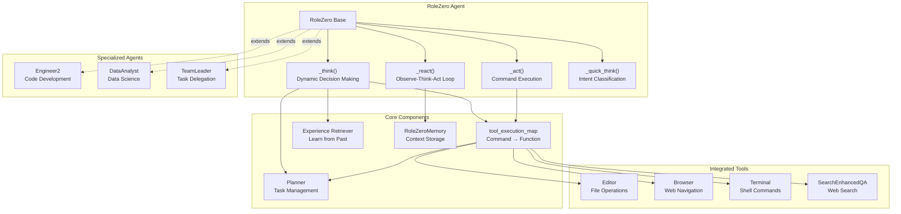

**Sources:** [metagpt/roles/di/role_zero.py:55-492]()

---

## Core Class Structure

The `RoleZero` class is defined in [metagpt/roles/di/role_zero.py:55-492]() and serves as the foundation for all dynamic agents.

### Class Definition and Key Fields

| Field | Type | Purpose |
|-------|------|---------|
| `name` | `str` | Agent identifier (default: "Zero") |
| `profile` | `str` | Agent type descriptor (default: "RoleZero") |
| `react_mode` | `Literal["react"]` | Execution mode (always "react") |
| `max_react_loop` | `int` | Maximum action cycles (default: 50) |
| `tools` | `list[str]` | Available tool names |
| `tool_execution_map` | `dict[str, Callable]` | Command name → function mapping |
| `editor` | `Editor` | File operation tool |
| `browser` | `Browser` | Web automation tool |
| `planner` | `Planner` | Task planning system |
| `experience_retriever` | `ExpRetriever` | Learning from past experiences |
| `memory_k` | `int` | Number of historical messages to use (default: 200) |
| `respond_language` | `str` | Language for human responses |

**Sources:** [metagpt/roles/di/role_zero.py:58-101]()

### Initialization and Setup

RoleZero uses Pydantic validators to set up its components during initialization:

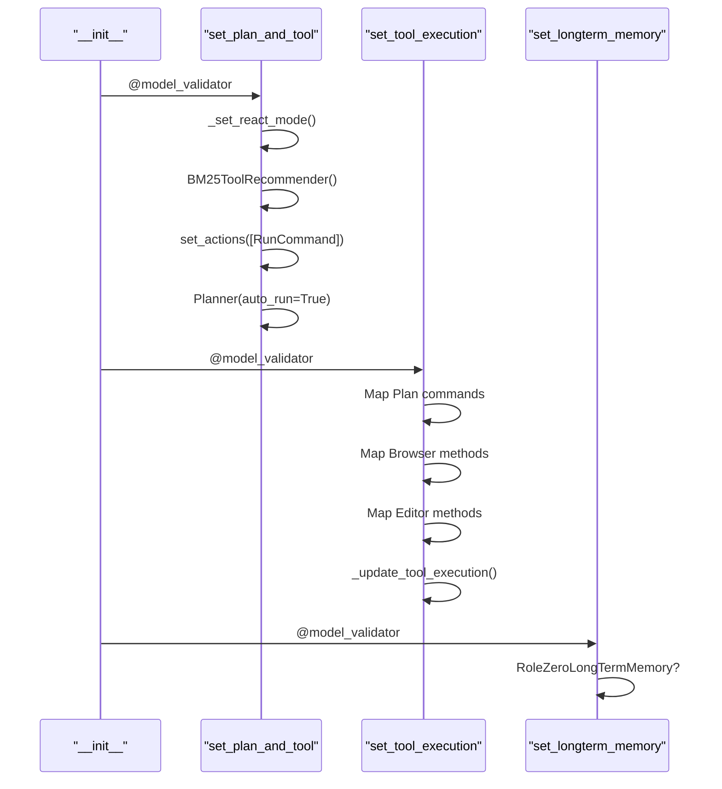

**Sources:** [metagpt/roles/di/role_zero.py:102-196]()

The `set_tool_execution` validator [metagpt/roles/di/role_zero.py:119-171]() builds the `tool_execution_map` dictionary:

| Command Pattern | Mapped Function | Description |
|----------------|-----------------|-------------|
| `Plan.append_task` | `self.planner.plan.append_task` | Add task to plan |
| `Plan.reset_task` | `self.planner.plan.reset_task` | Reset task status |
| `Plan.replace_task` | `self.planner.plan.replace_task` | Replace task definition |
| `RoleZero.ask_human` | `self.ask_human` | Request human input |
| `RoleZero.reply_to_human` | `self.reply_to_human` | Send response to human |
| `SearchEnhancedQA.run` | `SearchEnhancedQA().run` | Web search |
| `Browser.<method>` | `self.browser.<method>` | Browser actions (click, goto, etc.) |
| `Editor.<method>` | `self.editor.<method>` | File operations (read, write, edit, etc.) |

---

## Think-Act-React Cycle

RoleZero implements a continuous observe-think-act loop for adaptive behavior. The cycle allows the agent to respond to new information at any time.

### Overall React Flow

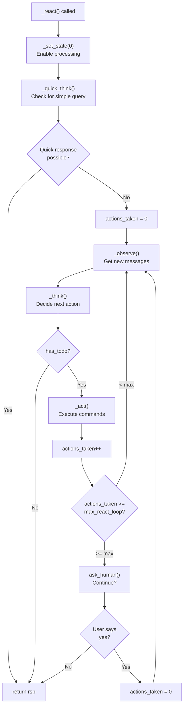

**Sources:** [metagpt/roles/di/role_zero.py:303-336]()

### Quick Thinking: Intent Classification

Before entering the full think-act loop, RoleZero performs a lightweight intent classification to handle simple queries directly [metagpt/roles/di/role_zero.py:342-383]():

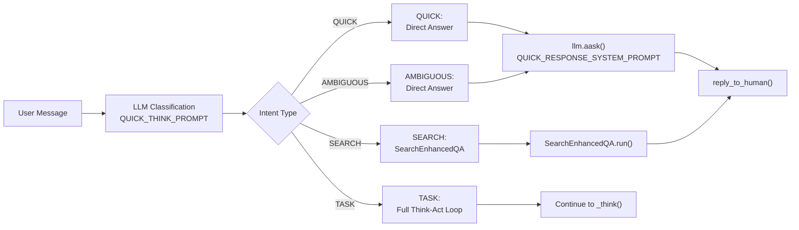

Intent categories defined in [metagpt/prompts/di/role_zero.py:148-176]():

| Intent | Description | Examples |
|--------|-------------|----------|
| **QUICK** | Straightforward questions answerable directly | "What's 2+2?", "What is a decorator in Python?", "Who is the first man on Moon?" |
| **SEARCH** | Requires up-to-date/detailed information | "What's the weather today?", "Latest research papers on deep learning" |
| **TASK** | Requires tool usage, multiple steps | "Create a 2048 game", "Analyze this dataset" |
| **AMBIGUOUS** | Unclear, lacks details, or impossible | "Redesign this logo" (no logo provided), "Summarize this document" (no document path) |

**Sources:** [metagpt/roles/di/role_zero.py:342-383](), [metagpt/prompts/di/role_zero.py:148-229]()

### Think: Dynamic Decision Making

The `_think()` method [metagpt/roles/di/role_zero.py:198-265]() is where RoleZero decides what to do next:

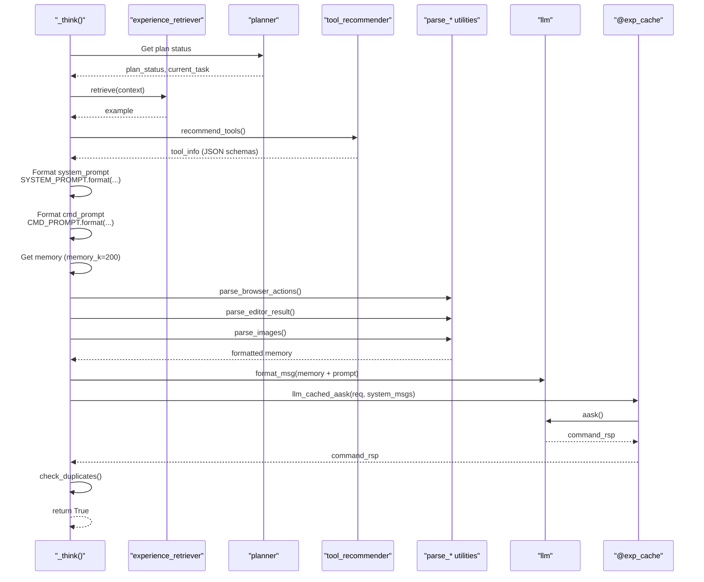

Key steps in `_think()`:

1. **Experience Retrieval** [metagpt/roles/di/role_zero.py:213](): Fetch relevant examples from past similar tasks
2. **Plan Status** [metagpt/roles/di/role_zero.py:216](): Get current task and progress
3. **Tool Recommendation** [metagpt/roles/di/role_zero.py:219-220](): Get schemas for available tools using BM25 matching
4. **Prompt Construction** [metagpt/roles/di/role_zero.py:224-238](): Build system prompt and command prompt with context
5. **Memory Parsing** [metagpt/roles/di/role_zero.py:241-244](): Process recent observations (browser actions, editor results, images)
6. **LLM Call** [metagpt/roles/di/role_zero.py:254](): Get command decision from LLM
7. **Duplicate Check** [metagpt/roles/di/role_zero.py:257-263](): Ensure not repeating failed commands

**Sources:** [metagpt/roles/di/role_zero.py:198-265]()

### Act: Command Execution

The `_act()` method [metagpt/roles/di/role_zero.py:280-301]() parses and executes the commands returned by `_think()`:

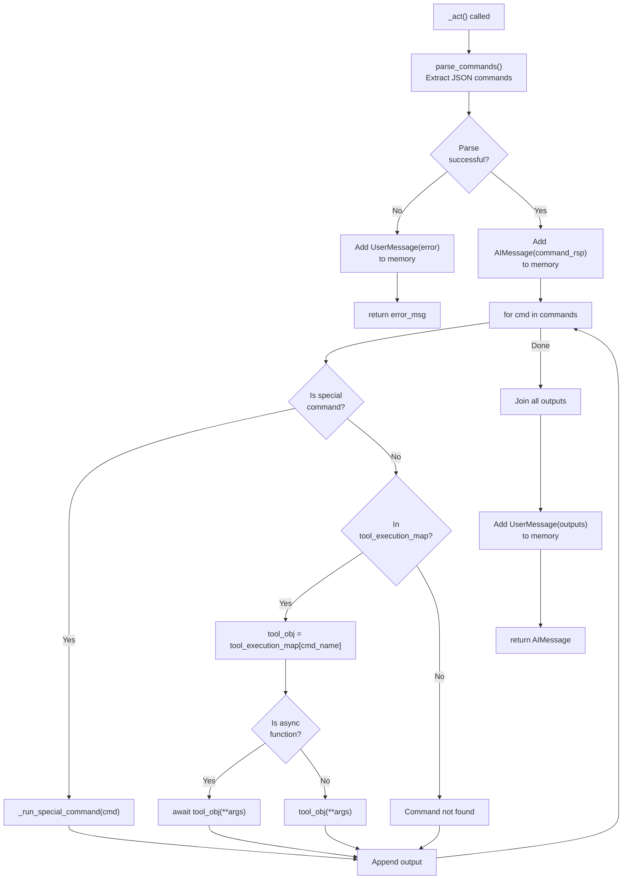

**Command Parsing** [metagpt/utils/role_zero_utils.py](): The `parse_commands()` function extracts JSON command arrays from LLM responses, handling:
- Multiple JSON blocks in response
- Malformed JSON (attempts repair)
- Duplicate exclusive commands (keeps first occurrence only)

**Special Commands** [metagpt/roles/di/role_zero.py:417-447]() require custom handling:

| Command | Behavior |
|---------|----------|
| `Plan.finish_current_task` | Marks current task complete, moves to next task |
| `end` | Calls `_end()` to summarize and terminate |
| `Terminal.run_command` | Decorates output with formatting for visibility |
| `RoleZero.ask_human` | Blocks for human input; if response contains "stop", triggers `_end()` |

**Sources:** [metagpt/roles/di/role_zero.py:280-301](), [metagpt/roles/di/role_zero.py:385-415](), [metagpt/roles/di/role_zero.py:417-447]()

---

## Tool Execution System

RoleZero's tool system maps command names to Python functions, enabling dynamic tool invocation.

### Tool Execution Map Architecture

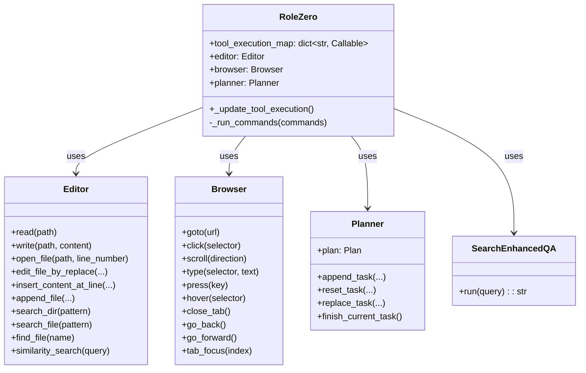

### Default Tool Mappings

The base `tool_execution_map` is built in [metagpt/roles/di/role_zero.py:119-171]():

```python
# Plan commands
"Plan.append_task" → self.planner.plan.append_task
"Plan.reset_task" → self.planner.plan.reset_task
"Plan.replace_task" → self.planner.plan.replace_task

# Human interaction
"RoleZero.ask_human" → self.ask_human
"RoleZero.reply_to_human" → self.reply_to_human

# Web search (if enabled)
"SearchEnhancedQA.run" → SearchEnhancedQA().run

# Browser actions
"Browser.click" → self.browser.click
"Browser.goto" → self.browser.goto
"Browser.scroll" → self.browser.scroll
# ... (10 browser methods total)

# Editor actions
"Editor.read" → self.editor.read
"Editor.write" → self.editor.write
"Editor.open_file" → self.editor.open_file
"Editor.edit_file_by_replace" → self.editor.edit_file_by_replace
"Editor.insert_content_at_line" → self.editor.insert_content_at_line
# ... (14 editor methods total)
```

### Tool Registration with @register_tool

Tools are decorated with `@register_tool` to expose their methods [metagpt/tools/tool_registry.py]():

```python
# Example from Editor
@register_tool(include_functions=[
    "write", "read", "open_file", "edit_file_by_replace",
    "insert_content_at_line", "append_file", "search_dir",
    "search_file", "find_file", "similarity_search"
])
class Editor(BaseModel):
    ...
```

This enables the `BM25ToolRecommender` to:
1. Extract function signatures and docstrings
2. Recommend relevant tools based on task context
3. Provide JSON schemas to LLM for structured command generation

**Sources:** [metagpt/roles/di/role_zero.py:119-171](), [metagpt/tools/libs/editor.py:84-101]()

### Exclusive and Special Commands

**Exclusive Commands** [metagpt/roles/di/role_zero.py:80-85](): Only the first occurrence is kept when duplicates appear:
- `Editor.edit_file_by_replace`
- `Editor.insert_content_at_line`
- `Editor.append_file`
- `Editor.open_file`

This prevents conflicts when multiple edits to the same file would invalidate line numbers.

**Special Commands** [metagpt/roles/di/role_zero.py:77](): Require custom execution logic:
- `Plan.finish_current_task`
- `end`
- `Terminal.run_command`
- `RoleZero.ask_human`

**Sources:** [metagpt/roles/di/role_zero.py:77-85]()

---

## Planning System Integration

RoleZero uses a `Planner` instance for task management, enabling multi-step problem solving.

### Planner Initialization

The planner is created during `set_plan_and_tool` validation [metagpt/roles/di/role_zero.py:114]():

```python
self.planner = Planner(
    goal="",  # Set later from first user message
    working_memory=self.rc.working_memory,
    auto_run=True
)
```

### Plan Status in Think Cycle

During `_think()`, the agent retrieves plan information [metagpt/roles/di/role_zero.py:216]():

```python
plan_status, current_task = get_plan_status(planner=self.planner)
```

This provides context like:

```
## Current Plan
Task 1: Read dataset [FINISHED]
Task 2: Analyze data [CURRENT]
Task 3: Train model [PENDING]

## Current Task
Task ID: 2
Instruction: Perform exploratory data analysis on the dataset
Dependencies: [1]
```

### Plan Manipulation Commands

| Command | Function | Description |
|---------|----------|-------------|
| `Plan.append_task` | Add new task to end | Creates task with id, dependencies, instruction |
| `Plan.reset_task` | Mark task as unfinished | Also resets all dependent tasks |
| `Plan.replace_task` | Replace task definition | Updates task and resets dependents |
| `Plan.finish_current_task` | Complete current task | Moves to next task in sequence |

**Goal Setting** [metagpt/roles/di/role_zero.py:209-211](): The plan goal is set from the first user message:

```python
if not self.planner.plan.goal:
    self.planner.plan.goal = self.get_memories()[-1].content
```

**Sources:** [metagpt/roles/di/role_zero.py:209-216](), [metagpt/utils/role_zero_utils.py]()

---

## Experience Retrieval System

RoleZero learns from past experiences through the `ExpRetriever` interface, which provides relevant examples during `_think()`.

### Experience Retriever Interface

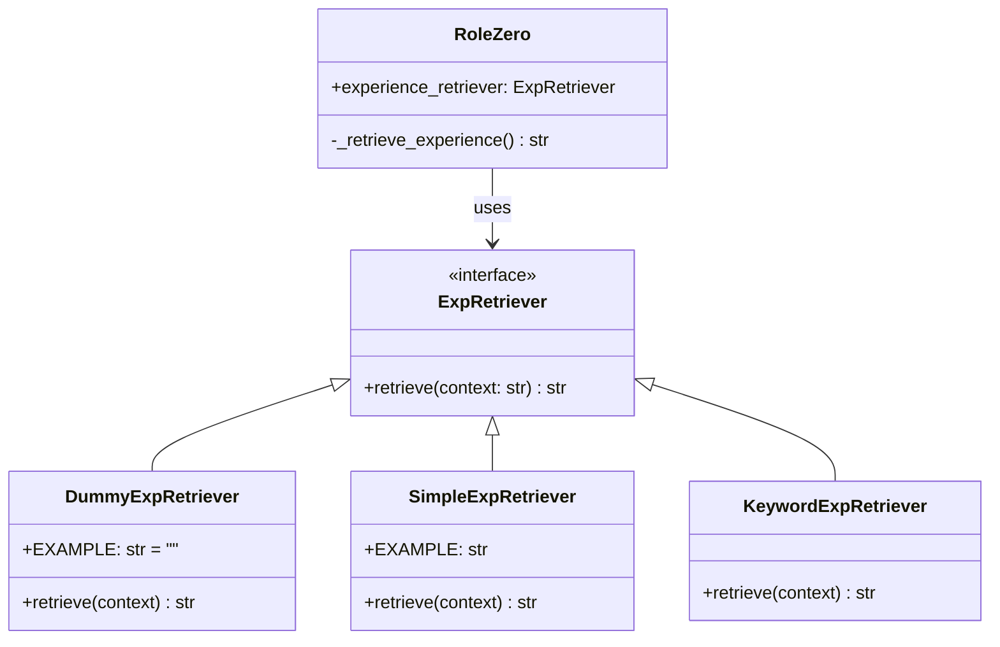

### Retriever Implementations

| Retriever | Behavior | Used By |
|-----------|----------|---------|
| `DummyExpRetriever` | Returns empty string | Base RoleZero (default) |
| `SimpleExpRetriever` | Returns fixed example string | TeamLeader |
| `KeywordExpRetriever` | Keyword-based matching (future) | DataAnalyst |

**Sources:** [metagpt/strategy/experience_retriever.py:1-469]()

### Experience Integration in Think

The experience is retrieved and injected into the system prompt [metagpt/roles/di/role_zero.py:213-228]():

```python
# During _think()
example = self._retrieve_experience()

system_prompt = self.system_prompt.format(
    role_info=self._get_prefix(),
    task_type_desc=self.task_type_desc,
    available_commands=tool_info,
    example=example,  # ← Injected here
    instruction=instruction,
)
```

### Cached LLM Calls with @exp_cache

RoleZero uses the `@exp_cache` decorator [metagpt/roles/di/role_zero.py:267-274]() to automatically manage experiences:

```python
@exp_cache(context_builder=RoleZeroContextBuilder(), serializer=RoleZeroSerializer())
async def llm_cached_aask(self, *, req: list[dict], system_msgs: list[str], **kwargs) -> str:
    return await self.llm.aask(req, system_msgs=system_msgs)
```

- `RoleZeroContextBuilder`: Attempts to add relevant experiences to `req`
- `RoleZeroSerializer`: Extracts essential parts of `req` for experience pool storage

**Sources:** [metagpt/roles/di/role_zero.py:213-228](), [metagpt/roles/di/role_zero.py:267-274](), [metagpt/exp_pool/context_builders.py](), [metagpt/exp_pool/serializers.py]()

---

## Human Interaction

RoleZero provides bidirectional communication with humans through two key methods.

### Ask Human

```python
async def ask_human(self, question: str) -> str:
    """Use this when you fail the current task or if you are unsure 
    of the situation encountered."""
```

**Behavior** [metagpt/roles/di/role_zero.py:456-463]():
1. Checks if running in `MGXEnv`
2. Calls `env.ask_human(question, sent_from=self)`
3. Returns human response string
4. If response contains "stop" or "<stop>", triggers `_end()` [metagpt/roles/di/role_zero.py:435-441]()

### Reply to Human

```python
async def reply_to_human(self, content: str) -> str:
    """Reply to human user with the content provided. Use this when you 
    have a clear answer or solution to the user's question."""
```

**Behavior** [metagpt/roles/di/role_zero.py:465-472]():
1. Checks if running in `MGXEnv`
2. Calls `env.reply_to_human(content, sent_from=self)`
3. Returns success confirmation
4. Prevents duplicate replies by checking recent memory [metagpt/roles/di/role_zero.py:478]()

### Automatic Reply Before End

When `end` command is executed, RoleZero ensures a final reply is sent [metagpt/roles/di/role_zero.py:474-491]():

```python
async def _end(self, **kwarg):
    self._set_state(-1)
    memory = self.rc.memory.get(self.memory_k)
    
    # Check if reply already sent
    if not any(["reply_to_human" in memory.content for memory in self.get_memories(k=5)]):
        # Generate and send final reply
        reply_content = await self.llm.aask(...)
        await self.reply_to_human(content=reply_content)
    
    # Optional summary
    if self.use_summary:
        outputs = await self.llm.aask(...)
    return outputs
```

**Sources:** [metagpt/roles/di/role_zero.py:456-491]()

---

## Memory Management

RoleZero uses a sophisticated memory system to maintain context across interactions.

### Memory Architecture

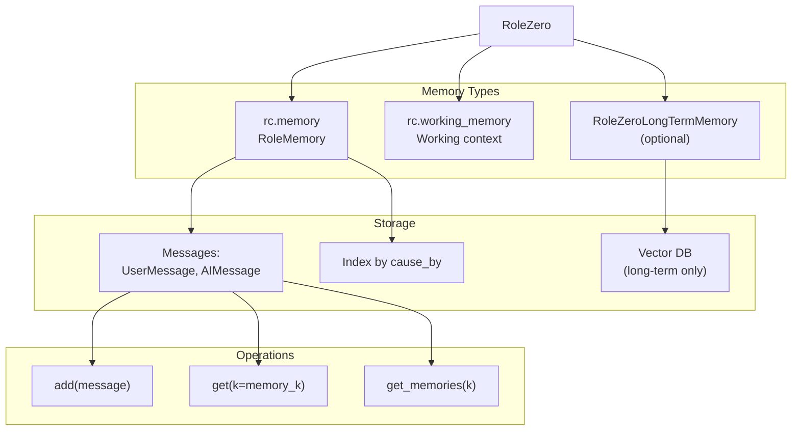

### Memory Configuration

**memory_k** [metagpt/roles/di/role_zero.py:97](): Number of recent messages to use as context (default: 200)

**Long-term Memory** [metagpt/roles/di/role_zero.py:174-193](): Optionally enabled via config:

```python
if self.config.role_zero.enable_longterm_memory:
    self.rc.memory = RoleZeroLongTermMemory(
        **self.rc.memory.model_dump(),
        persist_path=self.config.role_zero.longterm_memory_persist_path,
        collection_name=self.name.replace(" ", ""),
        memory_k=self.config.role_zero.memory_k,
        similarity_top_k=self.config.role_zero.similarity_top_k,
        use_llm_ranker=self.config.role_zero.use_llm_ranker,
    )
```

### Memory Usage in Think

During `_think()`, memory is retrieved and parsed [metagpt/roles/di/role_zero.py:241-244]():

```python
memory = self.rc.memory.get(self.memory_k)
memory = await parse_browser_actions(memory, browser=self.browser)
memory = await parse_editor_result(memory)
memory = await parse_images(memory, llm=self.llm)
```

**Parsing Functions**:
- `parse_browser_actions`: Enriches browser commands with visible page content
- `parse_editor_result`: Formats file operation results
- `parse_images`: Converts image paths to base64 for vision models

**Sources:** [metagpt/roles/di/role_zero.py:97](), [metagpt/roles/di/role_zero.py:174-193](), [metagpt/roles/di/role_zero.py:241-244](), [metagpt/memory/role_zero_memory.py]()

---

## Prompts and Instructions

RoleZero's behavior is guided by carefully crafted prompts defined in [metagpt/prompts/di/role_zero.py:1-268]().

### Core Prompts

| Prompt | Purpose | Location |
|--------|---------|----------|
| `ROLE_INSTRUCTION` | Base instructions for all RoleZero agents | [metagpt/prompts/di/role_zero.py:3-14]() |
| `SYSTEM_PROMPT` | System message template with placeholders | [metagpt/prompts/di/role_zero.py:25-50]() |
| `CMD_PROMPT` | Command generation prompt | [metagpt/prompts/di/role_zero.py:57-93]() |
| `QUICK_THINK_SYSTEM_PROMPT` | Intent classification system message | [metagpt/prompts/di/role_zero.py:148-176]() |
| `QUICK_THINK_PROMPT` | Intent classification user prompt | [metagpt/prompts/di/role_zero.py:178-188]() |
| `QUICK_RESPONSE_SYSTEM_PROMPT` | Direct answer system message | [metagpt/prompts/di/role_zero.py:230-233]() |

### System Prompt Structure

The `SYSTEM_PROMPT` is formatted during `_think()` [metagpt/prompts/di/role_zero.py:25-50]():

```
# Basic Info
{role_info}  ← Name, profile, goal, timestamp

# Data Structure
class Task(BaseModel):
    task_id: str = ""
    dependent_task_ids: list[str] = []
    instruction: str = ""
    task_type: str = ""
    assignee: str = ""

# Available Task Types
{task_type_desc}  ← Task type descriptions (optional)

# Available Commands
{available_commands}  ← JSON schemas from tool_recommender
Special Command: Use {"command_name": "end"} to indicate completion

# Example
{example}  ← From experience_retriever

# Instruction
{instruction}  ← Role-specific guidelines
```

### Command Prompt Structure

The `CMD_PROMPT` guides command generation [metagpt/prompts/di/role_zero.py:57-93]():

```
# Past Experience
{EXPERIENCE_MASK}  ← Placeholder for cached experiences

# Tool State
{current_state}  ← Editor open file, terminal directory

# Current Plan
{plan_status}  ← Task list with status

# Current Task
{current_task}  ← Current task details

# Response Language
you must respond in {respond_language}.

[Guidelines...]

# Output format:
```json
[
    {
        "command_name": "ClassName.method_name" or "function_name",
        "args": {"arg_name": arg_value, ...}
    },
    ...
]
```
```

### Language Detection

RoleZero detects the user's language to respond appropriately [metagpt/roles/di/role_zero.py:210-211]():

```python
detect_language_prompt = DETECT_LANGUAGE_PROMPT.format(requirement=self.planner.plan.goal)
self.respond_language = await self.llm.aask(detect_language_prompt)
```

**Sources:** [metagpt/prompts/di/role_zero.py:1-268](), [metagpt/roles/di/role_zero.py:210-211](), [metagpt/roles/di/role_zero.py:224-238]()

---

## Specialized RoleZero Implementations

Three main specialized agents extend RoleZero for specific domains.

### Specialization Comparison

| Agent | Profile | Goal | Custom Tools | Tool Recommender | Experience |
|-------|---------|------|--------------|------------------|------------|
| **Engineer2** | Engineer | Game/app/web dev & deployment | `write_new_code`, `CodeReview`, `Deployer` | Default (BM25) | `ENGINEER_EXAMPLE` |
| **DataAnalyst** | DataAnalyst | Data science, ML, web scraping | `write_and_exec_code` | BM25 + Custom tools | `KeywordExpRetriever` |
| **TeamLeader** | Team Leader | Manage team, delegate tasks | `publish_team_message` | Default (BM25) | `SimpleExpRetriever` |

### Engineer2 Architecture

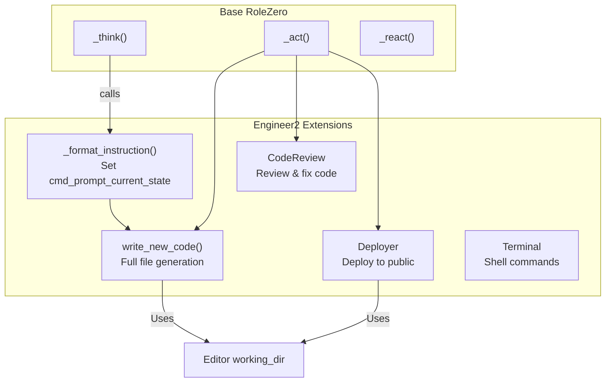

**Key Features**:
- `write_new_code()` [metagpt/roles/di/engineer2.py:112-142](): Generates complete file content using LLM
- `_format_instruction()` [metagpt/roles/di/engineer2.py:62-73](): Displays current directory and open file in prompts
- Code review integration via `CodeReview` tool [metagpt/tools/libs/cr.py]()

**Sources:** [metagpt/roles/di/engineer2.py:1-172](), [metagpt/prompts/di/engineer2.py:1-105]()

### DataAnalyst Architecture

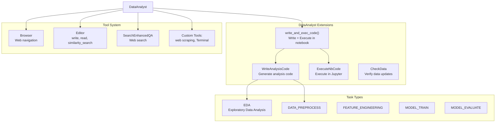

**Key Features**:
- `write_and_exec_code()` [metagpt/roles/di/data_analyst.py:61-125](): Iterative code generation with reflection
- Task type descriptions [metagpt/prompts/di/data_analyst.py:17]() for specialized data science tasks
- Custom tool recommender [metagpt/roles/di/data_analyst.py:50-52]() for web scraping and terminal
- Automatic data checking [metagpt/roles/di/data_analyst.py:127-142]() after preprocessing/feature engineering

**Sources:** [metagpt/roles/di/data_analyst.py:1-155](), [metagpt/prompts/di/data_analyst.py:1-27]()

### TeamLeader Architecture

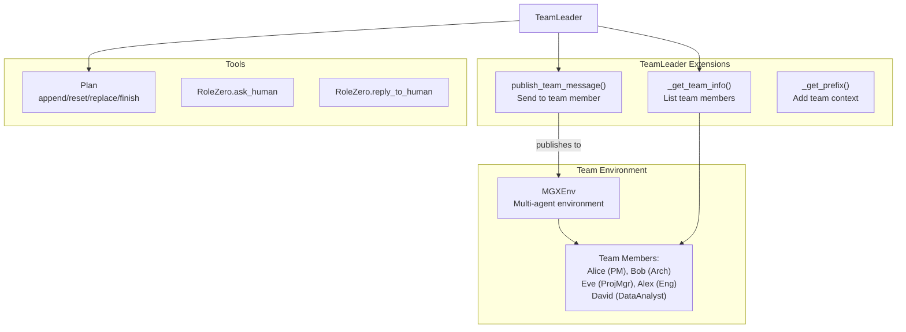

**Key Features**:
- `publish_team_message()` [metagpt/roles/di/team_leader.py:75-86](): Sends UserMessage to specific team member
- Limited `max_react_loop=3` [metagpt/roles/di/team_leader.py:29](): Usually acts once per turn
- Custom message routing [metagpt/roles/di/team_leader.py:64-73](): Overrides default publish to send to no one unless specified
- Team complexity estimation [metagpt/prompts/di/team_leader.py:19-25](): T-shirt sizing (XS to XL) to determine if standard SOP is needed

**Sources:** [metagpt/roles/di/team_leader.py:1-91](), [metagpt/prompts/di/team_leader.py:1-64]()

---

## Integration Points

### Editor Tool Integration

The `Editor` class [metagpt/tools/libs/editor.py:102-869]() provides file operations with safety features:

**Key Methods Mapped to RoleZero**:
- `read(path)`: Read entire file with line numbers [metagpt/tools/libs/editor.py:133-158]()
- `open_file(path, line_number, context_lines)`: View file window [metagpt/tools/libs/editor.py:279-314]()
- `edit_file_by_replace(...)`: Replace lines with validation [metagpt/tools/libs/editor.py:703-876]()
- `insert_content_at_line(...)`: Insert content with linting [metagpt/tools/libs/editor.py:878-949]()
- `similarity_search(query, paths)`: Semantic file search using `IndexRepo` [metagpt/tools/libs/editor.py:984-1027]()

**Auto-linting** [metagpt/tools/libs/editor.py:202-215](): When `enable_auto_lint=True`, uses `Linter` to check Python syntax and provide error guidance.

**Sources:** [metagpt/tools/libs/editor.py:102-1027]()

### IndexRepo for Semantic Search

`IndexRepo` [metagpt/tools/libs/index_repo.py:47-407]() provides semantic file search capabilities:

```python
# Used by Editor.similarity_search()
repo = IndexRepo(
    persist_path="/data/.index/uploads",
    root_path="/data/uploads",
    min_token_count=10000,
    max_token_count=100000000
)

# Search returns nodes with scores
results = await repo.search(query="authentication logic", filenames=file_list)
```

**Features**:
- FAISS-based vector search
- Automatic indexing of text files
- Fingerprint-based change detection
- LLM ranker for result reranking

**Sources:** [metagpt/tools/libs/index_repo.py:47-407](), [metagpt/tools/libs/editor.py:984-1027]()

### MGXEnv Message Orchestration

`MGXEnv` [metagpt/environment/mgx/mgx_env.py:11-100]() orchestrates multi-agent communication:

**Key Features**:
- `publish_message()` [metagpt/environment/mgx/mgx_env.py:24-62](): Routes messages through TeamLeader
- `move_message_info_to_content()` [metagpt/environment/mgx/mgx_env.py:73-89](): Adds sender/recipient info to content
- `attach_images()` [metagpt/environment/mgx/mgx_env.py:91-96](): Extracts and encodes images for multi-modal support
- `direct_chat_roles` [metagpt/environment/mgx/mgx_env.py:14](): Tracks direct human-agent conversations

**Message Flow**:
1. User message → Publishes to environment
2. If direct chat (e.g., "@Alex"), bypasses TeamLeader
3. Otherwise, message sent to TeamLeader
4. TeamLeader processes and routes to appropriate role
5. Role completes work and responds
6. Response goes back to TeamLeader
7. TeamLeader replies to user

**Sources:** [metagpt/environment/mgx/mgx_env.py:11-100]()

---

