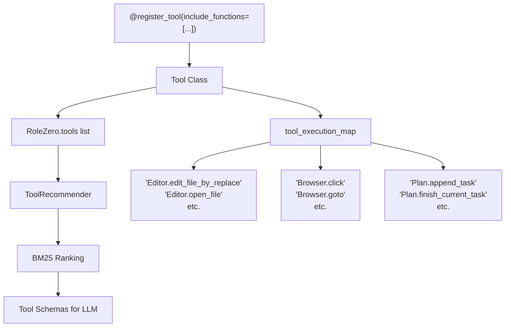
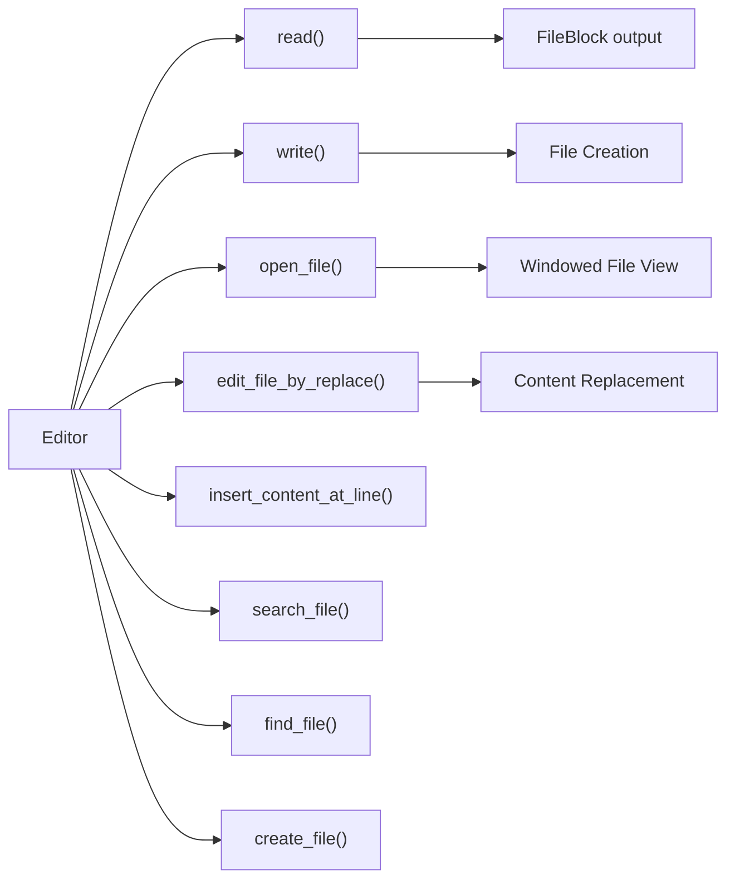
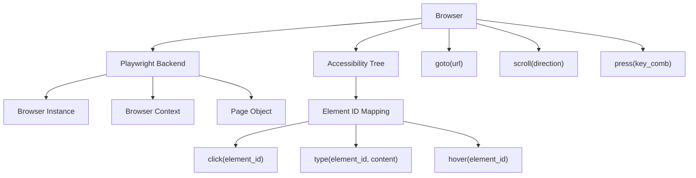
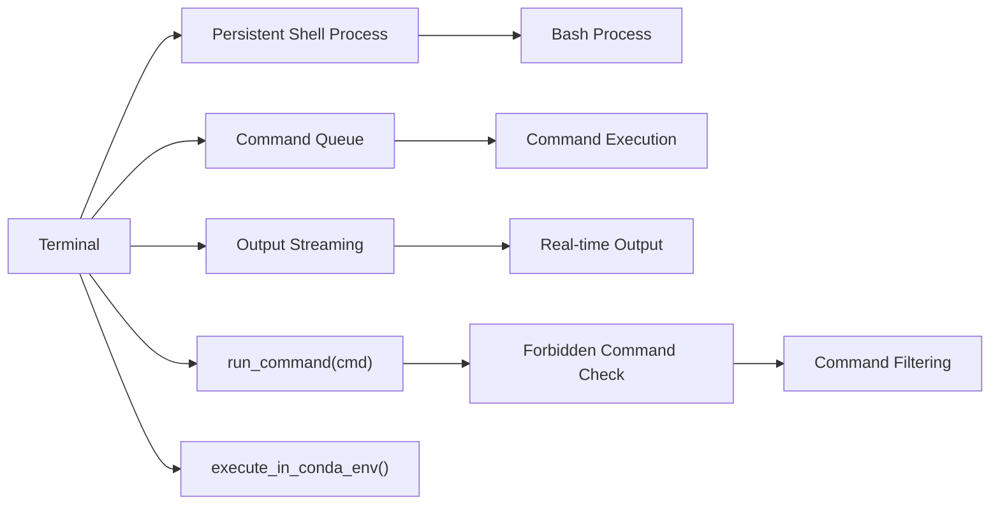
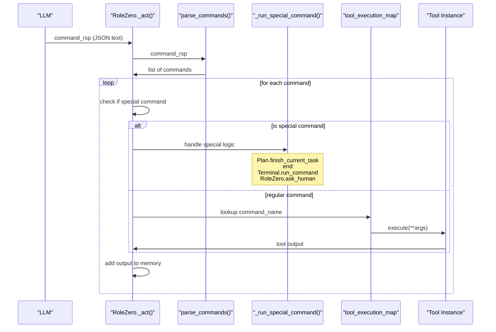
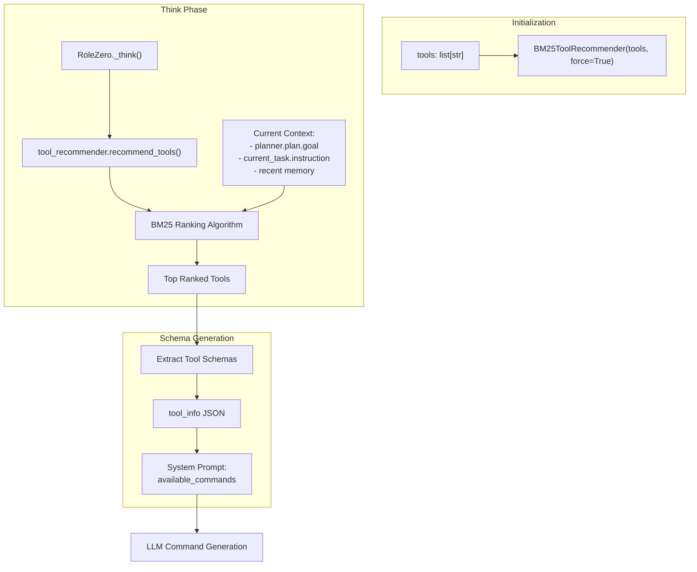
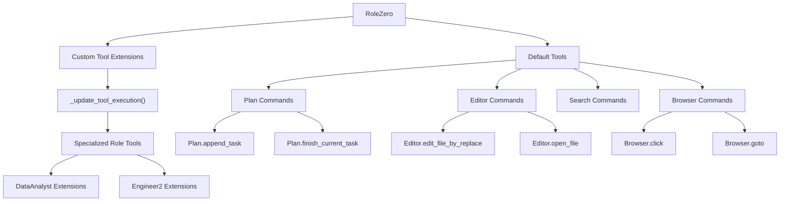

<!-- source: DeepWiki mcp.deepwiki.com · repo FoundationAgents/MetaGPT · page 4.2 Tool Integration System · fetched 2026-10-30 -->

# Tool Integration

<details>
<summary>Relevant source files</summary>

The following files were used as context for generating this wiki page:

- [metagpt/environment/mgx/mgx_env.py](metagpt/environment/mgx/mgx_env.py)
- [metagpt/prompts/di/data_analyst.py](metagpt/prompts/di/data_analyst.py)
- [metagpt/prompts/di/engineer2.py](metagpt/prompts/di/engineer2.py)
- [metagpt/prompts/di/role_zero.py](metagpt/prompts/di/role_zero.py)
- [metagpt/prompts/di/team_leader.py](metagpt/prompts/di/team_leader.py)
- [metagpt/roles/di/data_analyst.py](metagpt/roles/di/data_analyst.py)
- [metagpt/roles/di/engineer2.py](metagpt/roles/di/engineer2.py)
- [metagpt/roles/di/role_zero.py](metagpt/roles/di/role_zero.py)
- [metagpt/roles/di/team_leader.py](metagpt/roles/di/team_leader.py)
- [metagpt/strategy/experience_retriever.py](metagpt/strategy/experience_retriever.py)
- [metagpt/strategy/thinking_command.py](metagpt/strategy/thinking_command.py)
- [metagpt/tools/libs/editor.py](metagpt/tools/libs/editor.py)
- [metagpt/tools/libs/index_repo.py](metagpt/tools/libs/index_repo.py)
- [metagpt/tools/libs/linter.py](metagpt/tools/libs/linter.py)
- [metagpt/utils/file.py](metagpt/utils/file.py)
- [tests/metagpt/environment/mgx_env/run_mgx_env.py](tests/metagpt/environment/mgx_env/run_mgx_env.py)
- [tests/metagpt/roles/di/run_engineer2.py](tests/metagpt/roles/di/run_engineer2.py)
- [tests/metagpt/tools/libs/test_editor.py](tests/metagpt/tools/libs/test_editor.py)

</details>


This document covers the tool integration system within MetaGPT's RoleZero framework, which enables dynamic agents to utilize various tools for task execution. This system provides a structured approach to register, recommend, and execute tools based on agent needs. For information about the broader RoleZero architecture, see [RoleZero Architecture](#4.1). For details on experience and memory management related to tool usage, see [Experience and Memory Management](#4.3).

## Tool Registration System

MetaGPT uses a decorator-based tool registration system that allows tools to expose their functionality to the agent framework. Tools are registered using the `@register_tool` decorator, which specifies which functions to include as callable commands.



**Tool Registration and Execution Flow**

Sources: [metagpt/roles/di/role_zero.py:74-78](), [metagpt/roles/di/role_zero.py:119-171](), [metagpt/tools/libs/editor.py:84-101]()

The registration system connects tools to the execution framework:
- `include_functions`: List of method names to expose as commands (e.g., `["edit_file_by_replace", "open_file"]`)
- Registered tools are referenced in `RoleZero.tools` list as strings like `"Editor"` or `"Browser:goto,scroll"`
- The `tool_execution_map` dictionary maps command names (e.g., `"Editor.open_file"`) to callable functions
- Tool schemas are extracted and provided to the LLM for command generation

## Built-in Tool Categories

The RoleZero framework includes three primary categories of built-in tools:

| Tool Category | Primary Class | Key Capabilities |
|---------------|---------------|------------------|
| File Management | `Editor` | File editing, reading, searching, creation |
| Web Interaction | `Browser` | Web browsing, clicking, form interaction |
| System Interaction | `Terminal` | Command execution, environment management |

### File Management Tools

The `Editor` class provides comprehensive file manipulation capabilities through a window-based interface that shows limited lines at a time for efficient processing.



**Editor Tool Operations**

Sources: [metagpt/tools/libs/editor.py:102-167](), [metagpt/tools/libs/editor.py:279-314](), [metagpt/tools/libs/editor.py:703-776]()

Key features include:
- **Windowed viewing**: Shows files in 200-line windows for efficient processing
- **Syntax validation**: Optional auto-linting for code files using the `Linter` class
- **Safe editing**: Atomic file operations with rollback on syntax errors
- **Content-aware operations**: Handles different file types (text, PDF, DOCX)

### Web Interaction Tools

The `Browser` class enables web navigation and interaction through Playwright, providing accessibility tree-based element interaction.



**Browser Tool Architecture**

Sources: [metagpt/tools/libs/browser.py:47-81](), [metagpt/tools/libs/browser.py:98-125](), [metagpt/tools/libs/browser.py:162-167]()

The browser tool provides:
- **Element-based interaction**: Uses accessibility tree for reliable element targeting
- **Asynchronous operations**: All browser actions are async for responsiveness
- **State management**: Maintains browser context across multiple operations
- **Visual feedback**: Reports page content and URLs after each action

### System Interaction Tools

The `Terminal` class provides command execution capabilities with persistent shell sessions and real-time output streaming.



**Terminal Tool Operations**

Sources: [metagpt/tools/libs/terminal.py:16-36](), [metagpt/tools/libs/terminal.py:57-96](), [metagpt/tools/libs/terminal.py:98-120]()

Terminal features include:
- **Persistent session**: Maintains state across command executions
- **Security filtering**: Blocks potentially harmful commands
- **Environment management**: Conda environment execution support
- **Real-time streaming**: Live output for long-running processes

## Tool Execution Framework

The RoleZero class implements a command-based tool execution framework that parses LLM-generated JSON commands into structured tool calls, with special handling for certain command types.



**Tool Command Execution Flow**

Sources: [metagpt/roles/di/role_zero.py:284-301](), [metagpt/roles/di/role_zero.py:385-415](), [metagpt/roles/di/role_zero.py:417-447]()

The execution framework includes:

**Command Categories**:
- **Regular commands**: Executed via `tool_execution_map` lookup (e.g., `Editor.open_file`, `Browser.goto`)
- **Special commands**: Require custom handling logic defined in `_run_special_command()` (e.g., `Plan.finish_current_task`, `end`, `RoleZero.ask_human`)
- **Exclusive commands**: Cannot be executed multiple times in the same command batch (e.g., `Editor.edit_file_by_replace`, `Editor.insert_content_at_line`)

**Execution Process**:
1. Parse JSON command array from LLM response
2. Check if command is in `special_tool_commands` list
3. For special commands, execute custom logic; for regular commands, lookup and call from `tool_execution_map`
4. Capture exceptions and format as error messages
5. Stop execution if any command fails
6. Add all outputs to agent memory

Sources: [metagpt/roles/di/role_zero.py:77-85](), [metagpt/roles/di/role_zero.py:417-447]()

## Tool Recommendation System

RoleZero uses a BM25-based tool recommendation system (`BM25ToolRecommender`) to dynamically suggest relevant tools based on the current task context, reducing prompt size while maintaining tool availability.



**Tool Recommendation Flow**

Sources: [metagpt/roles/di/role_zero.py:108-110](), [metagpt/roles/di/role_zero.py:218-220]()

### Recommendation Process

**Initialization** [metagpt/roles/di/role_zero.py:108-110]():
```python
if self.tools and not self.tool_recommender:
    self.tool_recommender = BM25ToolRecommender(tools=self.tools, force=True)
```
- `force=True`: Always includes all specified tools, regardless of ranking
- Parses tool strings to extract tool names and allowed functions

**Dynamic Recommendation** [metagpt/roles/di/role_zero.py:218-220]():
```python
tools = await self.tool_recommender.recommend_tools()
tool_info = json.dumps({tool.name: tool.schemas for tool in tools})
```
- BM25 algorithm ranks tools based on textual similarity to current context
- Returns `ToolType` objects containing tool name and JSON schemas
- Schemas describe function signatures, parameters, and descriptions
- `tool_info` is injected into system prompt as `available_commands`

### Context-Aware Selection

The recommendation considers:
- **Goal**: `planner.plan.goal` - overall task objective
- **Current Task**: `current_task.instruction` - specific step being executed
- **Recent Memory**: Recent messages and observations
- **Plan Status**: Progress through task list

This context is used as query text for BM25 ranking, ensuring the LLM receives the most relevant tools for the current situation.

Sources: [metagpt/roles/di/role_zero.py:108-110](), [metagpt/roles/di/role_zero.py:218-220](), [metagpt/roles/di/role_zero.py:223-230]()

## Dynamic Tool Integration in RoleZero

RoleZero supports dynamic tool integration through customizable execution maps and specialized tool commands.



**Dynamic Tool Integration Architecture**

Sources: [metagpt/roles/di/role_zero.py:119-171](), [metagpt/roles/di/role_zero.py:195-196](), [metagpt/roles/di/data_analyst.py:54-59]()

Key integration mechanisms include:

**Execution Map Structure**:
- Default mappings for core plan and interaction commands
- Dynamic updates through `_update_tool_execution()` method
- Specialized command handling for complex operations

**Special Command Categories**:
- **Plan commands**: Task management and workflow control
- **Human interaction**: `ask_human()` and `reply_to_human()` for user communication
- **Exclusive commands**: Commands that cannot be executed simultaneously

**Role-Specific Extensions**:
- `DataAnalyst` adds `write_and_exec_code` for notebook execution
- `Engineer2` adds `write_new_code` for file creation and deployment tools
- `TeamLeader` adds `publish_team_message` for team coordination

Sources: [metagpt/roles/di/role_zero.py:54-171](), [metagpt/tools/libs/editor.py:84-167](), [metagpt/tools/libs/browser.py:32-81](), [metagpt/tools/libs/terminal.py:15-96](), [metagpt/roles/di/data_analyst.py:25-59](), [metagpt/roles/di/engineer2.py:31-107]()

---

