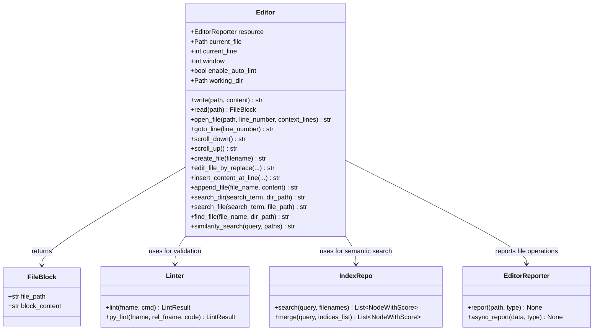
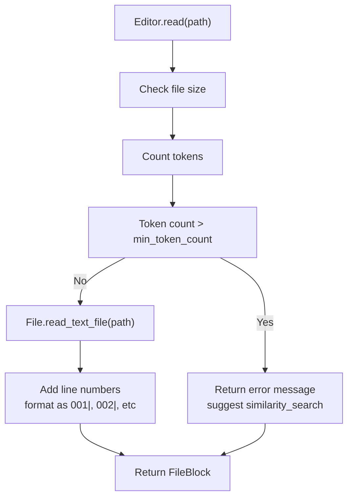
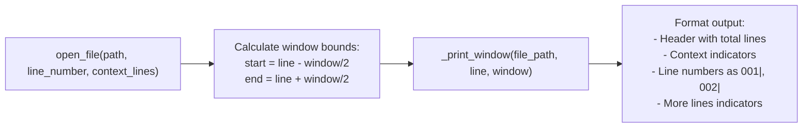
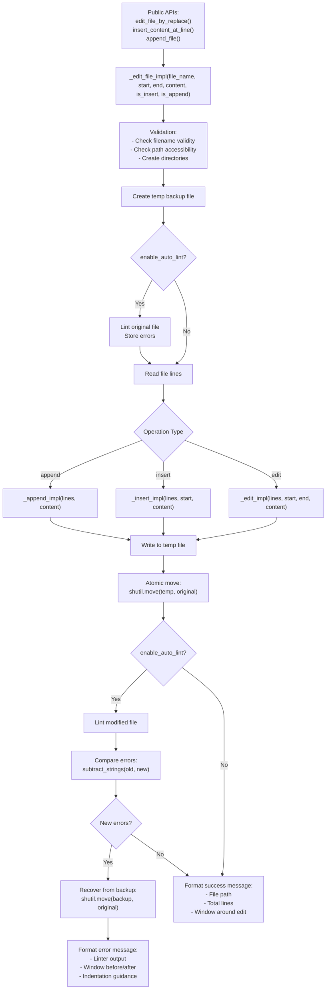
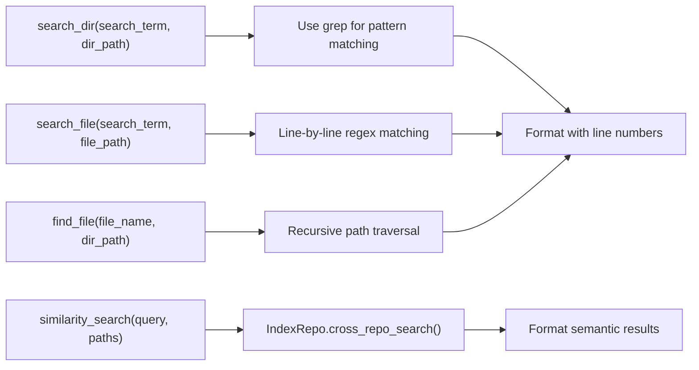
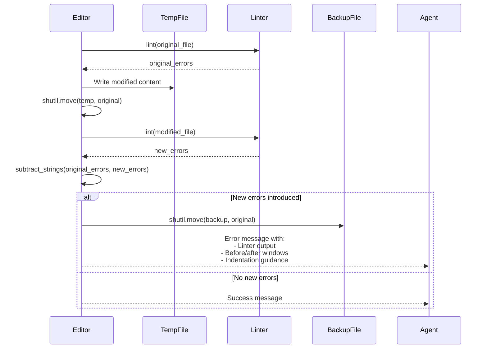
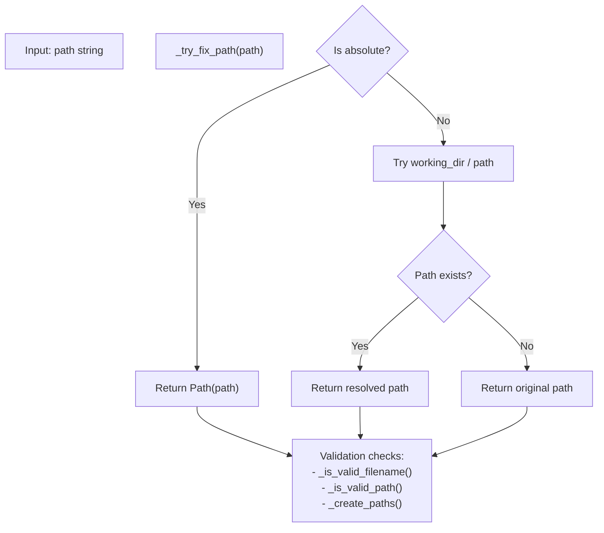
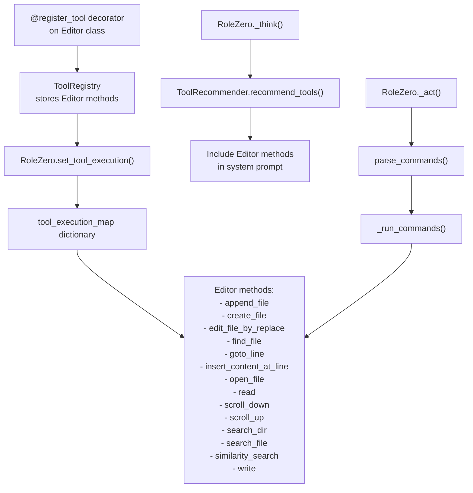

<!-- source: DeepWiki mcp.deepwiki.com · repo FoundationAgents/MetaGPT · page 4.3 Editor Tool Deep Dive · fetched 2026-10-30 -->

# Editor Tool Deep Dive

<details>
<summary>Relevant source files</summary>

The following files were used as context for generating this wiki page:

- [metagpt/environment/mgx/mgx_env.py](metagpt/environment/mgx/mgx_env.py)
- [metagpt/prompts/di/data_analyst.py](metagpt/prompts/di/data_analyst.py)
- [metagpt/prompts/di/engineer2.py](metagpt/prompts/di/engineer2.py)
- [metagpt/prompts/di/role_zero.py](metagpt/prompts/di/role_zero.py)
- [metagpt/prompts/di/team_leader.py](metagpt/prompts/di/team_leader.py)
- [metagpt/roles/di/data_analyst.py](metagpt/roles/di/data_analyst.py)
- [metagpt/roles/di/engineer2.py](metagpt/roles/di/engineer2.py)
- [metagpt/roles/di/role_zero.py](metagpt/roles/di/role_zero.py)
- [metagpt/roles/di/team_leader.py](metagpt/roles/di/team_leader.py)
- [metagpt/strategy/experience_retriever.py](metagpt/strategy/experience_retriever.py)
- [metagpt/strategy/thinking_command.py](metagpt/strategy/thinking_command.py)
- [metagpt/tools/libs/editor.py](metagpt/tools/libs/editor.py)
- [metagpt/tools/libs/index_repo.py](metagpt/tools/libs/index_repo.py)
- [metagpt/tools/libs/linter.py](metagpt/tools/libs/linter.py)
- [metagpt/utils/file.py](metagpt/utils/file.py)
- [tests/metagpt/environment/mgx_env/run_mgx_env.py](tests/metagpt/environment/mgx_env/run_mgx_env.py)
- [tests/metagpt/roles/di/run_engineer2.py](tests/metagpt/roles/di/run_engineer2.py)
- [tests/metagpt/tools/libs/test_editor.py](tests/metagpt/tools/libs/test_editor.py)

</details>


## Purpose and Scope

The Editor tool is a comprehensive file operations system that enables RoleZero-based agents to read, navigate, edit, and search code files programmatically. It serves as the primary interface for autonomous code manipulation within the MetaGPT framework, providing agents with human-like file editing capabilities enhanced by automatic linting and semantic search.

This document covers the Editor tool's architecture, operations, and integration patterns. For information about the RoleZero agent framework that uses this tool, see [RoleZero Core Architecture](#4.1). For details on tool registration and recommendation, see [Tool Integration System](#4.2).

Sources: [metagpt/tools/libs/editor.py:102-107]()

## Core Architecture

### Editor Class Structure



The `Editor` class is the central component, decorated with `@register_tool` to make it available to RoleZero agents. It maintains state including the currently open file, cursor position, and window size for navigation.

Sources: [metagpt/tools/libs/editor.py:84-114]()

## File Reading Operations

### Read Methods

The Editor provides multiple read strategies based on file size and type:



The `read()` method includes a safety mechanism that prevents reading excessively large files (> 5 * DEFAULT_MIN_TOKEN_COUNT bytes or > DEFAULT_MIN_TOKEN_COUNT tokens). For large files, it returns an error message suggesting the use of `similarity_search()` instead.

Sources: [metagpt/tools/libs/editor.py:133-158]()

### Supported File Types

The Editor integrates with `File.read_text_file()` to support multiple file formats:
- Plain text files (via aiofiles)
- PDF documents (via llama-index PDFReader or OmniParse)
- DOCX documents (via read_docx utility or OmniParse)

Sources: [metagpt/tools/libs/editor.py:133-158](), [metagpt/utils/file.py:109-147]()

## File Navigation

### Window-Based Viewing

The Editor uses a windowed view system to display portions of files with configurable context:



**Navigation Commands:**
- `open_file(path, line_number=1, context_lines=100)`: Opens file and displays lines around target
- `goto_line(line_number)`: Jumps to specific line number
- `scroll_down()`: Moves window down by 200 lines (default window size)
- `scroll_up()`: Moves window up by 200 lines

The default window size is 200 lines, configurable up to 2000 lines maximum.

Sources: [metagpt/tools/libs/editor.py:279-355]()

### Window Calculation Logic

The `_print_window()` method implements smart boundary handling:

```python
# Ensures at least one line above and below target when possible
if start == 1:
    end = min(total_lines, start + window - 1)
if end == total_lines:
    start = max(1, end - window + 1)
```

This creates a consistent viewing experience where the cursor is centered unless near file boundaries.

Sources: [metagpt/tools/libs/editor.py:217-261]()

## File Editing Operations

### Edit Implementation Architecture



Sources: [metagpt/tools/libs/editor.py:509-701]()

### Edit Operations

#### edit_file_by_replace

The primary editing method that replaces a range of lines with new content:

```python
def edit_file_by_replace(
    file_name: str,
    first_replaced_line_number: int,
    first_replaced_line_content: str,
    last_replaced_line_number: int,
    last_replaced_line_content: str,
    new_content: str,
) -> str
```

**Key features:**
- Validates that line numbers match their expected content before editing
- Returns detailed error messages if content mismatches
- Supports deletion by passing empty `new_content`
- Requires full line range specification for safety

Sources: [metagpt/tools/libs/editor.py:703-801]()

#### insert_content_at_line

Inserts content at a specific line without replacing existing content:

```python
def insert_content_at_line(
    file_name: str,
    line_number: int,
    insert_content: str,
) -> str
```

The implementation uses `_insert_impl()` which handles edge cases like empty files and maintains proper newline formatting.

Sources: [metagpt/tools/libs/editor.py:803-839]()

#### append_file

Appends content to the end of a file:

```python
def append_file(file_name: str, content: str) -> str
```

Uses `_append_impl()` which intelligently handles newlines at file boundaries and empty files.

Sources: [metagpt/tools/libs/editor.py:841-866]()

### Safety Mechanisms

**Temporary File Strategy:**
All edits use Python's `tempfile.NamedTemporaryFile` to create backups before modification. If linting fails, the original file is restored from backup via `shutil.move()`.

**Atomic Operations:**
After writing to temp file, `shutil.move()` provides atomic replacement, preventing partial writes.

**Content Validation:**
`edit_file_by_replace()` requires both line numbers and line content, validating matches before executing edits.

Sources: [metagpt/tools/libs/editor.py:556-658]()

## Search Capabilities

### Search Operation Types



Sources: [metagpt/tools/libs/editor.py:868-959]()

### Semantic Search via IndexRepo

The `similarity_search()` method provides AI-powered search across files:

```python
async def similarity_search(
    self, query: str, paths: Union[str, list[str]]
) -> str
```

**Implementation:**
1. Converts paths to list format
2. Calls `IndexRepo.cross_repo_search(query, path)` for each path
3. IndexRepo uses FAISS vector indexing with embedding models
4. Returns top-k semantically similar code snippets

The IndexRepo system maintains fingerprints of indexed files and automatically rebuilds indexes when file content changes.

Sources: [metagpt/tools/libs/editor.py:929-959](), [metagpt/tools/libs/index_repo.py:76-126]()

### Pattern-Based Search

**search_dir()**: Uses system `grep` command for fast pattern matching across directories. Returns formatted results with file paths and line numbers.

**search_file()**: Performs Python regex matching line-by-line, useful when grep is unavailable or for complex patterns.

**find_file()**: Performs filename-based search using `Path.rglob()` for recursive traversal.

Sources: [metagpt/tools/libs/editor.py:868-928]()

## Linting Integration

### Automatic Validation System



Sources: [metagpt/tools/libs/editor.py:559-658]()

### Linter Implementation

The `Linter` class supports multiple languages with different validation strategies:

| Language | Validation Method | Description |
|----------|------------------|-------------|
| Python | `py_lint()` | flake8 for fatal errors + compile() + tree-sitter |
| JavaScript | `fake_lint()` | Bypassed (tree-sitter lacks full JS support) |
| CSS | `fake_lint()` | Bypassed (tree-sitter lacks CSS support) |
| SQL | `fake_lint()` | Bypassed (tree-sitter lacks full SQL support) |
| Other | `basic_lint()` | tree-sitter syntax error detection |

**Python Linting Pipeline:**
1. **flake8**: Checks for fatal errors (F821, F822, F831, E112, E113, E999, E902)
2. **compile()**: Python's built-in compiler for syntax validation
3. **tree-sitter**: AST-based error detection

Sources: [metagpt/tools/libs/linter.py:28-121]()

### Error Reporting

When linting detects new errors, the Editor provides:
- **LINTER_ERROR_MSG**: Error text from linter
- **window_before_applied**: Code before edit (from backup)
- **window_after_applied**: Code after edit (from modified file)
- **Indentation guidance**: Specific suggestions based on indentation analysis

This comprehensive error output helps LLM-based agents understand and fix their mistakes.

Sources: [metagpt/tools/libs/editor.py:40-69](), [metagpt/tools/libs/editor.py:647-658]()

## Safety Features

### Path Resolution and Validation



The `_try_fix_path()` method enables agents to use relative paths, automatically resolving them against the Editor's `working_dir`.

Sources: [metagpt/tools/libs/editor.py:1034-1045]()

### File Operation Safety

**Invalid Character Detection:**
`_is_valid_filename()` checks for OS-specific invalid characters:
- Windows: `<>:"/\|?*`
- Unix-like: null byte `\0`

**Permission Handling:**
`_is_valid_path()` and `_create_paths()` use try-except blocks to handle `PermissionError` gracefully.

**Temporary Backup:**
All editing operations create a `tempfile.NamedTemporaryFile(delete=True)` that auto-deletes on success but can restore on failure.

Sources: [metagpt/tools/libs/editor.py:161-189](), [metagpt/tools/libs/editor.py:556-601]()

## Integration with RoleZero Agents

### Tool Registration and Execution



Sources: [metagpt/roles/di/role_zero.py:119-171]()

### RoleZero Usage Pattern

RoleZero agents access Editor methods through the `tool_execution_map`:

```python
self.tool_execution_map.update({
    f"Editor.{i}": getattr(self.editor, i)
    for i in [
        "append_file",
        "create_file",
        "edit_file_by_replace",
        "find_file",
        "goto_line",
        "insert_content_at_line",
        "open_file",
        "read",
        "scroll_down",
        "scroll_up",
        "search_dir",
        "search_file",
        "similarity_search",
        "write",
    ]
})
```

During execution, agents output commands in JSON format:
```json
{
    "command_name": "Editor.edit_file_by_replace",
    "args": {
        "file_name": "/path/to/file.py",
        "first_replaced_line_number": 10,
        "first_replaced_line_content": "old line",
        "last_replaced_line_number": 12,
        "last_replaced_line_content": "old line",
        "new_content": "new implementation"
    }
}
```

Sources: [metagpt/roles/di/role_zero.py:147-168](), [metagpt/roles/di/role_zero.py:385-415]()

### Engineer2 Extensions

Engineer2 extends RoleZero with additional file operations:

**Current State Awareness:**
```python
async def _format_instruction(self):
    current_directory = (await self.terminal.run_command("pwd")).strip()
    self.editor._set_workdir(current_directory)
    state = {
        "editor_open_file": self.editor.current_file,
        "current_directory": current_directory,
    }
    self.cmd_prompt_current_state = CURRENT_STATE.format(**state).strip()
```

This dynamic state information is injected into the command prompt, making the agent aware of its current file and directory context.

**Whole-File Writing:**
Engineer2 adds `write_new_code()` method that generates complete file contents using LLM and writes them using `Editor.write()`. This complements the line-level editing operations.

Sources: [metagpt/roles/di/engineer2.py:62-73](), [metagpt/roles/di/engineer2.py:112-142]()

### DataAnalyst Integration

DataAnalyst uses a restricted set of Editor operations focused on reading and searching:

```python
tools: list[str] = [
    "Plan",
    "DataAnalyst",
    "RoleZero",
    "Browser",
    "Editor:write,read,similarity_search",  # Limited Editor access
    "SearchEnhancedQA",
]
```

This restriction prevents DataAnalyst from making complex code edits, keeping its focus on data analysis tasks.

Sources: [metagpt/roles/di/data_analyst.py:26-40]()

## Usage Examples

### Example 1: Sequential File Editing

From RoleZero agent perspective:

```json
[
    {
        "command_name": "Editor.open_file",
        "args": {
            "path": "/workspace/game.py",
            "line_number": 50
        }
    }
]
```

Agent receives window showing lines around line 50. Next turn:

```json
[
    {
        "command_name": "Editor.edit_file_by_replace",
        "args": {
            "file_name": "/workspace/game.py",
            "first_replaced_line_number": 52,
            "first_replaced_line_content": "    def move(self):",
            "last_replaced_line_number": 54,
            "last_replaced_line_content": "        pass",
            "new_content": "    def move(self):\n        self.x += self.dx\n        self.y += self.dy"
        }
    }
]
```

If successful, agent receives updated window showing the changes. If linting fails, receives error with before/after comparison.

Sources: [tests/metagpt/tools/libs/test_editor.py:67-103]()

### Example 2: Search and Edit Workflow

Agent searching for specific code pattern:

```json
[
    {
        "command_name": "Editor.search_dir",
        "args": {
            "search_term": "def calculate_score",
            "dir_path": "/workspace/src"
        }
    }
]
```

Receives file paths and line numbers. Then opens and edits:

```json
[
    {
        "command_name": "Editor.open_file",
        "args": {
            "path": "/workspace/src/scoring.py",
            "line_number": 42
        }
    }
]
```

Sources: [metagpt/tools/libs/editor.py:868-899]()

### Example 3: Semantic Search for Large Files

When file is too large to read entirely:

```json
[
    {
        "command_name": "Editor.similarity_search",
        "args": {
            "query": "function that handles user authentication",
            "paths": ["/workspace/src/auth.py"]
        }
    }
]
```

Returns semantically relevant code snippets with context, allowing agent to understand large codebases without reading entire files.

Sources: [metagpt/tools/libs/editor.py:929-959](), [metagpt/tools/libs/index_repo.py:409-445]()

---

