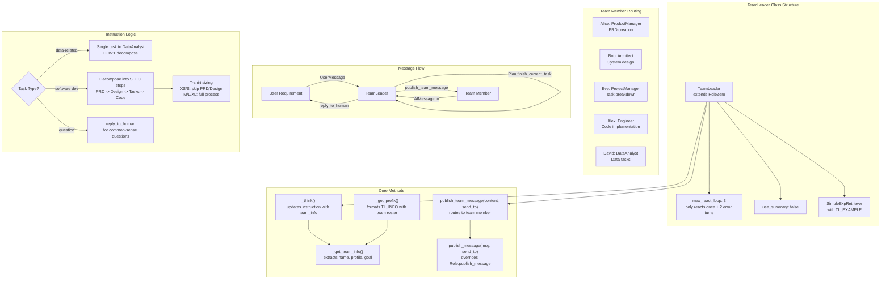
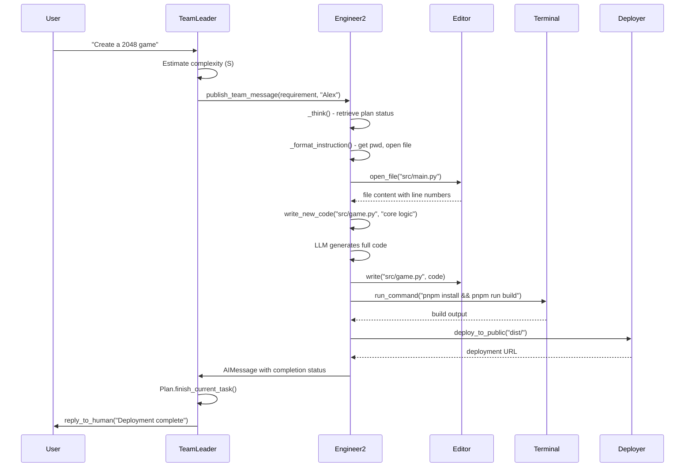
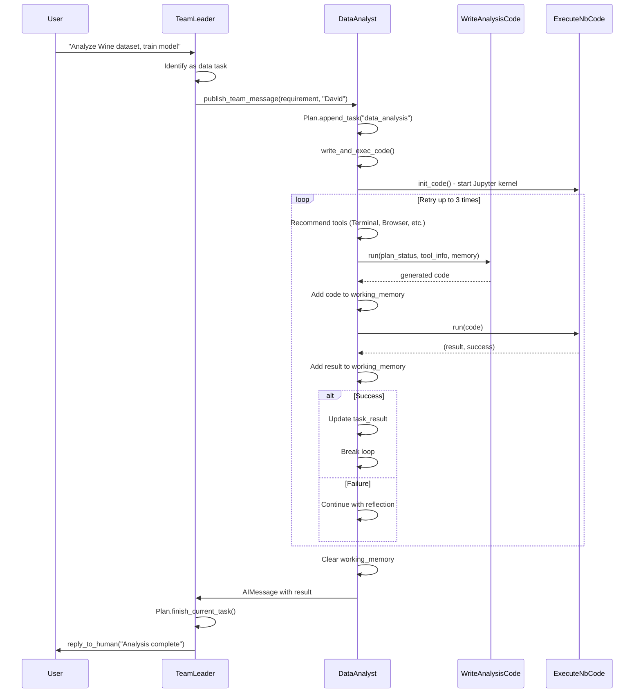

<!-- source: DeepWiki mcp.deepwiki.com · repo FoundationAgents/MetaGPT · page 4.4 Specialized RoleZero Agents · fetched 2026-10-30 -->

# Specialized Roles

<details>
<summary>Relevant source files</summary>

The following files were used as context for generating this wiki page:

- [metagpt/actions/prepare_documents.py](metagpt/actions/prepare_documents.py)
- [metagpt/environment/mgx/mgx_env.py](metagpt/environment/mgx/mgx_env.py)
- [metagpt/prompts/di/data_analyst.py](metagpt/prompts/di/data_analyst.py)
- [metagpt/prompts/di/engineer2.py](metagpt/prompts/di/engineer2.py)
- [metagpt/prompts/di/role_zero.py](metagpt/prompts/di/role_zero.py)
- [metagpt/prompts/di/swe_agent.py](metagpt/prompts/di/swe_agent.py)
- [metagpt/prompts/di/team_leader.py](metagpt/prompts/di/team_leader.py)
- [metagpt/roles/di/data_analyst.py](metagpt/roles/di/data_analyst.py)
- [metagpt/roles/di/engineer2.py](metagpt/roles/di/engineer2.py)
- [metagpt/roles/di/role_zero.py](metagpt/roles/di/role_zero.py)
- [metagpt/roles/di/swe_agent.py](metagpt/roles/di/swe_agent.py)
- [metagpt/roles/di/team_leader.py](metagpt/roles/di/team_leader.py)
- [metagpt/strategy/experience_retriever.py](metagpt/strategy/experience_retriever.py)
- [metagpt/strategy/thinking_command.py](metagpt/strategy/thinking_command.py)
- [metagpt/tools/libs/editor.py](metagpt/tools/libs/editor.py)
- [metagpt/tools/libs/git.py](metagpt/tools/libs/git.py)
- [metagpt/tools/libs/index_repo.py](metagpt/tools/libs/index_repo.py)
- [metagpt/tools/libs/linter.py](metagpt/tools/libs/linter.py)
- [metagpt/utils/file.py](metagpt/utils/file.py)
- [metagpt/utils/file_repository.py](metagpt/utils/file_repository.py)
- [metagpt/utils/git_repository.py](metagpt/utils/git_repository.py)
- [tests/metagpt/environment/mgx_env/run_mgx_env.py](tests/metagpt/environment/mgx_env/run_mgx_env.py)
- [tests/metagpt/roles/di/run_engineer2.py](tests/metagpt/roles/di/run_engineer2.py)
- [tests/metagpt/roles/di/run_swe_agent_for_benchmark.py](tests/metagpt/roles/di/run_swe_agent_for_benchmark.py)
- [tests/metagpt/roles/di/run_swe_agent_open_source_issue.py](tests/metagpt/roles/di/run_swe_agent_open_source_issue.py)
- [tests/metagpt/test_document.py](tests/metagpt/test_document.py)
- [tests/metagpt/tools/libs/test_editor.py](tests/metagpt/tools/libs/test_editor.py)
- [tests/metagpt/tools/libs/test_git.py](tests/metagpt/tools/libs/test_git.py)
- [tests/metagpt/tools/libs/test_image_getter.py](tests/metagpt/tools/libs/test_image_getter.py)

</details>


This page documents specialized roles in MetaGPT that extend beyond traditional SDLC roles covered in [5.1](#5.1). These roles inherit from `RoleZero` to gain dynamic think-act capabilities while adding domain-specific tools and workflows. Specialized roles include `Engineer2` (enhanced software engineer with deployment), `DataAnalyst` (data science and analysis), and others designed for specific technical domains.

For general RoleZero architecture and tool integration patterns, see [4.1](#4.1). For team coordination and message routing with specialized roles, see [4.3](#4.3).

---

## Overview of Specialized Roles

Specialized roles extend `RoleZero` with domain-specific capabilities:

| Role | Profile | Primary Capabilities | Key Actions/Tools |
|------|---------|---------------------|-------------------|
| **Engineer2** | Enhanced Engineer | Game/app/web development with deployment | `write_new_code`, `Deployer`, `CodeReview`, `ImageGetter` |
| **DataAnalyst** | Data Analyst | Data analysis, ML, web scraping, notebook execution | `write_and_exec_code`, `WriteAnalysisCode`, `ExecuteNbCode`, `Browser` |
| **TeamLeader** | Team Coordinator | Task decomposition and routing to team members | `publish_team_message`, `Plan` commands |

Sources: [metagpt/roles/di/engineer2.py:32-51](), [metagpt/roles/di/data_analyst.py:26-43](), [metagpt/roles/di/team_leader.py:23-31]()

---

## Engineer2: Enhanced Software Development with Deployment

### Architecture



```mermaid
graph TB
    subgraph "Engineer2 Class Structure"
        E2[Engineer2<br/>extends RoleZero]
        E2 --> Tools[Tool Execution Map]
        E2 --> Instruction[ENGINEER2_INSTRUCTION]
        E2 --> MaxLoop[max_react_loop: 40]
    end
    
    subgraph "Core Methods"
        Think["_think()<br/>formats instruction with state"]
        FormatInst["_format_instruction()<br/>displays terminal + editor state"]
        WriteCode["write_new_code(path, file_description)<br/>generates full code file"]
        DeployPublic["_deploy_to_public(dist_dir)<br/>deploys web app"]
        UpdateToolExec["_update_tool_execution()<br/>registers tools"]
    end
    
    subgraph "Tool Integration"
        Editor[Editor<br/>file editing]
        Terminal[Terminal<br/>command execution]
        Deployer[Deployer<br/>web deployment]
        CodeReview[CodeReview<br/>code review + fix]
        ImageGetter[ImageGetter<br/>fetch images]
        Browser[Browser<br/>goto, scroll]
        Git[git_create_pull<br/>GitHub PR creation]
    end
    
    subgraph "Execution Modes"
        NormalMode[Normal Mode<br/>standard development]
        EvalMode[Eval Mode<br/>SWE-bench evaluation]
    end
    
    E2 --> Think
    E2 --> WriteCode
    Think --> FormatInst
    FormatInst --> CURRENT_STATE["CURRENT_STATE prompt<br/>editor_open_file<br/>current_directory"]
    
    UpdateToolExec --> Editor
    UpdateToolExec --> Terminal
    UpdateToolExec --> Deployer
    UpdateToolExec --> CodeReview
    UpdateToolExec --> ImageGetter
    UpdateToolExec --> Browser
    UpdateToolExec --> Git
    
    EvalMode --> EvalTerminal["_eval_terminal_run<br/>intercepts git commands"]
    EvalMode --> AutoEnd["auto-finish on PR creation"]
```

**Tool Execution Map Registration in Engineer2**

Sources: [metagpt/roles/di/engineer2.py:1-172](), [metagpt/prompts/di/engineer2.py:1-105]()

### Key Capabilities

#### 1. State-Aware Instruction Formatting

`Engineer2` dynamically updates its instruction prompt with current terminal and editor state:

```
editor_open_file: /workspace/project/src/main.py
current_directory: /workspace/project
```

This context is injected into `cmd_prompt_current_state` at each think cycle, enabling the agent to maintain awareness of its working directory and currently open file.

Sources: [metagpt/roles/di/engineer2.py:62-73](), [metagpt/prompts/di/engineer2.py:66-70]()

#### 2. Full Code Generation with Context

The `write_new_code` method generates complete code files using LLM:

**Method Signature:**
```python
async def write_new_code(self, path: str, file_description: str = "") -> str
```

**Workflow:**
1. Fixes relative paths using editor's working directory
2. Retrieves plan status from planner
3. Constructs prompt with user requirement, plan status, file path, and description
4. Uses `WRITE_CODE_SYSTEM_PROMPT` emphasizing "google-style, elegant, modular, readable, maintainable, fully functional, and ready-for-production code"
5. Replaces last memory item with manual prompt to prevent repetition
6. Parses code from LLM response and writes to file
7. Reports via `EditorReporter` for UI feedback

Sources: [metagpt/roles/di/engineer2.py:112-142](), [metagpt/prompts/di/engineer2.py:73-104]()

#### 3. Web Deployment

The `_deploy_to_public` method handles web application deployment:

- Validates `dist_dir` as absolute path
- Falls back to editor's working directory for relative paths
- Delegates to `Deployer` tool for actual deployment
- Used after build step (e.g., `pnpm run build`)

Sources: [metagpt/roles/di/engineer2.py:144-155]()

#### 4. Tool Registration

Engineer2 registers two tool sets based on execution mode:

**Normal Mode (default):**
```python
{
    "git_create_pull": git_create_pull,
    "Engineer2.write_new_code": self.write_new_code,
    "ImageGetter.get_image": image_getter.get_image,
    "CodeReview.review": cr.review,
    "CodeReview.fix": cr.fix,
    "Terminal.run_command": self.terminal.run_command,
    "Deployer.deploy_to_public": self._deploy_to_public,
}
```

**Eval Mode (for SWE-bench):**
- Replaces `Terminal.run_command` with `_eval_terminal_run`
- Replaces human interaction commands with `_end`
- `_eval_terminal_run` intercepts git commands (pull/push/commit) and terminates execution

Sources: [metagpt/roles/di/engineer2.py:75-107]()

### Instruction Set

The `ENGINEER2_INSTRUCTION` extends `ROLE_INSTRUCTION` with 61 detailed guidelines covering:

1. **File Operations:** Editor window navigation, line numbering, edit command exclusivity
2. **Project Structure:** Timestamped folder naming, file organization
3. **Technology Stack Priority:** System Design > Vite+React+MUI+Tailwind > native HTML
4. **React/Vue Templates:** Copy from predefined paths, rewrite all `src/` files
5. **Incremental Development:** Read existing files before planning modifications
6. **Code Generation:** Use `Engineer2.write_new_code` for full files, `Editor.edit_file_by_replace` for small edits
7. **Deployment:** Build project, then deploy `dist/` folder

Sources: [metagpt/prompts/di/engineer2.py:6-71]()

---

## DataAnalyst: Data Science and Analysis

### Architecture



```mermaid
graph TB
    subgraph "DataAnalyst Class Structure"
        DA[DataAnalyst<br/>extends RoleZero]
        DA --> Goal["goal: data-related tasks<br/>ML, DL, web scraping, browsing"]
        DA --> CustomTools[custom_tools list]
        DA --> ToolRecommender[custom_tool_recommender]
        DA --> UseReflection[use_reflection: bool]
    end
    
    subgraph "Core Actions"
        WriteCode[WriteAnalysisCode<br/>generates notebook code]
        ExecCode[ExecuteNbCode<br/>runs in notebook env]
        CheckData[CheckData<br/>validates updated data]
    end
    
    subgraph "write_and_exec_code Method"
        Start[Start]
        Init["init_code()<br/>setup notebook kernel"]
        GetPlan["get plan_status<br/>exclude task_result"]
        GetTools["recommend tools<br/>via BM25"]
        CheckDataStep["_check_data()<br/>for preprocessing tasks"]
        
        LoopStart{counter < 3}
        WriteStep["WriteAnalysisCode.run()<br/>with reflection if retry"]
        ExecStep["ExecuteNbCode.run(code)<br/>returns result, success"]
        AddMem["add to working_memory"]
        
        Success{success?}
        UpdateTask["update task_result"]
        ClearMem["clear working_memory"]
        Return[Return output]
        
        Start --> Init
        Init --> GetPlan
        GetPlan --> GetTools
        GetTools --> CheckDataStep
        CheckDataStep --> LoopStart
        LoopStart -->|Yes| WriteStep
        WriteStep --> ExecStep
        ExecStep --> AddMem
        AddMem --> Success
        Success -->|Yes| UpdateTask
        Success -->|No| LoopStart
        UpdateTask --> ClearMem
        ClearMem --> Return
        LoopStart -->|No| Return
    end
    
    subgraph "Tool Integration"
        Browser2[Browser<br/>web navigation]
        EditorLimit[Editor<br/>write,read,similarity_search]
        SearchQA[SearchEnhancedQA<br/>search engines]
        Terminal2[Terminal<br/>custom tool]
        WebScraping["web scraping<br/>custom tool"]
    end
    
    DA --> WriteCode
    DA --> ExecCode
    DA --> Browser2
    DA --> EditorLimit
    WriteCode --> ExecCode
```

**DataAnalyst Notebook Execution Loop**

Sources: [metagpt/roles/di/data_analyst.py:1-155](), [metagpt/prompts/di/data_analyst.py:1-27]()

### Key Capabilities

#### 1. Notebook-Based Execution

The `write_and_exec_code` method implements an iterative write-execute-reflect loop:

**Method Signature:**
```python
async def write_and_exec_code(self, instruction: str = "")
```

**Workflow:**
1. **Initialization:** Sets up Jupyter kernel via `ExecuteNbCode.init_code()`
2. **Context Building:**
   - Retrieves `plan_status` excluding `task_result` to save tokens
   - Appends optional `instruction` parameter
   - Recommends tools via `custom_tool_recommender` (BM25-based)
   - Checks updated data for preprocessing/feature engineering tasks
3. **Retry Loop (max 3 iterations):**
   - Generates code via `WriteAnalysisCode.run()` with reflection on retries
   - Executes code in notebook via `ExecuteNbCode.run(code)`
   - Adds code and result to `working_memory`
   - If success, updates task result and breaks
4. **Cleanup:** Clears `working_memory` and returns formatted output

Sources: [metagpt/roles/di/data_analyst.py:61-125]()

#### 2. Task Type Specialization

DataAnalyst supports specific task types defined in `TaskType` enum:

```python
TASK_TYPE_DESC = "\n".join([f"- **{tt.type_name}**: {tt.value.desc}" for tt in TaskType])
```

Task types include:
- Data preprocessing
- Feature engineering
- Model training
- Data analysis
- Others

When current task is preprocessing, feature engineering, or model training, `_check_data()` validates the updated dataset structure.

Sources: [metagpt/roles/di/data_analyst.py:127-142](), [metagpt/prompts/di/data_analyst.py:17]()

#### 3. Tool Recommendation

DataAnalyst uses a custom BM25-based tool recommender initialized with:

```python
custom_tools: list[str] = ["web scraping", "Terminal", "Editor:write,read,similarity_search"]
custom_tool_recommender: ToolRecommender = None  # set to BM25ToolRecommender in validator
```

The recommender provides contextual tool suggestions based on plan status, helping the agent select appropriate tools for data tasks.

Sources: [metagpt/roles/di/data_analyst.py:41-52]()

#### 4. Experience Retrieval

DataAnalyst uses `KeywordExpRetriever` (vs. `DummyExpRetriever` in base RoleZero) to retrieve relevant past experiences for similar data analysis tasks.

Sources: [metagpt/roles/di/data_analyst.py:43]()

### Instruction Set

The `EXTRA_INSTRUCTION` provides 10 guidelines for data tasks:

1. **Web Task Disambiguation:**
   - `SearchEnhancedQA`: General search (news, weather, wiki)
   - `Browser`: Navigate specific websites, in-domain search
   - `write_and_exec_code`: Web scraping for batch data

2. **Planning:** Append all tasks in first response (except for document QA)

3. **Document QA:** Read document via `Editor.read` WITHOUT plan, then `reply_to_human` or create plan if calculation needed

4. **Task Completion:** Finish task timely after successful code execution, avoid multiple finishes for same task

5. **End Command:** Use `finish_current_task` before `end`

Sources: [metagpt/prompts/di/data_analyst.py:3-15]()

---

## TeamLeader: Multi-Role Coordination

### Architecture



**TeamLeader Coordination Pattern**

Sources: [metagpt/roles/di/team_leader.py:1-91](), [metagpt/prompts/di/team_leader.py:1-64]()

### Key Capabilities

#### 1. Task Decomposition Logic

TeamLeader's instruction provides decision trees for task assignment:

**Data-Related Requirements:**
- Web browsing, scraping, searching
- Data science, analysis, machine learning, deep learning
- Text-to-image
- **Action:** Assign single task with full requirement to DataAnalyst (David) without decomposition

**Software Development Requirements:**
- Games, apps, websites (excluding data tasks)
- **Action:** Estimate complexity via t-shirt sizing:
  - **XS/S** (snake game, calculator): Direct to Engineer
  - **M/L/XL** (booking system, e-commerce): Full SDLC process
    1. ProductManager (Alice) creates PRD
    2. Architect (Bob) writes System Design
    3. ProjectManager (Eve) creates task breakdown
    4. Engineer (Alex) implements code

**Mixed Requirements:**
- Decompose software part to dev team
- Assign data part to DataAnalyst

**Common-Sense Questions:**
- Respond directly without team assignment

Sources: [metagpt/prompts/di/team_leader.py:3-30]()

#### 2. Message Publishing

The `publish_team_message` method:

1. Sets `_set_state(-1)` to pause after publishing (wait for response)
2. Checks `send_to != self.name` to avoid self-messages
3. Wraps content in `UserMessage` with `cause_by=RunCommand`
4. Calls `publish_message` with outer `send_to` override

The overridden `publish_message` method:
- Skips publishing if `cause_by != QUICK_THINK_TAG` and no env
- Sets `msg.send_to = send_to` parameter (not default "no one")
- Publishes via `self.rc.env.publish_message(msg, publicer=self.profile)`

Sources: [metagpt/roles/di/team_leader.py:64-86]()

#### 3. Team Information Extraction

```python
def _get_team_info(self) -> str:
    if not self.rc.env:
        return ""
    team_info = ""
    for role in self.rc.env.roles.values():
        team_info += f"{role.name}: {role.profile}, {role.goal}\n"
    return team_info
```

This information is formatted into prompts using `TL_INFO` template and injected into the system prompt at each think cycle.

Sources: [metagpt/roles/di/team_leader.py:45-53]()

#### 4. Experience Examples

The `SimpleExpRetriever` provides 6 examples in `TL_EXAMPLE`:

1. **Software Development:** Decompose snake game into 4 tasks (PRD → Design → Tasks → Code)
2. **Data Analysis:** Assign Wine dataset analysis directly to DataAnalyst
3. **Task Completion:** Finish current task after member feedback, publish next task
4. **Status Query:** Respond with progress summary
5. **Plan Finished:** Use `reply_to_human` and `end`
6. **Error Handling:** Ask for clarification on ambiguous requirements

Sources: [metagpt/strategy/experience_retriever.py:471-613]()

---

## Tool Integration Patterns

### Editor Tool Capabilities

The `Editor` tool provides file manipulation capabilities with automatic linting:

| Method | Signature | Description |
|--------|-----------|-------------|
| `write` | `write(path: str, content: str)` | Write full file content |
| `read` | `read(path: str) -> FileBlock` | Read with line numbers (001\|, 002\|, ...) |
| `open_file` | `open_file(path, line_number, context_lines)` | Open with window view |
| `goto_line` | `goto_line(line_number: int)` | Navigate to line |
| `scroll_down/up` | `scroll_down()` / `scroll_up()` | Scroll by window size (default 200) |
| `create_file` | `create_file(filename: str)` | Create new file |
| `edit_file_by_replace` | `edit_file_by_replace(file_name, first_replaced_line_number, first_replaced_line_content, last_replaced_line_number, last_replaced_line_content, new_content)` | Replace line range with validation |
| `insert_content_at_line` | `insert_content_at_line(file_name, line_number, insert_content)` | Insert at specific line |
| `append_file` | `append_file(file_name, content)` | Append to end |
| `search_dir` | `search_dir(dir_path, search_term)` | Grep-style search |
| `search_file` | `search_file(file_path, search_term)` | Search within file |
| `find_file` | `find_file(file_name, dir_path)` | Locate file by name |
| `similarity_search` | `similarity_search(query, path)` | Semantic search via IndexRepo |

**Key Features:**
- **Auto-linting:** When `enable_auto_lint=True`, validates Python syntax after edits and reverts on error
- **Line number display:** All read operations show `NNN|` prefix for easy reference
- **Working directory:** Tracks `working_dir` for relative path resolution
- **Error guidance:** Provides detailed error messages with indentation hints

Sources: [metagpt/tools/libs/editor.py:84-702]()

### IndexRepo Integration

The `similarity_search` method uses `IndexRepo` for semantic code search:

```python
async def similarity_search(self, query: str, path: str = ".") -> str:
    """Semantic search in a file or directory using RAG."""
    results = await IndexRepo.cross_repo_search(query=query, file_or_path=path)
    return "\n".join(results)
```

**Workflow:**
1. Determines index repo path based on file location (uploads, chats, other)
2. Filters files by token count (min: 10K, max: 100M)
3. Searches via FAISS index with LLM ranker
4. Merges results from multiple repos if needed
5. Returns top-k results with filenames and text snippets

Sources: [metagpt/tools/libs/editor.py:871-912](), [metagpt/tools/libs/index_repo.py:76-171]()

---

## Workflow Comparison

### Engineer2 Workflow



**Engineer2 Development Cycle**

Sources: [metagpt/roles/di/engineer2.py:57-172]()

### DataAnalyst Workflow



**DataAnalyst Write-Execute-Reflect Loop**

Sources: [metagpt/roles/di/data_analyst.py:61-125]()

---

## Configuration and Usage

### Engineer2 Instantiation

```python
# Normal mode
engineer = Engineer2()

# Evaluation mode (for SWE-bench)
engineer = Engineer2(run_eval=True)

# Configure tools
engineer.tools = [
    "Plan",
    "Editor",
    "RoleZero",
    "Terminal:run_command",
    "Browser:goto,scroll",
    "git_create_pull",
    "SearchEnhancedQA",
    "Engineer2",
    "CodeReview",
    "ImageGetter",
    "Deployer",
]
```

Sources: [metagpt/roles/di/engineer2.py:32-56]()

### DataAnalyst Instantiation

```python
# Default configuration
data_analyst = DataAnalyst()

# Custom tool configuration
data_analyst.custom_tools = ["web scraping", "Terminal", "Editor:write,read,similarity_search"]

# Enable/disable reflection
data_analyst.use_reflection = True  # default
```

Sources: [metagpt/roles/di/data_analyst.py:26-48]()

### MGXEnv Integration Example

```python
from metagpt.environment.mgx.mgx_env import MGXEnv
from metagpt.roles.di.engineer2 import Engineer2
from metagpt.roles.di.data_analyst import DataAnalyst
from metagpt.roles.di.team_leader import TeamLeader
from metagpt.schema import Message

# Create environment and add roles
env = MGXEnv()
env.add_roles([
    TeamLeader(),
    Engineer2(),
    DataAnalyst(),
])

# Publish user requirement
env.publish_message(Message(content="Create a data visualization web app"))

# Run until idle
while not env.is_idle:
    await env.run()
```

Sources: [tests/metagpt/environment/mgx_env/run_mgx_env.py:15-55]()

---

## Implementation Details

### Engineer2 Experience Retrieval

Engineer2 uses `ENGINEER_EXAMPLE` from experience retriever:

```python
def _retrieve_experience(self) -> str:
    return ENGINEER_EXAMPLE
```

This provides examples for:
- File editing operations
- Code review workflows
- Terminal command patterns
- Web development with React/Vue templates

Sources: [metagpt/roles/di/engineer2.py:109-110]()

### DataAnalyst Task Type Handling

DataAnalyst checks task types to validate data consistency:

```python
async def _check_data(self):
    if not self.planner.plan.get_finished_tasks() or self.planner.plan.current_task.task_type not in [
        TaskType.DATA_PREPROCESS.type_name,
        TaskType.FEATURE_ENGINEERING.type_name,
        TaskType.MODEL_TRAIN.type_name,
    ]:
        return
    code = await CheckData().run(self.planner.plan)
    if not code.strip():
        return
    result, success = await self.execute_code.run(code)
    if success:
        data_info = DATA_INFO.format(info=result)
        self.rc.working_memory.add(Message(content=data_info, role="user", cause_by=CheckData))
```

This ensures the agent is aware of data schema changes during preprocessing and feature engineering phases.

Sources: [metagpt/roles/di/data_analyst.py:127-142]()

### TeamLeader Experience Examples

The `TL_EXAMPLE` provides 6 scenarios stored in `SimpleExpRetriever`:

1. Software development decomposition
2. Data analysis single-task assignment
3. Task completion and next task publishing
4. Status inquiry response
5. Plan completion handling
6. Error recovery and clarification

These examples guide the LLM on proper team coordination patterns.

Sources: [metagpt/strategy/experience_retriever.py:471-615]()

---

## Testing Infrastructure

### Engineer2 Test Cases

The test suite includes increment development scenarios:

```python
INC_DEVELOPMENT_CASE1 = [
    "Complete the Snake game with root directory at '/path/to/workspace/snake_game'",
    "Use the up button to control snake to move down, left button to move right",
    "Place restart/start button at top",
    "Add pause button",
    "Display score and leaderboard in real-time",
]
```

Tests validate:
- Multi-turn incremental development
- Working directory persistence
- File editing across turns
- Build and deployment flows

Sources: [tests/metagpt/roles/di/run_engineer2.py:107-146]()

### MGXEnv Test Examples

The `run_mgx_env.py` script demonstrates complete workflows:

```python
# Software development
GAME_REQ = "create a 2048 game"

# Data analysis
WINE_REQ = "Run data analysis on sklearn Wine recognition dataset, train model, show validation accuracy"

# Web scraping
ECOMMERCE_REQ = "Get products data from https://scrapeme.live/shop/ and save as csv"

# Document QA
DOC_QA_REQ = "Tell me what this paper is about /path/to/paper.pdf"
```

Sources: [tests/metagpt/environment/mgx_env/run_mgx_env.py:82-147]()

---

