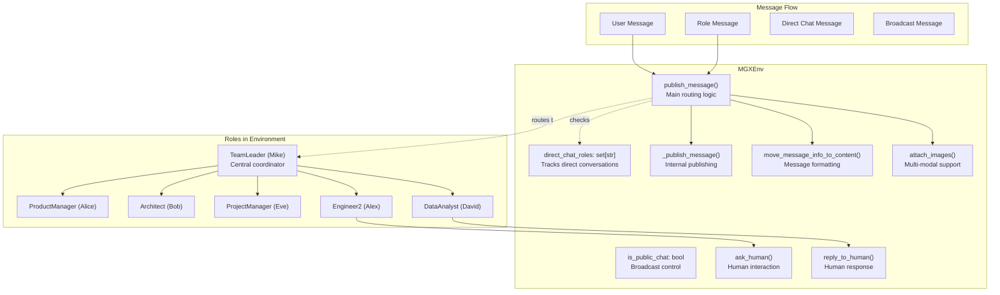
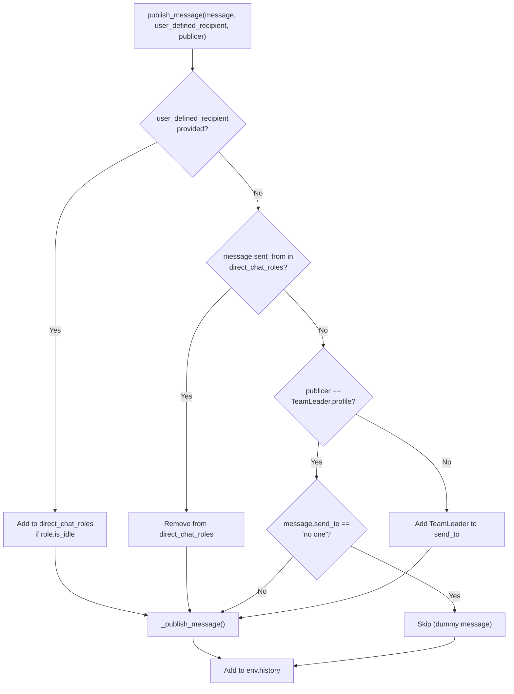
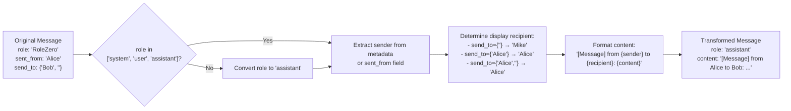
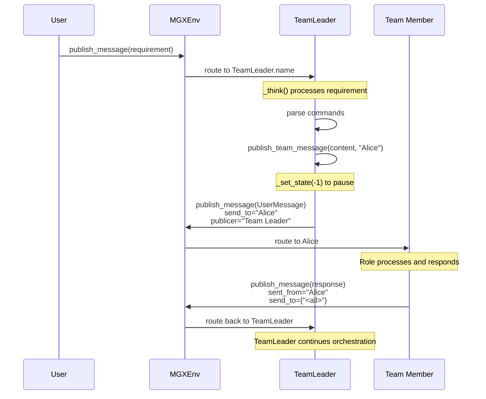
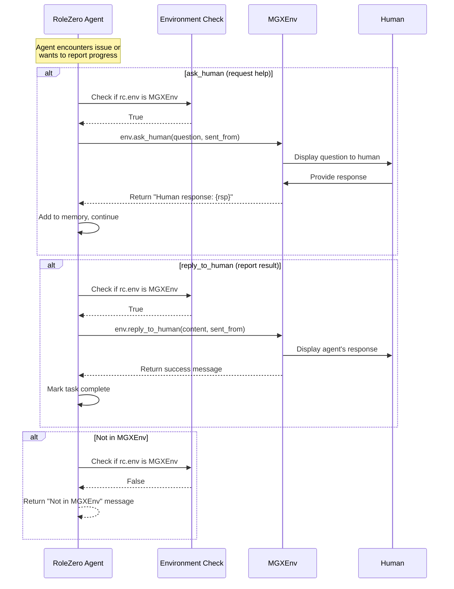
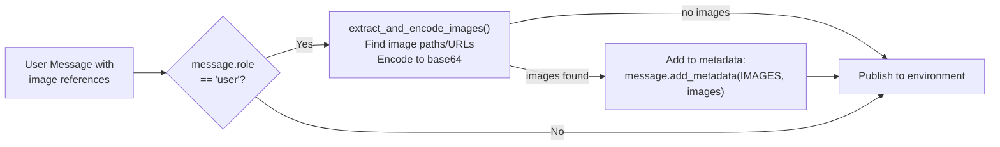
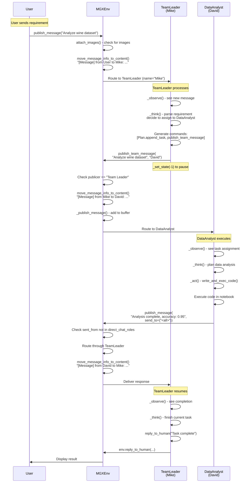
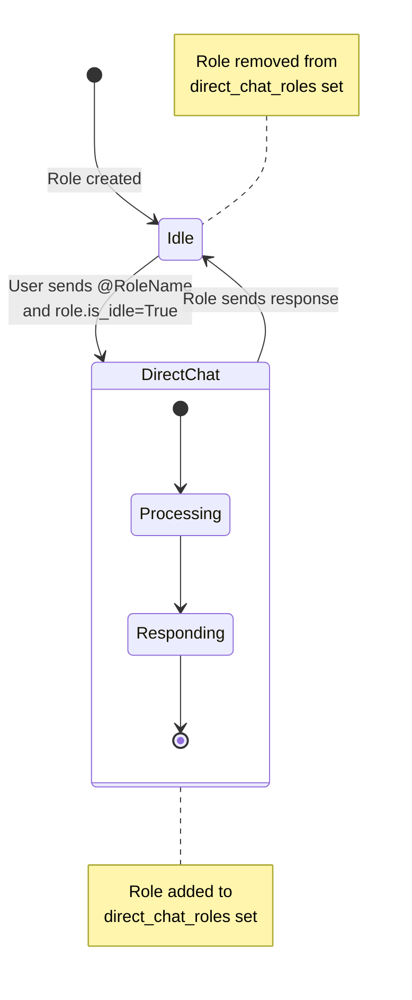

<!-- source: DeepWiki mcp.deepwiki.com · repo FoundationAgents/MetaGPT · page 4.5 MGXEnv and Message Orchestration · fetched 2026-10-30 -->

# MGXEnv and Message Orchestration

<details>
<summary>Relevant source files</summary>

The following files were used as context for generating this wiki page:

- [metagpt/environment/mgx/mgx_env.py](metagpt/environment/mgx/mgx_env.py)
- [metagpt/prompts/di/data_analyst.py](metagpt/prompts/di/data_analyst.py)
- [metagpt/prompts/di/engineer2.py](metagpt/prompts/di/engineer2.py)
- [metagpt/prompts/di/role_zero.py](metagpt/prompts/di/role_zero.py)
- [metagpt/prompts/di/team_leader.py](metagpt/prompts/di/team_leader.py)
- [metagpt/roles/di/data_analyst.py](metagpt/roles/di/data_analyst.py)
- [metagpt/roles/di/engineer2.py](metagpt/roles/di/engineer2.py)
- [metagpt/roles/di/role_zero.py](metagpt/roles/di/role_zero.py)
- [metagpt/roles/di/team_leader.py](metagpt/roles/di/team_leader.py)
- [metagpt/strategy/experience_retriever.py](metagpt/strategy/experience_retriever.py)
- [metagpt/strategy/thinking_command.py](metagpt/strategy/thinking_command.py)
- [metagpt/tools/libs/editor.py](metagpt/tools/libs/editor.py)
- [metagpt/tools/libs/index_repo.py](metagpt/tools/libs/index_repo.py)
- [metagpt/tools/libs/linter.py](metagpt/tools/libs/linter.py)
- [metagpt/utils/file.py](metagpt/utils/file.py)
- [tests/metagpt/environment/mgx_env/run_mgx_env.py](tests/metagpt/environment/mgx_env/run_mgx_env.py)
- [tests/metagpt/roles/di/run_engineer2.py](tests/metagpt/roles/di/run_engineer2.py)
- [tests/metagpt/tools/libs/test_editor.py](tests/metagpt/tools/libs/test_editor.py)

</details>


## Purpose and Scope

This document describes the **MGXEnv** (MetaGPT Exchange Environment) system and its message orchestration mechanisms. MGXEnv is a specialized environment class designed for multi-agent collaboration in the dynamic agent system (RoleZero and descendants). It manages message routing, direct chat capabilities, TeamLeader coordination, and human interaction for agents operating in the RoleZero paradigm.

For information about the RoleZero base architecture and tool integration, see [4.1](#4.1). For specialized RoleZero agents (Engineer2, DataAnalyst, etc.), see [4.4](#4.4). For the standard role-based system with fixed SOPs, see [2.4](#2.4).

**Sources**: [metagpt/environment/mgx/mgx_env.py:1-100](), [tests/metagpt/environment/mgx_env/run_mgx_env.py:1-171]()

---

## MGXEnv Architecture

### Class Structure

`MGXEnv` extends `Environment` and `SerializationMixin`, providing specialized message handling for teams of RoleZero agents. The environment operates with two key properties:

| Property | Type | Default | Purpose |
|----------|------|---------|---------|
| `direct_chat_roles` | `set[str]` | `set()` | Tracks roles currently in direct chat with human user |
| `is_public_chat` | `bool` | `True` | Controls whether messages are broadcast to all roles |

The environment coordinates between multiple specialized roles, with the TeamLeader (`TEAMLEADER_NAME`, typically "Mike") acting as the central orchestrator.

**MGXEnv Core Components**



**Sources**: [metagpt/environment/mgx/mgx_env.py:11-100](), [tests/metagpt/environment/mgx_env/run_mgx_env.py:15-55]()

---

## Message Routing Mechanisms

### Core Routing Logic

The `publish_message` method implements a sophisticated routing system with four distinct pathways:

#### Routing Decision Tree



**Sources**: [metagpt/environment/mgx/mgx_env.py:24-62]()

### Routing Pathways Explained

#### Pathway 1: User Direct Chat (Lines 30-40)
When `user_defined_recipient` is provided (e.g., "@Alice"):
- If the target role is idle, add it to `direct_chat_roles`
- Publish message directly to the role
- TeamLeader is informed but does not react (optional)

```python
# Example: Direct chat with specific role
env.publish_message(
    Message(content=requirement, send_to={user_defined_recipient}),
    user_defined_recipient=user_defined_recipient
)
```

#### Pathway 2: Direct Chat Response (Lines 42-46)
When a role in `direct_chat_roles` responds:
- Remove the role from `direct_chat_roles`
- If `is_public_chat=True`, broadcast the response
- Otherwise, send only to the human user

#### Pathway 3: TeamLeader Publication (Lines 48-53)
When TeamLeader publishes a message:
- Skip if `send_to == {"no one"}` (dummy message)
- Otherwise, publish through `_publish_message`
- This allows TeamLeader to control message flow

#### Pathway 4: Regular Flow (Lines 56-58)
All other messages route through TeamLeader:
- Add TeamLeader's name to `send_to`
- TeamLeader processes and decides next actions

**Sources**: [metagpt/environment/mgx/mgx_env.py:24-62]()

---

## Message Formatting and Metadata

### Message Content Transformation

The `move_message_info_to_content` method transforms messages for LLM consumption by embedding sender and recipient information into the content string.

#### Message Transformation Process



**Transformation Rules**:
1. **Role Conversion**: Non-standard roles → `"assistant"` (lines 79-80)
2. **Sender Extraction**: From `metadata[AGENT]` or `sent_from` (line 81)
3. **Recipient Display**: `<all>` → "Mike", otherwise actual recipients (lines 84-87)
4. **Content Formatting**: Prepends `"[Message] from {sender} to {recipient}: "` (line 88)

**Example**:
```
Original: 
  role: "DataAnalyst"
  sent_from: "David"
  send_to: {"<all>"}
  content: "Analysis complete"

Transformed:
  role: "assistant"
  content: "[Message] from David to Mike: Analysis complete"
```

**Sources**: [metagpt/environment/mgx/mgx_env.py:73-89]()

---

## TeamLeader Integration

### TeamLeader Message Publishing

The `TeamLeader` class overrides default message publishing to integrate with MGXEnv's routing system.

#### TeamLeader Message Flow



### Key TeamLeader Methods

| Method | Purpose | Behavior |
|--------|---------|----------|
| `publish_message` | Override standard publishing | Sets `send_to="no one"` if not QUICK_THINK_TAG to prevent duplicate routing |
| `publish_team_message` | Send message to team member | Creates `UserMessage` with specified recipient, pauses TeamLeader via `_set_state(-1)` |
| `_think` | Decision making | Formats team info, calls parent `_think()` |

**TeamLeader publish_team_message implementation**:
```python
def publish_team_message(self, content: str, send_to: str):
    self._set_state(-1)  # Pause to wait for response
    if send_to == self.name:
        return  # Avoid sending to self
    # Create UserMessage because message from self is like user request for others
    self.publish_message(
        UserMessage(content=content, sent_from=self.name, send_to=send_to, cause_by=RunCommand),
        send_to=send_to
    )
```

**Sources**: [metagpt/roles/di/team_leader.py:23-91](), [metagpt/environment/mgx/mgx_env.py:24-62]()

---

## Human Interaction System

### ask_human and reply_to_human

RoleZero agents can interact with humans through two primary methods, both of which are delegated to the MGXEnv.

#### Human Interaction Flow



### RoleZero Integration

RoleZero agents have these methods that check for MGXEnv:

```python
# In RoleZero class
async def ask_human(self, question: str) -> str:
    """Use this when you fail the current task or if you are unsure of the situation encountered."""
    from metagpt.environment.mgx.mgx_env import MGXEnv
    
    if not isinstance(self.rc.env, MGXEnv):
        return "Not in MGXEnv, command will not be executed."
    return await self.rc.env.ask_human(question, sent_from=self)

async def reply_to_human(self, content: str) -> str:
    """Reply to human user with the content provided."""
    from metagpt.environment.mgx.mgx_env import MGXEnv
    
    if not isinstance(self.rc.env, MGXEnv):
        return "Not in MGXEnv, command will not be executed."
    return await self.rc.env.reply_to_human(content, sent_from=self)
```

### MGXEnv Default Implementations

```python
# In MGXEnv class
async def ask_human(self, question: str, sent_from: Role = None) -> str:
    # NOTE: Can be overwritten in remote setting
    rsp = await get_human_input(question)
    return "Human response: " + rsp

async def reply_to_human(self, content: str, sent_from: Role = None) -> str:
    # NOTE: Can be overwritten in remote setting
    return "SUCCESS, human has received your reply. Refrain from resending duplicate messages..."
```

Both methods can be overridden for remote/UI integration scenarios.

**Sources**: [metagpt/roles/di/role_zero.py:456-472](), [metagpt/environment/mgx/mgx_env.py:64-71]()

---

## Multi-Modal Message Support

### Image Attachment

MGXEnv supports multi-modal messages by automatically extracting and encoding images from message content.

#### Image Processing Pipeline



### Implementation Details

```python
def attach_images(self, message: Message) -> Message:
    if message.role == "user":
        images = extract_and_encode_images(message.content)
        if images:
            message.add_metadata(IMAGES, images)
    return message
```

The `extract_and_encode_images` utility:
- Scans message content for image file paths or URLs
- Reads and encodes images as base64 strings
- Returns list of encoded images for metadata storage

This metadata can be consumed by vision-enabled LLM providers when processing messages.

**Sources**: [metagpt/environment/mgx/mgx_env.py:91-96](), [metagpt/utils/common.py:extract_and_encode_images]()

---

## Complete Message Lifecycle

### End-to-End Message Flow Example

The following diagram illustrates a complete message journey from user input to team member execution:



**Sources**: [metagpt/environment/mgx/mgx_env.py:11-100](), [metagpt/roles/di/team_leader.py:23-91](), [metagpt/roles/di/data_analyst.py:26-155]()

---

## Direct Chat Implementation

### Syntax and Mechanics

Direct chat allows users to bypass TeamLeader and communicate directly with a specific role using `@mention` syntax.

#### Direct Chat State Tracking



### Example Direct Chat Usage

```python
# From test file
def send_messages():
    message = input("Enter a message: ")
    user_defined_recipient = re.search(r"@(\w+)", message)
    
    if user_defined_recipient:
        recipient_name = user_defined_recipient.group(1)  # e.g., "Alex"
        print(f"{recipient_name} will receive the message")
        env.publish_message(
            Message(content=message, send_to={recipient_name}),
            user_defined_recipient=recipient_name
        )
    else:
        # Regular message, goes through TeamLeader
        env.publish_message(Message(content=message))
```

### Direct Chat vs Regular Flow

| Aspect | Direct Chat | Regular Flow |
|--------|-------------|--------------|
| **Trigger** | `@RoleName` syntax with `user_defined_recipient` parameter | No recipient specified |
| **Routing** | Directly to specified role if idle | Through TeamLeader |
| **State Tracking** | Added to `direct_chat_roles` set | Not tracked |
| **Response** | Bypasses TeamLeader coordination | Routes through TeamLeader |
| **Use Case** | Quick questions to specific expert | Complex multi-step tasks |

**Conditions for Direct Chat Activation**:
1. User provides `user_defined_recipient` parameter
2. Target role's `is_idle` property is `True`
3. Message routed directly to role's buffer

**Sources**: [metagpt/environment/mgx/mgx_env.py:30-46](), [tests/metagpt/environment/mgx_env/run_mgx_env.py:57-79]()

---

## Environment Setup and Usage

### Creating an MGXEnv Team

The typical setup involves creating an MGXEnv instance and adding specialized RoleZero agents:

```python
from metagpt.environment.mgx.mgx_env import MGXEnv
from metagpt.roles import Architect, Engineer, ProductManager, ProjectManager
from metagpt.roles.di.data_analyst import DataAnalyst
from metagpt.roles.di.engineer2 import Engineer2
from metagpt.roles.di.team_leader import TeamLeader

# Create environment
env = MGXEnv()

# Add roles
env.add_roles([
    TeamLeader(),                          # Mike - orchestrator
    ProductManager(use_fixed_sop=False),   # Alice - requirements
    Architect(use_fixed_sop=False),        # Bob - design
    ProjectManager(use_fixed_sop=False),   # Eve - planning
    Engineer2(),                           # Alex - coding
    DataAnalyst(),                         # David - data tasks
])

# Start with user requirement
env.publish_message(Message(content="Create a 2048 game"))

# Run environment until completion
while not env.is_idle:
    await env.run()
```

### Role Naming Convention

| Role Class | Default Name | Profile | Purpose |
|------------|--------------|---------|---------|
| `TeamLeader` | Mike | Team Leader | Orchestrates team, routes tasks |
| `ProductManager` | Alice | Product Manager | Writes PRDs |
| `Architect` | Bob | Architect | Designs system architecture |
| `ProjectManager` | Eve | Project Manager | Creates task breakdowns |
| `Engineer2` | Alex | Engineer | Implements code |
| `DataAnalyst` | David | Data Analyst | Handles data/ML tasks |

These names are used in message routing and TeamLeader instructions.

**Sources**: [tests/metagpt/environment/mgx_env/run_mgx_env.py:15-55](), [metagpt/const.py:TEAMLEADER_NAME]()

---

## Message Routing Constants

### Key Constants and Their Usage

```python
# From metagpt/const.py
MESSAGE_ROUTE_TO_ALL = "<all>"
TEAMLEADER_NAME = "Mike"
AGENT = "agent"
IMAGES = "images"
```

| Constant | Type | Usage |
|----------|------|-------|
| `MESSAGE_ROUTE_TO_ALL` | `str` | Added to `send_to` for broadcast messages |
| `TEAMLEADER_NAME` | `str` | Default name for TeamLeader role, used in routing |
| `AGENT` | `str` | Metadata key for storing original sender |
| `IMAGES` | `str` | Metadata key for storing encoded images |

### Broadcast Mechanism

When `is_public_chat=True`, the environment automatically adds `MESSAGE_ROUTE_TO_ALL` to outgoing messages:

```python
def _publish_message(self, message: Message, peekable: bool = True) -> bool:
    if self.is_public_chat:
        message.send_to.add(MESSAGE_ROUTE_TO_ALL)  # Add "<all>"
    message = self.move_message_info_to_content(message)
    return super().publish_message(message, peekable)
```

This ensures all roles in the environment observe the message, even if specific recipients are designated.

**Sources**: [metagpt/environment/mgx/mgx_env.py:18-22](), [metagpt/const.py]()

---

## Advanced Patterns

### Idle Time Management

For interactive environments with human input, the system supports idle time detection:

```python
allow_idle_time = 30  # seconds
start_time = time.time()

while time.time() - start_time < allow_idle_time:
    if not env.is_idle:
        await env.run()
        start_time = time.time()  # Reset on activity
```

This pattern allows the environment to wait for human input without blocking indefinitely.

### Threading for Human Input

The test file demonstrates concurrent human input using threading:

```python
def send_messages():
    while not stop_event.is_set():
        message = input("Enter a message: ")
        user_defined_recipient = re.search(r"@(\w+)", message)
        
        if user_defined_recipient:
            recipient_name = user_defined_recipient.group(1)
            env.publish_message(
                Message(content=message, send_to={recipient_name}),
                user_defined_recipient=recipient_name
            )
        else:
            env.publish_message(Message(content=message))

# Start input thread
send_thread = threading.Thread(target=send_messages)
send_thread.start()
```

This enables asynchronous message injection while the environment runs.

**Sources**: [tests/metagpt/environment/mgx_env/run_mgx_env.py:44-79]()

---

## Serialization Support

MGXEnv extends `SerializationMixin`, enabling full environment state persistence:

```python
# Serialize environment state
env_state = env.serialize()

# Deserialize to restore
env = MGXEnv.deserialize(env_state)
```

This supports:
- Checkpoint/resume workflows
- Distributed deployment
- State debugging and inspection

The serialization captures:
- Role states and memories
- Message history
- Direct chat tracking
- Configuration flags

**Sources**: [metagpt/environment/mgx/mgx_env.py:11](), [metagpt/schema.py:SerializationMixin]()

---

## Summary

MGXEnv provides a sophisticated message orchestration layer for RoleZero-based multi-agent collaboration:

**Core Capabilities**:
1. **Intelligent Routing**: Four-pathway routing with TeamLeader coordination
2. **Direct Chat**: @mention syntax for direct role communication
3. **Message Transformation**: Automatic formatting for LLM consumption
4. **Human Interaction**: Bidirectional `ask_human` and `reply_to_human`
5. **Multi-Modal Support**: Automatic image extraction and encoding
6. **State Management**: Serialization and idle detection

**Integration Points**:
- RoleZero agents check for MGXEnv before human interaction
- TeamLeader overrides publishing to integrate with routing
- Specialized roles (Engineer2, DataAnalyst) inherit behavior

**Key Files**:
- [metagpt/environment/mgx/mgx_env.py:1-100]() - Core environment implementation
- [metagpt/roles/di/role_zero.py:456-472]() - RoleZero integration
- [metagpt/roles/di/team_leader.py:64-91]() - TeamLeader publishing
- [tests/metagpt/environment/mgx_env/run_mgx_env.py:1-171]() - Usage examples

---

