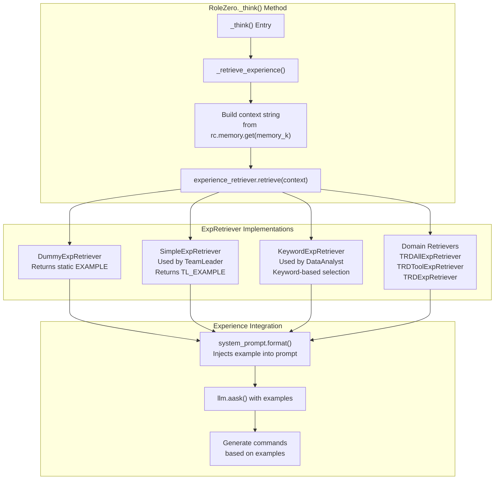
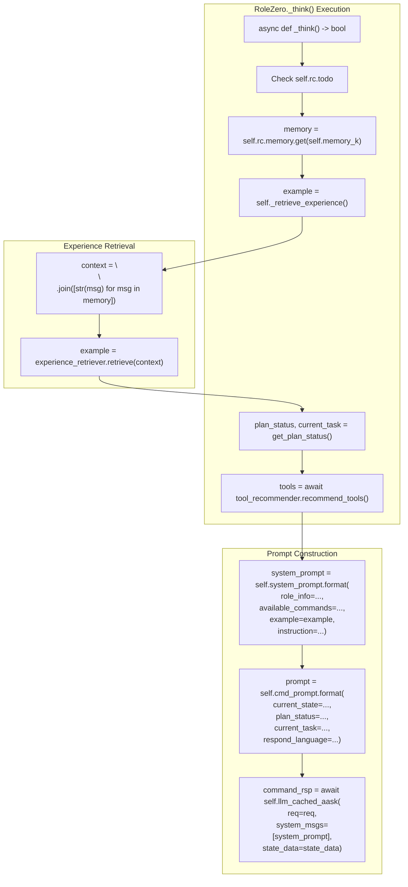
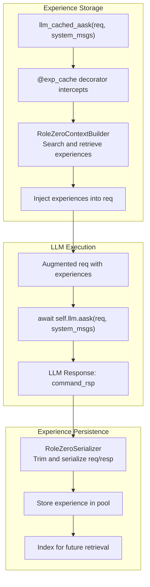
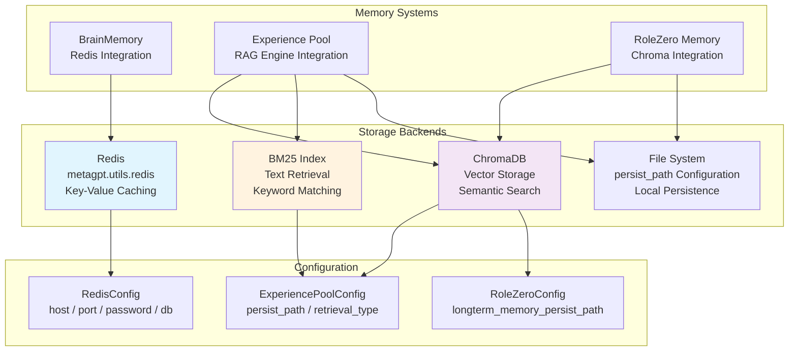
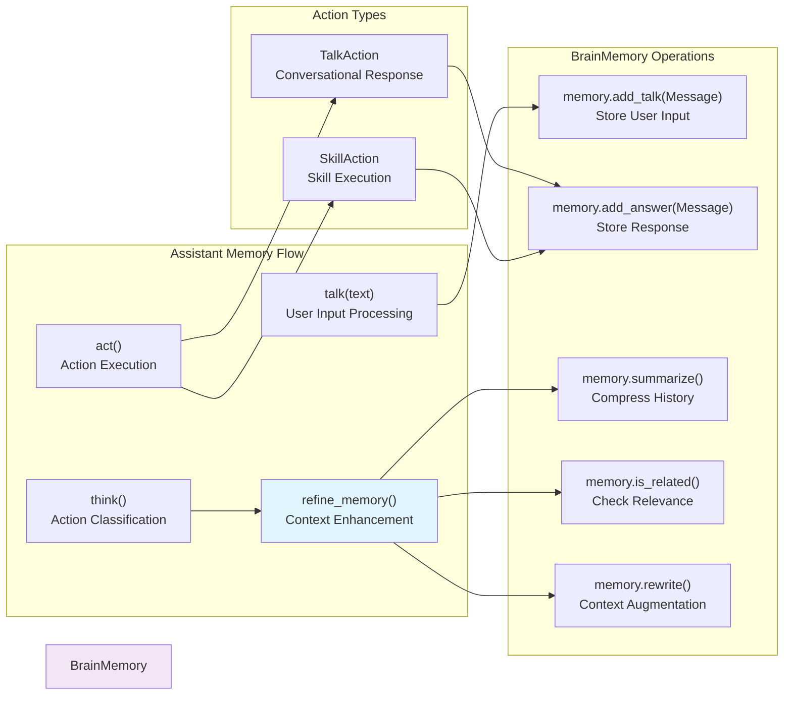

<!-- source: DeepWiki mcp.deepwiki.com · repo FoundationAgents/MetaGPT · page 4.6 Experience Retrieval and Learning · fetched 2026-10-30 -->

# 4.6 Experience Retrieval and Learning

<details>
<summary>Relevant source files</summary>

The following files were used as context for generating this wiki page:

- [metagpt/environment/mgx/mgx_env.py](metagpt/environment/mgx/mgx_env.py)
- [metagpt/prompts/di/data_analyst.py](metagpt/prompts/di/data_analyst.py)
- [metagpt/prompts/di/engineer2.py](metagpt/prompts/di/engineer2.py)
- [metagpt/prompts/di/role_zero.py](metagpt/prompts/di/role_zero.py)
- [metagpt/prompts/di/team_leader.py](metagpt/prompts/di/team_leader.py)
- [metagpt/roles/di/data_analyst.py](metagpt/roles/di/data_analyst.py)
- [metagpt/roles/di/engineer2.py](metagpt/roles/di/engineer2.py)
- [metagpt/roles/di/role_zero.py](metagpt/roles/di/role_zero.py)
- [metagpt/roles/di/team_leader.py](metagpt/roles/di/team_leader.py)
- [metagpt/strategy/experience_retriever.py](metagpt/strategy/experience_retriever.py)
- [metagpt/strategy/thinking_command.py](metagpt/strategy/thinking_command.py)
- [metagpt/tools/libs/editor.py](metagpt/tools/libs/editor.py)
- [metagpt/tools/libs/index_repo.py](metagpt/tools/libs/index_repo.py)
- [metagpt/tools/libs/linter.py](metagpt/tools/libs/linter.py)
- [metagpt/utils/file.py](metagpt/utils/file.py)
- [tests/metagpt/environment/mgx_env/run_mgx_env.py](tests/metagpt/environment/mgx_env/run_mgx_env.py)
- [tests/metagpt/roles/di/run_engineer2.py](tests/metagpt/roles/di/run_engineer2.py)
- [tests/metagpt/tools/libs/test_editor.py](tests/metagpt/tools/libs/test_editor.py)

</details>


This document covers MetaGPT's experience retrieval system used by RoleZero agents to learn from past successful interactions. The system provides a pluggable `ExpRetriever` interface with multiple implementations, an `@exp_cache` decorator for automatic experience caching, and specialized context building for experience-based prompting.

The experience retrieval system enables RoleZero agents to access relevant past examples during the think phase, improving task execution by learning from similar situations. For information about the broader RoleZero architecture, see [RoleZero Core Architecture](#4.1).

## Experience Retrieval Architecture

The experience retrieval system integrates with RoleZero agents to provide contextual examples during task execution, enhancing decision-making through learned patterns.

**Experience Retrieval Flow in RoleZero**



Sources: [metagpt/roles/di/role_zero.py:449-454](), [metagpt/roles/di/role_zero.py:213-216](), [metagpt/roles/di/role_zero.py:224-230](), [metagpt/strategy/experience_retriever.py:6-10]()

## ExpRetriever Interface

The `ExpRetriever` interface defines the contract for experience retrieval implementations. All retrievers implement a single `retrieve()` method that takes contextual information and returns example text.

### Base Interface

| Method | Signature | Description |
|--------|-----------|-------------|
| `retrieve` | `retrieve(context: str = "") -> str` | Retrieves relevant examples based on context |

The interface is defined at [metagpt/strategy/experience_retriever.py:6-10]():

```python
class ExpRetriever(BaseModel):
    """interface for experience retriever"""
    
    def retrieve(self, context: str = "") -> str:
        raise NotImplementedError
```

Sources: [metagpt/strategy/experience_retriever.py:6-10]()

## Experience Retriever Implementations

MetaGPT provides multiple `ExpRetriever` implementations optimized for different agent types and task domains.

### DummyExpRetriever

The simplest implementation that returns an empty or static example. Used as the default for RoleZero agents.

| Property | Type | Description |
|----------|------|-------------|
| `EXAMPLE` | `str` | Static example string (empty by default) |
| `retrieve()` | Method | Returns `self.EXAMPLE` |

**Usage Pattern**:
- Default retriever for base `RoleZero` class [metagpt/roles/di/role_zero.py:91]()
- Provides no-op behavior when experience retrieval is not needed
- Can be subclassed to provide static examples

Sources: [metagpt/strategy/experience_retriever.py:13-19](), [metagpt/roles/di/role_zero.py:91]()

### SimpleExpRetriever

Used by `TeamLeader` role to provide task delegation and team orchestration examples. Returns the `TL_EXAMPLE` constant containing multi-step workflow patterns.

**Example Categories in TL_EXAMPLE**:
1. Software development task delegation (example 1)
2. Data-related task assignment (example 2)
3. Message handling and task completion (example 3)
4. Status inquiry responses (example 4)
5. Task completion and termination (example 5)

**Integration**:
```python
# From metagpt/roles/di/team_leader.py
experience_retriever: ExpRetriever = SimpleExpRetriever()
```

Sources: [metagpt/strategy/experience_retriever.py:471-617](), [metagpt/roles/di/team_leader.py:33]()

### KeywordExpRetriever

Used by `DataAnalyst` role for keyword-based example selection. While the implementation details are not in the provided files, it is instantiated at [metagpt/roles/di/data_analyst.py:43]():

```python
experience_retriever: ExpRetriever = KeywordExpRetriever()
```

This retriever likely performs keyword matching against a database of examples to find the most relevant ones for data analysis tasks.

Sources: [metagpt/roles/di/data_analyst.py:43]()

## Domain-Specific Experience Retrievers

MetaGPT includes specialized retrievers for complex domain workflows, particularly for TRD (Technical Requirements Document) and software framework generation tasks.

### TRD Experience Retrievers

**TRDAllExpRetriever**: Provides comprehensive examples for TRD writing and framework generation workflows [metagpt/strategy/experience_retriever.py:22-237](). Includes three detailed examples:
1. Single-command TRD and framework generation
2. Sequential TRD then framework generation
3. Multi-step iterative workflow with evaluation loops

**TRDToolExpRetriever**: Simplified version for tool-based TRD generation [metagpt/strategy/experience_retriever.py:240-294](). Focuses on single-command `write_trd_and_framework` pattern.

**TRDExpRetriever**: Complete workflow example covering [metagpt/strategy/experience_retriever.py:297-468]():
- External interface compression
- Interaction detection
- Iterative TRD writing and evaluation
- Framework generation and evaluation
- Result persistence

### Role-Specific Examples

The `experience_retriever.py` file also defines specialized example constants for different agent roles:

**TL_EXAMPLE** [metagpt/strategy/experience_retriever.py:471-617]():
- Task delegation patterns for TeamLeader
- Software development vs. data analysis task routing
- Message publishing and progress tracking
- Plan status updates and task completion

**ENGINEER_EXAMPLE**: Examples specific to Engineer2 role for code generation, deployment, and code review workflows [metagpt/prompts/di/engineer2.py:110]()

Sources: [metagpt/strategy/experience_retriever.py:22-617](), [metagpt/roles/di/engineer2.py:110]()

## Experience Integration in RoleZero

RoleZero agents integrate experience retrieval in the `_think()` method to enhance prompt context with relevant examples from past successful executions.

### Experience Retrieval Flow



Sources: [metagpt/roles/di/role_zero.py:198-265](), [metagpt/roles/di/role_zero.py:449-454]()

### Experience Context Building

The `_retrieve_experience()` method builds context from recent memory and delegates to the configured retriever:

**Default Implementation** [metagpt/roles/di/role_zero.py:449-454]():
```python
def _retrieve_experience(self) -> str:
    """Default implementation of experience retrieval. Can be overwritten in subclasses."""
    context = [str(msg) for msg in self.rc.memory.get(self.memory_k)]
    context = "\n\n".join(context)
    example = self.experience_retriever.retrieve(context=context)
    return example
```

**Subclass Overrides**:
- `Engineer2._retrieve_experience()` returns `ENGINEER_EXAMPLE` constant [metagpt/roles/di/engineer2.py:109-110]()
- Other specialized agents can override to implement custom retrieval logic

### Prompt Template Integration

Retrieved experiences are injected into the system prompt via the `{example}` placeholder:

**System Prompt Template** [metagpt/prompts/di/role_zero.py:25-50]():
```
# Basic Info
{role_info}

# Data Structure
...

# Available Commands
{available_commands}

# Example
{example}

# Instruction
{instruction}
```

The `EXPERIENCE_MASK` constant [metagpt/prompts/di/role_zero.py:1-2]() is used in prompt templates to mark where experiences should be inserted.

Sources: [metagpt/roles/di/role_zero.py:224-230](), [metagpt/prompts/di/role_zero.py:25-50](), [metagpt/prompts/di/role_zero.py:52-55]()

## @exp_cache Decorator

The `@exp_cache` decorator enables automatic experience caching for RoleZero's LLM calls, storing successful interactions for future reuse and learning.

### Decorator Usage in RoleZero

The decorator is applied to the `llm_cached_aask()` method to cache LLM responses with context building and serialization:

**Implementation** [metagpt/roles/di/role_zero.py:267-274]():
```python
@exp_cache(context_builder=RoleZeroContextBuilder(), serializer=RoleZeroSerializer())
async def llm_cached_aask(self, *, req: list[dict], system_msgs: list[str], **kwargs) -> str:
    """Use `exp_cache` to automatically manage experiences.
    
    The `RoleZeroContextBuilder` attempts to add experiences to `req`.
    The `RoleZeroSerializer` extracts essential parts of `req` for the experience pool, 
    trimming lengthy entries to retain only necessary parts.
    """
    return await self.llm.aask(req, system_msgs=system_msgs)
```

### Decorator Parameters

| Parameter | Type | Description |
|-----------|------|-------------|
| `context_builder` | `RoleZeroContextBuilder` | Builds context by retrieving and injecting relevant experiences |
| `serializer` | `RoleZeroSerializer` | Serializes request/response for efficient storage |

**Execution Flow**:
1. Decorator intercepts `llm_cached_aask()` call
2. `RoleZeroContextBuilder` searches for similar past experiences
3. Retrieved experiences are added to the request context
4. LLM is called with augmented context
5. Response is serialized via `RoleZeroSerializer`
6. Experience is stored for future retrieval

Sources: [metagpt/roles/di/role_zero.py:267-274](), [metagpt/roles/di/role_zero.py:15-17]()

## Experience Context Building and Serialization

The experience caching system uses specialized components to prepare and store experiences efficiently.

### RoleZeroContextBuilder

The `RoleZeroContextBuilder` class [metagpt/exp_pool/context_builders.py (imported at metagpt/roles/di/role_zero.py:16)]() handles:
- **Experience Search**: Queries the experience pool for similar past interactions
- **Context Augmentation**: Injects retrieved experiences into the LLM request
- **Relevance Filtering**: Selects most relevant examples based on similarity

The context builder examines the current state data (plan status, current task, instruction) and retrieves experiences that match similar contexts.

### RoleZeroSerializer

The `RoleZeroSerializer` class [metagpt/exp_pool/serializers.py (imported at metagpt/roles/di/role_zero.py:17)]() performs:
- **Request Trimming**: Extracts essential parts of the request, removing verbose content
- **Response Serialization**: Stores LLM responses in a compact format
- **Metadata Preservation**: Retains state data for experience matching

**Purpose**: The serializer reduces storage requirements by keeping only the necessary parts of each interaction while maintaining enough information for effective retrieval and matching.

### Experience Lifecycle with @exp_cache



Sources: [metagpt/roles/di/role_zero.py:267-274](), [metagpt/roles/di/role_zero.py:15-17]()

## Configuration and Best Practices

### Configuring Experience Retrieval

**Setting Custom Retrievers**:
```python
from metagpt.roles.di.role_zero import RoleZero
from metagpt.strategy.experience_retriever import SimpleExpRetriever

role = RoleZero(
    experience_retriever=SimpleExpRetriever()
)
```

**Memory Window Configuration** [metagpt/roles/di/role_zero.py:97]():
- `memory_k` parameter controls how many recent messages are used as context
- Default: 200 messages
- Used in `_retrieve_experience()` to build context string

### Retriever Selection by Agent Type

| Agent Type | Retriever | Purpose |
|------------|-----------|---------|
| Base RoleZero | `DummyExpRetriever` | No experience retrieval |
| TeamLeader | `SimpleExpRetriever` | Task delegation patterns |
| DataAnalyst | `KeywordExpRetriever` | Data task examples |
| Engineer2 | Override `_retrieve_experience()` | Engineering-specific examples |
| Custom agents | Custom `ExpRetriever` | Domain-specific patterns |

Sources: [metagpt/roles/di/role_zero.py:91](), [metagpt/roles/di/team_leader.py:33](), [metagpt/roles/di/data_analyst.py:43](), [metagpt/roles/di/engineer2.py:109-110]()

## Storage and Persistence Layer

MetaGPT's memory systems utilize multiple storage backends optimized for different access patterns and persistence requirements.

### Storage Backend Integration



Sources: [metagpt/utils/redis.py](), [metagpt/exp_pool/manager.py:135-189](), [metagpt/memory/role_zero_memory.py:46-69](), [config/config2.example.yaml:71-98]()

### Redis Integration for BrainMemory

Redis provides fast key-value storage for conversational memory with automatic expiration:

**Key Structure**: [metagpt/memory/brain_memory.py:87-89]()
```
{prefix}:{user_id}:{chat_id}
```

**Operations**:
- `loads(redis_key)` [metagpt/memory/brain_memory.py:63-73](): Deserialize memory from Redis
- `dumps(redis_key, timeout_sec)` [metagpt/memory/brain_memory.py:75-85](): Serialize and store with timeout
- Automatic dirty flag tracking for efficient updates

### RAG Engine Storage Configuration

The Experience Pool and RoleZero memory systems support multiple retrieval backends:

**BM25 Configuration** [metagpt/exp_pool/manager.py:145-189]():
- Text-based keyword matching
- Docstore persistence at `{persist_path}/docstore.json`
- Automatic index creation and loading

**Chroma Configuration** [metagpt/exp_pool/manager.py:191-218]():
- Vector-based semantic search
- Collection-based organization
- Embedding model integration

## Memory Integration with Agent Roles

MetaGPT's memory systems integrate seamlessly with different agent types, providing specialized memory behaviors for various use cases.

### Assistant Role Integration

The `Assistant` role demonstrates comprehensive `BrainMemory` integration for conversational AI:



Sources: [metagpt/roles/assistant.py:85-87](), [metagpt/roles/assistant.py:118-130](), [metagpt/roles/assistant.py:72-83](), [metagpt/actions/talk_action.py:92-96]()

### Experience Cache Integration Patterns

The `exp_cache` decorator integrates transparently with any function requiring experience-based caching:

**Usage Pattern**:
```python
@exp_cache(query_type=QueryType.SEMANTIC, tag="custom_tag")
async def my_function(req: str) -> str:
    # Function implementation
    return result
```

**Integration Points** [metagpt/exp_pool/decorator.py:60-94]():
- Automatic request serialization and response deserialization
- Context building from similar experiences
- Quality scoring and experience storage
- Perfect match detection for cache hits

Sources: [metagpt/exp_pool/decorator.py:29-58](), [examples/exp_pool/decorator.py:12-14]()

---

