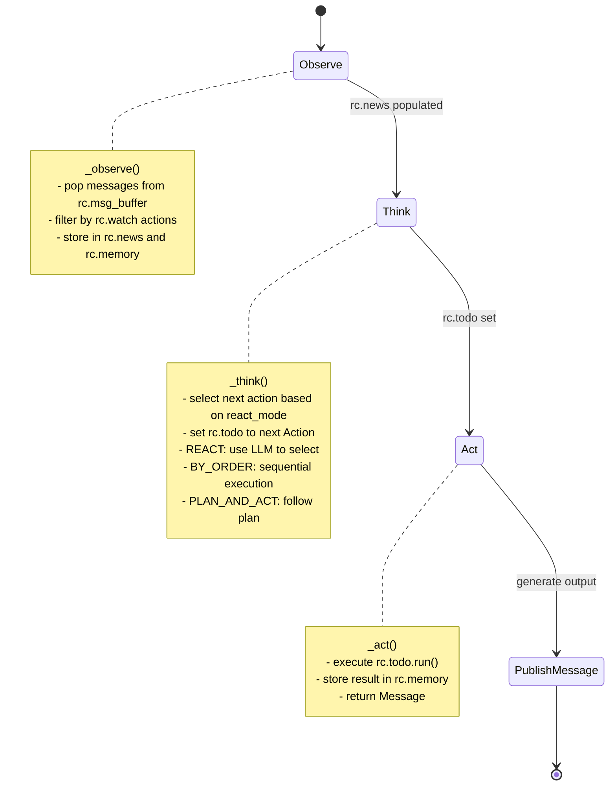
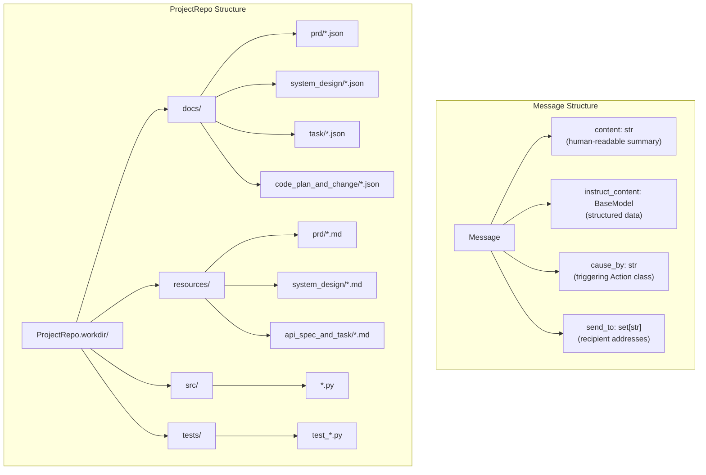
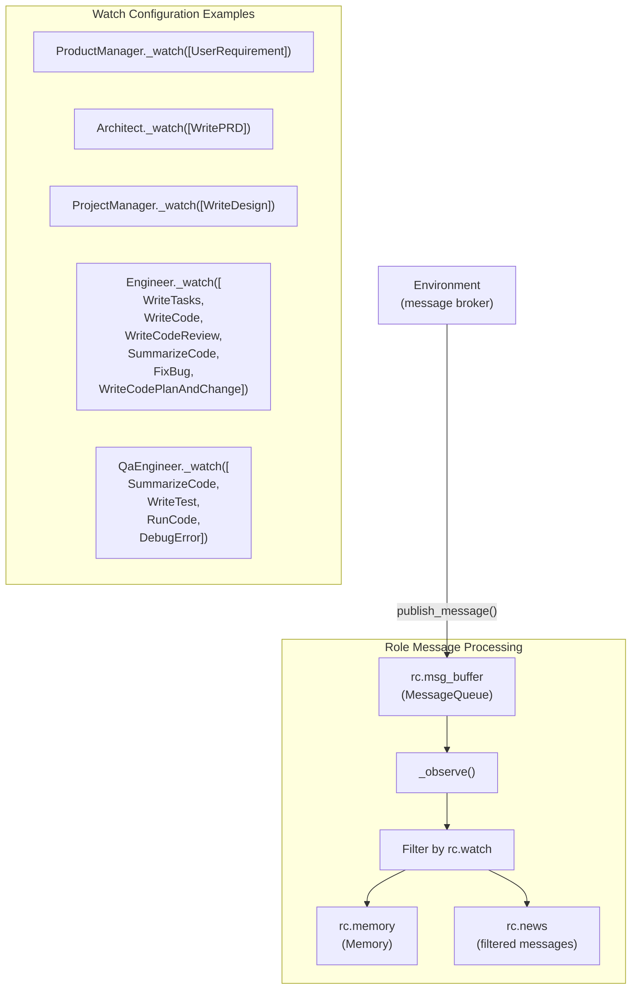
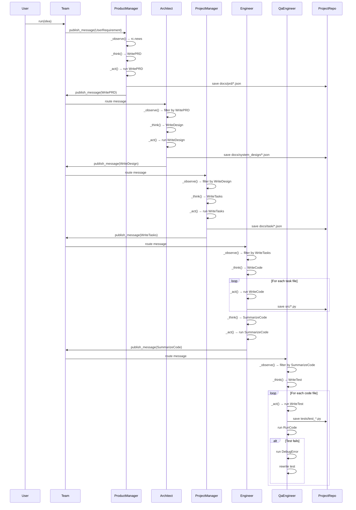
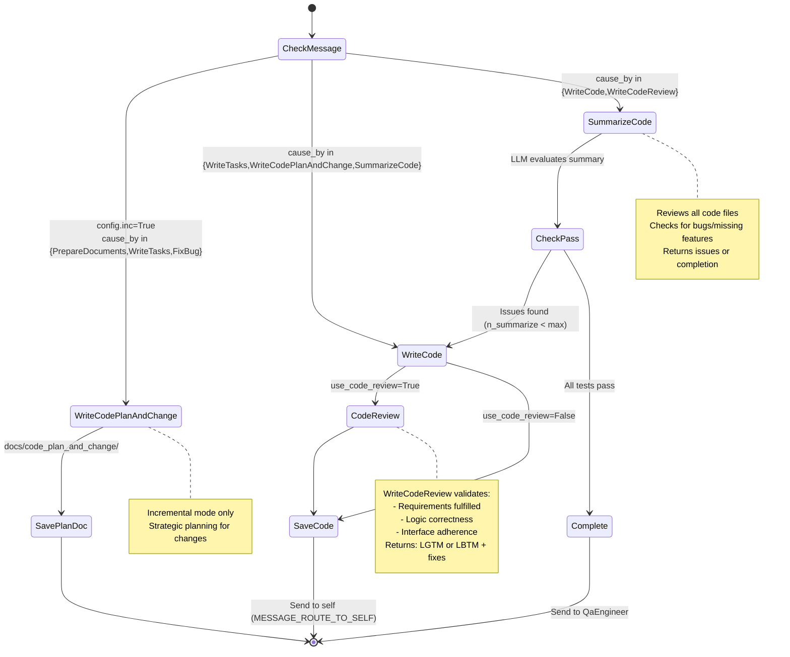

<!-- source: DeepWiki mcp.deepwiki.com · repo FoundationAgents/MetaGPT · page 5 Software Development Workflow · fetched 2026-10-30 -->

# Software Development Workflow

<details>
<summary>Relevant source files</summary>

The following files were used as context for generating this wiki page:

- [metagpt/actions/action.py](metagpt/actions/action.py)
- [metagpt/actions/design_api.py](metagpt/actions/design_api.py)
- [metagpt/actions/project_management.py](metagpt/actions/project_management.py)
- [metagpt/actions/summarize_code.py](metagpt/actions/summarize_code.py)
- [metagpt/actions/write_code.py](metagpt/actions/write_code.py)
- [metagpt/actions/write_code_review.py](metagpt/actions/write_code_review.py)
- [metagpt/actions/write_prd.py](metagpt/actions/write_prd.py)
- [metagpt/const.py](metagpt/const.py)
- [metagpt/memory/memory.py](metagpt/memory/memory.py)
- [metagpt/roles/architect.py](metagpt/roles/architect.py)
- [metagpt/roles/engineer.py](metagpt/roles/engineer.py)
- [metagpt/roles/product_manager.py](metagpt/roles/product_manager.py)
- [metagpt/roles/project_manager.py](metagpt/roles/project_manager.py)
- [metagpt/roles/qa_engineer.py](metagpt/roles/qa_engineer.py)
- [metagpt/roles/role.py](metagpt/roles/role.py)
- [metagpt/schema.py](metagpt/schema.py)
- [metagpt/utils/common.py](metagpt/utils/common.py)

</details>


The Software Development Workflow is MetaGPT's standard, SOP-driven multi-agent system for generating complete software projects from user requirements. This page describes the sequential pipeline architecture where specialized roles (ProductManager, Architect, ProjectManager, Engineer, QaEngineer) collaborate through structured document handoffs to produce working code with tests. Each role follows an observe-think-act cycle, communicating via `Message` objects and persisting artifacts in a Git-backed `ProjectRepo`.

For information about the dynamic tool-based workflow used by advanced agents, see [Dynamic Agent System (RoleZero)](#4). For details on individual role implementations and their specific workflows, see [Standard Development Roles](#5.1).

## Sequential Pipeline Architecture

The workflow operates as a sequential pipeline where each role performs a specific phase of software development, then passes structured documents to the next role.

```mermaid
graph LR
    User["User<br/>(UserRequirement)"]
    PM["ProductManager<br/>'Alice'"]
    Arch["Architect<br/>'Bob'"]
    ProjM["ProjectManager<br/>'Eve'"]
    Eng["Engineer<br/>'Alex'"]
    QA["QaEngineer<br/>'Edward'"]
    
    User -->|"Message<br/>cause_by=UserRequirement"| PM
    PM -->|"Message<br/>cause_by=WritePRD<br/>instruct_content=WritePRDOutput"| Arch
    Arch -->|"Message<br/>cause_by=WriteDesign<br/>instruct_content=WriteDesignOutput"| ProjM
    ProjM -->|"Message<br/>cause_by=WriteTasks<br/>instruct_content=WriteTaskOutput"| Eng
    Eng -->|"Message<br/>cause_by=WriteCode/WriteCodeReview<br/>instruct_content=SummarizeCodeOutput"| QA
    QA -->|"Message<br/>cause_by=WriteTest<br/>instruct_content=WriteTestOutput"| Eng
    
    style PM fill:#e1f5ff
    style Arch fill:#fff4e1
    style ProjM fill:#ffe1f5
    style Eng fill:#e1ffe1
    style QA fill:#f5e1ff
```



**Sources:** [metagpt/roles/role.py:1-593](), [metagpt/roles/product_manager.py:1-65](), [metagpt/roles/architect.py:1-59](), [metagpt/roles/project_manager.py:1-51](), [metagpt/roles/engineer.py:1-493](), [metagpt/roles/qa_engineer.py:1-231]()

## Role Base Class and Observe-Think-Act Cycle

All roles inherit from the `Role` base class, which implements a standardized observe-think-act cycle:



### Key Role Attributes

| Attribute | Type | Purpose |
|-----------|------|---------|
| `rc.env` | `BaseEnvironment` | Message broker for role communication |
| `rc.msg_buffer` | `MessageQueue` | Private queue for incoming messages |
| `rc.memory` | `Memory` | Persistent storage indexed by `cause_by` |
| `rc.todo` | `Action` | Current action to execute |
| `rc.state` | `int` | Index into `actions` list (-1 = idle) |
| `rc.watch` | `set[str]` | Action names to filter for in messages |
| `rc.react_mode` | `RoleReactMode` | Strategy for selecting actions |
| `actions` | `list[Action]` | Available actions for this role |

**Sources:** [metagpt/roles/role.py:92-124](), [metagpt/roles/role.py:340-379](), [metagpt/roles/role.py:381-397](), [metagpt/roles/role.py:399-428]()

## Document-Driven Communication

Roles communicate by passing `Message` objects containing structured documents. Each phase produces artifacts stored in `ProjectRepo` and referenced in subsequent messages.



### Document Flow by Phase

| Phase | Input Documents | Output Documents | Action | Repo Location |
|-------|----------------|------------------|--------|---------------|
| **Requirements** | User text | PRD JSON + MD | `WritePRD` | `docs/prd/*.json`, `resources/prd/*.md` |
| **Design** | PRD JSON | System Design JSON + MD | `WriteDesign` | `docs/system_design/*.json`, `resources/system_design/*.md` |
| **Planning** | System Design JSON | Task List JSON + MD | `WriteTasks` | `docs/task/*.json`, `resources/api_spec_and_task/*.md` |
| **Coding** | Task List + Design | Python files | `WriteCode` | `src/*.py` |
| **Testing** | Python files | Test files | `WriteTest` | `tests/test_*.py` |

**Sources:** [metagpt/schema.py:232-417](), [metagpt/const.py:86-111](), [metagpt/actions/write_prd.py:1-326](), [metagpt/actions/design_api.py:1-280](), [metagpt/actions/project_management.py:1-202](), [metagpt/actions/write_code.py:1-229]()

## Message Routing and Filtering

Roles use the `_watch()` method to subscribe to specific action types and filter incoming messages in `_observe()`.



**Sources:** [metagpt/roles/role.py:284-301](), [metagpt/roles/role.py:399-428](), [metagpt/roles/role.py:429-453](), [metagpt/roles/product_manager.py:41-47](), [metagpt/roles/architect.py:43-53](), [metagpt/roles/project_manager.py:36-42](), [metagpt/roles/engineer.py:102-110](), [metagpt/roles/qa_engineer.py:52-61]()

## Role React Modes

The `Role` class supports three execution strategies via `RoleReactMode`:

### BY_ORDER Mode (Sequential)
Executes actions in the order defined by `self.actions`. Used by most standard roles.

```python
# metagpt/roles/role.py:353-357
if self.rc.react_mode == RoleReactMode.BY_ORDER:
    if self.rc.max_react_loop != len(self.actions):
        self.rc.max_react_loop = len(self.actions)
    self._set_state(self.rc.state + 1)
    return self.rc.state >= 0 and self.rc.state < len(self.actions)
```

### REACT Mode (Dynamic)
Uses LLM to select the next action from available options based on conversation history.

```python
# metagpt/roles/role.py:359-379
prompt = self._get_prefix()
prompt += STATE_TEMPLATE.format(
    history=self.rc.history,
    states="\n".join(self.states),
    n_states=len(self.states) - 1,
    previous_state=self.rc.state,
)
next_state = await self.llm.aask(prompt)
```

### PLAN_AND_ACT Mode
Creates an initial plan, then executes tasks sequentially until completion.

```python
# metagpt/roles/role.py:472-496
if not self.planner.plan.goal:
    goal = self.rc.memory.get()[-1].content
    await self.planner.update_plan(goal=goal)

while self.planner.current_task:
    task = self.planner.current_task
    task_result = await self._act_on_task(task)
    await self.planner.process_task_result(task_result)
```

**Sources:** [metagpt/roles/role.py:82-90](), [metagpt/roles/role.py:261-283](), [metagpt/roles/role.py:340-379](), [metagpt/roles/role.py:472-496]()

## Standard Workflow Execution

The complete workflow is orchestrated by the `Team` class, which initializes roles and coordinates message passing:



**Sources:** [metagpt/roles/role.py:529-555](), [metagpt/actions/write_prd.py:86-189](), [metagpt/actions/design_api.py:64-207](), [metagpt/actions/project_management.py:52-153](), [metagpt/roles/engineer.py:152-231](), [metagpt/roles/qa_engineer.py:62-104]()

## Engineer Multi-Phase Workflow

The `Engineer` role has a complex internal workflow that handles incremental development, code review, and summarization:



### Engineer Action Selection

The `Engineer._think()` method determines which action to execute based on the incoming message's `cause_by` field:

```python
# metagpt/roles/engineer.py:262-288
async def _think(self) -> bool:
    if not self.rc.news:
        return False
    msg = self.rc.news[0]
    
    write_plan_and_change_filters = any_to_str_set([PrepareDocuments, WriteTasks, FixBug])
    write_code_filters = any_to_str_set([WriteTasks, WriteCodePlanAndChange, SummarizeCode])
    summarize_code_filters = any_to_str_set([WriteCode, WriteCodeReview])
    
    if self.config.inc and msg.cause_by in write_plan_and_change_filters:
        await self._new_code_plan_and_change_action(cause_by=msg.cause_by)
        return bool(self.rc.todo)
    if msg.cause_by in write_code_filters:
        await self._new_code_actions()
        return bool(self.rc.todo)
    if msg.cause_by in summarize_code_filters and msg.sent_from == any_to_str(self):
        await self._new_summarize_actions()
        return bool(self.rc.todo)
    return False
```

**Sources:** [metagpt/roles/engineer.py:102-110](), [metagpt/roles/engineer.py:152-231](), [metagpt/roles/engineer.py:262-288](), [metagpt/roles/engineer.py:328-429]()

## Code Review Iteration

When `use_code_review=True`, `Engineer` performs iterative code review using `WriteCodeReview`:

```mermaid
graph TD
    Start["WriteCode generates initial code"]
    Review["WriteCodeReview.run()"]
    Evaluate["Parse 'Code Review Result'"]
    LGTM["Result contains 'LGTM'"]
    LBTM["Result contains 'LBTM'"]
    Rewrite["Rewrite code based on review"]
    MaxIter["Check iteration count"]
    Return["Return final code"]
    
    Start --> Review
    Review --> Evaluate
    Evaluate --> LGTM
    Evaluate --> LBTM
    
    LGTM --> Return
    LBTM --> Rewrite
    Rewrite --> MaxIter
    MaxIter -->|"i < config.code_validate_k_times"| Review
    MaxIter -->|"i >= k"| Return
    
    note left of Review
        Validates:
        1. Requirements met?
        2. Logic correct?
        3. Follows design?
        4. All functions implemented?
        5. Dependencies imported?
        6. Code reuse correct?
    end note
```

**Sources:** [metagpt/actions/write_code_review.py:141-222](), [metagpt/roles/engineer.py:116-151]()

## ProjectRepo Structure

All artifacts are persisted in a Git-backed repository with parallel `docs/` (JSON) and `resources/` (Markdown/PDF) hierarchies:

| Repository Type | Root Path | File Format | Purpose |
|----------------|-----------|-------------|---------|
| `docs.prd` | `docs/prd/` | JSON | Structured PRD data |
| `resources.prd` | `resources/prd/` | Markdown | Human-readable PRD |
| `docs.system_design` | `docs/system_design/` | JSON | Structured design data |
| `resources.system_design` | `resources/system_design/` | Markdown/SVG | Design docs + diagrams |
| `docs.task` | `docs/task/` | JSON | Task list with dependencies |
| `resources.api_spec_and_task` | `resources/api_spec_and_task/` | Markdown | Readable task docs |
| `docs.code_plan_and_change` | `docs/code_plan_and_change/` | JSON | Incremental change plans |
| `srcs` | `src/` | Python | Source code files |
| `tests` | `tests/` | Python | Test files |
| `test_outputs` | `test_outputs/` | JSON | Test execution results |
| `docs.code_summary` | `docs/code_summary/` | JSON | Code review summaries |

**Sources:** [metagpt/const.py:86-111](), [metagpt/actions/write_prd.py:218-230](), [metagpt/actions/design_api.py:187-207](), [metagpt/actions/project_management.py:134-153](), [metagpt/roles/engineer.py:234-253]()

## Memory and Message Indexing

Each role maintains a `Memory` object that stores all messages and indexes them by `cause_by` for efficient retrieval:

```python
# metagpt/memory/memory.py:20-40
class Memory(BaseModel):
    storage: list[Message] = []
    index: DefaultDict[str, list[Message]] = Field(default_factory=lambda: defaultdict(list))
    
    def add(self, message: Message):
        """Add a new message to storage, while updating the index"""
        self.storage.append(message)
        if message.cause_by:
            self.index[message.cause_by].append(message)
    
    def get_by_action(self, action) -> list[Message]:
        """Return all messages triggered by a specified Action"""
        index = any_to_str(action)
        return self.index[index]
```

This enables efficient filtering in `_observe()`:

```python
# metagpt/roles/role.py:409-419
self.rc.news = [
    n for n in news 
    if (n.cause_by in self.rc.watch or self.name in n.send_to) 
    and n not in old_messages
]
if self.observe_all_msg_from_buffer:
    self.rc.memory.add_batch(news)
else:
    self.rc.memory.add_batch(self.rc.news)
```

**Sources:** [metagpt/memory/memory.py:20-113](), [metagpt/roles/role.py:399-428]()

## Key Configuration Parameters

The workflow behavior can be controlled through configuration:

| Parameter | Type | Default | Purpose |
|-----------|------|---------|---------|
| `config.inc` | `bool` | `False` | Enable incremental development mode |
| `config.code_validate_k_times` | `int` | `1` | Number of code review iterations |
| `config.max_auto_summarize_code` | `int` | `0` | Max automatic code summarization rounds |
| `use_code_review` | `bool` | `False` | Enable WriteCodeReview for Engineer |
| `test_round_allowed` | `int` | `5` | Max test/debug cycles for QaEngineer |

**Sources:** [metagpt/roles/engineer.py:93-94](), [metagpt/roles/engineer.py:169-231](), [metagpt/roles/qa_engineer.py:47-48](), [metagpt/actions/write_code_review.py:167-179]()

## Summary

The Software Development Workflow implements a structured, document-driven pipeline where specialized roles collaborate through message passing. The `Role` base class provides the observe-think-act cycle, while each role implements specific actions (WritePRD, WriteDesign, WriteTasks, WriteCode, WriteTest) that produce artifacts stored in a Git-backed repository. Messages carry both human-readable content and structured `instruct_content` (BaseModel instances) that subsequent roles consume. The `Engineer` role orchestrates multi-phase code generation with optional review and summarization, while `QaEngineer` performs test generation and iterative debugging. This architecture enables deterministic, reproducible software generation with clear separation of concerns and comprehensive audit trails.

---

