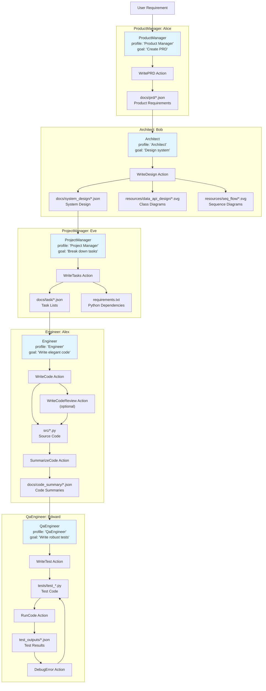
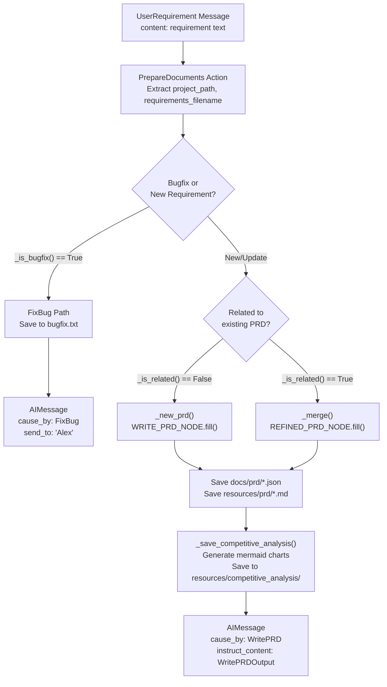
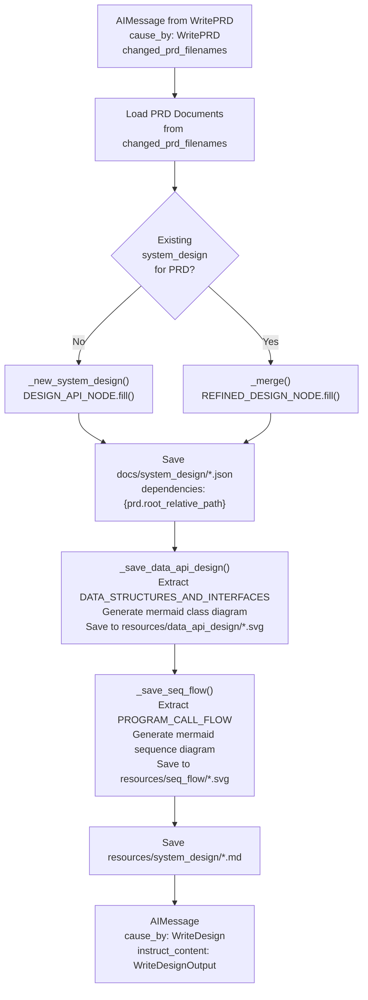
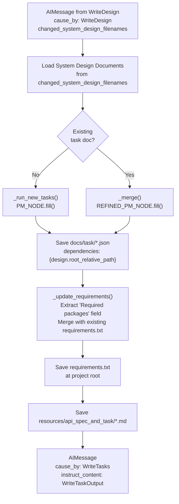
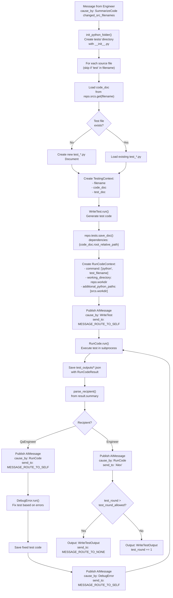
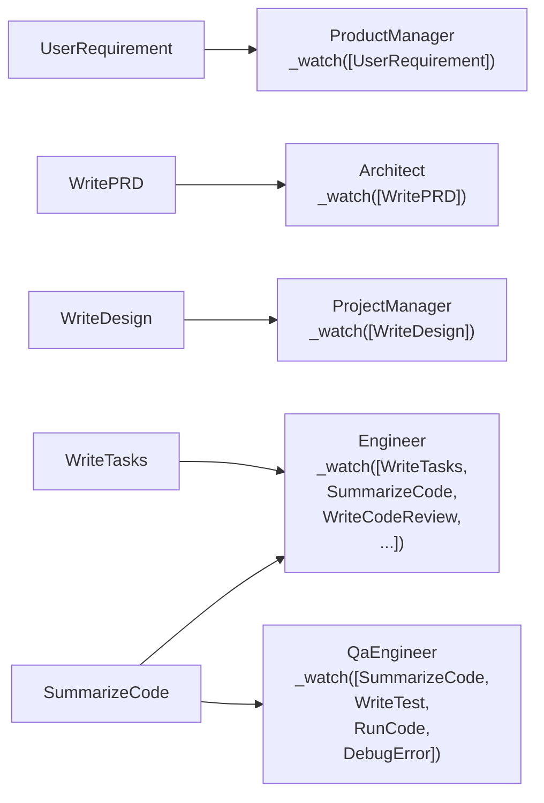
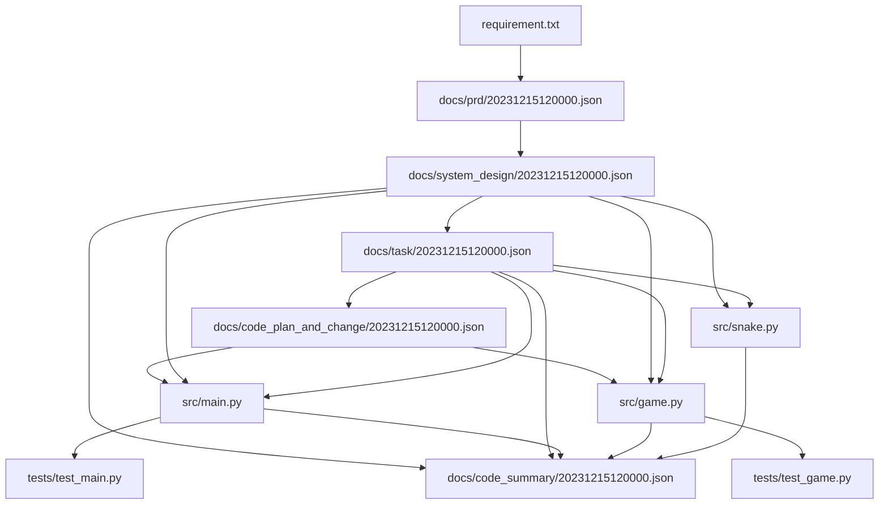

<!-- source: DeepWiki mcp.deepwiki.com · repo FoundationAgents/MetaGPT · page 5.1 Standard Development Roles · fetched 2026-10-30 -->

# Standard Development Roles

<details>
<summary>Relevant source files</summary>

The following files were used as context for generating this wiki page:

- [metagpt/actions/action.py](metagpt/actions/action.py)
- [metagpt/actions/design_api.py](metagpt/actions/design_api.py)
- [metagpt/actions/project_management.py](metagpt/actions/project_management.py)
- [metagpt/actions/summarize_code.py](metagpt/actions/summarize_code.py)
- [metagpt/actions/write_code.py](metagpt/actions/write_code.py)
- [metagpt/actions/write_code_review.py](metagpt/actions/write_code_review.py)
- [metagpt/actions/write_prd.py](metagpt/actions/write_prd.py)
- [metagpt/const.py](metagpt/const.py)
- [metagpt/memory/memory.py](metagpt/memory/memory.py)
- [metagpt/roles/architect.py](metagpt/roles/architect.py)
- [metagpt/roles/engineer.py](metagpt/roles/engineer.py)
- [metagpt/roles/product_manager.py](metagpt/roles/product_manager.py)
- [metagpt/roles/project_manager.py](metagpt/roles/project_manager.py)
- [metagpt/roles/qa_engineer.py](metagpt/roles/qa_engineer.py)
- [metagpt/roles/role.py](metagpt/roles/role.py)
- [metagpt/schema.py](metagpt/schema.py)
- [metagpt/utils/common.py](metagpt/utils/common.py)

</details>


## Purpose and Scope

This document describes the **standard development roles** in MetaGPT, which implement a sequential, SOP-driven software development workflow. These roles follow a fixed pipeline from requirements gathering through testing, with each role performing a specialized task and passing structured documents to the next role in the chain.

For information about:
- The base `Role` class architecture and observe-think-act loops, see [Role Architecture](#2.1)
- Advanced roles with dynamic tool usage (RoleZero descendants), see [Dynamic Agent System (RoleZero)](#4)
- The Engineer's detailed multi-phase workflow, see [Engineer Role Workflow](#5.2)
- Conversational roles with persistent memory, see [Conversational Agents and Memory](#8)

The standard roles implement the "Code = SOP(Team)" philosophy by encoding a software company's standard operating procedures into autonomous agents that collaborate through document exchanges.

Sources: [metagpt/roles/role.py:82-90](), [metagpt/roles/product_manager.py:1-65](), [metagpt/roles/architect.py:1-59](), [metagpt/roles/project_manager.py:1-51](), [metagpt/roles/engineer.py:1-110](), [metagpt/roles/qa_engineer.py:1-61]()

## Role Pipeline and Document Flow



This pipeline implements a sequential handoff pattern where each role:
1. **Observes** messages from upstream roles via `_watch()`
2. **Thinks** to determine if action is needed based on message types
3. **Acts** by executing its primary action(s)
4. **Publishes** results as messages with structured `instruct_content`

Sources: [metagpt/roles/role.py:284-289](), [metagpt/roles/role.py:399-428](), [metagpt/roles/role.py:454-496]()

## ProductManager: Alice

The `ProductManager` role generates Product Requirement Documents (PRDs) from user requirements. It can handle new requirements, requirement updates, and bug reports.

### Configuration

| Attribute | Value |
|-----------|-------|
| Name | `"Alice"` |
| Profile | `"Product Manager"` |
| Goal | `"Create a Product Requirement Document or market research/competitive product research."` |
| Primary Action | `WritePRD` |
| Watches | `[UserRequirement, PrepareDocuments]` |
| React Mode | `RoleReactMode.BY_ORDER` (when using fixed SOP) |

### Workflow



### Key Methods and Data Structures

**ActionNode Structure**: The PRD is generated using `WRITE_PRD_NODE` with 12 fields including:
- Project Name
- Goals and User Stories
- Competitive Analysis
- Competitive Quadrant Chart (mermaid)

**Message Output**: Returns `AIMessage` with `instruct_content` containing:
```python
{
    "project_path": str,
    "requirements_filename": str,
    "changed_prd_filenames": List[str]
}
```

### Fixed vs Dynamic SOP

When `use_fixed_sop=True`, ProductManager operates in `BY_ORDER` mode with two actions:
1. `PrepareDocuments` - Extracts project information
2. `WritePRD` - Generates the PRD

When `use_fixed_sop=False`, ProductManager inherits from `RoleZero` and uses dynamic tool selection.

Sources: [metagpt/roles/product_manager.py:21-65](), [metagpt/actions/write_prd.py:76-189](), [metagpt/actions/write_prd.py:209-272]()

## Architect: Bob

The `Architect` role designs the system architecture, defining APIs, data structures, program flow, and dependencies based on the PRD.

### Configuration

| Attribute | Value |
|-----------|-------|
| Name | `"Bob"` |
| Profile | `"Architect"` |
| Goal | `"design a concise, usable, complete software system. output the system design."` |
| Primary Action | `WriteDesign` |
| Watches | `[WritePRD]` |
| Tools | `["Editor:write,read,similarity_search", "RoleZero", "Terminal:run_command"]` |

### Workflow



### Key Methods and Data Structures

**ActionNode Structure**: System design uses `DESIGN_API_NODE` with 5 fields:
- Implementation approach
- File list
- Data structures and interfaces (mermaid class diagram)
- Program call flow (mermaid sequence diagram)
- Anything UNCLEAR

**Mermaid Diagram Generation**: Both class diagrams and sequence diagrams are automatically converted to SVG files using the configured mermaid engine ([metagpt/actions/design_api.py:231-236]()).

**Message Output**: Returns `AIMessage` with `instruct_content` containing:
```python
{
    "project_path": str,
    "requirements_filename": str,
    "changed_prd_filenames": List[str],
    "changed_system_design_filenames": List[str]
}
```

Sources: [metagpt/roles/architect.py:17-59](), [metagpt/actions/design_api.py:53-207](), [metagpt/actions/design_api_an.py:DESIGN_API_NODE]()

## ProjectManager: Eve

The `ProjectManager` role breaks down the system design into actionable tasks with dependencies and generates a list of required Python packages.

### Configuration

| Attribute | Value |
|-----------|-------|
| Name | `"Eve"` |
| Profile | `"Project Manager"` |
| Goal | `"break down tasks according to PRD/technical design, generate a task list, and analyze task dependencies to start with the prerequisite modules"` |
| Primary Action | `WriteTasks` |
| Watches | `[WriteDesign]` |
| Tools | `["Editor:write,read,similarity_search", "RoleZero", "WriteTasks"]` |

### Workflow



### Key Methods and Data Structures

**ActionNode Structure**: Task breakdown uses `PM_NODE` with 7 fields:
- Required Python packages
- Required Other language third-party packages
- Logic Analysis (dependencies between files)
- Task list (list of filenames to implement)
- Full API spec
- Shared Knowledge
- Anything UNCLEAR

**Task List Format**: The task list is a JSON array of Python filenames:
```json
["main.py", "game.py", "snake.py", "food.py"]
```

**Dependency Analysis**: The `Logic Analysis` field specifies file dependencies to establish implementation order.

**Message Output**: Returns `AIMessage` with `instruct_content` containing:
```python
{
    "project_path": str,
    "requirements_filename": str,
    "changed_prd_filenames": List[str],
    "changed_system_design_filenames": List[str],
    "changed_task_filenames": List[str],
    "python_package_dependency_filename": str
}
```

Sources: [metagpt/roles/project_manager.py:13-51](), [metagpt/actions/project_management.py:46-177](), [metagpt/actions/project_management_an.py:PM_NODE]()

## Engineer: Alex

The `Engineer` role implements source code based on design documents and task lists. It supports optional code review, iterative refinement, and code summarization.

### Configuration

| Attribute | Value |
|-----------|-------|
| Name | `"Alex"` |
| Profile | `"Engineer"` |
| Goal | `"write elegant, readable, extensible, efficient code"` |
| Primary Actions | `WriteCode`, `WriteCodeReview` (optional), `SummarizeCode` |
| Watches | `[WriteTasks, SummarizeCode, WriteCode, WriteCodeReview, FixBug, WriteCodePlanAndChange]` |
| Uses Code Review | Configurable via `use_code_review` flag |

### Multi-Phase Workflow

The Engineer implements a sophisticated multi-phase workflow:

```mermaid
graph TB
    TaskMsg["Message from WriteTasks<br/>or SummarizeCode<br/>or WriteCodePlanAndChange"]
    
    Think["_think()<br/>Determine next action"]
    
    TodoType{"rc.todo<br/>type?"}
    
    PlanPhase["WriteCodePlanAndChange<br/>Generate code plan (inc mode)"]
    WritePhase["WriteCode<br/>Generate code for each file"]
    SummarizePhase["SummarizeCode<br/>Review all code, find issues"]
    
    SavePlan["Save docs/code_plan_and_change/*.json"]
    
    ForEachFile["For each file in task list"]
    
    LoadContext["Load CodingContext:<br/>- design_doc<br/>- task_doc<br/>- code_doc (old code)<br/>- code_plan_and_change_doc"]
    
    GetOtherCodes["get_codes()<br/>Load other files as context<br/>(exclude current file)"]
    
    WritePrompt["Format PROMPT_TEMPLATE<br/>or REFINED_TEMPLATE"]
    
    CallLLM["WriteCode.write_code()<br/>await _aask(prompt)"]
    
    ParseCode["CodeParser.parse_code()"]
    
    ReviewCheck{"use_code_review?"}
    
    CodeReview["WriteCodeReview<br/>Iterative review + rewrite"]
    
    SaveCode["repo.srcs.save()<br/>dependencies: {design, task, plan}"]
    
    CheckSummary["Check max_auto_summarize_code"]
    
    RunSummary["For each (design, task) pair:<br/>SummarizeCode.run()"]
    
    IsPass["_is_pass()<br/>Check if issues found"]
    
    SaveSummary["Save docs/code_summary/*.json<br/>and resources/code_summary/*.md"]
    
    MoreIssues{"Issues<br/>found?"}
    
    Complete["Output: SummarizeCodeOutput<br/>send_to: 'Edward' (QA)"]
    Iterate["Output: SummarizeCode<br/>send_to: MESSAGE_ROUTE_TO_SELF"]
    
    TaskMsg --> Think
    Think --> TodoType
    
    TodoType -->|"WriteCodePlanAndChange"| PlanPhase
    TodoType -->|"WriteCode"| WritePhase
    TodoType -->|"SummarizeCode"| SummarizePhase
    
    PlanPhase --> SavePlan
    SavePlan --> WritePhase
    
    WritePhase --> ForEachFile
    ForEachFile --> LoadContext
    LoadContext --> GetOtherCodes
    GetOtherCodes --> WritePrompt
    WritePrompt --> CallLLM
    CallLLM --> ParseCode
    ParseCode --> ReviewCheck
    
    ReviewCheck -->|"Yes"| CodeReview
    ReviewCheck -->|"No"| SaveCode
    CodeReview --> SaveCode
    
    SaveCode --> SummarizePhase
    
    SummarizePhase --> CheckSummary
    CheckSummary --> RunSummary
    RunSummary --> IsPass
    IsPass --> SaveSummary
    SaveSummary --> MoreIssues
    
    MoreIssues -->|"Yes and n < max"| Iterate
    MoreIssues -->|"No or n >= max"| Complete
```



### CodingContext Data Structure

Each file to be written is encapsulated in a `CodingContext`:

```python
class CodingContext:
    filename: str
    design_doc: Optional[Document]  # System design
    task_doc: Optional[Document]    # Task breakdown
    code_doc: Optional[Document]    # Old code (for updates)
    code_plan_and_change_doc: Optional[Document]  # Incremental plan
```

The context is serialized to JSON and stored as a `Document` object, which is passed to the `WriteCode` action.

### Code Review Integration

When `use_code_review=True`, the Engineer performs iterative code review:
1. **WriteCode** generates initial code
2. **WriteCodeReview** reviews against requirements (up to `config.code_validate_k_times` iterations)
3. If review returns "LBTM" (Looks Bad To Me), code is rewritten
4. If review returns "LGTM" (Looks Good To Me), code is accepted

### Code Summarization

After all files are written, `SummarizeCode`:
1. Loads all source files for a given (design, task) pair
2. Generates a summary with:
   - Code review of all files
   - Call flow diagram (mermaid)
   - TODOs (dict of files needing fixes)
3. Checks if issues exist via `_is_pass()`
4. If issues found and under `max_auto_summarize_code` limit, triggers another WriteCode iteration

### Message Outputs

The Engineer produces different messages depending on the phase:

**After WriteCode/WriteCodeReview**:
```python
AIMessage(
    content="",
    cause_by=WriteCodeReview or WriteCode,
    send_to=MESSAGE_ROUTE_TO_SELF
)
```

**After SummarizeCode (complete)**:
```python
AIMessage(
    content="Coding is complete...",
    instruct_content={
        "project_path": str,
        "changed_src_filenames": List[str],
        "changed_code_summary_filenames": List[str]
    },
    cause_by=SummarizeCode,
    send_to="Edward"  # QaEngineer
)
```

Sources: [metagpt/roles/engineer.py:73-289](), [metagpt/actions/write_code.py:88-228](), [metagpt/actions/write_code_review.py:141-221](), [metagpt/actions/summarize_code.py:93-123]()

## QaEngineer: Edward

The `QaEngineer` role writes unit tests, executes them, and debugs failures in an iterative loop until tests pass or a maximum iteration count is reached.

### Configuration

| Attribute | Value |
|-----------|-------|
| Name | `"Edward"` |
| Profile | `"QaEngineer"` |
| Goal | `"Write comprehensive and robust tests to ensure codes will work as expected without bugs"` |
| Primary Actions | `WriteTest`, `RunCode`, `DebugError` |
| Watches | `[SummarizeCode, WriteTest, RunCode, DebugError]` |
| Test Round Allowed | Default: 5 iterations |

### Test-Debug-Fix Cycle



### TestingContext and RunCodeContext

**TestingContext**: Input to `WriteTest`
```python
class TestingContext:
    filename: str
    code_doc: Document      # Source code to test
    test_doc: Optional[Document]  # Existing test or empty
```

**RunCodeContext**: Input to `RunCode` and `DebugError`
```python
class RunCodeContext:
    mode: str = "script"
    command: List[str]  # ["python", "tests/test_main.py"]
    code_filename: str
    test_filename: str
    working_directory: str
    additional_python_paths: List[str]
    output_filename: Optional[str]  # test_outputs/*.json
    output: Optional[str]
```

### Test Execution and Result Parsing

1. **RunCode** executes tests using `subprocess` with proper Python paths
2. Results are captured in `RunCodeResult`:
   ```python
   class RunCodeResult:
       summary: str  # Contains recipient info
       stdout: str
       stderr: str
   ```
3. **parse_recipient()** extracts intended recipient from summary
4. If recipient is "Engineer", issue is sent back for code fixes
5. If recipient is "QaEngineer", issue is debugged locally

### Iteration Control

The QaEngineer maintains a `test_round` counter:
- Increments after each `_act()` call
- Stops when `test_round > test_round_allowed` (default 5)
- Sends final message with `send_to=MESSAGE_ROUTE_TO_NONE` to terminate

### Message Outputs

**During iteration**:
```python
AIMessage(
    content=f"Round {test_round} of tests done",
    instruct_content={
        "changed_test_filenames": List[str]
    },
    cause_by=WriteTest,
    send_to=MESSAGE_ROUTE_TO_NONE
)
```

**When complete**:
```python
AIMessage(
    content=f"Exceeding {test_round_allowed} rounds...",
    cause_by=WriteTest,
    instruct_content={
        "changed_test_filenames": List[str]
    },
    send_to=MESSAGE_ROUTE_TO_NONE
)
```

Sources: [metagpt/roles/qa_engineer.py:39-229](), [metagpt/actions/write_test.py:WriteTest](), [metagpt/actions/run_code.py:RunCode](), [metagpt/actions/debug_error.py:DebugError]()

## Message-Based Communication

Standard roles communicate through structured `Message` objects with filtering and routing capabilities.

### Message Structure

```python
class Message(BaseModel):
    id: str                    # Unique identifier
    content: str              # Natural language content
    instruct_content: Optional[BaseModel]  # Structured data
    role: str = "user"        # "system", "user", "assistant"
    cause_by: str             # Action class that created this message
    sent_from: str            # Role that sent the message
    send_to: set[str]         # Recipient addresses
    metadata: Dict[str, Any]  # Additional metadata
```

### Watch Pattern

Each role specifies which message types it observes using `_watch()`:



### Memory Indexing

The `Memory` class maintains an index of messages by `cause_by`:

```python
class Memory(BaseModel):
    storage: list[Message] = []
    index: DefaultDict[str, list[Message]]  # cause_by -> messages
    
    def add(self, message: Message):
        self.storage.append(message)
        if message.cause_by:
            self.index[message.cause_by].append(message)
    
    def get_by_action(self, action) -> list[Message]:
        index = any_to_str(action)
        return self.index[index]
```

### Message Filtering in _observe()

The `Role._observe()` method filters messages based on watch patterns:

```python
async def _observe(self) -> int:
    news = self.rc.msg_buffer.pop_all()
    old_messages = self.rc.memory.get()
    
    # Filter messages where:
    # 1. cause_by is in watched actions, OR
    # 2. self.name is in send_to
    self.rc.news = [
        n for n in news 
        if (n.cause_by in self.rc.watch or self.name in n.send_to) 
        and n not in old_messages
    ]
    
    # Save filtered messages to memory
    self.rc.memory.add_batch(self.rc.news)
    return len(self.rc.news)
```

This ensures roles only process relevant messages, enabling selective collaboration.

Sources: [metagpt/roles/role.py:284-289](), [metagpt/roles/role.py:399-428](), [metagpt/schema.py:232-334](), [metagpt/memory/memory.py:20-113]()

## React Modes

Standard roles support three reaction modes via `RoleReactMode`:

| Mode | Description | Control Flow |
|------|-------------|-------------|
| `REACT` | Standard ReAct loop: alternating think-act cycles | LLM selects actions dynamically via `STATE_TEMPLATE` prompt |
| `BY_ORDER` | Execute actions sequentially in order | Cycles through `self.actions` list in order |
| `PLAN_AND_ACT` | First plan, then execute action sequence | LLM generates `Plan`, then executes tasks |

### BY_ORDER Mode (Default for Standard Roles)

Most standard roles use `BY_ORDER` mode when configured with fixed SOPs:

```python
# In ProductManager.__init__()
self.set_actions([PrepareDocuments(send_to=any_to_str(self)), WritePRD])
self._watch([UserRequirement, PrepareDocuments])
self.rc.react_mode = RoleReactMode.BY_ORDER
```

The `Role._think()` method handles `BY_ORDER`:

```python
async def _think(self) -> bool:
    if self.rc.react_mode == RoleReactMode.BY_ORDER:
        if self.rc.max_react_loop != len(self.actions):
            self.rc.max_react_loop = len(self.actions)
        self._set_state(self.rc.state + 1)
        return self.rc.state >= 0 and self.rc.state < len(self.actions)
```

### REACT Mode

Used when roles need dynamic action selection:

```python
async def _think(self) -> bool:
    prompt = self._get_prefix()
    prompt += STATE_TEMPLATE.format(
        history=self.rc.history,
        states="\n".join(self.states),
        n_states=len(self.states) - 1,
        previous_state=self.rc.state,
    )
    
    next_state = await self.llm.aask(prompt)
    next_state = extract_state_value_from_output(next_state)
    
    if int(next_state) == -1:
        logger.info(f"End actions with {next_state=}")
    self._set_state(next_state)
    return True
```

The LLM chooses which action to execute next or terminates with `-1`.

Sources: [metagpt/roles/role.py:82-90](), [metagpt/roles/role.py:261-283](), [metagpt/roles/role.py:340-379](), [metagpt/roles/role.py:512-523]()

## Document Repository Structure

Standard roles store artifacts in a Git-backed `ProjectRepo` with parallel hierarchies:

```
project_root/
├── docs/                          # JSON source of truth
│   ├── requirement.txt            # User requirement
│   ├── bugfix.txt                 # Bug report (if applicable)
│   ├── prd/                       # Product Requirements
│   │   └── *.json
│   ├── system_design/             # System Designs
│   │   └── *.json
│   ├── task/                      # Task Breakdowns
│   │   └── *.json
│   ├── code_plan_and_change/      # Incremental plans
│   │   └── *.json
│   └── code_summary/              # Code review summaries
│       └── *.json
├── resources/                     # Human-readable artifacts
│   ├── prd/                       # PRD markdown
│   │   └── *.md
│   ├── competitive_analysis/      # Quadrant charts
│   │   └── *.svg
│   ├── system_design/             # Design markdown
│   │   └── *.md
│   ├── data_api_design/           # Class diagrams
│   │   └── *.svg
│   ├── seq_flow/                  # Sequence diagrams
│   │   └── *.svg
│   ├── api_spec_and_task/         # Task markdown
│   │   └── *.md
│   └── code_summary/              # Summary markdown
│       └── *.md
├── src/                           # Source code
│   └── *.py
├── tests/                         # Test code
│   └── test_*.py
├── test_outputs/                  # Test execution results
│   └── *.json
└── requirements.txt               # Python dependencies
```

### Document Dependencies

Each file tracks its dependencies for incremental rebuilds:



Dependencies are tracked in `FileRepository`:

```python
await self.repo.srcs.save(
    filename=coding_context.filename,
    dependencies=[
        coding_context.design_doc.root_relative_path,
        coding_context.task_doc.root_relative_path
    ],
    content=coding_context.code_doc.content
)
```

This enables:
1. **Incremental updates**: Only rebuild files whose dependencies changed
2. **Change tracking**: `repo.srcs.changed_files` identifies modified files
3. **Dependency analysis**: `repo.git_repo.get_dependency()` retrieves file dependencies

Sources: [metagpt/utils/project_repo.py:ProjectRepo](), [metagpt/utils/file_repository.py:FileRepository](), [metagpt/roles/engineer.py:139-150](), [metagpt/const.py:86-111]()

---

