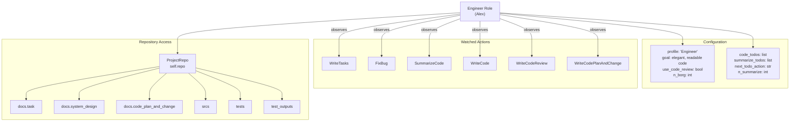
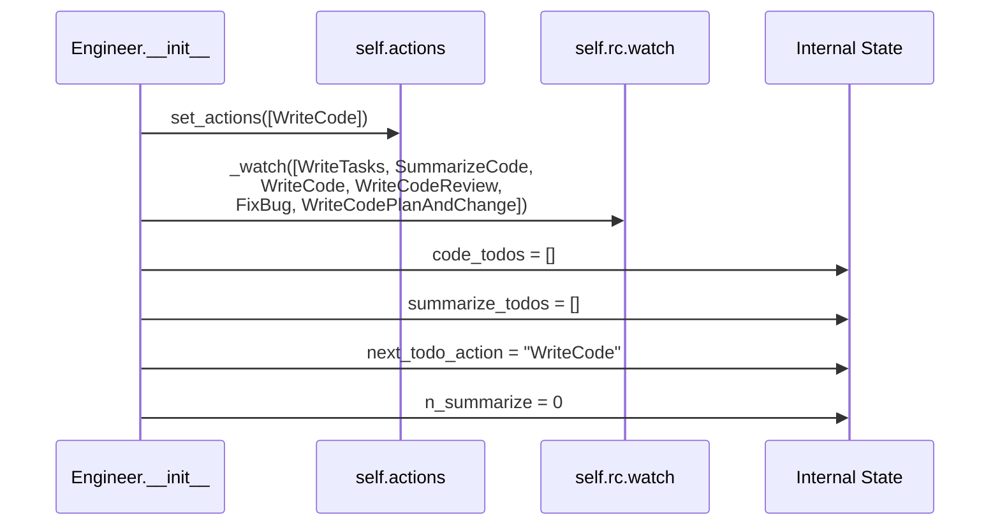
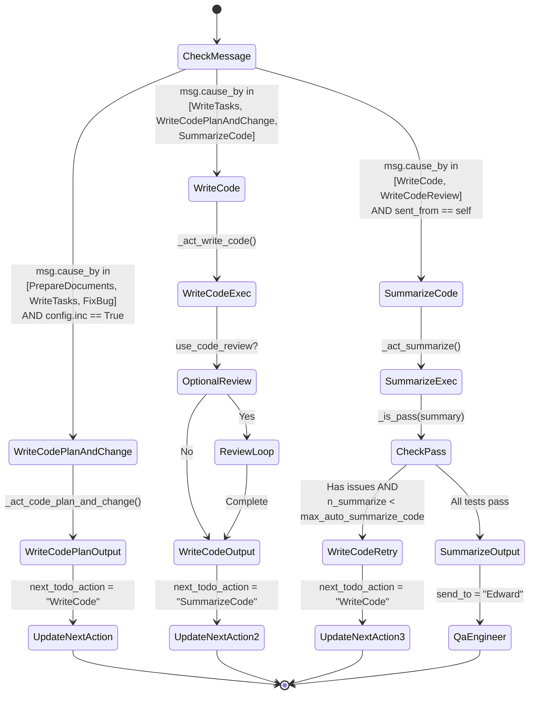
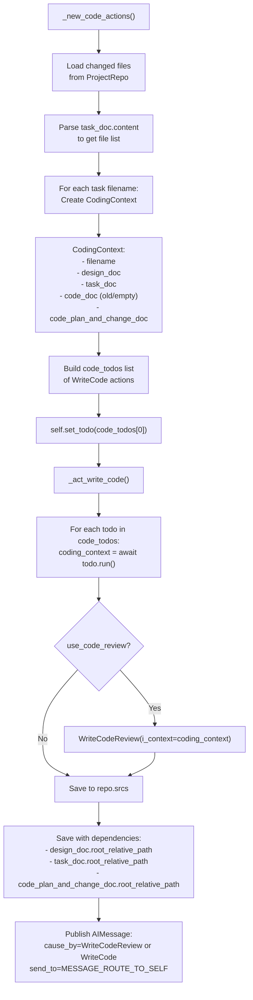
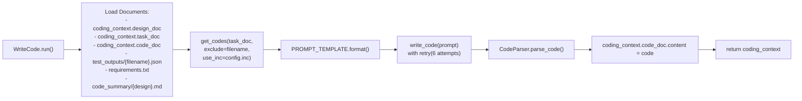
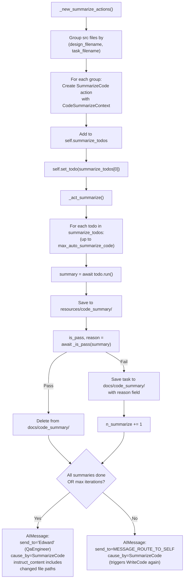
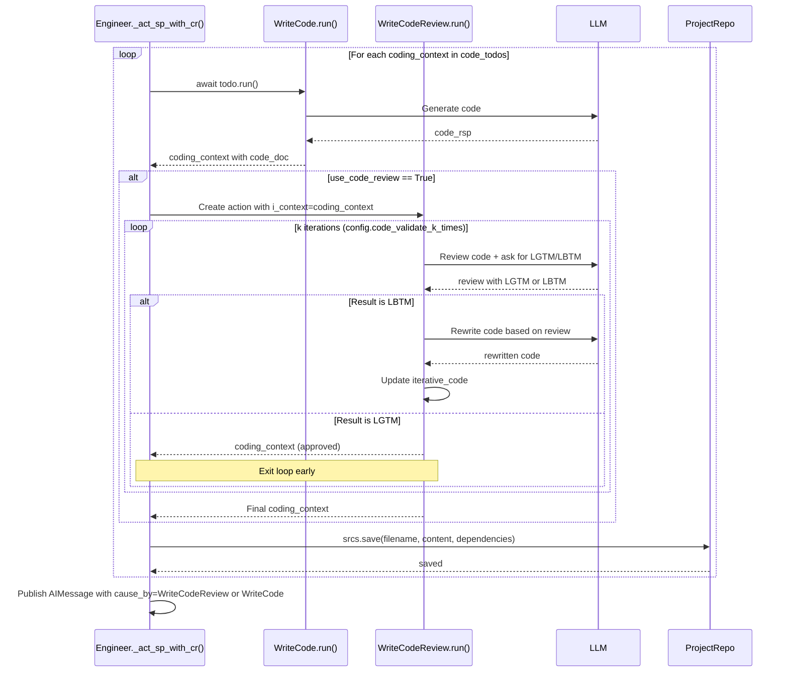
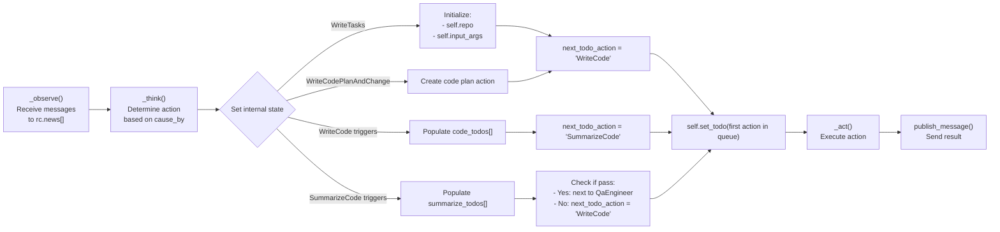
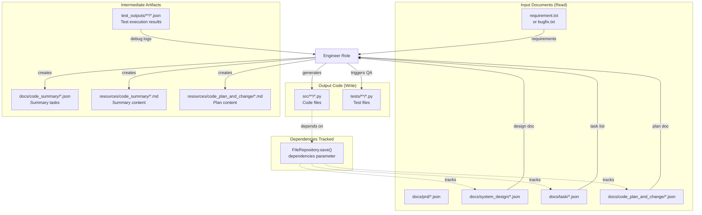
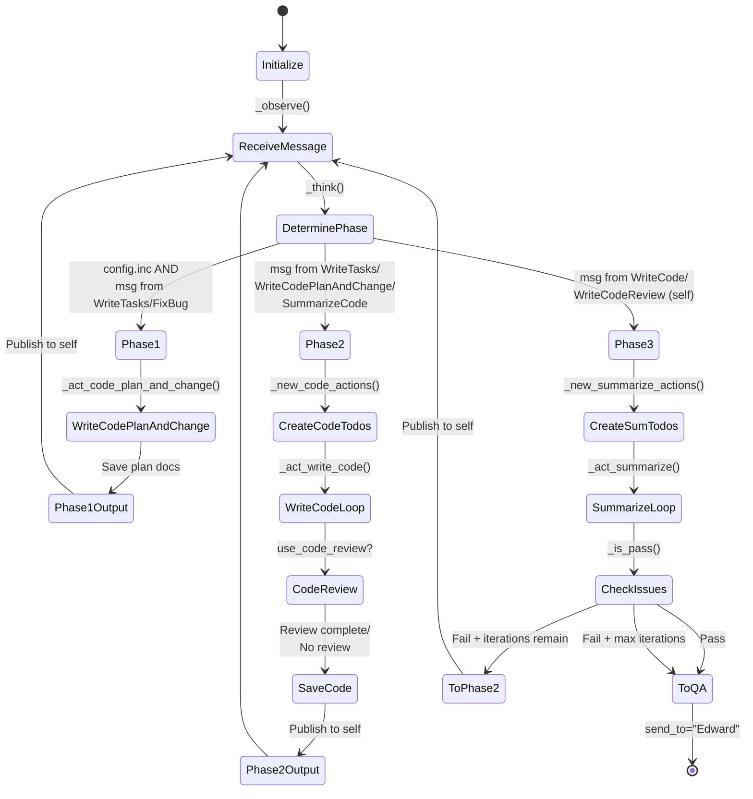

<!-- source: DeepWiki mcp.deepwiki.com · repo FoundationAgents/MetaGPT · page 5.2 Engineer Role Workflow · fetched 2026-10-30 -->

# Engineer Role Workflow

<details>
<summary>Relevant source files</summary>

The following files were used as context for generating this wiki page:

- [metagpt/actions/action.py](metagpt/actions/action.py)
- [metagpt/actions/design_api.py](metagpt/actions/design_api.py)
- [metagpt/actions/project_management.py](metagpt/actions/project_management.py)
- [metagpt/actions/summarize_code.py](metagpt/actions/summarize_code.py)
- [metagpt/actions/write_code.py](metagpt/actions/write_code.py)
- [metagpt/actions/write_code_review.py](metagpt/actions/write_code_review.py)
- [metagpt/actions/write_prd.py](metagpt/actions/write_prd.py)
- [metagpt/const.py](metagpt/const.py)
- [metagpt/memory/memory.py](metagpt/memory/memory.py)
- [metagpt/roles/architect.py](metagpt/roles/architect.py)
- [metagpt/roles/engineer.py](metagpt/roles/engineer.py)
- [metagpt/roles/product_manager.py](metagpt/roles/product_manager.py)
- [metagpt/roles/project_manager.py](metagpt/roles/project_manager.py)
- [metagpt/roles/qa_engineer.py](metagpt/roles/qa_engineer.py)
- [metagpt/roles/role.py](metagpt/roles/role.py)
- [metagpt/schema.py](metagpt/schema.py)
- [metagpt/utils/common.py](metagpt/utils/common.py)

</details>


This document provides a detailed technical specification of the Engineer role's multi-phase code generation workflow in MetaGPT. It covers the role's initialization, action dispatch logic, three-phase execution cycle (plan → write → summarize), optional code review iteration, and file/dependency management through ProjectRepo.

For information about the broader software development pipeline and how Engineer interacts with other roles, see [Standard Development Roles](#5.1). For details on incremental development features and WriteCodePlanAndChange, see [Incremental Development](#5.3).

## Overview of Engineer Role

The `Engineer` role is responsible for transforming design documents and task lists into executable code. It operates as a state machine that cycles through multiple phases, optionally performing code review iterations, and maintaining comprehensive file dependency tracking.

**Key Characteristics:**
- **Profile**: `"Engineer"`, identified by name `"Alex"`
- **Goal**: `"write elegant, readable, extensible, efficient code"`
- **Memory**: Disabled (`enable_memory = False`) for stateless operation
- **Actions Watched**: `WriteTasks`, `SummarizeCode`, `WriteCode`, `WriteCodeReview`, `FixBug`, `WriteCodePlanAndChange`



Sources: [metagpt/roles/engineer.py:73-110]()

## Engineer Initialization

The Engineer initializes with a single action (`WriteCode`) but watches for multiple message types to determine its execution phase:



Sources: [metagpt/roles/engineer.py:102-110]()

## Three-Phase Workflow State Machine

The Engineer operates as a state machine with three primary phases, selected based on the `cause_by` field of incoming messages and the `next_todo_action` state variable.



Sources: [metagpt/roles/engineer.py:152-165](), [metagpt/roles/engineer.py:262-288]()

### Phase 1: WriteCodePlanAndChange (Incremental Mode Only)

When `config.inc` is enabled, the Engineer first creates a strategic plan document outlining code changes. This phase only executes when triggered by `PrepareDocuments`, `WriteTasks`, or `FixBug` messages.

**Trigger Conditions:**
```python
write_plan_and_change_filters = any_to_str_set([PrepareDocuments, WriteTasks, FixBug])
if self.config.inc and msg.cause_by in write_plan_and_change_filters:
    await self._new_code_plan_and_change_action(cause_by=msg.cause_by)
```

**Key Operations:**
1. Loads requirement or issue document
2. Creates `CodePlanAndChangeContext` with PRD, design, and task filenames
3. Executes `WriteCodePlanAndChange` action
4. Saves plan to `docs/code_plan_and_change/` and resources
5. Publishes message with `MESSAGE_ROUTE_TO_SELF` to trigger next phase

Sources: [metagpt/roles/engineer.py:273-279](), [metagpt/roles/engineer.py:455-490]()

### Phase 2: WriteCode

The core code generation phase that transforms task lists into source files. Creates multiple `WriteCode` actions (stored in `self.code_todos`) and executes them sequentially.

**Trigger Conditions:**
```python
write_code_filters = any_to_str_set([WriteTasks, WriteCodePlanAndChange, SummarizeCode])
if msg.cause_by in write_code_filters:
    await self._new_code_actions()
```

**Workflow:**



Sources: [metagpt/roles/engineer.py:280-283](), [metagpt/roles/engineer.py:328-428](), [metagpt/roles/engineer.py:116-150](), [metagpt/roles/engineer.py:167-171]()

**WriteCode Action Details:**

The `WriteCode.run()` method constructs a comprehensive prompt that includes:
- **Design**: System design document content
- **Task**: Task document content
- **Legacy Code**: Existing code from other files (via `get_codes()`)
- **Debug logs**: Test execution results from `test_outputs/`
- **Bug Feedback**: Issue document content (for bug fixes)
- **Summary Log**: Code summary document (if available)



Sources: [metagpt/actions/write_code.py:100-165](), [metagpt/actions/write_code.py:34-85]()

**Code Context Retrieval (`get_codes`):**

The `get_codes()` static method provides different behavior based on whether incremental mode is enabled:

| Mode | Behavior |
|------|----------|
| **Normal** (`use_inc=False`) | Includes code from files listed in `task_doc` EXCEPT the target file |
| **Incremental** (`use_inc=True`) | Includes ALL files from `repo.srcs`, placing the target file FIRST with old content, followed by all other files |

Sources: [metagpt/actions/write_code.py:168-228]()

### Phase 3: SummarizeCode

After code generation completes, the Engineer creates summary documents that analyze the codebase, identify issues, and determine whether iteration is needed.

**Trigger Conditions:**
```python
summarize_code_filters = any_to_str_set([WriteCode, WriteCodeReview])
if msg.cause_by in summarize_code_filters and msg.sent_from == any_to_str(self):
    await self._new_summarize_actions()
```

**Workflow:**



Sources: [metagpt/roles/engineer.py:284-287](), [metagpt/roles/engineer.py:430-453](), [metagpt/roles/engineer.py:173-231]()

**SummarizeCode Output Format:**

The `SummarizeCode` action generates a structured markdown document with four sections:

1. **Code Review All**: Lists bugs/issues per file
2. **Call flow**: Mermaid flowchart showing function call chains
3. **Summary**: High-level summary per file
4. **TODOs**: Python dict mapping filenames to required changes

Sources: [metagpt/actions/summarize_code.py:20-90]()

**Pass/Fail Determination:**

The `_is_pass()` method uses LLM to evaluate the summary:

```python
IS_PASS_PROMPT = """
{context}

----
Does the above log indicate anything that needs to be done?
If there are any tasks to be completed, please answer 'NO' along with the to-do list in JSON format;
otherwise, answer 'YES' in JSON format.
"""
```

- **YES**: Code is complete, proceed to QaEngineer
- **NO**: Code has issues, return to WriteCode phase (if iterations remain)

Sources: [metagpt/roles/engineer.py:63-70](), [metagpt/roles/engineer.py:255-260]()

## Code Review Process (LGTM/LBTM)

When `use_code_review=True`, the Engineer performs iterative code review and rewriting within the WriteCode phase. This occurs in `_act_sp_with_cr()` before files are saved.



Sources: [metagpt/roles/engineer.py:116-150](), [metagpt/actions/write_code_review.py:167-221]()

**Review Prompt Structure:**

The `WriteCodeReview` action constructs a comprehensive context including:
- System Design
- Task definition
- Code Files (other files in the project)
- User New Requirements (in incremental mode)
- Code Plan And Change (in incremental mode)
- Code to be Reviewed

The review evaluates six criteria:
1. Implementation matches requirements?
2. Logic is correct?
3. Follows data structures and interfaces?
4. All functions implemented?
5. All dependencies imported?
6. Reusing methods from other files correctly?

Sources: [metagpt/actions/write_code_review.py:27-65]()

**LGTM vs LBTM:**
- **LGTM** (Looks Good To Me): Code is approved, no changes needed
- **LBTM** (Looks Bad To Me): Code needs revision, triggers rewrite

Sources: [metagpt/actions/write_code_review.py:62-64](), [metagpt/actions/write_code_review.py:152-165]()

## Action Coordination and State Management

The Engineer maintains internal state to coordinate between phases and track progress:

| State Variable | Type | Purpose |
|----------------|------|---------|
| `code_todos` | `list[WriteCode]` | Queue of WriteCode actions to execute |
| `summarize_todos` | `list[SummarizeCode]` | Queue of SummarizeCode actions to execute |
| `next_todo_action` | `str` | Name of next action phase ("WriteCode" or "SummarizeCode") |
| `n_summarize` | `int` | Counter for auto-summarize iterations |
| `input_args` | `BaseModel` | Input parameters from previous role (contains file paths) |
| `repo` | `ProjectRepo` | File repository manager |

**Message Flow and State Transitions:**



Sources: [metagpt/roles/engineer.py:262-288](), [metagpt/roles/engineer.py:152-165]()

## File Organization and Dependency Tracking

The Engineer interacts with multiple file repositories through `ProjectRepo`, maintaining strict dependency relationships:



**Dependency Chain Example:**

When saving a source file, the Engineer records dependencies:

```python
dependencies = {
    coding_context.design_doc.root_relative_path,  # "docs/system_design/game.json"
    coding_context.task_doc.root_relative_path,    # "docs/task/game.json"
}
if self.config.inc:
    dependencies.add(coding_context.code_plan_and_change_doc.root_relative_path)

await self.repo.srcs.save(
    filename=coding_context.filename,  # "game.py"
    dependencies=list(dependencies),
    content=coding_context.code_doc.content,
)
```

This enables Git-based change tracking: when a design document changes, the system knows which source files need regeneration.

Sources: [metagpt/roles/engineer.py:139-147](), [metagpt/roles/engineer.py:293-317]()

## Integration with Other Roles

The Engineer receives input from upstream roles and sends output to downstream roles:

**Upstream Inputs:**

| Role | Action | Provides | Message Field |
|------|--------|----------|---------------|
| ProductManager | `WritePRD` | Requirements document | `requirements_filename` |
| Architect | `WriteDesign` | System design documents | `changed_system_design_filenames` |
| ProjectManager | `WriteTasks` | Task lists and file structure | `changed_task_filenames` |
| Self | `SummarizeCode` | Iteration trigger (when issues found) | - |
| Self | `WriteCodeReview` | Review results (LBTM triggers retry) | - |

**Downstream Outputs:**

| Phase | Target Role | Action | Message Content |
|-------|-------------|--------|-----------------|
| WriteCodePlanAndChange | Self | Continue to WriteCode | `MESSAGE_ROUTE_TO_SELF` |
| WriteCode | Self | Continue to SummarizeCode | `MESSAGE_ROUTE_TO_SELF` |
| SummarizeCode (pass) | QaEngineer | Start testing | `send_to="Edward"`, includes `changed_src_filenames`, `changed_test_filenames` |
| SummarizeCode (fail) | Self | Iterate on WriteCode | `MESSAGE_ROUTE_TO_SELF` |

Sources: [metagpt/roles/engineer.py:169-171](), [metagpt/roles/engineer.py:217-231](), [metagpt/roles/engineer.py:252-253]()

**Message Protocol Example:**

After successful code generation and summarization:

```python
kvs = self.input_args.model_dump()
kvs["changed_src_filenames"] = [
    str(self.repo.srcs.workdir / i) for i in list(self.repo.srcs.changed_files.keys())
]
return AIMessage(
    content=f"Coding is complete. The source code is at {self.repo.workdir.name}/{self.repo.srcs.root_path}...",
    instruct_content=AIMessage.create_instruct_value(kvs=kvs, class_name="SummarizeCodeOutput"),
    cause_by=SummarizeCode,
    send_to="Edward",  # The name of QaEngineer
)
```

This message structure allows the QaEngineer to locate generated files and begin test generation.

Sources: [metagpt/roles/engineer.py:203-227]()

---

**Complete Engineer Workflow Summary:**



Sources: [metagpt/roles/engineer.py:152-288]()

---

