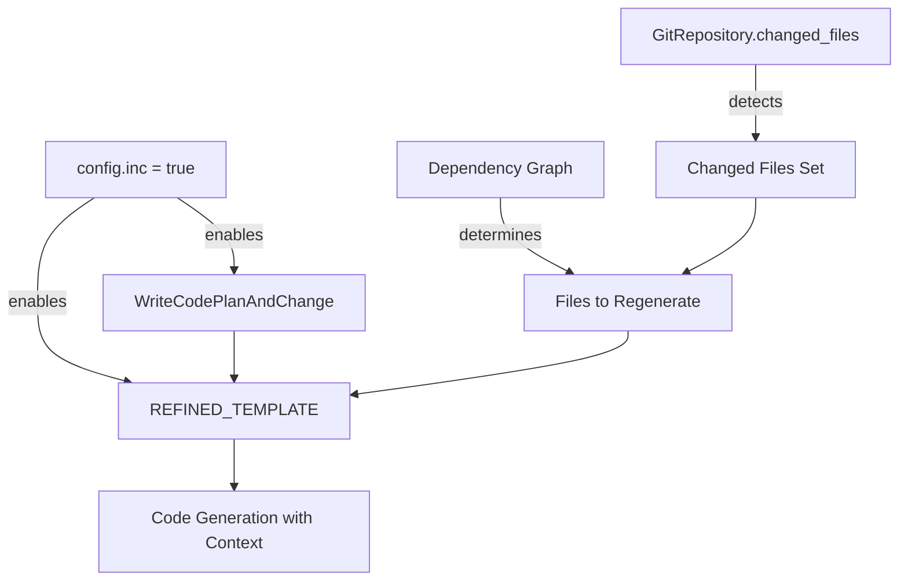
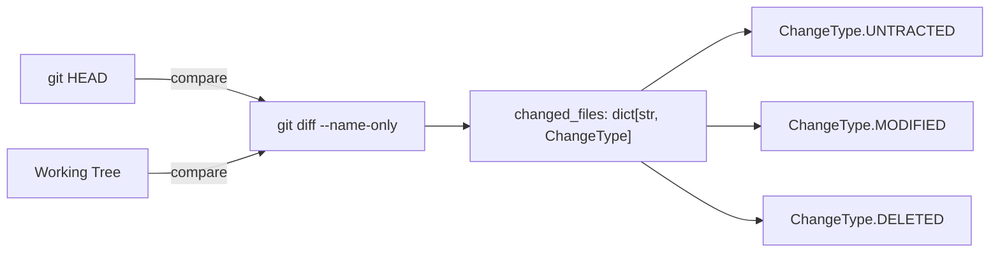
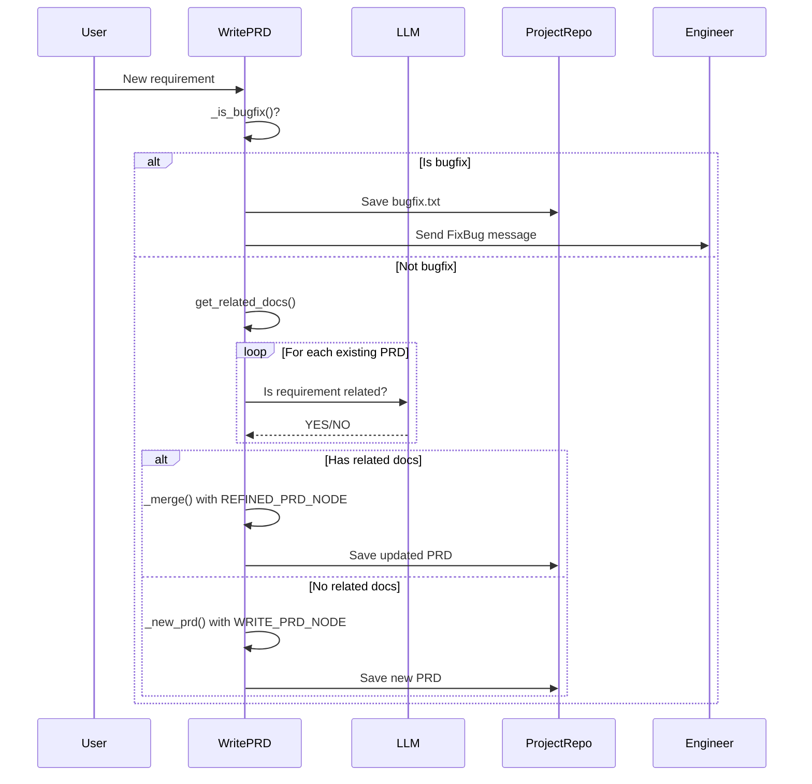
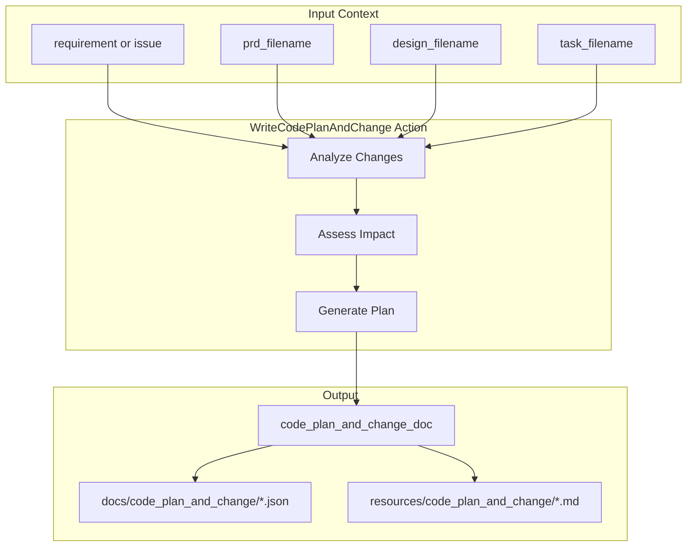
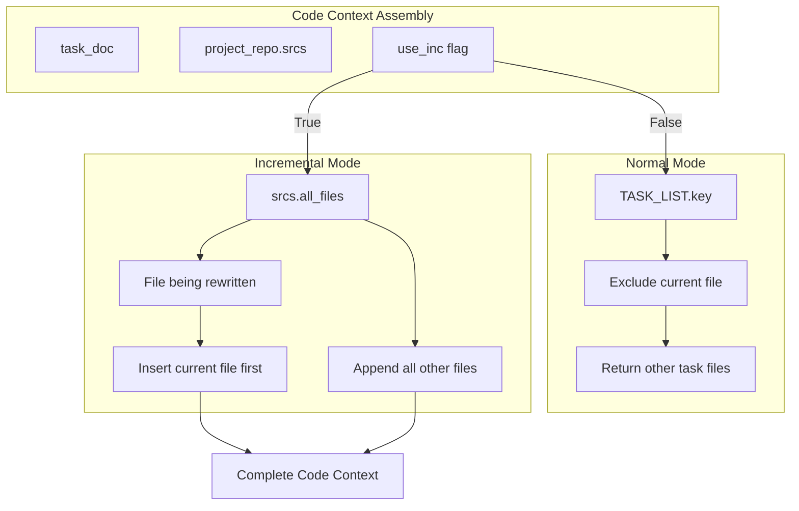
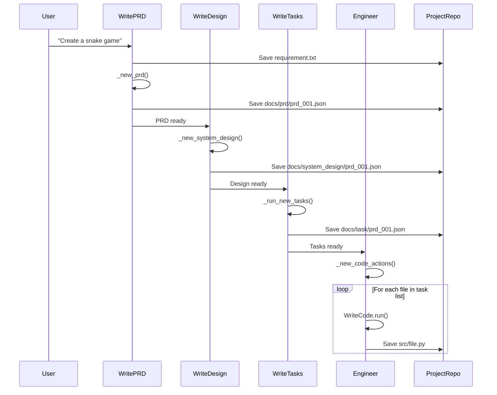
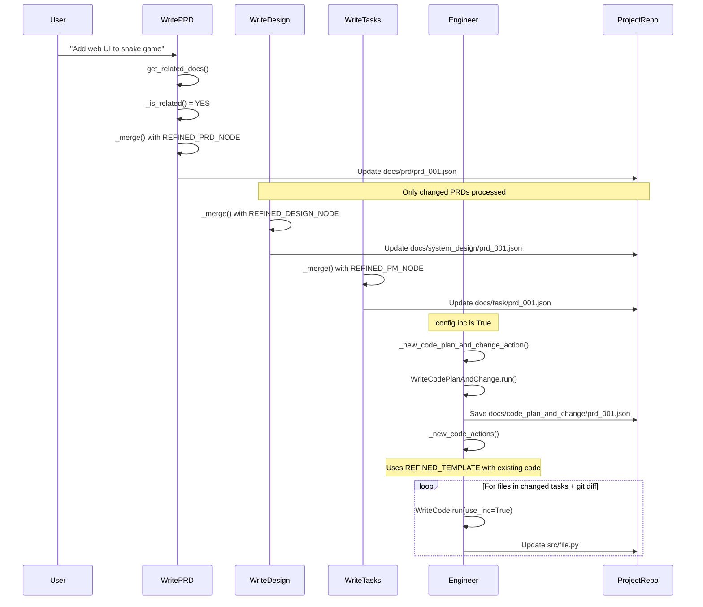

<!-- source: DeepWiki mcp.deepwiki.com · repo FoundationAgents/MetaGPT · page 5.3 Incremental Development · fetched 2026-10-30 -->

# Incremental Development

<details>
<summary>Relevant source files</summary>

The following files were used as context for generating this wiki page:

- [metagpt/actions/action.py](metagpt/actions/action.py)
- [metagpt/actions/design_api.py](metagpt/actions/design_api.py)
- [metagpt/actions/project_management.py](metagpt/actions/project_management.py)
- [metagpt/actions/summarize_code.py](metagpt/actions/summarize_code.py)
- [metagpt/actions/write_code.py](metagpt/actions/write_code.py)
- [metagpt/actions/write_code_review.py](metagpt/actions/write_code_review.py)
- [metagpt/actions/write_prd.py](metagpt/actions/write_prd.py)
- [metagpt/const.py](metagpt/const.py)
- [metagpt/memory/memory.py](metagpt/memory/memory.py)
- [metagpt/roles/architect.py](metagpt/roles/architect.py)
- [metagpt/roles/engineer.py](metagpt/roles/engineer.py)
- [metagpt/roles/product_manager.py](metagpt/roles/product_manager.py)
- [metagpt/roles/project_manager.py](metagpt/roles/project_manager.py)
- [metagpt/roles/qa_engineer.py](metagpt/roles/qa_engineer.py)
- [metagpt/roles/role.py](metagpt/roles/role.py)
- [metagpt/schema.py](metagpt/schema.py)
- [metagpt/utils/common.py](metagpt/utils/common.py)

</details>


## Purpose and Scope

This document explains MetaGPT's incremental development system, which enables evolutionary iteration on existing projects by detecting changes and regenerating only affected downstream artifacts. When enabled via `config.inc`, the framework uses git diff detection and dependency tracking to perform targeted updates rather than full regeneration.

For general project artifact management without incremental updates, see [ProjectRepo and File Management](#6.1). For code generation fundamentals, see [Traditional Development Roles](#5.1).

---

## Overview

Incremental development in MetaGPT allows users to modify requirements, PRDs, designs, or code, and have the system intelligently regenerate only the affected components. The system maintains a dependency graph where downstream artifacts are automatically updated when upstream documents change:

```
Requirement → PRD → System Design → Tasks → Code Plan → Code → Tests
```

The key insight is that MetaGPT tracks file dependencies in a git repository and uses git diff to detect what has changed since the last generation. When changes are detected, only the affected files and their dependents are regenerated with full context of the existing codebase.

Sources: [Diagram 5: Data Flow Through ProjectRepo and Incremental Development](), [metagpt/const.py:86-111]()

---

## Configuration and Activation

Incremental development is controlled by the `config.inc` flag, accessible via:

- **Configuration file**: Set `inc: true` in `config2.yaml`
- **Context property**: Access via `self.config.inc` in actions and roles
- **Runtime check**: Used throughout the codebase to branch between normal and incremental modes

When `config.inc` is enabled, the system automatically:
1. Uses `GitRepository` to track file changes via git diff
2. Applies `REFINED_TEMPLATE` prompts that include existing code context
3. Generates `WriteCodePlanAndChange` documents before code generation
4. Loads dependency information to determine what needs regeneration



**Diagram: Incremental Development Activation Flow**

Sources: [metagpt/roles/engineer.py:140-141](), [metagpt/roles/engineer.py:276-279](), [metagpt/actions/write_code.py:119-142]()

---

## Dependency Tracking and Git Diff Detection

### ProjectRepo and FileRepository

MetaGPT uses `ProjectRepo` to organize artifacts into separate `FileRepository` instances, each tracking its own files and dependencies:

| Repository | Path | Purpose | Key Method |
|------------|------|---------|------------|
| `docs.prd` | `docs/prd/` | Product requirements | `save()`, `changed_files` |
| `docs.system_design` | `docs/system_design/` | System design documents | `save()`, `changed_files` |
| `docs.task` | `docs/task/` | Task breakdowns | `save()`, `changed_files` |
| `docs.code_plan_and_change` | `docs/code_plan_and_change/` | Code change plans | `save()`, `changed_files` |
| `srcs` | `src/` | Source code files | `save()`, `changed_files`, `get_dependency()` |
| `tests` | `tests/` | Test files | `save()`, `changed_files` |

Each `FileRepository` provides:
- **`changed_files` property**: Returns files that differ from git HEAD
- **`save(dependencies=set)` method**: Stores file with explicit dependency list
- **`get_dependency(filename)` method**: Retrieves stored dependencies for a file

### Git Diff Detection

The `GitRepository` class wraps git operations and provides the `changed_files` property, which compares the current workspace against git HEAD:



**Diagram: Git Diff Detection Mechanism**

Sources: [metagpt/utils/git_repository.py]() (implied from usage in [metagpt/roles/engineer.py:331-335]()), [metagpt/schema.py:138-192]()

---

## Incremental Workflow Phases

### Phase 1: Requirement Update Detection

When a user provides a new requirement, `WritePRD` determines whether it's:
1. **A bug fix**: Generates `bugfix.txt` and routes to `FixBug` → `Engineer`
2. **Related to existing PRD**: Updates the existing PRD document
3. **New requirement**: Creates a new PRD document

The relatedness check uses `WP_IS_RELATIVE_NODE` to ask the LLM if the new requirement relates to an existing PRD:



**Diagram: Requirement Update Detection Flow**

Sources: [metagpt/actions/write_prd.py:159-171](), [metagpt/actions/write_prd.py:238-252](), [metagpt/actions/write_prd.py:232-236]()

### Phase 2: Code Plan and Change Generation

When `config.inc` is enabled and the Engineer receives a task from `WriteTasks`, `PrepareDocuments`, or `FixBug`, it first generates a `WriteCodePlanAndChange` document before any code generation:

The `WriteCodePlanAndChange` action analyzes:
- Original requirement or bug report
- Existing PRD
- Existing system design
- Existing task breakdown
- Current source code files

It produces a `CodePlanAndChangeContext` containing:
- **Change analysis**: What needs to be modified and why
- **Impact assessment**: Which files are affected
- **Implementation plan**: Step-by-step changes



**Diagram: Code Plan and Change Generation**

Sources: [metagpt/roles/engineer.py:455-483](), [metagpt/schema.py:852-858](), [metagpt/roles/engineer.py:233-253]()

### Phase 3: Code Generation with Context

When generating code in incremental mode, the `WriteCode` action uses `REFINED_TEMPLATE` instead of `PROMPT_TEMPLATE`. The refined template includes:

1. **User Requirement**: Original or updated requirement
2. **Code Plan and Change**: The generated plan from Phase 2
3. **System Design**: Current design document
4. **Task**: Current task breakdown
5. **Existing Code**: All other source files in the project
6. **File to Rewrite**: The specific file being regenerated with its current content

The key difference is providing the LLM with the existing code as context, so it can make targeted changes rather than generating from scratch:

```python
# From write_code.py, incremental mode
if self.config.inc:
    prompt = REFINED_TEMPLATE.format(
        user_requirement=requirement_doc.content,
        code_plan_and_change=coding_context.code_plan_and_change_doc.content,
        design=coding_context.design_doc.content,
        task=coding_context.task_doc.content,
        code=code_context,  # includes existing code
        logs=logs,
        feedback=bug_feedback.content if bug_feedback else "",
        filename=self.i_context.filename,
        demo_filename=Path(self.i_context.filename).stem,
        summary_log=summary_doc.content if summary_doc else "",
    )
```

The `get_codes()` method behaves differently in incremental mode:
- **Normal mode**: Returns only files from the task list, excluding the current file
- **Incremental mode**: Returns ALL source files, placing the file being rewritten first with its current content



**Diagram: Code Context Assembly for Incremental Generation**

Sources: [metagpt/actions/write_code.py:167-228](), [metagpt/actions/write_code.py:119-142](), [metagpt/actions/write_code_plan_and_change_an.py]() (implied from usage)

---

## Key Components

### Engineer Role Incremental Logic

The `Engineer` role contains the core orchestration for incremental development. Its `_think()` method determines what action to take based on incoming messages:

```python
write_plan_and_change_filters = any_to_str_set([PrepareDocuments, WriteTasks, FixBug])
write_code_filters = any_to_str_set([WriteTasks, WriteCodePlanAndChange, SummarizeCode])
summarize_code_filters = any_to_str_set([WriteCode, WriteCodeReview])

if self.config.inc and msg.cause_by in write_plan_and_change_filters:
    await self._new_code_plan_and_change_action(cause_by=msg.cause_by)
    return bool(self.rc.todo)
if msg.cause_by in write_code_filters:
    await self._new_code_actions()
    return bool(self.rc.todo)
if msg.cause_by in summarize_code_filters and msg.sent_from == any_to_str(self):
    await self._new_summarize_actions()
    return bool(self.rc.todo)
```

This creates a clear branching logic:
- **Incremental mode + initial trigger**: Generate code plan first
- **After plan or normal mode**: Generate code
- **After code**: Summarize and check for issues

Sources: [metagpt/roles/engineer.py:262-288](), [metagpt/roles/engineer.py:156-164]()

### CodingContext Schema

The `CodingContext` schema encapsulates all information needed for code generation:

```python
class CodingContext(BaseContext):
    filename: str
    design_doc: Optional[Document] = None
    task_doc: Optional[Document] = None
    code_doc: Optional[Document] = None
    code_plan_and_change_doc: Optional[Document] = None
```

In incremental mode, `code_plan_and_change_doc` is populated with the plan generated in Phase 2. The `WriteCode` action checks for this document and uses it to guide code generation.

Sources: [metagpt/schema.py:797-803](), [metagpt/roles/engineer.py:290-317](), [metagpt/actions/write_code.py:104-109]()

### Dependency Saving

When saving files, MetaGPT explicitly tracks dependencies using the `dependencies` parameter:

```python
await self.repo.srcs.save(
    filename=coding_context.filename,
    dependencies=list(dependencies),
    content=coding_context.code_doc.content,
)
```

For code files, dependencies typically include:
- The design document that specified the file's architecture
- The task document that defined what the file should implement
- The code plan and change document (in incremental mode)

These dependencies are used to determine when files need regeneration. If any dependency changes, the dependent file is marked as needing update.

Sources: [metagpt/roles/engineer.py:139-147](), [metagpt/roles/engineer.py:237-245]()

---

## File Structure and Artifacts

The incremental development system produces artifacts in a structured directory layout:

```
project_root/
├── docs/
│   ├── prd/
│   │   └── *.json                    # PRD documents
│   ├── system_design/
│   │   └── *.json                    # System design documents
│   ├── task/
│   │   └── *.json                    # Task breakdowns
│   └── code_plan_and_change/
│       └── *.json                    # Code change plans (incremental only)
├── resources/
│   ├── prd/
│   │   └── *.md                      # PRD markdown exports
│   ├── system_design/
│   │   └── *.md                      # Design markdown exports
│   ├── code_plan_and_change/
│   │   └── *.md                      # Plan markdown exports
│   ├── data_api_design/
│   │   └── *.svg                     # Class diagrams
│   └── seq_flow/
│       └── *.svg                     # Sequence diagrams
├── src/
│   └── *.py                          # Source code files
└── tests/
    └── test_*.py                     # Test files
```

Constants defining these paths:

| Constant | Value | Purpose |
|----------|-------|---------|
| `DOCS_FILE_REPO` | `"docs"` | Root for all documentation |
| `PRDS_FILE_REPO` | `"docs/prd"` | Product requirements |
| `SYSTEM_DESIGN_FILE_REPO` | `"docs/system_design"` | System designs |
| `TASK_FILE_REPO` | `"docs/task"` | Task breakdowns |
| `CODE_PLAN_AND_CHANGE_FILE_REPO` | `"docs/code_plan_and_change"` | Change plans |
| `RESOURCES_FILE_REPO` | `"resources"` | Exported artifacts |

Sources: [metagpt/const.py:90-111](), [Diagram 5: Data Flow Through ProjectRepo and Incremental Development]()

---

## Example Workflow

Here's a complete example of incremental development in action:

### Initial Development



**Diagram: Initial Development Workflow**

### Incremental Update (config.inc = true)



**Diagram: Incremental Update Workflow**

### Dependency Chain Example

Suppose we have the following dependency chain:

```
requirement.txt → docs/prd/game.json → docs/system_design/game.json → docs/task/game.json → src/game.py
                                                                                         → src/ui.py
                                                                     → src/main.py (depends on game.py and ui.py)
```

If the user updates `requirement.txt`:
1. **Git diff**: Detects `requirement.txt` changed
2. **Dependency tracking**: `docs/prd/game.json` depends on `requirement.txt` → mark for update
3. **Cascade**: `docs/system_design/game.json` depends on `docs/prd/game.json` → mark for update
4. **Cascade**: `docs/task/game.json` depends on `docs/system_design/game.json` → mark for update
5. **Cascade**: All source files depending on `docs/task/game.json` → mark for update
6. **Code plan**: Generate `docs/code_plan_and_change/game.json` analyzing required changes
7. **Code generation**: Regenerate all marked source files with full existing code context

Sources: [metagpt/roles/engineer.py:328-426](), [metagpt/actions/write_prd.py:218-236](), [metagpt/actions/design_api.py:147-175](), [metagpt/actions/project_management.py:103-132]()

---

## Integration with Other Systems

### SummarizeCode Feedback Loop

After code generation in incremental mode, the `SummarizeCode` action reviews all generated files and creates a summary document. If issues are found, the summary triggers another iteration:

1. Engineer generates code → `SummarizeCode` action runs
2. `SummarizeCode` creates `docs/code_summary/*.json` with issues
3. If issues found, publishes message to `MESSAGE_ROUTE_TO_SELF`
4. Engineer's `_think()` detects `SummarizeCode` message → triggers `_new_summarize_actions()`
5. Creates new `WriteCode` actions to fix issues
6. Process repeats up to `config.max_auto_summarize_code` times

This creates a self-correcting loop where the framework iteratively improves the code until no issues remain or the iteration limit is reached.

Sources: [metagpt/roles/engineer.py:173-231](), [metagpt/roles/engineer.py:430-453](), [metagpt/actions/summarize_code.py:93-123]()

### WriteCodeReview Integration

When `use_code_review=True` on the Engineer role, code review is performed before saving in both normal and incremental modes. The review process uses the same context as code generation, including the code plan and change document in incremental mode:

```python
if review:
    action = WriteCodeReview(
        i_context=coding_context,
        repo=self.repo,
        input_args=self.input_args,
        context=self.context,
        llm=self.llm,
    )
    self._init_action(action)
    coding_context = await action.run()
```

The reviewer has access to `code_plan_and_change_doc` and uses it to verify that changes align with the planned modifications.

Sources: [metagpt/roles/engineer.py:116-137](), [metagpt/actions/write_code_review.py:167-221](), [metagpt/actions/write_code_review.py:178-192]()

---

## Performance Considerations

Incremental development significantly improves performance by:

1. **Reduced LLM calls**: Only regenerating changed files instead of the entire codebase
2. **Smaller context windows**: Focused changes with targeted context
3. **Faster iterations**: Quick updates to existing projects without full regeneration

However, there are trade-offs:
- **Git dependency**: Requires a git repository for change detection
- **Context size**: Including all existing code can create large prompts in complex projects
- **Dependency accuracy**: Incorrect dependencies can lead to incomplete regeneration

The system limits context growth through:
- `max_auto_summarize_code`: Controls iteration depth (default from config)
- `REFINED_TASK_LIST`: Separate task list field for incremental vs normal tasks
- Selective code context: Only includes relevant files, not entire repository

Sources: [metagpt/actions/write_code.py:167-228](), [metagpt/roles/engineer.py:176-201]()

---

