<!-- source: DeepWiki mcp.deepwiki.com · repo FoundationAgents/MetaGPT · page 6 Project Repository and Artifact Management · fetched 2026-10-30 -->

# Project Repository and Artifact Management

<details>
<summary>Relevant source files</summary>

The following files were used as context for generating this wiki page:

- [metagpt/actions/action.py](metagpt/actions/action.py)
- [metagpt/actions/design_api.py](metagpt/actions/design_api.py)
- [metagpt/actions/prepare_documents.py](metagpt/actions/prepare_documents.py)
- [metagpt/actions/project_management.py](metagpt/actions/project_management.py)
- [metagpt/actions/summarize_code.py](metagpt/actions/summarize_code.py)
- [metagpt/actions/write_code.py](metagpt/actions/write_code.py)
- [metagpt/actions/write_code_review.py](metagpt/actions/write_code_review.py)
- [metagpt/actions/write_prd.py](metagpt/actions/write_prd.py)
- [metagpt/const.py](metagpt/const.py)
- [metagpt/memory/memory.py](metagpt/memory/memory.py)
- [metagpt/prompts/di/swe_agent.py](metagpt/prompts/di/swe_agent.py)
- [metagpt/roles/architect.py](metagpt/roles/architect.py)
- [metagpt/roles/di/swe_agent.py](metagpt/roles/di/swe_agent.py)
- [metagpt/roles/engineer.py](metagpt/roles/engineer.py)
- [metagpt/roles/product_manager.py](metagpt/roles/product_manager.py)
- [metagpt/roles/project_manager.py](metagpt/roles/project_manager.py)
- [metagpt/roles/qa_engineer.py](metagpt/roles/qa_engineer.py)
- [metagpt/roles/role.py](metagpt/roles/role.py)
- [metagpt/schema.py](metagpt/schema.py)
- [metagpt/tools/libs/git.py](metagpt/tools/libs/git.py)
- [metagpt/utils/common.py](metagpt/utils/common.py)
- [metagpt/utils/file_repository.py](metagpt/utils/file_repository.py)
- [metagpt/utils/git_repository.py](metagpt/utils/git_repository.py)
- [tests/metagpt/roles/di/run_swe_agent_for_benchmark.py](tests/metagpt/roles/di/run_swe_agent_for_benchmark.py)
- [tests/metagpt/roles/di/run_swe_agent_open_source_issue.py](tests/metagpt/roles/di/run_swe_agent_open_source_issue.py)
- [tests/metagpt/test_document.py](tests/metagpt/test_document.py)
- [tests/metagpt/tools/libs/test_git.py](tests/metagpt/tools/libs/test_git.py)
- [tests/metagpt/tools/libs/test_image_getter.py](tests/metagpt/tools/libs/test_image_getter.py)

</details>


This document describes MetaGPT's Git-backed project storage system, which manages hierarchical file organization and artifact persistence across the software development lifecycle. The system handles structured documents (PRD, design, tasks) and their human-readable counterparts (Markdown, PDF, SVG) through a dual-hierarchy pattern.

For information about how roles interact with these artifacts during the development workflow, see [Software Development Workflow](#5). For serialization and recovery of entire project state, see [Context Serialization and Recovery](#10.2).

## Overview of ProjectRepo Architecture

The `ProjectRepo` class serves as the primary interface for all project artifact management operations. It maintains parallel directory hierarchies for machine-readable documents (JSON) and human-readable resources (Markdown, PDF, SVG), all backed by Git version control.

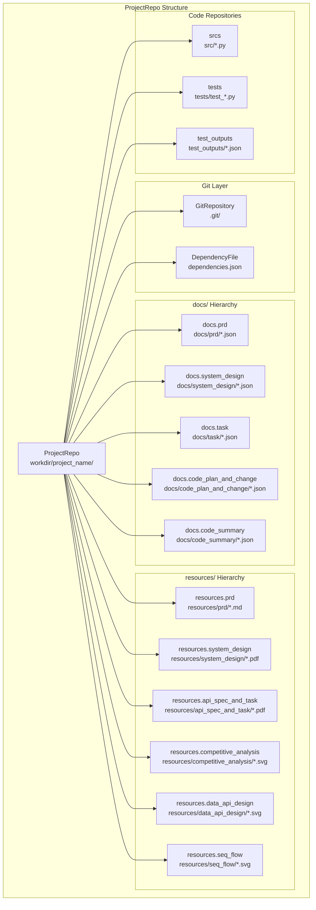

**ProjectRepo Dual Storage Pattern**

| Hierarchy | Content Type | Format | Purpose | Example Path |
|-----------|-------------|--------|---------|--------------|
| `docs/` | Machine-readable | JSON | Structured data for LLM consumption | `docs/prd/20231120_abcd1234.json` |
| `resources/` | Human-readable | MD/PDF/SVG | Formatted output for human review | `resources/prd/20231120_abcd1234.md` |
| `src/` | Source code | .py/.js | Generated application code | `src/main.py` |
| `tests/` | Test code | test_*.py | Generated test cases | `tests/test_main.py` |
| `test_outputs/` | Test results | JSON | Execution results from RunCode | `test_outputs/test_main.py.json` |

Sources: [metagpt/utils/project_repo.py](), [metagpt/const.py:90-111]()

## FileRepository Base Class

`FileRepository` provides the foundational interface for all file operations, managing a specific directory within a Git repository with dependency tracking.

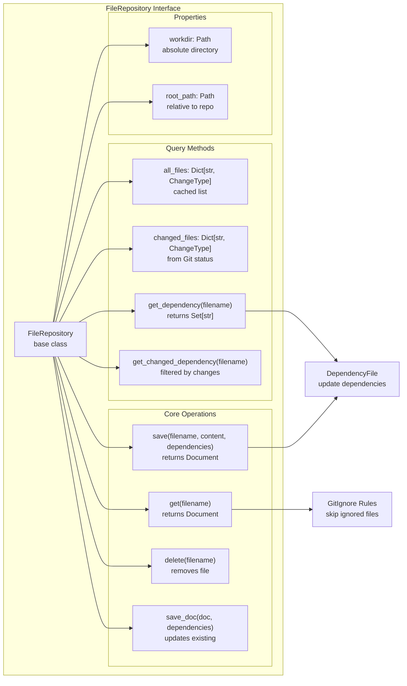

**Key Methods and Return Types**

```python
# FileRepository core interface
async def save(filename: Path | str, content, dependencies: List[str] = None) -> Document
async def get(filename: Path | str) -> Document | None
async def delete(filename: Path | str) -> bool
async def save_doc(doc: Document, dependencies: Set[str] = None) -> Document
```

The `save` method performs three critical operations:
1. Writes content to disk at `workdir / filename`
2. Updates the dependency graph via `DependencyFile`
3. Returns a `Document` object with metadata

Sources: [metagpt/utils/file_repository.py:23-113]()

## Document Schema and Lifecycle

The `Document` class represents a single file artifact with metadata for dependency tracking and path resolution.

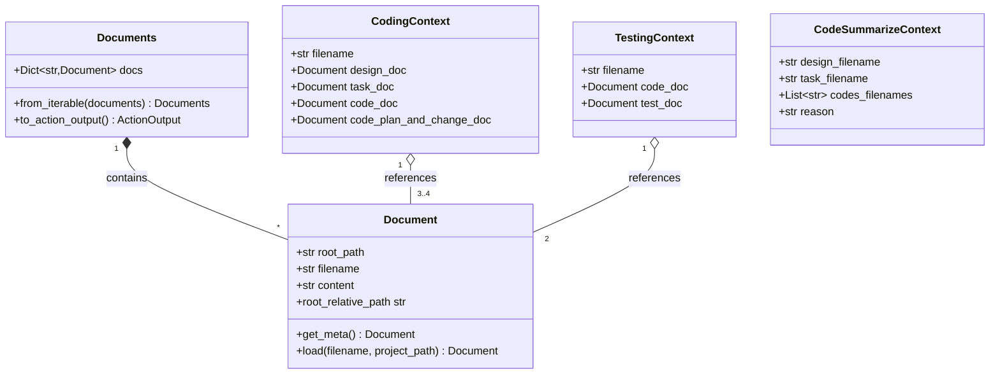

**Document Path Resolution**

The `Document` class maintains both absolute and relative paths:
- `root_path`: Relative directory from repository root (e.g., `"docs/prd"`)
- `filename`: File basename (e.g., `"20231120_abcd1234.json"`)
- `root_relative_path`: Combined path property (e.g., `"docs/prd/20231120_abcd1234.json"`)

This separation enables dependency tracking across different repository sections while maintaining portability when the repository is moved.

Sources: [metagpt/schema.py:138-193](), [metagpt/schema.py:194-222](), [metagpt/schema.py:797-858]()

## Git Integration and Version Control

`GitRepository` wraps the GitPython library and provides MetaGPT-specific operations including dependency management, change tracking, and GitHub integration.

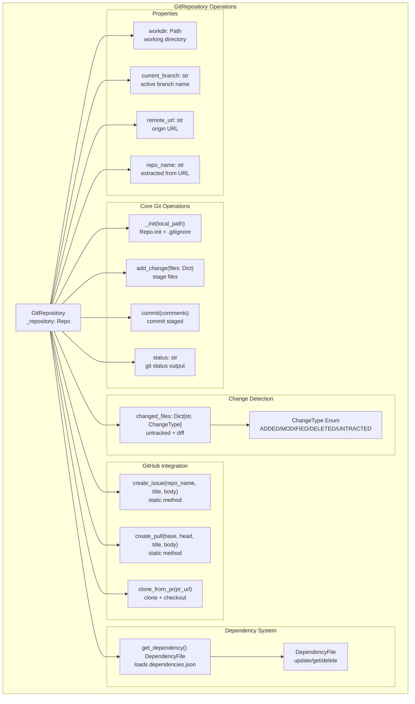

**ChangeType Enumeration**

| Value | Constant | Meaning | Git Status |
|-------|----------|---------|------------|
| `"A"` | `ADDED` | New file staged | `A  file.py` |
| `"M"` | `MODIFIED` | Existing file changed | `M  file.py` |
| `"D"` | `DELETED` | File removed | `D  file.py` |
| `"U"` | `UNTRACTED` | File not in version control | `?? file.py` |
| `"C"` | `COPIED` | File copied | `C  file.py` |
| `"R"` | `RENAMED` | File renamed | `R  old.py -> new.py` |
| `"T"` | `TYPE_CHANGED` | File type changed | `T  file` |

The `changed_files` property merges untracked files with the Git index diff to provide a complete picture of modifications.

Sources: [metagpt/utils/git_repository.py:39-47](), [metagpt/utils/git_repository.py:61-189](), [metagpt/utils/git_repository.py:142-150]()

## Dependency Tracking with DependencyFile

`DependencyFile` maintains a persistent JSON graph of file dependencies, enabling change propagation analysis and incremental rebuilds.

```mermaid
graph TB
    subgraph "DependencyFile System"
        DF[DependencyFile<br/>dependencies: Dict[str, Set[str]]]
        
        subgraph "Operations"
            Update["update(filename, dependencies)<br/>record edges"]
            Get["get(filename)<br/>return Set[str]"]
            Delete["delete(filename)<br/>remove node"]
            Load["load(pathname)<br/>read JSON"]
            Save["save(pathname)<br/>write JSON"]
        end
        
        subgraph "Storage Format"
            JSON["dependencies.json<br/>{filename: [dep1, dep2]}"]
        end
        
        DF --> Update
        DF --> Get
        DF --> Delete
        DF --> Load
        DF --> Save
        Save --> JSON
        Load --> JSON
    end
    
    subgraph "Example Dependency Graph"
        Task["docs/task/design_20231120.json"]
        Design["docs/system_design/design_20231120.json"]
        PRD["docs/prd/prd_20231120.json"]
        Code["src/main.py"]
        
        Code --> Task
        Code --> Design
        Task --> Design
        Design --> PRD
    end
```

**Dependency Graph Example**

```json
{
  "src/main.py": [
    "docs/task/design_20231120.json",
    "docs/system_design/design_20231120.json"
  ],
  "docs/task/design_20231120.json": [
    "docs/system_design/design_20231120.json"
  ],
  "docs/system_design/design_20231120.json": [
    "docs/prd/prd_20231120.json"
  ]
}
```

When `WriteTasks` updates a task file, the Engineer can query `get_dependency("src/main.py")` to discover it needs the updated task document and its upstream design document.

Sources: [metagpt/utils/dependency_file.py]() (referenced in [metagpt/utils/git_repository.py:78]())

## ProjectRepo Implementation Details

`ProjectRepo` extends `GitRepository` with specialized `FileRepository` instances for each artifact type, providing type-safe access to different document categories.

```mermaid
graph LR
    subgraph "ProjectRepo Attributes"
        PR[ProjectRepo]
        
        subgraph "Document Repositories"
            DocsPRD["docs.prd<br/>FileRepository"]
            DocsDesign["docs.system_design<br/>FileRepository"]
            DocsTask["docs.task<br/>FileRepository"]
            DocsPlan["docs.code_plan_and_change<br/>FileRepository"]
            DocsSummary["docs.code_summary<br/>FileRepository"]
            Docs["docs<br/>FileRepository<br/>(generic)"]
        end
        
        subgraph "Resource Repositories"
            ResPRD["resources.prd<br/>FileRepository"]
            ResDesign["resources.system_design<br/>FileRepository"]
            ResTask["resources.api_spec_and_task<br/>FileRepository"]
            ResOthers["resources.*<br/>competitive_analysis<br/>data_api_design<br/>seq_flow<br/>code_plan_and_change<br/>code_summary"]
            Resources["resources<br/>FileRepository<br/>(generic)"]
        end
        
        subgraph "Code Repositories"
            Srcs["srcs<br/>FileRepository"]
            Tests["tests<br/>FileRepository"]
            TestOutputs["test_outputs<br/>FileRepository"]
        end
        
        PR --> DocsPRD
        PR --> DocsDesign
        PR --> DocsTask
        PR --> DocsPlan
        PR --> DocsSummary
        PR --> Docs
        
        PR --> ResPRD
        PR --> ResDesign
        PR --> ResTask
        PR --> ResOthers
        PR --> Resources
        
        PR --> Srcs
        PR --> Tests
        PR --> TestOutputs
    end
```

**Repository Path Constants**

The paths are defined in [metagpt/const.py:90-111]():

| Constant | Value | Purpose |
|----------|-------|---------|
| `PRDS_FILE_REPO` | `"docs/prd"` | Product requirement documents |
| `SYSTEM_DESIGN_FILE_REPO` | `"docs/system_design"` | System design specifications |
| `TASK_FILE_REPO` | `"docs/task"` | Task breakdown lists |
| `CODE_PLAN_AND_CHANGE_FILE_REPO` | `"docs/code_plan_and_change"` | Code change plans |
| `CODE_SUMMARIES_FILE_REPO` | `"docs/code_summary"` | Code review summaries |
| `PRD_PDF_FILE_REPO` | `"resources/prd"` | PRD markdown exports |
| `SYSTEM_DESIGN_PDF_FILE_REPO` | `"resources/system_design"` | Design PDF exports |
| `TASK_PDF_FILE_REPO` | `"resources/api_spec_and_task"` | Task PDF exports |
| `COMPETITIVE_ANALYSIS_FILE_REPO` | `"resources/competitive_analysis"` | Competition charts (SVG) |
| `DATA_API_DESIGN_FILE_REPO` | `"resources/data_api_design"` | Class diagrams (SVG) |
| `SEQ_FLOW_FILE_REPO` | `"resources/seq_flow"` | Sequence diagrams (SVG) |
| `TEST_CODES_FILE_REPO` | `"tests"` | Test code |
| `TEST_OUTPUTS_FILE_REPO` | `"test_outputs"` | Test execution results |

Sources: [metagpt/const.py:90-111]()

## Storage Patterns by Development Role

Each role in the software development workflow has specific patterns for reading and writing artifacts through `ProjectRepo`.

### ProductManager (WritePRD)

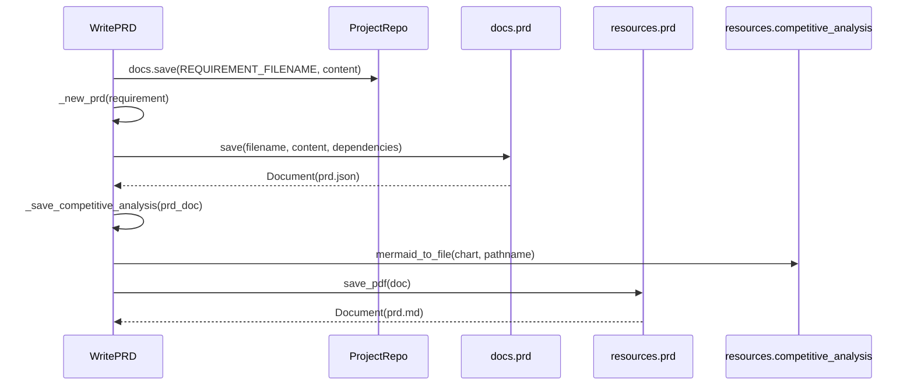

The ProductManager:
1. Saves the raw user requirement to `docs/requirement.txt`
2. Generates structured PRD JSON to `docs/prd/{timestamp}_{uuid}.json`
3. Extracts competitive analysis mermaid chart to `resources/competitive_analysis/{name}.svg`
4. Exports human-readable markdown to `resources/prd/{name}.md`

**File Naming Convention**: `FileRepository.new_filename()` generates timestamps like `"20231120_abcd1234"` to ensure unique, sortable filenames.

Sources: [metagpt/actions/write_prd.py:218-230](), [metagpt/actions/write_prd.py:273-283]()

### Architect (WriteDesign)

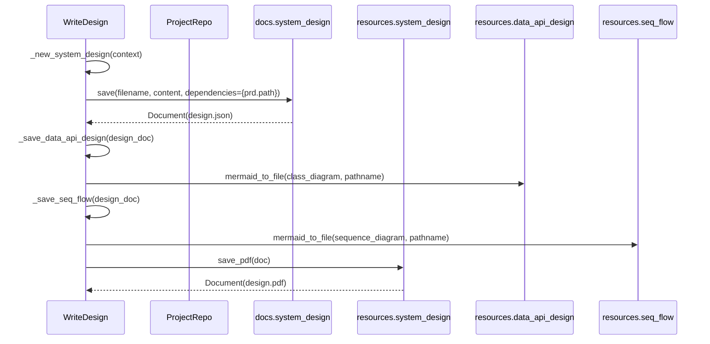

The Architect:
1. Loads PRD from `docs/prd/{name}.json`
2. Generates system design to `docs/system_design/{name}.json` with dependency on PRD
3. Extracts class diagram mermaid to `resources/data_api_design/{name}.svg`
4. Extracts sequence diagram to `resources/seq_flow/{name}.svg`
5. Exports PDF to `resources/system_design/{name}.pdf`

Sources: [metagpt/actions/design_api.py:187-207](), [metagpt/actions/design_api.py:209-236]()

### ProjectManager (WriteTasks)

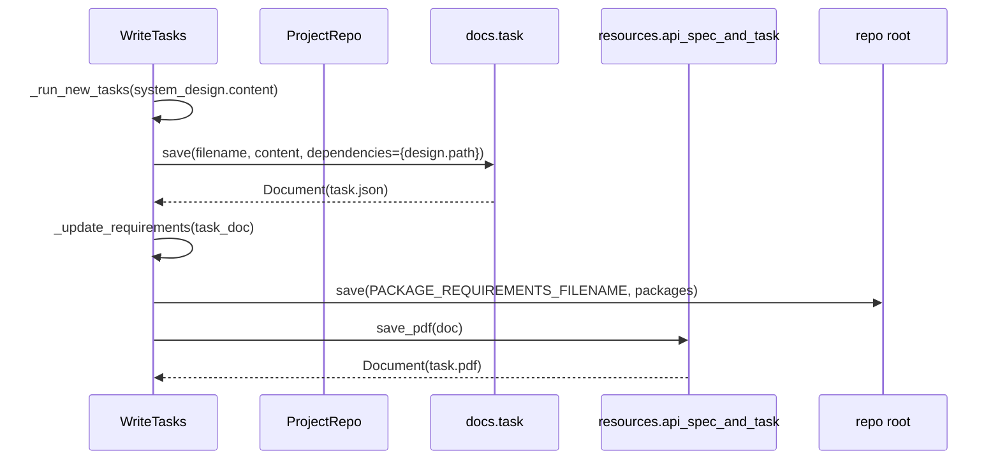

The ProjectManager:
1. Loads system design from `docs/system_design/{name}.json`
2. Generates task list to `docs/task/{name}.json` with dependency on design
3. Extracts Python package requirements to `requirements.txt` at repository root
4. Exports PDF to `resources/api_spec_and_task/{name}.pdf`

Sources: [metagpt/actions/project_management.py:134-153](), [metagpt/actions/project_management.py:165-176]()

### Engineer (WriteCode)

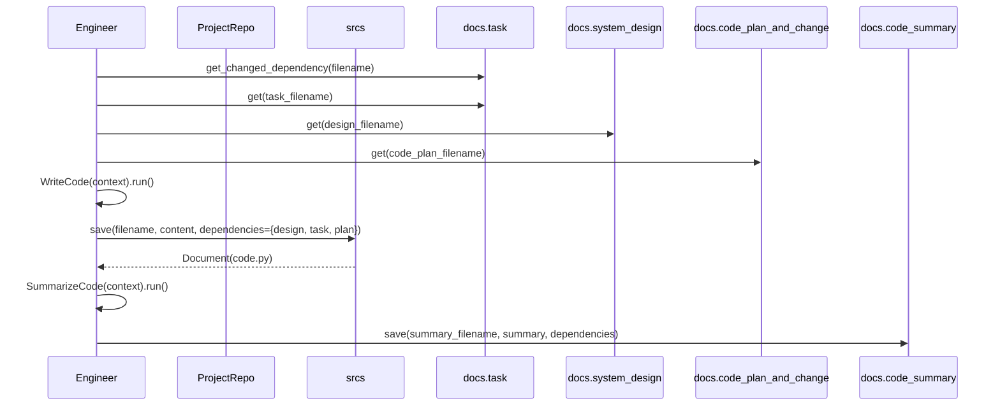

The Engineer:
1. Queries `changed_files` from `repo.docs.task` to find updated tasks
2. Loads dependencies: design doc, task doc, code plan (if incremental mode)
3. Retrieves existing code via `repo.srcs.get(filename)` for modification
4. Saves generated code to `src/{filename}` with dependencies on docs
5. Generates code summary to `docs/code_summary/{design_name}.json`
6. Exports summary markdown to `resources/code_summary/{design_name}.md`

**Incremental Mode**: When `config.inc=True`, Engineer loads `code_plan_and_change_doc` and uses it to guide modifications to existing code rather than rewriting from scratch.

Sources: [metagpt/roles/engineer.py:328-428](), [metagpt/roles/engineer.py:173-198](), [metagpt/roles/engineer.py:290-317]()

### QaEngineer (WriteTest)

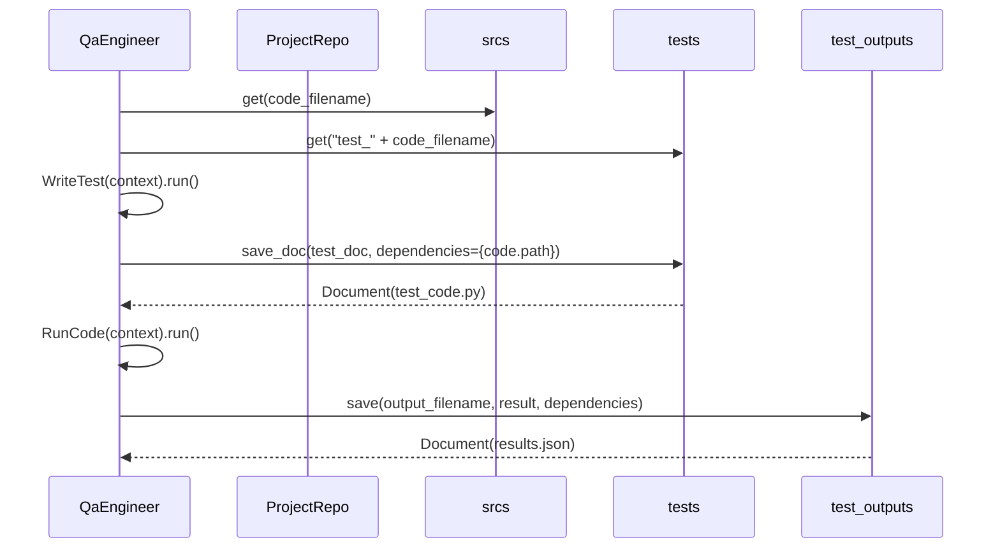

The QaEngineer:
1. Iterates through changed files in `repo.srcs.changed_files`
2. Loads source code from `src/{filename}`
3. Generates or loads existing test from `tests/test_{filename}`
4. Saves test code to `tests/test_{filename}` with dependency on source
5. Executes test and saves results to `test_outputs/test_{filename}.json`

Sources: [metagpt/roles/qa_engineer.py:62-104](), [metagpt/roles/qa_engineer.py:105-148]()

## Changed Files Tracking

`FileRepository` and `GitRepository` collaborate to track modifications, enabling incremental workflows where only changed artifacts are reprocessed.

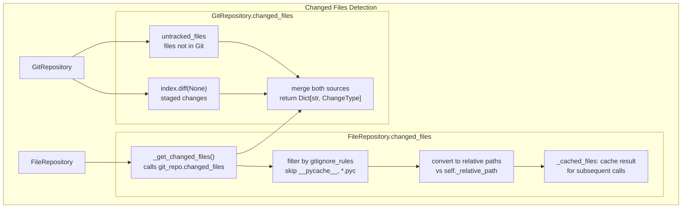

**Changed Files Usage Pattern**

```python
# Engineer checks for changed task documents
changed_task_filenames = [
    str(repo.docs.task.workdir / i) 
    for i in list(repo.docs.task.changed_files.keys())
]

# QaEngineer checks for changed source files
changed_src_files = repo.srcs.changed_files
for filename, change_type in changed_src_files.items():
    if change_type in {ChangeType.ADDED, ChangeType.MODIFIED}:
        # Generate tests for this file
        await write_test_for(filename)
```

The `changed_files` property is central to incremental iteration: roles only process artifacts that have been modified since the last commit, avoiding redundant LLM calls.

Sources: [metagpt/utils/file_repository.py:157-183](), [metagpt/utils/git_repository.py:142-150](), [metagpt/roles/engineer.py:331-343]()

## Workspace Initialization and Lifecycle

The `PrepareDocuments` action initializes the workspace structure before any development begins.

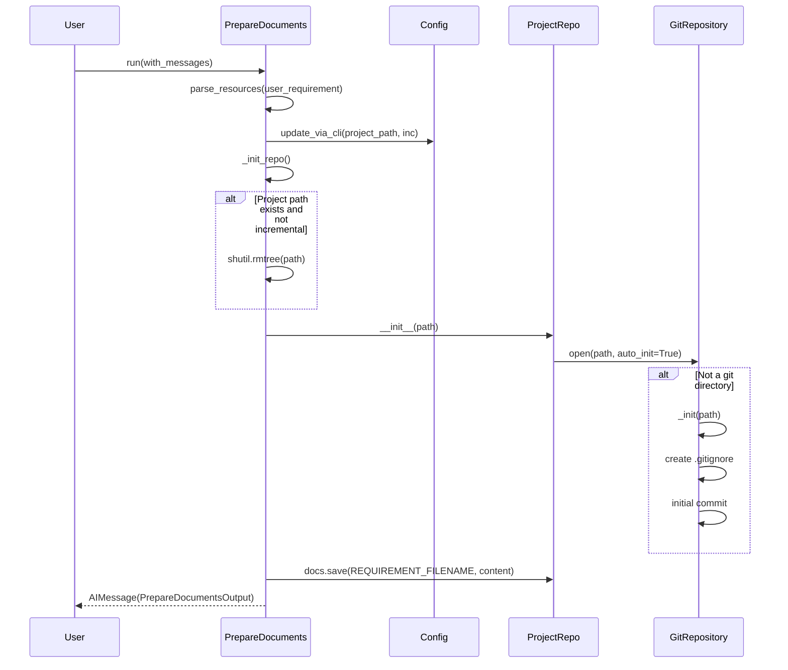

**Initialization Steps**

1. **Path Resolution**: Use `config.project_path` if set, otherwise generate `workspace/{project_name}`
2. **Clean/Incremental Mode**: If `config.inc=False` and path exists, delete it to start fresh
3. **Git Initialization**: Create `.git` directory, add `.gitignore` with Python defaults
4. **Directory Structure**: `FileRepository` constructors create subdirectories on first access
5. **Requirement Persistence**: Save user requirement to `docs/requirement.txt`

The `config.inc` flag controls incremental vs. clean mode:
- `inc=False`: Delete existing workspace, regenerate everything
- `inc=True`: Preserve workspace, modify only changed files

Sources: [metagpt/actions/prepare_documents.py:40-51](), [metagpt/actions/prepare_documents.py:53-90](), [metagpt/utils/git_repository.py:99-112]()

## Special Repository Operations

`FileRepository` provides specialized methods for different artifact types beyond basic save/get/delete.

### PDF Export with save_pdf

```python
async def save_pdf(self, doc: Document, with_suffix: str = ".md", **kwargs) -> Document:
    """
    Save a document as PDF by converting structured JSON to markdown,
    then exporting to the resources/ hierarchy.
    
    Args:
        doc: Document with JSON content
        with_suffix: Output format (default ".md", also supports ".pdf")
    
    Returns:
        Document with exported content
    """
```

The `save_pdf` method:
1. Parses JSON content from the document
2. Converts to markdown using `json_to_markdown`
3. Saves to `resources/{type}/{name}.md` or `.pdf`
4. Maintains the same filename stem as the source document

This creates the parallel docs/resources structure where `docs/prd/design.json` → `resources/prd/design.md`.

Sources: [metagpt/utils/file_repository.py:131-156]()

### Filename Generation with new_filename

```python
@staticmethod
def new_filename(n=8) -> str:
    """
    Generate a unique filename with timestamp and random suffix.
    
    Args:
        n: Length of random hex suffix (default 8)
    
    Returns:
        String like "20231120_a1b2c3d4"
    """
    now = datetime.now()
    return f"{now.strftime('%Y%m%d_%H%M%S')}_{uuid.uuid4().hex[:n]}"
```

This ensures:
- **Sortability**: Timestamp prefix allows chronological ordering
- **Uniqueness**: UUID suffix prevents collisions
- **Readability**: Human-parseable date component

Used by all document-generating actions to create new files without overwriting.

Sources: [metagpt/utils/file_repository.py:185-195]()

### Directory Existence Check with code_files_exists

```python
def code_files_exists(self) -> bool:
    """
    Check if the repository contains any generated code files.
    
    Returns:
        True if src/ directory exists and is non-empty
    """
    if not self.src_relative_path:
        return False
    return (self.workdir / self.src_relative_path).exists()
```

This is used by `WritePRD` to distinguish between bug fixes (which modify existing code) and new requirements (which generate new code).

Sources: Referenced in [metagpt/actions/write_prd.py:239]()

## Complete Storage Workflow Example

Here's how artifacts flow through the repository during a full development cycle:

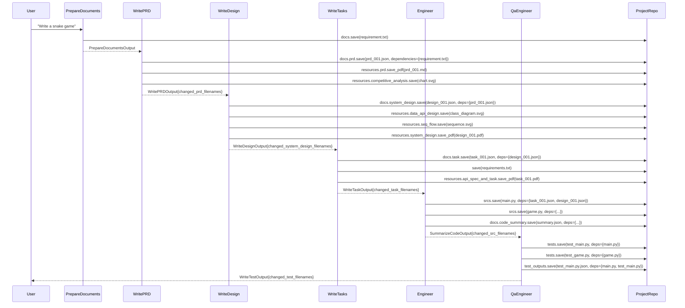

**Dependency Chain**

The dependency graph for this workflow:

```
requirement.txt
    └── docs/prd/prd_001.json
            ├── resources/prd/prd_001.md
            ├── resources/competitive_analysis/prd_001.svg
            └── docs/system_design/design_001.json
                    ├── resources/system_design/design_001.pdf
                    ├── resources/data_api_design/design_001.svg
                    ├── resources/seq_flow/design_001.svg
                    └── docs/task/task_001.json
                            ├── resources/api_spec_and_task/task_001.pdf
                            ├── src/main.py
                            │   ├── tests/test_main.py
                            │   └── test_outputs/test_main.py.json
                            ├── src/game.py
                            │   ├── tests/test_game.py
                            │   └── test_outputs/test_game.py.json
                            └── docs/code_summary/design_001.json
                                    └── resources/code_summary/design_001.md
```

Each `save()` call records these dependencies in `dependencies.json`, enabling the system to determine which files need regeneration when upstream dependencies change.

Sources: [metagpt/actions/write_prd.py:129-189](), [metagpt/actions/design_api.py:187-207](), [metagpt/actions/project_management.py:134-153](), [metagpt/roles/engineer.py:328-428](), [metagpt/roles/qa_engineer.py:62-104]()

## Integration with Git Operations

`ProjectRepo` inherits Git operations from `GitRepository` but doesn't automatically commit. Roles must explicitly call `commit()` when appropriate.

**Manual Commit Pattern**

```python
# Typical usage in roles
repo = ProjectRepo(project_path)

# Make changes
await repo.docs.prd.save(filename, content, dependencies)
await repo.resources.prd.save_pdf(doc)

# Commit all changes
changed = repo.changed_files  # Dict[str, ChangeType]
repo.add_change(changed)
repo.commit(f"Add PRD: {filename}")
```

However, most roles in MetaGPT do **not** commit automatically. Instead, they rely on:
1. **End-of-session commits**: The `Team` orchestrator commits after all roles finish
2. **Serialization**: `Team.serialize()` saves state without committing
3. **External commits**: User or CI/CD commits the workspace manually

This separation allows roles to focus on artifact generation while deferring version control strategy to higher layers.

### GitHub Integration

For `SWEAgent` that resolves GitHub issues, Git operations are more sophisticated:

```python
# Clone repository from PR
await GitRepository.clone_from_pr(
    url="https://github.com/owner/repo/pull/123",
    local_path=workspace / "repo",
)

# Make changes...

# Create pull request
pr = await git_create_pull(
    base="main",
    head="feature-branch",
    base_repo_name="owner/repo",
    head_repo_name="contributor/repo",
    title="Fix issue #123",
    body="Description of changes",
    app_name="github",
)
```

Sources: [metagpt/utils/git_repository.py:114-131](), [metagpt/tools/libs/git.py:16-66](), [metagpt/roles/di/swe_agent.py:28-43]()

## Error Handling and Edge Cases

### Missing Dependency Handling

When a file references a dependency that doesn't exist:

```python
# FileRepository.get() returns None for missing files
doc = await repo.docs.task.get("nonexistent.json")
if not doc:
    # Handle missing file
    logger.error(f"Task file not found")
    return None
```

The Engineer checks for this when loading coding context:

```python
if not task_doc or not design_doc:
    if filename == "__init__.py":  # Special case
        return None
    logger.error(f'Detected source code "{filename}" from an unknown origin.')
    raise ValueError(f'Detected source code "{filename}" from an unknown origin.')
```

Sources: [metagpt/roles/engineer.py:305-309]()

### Circular Dependencies

While `DependencyFile` doesn't prevent circular dependencies, the sequential nature of the development workflow (PRD → Design → Tasks → Code) naturally creates a directed acyclic graph (DAG).

### Filename Conflicts

`FileRepository.new_filename()` uses UUID suffixes to prevent conflicts. If a role tries to save with an existing filename, it overwrites:

```python
# First save
await repo.docs.prd.save(filename="my_prd.json", content="v1")

# Second save with same filename
await repo.docs.prd.save(filename="my_prd.json", content="v2")  # Overwrites

# Recommended: use new_filename()
filename = FileRepository.new_filename() + ".json"
await repo.docs.prd.save(filename=filename, content="v1")
```

Sources: [metagpt/utils/file_repository.py:46-64]()

### Git Ignore Rules

The `.gitignore` created during initialization excludes common Python artifacts:

```python
ignores = ["__pycache__", "*.pyc", ".vs"]
```

`FileRepository._get_changed_files()` respects these rules, filtering out ignored files from the changed files list.

Sources: [metagpt/utils/git_repository.py:106-112](), [metagpt/utils/file_repository.py:169-174]()

---

