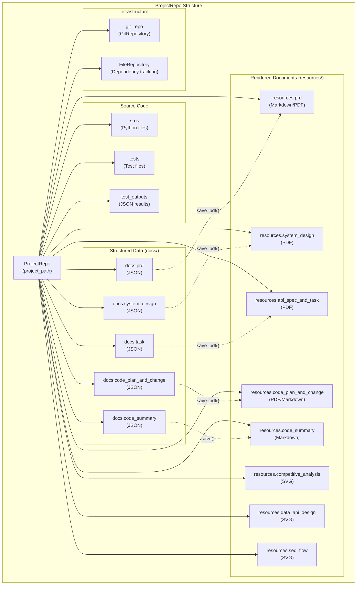
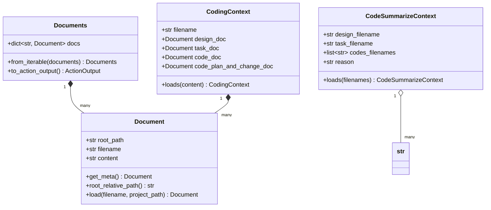
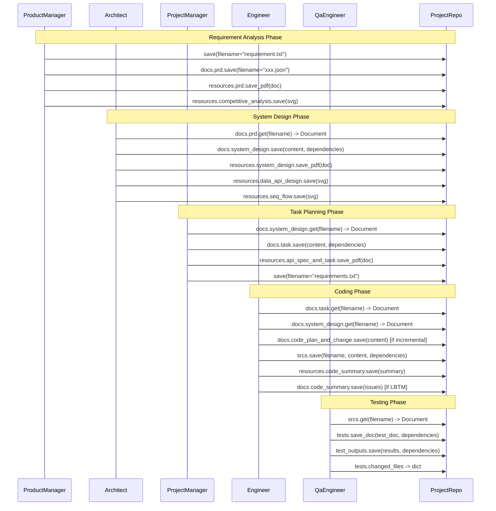
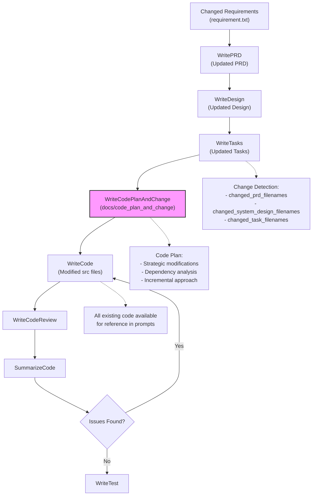

<!-- source: DeepWiki mcp.deepwiki.com · repo FoundationAgents/MetaGPT · page 6.1 ProjectRepo Architecture · fetched 2026-10-30 -->

# ProjectRepo Architecture

<details>
<summary>Relevant source files</summary>

The following files were used as context for generating this wiki page:

- [metagpt/actions/action.py](metagpt/actions/action.py)
- [metagpt/actions/design_api.py](metagpt/actions/design_api.py)
- [metagpt/actions/project_management.py](metagpt/actions/project_management.py)
- [metagpt/actions/summarize_code.py](metagpt/actions/summarize_code.py)
- [metagpt/actions/write_code.py](metagpt/actions/write_code.py)
- [metagpt/actions/write_code_review.py](metagpt/actions/write_code_review.py)
- [metagpt/actions/write_prd.py](metagpt/actions/write_prd.py)
- [metagpt/const.py](metagpt/const.py)
- [metagpt/memory/memory.py](metagpt/memory/memory.py)
- [metagpt/roles/architect.py](metagpt/roles/architect.py)
- [metagpt/roles/engineer.py](metagpt/roles/engineer.py)
- [metagpt/roles/product_manager.py](metagpt/roles/product_manager.py)
- [metagpt/roles/project_manager.py](metagpt/roles/project_manager.py)
- [metagpt/roles/qa_engineer.py](metagpt/roles/qa_engineer.py)
- [metagpt/roles/role.py](metagpt/roles/role.py)
- [metagpt/schema.py](metagpt/schema.py)
- [metagpt/utils/common.py](metagpt/utils/common.py)

</details>


## Purpose and Scope

This document describes the `ProjectRepo` architecture, which serves as the central file storage and management system for MetaGPT projects. `ProjectRepo` provides a Git-backed, hierarchical repository for organizing project artifacts including requirements documents, design specifications, task lists, source code, and tests. It implements a dual-hierarchy structure with structured JSON data in `docs/` and human-readable formats (Markdown, PDF, SVG) in `resources/`.

For information about how roles interact with the project repository during the development workflow, see [Software Development Workflow](#5). For Git-level operations including commits and pull requests, see [Git Integration](#6.2).

## Overview

`ProjectRepo` acts as the single source of truth for all project artifacts generated during the software development lifecycle. It is instantiated with a project path and automatically creates a structured directory layout that separates machine-readable structured data from human-readable rendered documents.

Key characteristics:
- **Git-backed**: All changes are tracked through an underlying `GitRepository`
- **Dual hierarchies**: Parallel `docs/` (JSON) and `resources/` (Markdown/PDF/SVG) directories
- **Type-safe repositories**: Specialized accessors for each artifact type (`.prd`, `.system_design`, `.task`, etc.)
- **Dependency tracking**: Files record their dependencies for change propagation
- **Change detection**: Tracks which files have been modified since last commit



Sources: [metagpt/engineer.py:100-484](), [metagpt/write_prd.py:83-295](), [metagpt/const.py:90-111]()

## Directory Structure

The `ProjectRepo` organizes project artifacts into a standardized directory hierarchy rooted at a workspace path. Each repository type corresponds to a specific directory and file format.

### Standard Layout

| Directory Path | Repository Accessor | Content Type | Purpose |
|---------------|---------------------|--------------|---------|
| `docs/` | `.docs` | Mixed JSON | Root for structured documents |
| `docs/prd/` | `.docs.prd` | JSON | Product Requirement Documents |
| `docs/system_design/` | `.docs.system_design` | JSON | System architecture designs |
| `docs/task/` | `.docs.task` | JSON | Task breakdowns and schedules |
| `docs/code_plan_and_change/` | `.docs.code_plan_and_change` | JSON | Incremental coding plans |
| `docs/code_summary/` | `.docs.code_summary` | JSON | Code review summaries |
| `resources/` | `.resources` | Mixed | Root for rendered documents |
| `resources/prd/` | `.resources.prd` | Markdown/PDF | Rendered PRD documents |
| `resources/system_design/` | `.resources.system_design` | PDF/SVG | Design diagrams |
| `resources/competitive_analysis/` | `.resources.competitive_analysis` | SVG | Competitive quadrant charts |
| `resources/data_api_design/` | `.resources.data_api_design` | SVG | Class/API diagrams |
| `resources/seq_flow/` | `.resources.seq_flow` | SVG | Sequence flow diagrams |
| `resources/api_spec_and_task/` | `.resources.api_spec_and_task` | PDF | Task specifications |
| `resources/code_plan_and_change/` | `.resources.code_plan_and_change` | Markdown/PDF | Rendered coding plans |
| `resources/code_summary/` | `.resources.code_summary` | Markdown | Rendered code reviews |
| `src/` or custom | `.srcs` | Python/.js/etc | Source code files |
| `tests/` | `.tests` | Python | Test code files |
| `test_outputs/` | `.test_outputs` | JSON | Test execution results |

### Dual-Hierarchy Design

The separation between `docs/` and `resources/` enables:
- **Machine processing**: JSON in `docs/` for structured data extraction and manipulation
- **Human consumption**: Markdown/PDF/SVG in `resources/` for documentation and review
- **Parallel updates**: When a document changes, both representations are updated atomically

Sources: [metagpt/const.py:90-111](), [metagpt/write_prd.py:224-230](), [metagpt/design_api.py:203-206]()

## Core Components

### ProjectRepo Class

The `ProjectRepo` class serves as the primary interface for all file operations within a project. It is instantiated with a project path and provides typed accessors for each repository type.

```mermaid
graph TB
    ProjectRepo["ProjectRepo"]
    
    subgraph "Repository Properties"
        workdir["workdir: Path<br/>(project root)"]
        src_relative_path["src_relative_path: Path<br/>(source code directory)"]
        git_repo["git_repo: GitRepository<br/>(Git operations)"]
    end
    
    subgraph "Document Repositories"
        docs["docs: FileRepository"]
        docs_prd["docs.prd: FileRepository"]
        docs_system_design["docs.system_design: FileRepository"]
        docs_task["docs.task: FileRepository"]
        docs_code_plan["docs.code_plan_and_change: FileRepository"]
        docs_code_summary["docs.code_summary: FileRepository"]
    end
    
    subgraph "Resource Repositories"
        resources["resources: FileRepository"]
        res_prd["resources.prd: FileRepository"]
        res_system_design["resources.system_design: FileRepository"]
        res_competitive["resources.competitive_analysis: FileRepository"]
        res_data_api["resources.data_api_design: FileRepository"]
        res_seq_flow["resources.seq_flow: FileRepository"]
        res_task["resources.api_spec_and_task: FileRepository"]
        res_code_plan["resources.code_plan_and_change: FileRepository"]
        res_code_summary["resources.code_summary: FileRepository"]
    end
    
    subgraph "Code Repositories"
        srcs["srcs: FileRepository<br/>(source code)"]
        tests["tests: FileRepository<br/>(test code)"]
        test_outputs["test_outputs: FileRepository<br/>(test results)"]
    end
    
    subgraph "Methods"
        save["save(filename, content)"]
        get["get(filename) -> Document"]
        save_doc["save_doc(doc, dependencies)"]
        delete["delete(filename)"]
        code_files_exists["code_files_exists() -> bool"]
        with_src_path["with_src_path(path)"]
    end
    
    ProjectRepo --> workdir
    ProjectRepo --> src_relative_path
    ProjectRepo --> git_repo
    
    ProjectRepo --> docs
    docs --> docs_prd
    docs --> docs_system_design
    docs --> docs_task
    docs --> docs_code_plan
    docs --> docs_code_summary
    
    ProjectRepo --> resources
    resources --> res_prd
    resources --> res_system_design
    resources --> res_competitive
    resources --> res_data_api
    resources --> res_seq_flow
    resources --> res_task
    resources --> res_code_plan
    resources --> res_code_summary
    
    ProjectRepo --> srcs
    ProjectRepo --> tests
    ProjectRepo --> test_outputs
    
    ProjectRepo --> save
    ProjectRepo --> get
    ProjectRepo --> save_doc
    ProjectRepo --> delete
    ProjectRepo --> code_files_exists
    ProjectRepo --> with_src_path
```



**Key methods and properties:**

- **`workdir: Path`**: Root directory of the project
- **`src_relative_path: Path`**: Relative path to source code directory (e.g., `src/`)
- **`git_repo: GitRepository`**: Git integration for version control operations
- **`save(filename, content)`**: Save a file to the root of the repository
- **`get(filename) -> Document`**: Retrieve a document from the root
- **`code_files_exists() -> bool`**: Check if source code files exist (used for bugfix detection)
- **`with_src_path(path)`**: Set the source code directory path

Sources: [metagpt/engineer.py:100-484](), [metagpt/write_prd.py:83-295]()

### FileRepository Integration

Each repository accessor (`.prd`, `.system_design`, etc.) is a `FileRepository` instance that provides:

**Properties:**
- **`workdir: Path`**: Working directory for this repository
- **`root_path: str`**: Relative path from project root
- **`all_files: dict`**: All files in the repository
- **`changed_files: dict`**: Files modified since last Git commit

**Methods:**
- **`save(filename, content, dependencies) -> Document`**: Save content with dependency tracking
- **`save_doc(doc, dependencies) -> Document`**: Save a Document object
- **`get(filename) -> Document`**: Retrieve a document by filename
- **`delete(filename)`**: Remove a file from the repository
- **`save_pdf(doc) -> Document`**: Convert JSON to Markdown/PDF and save to resources
- **`get_dependency(filename) -> list[str]`**: Get dependencies for a file
- **`new_filename() -> str`**: Generate a unique filename (timestamp-based)

Sources: [metagpt/engineer.py:142-147](), [metagpt/write_prd.py:224-230](), [metagpt/design_api.py:195-207]()

### Document Schema

The `Document` class represents a single file in the repository with metadata.



**Document attributes:**
- **`root_path: str`**: Relative path from project root (e.g., `docs/prd`)
- **`filename: str`**: File name (e.g., `20231115_142301.json`)
- **`content: str`**: File content (JSON, Markdown, code, etc.)
- **`root_relative_path: str`**: Computed property combining root_path and filename

**Context classes:**
- **`CodingContext`**: Bundles design, task, and code documents for `WriteCode` action
- **`CodeSummarizeContext`**: Bundles design, task, and code filenames for `SummarizeCode` action
- **`CodePlanAndChangeContext`**: Bundles requirement, PRD, design, and task for incremental coding

Sources: [metagpt/schema.py:138-192](), [metagpt/schema.py:797-858](), [metagpt/engineer.py:310-317]()

## Repository Types and Usage

### Product Requirements (prd)

**Location:** `docs/prd/*.json`, `resources/prd/*.md`

Stores Product Requirement Documents generated by `ProductManager` via `WritePRD`. Each PRD is a JSON file containing structured fields defined by `WRITE_PRD_NODE` or `REFINED_PRD_NODE`:
- Project Name
- Original Requirements
- Product Goals
- User Stories
- Competitive Analysis
- Competitive Quadrant Chart (Mermaid)
- Requirement Analysis
- Requirement Pool (P0/P1/P2 priorities)
- UI Design Draft
- Anything UNCLEAR

**Write operations:**
```python
# Save new PRD
await self.repo.docs.prd.save(
    filename=FileRepository.new_filename() + ".json",
    content=node.instruct_content.model_dump_json()
)

# Save rendered version
await self.repo.resources.prd.save_pdf(doc=new_prd_doc)
```

**Read operations:**
```python
# Get all PRD filenames
prd_filenames = [str(self.repo.docs.prd.workdir / i) for i in self.repo.docs.prd.all_files]

# Load a specific PRD
docs = [await Document.load(filename=i, project_path=self.repo.workdir) for i in prd_filenames]
```

Sources: [metagpt/write_prd.py:139-230](), [metagpt/write_prd.py:273-283]()

### System Design (system_design)

**Location:** `docs/system_design/*.json`, `resources/system_design/*.pdf`

Contains architectural designs generated by `Architect` via `WriteDesign`. Each design includes:
- Implementation Approach
- File List
- Data Structures and Interfaces (Mermaid class diagram)
- Program Call Flow (Mermaid sequence diagram)
- Anything UNCLEAR

**Associated artifacts:**
- Class/API diagrams saved to `resources/data_api_design/*.svg`
- Sequence flow diagrams saved to `resources/seq_flow/*.svg`

**Write operations:**
```python
# Save new design
await self.repo.docs.system_design.save(
    filename=prd.filename,
    content=system_design.instruct_content.model_dump_json(),
    dependencies={prd.root_relative_path}
)

# Save diagrams
await self._save_data_api_design(doc)
await self._save_seq_flow(doc)
```

Sources: [metagpt/design_api.py:188-230](), [metagpt/const.py:92-98]()

### Tasks (task)

**Location:** `docs/task/*.json`, `resources/api_spec_and_task/*.pdf`

Task breakdowns generated by `ProjectManager` via `WriteTasks`. Includes:
- Required Python packages
- Required Other language third-party packages
- Logic Analysis (ordered list of files and dependencies)
- Task list (ordered list of filenames)
- Shared Knowledge (design principles)
- Anything UNCLEAR

**Refined format** (incremental mode):
- Refined Required packages
- Refined Logic Analysis
- Refined Task list

**Write operations:**
```python
# Save task document
await self.repo.docs.task.save(
    filename=system_design_doc.filename,
    content=rsp.instruct_content.model_dump_json(),
    dependencies={system_design_doc.root_relative_path}
)

# Update requirements.txt
await self._update_requirements(task_doc)
```

**Read and parse:**
```python
# Parse task list from document
def _parse_tasks(task_msg: Document) -> list[str]:
    m = json.loads(task_msg.content)
    return m.get(TASK_LIST.key) or m.get(REFINED_TASK_LIST.key)
```

Sources: [metagpt/project_management.py:134-177](), [metagpt/engineer.py:112-114](), [metagpt/engineer.py:370-407]()

### Code Plan and Change (code_plan_and_change)

**Location:** `docs/code_plan_and_change/*.json`, `resources/code_plan_and_change/*.md`

Incremental coding plans generated by `Engineer` via `WriteCodePlanAndChange` (only in incremental mode). Contains strategic planning for code modifications before actual coding begins.

**Write operations:**
```python
# Save code plan
await self.repo.docs.code_plan_and_change.save(
    filename=code_plan_and_change_filepath.name,
    content=code_plan_and_change,
    dependencies={REQUIREMENT_FILENAME, prd_path, design_path, task_path}
)

# Save rendered version
await self.repo.resources.code_plan_and_change.save(
    filename=code_plan_and_change_filepath.with_suffix(".md").name,
    content=node.content,
    dependencies=dependencies
)
```

Sources: [metagpt/engineer.py:233-254](), [metagpt/engineer.py:297-304](), [metagpt/engineer.py:372-374]()

### Source Code (srcs)

**Location:** Configurable (default `src/`), auto-detected with `get_project_srcs_path()`

Contains actual implementation code written by `Engineer` via `WriteCode`. Each file has:
- Dependencies tracked (references to design_doc, task_doc, code_plan_and_change_doc)
- Change detection for incremental builds
- Support for multiple languages (Python, JavaScript, etc.)

**Write operations:**
```python
# Save source code with dependencies
await self.repo.srcs.save(
    filename=coding_context.filename,
    dependencies=[
        coding_context.design_doc.root_relative_path,
        coding_context.task_doc.root_relative_path
    ],
    content=coding_context.code_doc.content
)
```

**Read operations:**
```python
# Get file with dependencies
old_code_doc = await self.repo.srcs.get(filename)
dependencies = await self.repo.srcs.get_dependency(filename=filename)

# Get all changed files
changed_src_files = self.repo.srcs.changed_files

# Get all files
src_files = self.repo.srcs.all_files
```

Sources: [metagpt/engineer.py:142-147](), [metagpt/engineer.py:291-327](), [metagpt/engineer.py:431-453]()

### Code Summary (code_summary)

**Location:** `docs/code_summary/*.json`, `resources/code_summary/*.md`

Code review summaries generated by `Engineer` via `SummarizeCode`. Used to determine if code needs further refinement or can proceed to testing.

**Write operations:**
```python
# Save summary
await self.repo.resources.code_summary.save(
    filename=summary_filename,
    content=summary,
    dependencies={design_filename, task_filename, *code_filenames}
)

# Save structured summary if issues found
await self.repo.docs.code_summary.save(
    filename=Path(design_filename).name,
    content=todo.i_context.model_dump_json(),
    dependencies=dependencies
)

# Delete if no issues
await self.repo.docs.code_summary.delete(filename=Path(design_filename).name)
```

Sources: [metagpt/engineer.py:173-199](), [metagpt/summarize_code.py:93-123]()

### Tests (tests)

**Location:** `tests/`

Test files generated by `QaEngineer` via `WriteTest`. Each test file corresponds to a source file with prefix `test_`.

**Write operations:**
```python
# Save test
doc = await self.repo.tests.save_doc(
    doc=context.test_doc,
    dependencies={context.code_doc.root_relative_path}
)
```

**Read operations:**
```python
test_doc = await self.repo.tests.get("test_" + code_doc.filename)
```

Sources: [metagpt/qa_engineer.py:74-89](), [metagpt/qa_engineer.py:110-114]()

### Test Outputs (test_outputs)

**Location:** `test_outputs/`

JSON files containing test execution results from `RunCode`. Each output corresponds to a test file.

**Write operations:**
```python
# Save test results
await self.repo.test_outputs.save(
    filename=run_code_context.output_filename,
    content=result.model_dump_json(),
    dependencies={src_doc.root_relative_path, test_doc.root_relative_path}
)
```

**Read operations:**
```python
test_doc = await self.repo.test_outputs.get(filename="test_" + coding_context.filename + ".json")
if test_doc:
    test_detail = RunCodeResult.loads(test_doc.content)
    logs = test_detail.stderr
```

Sources: [metagpt/qa_engineer.py:116-121](), [metagpt/write_code.py:109-117]()

## File Operations

### Saving Documents

Files can be saved with or without dependency tracking. Dependencies are used for change propagation and determining which files need to be regenerated.

**Basic save (root level):**
```python
# Save to project root
await self.repo.save(filename=REQUIREMENT_FILENAME, content=content)
await self.repo.docs.save(filename=REQUIREMENT_FILENAME, content=content)
```

**Save with dependencies:**
```python
# Save with explicit dependencies
await self.repo.docs.prd.save(
    filename="20231115_142301.json",
    content=json_content,
    dependencies={"requirement.txt"}
)

# Save document object
await self.repo.srcs.save(
    filename="main.py",
    content=code,
    dependencies=[
        "docs/system_design/20231115_142301.json",
        "docs/task/20231115_142301.json"
    ]
)
```

**Save with parallel formats:**
```python
# Save JSON and rendered version
new_prd_doc = await self.repo.docs.prd.save(
    filename=filename,
    content=node.instruct_content.model_dump_json()
)
# Automatically converts to Markdown/PDF
md = await self.repo.resources.prd.save_pdf(doc=new_prd_doc)
```

Sources: [metagpt/engineer.py:142-147](), [metagpt/write_prd.py:224-230](), [metagpt/design_api.py:195-206]()

### Retrieving Documents

Documents can be retrieved individually or as collections.

**Single document:**
```python
# Get by filename
doc = await self.repo.docs.prd.get(filename="20231115_142301.json")
doc = await self.repo.srcs.get(filename="main.py")

# Get from root
requirement_doc = await self.repo.get(filename=PACKAGE_REQUIREMENTS_FILENAME)

# Load with project path context
doc = await Document.load(filename=full_path, project_path=self.repo.workdir)
```

**Multiple documents:**
```python
# Get all filenames
all_prd_files = self.repo.docs.prd.all_files
all_src_files = self.repo.srcs.all_files

# Iterate and load
docs = [await Document.load(filename=i, project_path=self.repo.workdir) 
        for i in prd_filenames]
```

Sources: [metagpt/engineer.py:291-327](), [metagpt/write_prd.py:151-154](), [metagpt/design_api.py:188-190]()

### Dependency Tracking

Dependencies enable automatic change propagation. When a file changes, all files that depend on it can be identified and regenerated.

**Getting dependencies:**
```python
# Get dependencies for a file
dependencies = await self.repo.srcs.get_dependency(filename=filename)
# Returns: ['docs/system_design/20231115_142301.json', 'docs/task/20231115_142301.json']

# Get from FileRepository directly
dependency = await self.repo.git_repo.get_dependency()
dependencies = await dependency.get(old_code_doc.root_relative_path)
```

**Parsing dependencies:**
```python
# Extract specific dependency types
ctx = CodeSummarizeContext.loads(filenames=list(dependencies))
# ctx.design_filename = "docs/system_design/20231115_142301.json"
# ctx.task_filename = "docs/task/20231115_142301.json"

for i in dependencies:
    if str(Path(i).parent) == TASK_FILE_REPO:
        task_doc = await self.repo.docs.task.get(Path(i).name)
    elif str(Path(i).parent) == SYSTEM_DESIGN_FILE_REPO:
        design_doc = await self.repo.docs.system_design.get(Path(i).name)
```

Sources: [metagpt/engineer.py:290-317](), [metagpt/engineer.py:413-425](), [metagpt/engineer.py:434-451]()

### Change Detection

The repository tracks which files have been modified since the last Git commit. This enables incremental builds and selective regeneration.

**Accessing changed files:**
```python
# Get changed files as dict {filename: ChangeType}
changed_src_files = self.repo.srcs.changed_files
changed_prd_files = self.repo.docs.prd.changed_files
changed_task_files = self.repo.docs.task.changed_files

# Convert to full paths for messaging
changed_prd_filenames = [
    str(self.repo.docs.prd.workdir / i) 
    for i in list(self.repo.docs.prd.changed_files.keys())
]
```

**Using changed files for regeneration:**
```python
# Regenerate only changed documents
for filename in changed_prds:
    doc = await self._update_system_design(filename=filename)
    changed_files.docs[filename] = doc

for filename in changed_system_designs:
    if filename in changed_files.docs:
        continue  # Skip duplicates
    doc = await self._update_system_design(filename=filename)
    changed_files.docs[filename] = doc
```

Sources: [metagpt/engineer.py:331-343](), [metagpt/design_api.py:140-157](), [metagpt/project_management.py:98-112]()

### Deletion

Files can be deleted from repositories, typically when they become obsolete or a workflow transitions states.

**Delete operations:**
```python
# Delete a document
await self.repo.docs.delete(filename=BUGFIX_FILENAME)
await self.repo.docs.code_summary.delete(filename=Path(design_filename).name)
```

Sources: [metagpt/write_prd.py:163](), [metagpt/engineer.py:198]()

## Integration with Roles

The following diagram shows how different roles interact with `ProjectRepo` during the development workflow.



### ProductManager Integration

`ProductManager` initializes the repository and creates the foundational requirement and PRD documents.

```python
class ProductManager(RoleZero):
    async def run(self, with_messages):
        # Initialize repo
        self.repo = ProjectRepo(self.context.kwargs.project_path)
        
        # Save user requirement
        await self.repo.docs.save(
            filename=REQUIREMENT_FILENAME,
            content=with_messages[-1].content
        )
        
        # Generate and save PRD
        node = await self._new_prd(req.content)
        new_prd_doc = await self.repo.docs.prd.save(
            filename=FileRepository.new_filename() + ".json",
            content=node.instruct_content.model_dump_json()
        )
        
        # Save rendered version and diagrams
        await self.repo.resources.prd.save_pdf(doc=new_prd_doc)
        await self._save_competitive_analysis(new_prd_doc)
```

Sources: [metagpt/write_prd.py:137-230]()

### Architect Integration

`Architect` reads PRDs and generates system design documents with associated diagrams.

```python
class Architect(RoleZero):
    async def _update_system_design(self, filename):
        # Load PRD
        prd = await Document.load(filename=filename, project_path=self.repo.workdir)
        
        # Generate design
        system_design = await self._new_system_design(context=prd.content)
        
        # Save design with dependency on PRD
        doc = await self.repo.docs.system_design.save(
            filename=prd.filename,
            content=system_design.instruct_content.model_dump_json(),
            dependencies={prd.root_relative_path}
        )
        
        # Save diagrams
        await self._save_data_api_design(doc)
        await self._save_seq_flow(doc)
        await self.repo.resources.system_design.save_pdf(doc=doc)
```

Sources: [metagpt/design_api.py:187-207]()

### ProjectManager Integration

`ProjectManager` reads system designs and creates task breakdowns.

```python
class ProjectManager(RoleZero):
    async def _update_tasks(self, filename):
        # Load system design
        system_design_doc = await Document.load(
            filename=filename,
            project_path=self.repo.workdir
        )
        
        # Generate task list
        rsp = await self._run_new_tasks(context=system_design_doc.content)
        
        # Save task with dependency on design
        task_doc = await self.repo.docs.task.save(
            filename=system_design_doc.filename,
            content=rsp.instruct_content.model_dump_json(),
            dependencies={system_design_doc.root_relative_path}
        )
        
        # Update requirements.txt
        await self._update_requirements(task_doc)
        await self.repo.resources.api_spec_and_task.save_pdf(doc=task_doc)
```

Sources: [metagpt/project_management.py:134-177]()

### Engineer Integration

`Engineer` has the most complex interaction with `ProjectRepo`, managing source code, code reviews, and summaries.

```python
class Engineer(Role):
    async def _think(self):
        # Initialize repo
        self.repo = ProjectRepo(input_args.project_path)
        if self.repo.src_relative_path is None:
            path = get_project_srcs_path(self.repo.workdir)
            self.repo.with_src_path(path)
    
    async def _new_code_actions(self):
        # Get changed task documents
        for filename in changed_task_filenames:
            # Load dependencies
            design_doc = await Document.load(filename=design_filename)
            task_doc = await Document.load(filename=task_filename)
            code_plan_doc = await Document.load(filename=code_plan_filename)
            
            # Parse task list
            task_list = self._parse_tasks(task_doc)
            
            # Create WriteCode actions for each task
            for task_filename in task_list:
                context = CodingContext(
                    filename=task_filename,
                    design_doc=design_doc,
                    task_doc=task_doc,
                    code_doc=old_code_doc,
                    code_plan_and_change_doc=code_plan_doc
                )
                self.code_todos.append(WriteCode(i_context=context, repo=self.repo))
    
    async def _act_write_code(self):
        # Execute code writing
        for todo in self.code_todos:
            coding_context = await todo.run()
            
            # Save source code with dependencies
            await self.repo.srcs.save(
                filename=coding_context.filename,
                dependencies=[
                    coding_context.design_doc.root_relative_path,
                    coding_context.task_doc.root_relative_path,
                    coding_context.code_plan_and_change_doc.root_relative_path
                ],
                content=coding_context.code_doc.content
            )
    
    async def _act_summarize(self):
        # Generate code summaries
        for todo in self.summarize_todos:
            summary = await todo.run()
            
            # Save summary
            await self.repo.resources.code_summary.save(
                filename=summary_filename,
                content=summary,
                dependencies={design_filename, task_filename, *code_filenames}
            )
            
            # If issues found, save structured summary
            is_pass, reason = await self._is_pass(summary)
            if not is_pass:
                await self.repo.docs.code_summary.save(
                    filename=design_filename,
                    content=context.model_dump_json(),
                    dependencies=dependencies
                )
```

Sources: [metagpt/engineer.py:262-454]()

### QaEngineer Integration

`QaEngineer` reads source code, generates tests, executes them, and saves results.

```python
class QaEngineer(Role):
    async def _write_test(self, message):
        for filename in changed_files:
            # Load source code
            code_doc = await self.repo.srcs.get(filename)
            
            # Get or create test document
            test_doc = await self.repo.tests.get("test_" + code_doc.filename)
            if not test_doc:
                test_doc = Document(
                    root_path=str(self.repo.tests.root_path),
                    filename="test_" + code_doc.filename,
                    content=""
                )
            
            # Generate test
            context = TestingContext(
                filename=test_doc.filename,
                test_doc=test_doc,
                code_doc=code_doc
            )
            context = await WriteTest(i_context=context).run()
            
            # Save test with dependency on source
            doc = await self.repo.tests.save_doc(
                doc=context.test_doc,
                dependencies={context.code_doc.root_relative_path}
            )
    
    async def _run_code(self, msg):
        # Load source and test
        src_doc = await self.repo.srcs.get(run_code_context.code_filename)
        test_doc = await self.repo.tests.get(run_code_context.test_filename)
        
        # Execute test
        result = await RunCode(i_context=run_code_context).run()
        
        # Save test results
        await self.repo.test_outputs.save(
            filename=run_code_context.output_filename,
            content=result.model_dump_json(),
            dependencies={src_doc.root_relative_path, test_doc.root_relative_path}
        )
```

Sources: [metagpt/qa_engineer.py:62-149]()

## Git Integration

`ProjectRepo` integrates with Git through the `GitRepository` class for version control operations.

### Repository Initialization

When a `ProjectRepo` is created, it automatically initializes or connects to an existing Git repository.

```python
# Create ProjectRepo (initializes GitRepository internally)
repo = ProjectRepo(project_path)

# Access Git operations
repo.git_repo  # GitRepository instance
```

### Renaming Projects

The repository can rename its root directory, which is useful when a project name is determined after initial creation (e.g., after PRD generation).

```python
# Rename workspace based on PRD
if self.repo:
    self.repo.git_repo.rename_root(self.project_name)
```

This operation:
1. Renames the directory on the filesystem
2. Updates internal paths in `ProjectRepo`
3. Updates Git repository location

Sources: [metagpt/write_prd.py:294]()

### Dependency Retrieval

Git-tracked dependencies enable change detection and propagation.

```python
# Get dependency graph from Git
dependency = await self.repo.git_repo.get_dependency()

# Get dependencies for a specific file
dependencies = await dependency.get(file_path)
# Returns list of paths this file depends on
```

For more information about Git operations including commits, pull requests, and issue management, see [Git Integration](#6.2).

Sources: [metagpt/engineer.py:413-425]()

## Incremental Development Support

`ProjectRepo` supports incremental development through change detection and code plan documents. In incremental mode (`config.inc=True`), the workflow includes an additional planning phase before code generation.

### Incremental Mode Workflow



### Change Detection for Incremental Builds

```python
# Check if incremental mode and code plan needed
if self.config.inc and msg.cause_by in write_plan_and_change_filters:
    await self._new_code_plan_and_change_action(cause_by=msg.cause_by)

# Get changed files from multiple stages
changed_prd_filenames = [
    str(self.repo.docs.prd.workdir / i) 
    for i in list(self.repo.docs.prd.changed_files.keys())
]
changed_system_design_filenames = [
    str(self.repo.docs.system_design.workdir / i)
    for i in list(self.repo.docs.system_design.changed_files.keys())
]
changed_task_filenames = [
    str(self.repo.docs.task.workdir / i)
    for i in list(self.repo.docs.task.changed_files.keys())
]
```

### Code Plan Storage

```python
# Create and save code plan
code_plan_and_change_ctx = CodePlanAndChangeContext(
    requirement=requirement,
    prd_filename=prd_path,
    design_filename=design_path,
    task_filename=task_path
)

node = await WriteCodePlanAndChange(i_context=code_plan_and_change_ctx).run()

# Save structured JSON
await self.repo.docs.code_plan_and_change.save(
    filename=design_filename,
    content=node.instruct_content.model_dump_json(),
    dependencies={REQUIREMENT_FILENAME, prd_path, design_path, task_path}
)

# Save rendered Markdown
await self.repo.resources.code_plan_and_change.save(
    filename=Path(design_filename).with_suffix(".md").name,
    content=node.content,
    dependencies=dependencies
)
```

### Using Code Plans in WriteCode

```python
# Load code plan during code generation
coding_context = CodingContext.loads(self.i_context.content)
if not coding_context.code_plan_and_change_doc:
    coding_context.code_plan_and_change_doc = await self.repo.docs.code_plan_and_change.get(
        filename=coding_context.task_doc.filename
    )

# Include in prompt for strategic guidance
prompt = REFINED_TEMPLATE.format(
    user_requirement=requirement_doc.content,
    code_plan_and_change=coding_context.code_plan_and_change_doc.content,
    design=coding_context.design_doc.content,
    task=coding_context.task_doc.content,
    code=existing_code_context,
    filename=filename
)
```

Sources: [metagpt/engineer.py:273-288](), [metagpt/engineer.py:455-483](), [metagpt/write_code.py:119-142]()

---

