<!-- source: DeepWiki mcp.deepwiki.com · repo FoundationAgents/MetaGPT · page 6.2 Git Integration · fetched 2026-10-30 -->

# Git Integration

Relevant source files

The following files were used as context for generating this wiki page:

- [metagpt/actions/prepare_documents.py](metagpt/actions/prepare_documents.py)
- [metagpt/prompts/di/swe_agent.py](metagpt/prompts/di/swe_agent.py)
- [metagpt/roles/di/swe_agent.py](metagpt/roles/di/swe_agent.py)
- [metagpt/tools/libs/git.py](metagpt/tools/libs/git.py)
- [metagpt/utils/file_repository.py](metagpt/utils/file_repository.py)
- [metagpt/utils/git_repository.py](metagpt/utils/git_repository.py)
- [tests/metagpt/roles/di/run_swe_agent_for_benchmark.py](tests/metagpt/roles/di/run_swe_agent_for_benchmark.py)
- [tests/metagpt/roles/di/run_swe_agent_open_source_issue.py](tests/metagpt/roles/di/run_swe_agent_open_source_issue.py)
- [tests/metagpt/test_document.py](tests/metagpt/test_document.py)
- [tests/metagpt/tools/libs/test_git.py](tests/metagpt/tools/libs/test_git.py)
- [tests/metagpt/tools/libs/test_image_getter.py](tests/metagpt/tools/libs/test_image_getter.py)

## Purpose and Scope

This document covers Git repository management and GitHub integration in MetaGPT. The Git integration layer provides version control, change tracking, and GitHub API operations for multi-agent software development workflows. For information about the higher-level project repository structure and artifact organization, see [ProjectRepo Architecture](#6.1). For code execution and persistence patterns, see [Code Execution and Persistence](#6.3).

The Git integration system consists of:
- **GitRepository**: Core Git operations (commit, push, clone, branch management)
- **FileRepository**: File operations with automatic dependency tracking
- **GitHub API Integration**: Pull request and issue creation
- **Change Detection**: Tracking modified, added, and deleted files

Sources: [metagpt/utils/git_repository.py:1-634](), [metagpt/utils/file_repository.py:1-240]()

---

## GitRepository Architecture

The `GitRepository` class wraps GitPython's `Repo` object and provides MetaGPT-specific functionality for repository management. It serves as the foundation for all version-controlled project artifacts.

```mermaid
graph TB
    subgraph "GitRepository Core"
        GitRepo["GitRepository<br/>metagpt/utils/git_repository.py"]
        Repo["_repository: Repo<br/>GitPython Repo object"]
        Dependency["_dependency: DependencyFile<br/>Tracks file dependencies"]
        GitIgnore["_gitignore_rules<br/>Parsed .gitignore"]
        
        GitRepo --> Repo
        GitRepo --> Dependency
        GitRepo --> GitIgnore
    end
    
    subgraph "Core Properties"
        WorkDir["workdir: Path<br/>_repository.working_dir"]
        IsValid["is_valid: bool<br/>bool(_repository)"]
        Status["status: str<br/>_repository.git.status()"]
        ChangedFiles["changed_files: Dict[str, ChangeType]<br/>untracked + diff"]
        CurrentBranch["current_branch: str<br/>_repository.active_branch.name"]
        RemoteURL["remote_url: str<br/>_repository.remotes.origin.url"]
    end
    
    subgraph "File Management"
        AddChange["add_change(files: Dict)<br/>Index add/remove"]
        Commit["commit(comments)<br/>Index commit"]
        Archive["archive(comments)<br/>add_change + commit"]
        GetFiles["get_files(relative_path)<br/>List files recursively"]
        FilterGitIgnore["filter_gitignore(filenames)<br/>Apply .gitignore rules"]
    end
    
    subgraph "Branch & Remote Operations"
        NewBranch["new_branch(branch_name)<br/>Create and checkout"]
        Push["push(new_branch, access_token)<br/>Archive + shell git push"]
        CloneFrom["clone_from(url, output_dir)<br/>Shell git clone"]
        Checkout["checkout(commit_id)<br/>Git checkout"]
    end
    
    subgraph "Repository Management"
        Open["open(local_path, auto_init)<br/>Open or init repo"]
        Init["_init(local_path)<br/>Repo.init + .gitignore"]
        Delete["delete_repository()<br/>shutil.rmtree"]
        Rename["rename_root(new_dir_name)<br/>shutil.move + reopen"]
    end
    
    subgraph "FileRepository Factory"
        NewFileRepo["new_file_repository(relative_path)<br/>Returns FileRepository"]
        GetDependency["get_dependency()<br/>Returns DependencyFile"]
    end
    
    GitRepo --> WorkDir
    GitRepo --> IsValid
    GitRepo --> Status
    GitRepo --> ChangedFiles
    GitRepo --> CurrentBranch
    GitRepo --> RemoteURL
    
    GitRepo --> AddChange
    GitRepo --> Commit
    GitRepo --> Archive
    GitRepo --> GetFiles
    GitRepo --> FilterGitIgnore
    
    GitRepo --> NewBranch
    GitRepo --> Push
    GitRepo --> CloneFrom
    GitRepo --> Checkout
    
    GitRepo --> Open
    GitRepo --> Init
    GitRepo --> Delete
    GitRepo --> Rename
    
    GitRepo --> NewFileRepo
    GitRepo --> GetDependency
```

**GitRepository Initialization and Lifecycle**

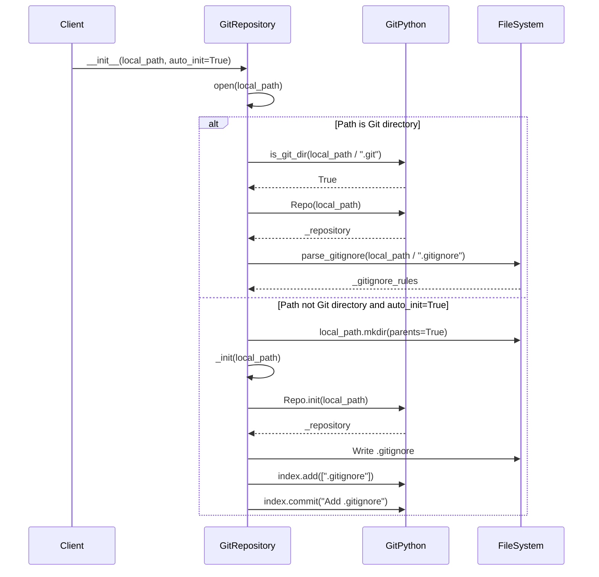

Sources: [metagpt/utils/git_repository.py:61-113](), [metagpt/utils/git_repository.py:153-165]()

---

## Change Tracking and ChangeType Enum

MetaGPT tracks file changes using the `ChangeType` enum and the `changed_files` property. This enables incremental development workflows where roles process only modified files.

| ChangeType | Value | Description |
|------------|-------|-------------|
| ADDED | "A" | File was added |
| COPIED | "C" | File was copied |
| DELETED | "D" | File was deleted |
| RENAMED | "R" | File was renamed |
| MODIFIED | "M" | File was modified |
| TYPE_CHANGED | "T" | Type of the file was changed |
| UNTRACTED | "U" | File is untracked (not added to version control) |

**Change Detection Flow**

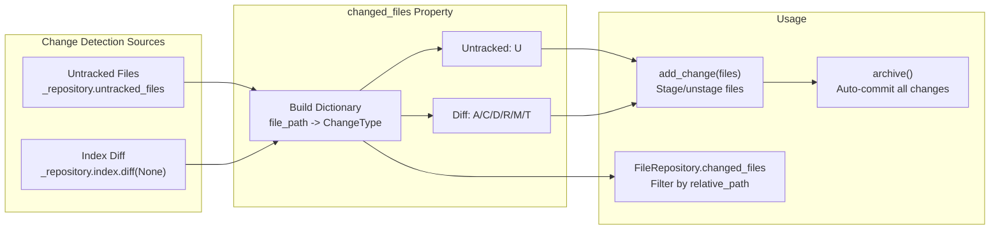

Sources: [metagpt/utils/git_repository.py:39-47](), [metagpt/utils/git_repository.py:142-150](), [metagpt/utils/git_repository.py:114-124](), [metagpt/utils/git_repository.py:237-246]()

---

## FileRepository Integration

`FileRepository` provides a higher-level interface for file operations within a Git repository, with automatic dependency tracking and relative path management. Each `FileRepository` instance is scoped to a specific subdirectory within the Git repository.

```mermaid
graph TB
    subgraph "FileRepository Structure"
        FileRepo["FileRepository<br/>metagpt/utils/file_repository.py"]
        GitRepoRef["_git_repo: GitRepository<br/>Parent repository"]
        RelPath["_relative_path: Path<br/>Subdirectory scope"]
        
        FileRepo --> GitRepoRef
        FileRepo --> RelPath
    end
    
    subgraph "Core Operations"
        Save["save(filename, content, dependencies)<br/>Write file + update deps"]
        Get["get(filename)<br/>Read file as Document"]
        GetAll["get_all(filter_ignored)<br/>Read all files"]
        Delete["delete(filename)<br/>Remove file + deps"]
        SaveDoc["save_doc(doc, dependencies)<br/>Save Document object"]
        SavePDF["save_pdf(doc, with_suffix)<br/>JSON to Markdown"]
    end
    
    subgraph "Dependency Tracking"
        GetDep["get_dependency(filename)<br/>Set[str] of deps"]
        GetChangedDep["get_changed_dependency(filename)<br/>Changed deps only"]
        DepFile["DependencyFile<br/>From _git_repo.get_dependency()"]
    end
    
    subgraph "Path Resolution"
        Workdir["workdir: Path<br/>_git_repo.workdir / _relative_path"]
        RootPath["root_path: Path<br/>_relative_path"]
        AllFiles["all_files: List<br/>_git_repo.get_files(relative_path)"]
        ChangedFiles["changed_files: Dict<br/>Filter _git_repo.changed_files"]
        ChangeDirFiles["get_change_dir_files(dir)<br/>Changed files in subdirectory"]
    end
    
    FileRepo --> Save
    FileRepo --> Get
    FileRepo --> GetAll
    FileRepo --> Delete
    FileRepo --> SaveDoc
    FileRepo --> SavePDF
    
    Save --> DepFile
    GetDep --> DepFile
    GetChangedDep --> DepFile
    Delete --> DepFile
    
    FileRepo --> Workdir
    FileRepo --> RootPath
    FileRepo --> AllFiles
    FileRepo --> ChangedFiles
    FileRepo --> ChangeDirFiles
```

**FileRepository Dependency Tracking Example**

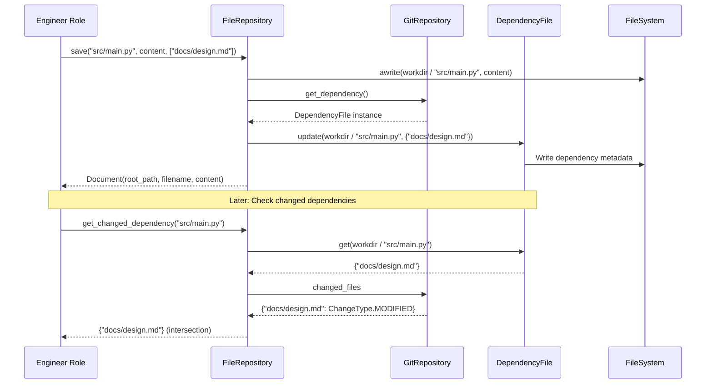

Sources: [metagpt/utils/file_repository.py:23-44](), [metagpt/utils/file_repository.py:46-64](), [metagpt/utils/file_repository.py:66-89]()

---

## Git Operations: Commit, Branch, and Push

### Commit and Archive

The `commit` method stages and commits changes, while `archive` is a convenience method that automatically stages all changed files before committing.

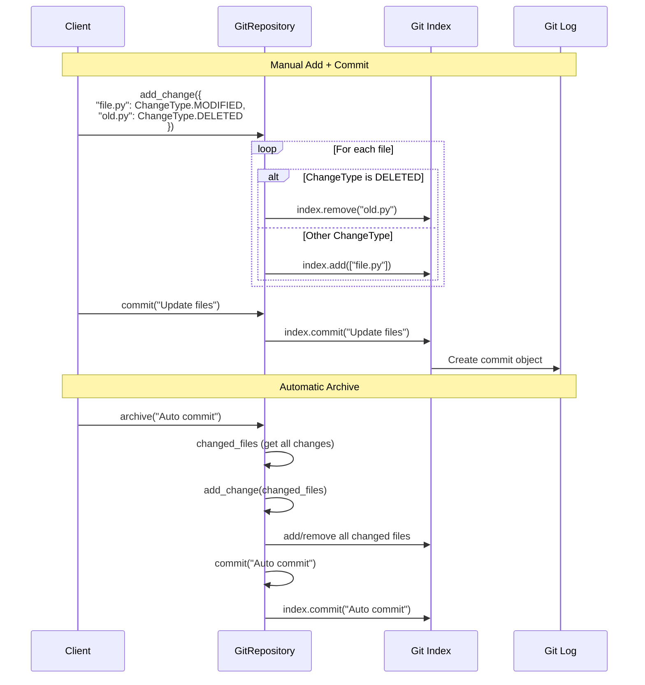

Sources: [metagpt/utils/git_repository.py:114-132](), [metagpt/utils/git_repository.py:237-246]()

### Branch Management

GitRepository supports creating new branches and switching between them. The `new_branch` method creates and checks out a new branch in one operation.

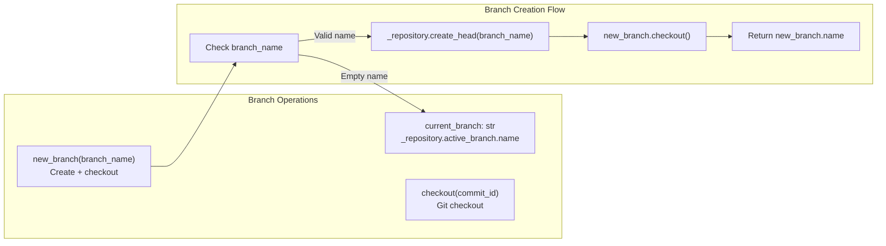

Sources: [metagpt/utils/git_repository.py:192-236]()

### Push to Remote

The `push` method combines branch creation, archiving, and remote push operations. It uses shell execution for Git push to support proxy configuration and custom authentication.

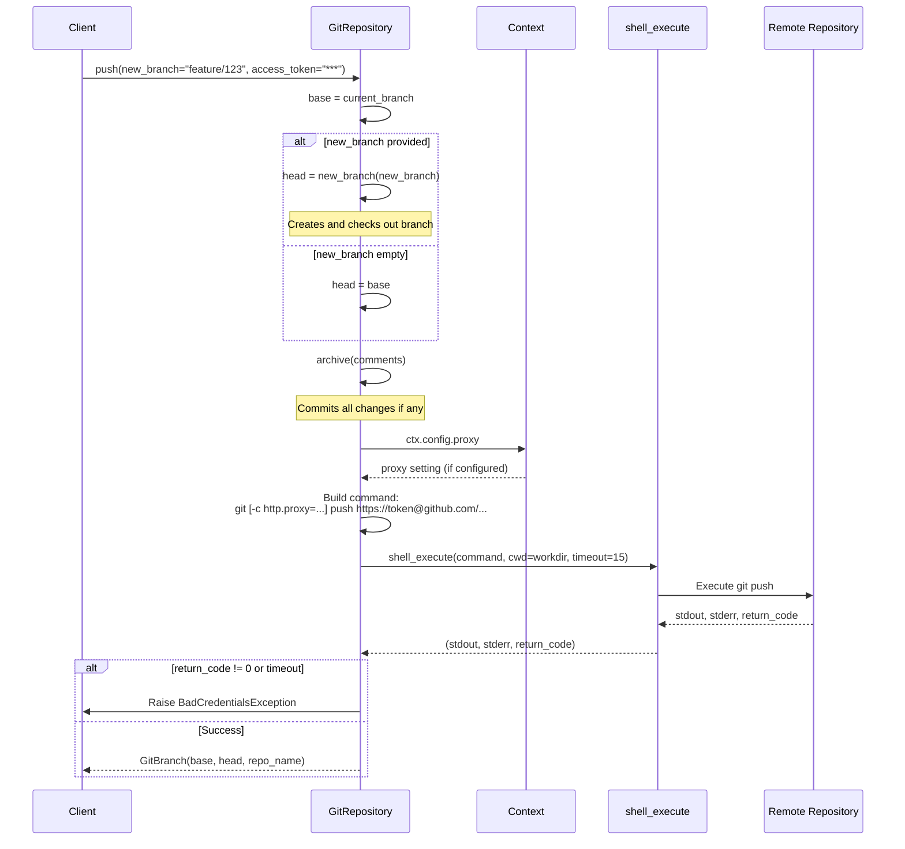

**GitBranch Return Object**

| Field | Type | Description |
|-------|------|-------------|
| `base` | str | Base branch name (before push) |
| `head` | str | Head branch name (after push) |
| `repo_name` | str | Repository name extracted from remote URL |

Sources: [metagpt/utils/git_repository.py:248-297](), [metagpt/utils/git_repository.py:55-59]()

---

## GitHub Integration: Pull Requests and Issues

MetaGPT provides static methods for GitHub API operations using PyGithub. These are used by roles like `SWEAgent` to create pull requests and issues programmatically.

### Pull Request Creation

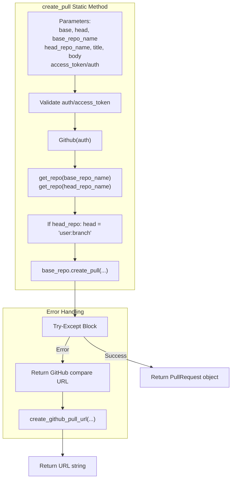

**Usage Example from SWEAgent**

The `SWEAgent` role uses `git_create_pull` tool which wraps `GitRepository.create_pull`:

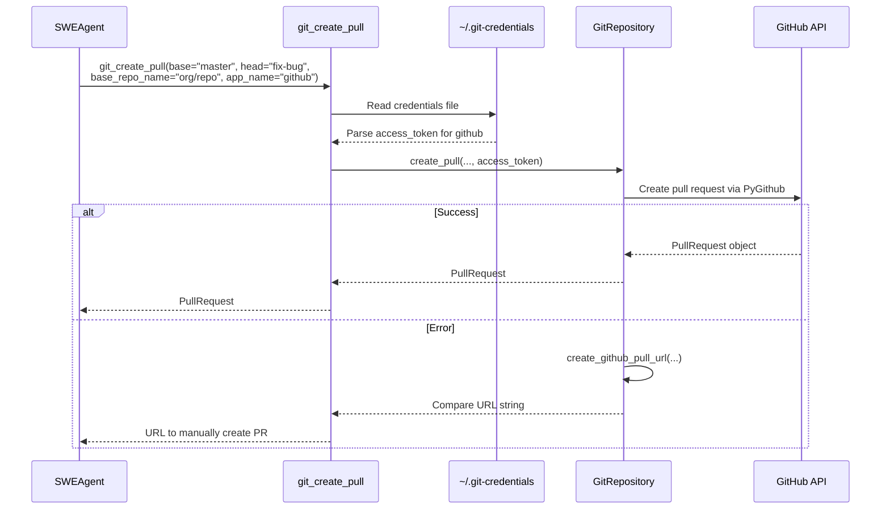

Sources: [metagpt/utils/git_repository.py:450-518](), [metagpt/tools/libs/git.py:15-92](), [metagpt/roles/di/swe_agent.py:17-84]()

### Issue Creation

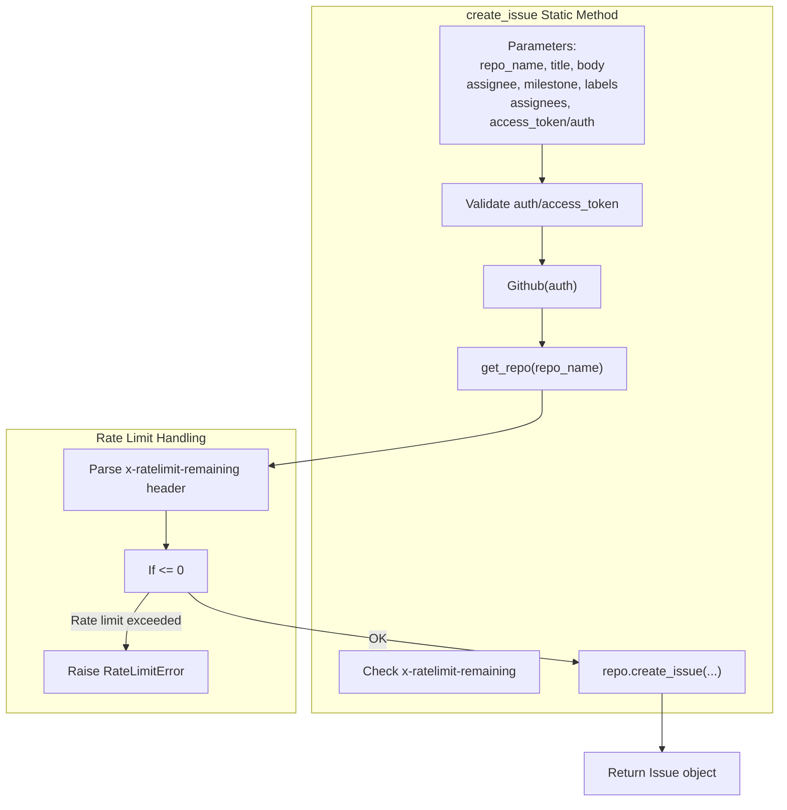

**Rate Limit Detection**

The `create_issue` method includes rate limit detection to prevent hitting GitHub API limits:

Sources: [metagpt/utils/git_repository.py:520-576](), [metagpt/utils/git_repository.py:49-52](), [metagpt/tools/libs/git.py:95-132]()

---

## Repository Cloning and Remote Operations

### Clone from Remote

The `clone_from` class method uses shell execution to clone repositories, supporting proxy configuration and retry logic via tenacity.

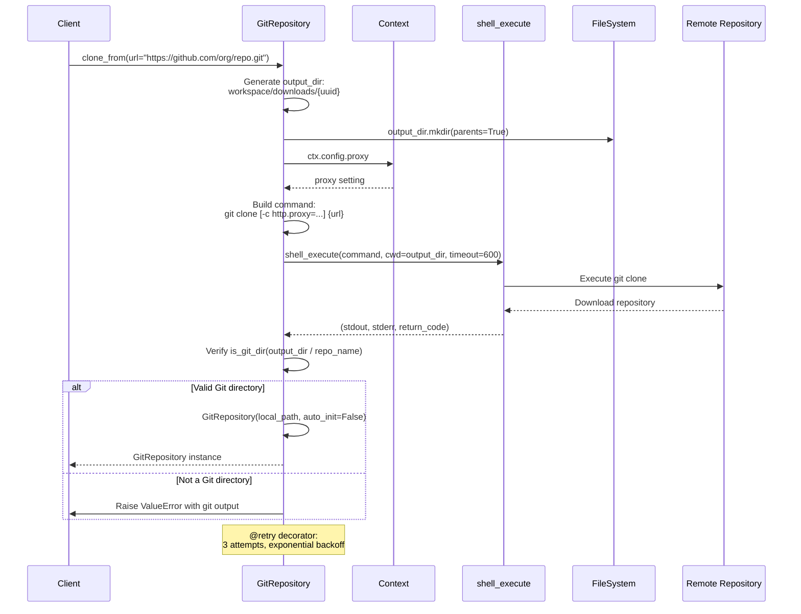

**Retry Configuration**

The `clone_from` method uses tenacity for automatic retry:
- **Wait strategy**: Exponential backoff (1-15 seconds)
- **Stop strategy**: After 3 attempts
- **Timeout per attempt**: 600 seconds

Sources: [metagpt/utils/git_repository.py:416-440](), [metagpt/utils/git_repository.py:31]()

### Remote URL and Repository Name Extraction

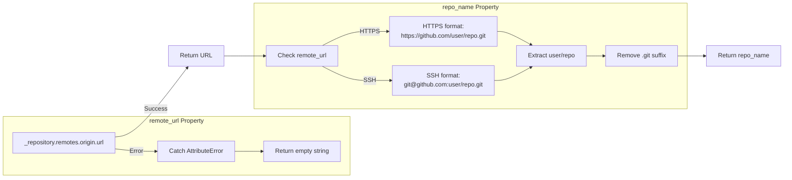

Sources: [metagpt/utils/git_repository.py:201-219]()

---

## Integration with MetaGPT System

### ProjectRepo and PrepareDocuments

The `PrepareDocuments` action initializes a `ProjectRepo`, which internally creates a `GitRepository`. This is the entry point for document-driven development workflows.

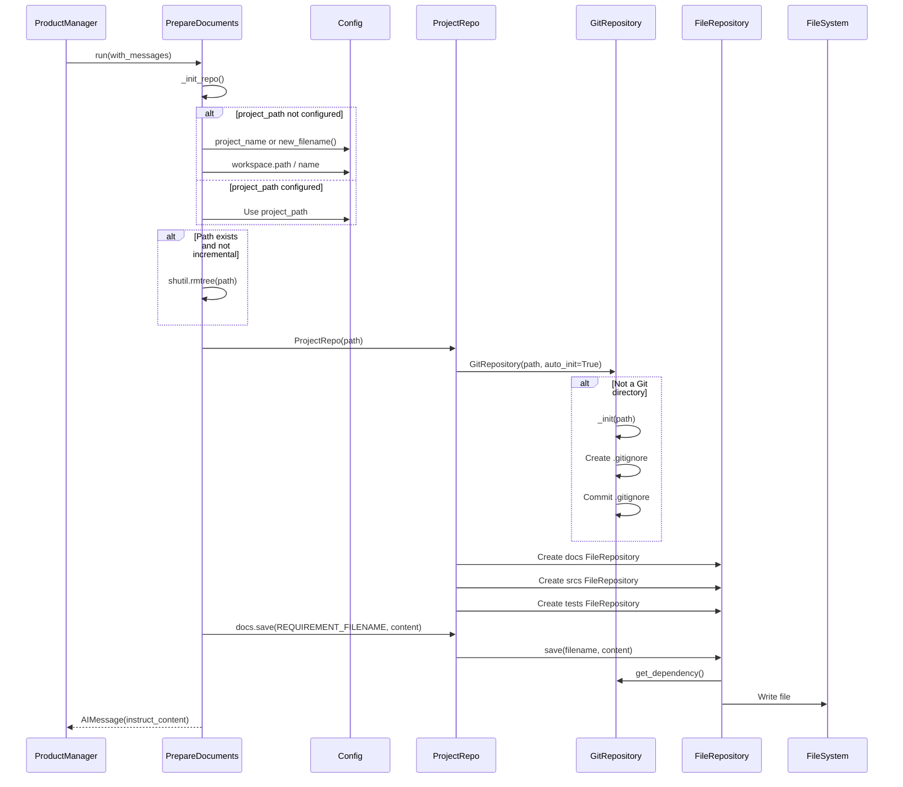

Sources: [metagpt/actions/prepare_documents.py:23-91]()

### SWEAgent GitHub Issue Resolution

The `SWEAgent` role integrates Git operations for resolving GitHub issues and creating pull requests.

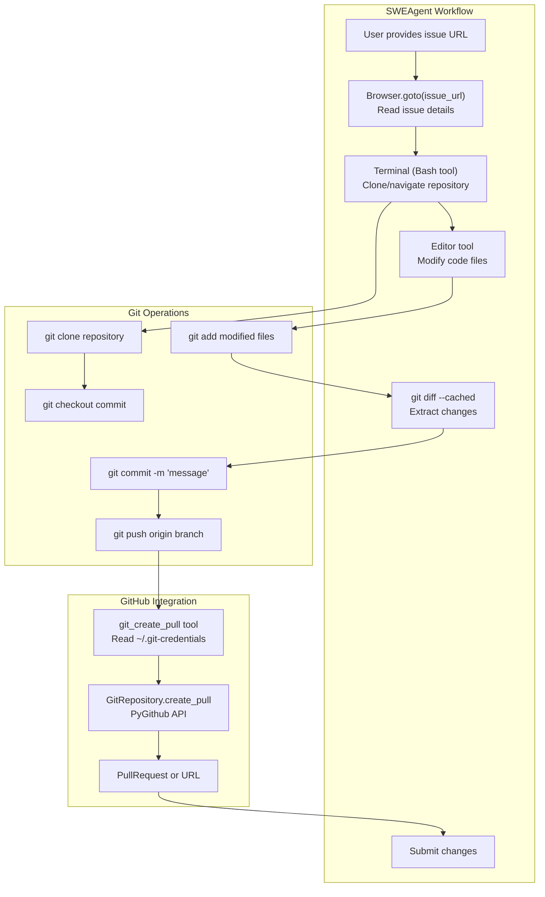

**SWEAgent Git Command Integration**

The `SWEAgent` updates its tool execution map to include `git_create_pull`:

Sources: [metagpt/roles/di/swe_agent.py:17-84](), [metagpt/prompts/di/swe_agent.py:1-247]()

### Git Operations in Testing

Test benchmarks use Git operations extensively for repository management:

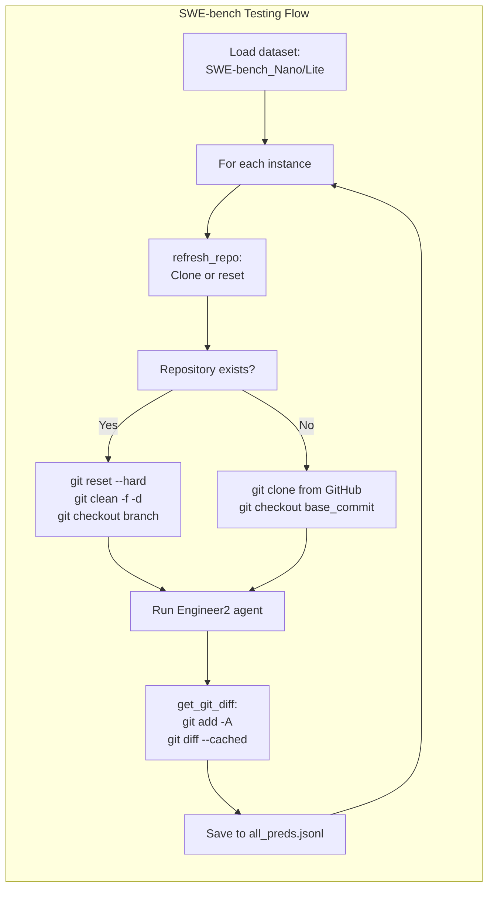

**Git Commands in Terminal Operations**

The test script uses `Terminal` to execute Git commands:

| Command | Purpose |
|---------|---------|
| `git reset --hard && git clean -f -d` | Discard all local changes |
| `git checkout -f {base_commit}` | Switch to specific commit |
| `git clone {url} {path}` | Clone repository |
| `echo '.backup.*' >> .gitignore` | Ignore backup files |
| `git add -A` | Stage all changes |
| `git diff --cached` | Get staged changes as patch |

Sources: [tests/metagpt/roles/di/run_swe_agent_for_benchmark.py:1-228]()

---

## GitIgnore Filtering

GitRepository provides `.gitignore` parsing and filtering to respect version control exclusions when listing files.

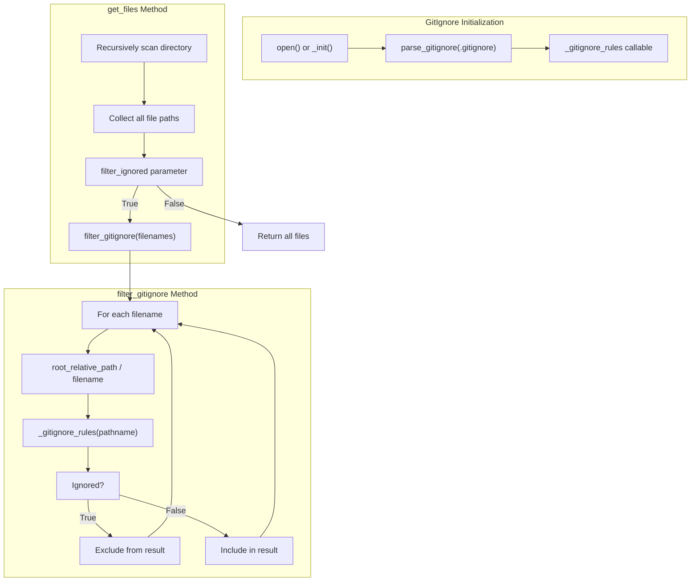

**Default .gitignore Contents**

When initializing a new repository, GitRepository creates a `.gitignore` with default exclusions:

Sources: [metagpt/utils/git_repository.py:83-113](), [metagpt/utils/git_repository.py:350-414]()

---

## Summary: Git Integration in MetaGPT Architecture

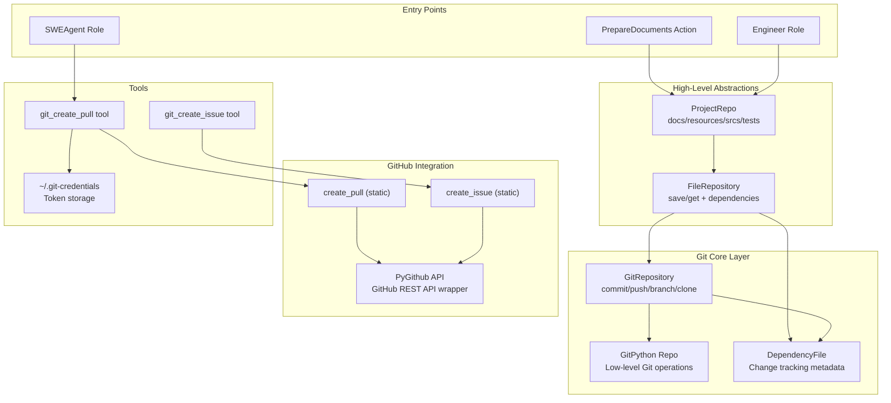

The Git integration system provides:

1. **Version Control Foundation**: All project artifacts are Git-tracked via `GitRepository`
2. **Dependency Management**: `FileRepository` + `DependencyFile` enable incremental development
3. **Change Detection**: Roles process only modified files using `changed_files`
4. **GitHub Integration**: Programmatic PR/issue creation for automated workflows
5. **Multi-Environment Support**: Proxy configuration, token authentication, SSH/HTTPS URLs
6. **Resilience**: Retry logic for cloning, error handling for GitHub API rate limits

Sources: [metagpt/utils/git_repository.py:1-634](), [metagpt/utils/file_repository.py:1-240](), [metagpt/tools/libs/git.py:1-132]()

---

