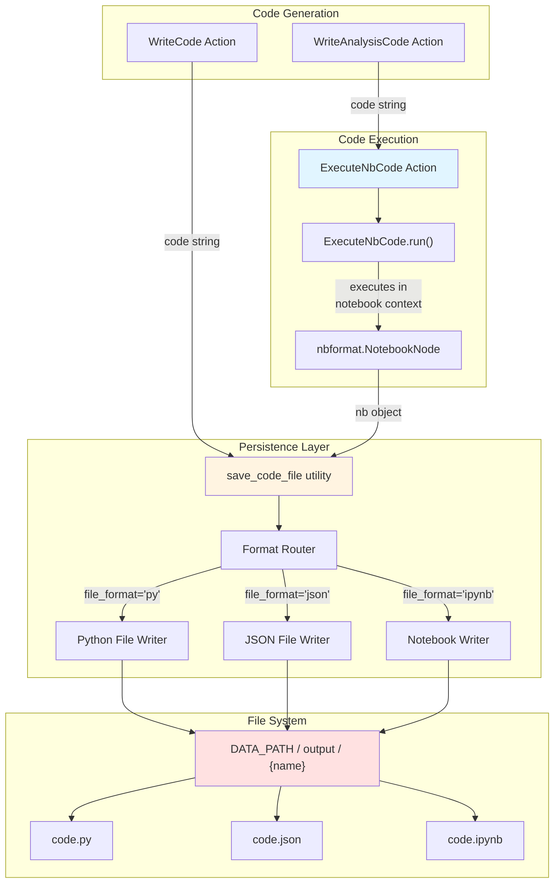
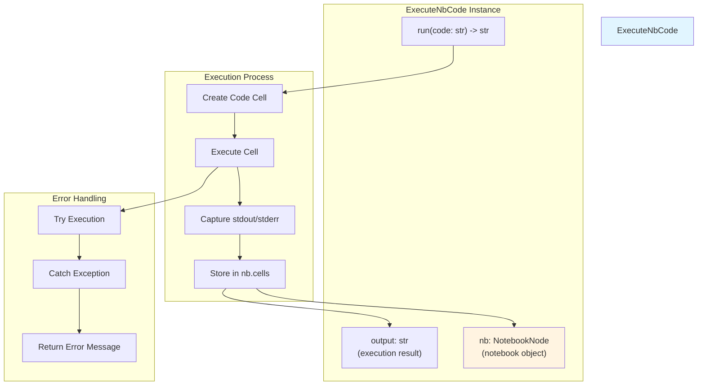
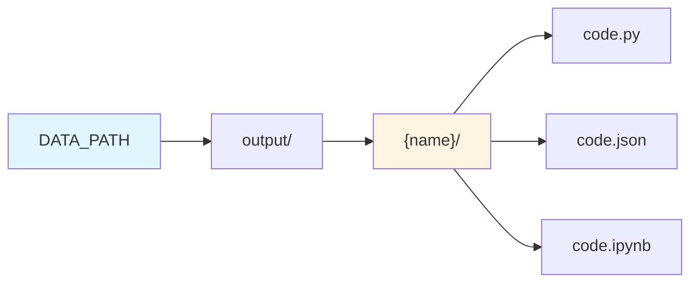
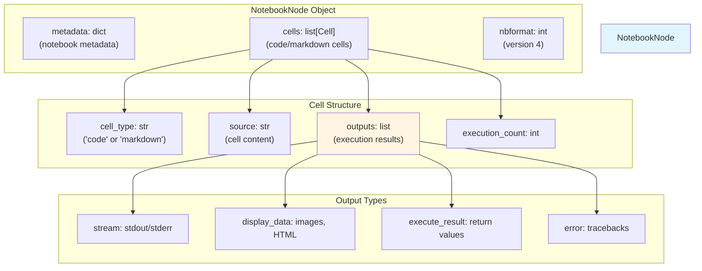
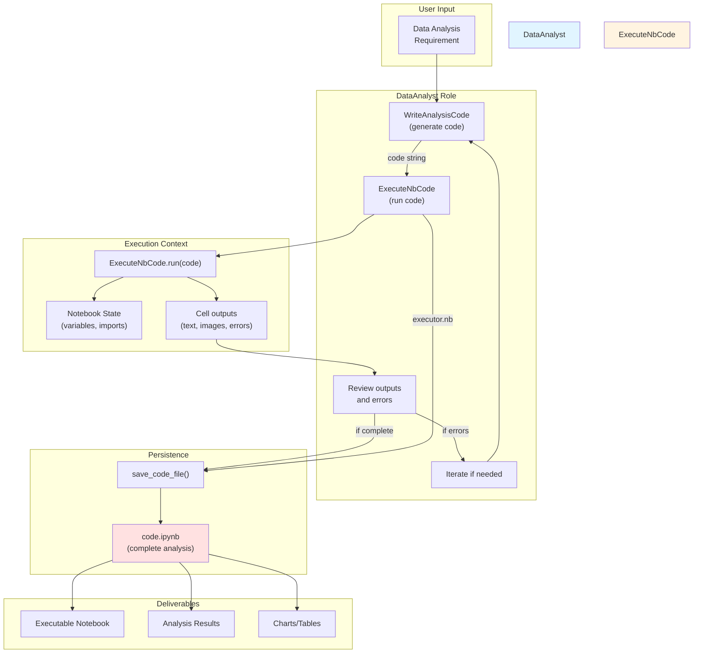

<!-- source: DeepWiki mcp.deepwiki.com · repo FoundationAgents/MetaGPT · page 6.3 Code Execution and Persistence · fetched 2026-10-30 -->

# Code Execution and Persistence

<details>
<summary>Relevant source files</summary>

The following files were used as context for generating this wiki page:

- [metagpt/utils/save_code.py](metagpt/utils/save_code.py)
- [tests/metagpt/utils/test_save_code.py](tests/metagpt/utils/test_save_code.py)

</details>


## Purpose and Scope

This document covers MetaGPT's code execution and persistence subsystem, which enables agents to run Python code and save artifacts to disk. The primary components are the `ExecuteNbCode` action for executing code in Jupyter notebook contexts and the `save_code_file` utility for persisting code artifacts in multiple formats (Python files, JSON documents, and Jupyter notebooks).

For broader project artifact management across the development lifecycle, see [ProjectRepo and File Management](#6.1). For iterative code generation workflows, see [Incremental Development](#6.2). For data analysis roles that leverage these execution capabilities, see [Specialized Roles](#5.2).

---

## Code Execution Architecture

MetaGPT provides two primary mechanisms for executing code: direct Python execution and Jupyter notebook-based execution. The notebook-based approach is preferred for data analysis workflows because it captures execution state, outputs, and visualizations in a structured format.

### Execution Flow



**Sources:** [metagpt/utils/save_code.py:13-40](), [tests/metagpt/utils/test_save_code.py:30-44]()

---

## ExecuteNbCode Action

The `ExecuteNbCode` action executes Python code within a Jupyter notebook environment, capturing outputs, errors, and execution state. This action is used primarily by the `DataAnalyst` role for running analysis code.

### Execution Context



### Key Properties

| Property | Type | Description |
|----------|------|-------------|
| `nb` | `nbformat.NotebookNode` | Notebook object containing all executed cells with outputs |
| `output` | `str` | String representation of the most recent execution result |

The notebook object (`nb`) accumulates execution history across multiple `run()` calls, enabling stateful analysis workflows where variables persist between executions.

**Sources:** [tests/metagpt/utils/test_save_code.py:30-44]()

---

## Code Persistence with save_code_file

The `save_code_file` utility provides a unified interface for persisting code artifacts in three formats: Python files, JSON documents, and Jupyter notebooks.

### Function Signature

```python
def save_code_file(name: str, code_context: str, file_format: str = "py") -> None
```

### Parameters

| Parameter | Type | Default | Description |
|-----------|------|---------|-------------|
| `name` | `str` | Required | Folder name under `DATA_PATH/output/` |
| `code_context` | `str` or `NotebookNode` | Required | Code content (string) or notebook object |
| `file_format` | `str` | `"py"` | Output format: `"py"`, `"json"`, or `"ipynb"` |

### File Path Structure



All artifacts are saved under `DATA_PATH / "output" / {name} / code.{format}`, where `DATA_PATH` is defined in `metagpt.const`.

**Sources:** [metagpt/utils/save_code.py:13-40]()

---

## Format-Specific Behavior

### Python File Format (py)

Saves code as plain text with UTF-8 encoding and double newline suffix:

```python
save_code_file("example", "print('Hello, World!')")
# Creates: DATA_PATH/output/example/code.py
# Content: print('Hello, World!')\n\n
```

**Implementation:** [metagpt/utils/save_code.py:31-32]()

### JSON Format (json)

Wraps code in a JSON object with `"code"` key:

```python
save_code_file("example_json", "print('Hello, JSON!')", file_format="json")
# Creates: DATA_PATH/output/example_json/code.json
# Content: {"code": "print('Hello, JSON!')"}
```

**Implementation:** [metagpt/utils/save_code.py:33-36]()

### Jupyter Notebook Format (ipynb)

Requires a `NotebookNode` object (not a string). Used with `ExecuteNbCode`:

```python
executor = ExecuteNbCode()
await executor.run("print('Hello, World!')")
save_code_file("example_nb", executor.nb, file_format="ipynb")
# Creates: DATA_PATH/output/example_nb/code.ipynb
# Content: Complete notebook with cells, outputs, metadata
```

The notebook includes:
- All executed code cells
- Cell outputs (stdout, stderr, return values)
- Execution counts
- Cell metadata
- Notebook-level metadata

**Implementation:** [metagpt/utils/save_code.py:37-38](), [tests/metagpt/utils/test_save_code.py:30-44]()

**Sources:** [metagpt/utils/save_code.py:13-40](), [tests/metagpt/utils/test_save_code.py:14-44]()

---

## Jupyter Notebook Integration

MetaGPT leverages the `nbformat` library for full Jupyter notebook support, enabling agents to produce executable, shareable analysis artifacts.

### Notebook Structure



### Validation

After saving, notebooks can be read and validated:

```python
notebook = nbformat.read(file_path, as_version=4)
assert len(notebook.cells) > 0
assert notebook.cells[0].source  # Verify cell content
```

**Sources:** [tests/metagpt/utils/test_save_code.py:40-44]()

---

## Integration with Data Analysis Workflow

The code execution and persistence system integrates with the `DataAnalyst` role to enable end-to-end data analysis workflows.

### Complete Analysis Pipeline



### Workflow Characteristics

1. **Stateful Execution**: Variables and imports persist across multiple `ExecuteNbCode.run()` calls within the same executor instance
2. **Error Recovery**: Execution errors are captured in cell outputs, allowing the agent to diagnose and fix issues
3. **Incremental Development**: Agents can build analysis iteratively, adding cells as needed
4. **Reproducibility**: Final notebooks are fully executable, allowing stakeholders to re-run analyses

**Sources:** [tests/metagpt/utils/test_save_code.py:30-44]()

---

## Usage Patterns

### Pattern 1: Simple Python Script Persistence

```python
# Generate code
code = "def greet(name):\n    return f'Hello, {name}!'"

# Save as Python file
save_code_file("greetings", code, file_format="py")
# Result: DATA_PATH/output/greetings/code.py
```

### Pattern 2: Structured JSON Storage

```python
# Save code with metadata wrapper
analysis_code = "import pandas as pd\ndf = pd.read_csv('data.csv')"
save_code_file("data_loading", analysis_code, file_format="json")
# Result: DATA_PATH/output/data_loading/code.json
# Content: {"code": "import pandas as pd\ndf = pd.read_csv('data.csv')"}
```

### Pattern 3: Interactive Analysis Notebook

```python
# Create executor
executor = ExecuteNbCode()

# Execute analysis steps
await executor.run("import pandas as pd")
await executor.run("df = pd.DataFrame({'x': [1, 2, 3], 'y': [4, 5, 6]})")
await executor.run("print(df.describe())")

# Save complete notebook with all cells and outputs
save_code_file("analysis_results", executor.nb, file_format="ipynb")
# Result: DATA_PATH/output/analysis_results/code.ipynb
```

**Sources:** [metagpt/utils/save_code.py:13-40](), [tests/metagpt/utils/test_save_code.py:14-44]()

---

## Error Handling

### Format Validation

The `save_code_file` function validates the `file_format` parameter:

```python
if file_format not in ["py", "json", "ipynb"]:
    raise ValueError("Unsupported file format. Please choose 'py', 'json', or 'ipynb'.")
```

**Implementation:** [metagpt/utils/save_code.py:39-40]()

### Directory Creation

Parent directories are created automatically if they don't exist:

```python
os.makedirs(name=DATA_PATH / "output" / f"{name}", exist_ok=True)
```

This prevents file write errors when saving to new project folders.

**Implementation:** [metagpt/utils/save_code.py:27]()

### Type Validation for Notebooks

When `file_format="ipynb"`, the `code_context` parameter must be a `NotebookNode` object (not a string). Passing a string will cause `nbformat.write()` to fail with a type error.

**Sources:** [metagpt/utils/save_code.py:27-40]()

---

## Summary

The code execution and persistence subsystem provides MetaGPT agents with the ability to:

1. **Execute code in notebook contexts** via `ExecuteNbCode`, capturing outputs and maintaining state
2. **Save artifacts in multiple formats** via `save_code_file` (Python, JSON, Jupyter notebooks)
3. **Support stateful analysis workflows** where variables persist across execution steps
4. **Produce reproducible deliverables** as executable Jupyter notebooks

This system integrates with the `DataAnalyst` role (see [Specialized Roles](#5.2)) to enable end-to-end data analysis workflows and with the broader artifact management system (see [ProjectRepo and File Management](#6.1)) to maintain project coherence across the development lifecycle.

**Sources:** [metagpt/utils/save_code.py:13-40](), [tests/metagpt/utils/test_save_code.py:1-45]()

---

