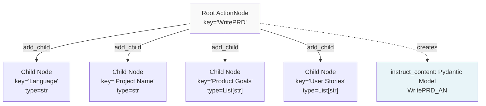
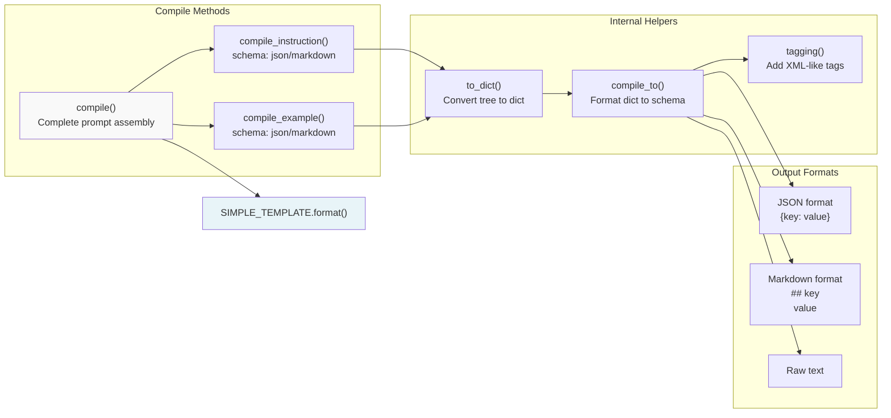
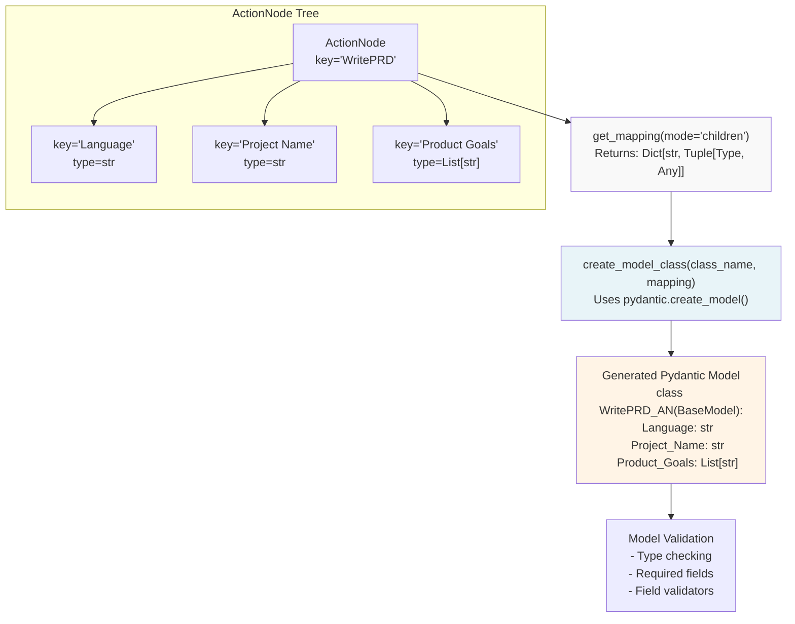
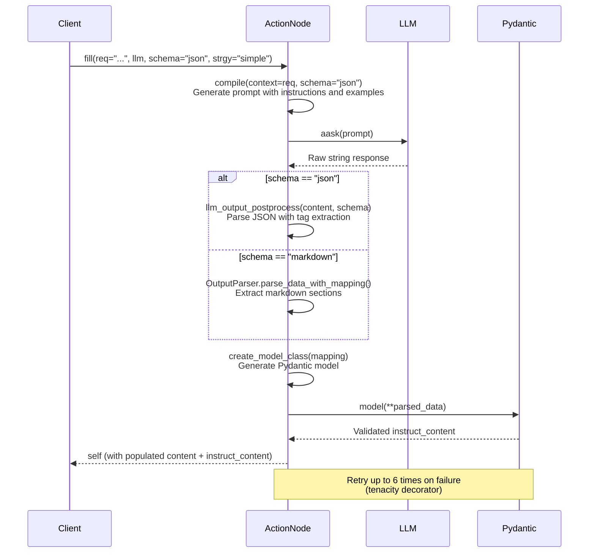
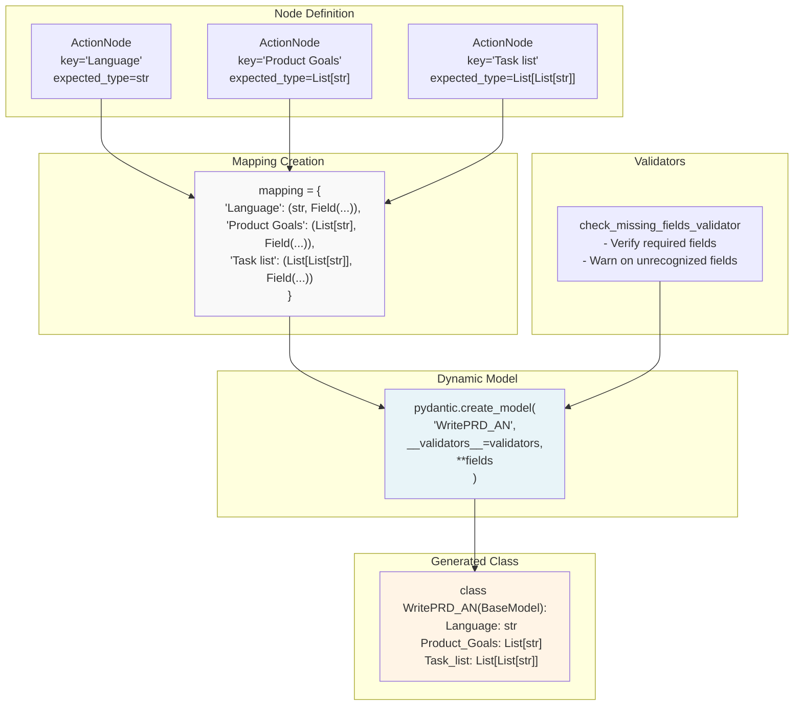
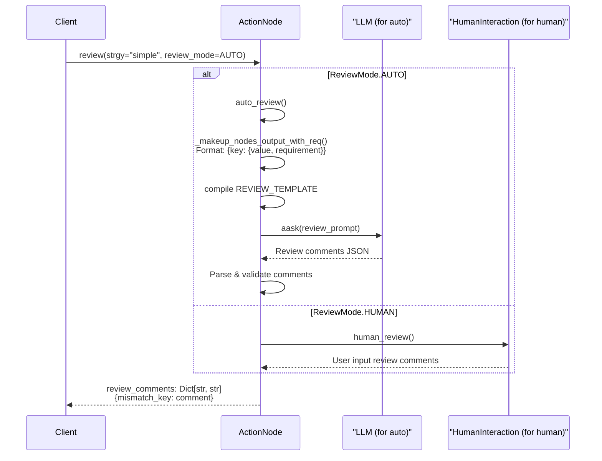
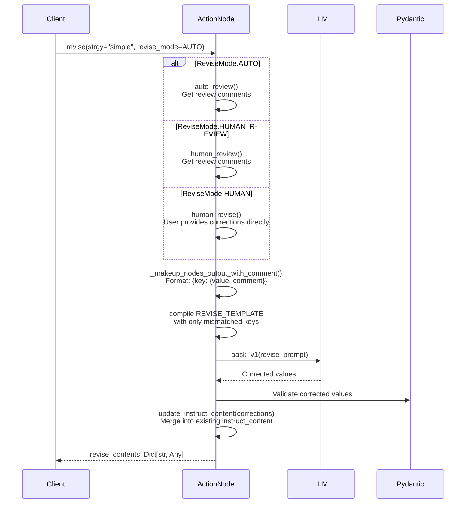
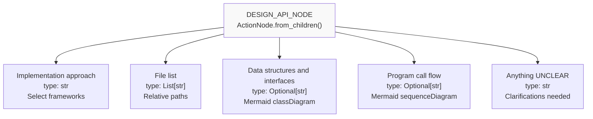
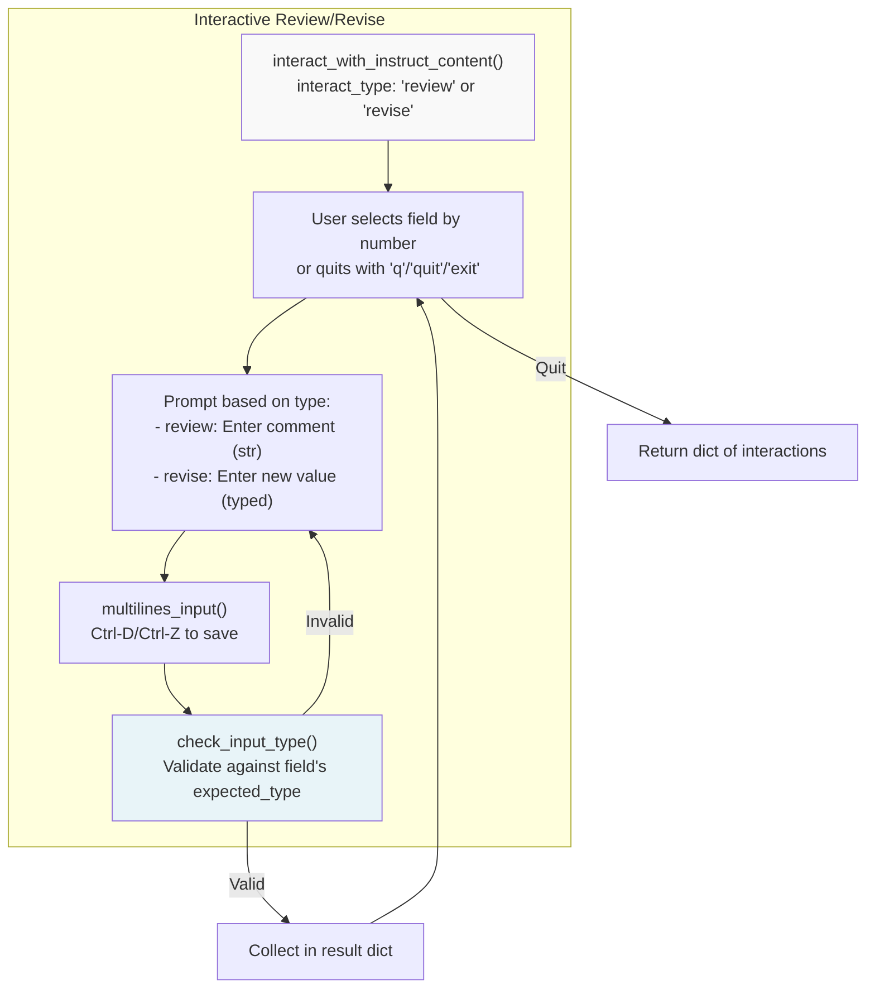

<!-- source: DeepWiki mcp.deepwiki.com · repo FoundationAgents/MetaGPT · page 7 ActionNode and Structured Output · fetched 2026-10-30 -->

# ActionNode and Structured Output

<details>
<summary>Relevant source files</summary>

The following files were used as context for generating this wiki page:

- [metagpt/actions/action_node.py](metagpt/actions/action_node.py)
- [metagpt/actions/design_api_an.py](metagpt/actions/design_api_an.py)
- [metagpt/actions/project_management_an.py](metagpt/actions/project_management_an.py)
- [metagpt/actions/write_prd_an.py](metagpt/actions/write_prd_an.py)
- [metagpt/utils/human_interaction.py](metagpt/utils/human_interaction.py)
- [tests/metagpt/actions/test_action_node.py](tests/metagpt/actions/test_action_node.py)
- [tests/metagpt/utils/test_human_interaction.py](tests/metagpt/utils/test_human_interaction.py)

</details>


## Purpose and Scope

This document describes the `ActionNode` system, MetaGPT's framework for structured LLM interactions and type-safe output generation. ActionNode provides a tree-based abstraction for defining prompt schemas, dynamically generating Pydantic validation models, and ensuring that LLM outputs conform to expected formats.

For information about how Actions use ActionNodes, see [Action System](#2.2). For LLM provider integration details, see [LLM Provider Integration](#3).

## Core Architecture

### ActionNode Class Structure

`ActionNode` is a tree-structured data class that represents both the prompt schema and the expected output structure for LLM interactions. Each node defines a field with its type, instructions, and example values.

**Core Attributes:**

| Attribute | Type | Purpose |
|-----------|------|---------|
| `key` | `str` | Field name/identifier |
| `expected_type` | `Type` | Python type annotation (str, int, List[str], etc.) |
| `instruction` | `str` | Natural language instructions for the LLM |
| `example` | `Any` | Example value for in-context learning |
| `content` | `str` | Raw LLM output (populated after fill) |
| `instruct_content` | `BaseModel` | Parsed structured output (Pydantic model) |
| `children` | `dict[str, ActionNode]` | Child nodes in tree hierarchy |
| `schema` | `str` | Output format: "raw", "json", or "markdown" |

Sources: [metagpt/actions/action_node.py:135-181]()

### Tree Structure and Composition

ActionNodes form hierarchies where parent nodes contain multiple child nodes, each representing a field in the output structure:



**Node Construction Methods:**

- `add_child(node)` - Add a single child node [metagpt/actions/action_node.py:199-201]()
- `add_children(nodes)` - Batch add child nodes [metagpt/actions/action_node.py:206-209]()
- `from_children(key, nodes)` - Class method to construct parent from children list [metagpt/actions/action_node.py:211-216]()
- `from_pydantic(model)` - Convert a Pydantic model to ActionNode tree [metagpt/actions/action_node.py:840-867]()

Sources: [metagpt/actions/action_node.py:135-216]()

## Prompt Generation System

### Template System

ActionNode uses three primary templates for different stages of the workflow:

| Template | Purpose | Usage |
|----------|---------|-------|
| `SIMPLE_TEMPLATE` | Initial prompt generation | Includes context, format example, node instructions, constraints |
| `REVIEW_TEMPLATE` | Content validation | Compares output against requirements, generates comments |
| `REVISE_TEMPLATE` | Content correction | Modifies output based on review comments |

Sources: [metagpt/actions/action_node.py:56-125]()

### Compile Methods

ActionNode provides multiple compilation methods to generate different components of prompts:



**Key Compilation Methods:**

- **`compile_instruction(schema, mode, tag, exclude)`** - Generates instruction section showing field types and descriptions [metagpt/actions/action_node.py:369-372]()
  - Format: `"<key>: <type>  # <instruction>"`
  - Supports markdown (default) or JSON schema

- **`compile_example(schema, mode, tag, exclude)`** - Generates example section with sample values [metagpt/actions/action_node.py:374-380]()
  - Wrapped in `[CONTENT][/CONTENT]` tags by default
  - Uses node's `example` field values

- **`compile(context, schema, mode, template, exclude)`** - Assembles complete prompt [metagpt/actions/action_node.py:382-421]()
  - Combines context, examples, instructions, and constraints
  - Returns formatted string ready for LLM

**Schema Options:**

| Schema | Instruction Format | Example Format | Use Case |
|--------|-------------------|----------------|----------|
| `raw` | Plain text | None | Free-form text generation |
| `json` | Markdown list | JSON object | Structured data with complex types |
| `markdown` | Markdown list | Markdown sections | Code generation, documents |

Sources: [metagpt/actions/action_node.py:351-421]()

### Mapping and Model Generation

ActionNode dynamically creates Pydantic models based on its tree structure:



**Mapping Generation:**

- `_get_children_mapping(exclude)` - Recursively extracts child node definitions [metagpt/actions/action_node.py:218-234]()
- `_get_self_mapping()` - Returns mapping for just the current node [metagpt/actions/action_node.py:236-238]()
- `get_mapping(mode, exclude)` - Unified interface supporting "children", "auto", or "self" modes [metagpt/actions/action_node.py:240-244]()

**Dynamic Model Creation:**

The `create_model_class` method generates Pydantic models with validation [metagpt/actions/action_node.py:246-282]():

1. Accepts a mapping: `Dict[str, Tuple[Type, FieldInfo]]`
2. Creates validators for required vs optional fields
3. Handles nested structures recursively
4. Returns a Pydantic `BaseModel` subclass

Sources: [metagpt/actions/action_node.py:218-282]()

## Fill Strategies

### Fill Method Overview

The `fill()` method is the primary interface for populating ActionNodes with LLM-generated content. It supports multiple strategies and formats:

**Fill Signature:**

```python
async def fill(
    self,
    *,
    req,              # Request/context string
    llm,              # BaseLLM instance
    schema="json",    # Output format: "raw"/"json"/"markdown"
    mode="auto",      # Node selection: "auto"/"children"/"root"
    strgy="simple",   # Strategy: "simple"/"complex"
    images=None,      # Optional image inputs (for vision models)
    timeout=...,      # LLM invocation timeout
    exclude=[],       # Keys to exclude
    function_name=None  # For code_fill mode
)
```

Sources: [metagpt/actions/action_node.py:596-663]()

### Fill Strategies Comparison

| Strategy | Mode Value | Description | Implementation |
|----------|-----------|-------------|----------------|
| **Simple Fill** | `strgy="simple"` | Single LLM call for entire tree | `simple_fill()` [468-484]() |
| **Complex Fill** | `strgy="complex"` | Separate LLM call per child node | Loop with `simple_fill()` [653-663]() |
| **Code Fill** | `mode="code_fill"` | Extract code from markdown blocks | `code_fill()` [533-544]() |
| **XML Fill** | `mode="xml_fill"` | Parse XML-tagged output | `xml_fill()` [553-594]() |
| **Single Fill** | `mode="single_fill"` | Raw string response | `single_fill()` [546-551]() |

Sources: [metagpt/actions/action_node.py:468-663]()

### Simple Fill Workflow

The most common strategy for structured output:



**Simple Fill Process:**

1. **Compile Prompt** - Call `compile()` to generate formatted prompt [metagpt/actions/action_node.py:471]()
2. **LLM Invocation** - Send prompt via `_aask_v1()` [metagpt/actions/action_node.py:428-452]()
3. **Parse Response** - Extract structured data based on schema [metagpt/actions/action_node.py:443-448]()
4. **Validate** - Instantiate Pydantic model with parsed data [metagpt/actions/action_node.py:451]()
5. **Store** - Set `self.content` (raw) and `self.instruct_content` (structured) [metagpt/actions/action_node.py:478-479]()

Sources: [metagpt/actions/action_node.py:468-484](), [metagpt/actions/action_node.py:428-452]()

### Specialized Fill Modes

**Code Fill** - Extracts code blocks from markdown:

```python
# Uses sanitize() utility to extract code from ``` ``` blocks
async def code_fill(self, context: str, function_name: Optional[str] = None):
    content = await self.llm.aask(prompt, timeout=timeout)
    extracted_code = sanitize(code=content, entrypoint=function_name)
    result = {field_name: extracted_code}
    return result
```

Sources: [metagpt/actions/action_node.py:533-544]()

**XML Fill** - Parses XML-tagged structured output:

```python
# Generates prompt with XML example: <field_name>content</field_name>
# Extracts each field using regex patterns
for field_name in field_names:
    pattern = rf"<{field_name}>(.*?)</{field_name}>"
    match = re.search(pattern, content, re.DOTALL)
    # Type conversion based on field_type: str, int, bool, list, dict
```

Supports automatic type conversion for `str`, `int`, `bool`, `list`, and `dict` types [metagpt/actions/action_node.py:553-594]().

Sources: [metagpt/actions/action_node.py:553-594]()

### Experience Caching

The `fill()` method uses the `@exp_cache` decorator to memoize results:

```python
@exp_cache(serializer=ActionNodeSerializer())
async def fill(self, *, req, llm, schema="json", ...):
    # Fill implementation
```

**Caching Behavior:**

- **Cache Key** - Generated from `(req, schema, mode, strgy, exclude)` parameters
- **Serialization** - Uses `ActionNodeSerializer` to store/retrieve ActionNode state [metagpt/exp_pool/serializers.py]()
- **Storage** - Saves to experience pool for reuse across sessions
- **Benefits** - Avoids redundant LLM calls for identical prompts

Sources: [metagpt/actions/action_node.py:596](), [metagpt/exp_pool/__init__.py]()

## Dynamic Validation and Parsing

### Pydantic Model Generation

ActionNode creates Pydantic models dynamically to enforce type safety:



**Validation Features:**

1. **Required Field Checking** - Raises `ValueError` if required fields missing [metagpt/actions/action_node.py:260-262]()
2. **Unrecognized Field Warning** - Logs warning for extra fields [metagpt/actions/action_node.py:264-266]()
3. **Type Validation** - Pydantic enforces type annotations
4. **Nested Structure Support** - Recursively creates models for nested dicts [metagpt/actions/action_node.py:274-277]()
5. **Optional Type Handling** - Detects `Optional[T]` and allows None [metagpt/actions/action_node.py:869-876]()

Sources: [metagpt/actions/action_node.py:246-282]()

### Output Parsing Strategies

**JSON Parsing** - Uses `llm_output_postprocess()`:

```python
parsed_data = llm_output_postprocess(
    output=content, 
    schema=output_class.model_json_schema(), 
    req_key=f"[/{TAG}]"  # TAG = "CONTENT"
)
```

- Extracts content between `[CONTENT][/CONTENT]` tags
- Validates against Pydantic schema
- Handles malformed JSON with correction attempts

Sources: [metagpt/actions/action_node.py:443-446](), [metagpt/provider/postprocess/llm_output_postprocess.py]()

**Markdown Parsing** - Uses `OutputParser.parse_data_with_mapping()`:

```python
parsed_data = OutputParser.parse_data_with_mapping(content, output_data_mapping)
```

- Extracts sections based on mapping keys
- Parses markdown headers and content
- Converts to dictionary matching mapping structure

Sources: [metagpt/actions/action_node.py:448](), [metagpt/utils/common.py]()

### Field Introspection

ActionNode provides methods to inspect generated models:

| Method | Returns | Purpose |
|--------|---------|---------|
| `get_field_name()` | `str` | Single field name (for single-field models) |
| `get_field_names()` | `KeysView` | All field names in model |
| `get_field_types()` | `Dict[str, Type]` | Field name to type annotation mapping |

Sources: [metagpt/actions/action_node.py:486-512]()

## Review and Revision System

### Review Workflow

ActionNode supports automated and human review of generated content:



**Review Methods:**

- **`review(strgy, review_mode)`** - Main entry point [metagpt/actions/action_node.py:729-750]()
  - `strgy="simple"`: Review entire node once
  - `strgy="complex"`: Review each child node separately
  - Returns dict of keys needing revision with comments

- **`auto_review(template)`** - LLM-based review [metagpt/actions/action_node.py:680-716]()
  - Compares output values against instructions
  - Uses REVIEW_TEMPLATE to generate prompt
  - Returns only mismatched keys with comments

- **`human_review()`** - Interactive review [metagpt/actions/action_node.py:665-670]()
  - Uses `HumanInteraction.interact_with_instruct_content()`
  - User selects fields to comment on
  - Returns review comments dict

Sources: [metagpt/actions/action_node.py:665-750]()

### Revision Workflow

After review, ActionNode can automatically revise content:



**Revision Modes:**

| Mode | Behavior | Use Case |
|------|----------|----------|
| `ReviseMode.HUMAN` | User directly provides corrected values | Manual correction |
| `ReviseMode.HUMAN_REVIEW` | User reviews, LLM revises | Guided auto-correction |
| `ReviseMode.AUTO` | LLM reviews and revises | Fully automated refinement |

**Revision Process:**

1. **Generate Review** - Get comments on mismatched fields [metagpt/actions/action_node.py:773-776]()
2. **Create Revise Prompt** - Format REVISE_TEMPLATE with comments [metagpt/actions/action_node.py:788-794]()
3. **LLM Revise** - Generate corrected values [metagpt/actions/action_node.py:799-801]()
4. **Update Content** - Merge corrections into `instruct_content` [metagpt/actions/action_node.py:805]()

Sources: [metagpt/actions/action_node.py:752-838]()

### Update Mechanism

The `update_instruct_content()` method merges incremental updates:

```python
def update_instruct_content(self, incre_data: dict[str, Any]):
    origin_sc_dict = self.instruct_content.model_dump()
    origin_sc_dict.update(incre_data)  # Merge new data
    output_class = self.create_class()
    self.instruct_content = output_class(**origin_sc_dict)  # Re-validate
```

- Preserves unchanged fields
- Validates merged result
- Ensures type safety after updates

Sources: [metagpt/actions/action_node.py:332-337]()

## Domain-Specific ActionNodes

### Pre-Defined ActionNode Trees

MetaGPT includes several pre-configured ActionNode hierarchies for common software development tasks:

**WRITE_PRD_NODE** - Product Requirements Document (12 fields):

| Field | Type | Purpose |
|-------|------|---------|
| `Language` | `str` | Project language |
| `Programming Language` | `str` | Tech stack |
| `Original Requirements` | `str` | User's raw requirements |
| `Project Name` | `str` | Snake case project name |
| `Product Goals` | `List[str]` | 3 clear product goals |
| `User Stories` | `List[str]` | 3-5 scenario-based stories |
| `Competitive Analysis` | `List[str]` | 5-7 competitive products |
| `Competitive Quadrant Chart` | `str` | Mermaid quadrantChart |
| `Requirement Analysis` | `str` | Detailed analysis |
| `Requirement Pool` | `List[List[str]]` | Top-5 requirements with priority |
| `UI Design draft` | `str` | UI description |
| `Anything UNCLEAR` | `str` | Unclear aspects |

Sources: [metagpt/actions/write_prd_an.py:12-203](), [metagpt/actions/write_prd_an.py:220]()

**DESIGN_API_NODE** - System Design Document (5 fields):



Sources: [metagpt/actions/design_api_an.py:93-110]()

**PM_NODE** - Project Management Document (7 fields):

| Field | Type | Purpose |
|-------|------|---------|
| `Required packages` | `Optional[List[str]]` | Python dependencies |
| `Required Other language third-party packages` | `List[str]` | Non-Python dependencies |
| `Logic Analysis` | `List[List[str]]` | Files with classes/methods to implement |
| `Task list` | `List[str]` | Files ordered by dependency |
| `Full API spec` | `str` | OpenAPI 3.0 specification |
| `Shared Knowledge` | `str` | Common utilities, config |
| `Anything UNCLEAR` | `str` | Project management clarifications |

Sources: [metagpt/actions/project_management_an.py:101-121]()

### Refined Variants for Incremental Development

Each domain-specific node has a "refined" variant for incremental development scenarios:

| Original Node | Refined Node | Key Differences |
|--------------|--------------|-----------------|
| `WRITE_PRD_NODE` | `REFINED_PRD_NODE` | Uses `REFINED_REQUIREMENTS`, `REFINED_PRODUCT_GOALS`, `REFINED_USER_STORIES`, etc. |
| `DESIGN_API_NODE` | `REFINED_DESIGN_NODE` | Uses `REFINED_IMPLEMENTATION_APPROACH`, `REFINED_FILE_LIST`, etc. |
| `PM_NODE` | `REFINED_PM_NODE` | Uses `REFINED_LOGIC_ANALYSIS`, `REFINED_TASK_LIST`, etc. |

**Refined Fields** emphasize:
- Merging legacy and incremental content
- Updating existing structures
- Documenting new features while preserving old ones
- Consistency checks with previous versions

Sources: [metagpt/actions/write_prd_an.py:205-221](), [metagpt/actions/design_api_an.py:102-111](), [metagpt/actions/project_management_an.py:111-122]()

### Usage in Actions

Domain-specific ActionNodes are used by corresponding Action classes:

```python
# In WritePRD action
from metagpt.actions.write_prd_an import WRITE_PRD_NODE

class WritePRD(Action):
    async def run(self, requirements):
        node = WRITE_PRD_NODE
        node = await node.fill(req=requirements, llm=self.llm)
        prd_content = node.instruct_content  # Validated Pydantic model
        return prd_content.model_dump()
```

Sources: [metagpt/actions/write_prd.py]()

## Task Type Prompts

### Data Science Task Prompts

MetaGPT includes specialized prompts for data science workflows, typically used with `DataAnalyst` role:

| Prompt Constant | Task Type | Purpose |
|----------------|-----------|---------|
| `EDA_PROMPT` | Exploratory Data Analysis | Initial data inspection, statistics, distributions |
| `DATA_PREPROCESS_PROMPT` | Data Preprocessing | Cleaning, handling missing values, normalization |
| `FEATURE_ENGINEERING_PROMPT` | Feature Engineering | Creating derived features, transformations |
| `MODEL_TRAIN_PROMPT` | Model Training | Model selection, training, hyperparameter tuning |
| `MODEL_EVALUATE_PROMPT` | Model Evaluation | Metrics calculation, validation, performance analysis |

**Usage Pattern:**

```python
# In WriteAnalysisCode action
from metagpt.prompts.task_type import EDA_PROMPT

async def run(self, task_type):
    if task_type == "eda":
        prompt_template = EDA_PROMPT
    # ... etc
    
    code_node = ActionNode(key="code", expected_type=str, 
                           instruction=prompt_template, example="")
    await code_node.fill(req=context, llm=self.llm, mode="code_fill")
```

Sources: [metagpt/prompts/task_type.py]()

### Web Development Prompts

Additional specialized prompts for web development:

- **`IMAGE2WEBPAGE_PROMPT`** - Convert image mockups to HTML/CSS/JS code
- **`WEB_SCRAPING_PROMPT`** - Generate web scraping code with best practices

Sources: [metagpt/prompts/task_type.py]()

## Human Interaction Integration

### HumanInteraction Class

The `HumanInteraction` utility provides interactive review and revision capabilities:



**Key Features:**

1. **Field Selection** - User chooses which field to interact with by index [metagpt/utils/human_interaction.py:73-106]()
2. **Type Validation** - Inputs validated against Pydantic schema using `ActionNode.create_model_class()` [metagpt/utils/human_interaction.py:29-47]()
3. **Multiline Input** - Supports complex inputs via Ctrl-D/Ctrl-Z [metagpt/utils/human_interaction.py:17-27]()
4. **Review vs Revise** - Different workflows:
   - **Review**: Enter comment strings
   - **Revise**: Enter correctly typed values

Sources: [metagpt/utils/human_interaction.py:14-107]()

### Integration with ActionNode

ActionNode methods delegate to `HumanInteraction`:

```python
async def human_review(self) -> dict[str, str]:
    review_comments = HumanInteraction().interact_with_instruct_content(
        instruct_content=self.instruct_content, 
        interact_type="review"
    )
    return review_comments

async def human_revise(self) -> dict[str, str]:
    review_contents = HumanInteraction().interact_with_instruct_content(
        instruct_content=self.instruct_content, 
        mapping=self.get_mapping(mode="auto"), 
        interact_type="revise"
    )
    self.update_instruct_content(review_contents)
    return review_contents
```

Sources: [metagpt/actions/action_node.py:665-670](), [metagpt/actions/action_node.py:752-758]()

## Advanced Features

### From Pydantic Model

Convert existing Pydantic models to ActionNode trees:

```python
from pydantic import BaseModel, Field
from metagpt.actions.action_node import ActionNode

class Task(BaseModel):
    task_id: int = Field(description="task id", default=1)
    name: str = Field(description="task name", default="Get data")
    tool: str = Field(description="tool to use", default="requests")

# Convert to ActionNode
task_node = ActionNode.from_pydantic(Task)
# Creates tree with 3 children: task_id, name, tool
```

**Conversion Logic:**

- Top-level model becomes root node [metagpt/actions/action_node.py:851-852]()
- Each field becomes a child node [metagpt/actions/action_node.py:854-865]()
- Field descriptions become instructions
- Default values become examples
- Nested models handled recursively [metagpt/actions/action_node.py:860-861]()

Sources: [metagpt/actions/action_node.py:840-867]()

### Optional Type Detection

ActionNode provides utility to detect `Optional[T]` types:

```python
@staticmethod
def is_optional_type(tp) -> bool:
    """Return True if `tp` is `typing.Optional[...]`"""
    if typing.get_origin(tp) is Union:
        args = typing.get_args(tp)
        non_none_types = [arg for arg in args if arg is not type(None)]
        return len(non_none_types) == 1 and len(args) == 2
    return False
```

Used in validation to allow `None` values for optional fields [metagpt/actions/action_node.py:256-257]().

Sources: [metagpt/actions/action_node.py:869-876]()

### Content Constraints

ActionNode enforces standard constraints on LLM outputs:

| Constraint | Value | Purpose |
|-----------|-------|---------|
| `LANGUAGE_CONSTRAINT` | "Language: Please use the same language as Human INPUT." | Maintain language consistency |
| `FORMAT_CONSTRAINT` | "Format: output wrapped inside [CONTENT][/CONTENT]..." | Enforce tag wrapping |

These constraints are injected into all compiled prompts [metagpt/actions/action_node.py:412-413]().

Sources: [metagpt/actions/action_node.py:52-53]()

### Retry Mechanism

The `_aask_v1` method uses tenacity for robust LLM interactions:

```python
@retry(
    wait=wait_random_exponential(min=1, max=20),
    stop=stop_after_attempt(6),
    after=general_after_log(logger),
)
async def _aask_v1(self, prompt, ...):
    # LLM call and parsing
```

- Retries up to 6 times on failure
- Exponential backoff between 1-20 seconds
- Logs retry attempts

Sources: [metagpt/actions/action_node.py:423-427]()

## Usage Examples

### Basic Single-Node Fill

```python
from metagpt.actions.action_node import ActionNode
from metagpt.llm import LLM

# Define a simple node
project_name = ActionNode(
    key="Project Name",
    expected_type=str,
    instruction="Name the project using snake_case style",
    example="game_2048"
)

# Fill with LLM
await project_name.fill(
    req="Create a chess game",
    llm=LLM(),
    schema="json"
)

# Access results
print(project_name.content)  # Raw LLM output
print(project_name.instruct_content.Project_Name)  # Validated value
```

Sources: [tests/metagpt/actions/test_action_node.py:60-82]()

### Multi-Level Node Fill

```python
# Define child nodes
reasoning = ActionNode(
    key="reasoning", 
    expected_type=str, 
    instruction="reasoning step by step", 
    example=""
)
answer = ActionNode(
    key="answer", 
    expected_type=str, 
    instruction="the final answer", 
    example=""
)

# Create parent node
root = ActionNode.from_children(
    key="detail answer", 
    nodes=[reasoning, answer]
)

# Fill entire tree with single LLM call
await root.fill(
    req="what's the answer to 123+456?", 
    llm=LLM(),
    schema="json", 
    strgy="simple"
)

# Access structured output
print(root.instruct_content.reasoning)
print(root.instruct_content.answer)  # "579"
```

Sources: [tests/metagpt/actions/test_action_node.py:84-98]()

### Review and Revise Workflow

```python
# Fill initial content
node = await WRITE_PRD_NODE.fill(req=requirements, llm=LLM())

# Review with LLM
review_comments = await node.review(review_mode=ReviewMode.AUTO)
# Returns: {"Project Name": "Should use underscores, not spaces"}

# Revise based on comments
revise_contents = await node.revise(revise_mode=ReviseMode.AUTO)
# Automatically corrects mismatched fields

# Final validated content
prd = node.instruct_content.model_dump()
```

Sources: [tests/metagpt/actions/test_action_node.py:101-138]()

### Vision Model Integration

```python
from metagpt.utils.common import encode_image

# Define vision task
invoice_detector = ActionNode(
    key="invoice",
    expected_type=bool,
    instruction="if it's an invoice file, return True else False",
    example="False"
)

# Encode image to base64
img_base64 = encode_image(invoice_path)

# Fill with image input
await invoice_detector.fill(
    req="",
    llm=LLM(),
    images=[img_base64]
)

# Access boolean result
is_invoice = invoice_detector.instruct_content.invoice
```

Sources: [tests/metagpt/actions/test_action_node.py:246-261]()

---

