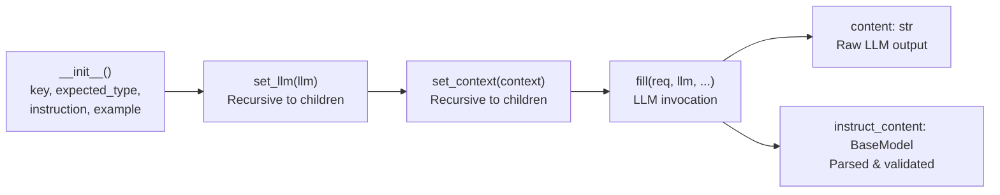
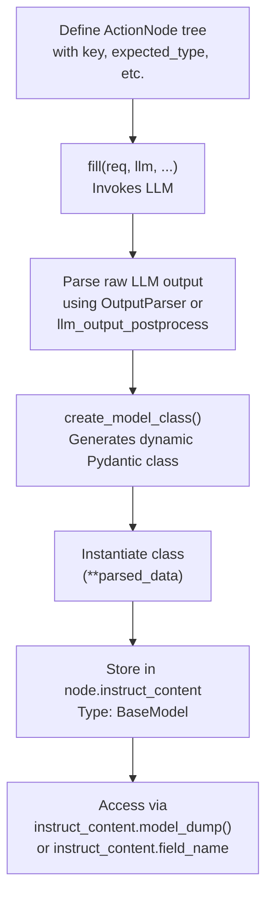

<!-- source: DeepWiki mcp.deepwiki.com · repo FoundationAgents/MetaGPT · page 7.1 ActionNode Core Architecture · fetched 2026-10-30 -->

# ActionNode Core Architecture

<details>
<summary>Relevant source files</summary>

The following files were used as context for generating this wiki page:

- [metagpt/actions/action_node.py](metagpt/actions/action_node.py)
- [metagpt/actions/design_api_an.py](metagpt/actions/design_api_an.py)
- [metagpt/actions/project_management_an.py](metagpt/actions/project_management_an.py)
- [metagpt/actions/write_prd_an.py](metagpt/actions/write_prd_an.py)
- [metagpt/utils/human_interaction.py](metagpt/utils/human_interaction.py)
- [tests/metagpt/actions/test_action_node.py](tests/metagpt/actions/test_action_node.py)
- [tests/metagpt/utils/test_human_interaction.py](tests/metagpt/utils/test_human_interaction.py)

</details>


## Purpose and Scope

This document describes the core structure of the `ActionNode` class [metagpt/actions/action_node.py:135-189](), MetaGPT's fundamental building block for structured LLM interactions. An `ActionNode` defines a single field in a structured output schema, with support for hierarchical composition via tree structures.

**Related Documentation:**
- For prompt generation and fill strategies: see page 7.2
- For dynamic Pydantic model creation and validation: see page 7.3
- For review and revision workflows: see page 7.4
- For pre-built domain-specific nodes (WRITE_PRD_NODE, DESIGN_API_NODE, PM_NODE): see page 7.5
- For data science task prompts: see page 7.6
- For Action system integration: see page 2.2

**Sources:** [metagpt/actions/action_node.py:135-189]()

## ActionNode Class Structure

The `ActionNode` class [metagpt/actions/action_node.py:135-189]() represents a node in a tree structure that maps to a single field in a structured output schema.

### Core Attributes

**Schema Definition Attributes:**

| Attribute | Type | Purpose | Example |
|-----------|------|---------|---------|
| `key` | `str` | Field name in output | `"Project Name"` |
| `expected_type` | `Type` | Python type for validation | `str`, `List[str]`, `Optional[BaseModel]` |
| `instruction` | `str` | Natural language guidance for LLM | `"Name the project using snake_case style"` |
| `example` | `Any` | In-context learning example | `"game_2048"` |
| `schema` | `str` | Output format override | `"json"`, `"markdown"`, `"raw"`, `""` (default) |

**Runtime State Attributes:**

| Attribute | Type | Purpose |
|-----------|------|---------|
| `content` | `str` | Raw LLM output text after `fill()` |
| `instruct_content` | `BaseModel` | Validated Pydantic model instance after parsing |
| `llm` | `BaseLLM` | LLM instance set via `set_llm()` |
| `context` | `str` | Context string set via `set_context()` |

**Tree Structure Attributes:**

| Attribute | Type | Purpose |
|-----------|------|---------|
| `children` | `dict[str, ActionNode]` | Child nodes indexed by key |
| `prevs` | `List[ActionNode]` | Previous nodes (for ActionGraph, not commonly used) |
| `nexts` | `List[ActionNode]` | Next nodes (for ActionGraph, not commonly used) |

**Sources:** [metagpt/actions/action_node.py:135-189]()

### Initialization Signature

```python
def __init__(
    self,
    key: str,
    expected_type: Type,
    instruction: str,
    example: Any,
    content: str = "",
    children: dict[str, "ActionNode"] = None,
    schema: str = "",
):
```

**Parameters:**
- `key`, `expected_type`, `instruction`, `example`: Required for schema definition
- `content`: Optional, populated after `fill()` execution
- `children`: Optional, defaults to empty dict `{}`
- `schema`: Optional, overrides default compilation schema

**Initialization Example:**
```python
# Leaf node
LANGUAGE = ActionNode(
    key="Language",
    expected_type=str,
    instruction="Provide the language used in the project",
    example="en_us"
)
```

**Sources:** [metagpt/actions/action_node.py:162-180](), [metagpt/actions/write_prd_an.py:12-17]()

### Node Attribute Flow

Title: ActionNode Attribute Lifecycle


**Sources:** [metagpt/actions/action_node.py:162-180](), [metagpt/actions/action_node.py:462-466](), [metagpt/actions/action_node.py:468-484]()

## Tree Structure and Hierarchical Composition

ActionNodes form tree structures where parent nodes aggregate multiple child nodes into a unified schema. This enables compositional definition of complex structured outputs.

### Tree Construction Methods

**add_child(node: ActionNode)**

Adds a single child node to the current node's `children` dict, indexed by the child's `key` [metagpt/actions/action_node.py:199-201]().

```python
parent = ActionNode("WritePRD", str, "", "")
parent.add_child(LANGUAGE)
parent.add_child(PROJECT_NAME)
# parent.children = {"Language": LANGUAGE, "Project Name": PROJECT_NAME}
```

**add_children(nodes: List[ActionNode])**

Batch adds multiple child nodes [metagpt/actions/action_node.py:206-209]().

```python
parent.add_children([LANGUAGE, PROJECT_NAME, PRODUCT_GOALS])
```

**from_children(key: str, nodes: List[ActionNode]) -> ActionNode**

Factory method that creates a parent node with pre-populated children [metagpt/actions/action_node.py:211-216]().

```python
WRITE_PRD_NODE = ActionNode.from_children("WritePRD", [
    LANGUAGE,
    PROGRAMMING_LANGUAGE,
    ORIGINAL_REQUIREMENTS,
    PROJECT_NAME,
    PRODUCT_GOALS,
    USER_STORIES,
    COMPETITIVE_ANALYSIS,
    COMPETITIVE_QUADRANT_CHART,
    REQUIREMENT_ANALYSIS,
    REQUIREMENT_POOL,
    UI_DESIGN_DRAFT,
    ANYTHING_UNCLEAR
])
```

This is the most common pattern for constructing ActionNode trees. The parent node's own attributes (`expected_type`, `instruction`, `example`) are typically set to placeholder values since the parent acts as a container [metagpt/actions/action_node.py:214]().

**get_child(key: str) -> ActionNode | None**

Retrieves a child node by its key [metagpt/actions/action_node.py:203-204]().

```python
language_node = WRITE_PRD_NODE.get_child("Language")
```

**Sources:** [metagpt/actions/action_node.py:199-216](), [metagpt/actions/write_prd_an.py:220-221]()

### Tree Structure Example

Title: WRITE_PRD_NODE Tree Structure

```mermaid
graph TB
    Root["WRITE_PRD_NODE<br/>key='WritePRD'<br/>from_children()"]
    Root --> Lang["LANGUAGE<br/>key='Language'<br/>expected_type=str<br/>example='en_us'"]
    Root --> ProgLang["PROGRAMMING_LANGUAGE<br/>key='Programming Language'<br/>expected_type=str"]
    Root --> OrigReq["ORIGINAL_REQUIREMENTS<br/>key='Original Requirements'<br/>expected_type=str"]
    Root --> ProjName["PROJECT_NAME<br/>key='Project Name'<br/>expected_type=str<br/>example='game_2048'"]
    Root --> Goals["PRODUCT_GOALS<br/>key='Product Goals'<br/>expected_type=List[str]"]
    Root --> Stories["USER_STORIES<br/>key='User Stories'<br/>expected_type=List[str]"]
    Root --> CompAnalysis["COMPETITIVE_ANALYSIS<br/>key='Competitive Analysis'<br/>expected_type=List[str]"]
    Root --> CompChart["COMPETITIVE_QUADRANT_CHART<br/>key='Competitive Quadrant Chart'<br/>expected_type=str"]
    Root --> ReqAnalysis["REQUIREMENT_ANALYSIS<br/>key='Requirement Analysis'<br/>expected_type=str"]
    Root --> ReqPool["REQUIREMENT_POOL<br/>key='Requirement Pool'<br/>expected_type=List[List[str]]"]
    Root --> UIDraft["UI_DESIGN_DRAFT<br/>key='UI Design draft'<br/>expected_type=str"]
    Root --> Unclear["ANYTHING_UNCLEAR<br/>key='Anything UNCLEAR'<br/>expected_type=str"]
```


**Sources:** [metagpt/actions/write_prd_an.py:12-221]()

### Nested Hierarchies

Child nodes can have their own children, enabling deeply nested schemas. Consider a Task node with a nested ToolDef:

```python
class ToolDef(BaseModel):
    tool_name: str = Field(default="a", description="tool name")
    description: str = Field(default="b", description="tool description")

class Task(BaseModel):
    task_id: int = Field(default=1, description="task id")
    name: str = Field(default="Get data from ...", description="task name")
    dependent_task_ids: List[int] = Field(default=[], description="dependent task ids")
    tool: ToolDef = Field(default=ToolDef(), description="tool use")

# Convert to ActionNode tree
task_node = ActionNode.from_pydantic(Task)
```

The resulting tree has `task_node` as root, with `tool` as a child that itself contains `tool_name` and `description` children. Methods like `_get_children_mapping()` [metagpt/actions/action_node.py:218-234]() recursively traverse this structure.

**Sources:** [tests/metagpt/actions/test_action_node.py:264-302](), [metagpt/actions/action_node.py:218-234]()

### Recursive Operations

Several methods operate recursively on the tree:

**set_recursive(name: str, value: Any)**

Sets an attribute on the current node and all descendants [metagpt/actions/action_node.py:457-460]().

```python
def set_recursive(self, name, value):
    setattr(self, name, value)
    for _, i in self.children.items():
        i.set_recursive(name, value)
```

**set_llm(llm: BaseLLM)** and **set_context(context: str)**

Convenience wrappers around `set_recursive()` [metagpt/actions/action_node.py:462-466]():

```python
node.set_llm(llm_instance)  # Propagates to all children
node.set_context("User requirements...")  # Propagates to all children
```

These ensure that when a parent node is filled, all children have access to the same LLM and context.

**Sources:** [metagpt/actions/action_node.py:457-466]()

## instruct_content and BaseModel

The `instruct_content` attribute stores the validated output after an ActionNode is filled. It is a Pydantic `BaseModel` instance dynamically created to match the ActionNode's schema.

### instruct_content Lifecycle

Title: instruct_content Creation and Usage


**Sources:** [metagpt/actions/action_node.py:428-452](), [metagpt/actions/action_node.py:468-484]()

### Dynamic Model Class Creation

The `create_model_class(class_name: str, mapping: Dict[str, Tuple[Type, Any]])` class method [metagpt/actions/action_node.py:246-282]() generates a Pydantic model at runtime:

```python
# Mapping from get_mapping()
mapping = {
    "Language": (str, Field(default="en_us", description="...")),
    "Project Name": (str, Field(default="game_2048", description="..."))
}

# Generate class
OutputClass = ActionNode.create_model_class("WritePRD_AN", mapping)

# Instantiate with parsed data
instruct_content = OutputClass(
    Language="en_us",
    **{"Project Name": "game_2048"}
)
```

The generated class includes validators for:
- **Missing required fields**: Raises `ValueError` [metagpt/actions/action_node.py:260-262]()
- **Unrecognized fields**: Logs warning [metagpt/actions/action_node.py:264-266]()

**Sources:** [metagpt/actions/action_node.py:246-282]()

### Accessing instruct_content

Once an ActionNode is filled, `instruct_content` provides type-safe access to the parsed output:

```python
# Fill the node
node = await WRITE_PRD_NODE.fill(req=requirements, llm=llm)

# Access as dict
data = node.instruct_content.model_dump()
project_name = data["Project Name"]  # "game_2048"
goals = data["Product Goals"]  # ["Create engaging UX", ...]

# Access as attributes (if keys are valid Python identifiers)
language = node.instruct_content.Language  # "en_us"

# Use get() helper
project_name = node.get("Project Name")  # Shorthand for instruct_content.model_dump()["Project Name"]
```

**get(key: str) Method** [metagpt/actions/action_node.py:454-455]():
```python
def get(self, key):
    return self.instruct_content.model_dump()[key]
```

**Sources:** [metagpt/actions/action_node.py:454-455]()

### update_instruct_content

The `update_instruct_content(incre_data: dict[str, Any])` method [metagpt/actions/action_node.py:332-337]() merges new data into the existing `instruct_content`:

```python
def update_instruct_content(self, incre_data: dict[str, Any]):
    assert self.instruct_content
    origin_sc_dict = self.instruct_content.model_dump()
    origin_sc_dict.update(incre_data)  # Merge
    output_class = self.create_class()
    self.instruct_content = output_class(**origin_sc_dict)  # Re-validate
```

This is used in the revision workflow (see page 7.4) to update specific fields while preserving others.

**Sources:** [metagpt/actions/action_node.py:332-337]()

### from_pydantic Conversion

The `from_pydantic(model: Type[BaseModel], key: str = None)` class method [metagpt/actions/action_node.py:840-867]() converts an existing Pydantic model into an ActionNode tree:

```python
class ToolDef(BaseModel):
    tool_name: str = Field(default="a", description="tool name")
    description: str = Field(default="b", description="tool description")

# Convert to ActionNode
tool_node = ActionNode.from_pydantic(ToolDef)
# tool_node has children: tool_name (ActionNode), description (ActionNode)
```

This enables reusing existing Pydantic models as ActionNode schemas. The method recursively handles nested BaseModel fields [metagpt/actions/action_node.py:859-861]().

**Sources:** [metagpt/actions/action_node.py:840-867](), [tests/metagpt/actions/test_action_node.py:280-302]()

## Mapping and Model Generation

ActionNodes define schemas declaratively via attributes. To validate LLM outputs, these schemas must be converted to executable Pydantic models. This section covers the mapping and model generation process, which bridges ActionNode definitions to runtime validation.

### get_mapping Method

The `get_mapping(mode: str = "auto", exclude: list = None)` method [metagpt/actions/action_node.py:240-244]() converts an ActionNode tree into a dictionary suitable for `create_model_class()`:

**Signature:**
```python
def get_mapping(self, mode="children", exclude=None) -> Dict[str, Tuple[Type, Any]]:
    """get key: type mapping under mode"""
    if mode == "children" or (mode == "auto" and self.children):
        return self._get_children_mapping(exclude=exclude)
    return {} if exclude and self.key in exclude else self._get_self_mapping()
```

**Mode Behavior:**
- `mode="children"`: Returns mapping of all child nodes (default for parent nodes)
- `mode="root"`: Returns mapping of current node only
- `mode="auto"`: Uses `"children"` if `self.children` exists, else `"root"`

**Mapping Format:**

For a node with children:
```python
{
    "Language": (str, Field(default="en_us", description="Provide the language...")),
    "Project Name": (str, Field(default="game_2048", description="Name using snake_case...")),
    "Product Goals": (List[str], Field(default=["Create engaging UX"], description="..."))
}
```

For a leaf node:
```python
{
    "Project Name": (str, ...)  # Ellipsis for required field
}
```

**Sources:** [metagpt/actions/action_node.py:240-244](), [metagpt/actions/action_node.py:218-244]()

### _get_children_mapping

The `_get_children_mapping(exclude=None)` method [metagpt/actions/action_node.py:218-234]() recursively traverses the tree:

```python
def _get_children_mapping(self, exclude=None) -> Dict[str, Any]:
    exclude = exclude or []
    
    def _get_mapping(node: "ActionNode") -> Dict[str, Any]:
        mapping = {}
        for key, child in node.children.items():
            if key in exclude:
                continue
            if child.children:  # Nested node
                mapping[key] = _get_mapping(child)  # Recursion
            else:  # Leaf node
                mapping[key] = (child.expected_type, Field(default=child.example, description=child.instruction))
        return mapping
    
    return _get_mapping(self)
```

This enables nested structures like:
```python
{
    "Task": {
        "task_id": (int, Field(default=1, description="...")),
        "tool": {
            "tool_name": (str, Field(default="a", description="...")),
            "description": (str, Field(default="b", description="..."))
        }
    }
}
```

**Sources:** [metagpt/actions/action_node.py:218-234]()

### create_model_class

The `create_model_class(class_name: str, mapping: Dict[str, Tuple[Type, Any]])` class method [metagpt/actions/action_node.py:246-282]() dynamically generates Pydantic model classes:

**Process:**

1. **Define validator** to check required/unrecognized fields [metagpt/actions/action_node.py:251-267]()
2. **Process mapping entries**:
   - For nested dicts: Recursively call `create_model_class()` [metagpt/actions/action_node.py:274-277]()
   - For tuples: Use as Pydantic field definition [metagpt/actions/action_node.py:279]()
3. **Call pydantic.create_model()** with validators and fields [metagpt/actions/action_node.py:281]()
4. **Register class** via `@register_action_outcls` decorator [metagpt/actions/action_node.py:247]()

**Validator Logic:**

```python
def check_fields(cls, values):
    all_fields = set(mapping.keys())
    required_fields = set()
    for k, v in mapping.items():
        type_v, field_info = v
        if ActionNode.is_optional_type(type_v):
            continue  # Skip Optional fields
        required_fields.add(k)
    
    missing_fields = required_fields - set(values.keys())
    if missing_fields:
        raise ValueError(f"Missing fields: {missing_fields}")
    
    unrecognized_fields = set(values.keys()) - all_fields
    if unrecognized_fields:
        logger.warning(f"Unrecognized fields: {unrecognized_fields}")
    return values
```

**is_optional_type Helper** [metagpt/actions/action_node.py:869-876]():

Detects `Optional[T]` (i.e., `Union[T, None]`):
```python
@staticmethod
def is_optional_type(tp) -> bool:
    if typing.get_origin(tp) is Union:
        args = typing.get_args(tp)
        non_none_types = [arg for arg in args if arg is not type(None)]
        return len(non_none_types) == 1 and len(args) == 2
    return False
```

**Sources:** [metagpt/actions/action_node.py:246-282](), [metagpt/actions/action_node.py:869-876]()

### create_class Wrapper

The `create_class(mode: str = "auto", class_name: str = None, exclude=None)` method [metagpt/actions/action_node.py:284-287]() combines mapping generation and class creation:

```python
def create_class(self, mode: str = "auto", class_name: str = None, exclude=None):
    class_name = class_name if class_name else f"{self.key}_AN"
    mapping = self.get_mapping(mode=mode, exclude=exclude)
    return self.create_model_class(class_name, mapping)
```

This is the typical entry point for generating a model class from an ActionNode.

**Sources:** [metagpt/actions/action_node.py:284-287]()

### to_dict and keys Methods

**to_dict(format_func=None, mode="auto", exclude=None) -> Dict** [metagpt/actions/action_node.py:295-330]():

Converts the ActionNode tree to a dictionary using a custom formatting function:

```python
# Default: extract instruction
node_dict = node.to_dict()  # {"Language": "Provide the language...", ...}

# Custom: extract expected_type
node_dict = node.to_dict(format_func=lambda n: n.expected_type)  # {"Language": str, ...}
```

**keys(mode: str = "auto") -> list** [metagpt/actions/action_node.py:339-349]():

Returns list of keys in the schema:

```python
keys = WRITE_PRD_NODE.keys()  # ["Language", "Project Name", "Product Goals", ...]
```

These methods support introspection and dynamic processing of ActionNode structures.

**Sources:** [metagpt/actions/action_node.py:295-349]()

## Basic Usage Pattern

This section demonstrates typical ActionNode usage in MetaGPT actions.

### Single Node Fill

For a simple leaf node:

```python
from metagpt.actions.action_node import ActionNode
from metagpt.llm import LLM

# Define node
invoice_node = ActionNode(
    key="invoice",
    expected_type=bool,
    instruction="if it's a invoice file, return True else False",
    example="False"
)

# Fill with context and LLM
llm = LLM()
result = await invoice_node.fill(
    req="Check if this is an invoice",
    llm=llm,
    images=[image_base64]  # Optional for vision models
)

# Access result
is_invoice = result.instruct_content.invoice  # bool
```

**Sources:** [tests/metagpt/actions/test_action_node.py:247-261]()

### Multi-Node Fill with Tree

For a structured output with multiple fields:

```python
from metagpt.actions.write_prd_an import WRITE_PRD_NODE

# WRITE_PRD_NODE already defined with 12 children

# Fill entire tree
prd_node = await WRITE_PRD_NODE.fill(
    req=user_requirements,
    llm=llm,
    schema="json",      # Output format
    mode="children",    # Fill all children
    strgy="simple"      # Single LLM call
)

# Access fields
prd_data = prd_node.instruct_content.model_dump()
project_name = prd_data["Project Name"]       # str
goals = prd_data["Product Goals"]             # List[str]
user_stories = prd_data["User Stories"]       # List[str]
req_pool = prd_data["Requirement Pool"]       # List[List[str]]
```

**Sources:** [metagpt/actions/write_prd_an.py:220-221]()

### Integration in Action Class

Typical usage within an `Action` subclass:

```python
from metagpt.actions import Action
from metagpt.actions.action_node import ActionNode
from metagpt.schema import Message

class MyAction(Action):
    async def run(self, context: str) -> Message:
        # Define or reuse ActionNode
        node = PREDEFINED_NODE  # e.g., WRITE_PRD_NODE
        
        # Fill with LLM (self.llm set via Action.__init__)
        filled_node = await node.fill(
            req=context,
            llm=self.llm,
            schema="json"
        )
        
        # Create message with structured content
        return Message(
            content=filled_node.content,  # Raw LLM output
            instruct_content=filled_node.instruct_content  # Validated BaseModel
        )
```

See page 2.2 for more on Action system integration.

**Sources:** [metagpt/actions/action_node.py:596-663]()

### Exclude Parameter

The `exclude` parameter [metagpt/actions/action_node.py:607]() omits specific fields from the schema:

```python
# Fill all fields except "Anything UNCLEAR"
node = await WRITE_PRD_NODE.fill(
    req=requirements,
    llm=llm,
    exclude=["Anything UNCLEAR"]
)
# "Anything UNCLEAR" will not be in instruct_content
```

This is useful when certain fields are optional or handled separately.

**Sources:** [metagpt/actions/action_node.py:607]()


## Summary

The ActionNode architecture provides a powerful abstraction for structured LLM outputs:

1. **Declarative Schema Definition**: Define expected outputs using `key`, `expected_type`, `instruction`, `example` tuples
2. **Hierarchical Composition**: Build complex schemas by nesting ActionNodes
3. **Dynamic Validation**: Generate Pydantic models at runtime to validate LLM responses
4. **Flexible Prompting**: Support JSON, Markdown, and raw output formats with customizable templates
5. **Multiple Fill Strategies**: Choose between simple (single call) or complex (per-node) filling
6. **Quality Assurance**: Built-in review and revision workflows with human-in-the-loop options
7. **Domain-Specific Libraries**: Pre-built nodes for PRD writing, system design, and project management
8. **Incremental Development**: REFINED variants enable evolution of existing projects

This system enables MetaGPT agents to reliably extract structured, type-safe data from LLMs while maintaining flexibility for different output formats and validation requirements.

**Sources:** [metagpt/actions/action_node.py:1-877]()

---

