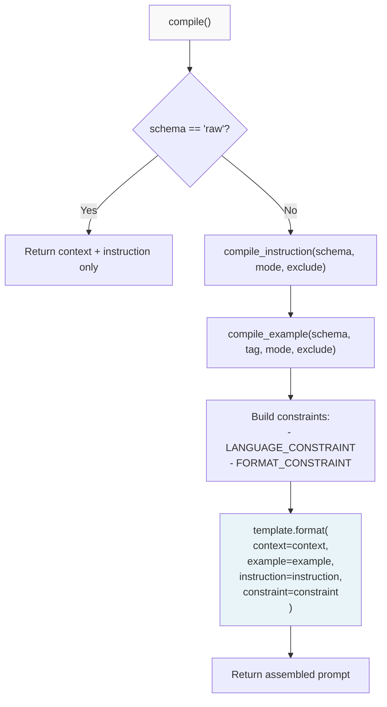
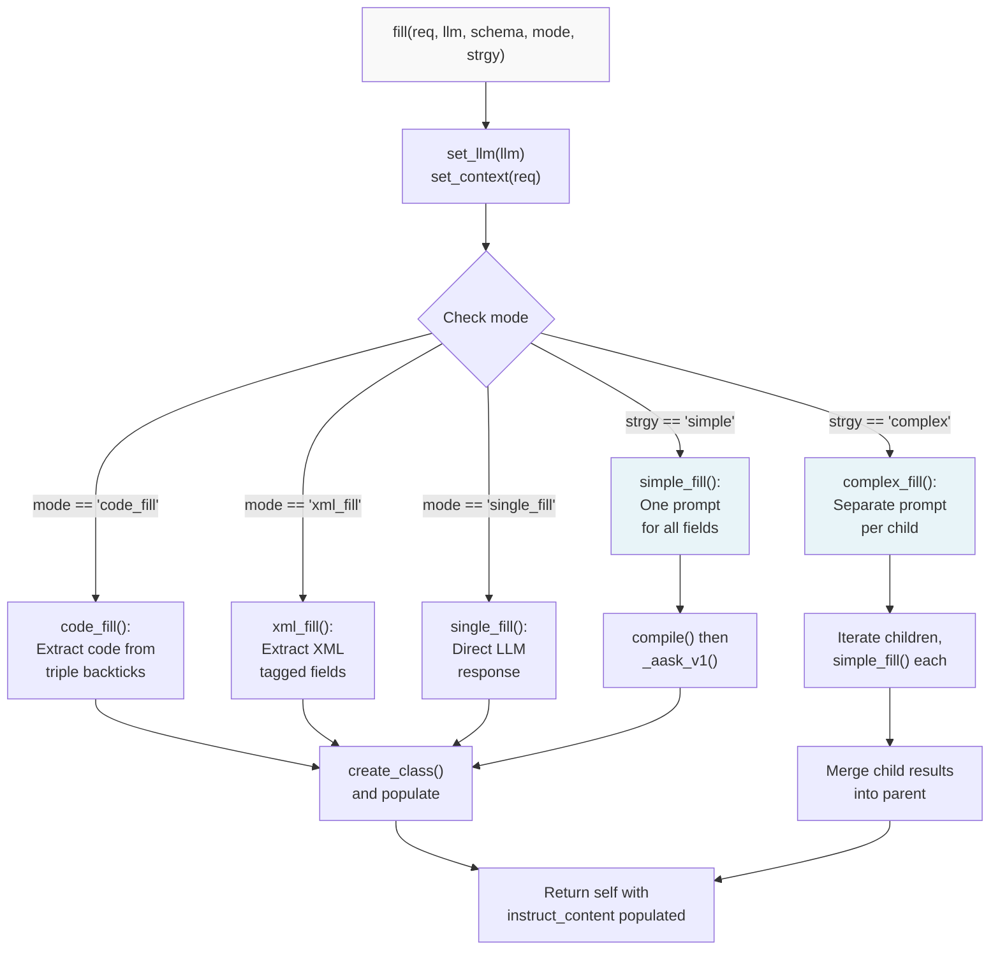
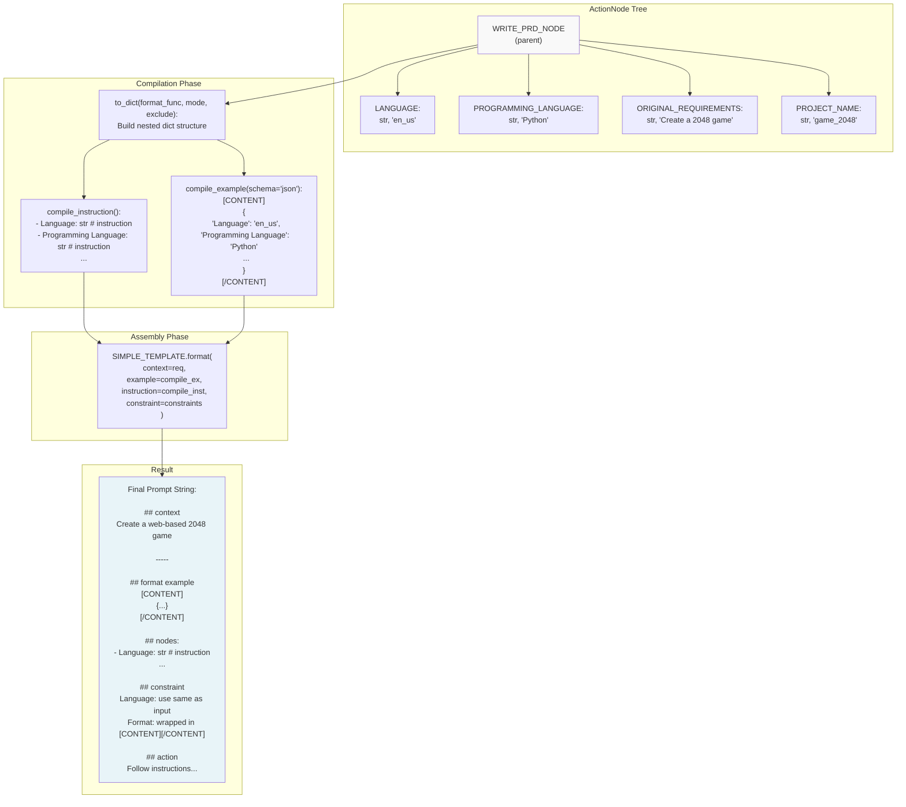
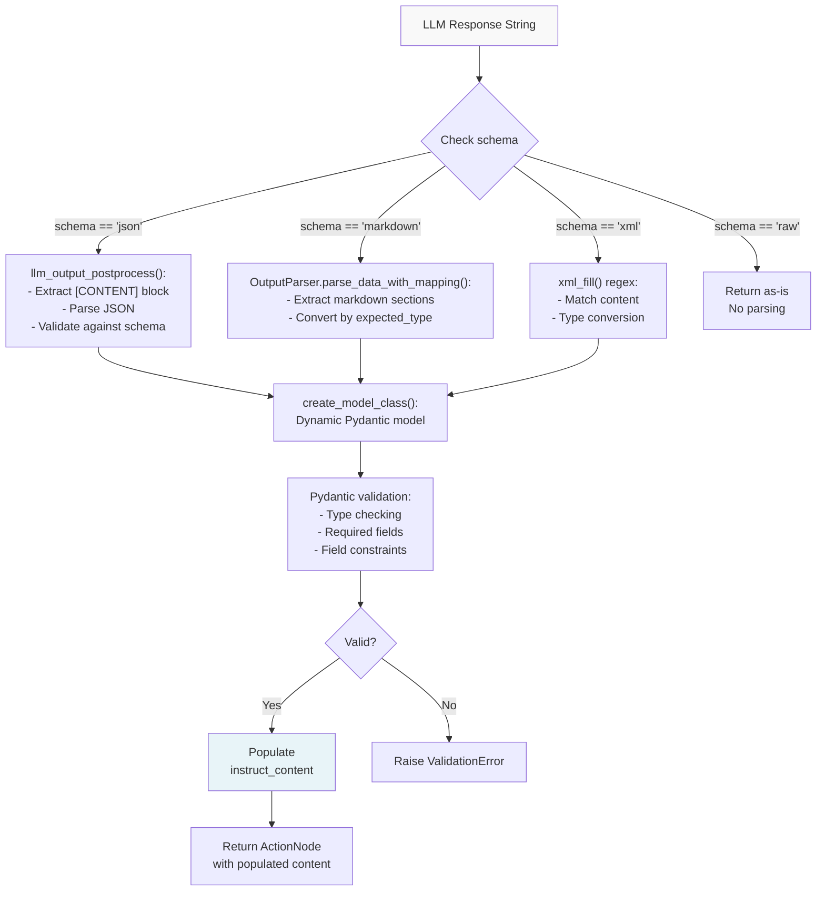

<!-- source: DeepWiki mcp.deepwiki.com · repo FoundationAgents/MetaGPT · page 7.2 Prompt Generation and Parsing · fetched 2026-10-30 -->

# Prompt Generation and Parsing

<details>
<summary>Relevant source files</summary>

The following files were used as context for generating this wiki page:

- [metagpt/actions/action_node.py](metagpt/actions/action_node.py)
- [metagpt/actions/design_api_an.py](metagpt/actions/design_api_an.py)
- [metagpt/actions/project_management_an.py](metagpt/actions/project_management_an.py)
- [metagpt/actions/write_prd_an.py](metagpt/actions/write_prd_an.py)
- [metagpt/utils/human_interaction.py](metagpt/utils/human_interaction.py)
- [tests/metagpt/actions/test_action_node.py](tests/metagpt/actions/test_action_node.py)
- [tests/metagpt/utils/test_human_interaction.py](tests/metagpt/utils/test_human_interaction.py)

</details>


## Purpose and Scope

This document explains how ActionNode structures are compiled into LLM prompts and how responses are parsed back into structured data. It covers the template system, schema formats, and fill strategies that enable MetaGPT to generate type-safe, structured outputs from language models.

For information about the ActionNode tree structure and dynamic validation, see [Dynamic Validation and Parsing](#7.3). For pre-defined domain nodes, see [Domain-Specific ActionNodes](#7.5). For the broader ActionNode architecture, see [ActionNode Core Architecture](#7.1).

---

## Template System

MetaGPT uses three primary prompt templates to structure different types of LLM interactions: generation, review, and revision.

### SIMPLE_TEMPLATE

The `SIMPLE_TEMPLATE` is used for initial content generation. It provides context, format examples, field instructions, and constraints to guide the LLM.

```markdown
## context
{context}

-----

## format example
{example}

## nodes: "<node>: <type>  # <instruction>"
{instruction}

## constraint
{constraint}

## action
Follow instructions of nodes, generate output and make sure it follows the format example.
```

Key sections:
- **context**: Domain-specific information provided by the caller
- **example**: Compiled example output showing desired format
- **instruction**: Field-by-field type and instruction metadata
- **constraint**: Language matching and format enforcement rules

Sources: [metagpt/actions/action_node.py:56-73]()

### REVIEW_TEMPLATE

The `REVIEW_TEMPLATE` validates generated content against requirements, producing comments for fields that need correction.

```markdown
## context
Compare the key's value of nodes_output and the corresponding requirements one by one. 
If a key's value that does not match the requirement is found, provide the comment content 
on how to modify it. No output is required for matching keys.

### nodes_output
{nodes_output}

-----

## format example
[{tag}]
{
    "key1": "comment1",
    "key2": "comment2"
}
[/{tag}]

## nodes: "<node>: <type>  # <instruction>"
- key1: <class 'str'> # the first key name of mismatch key
- key2: <class 'str'> # the second key name of mismatch key

## constraint
{constraint}

## action
Follow format example's {prompt_schema} format, generate output and make sure it follows the format example.
```

The template receives the generated `nodes_output` with both values and requirements, then produces a map of field names to review comments only for fields that need changes.

Sources: [metagpt/actions/action_node.py:75-103]()

### REVISE_TEMPLATE

The `REVISE_TEMPLATE` updates content based on review comments, regenerating only the fields that need correction.

```markdown
## context
change the nodes_output key's value to meet its comment and no need to add extra comment.

### nodes_output
{nodes_output}

-----

## format example
{example}

## nodes: "<node>: <type>  # <instruction>"
{instruction}

## constraint
{constraint}

## action
Follow format example's {prompt_schema} format, generate output and make sure it follows the format example.
```

This template receives the current values with review comments and produces corrected values for the problematic fields.

Sources: [metagpt/actions/action_node.py:105-125]()

---

## Compile Method Architecture

The `compile()` method orchestrates prompt generation by assembling context, instructions, examples, and constraints into a cohesive prompt according to the specified schema and mode.

### Method Signature

```python
def compile(self, context, schema="json", mode="children", 
            template=SIMPLE_TEMPLATE, exclude=[]) -> str
```

| Parameter | Values | Description |
|-----------|--------|-------------|
| `context` | str | Domain-specific context provided by the action |
| `schema` | raw/json/markdown | Output format for examples and parsing |
| `mode` | auto/children/root | Which nodes to include in compilation |
| `template` | Template str | Which template to use (SIMPLE/REVIEW/REVISE) |
| `exclude` | List[str] | Node keys to skip during compilation |

Sources: [metagpt/actions/action_node.py:382-421]()

### Compilation Flow



Sources: [metagpt/actions/action_node.py:382-421]()

### Helper Methods

The compilation process relies on several specialized helper methods:

#### compile_instruction()

Generates field metadata showing types and instructions:

```python
def compile_instruction(self, schema="markdown", mode="children", 
                       tag="", exclude=None) -> str
```

Output format (markdown schema):
```
- Language: <class 'str'>  # Provide the language used in the project
- Programming Language: <class 'str'>  # Mainstream programming language
- Original Requirements: <class 'str'>  # Place the original user's requirements here
```

Sources: [metagpt/actions/action_node.py:369-372]()

#### compile_example()

Generates example outputs showing expected structure:

```python
def compile_example(self, schema="json", mode="children", 
                   tag="", exclude=None) -> str
```

With `schema="json"`, wraps output in `[CONTENT][/CONTENT]` tags:
```json
[CONTENT]
{
    "Language": "en_us",
    "Programming Language": "Python",
    "Original Requirements": "Create a 2048 game"
}
[/CONTENT]
```

Sources: [metagpt/actions/action_node.py:374-380]()

#### compile_to()

Converts dictionary to the target schema format:

```python
def compile_to(self, i: Dict, schema, kv_sep) -> str
```

- **json**: `json.dumps(i, indent=4, ensure_ascii=False)`
- **markdown**: `dict_to_markdown(i, kv_sep=kv_sep)` 
- **raw**: `str(i)`

Sources: [metagpt/actions/action_node.py:351-357]()

#### tagging()

Wraps text in optional XML-style tags (typically `[CONTENT][/CONTENT]`):

```python
def tagging(self, text, schema, tag="") -> str
```

Sources: [metagpt/actions/action_node.py:359-362]()

---

## Schema Formats

ActionNode supports four schema formats that control both prompt structure and response parsing strategy.

### Schema Comparison Table

| Schema | Prompt Style | Example Format | Parsing Method | Use Case |
|--------|--------------|----------------|----------------|----------|
| `raw` | Context + instruction only | None | Plain text | Free-form responses without structure |
| `json` | Structured with JSON examples | Tagged JSON block | `llm_output_postprocess()` | Structured outputs with validation |
| `markdown` | Structured with markdown examples | Markdown sections | `OutputParser.parse_data_with_mapping()` | Code generation, documents |
| `xml` | Field-based XML tags | XML elements | Regex extraction | Simple single/multiple field extraction |

Sources: [metagpt/actions/action_node.py:382-421](), [metagpt/actions/action_node.py:428-452]()

### Raw Schema

The simplest format with no structure enforcement:

```python
if schema == "raw":
    return f"{context}\n\n## Actions\n{LANGUAGE_CONSTRAINT}\n{self.instruction}"
```

This returns just the context and instruction without examples or structured output requirements. The LLM response is returned as-is without parsing.

Sources: [metagpt/actions/action_node.py:393-394]()

### JSON Schema

Provides JSON examples and expects JSON-formatted responses wrapped in `[CONTENT][/CONTENT]` tags:

**Prompt includes:**
```json
## format example
[CONTENT]
{
    "Project Name": "game_2048",
    "Product Goals": ["Create an engaging user experience"],
    "User Stories": ["As a player, I want to choose difficulty levels"]
}
[/CONTENT]
```

**Parsing:** Uses `llm_output_postprocess()` which validates against the dynamically generated Pydantic schema and extracts content from the tagged block.

Sources: [metagpt/actions/action_node.py:443-446]()

### Markdown Schema

Uses markdown formatting for examples and parsing:

**Prompt includes:**
```markdown
## format example
[CONTENT]
# Project Name
game_2048

# Product Goals
["Create an engaging user experience"]

# User Stories
["As a player, I want to choose difficulty levels"]
[/CONTENT]
```

**Parsing:** Uses `OutputParser.parse_data_with_mapping()` which extracts sections by markdown headers and converts them according to expected types.

This format is particularly useful for code generation where markdown's triple-backtick code blocks provide natural delimiters.

Sources: [metagpt/actions/action_node.py:447-448]()

### XML Schema

Uses custom XML-like tags for field extraction:

**Prompt compiled by xml_compile():**
```xml
### Response format (must be strictly followed): 
All content must be enclosed in the given XML tags, 
ensuring each opening <tag> has a corresponding closing </tag>.

<field_name1>content</field_name1>
<field_name2>content</field_name2>
```

**Parsing:** Uses regex pattern matching to extract content between tags and converts according to field types (str, int, bool, list, dict).

Sources: [metagpt/actions/action_node.py:514-531](), [metagpt/actions/action_node.py:553-594]()

---

## Fill Strategies

The `fill()` method populates ActionNode content using different strategies optimized for various use cases. It serves as the main entry point for LLM interaction.

```python
@exp_cache(serializer=ActionNodeSerializer())
async def fill(self, *, req, llm, schema="json", mode="auto", 
               strgy="simple", images=None, timeout=USE_CONFIG_TIMEOUT,
               exclude=[], function_name=None):
```

Sources: [metagpt/actions/action_node.py:596-663]()

### Strategy Overview



Sources: [metagpt/actions/action_node.py:596-663]()

### Simple Fill Strategy

The `simple_fill()` strategy generates a single prompt for all fields and makes one LLM call:

**Process:**
1. Call `compile()` to build the prompt with all child fields
2. Call `_aask_v1()` with the prompt
3. Parse response according to schema
4. Populate `instruct_content` with structured result

**Best for:** Most use cases where fields are related and can be generated together.

**Example usage:**
```python
# From tests/metagpt/actions/test_action_node.py
node_a = ActionNode(key="reasoning", expected_type=str, 
                    instruction="reasoning step by step", example="")
node_b = ActionNode(key="answer", expected_type=str, 
                    instruction="the final answer", example="")
root = ActionNode.from_children(key="detail answer", nodes=[node_a, node_b])

# Single LLM call generates both reasoning and answer
answer = await root.fill(req="what's the answer to 123+456?", 
                        schema="json", strgy="simple", llm=LLM())
```

Sources: [metagpt/actions/action_node.py:468-484](), [tests/metagpt/actions/test_action_node.py:84-98]()

### Complex Fill Strategy

The `complex_fill()` strategy makes separate LLM calls for each child node:

**Process:**
1. Iterate over each child node
2. Call `simple_fill()` on each child individually
3. Merge results into parent's `instruct_content`

**Best for:** When fields require independent reasoning or when you want to isolate failures.

**Example usage:**
```python
# Each field gets its own LLM call
answer = await root.fill(req="what's the answer to 123+456?",
                        schema="json", strgy="complex", llm=LLM())
```

Sources: [metagpt/actions/action_node.py:653-663](), [tests/metagpt/actions/test_action_node.py:97-98]()

### Special Fill Modes

#### code_fill Mode

Optimized for extracting code blocks using the `sanitize()` utility:

```python
async def code_fill(self, context: str, function_name: Optional[str] = None, 
                   timeout: int = USE_CONFIG_TIMEOUT) -> Dict[str, str]:
    field_name = self.get_field_name()
    prompt = context
    content = await self.llm.aask(prompt, timeout=timeout)
    extracted_code = sanitize(code=content, entrypoint=function_name)
    result = {field_name: extracted_code}
    return result
```

The `sanitize()` function extracts code from markdown triple-backtick blocks and handles various formats.

Sources: [metagpt/actions/action_node.py:533-544]()

#### xml_fill Mode

Extracts fields using XML-style tags with type conversion:

```python
async def xml_fill(self, context: str, images=None) -> Dict[str, Any]:
    field_names = self.get_field_names()
    field_types = self.get_field_types()
    
    content = await self.llm.aask(context, images=images)
    
    extracted_data: Dict[str, Any] = {}
    for field_name in field_names:
        pattern = rf"<{field_name}>(.*?)</{field_name}>"
        match = re.search(pattern, content, re.DOTALL)
        if match:
            raw_value = match.group(1).strip()
            field_type = field_types.get(field_name)
            # Convert to appropriate type: str, int, bool, list, dict
            extracted_data[field_name] = convert(raw_value, field_type)
    
    return extracted_data
```

The method automatically converts string content to the expected field type (str, int, bool, list, dict) using type hints from the ActionNode definition.

Sources: [metagpt/actions/action_node.py:553-594]()

#### single_fill Mode

Direct LLM call without structured parsing:

```python
async def single_fill(self, context: str, images=None) -> Dict[str, str]:
    field_name = self.get_field_name()
    prompt = context
    content = await self.llm.aask(prompt, images=images)
    result = {field_name: content}
    return result
```

Returns the raw LLM response without any parsing or validation.

Sources: [metagpt/actions/action_node.py:546-551]()

---

## Prompt Generation Pipeline

The complete prompt generation process from ActionNode tree to executable LLM prompt.

### End-to-End Example

Using the `WRITE_PRD_NODE` from [metagpt/actions/write_prd_an.py:220]():



Sources: [metagpt/actions/action_node.py:295-330](), [metagpt/actions/action_node.py:382-421](), [metagpt/actions/write_prd_an.py:220]()

### Step-by-Step Breakdown

#### Step 1: Tree to Dictionary

The `to_dict()` method converts the ActionNode tree into a nested dictionary structure:

```python
def to_dict(self, format_func=None, mode="auto", exclude=None) -> Dict:
    # Recursively build dictionary with custom format function
    # Default format_func = lambda node: node.instruction
```

For `WRITE_PRD_NODE` with `mode="children"`, this produces:
```python
{
    "Language": "Provide the language used in the project...",
    "Programming Language": "Mainstream programming language...",
    "Original Requirements": "Place the original user's requirements here.",
    ...
}
```

Sources: [metagpt/actions/action_node.py:295-330]()

#### Step 2: Compile Instructions

The `compile_instruction()` method formats field metadata:

```python
format_func = lambda i: f"{i.expected_type}  # {i.instruction}"
return self._compile_f(schema, mode, tag, format_func, kv_sep=": ")
```

Produces markdown-formatted instructions:
```markdown
- Language: <class 'str'>  # Provide the language used in the project
- Programming Language: <class 'str'>  # Mainstream programming language
- Original Requirements: <class 'str'>  # Place the original user's requirements here
```

Sources: [metagpt/actions/action_node.py:369-372]()

#### Step 3: Compile Examples

The `compile_example()` method formats example values:

```python
format_func = lambda i: i.example
return self._compile_f(schema, mode, tag, format_func, kv_sep="\n")
```

For `schema="json"` with `tag="CONTENT"`:
```json
[CONTENT]
{
    "Language": "en_us",
    "Programming Language": "Vite, React, MUI, Tailwind CSS",
    "Original Requirements": "Create a 2048 game",
    "Project Name": "game_2048"
}
[/CONTENT]
```

Sources: [metagpt/actions/action_node.py:374-380]()

#### Step 4: Assemble Prompt

The `compile()` method combines all pieces using the template:

```python
constraints = [LANGUAGE_CONSTRAINT, FORMAT_CONSTRAINT]
constraint = "\n".join(constraints)

prompt = template.format(
    context=context,
    example=example,
    instruction=instruction,
    constraint=constraint,
)
```

Sources: [metagpt/actions/action_node.py:411-421]()

---

## Parsing Responses

After the LLM generates a response, it must be parsed and validated according to the ActionNode schema.

### Parsing Architecture



Sources: [metagpt/actions/action_node.py:428-452]()

### JSON Parsing with llm_output_postprocess()

For `schema="json"`, the `_aask_v1()` method uses `llm_output_postprocess()`:

```python
async def _aask_v1(self, prompt: str, output_class_name: str,
                  output_data_mapping: dict, images=None,
                  schema="markdown", timeout=USE_CONFIG_TIMEOUT):
    content = await self.llm.aask(prompt, system_msgs, images=images, timeout=timeout)
    logger.debug(f"llm raw output:\n{content}")
    
    output_class = self.create_model_class(output_class_name, output_data_mapping)
    
    if schema == "json":
        parsed_data = llm_output_postprocess(
            output=content, 
            schema=output_class.model_json_schema(), 
            req_key=f"[/{TAG}]"  # Look for [/CONTENT] tag
        )
    else:  # markdown
        parsed_data = OutputParser.parse_data_with_mapping(content, output_data_mapping)
    
    instruct_content = output_class(**parsed_data)
    return content, instruct_content
```

The `llm_output_postprocess()` function:
1. Extracts content between `[CONTENT]` and `[/CONTENT]` tags
2. Parses the JSON string
3. Validates against the Pydantic model schema
4. Returns a dictionary of parsed fields

Sources: [metagpt/actions/action_node.py:428-452]()

### Markdown Parsing with OutputParser

For `schema="markdown"`, the `OutputParser.parse_data_with_mapping()` method:

```python
parsed_data = OutputParser.parse_data_with_mapping(content, output_data_mapping)
```

This parser:
1. Identifies markdown headers corresponding to field names
2. Extracts content under each header
3. Converts the content according to the expected type from `output_data_mapping`
4. Returns a dictionary ready for Pydantic model instantiation

Sources: [metagpt/actions/action_node.py:448]()

### Dynamic Pydantic Model Creation

All parsing paths converge on creating a Pydantic model for validation:

```python
output_class = self.create_model_class(output_class_name, output_data_mapping)
instruct_content = output_class(**parsed_data)
```

The `create_model_class()` method:
1. Takes a mapping of `{field_name: (type, field_info)}`
2. Dynamically generates a Pydantic model class using `create_model()`
3. Adds custom validators for checking missing/extra fields
4. Returns the model class

When instantiated with `**parsed_data`, Pydantic automatically:
- Type-checks each field
- Validates required fields are present
- Applies field constraints
- Raises `ValidationError` if validation fails

Sources: [metagpt/actions/action_node.py:246-282]()

### Validation and Error Handling

The dynamically created Pydantic models include a custom validator:

```python
def check_fields(cls, values):
    all_fields = set(mapping.keys())
    required_fields = set()
    for k, v in mapping.items():
        type_v, field_info = v
        if ActionNode.is_optional_type(type_v):
            continue
        required_fields.add(k)
    
    missing_fields = required_fields - set(values.keys())
    if missing_fields:
        raise ValueError(f"Missing fields: {missing_fields}")
    
    unrecognized_fields = set(values.keys()) - all_fields
    if unrecognized_fields:
        logger.warning(f"Unrecognized fields: {unrecognized_fields}")
    return values
```

This validator:
- Identifies which fields are required (non-Optional types)
- Raises an error if required fields are missing
- Warns about unrecognized fields but allows them
- Ensures output matches the expected structure

Sources: [metagpt/actions/action_node.py:251-267]()

---

## Integration Example

A complete example showing prompt generation and parsing for PRD writing:

```python
# Define ActionNode structure
from metagpt.actions.write_prd_an import WRITE_PRD_NODE

# Initialize with context
llm = LLM()
context = "Create a web-based 2048 game with score tracking"

# Generate prompt and fill
node = await WRITE_PRD_NODE.fill(
    req=context,
    llm=llm,
    schema="json",      # Use JSON format
    mode="auto",        # Auto-select children mode
    strgy="simple"      # Single LLM call
)

# Access structured results
project_name = node.instruct_content.model_dump()["Project Name"]  # "game_2048"
product_goals = node.instruct_content.model_dump()["Product Goals"]  # List[str]
user_stories = node.instruct_content.model_dump()["User Stories"]   # List[str]
```

Behind the scenes:
1. `compile()` builds a prompt with 12 PRD fields (Language, Programming Language, etc.)
2. LLM generates JSON response wrapped in `[CONTENT]` tags
3. `llm_output_postprocess()` extracts and parses the JSON
4. Dynamic Pydantic model validates all 12 fields
5. `instruct_content` contains the validated, structured output

Sources: [metagpt/actions/write_prd_an.py:190-221](), [tests/metagpt/actions/test_action_node.py:60-82]()

---

