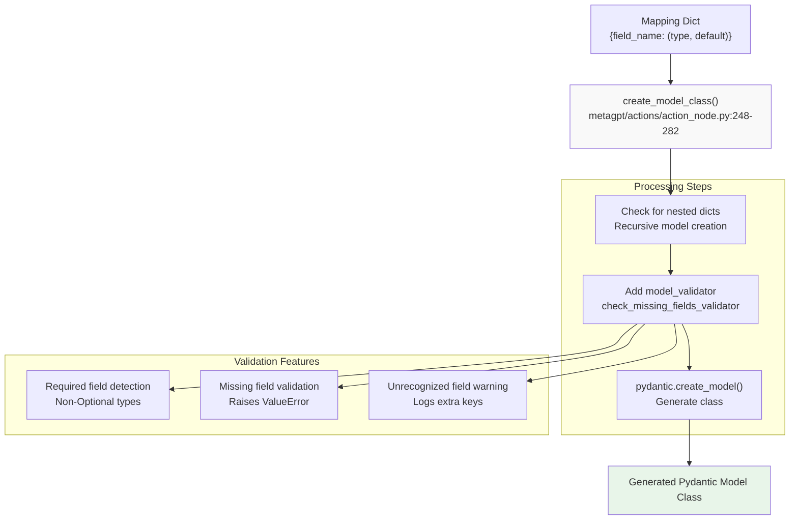
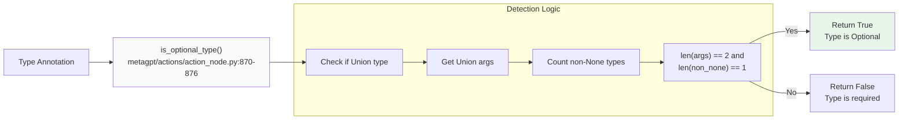
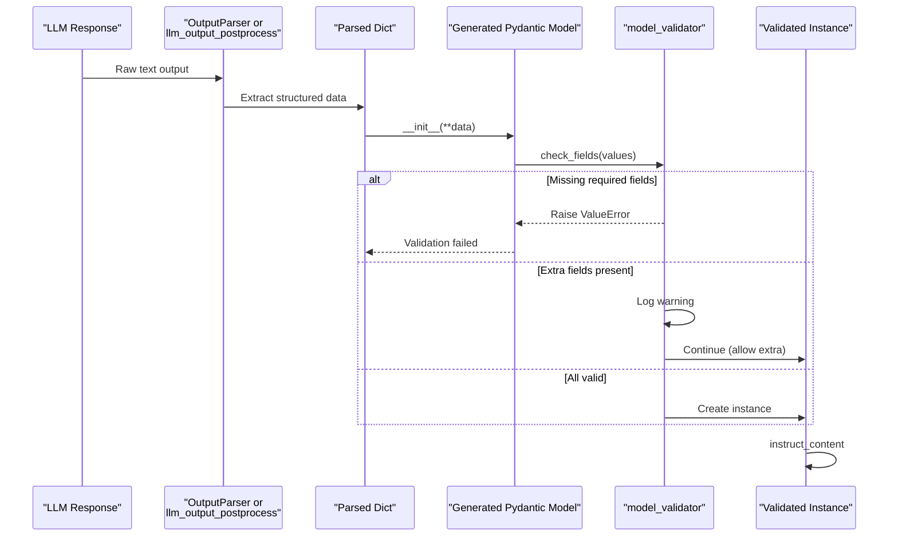
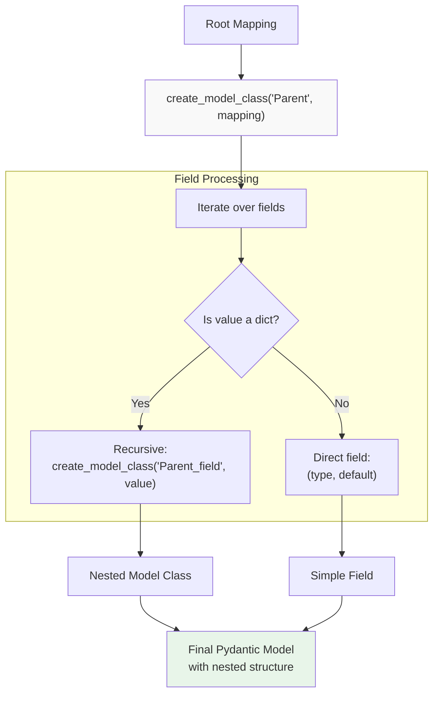
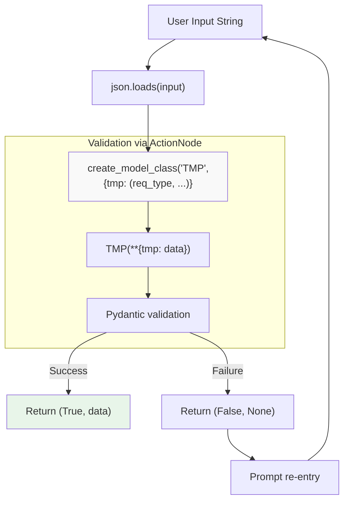
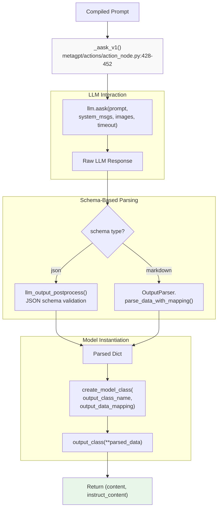
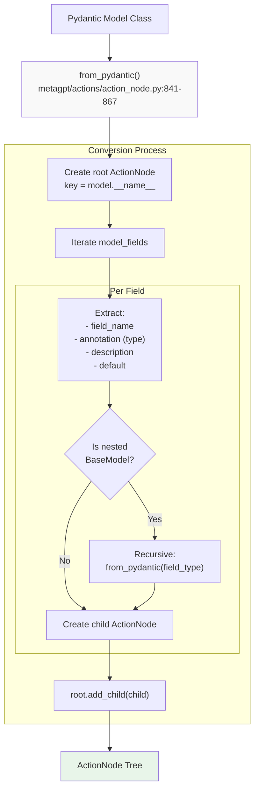

<!-- source: DeepWiki mcp.deepwiki.com · repo FoundationAgents/MetaGPT · page 7.3 Dynamic Validation and Parsing · fetched 2026-10-30 -->

# Dynamic Validation and Parsing

<details>
<summary>Relevant source files</summary>

The following files were used as context for generating this wiki page:

- [metagpt/actions/action_node.py](metagpt/actions/action_node.py)
- [metagpt/actions/design_api_an.py](metagpt/actions/design_api_an.py)
- [metagpt/actions/project_management_an.py](metagpt/actions/project_management_an.py)
- [metagpt/actions/write_prd_an.py](metagpt/actions/write_prd_an.py)
- [metagpt/utils/human_interaction.py](metagpt/utils/human_interaction.py)
- [tests/metagpt/actions/test_action_node.py](tests/metagpt/actions/test_action_node.py)
- [tests/metagpt/utils/test_human_interaction.py](tests/metagpt/utils/test_human_interaction.py)

</details>


## Purpose and Scope

This document covers the dynamic validation and parsing capabilities of the ActionNode system. These features enable runtime generation of Pydantic models for type-safe structured outputs from LLMs, automatic validation of LLM responses against expected schemas, and bidirectional conversion between ActionNode trees and Pydantic models.

For information about ActionNode's core architecture and tree structure, see [ActionNode Core Architecture](#7.1). For details on prompt generation and compilation strategies, see [Prompt Generation and Parsing](#7.2). For the review/revision workflow that builds on validation, see [Review and Revision System](#7.4).

---

## Dynamic Pydantic Model Generation

The ActionNode system generates Pydantic model classes at runtime to validate LLM outputs. This eliminates the need for manually defining model classes for every structured output format.

### The `create_model_class` Method

The `create_model_class` class method dynamically constructs Pydantic models from a mapping dictionary:



**Sources:** [metagpt/actions/action_node.py:246-282]()

The mapping format follows this pattern:
- **Key**: Field name (string)
- **Value**: Tuple of `(Type, default_value)` where default can be `...` (required), `None`, or a concrete value

For nested structures, the value can be another mapping dictionary, triggering recursive model creation.

### Field Validation Logic

The generated model includes a Pydantic `model_validator` that enforces three validation rules:

| Validation Type | Implementation | Behavior |
|----------------|----------------|----------|
| **Required Fields** | Detects non-Optional types | Raises `ValueError` if missing |
| **Missing Fields** | Compares `required_fields` vs `values.keys()` | Lists missing fields in error |
| **Unrecognized Fields** | Compares `values.keys()` vs `all_fields` | Logs warning, allows extra fields |

**Sources:** [metagpt/actions/action_node.py:251-267]()

### Example: Task Management Schema

From the test suite, here's how a complex nested schema is dynamically generated:

```python
# Mapping definition
WRITE_TASKS_OUTPUT_MAPPING = {
    "Required Python third-party packages": (str, ...),
    "Required Other language third-party packages": (str, ...),
    "Full API spec": (str, ...),
    "Logic Analysis": (List[Tuple[str, str]], ...),
    "Task list": (List[str], ...),
    "Shared Knowledge": (str, ...),
    "Anything UNCLEAR": (str, ...),
}

# Dynamic model creation
test_class = ActionNode.create_model_class("test_class", WRITE_TASKS_OUTPUT_MAPPING)
```

**Sources:** [tests/metagpt/actions/test_action_node.py:198-220]()

### Handling Optional Types

The system includes an `is_optional_type` utility to detect `Optional[T]` types:



**Sources:** [metagpt/actions/action_node.py:869-876]()

Optional fields are excluded from required field validation, allowing flexible schemas.

---

## Type Validation and Field Checking

### Runtime Type Validation

The dynamically generated Pydantic models perform runtime type validation when instantiated. The validation flow:



**Sources:** [metagpt/actions/action_node.py:251-267](), [metagpt/actions/action_node.py:428-452]()

### Nested Model Validation

For nested structures, `create_model_class` recursively generates child model classes:



**Sources:** [metagpt/actions/action_node.py:271-279]()

This enables validation of complex hierarchical data like the Task-ToolDef structure in the tests:

```python
class ToolDef(BaseModel):
    tool_name: str = Field(default="a", description="tool name")
    description: str = Field(default="b", description="tool description")

class Task(BaseModel):
    task_id: int = Field(default=1, description="task id")
    name: str = Field(default="Get data from ...", description="task name")
    dependent_task_ids: List[int] = Field(default=[], description="dependent task ids")
    tool: ToolDef = Field(default=ToolDef(), description="tool use")
```

**Sources:** [tests/metagpt/actions/test_action_node.py:264-274]()

### Human Interaction Validation

The `HumanInteraction` class uses `create_model_class` to validate user input during review/revise operations:



**Sources:** [metagpt/utils/human_interaction.py:29-47]()

---

## LLM Response Parsing with `_aask_v1`

The `_aask_v1` method orchestrates LLM interaction with automatic parsing and validation:

### Core Parsing Flow



**Sources:** [metagpt/actions/action_node.py:428-452]()

### JSON Schema Parsing

For JSON output, `llm_output_postprocess` performs extraction and validation:

**Key parameters:**
- `output`: Raw LLM response text
- `schema`: Pydantic model's `model_json_schema()`
- `req_key`: Tag to extract (e.g., `"[/CONTENT]"`)

```python
parsed_data = llm_output_postprocess(
    output=content, 
    schema=output_class.model_json_schema(), 
    req_key=f"[/{TAG}]"
)
```

**Sources:** [metagpt/actions/action_node.py:444-446](), [metagpt/provider/postprocess/llm_output_postprocess.py]()

### Markdown Parsing

For markdown output, `OutputParser.parse_data_with_mapping` extracts structured data:

```python
parsed_data = OutputParser.parse_data_with_mapping(content, output_data_mapping)
```

This uses the mapping dictionary to identify field locations in markdown-formatted output.

**Sources:** [metagpt/actions/action_node.py:448]()

### Retry Logic

`_aask_v1` includes automatic retry with exponential backoff:

```python
@retry(
    wait=wait_random_exponential(min=1, max=20),
    stop=stop_after_attempt(6),
    after=general_after_log(logger),
)
async def _aask_v1(self, prompt: str, ...):
```

**Sources:** [metagpt/actions/action_node.py:423-427]()

---

## Reverse Conversion: Pydantic to ActionNode

### The `from_pydantic` Class Method

The `from_pydantic` method converts existing Pydantic models into ActionNode trees:



**Sources:** [metagpt/actions/action_node.py:840-867]()

### Field Mapping

The conversion extracts Pydantic field metadata:

| Pydantic Field | ActionNode Property |
|---------------|---------------------|
| `field_name` | `key` |
| `field_info.annotation` | `expected_type` |
| `field_info.description` | `instruction` |
| `field_info.default` | `example` |

**Sources:** [metagpt/actions/action_node.py:854-863]()

### Example: Task Model Conversion

```python
class ToolDef(BaseModel):
    tool_name: str = Field(default="a", description="tool name", examples=[])
    description: str = Field(default="b", description="tool description", examples=[])

class Task(BaseModel):
    task_id: int = Field(default=1, description="task id", examples=[1, 2, 3])
    name: str = Field(default="Get data from ...", description="task name", examples=[])
    dependent_task_ids: List[int] = Field(default=[], description="dependent task ids", examples=[1, 2, 3])
    tool: ToolDef = Field(default=ToolDef(), description="tool use", examples=[])

# Convert to ActionNode
node = ActionNode.from_pydantic(Task)
```

This generates an ActionNode tree with:
- Root node: `key="Task"`
- Child nodes: `task_id`, `name`, `dependent_task_ids`, `tool`
- Nested ActionNode for `tool` with children `tool_name` and `description`

**Sources:** [tests/metagpt/actions/test_action_node.py:264-291]()

### Nested BaseModel Handling

The method checks if a field's type is a subclass of `BaseModel`:

```python
if not isinstance(field_type, typing._GenericAlias) and issubclass(field_type, BaseModel):
    child_node = cls.from_pydantic(field_type, key=field_name)
else:
    child_node = cls(key=field_name, expected_type=field_type, instruction=description, example=default)
```

**Sources:** [metagpt/actions/action_node.py:860-863]()

This enables full recursive conversion of complex Pydantic model hierarchies.

---

## Integration with Fill Strategies

### Simple Fill with Dynamic Validation

The `simple_fill` method uses `_aask_v1` for validation:

```mermaid
sequenceDiagram
    participant Fill as "simple_fill()"
    participant Compile as "compile()"
    participant Mapping as "get_mapping()"
    participant Ask as "_aask_v1()"
    participant Create as "create_model_class()"
    participant LLM as "llm.aask()"
    participant Validate as "Pydantic Validation"
    
    Fill->>Compile: Generate prompt
    Compile-->>Fill: prompt string
    Fill->>Mapping: Get field mapping
    Mapping-->>Fill: output_data_mapping
    
    Fill->>Ask: _aask_v1(prompt, class_name, mapping)
    Ask->>LLM: Send prompt
    LLM-->>Ask: Raw response
    Ask->>Create: create_model_class(class_name, mapping)
    Create-->>Ask: Pydantic model class
    Ask->>Validate: Parse and validate response
    
    alt Validation succeeds
        Validate-->>Ask: instruct_content instance
        Ask-->>Fill: (content, instruct_content)
        Fill->>Fill: Set self.content, self.instruct_content
    else Validation fails
        Validate-->>Ask: Retry (exponential backoff)
    end
```

**Sources:** [metagpt/actions/action_node.py:468-483]()

### Schema Format Impact

Different schema formats affect parsing:

| Schema | Validation Method | Use Case |
|--------|------------------|----------|
| `"json"` | `llm_output_postprocess` with JSON schema | Structured data extraction |
| `"markdown"` | `OutputParser.parse_data_with_mapping` | Human-readable formats |
| `"raw"` | No validation (direct LLM output) | Free-form text |

**Sources:** [metagpt/actions/action_node.py:443-448]()

### Alternative Fill Modes

Special fill modes bypass dynamic validation:

```python
if mode == FillMode.CODE_FILL.value:
    result = await self.code_fill(context, function_name, timeout)
    self.instruct_content = self.create_class()(**result)
    return self

elif mode == FillMode.XML_FILL.value:
    context = self.xml_compile(context=self.context)
    result = await self.xml_fill(context, images=images)
    self.instruct_content = self.create_class()(**result)
    return self

elif mode == FillMode.SINGLE_FILL.value:
    result = await self.single_fill(context, images=images)
    self.instruct_content = self.create_class()(**result)
    return self
```

**Sources:** [metagpt/actions/action_node.py:635-649]()

All modes still use `create_class()` to generate the validation model, but with different parsing strategies:
- **CODE_FILL**: Extracts code blocks with `sanitize()`
- **XML_FILL**: Parses XML tags with regex, converts types
- **SINGLE_FILL**: Direct field mapping

---

## Validation Error Handling

### Test Cases for Validation

The test suite demonstrates validation behavior:

```python
def test_create_model_class_with_fields_missing():
    test_class = ActionNode.create_model_class("test_class", WRITE_TASKS_OUTPUT_MAPPING)
    
    with pytest.raises(ValidationError):
        _ = test_class(**t_dict_min)  # Missing required fields
```

**Sources:** [tests/metagpt/actions/test_action_node.py:231-236]()

### Unrecognized Fields Handling

Extra fields trigger warnings but don't fail validation:

```python
def test_create_model_class_with_fields_unrecognized():
    test_class = ActionNode.create_model_class("test_class", WRITE_TASKS_OUTPUT_MAPPING_MISSING)
    
    _ = test_class(**t_dict)  # Extra fields present - just warning
```

**Sources:** [tests/metagpt/actions/test_action_node.py:224-228]()

### Field Accessor Methods

Validated content is accessed via:

```python
# Direct access
value = self.instruct_content.model_dump()[key]

# Helper method
value = self.get(key)
```

**Sources:** [metagpt/actions/action_node.py:454-455]()

---

## Summary

Dynamic validation and parsing in MetaGPT provides:

1. **Runtime Model Generation**: `create_model_class` eliminates manual Pydantic model definitions
2. **Type-Safe Validation**: Automatic required/optional field checking with meaningful errors
3. **Multi-Format Parsing**: JSON and Markdown parsing with schema enforcement
4. **Bidirectional Conversion**: `from_pydantic` enables existing model reuse
5. **Nested Structure Support**: Recursive validation for complex hierarchies
6. **Retry Resilience**: Exponential backoff for transient LLM failures

The system bridges the gap between unstructured LLM outputs and type-safe Python data structures, enabling reliable structured generation workflows throughout MetaGPT's multi-agent system.

**Primary Implementation:** [metagpt/actions/action_node.py:246-876]()

---

