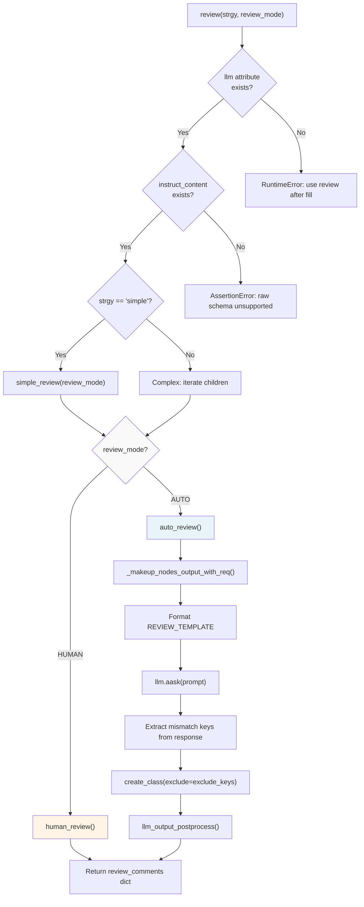
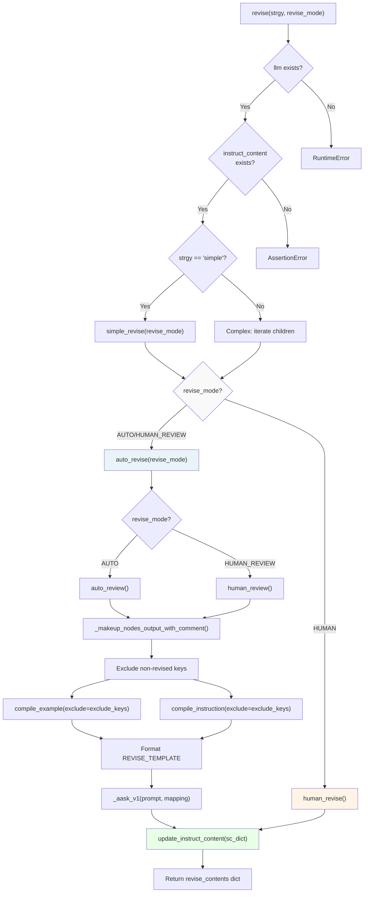
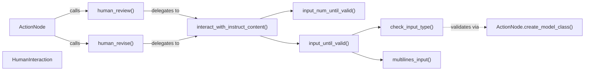

<!-- source: DeepWiki mcp.deepwiki.com · repo FoundationAgents/MetaGPT · page 7.4 Review and Revision System · fetched 2026-10-30 -->

# Review and Revision System

<details>
<summary>Relevant source files</summary>

The following files were used as context for generating this wiki page:

- [metagpt/actions/action_node.py](metagpt/actions/action_node.py)
- [metagpt/actions/design_api_an.py](metagpt/actions/design_api_an.py)
- [metagpt/actions/project_management_an.py](metagpt/actions/project_management_an.py)
- [metagpt/actions/write_prd_an.py](metagpt/actions/write_prd_an.py)
- [metagpt/utils/human_interaction.py](metagpt/utils/human_interaction.py)
- [tests/metagpt/actions/test_action_node.py](tests/metagpt/actions/test_action_node.py)
- [tests/metagpt/utils/test_human_interaction.py](tests/metagpt/utils/test_human_interaction.py)

</details>


## Purpose and Scope

The Review and Revision System provides automated and human-in-the-loop quality control for ActionNode outputs. After an ActionNode has been filled with LLM-generated content (see [Prompt Generation and Parsing](#7.2)), this system enables validation and correction through two complementary operations:

- **Review**: Evaluates existing content against requirements and generates structured feedback
- **Revise**: Modifies content based on review comments to meet requirements

For information about the core ActionNode architecture and fill operations, see [ActionNode Core Architecture](#7.1). For details on dynamic validation during initial content generation, see [Dynamic Validation and Parsing](#7.3).

Sources: [metagpt/actions/action_node.py:32-41](), [metagpt/actions/action_node.py:665-838]()

---

## Review and Revision Modes

The system defines explicit mode enumerations that control automation level:

### ReviewMode

```python
class ReviewMode(Enum):
    HUMAN = "human"  # Human provides review comments
    AUTO = "auto"    # LLM generates review comments
```

**ReviewMode.HUMAN**: Human reviewer inspects `instruct_content` and provides natural language feedback for each problematic field.

**ReviewMode.AUTO**: LLM compares each field's value against its instruction requirements using `REVIEW_TEMPLATE` and generates comments only for mismatched keys.

Sources: [metagpt/actions/action_node.py:32-34]()

### ReviseMode

```python
class ReviseMode(Enum):
    HUMAN = "human"              # Human directly revises content
    HUMAN_REVIEW = "human_review"  # Human reviews, LLM revises
    AUTO = "auto"                # LLM reviews and revises
```

**ReviseMode.HUMAN**: Human directly edits field values, bypassing automated review entirely.

**ReviseMode.HUMAN_REVIEW**: Human provides review comments (like `ReviewMode.HUMAN`), then LLM revises content based on those comments.

**ReviseMode.AUTO**: Fully automated - LLM generates review comments via `auto_review()`, then revises content accordingly.

Sources: [metagpt/actions/action_node.py:37-40]()

---

## Review System Architecture

### Review Flow



**Diagram: Review System Control Flow**

Sources: [metagpt/actions/action_node.py:729-750](), [metagpt/actions/action_node.py:680-716]()

### Simple vs Complex Review Strategies

| Strategy | Behavior | Use Case |
|----------|----------|----------|
| `simple` | Reviews parent node once, comparing all children fields together | Default for most scenarios; efficient single-pass validation |
| `complex` | Iterates through children, calling `simple_review()` on each child independently | When children have distinct validation contexts or need isolated feedback |

Both strategies produce a `dict[str, str]` mapping field keys to review comments.

Sources: [metagpt/actions/action_node.py:729-749]()

### Auto-Review Implementation

The `auto_review()` method performs LLM-based validation:

1. **Makeup Nodes Output** ([lines 672-678]()): Creates a dictionary pairing each field's current value with its requirement (instruction):
   ```python
   nodes_output = {
       "key": {"value": "actual_output", "requirement": "key instruction"}
   }
   ```

2. **Template Formatting** ([lines 691-696]()): Populates `REVIEW_TEMPLATE` with `nodes_output` and constraints.

3. **LLM Review** ([line 698]()): Sends formatted prompt to LLM requesting identification of mismatched fields.

4. **Dynamic Parsing** ([lines 701-716]()): 
   - Detects which keys appear in the LLM response
   - Creates a dynamic Pydantic model excluding matched (correct) fields
   - Parses response into structured review comments using `llm_output_postprocess()`

Returns only fields that need revision, making subsequent revise operations efficient.

Sources: [metagpt/actions/action_node.py:680-716]()

### REVIEW_TEMPLATE Structure

```python
REVIEW_TEMPLATE = """
## context
Compare the key's value of nodes_output and the corresponding requirements one by one. 
If a key's value that does not match the requirement is found, provide the comment content on how to modify it. 
No output is required for matching keys.

### nodes_output
{nodes_output}

-----

## format example
[CONTENT]
{
    "key1": "comment1",
    "key2": "comment2"
}
[/CONTENT]

## nodes: "<node>: <type>  # <instruction>"
- key1: <class 'str'> # the first key name of mismatch key
- key2: <class 'str'> # the second key name of mismatch key

## constraint
{constraint}

## action
Follow format example's {prompt_schema} format, generate output and make sure it follows the format example.
"""
```

The template instructs the LLM to output only mismatched keys with modification guidance, reducing token usage and focusing revision efforts.

Sources: [metagpt/actions/action_node.py:75-103]()

---

## Revision System Architecture

### Revision Flow



**Diagram: Revision System Control Flow with Update Integration**

Sources: [metagpt/actions/action_node.py:816-838](), [metagpt/actions/action_node.py:768-806]()

### Auto-Revise Two-Step Process

The `auto_revise()` method implements targeted content correction:

**Step 1: Generate Review Comments** ([lines 772-777]())
- `ReviseMode.AUTO`: Calls `auto_review()` for LLM-generated comments
- `ReviseMode.HUMAN_REVIEW`: Calls `human_review()` for human-provided comments
- Extracts `include_keys` (fields needing revision) and `exclude_keys` (correct fields)

**Step 2: Revise Structure** ([lines 780-801]())
- **Makeup Output** ([line 782]()): Creates `nodes_output` dict pairing values with review comments
- **Compile Partial Schema** ([lines 784-786]()): Generates example and instruction only for fields needing revision
- **Format Template** ([lines 788-794]()): Populates `REVISE_TEMPLATE` with partial schema
- **Structured Generation** ([lines 797-801]()): Uses `_aask_v1()` with partial mapping to regenerate only incorrect fields
- **Update Content** ([lines 804-805]()): Calls `update_instruct_content()` to merge revised fields back into `instruct_content`

This targeted approach minimizes LLM calls and preserves correct content.

Sources: [metagpt/actions/action_node.py:768-806]()

### REVISE_TEMPLATE Structure

```python
REVISE_TEMPLATE = """
## context
change the nodes_output key's value to meet its comment and no need to add extra comment.

### nodes_output
{nodes_output}

-----

## format example
{example}

## nodes: "<node>: <type>  # <instruction>"
{instruction}

## constraint
{constraint}

## action
Follow format example's {prompt_schema} format, generate output and make sure it follows the format example.
"""
```

The template only includes fields that need revision (via `exclude` parameter), making the revision prompt focused and efficient.

Sources: [metagpt/actions/action_node.py:105-125]()

---

## Human Interaction Integration

### HumanInteraction Class

The `HumanInteraction` class provides terminal-based interfaces for human reviewers/revisers:



**Diagram: Human Interaction Component Relationships**

Sources: [metagpt/utils/human_interaction.py:1-108](), [metagpt/actions/action_node.py:665-670](), [metagpt/actions/action_node.py:752-758]()

### Interactive Workflow

**Review Interaction** ([lines 97-105 in human_interaction.py]()):
1. Displays numbered field mapping to user
2. User selects field by number or quits with `q`/`quit`/`exit`
3. For review: User enters free-form comment string
4. Returns `dict[str, str]` mapping field keys to comments

**Revise Interaction** ([lines 97-105 in human_interaction.py]()):
1. Same field selection as review
2. For revise: User enters content matching field's `expected_type`
3. Type validation via `check_input_type()` using dynamic Pydantic model
4. Returns `dict[str, Any]` mapping field keys to typed revisions

The `multilines_input()` method ([lines 17-27]()) supports multi-line input via `Ctrl-D` (Unix) or `Ctrl-Z` (Windows).

Sources: [metagpt/utils/human_interaction.py:73-108]()

### Type Validation

Human-provided input undergoes strict type checking ([lines 29-47]()):

```python
def check_input_type(self, input_str: str, req_type: Type) -> Tuple[bool, Any]:
    if req_type == str:
        return True, input_str
    
    data = json.loads(input_str)  # Parse JSON
    
    # Create temporary Pydantic model to validate type
    tmp_cls = ActionNode.create_model_class("TMP", {"tmp": (req_type, ...)})
    tmp_cls(**{"tmp": data})  # Raises exception if invalid
    
    return True, data
```

This ensures human revisions conform to ActionNode field type constraints (e.g., `List[str]`, `Dict`, nested models).

Sources: [metagpt/utils/human_interaction.py:29-47]()

---

## Content Update Mechanism

### update_instruct_content Method

The `update_instruct_content()` method ([lines 332-337]()) merges revised fields into existing `instruct_content`:

```python
def update_instruct_content(self, incre_data: dict[str, Any]):
    assert self.instruct_content
    origin_sc_dict = self.instruct_content.model_dump()
    origin_sc_dict.update(incre_data)  # Merge new data
    output_class = self.create_class()
    self.instruct_content = output_class(**origin_sc_dict)  # Re-validate
```

**Key Properties:**
- **Partial Updates**: Only modifies fields present in `incre_data`, preserving all other fields
- **Type Safety**: Reconstructs Pydantic model to enforce validation
- **Immutability**: Creates new `instruct_content` instance rather than mutating in-place

This method is called by both `auto_revise()` and `human_revise()` to apply corrections.

Sources: [metagpt/actions/action_node.py:332-337]()

---

## Complete Review-Revise Patterns

### Pattern 1: Fully Automated Quality Control

```python
# After filling node
node = await node.fill(req=requirements, llm=llm)

# Auto-review to identify issues
review_comments = await node.review(review_mode=ReviewMode.AUTO)

if review_comments:
    # Auto-revise to fix issues
    await node.revise(revise_mode=ReviseMode.AUTO)
```

This pattern implements autonomous quality control with no human intervention.

Sources: [tests/metagpt/actions/test_action_node.py:102-138]()

### Pattern 2: Human Review with Auto-Correction

```python
node = await node.fill(req=requirements, llm=llm)

# Human provides expert review
review_comments = await node.review(review_mode=ReviewMode.HUMAN)

if review_comments:
    # LLM applies human feedback
    await node.revise(revise_mode=ReviseMode.HUMAN_REVIEW)
```

Combines human expertise with automated correction, useful when requirements are subjective.

Sources: [metagpt/actions/action_node.py:774-776]()

### Pattern 3: Full Human Control

```python
node = await node.fill(req=requirements, llm=llm)

# Human directly edits content
await node.revise(revise_mode=ReviseMode.HUMAN)
```

Maximum control for sensitive outputs or when LLM cannot meet requirements.

### Pattern 4: Complex Strategy for Independent Child Validation

```python
parent_node = ActionNode.from_children("ParentNode", [child1, child2, child3])
await parent_node.fill(req=requirements, llm=llm)

# Review each child independently
review_comments = await parent_node.review(strgy="complex", review_mode=ReviewMode.AUTO)

# Revise each child independently
await parent_node.revise(strgy="complex", revise_mode=ReviseMode.AUTO)
```

The complex strategy ensures each child node's validation context remains isolated, preventing cross-contamination of requirements.

Sources: [tests/metagpt/actions/test_action_node.py:122-137]()

---

## Usage in Standard Roles

The review and revision system integrates with domain-specific ActionNodes defined in role workflows:

### ProductManager PRD Validation

The `WRITE_PRD_NODE` ([write_prd_an.py:220]()) contains 12 fields like `PROJECT_NAME`, `PRODUCT_GOALS`, `REQUIREMENT_ANALYSIS`. After filling:

```python
# Example: Validate project name follows snake_case convention
await WRITE_PRD_NODE.review(review_mode=ReviewMode.AUTO)
# Auto-review catches "game 2048" should be "game_2048"

await WRITE_PRD_NODE.revise(revise_mode=ReviseMode.AUTO)
# Auto-revise corrects the format
```

Sources: [metagpt/actions/write_prd_an.py:190-223](), [tests/metagpt/actions/test_action_node.py:102-138]()

### Architect Design Validation

The `DESIGN_API_NODE` ([design_api_an.py:110]()) includes `FILE_LIST`, `DATA_STRUCTURES_AND_INTERFACES`, `PROGRAM_CALL_FLOW`. Review ensures:

- File paths are relative
- Mermaid syntax is valid
- API definitions are complete

Sources: [metagpt/actions/design_api_an.py:93-111]()

### ProjectManager Task Validation

The `PM_NODE` ([project_management_an.py:121]()) validates `LOGIC_ANALYSIS`, `TASK_LIST`, `SHARED_KNOWLEDGE` for:

- Dependency order correctness
- File list consistency with System Design
- Completeness of shared knowledge documentation

Sources: [metagpt/actions/project_management_an.py:101-122]()

---

## Error Handling and Constraints

### Precondition Checks

Both `review()` and `revise()` enforce preconditions ([lines 736-739, 823-826]()):

```python
if not hasattr(self, "llm"):
    raise RuntimeError("use `review` after `fill`")

assert self.instruct_content, 'review only support with `schema != "raw"`'
```

These ensure:
1. ActionNode has been filled (has LLM reference)
2. Structured content exists (not raw text mode)

### Mode Validation

Mode parameters are validated against enums:

```python
assert review_mode in ReviewMode
assert revise_mode in ReviseMode
```

Invalid modes raise `AssertionError` at runtime.

Sources: [metagpt/actions/action_node.py:738-739](), [metagpt/actions/action_node.py:825-826]()

### Empty Review Handling

When `auto_review()` finds no mismatches ([line 689]()), it returns an empty dict, allowing workflows to skip unnecessary revisions:

```python
if not review_comments:
    logger.warning("There are no review comments")
    return review_comments
```

Sources: [metagpt/actions/action_node.py:725-727]()

---

## Testing and Validation

### Test Coverage

The test suite demonstrates review/revise workflows:

**Review Test** ([test_action_node.py:102-138]()):
- Creates ActionNode with snake_case validation requirement
- Fills with correct content → review returns empty dict
- Sets incorrect value → review returns comments with field key
- Tests both simple and complex strategies

**Revise Test** ([test_action_node.py:141-176]()):
- Fills node, injects incorrect value "game snake"
- Calls revise with `ReviseMode.AUTO`
- Asserts corrected value contains "game_snake"
- Validates both simple and complex strategies

**Human Interaction Test** ([test_human_interaction.py:56-66]()):
- Mocks `input()` to simulate user interactions
- Tests review type (string comments) vs revise type (typed content)
- Validates multilines input and type checking

Sources: [tests/metagpt/actions/test_action_node.py:102-176](), [tests/metagpt/utils/test_human_interaction.py:56-66]()

---

## Summary Table: Review vs Revise

| Aspect | Review | Revise |
|--------|--------|--------|
| **Purpose** | Identify problematic fields | Correct problematic fields |
| **Output** | `dict[str, str]` (comments) | `dict[str, Any]` (corrected values) |
| **Modes** | HUMAN, AUTO | HUMAN, HUMAN_REVIEW, AUTO |
| **Template** | `REVIEW_TEMPLATE` | `REVISE_TEMPLATE` |
| **Side Effects** | None (read-only analysis) | Modifies `instruct_content` |
| **Strategies** | simple, complex | simple, complex |
| **LLM Calls** | 1 per review | 1-2 (review + revise) |
| **Human Method** | `human_review()` | `human_revise()` |
| **Auto Method** | `auto_review()` | `auto_revise()` |

Sources: [metagpt/actions/action_node.py:665-838]()

---

