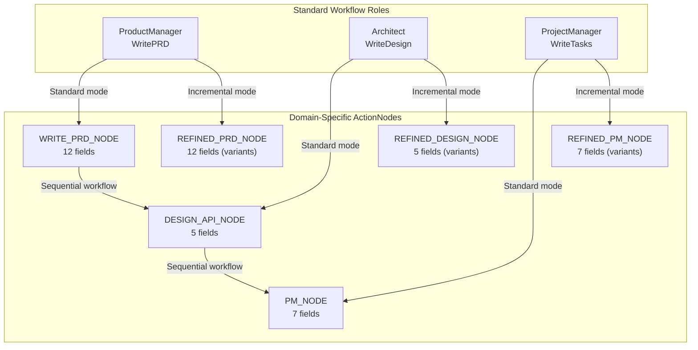
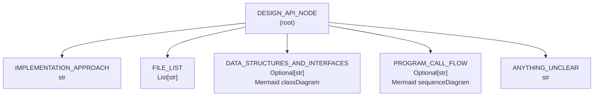
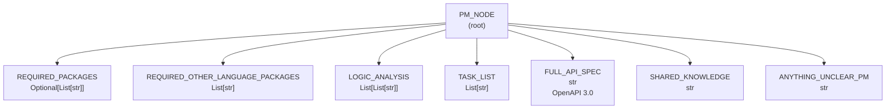
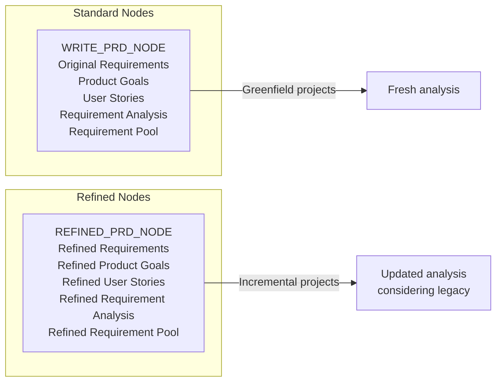
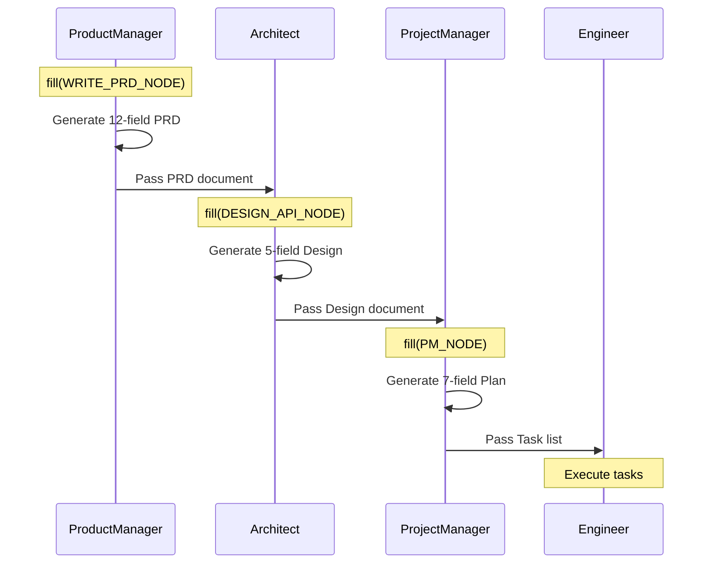
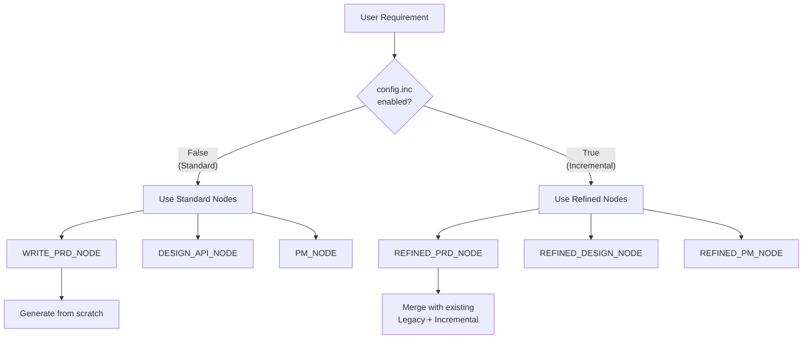

<!-- source: DeepWiki mcp.deepwiki.com · repo FoundationAgents/MetaGPT · page 7.5 Domain-Specific ActionNodes · fetched 2026-10-30 -->

# Domain-Specific ActionNodes

<details>
<summary>Relevant source files</summary>

The following files were used as context for generating this wiki page:

- [metagpt/actions/action_node.py](metagpt/actions/action_node.py)
- [metagpt/actions/design_api_an.py](metagpt/actions/design_api_an.py)
- [metagpt/actions/project_management_an.py](metagpt/actions/project_management_an.py)
- [metagpt/actions/write_prd_an.py](metagpt/actions/write_prd_an.py)
- [metagpt/utils/human_interaction.py](metagpt/utils/human_interaction.py)
- [tests/metagpt/actions/test_action_node.py](tests/metagpt/actions/test_action_node.py)
- [tests/metagpt/utils/test_human_interaction.py](tests/metagpt/utils/test_human_interaction.py)

</details>


## Purpose and Scope

This document details the pre-defined ActionNode trees used by standard workflow roles in MetaGPT's software development pipeline. These domain-specific structures standardize the output format for Product Requirements Documents (PRD), System Design specifications, and Project Management plans.

For information about the core ActionNode architecture and mechanics, see [ActionNode Core Architecture](#7.1). For prompt generation and fill strategies, see [Prompt Generation and Parsing](#7.2). For specialized data science prompts, see [Task Type Prompts](#7.6).

## Overview of Domain-Specific ActionNodes

Domain-specific ActionNodes are pre-configured tree structures that define the exact output schema for key deliverables in the software development workflow. Each ActionNode tree corresponds to a specific role's primary output:

- **WRITE_PRD_NODE**: ProductManager's Product Requirements Document
- **DESIGN_API_NODE**: Architect's System Design specification
- **PM_NODE**: ProjectManager's Task breakdown and dependency analysis

These structures are instantiated using `ActionNode.from_children()` and consist of child nodes representing individual fields with defined types, instructions, and examples. Each domain-specific node also has a "refined" variant for incremental development scenarios.



**Domain-Specific ActionNode Workflow Integration**

Sources: [metagpt/actions/write_prd_an.py:1-224](), [metagpt/actions/design_api_an.py:1-112](), [metagpt/actions/project_management_an.py:1-123]()

## WRITE_PRD_NODE Structure

`WRITE_PRD_NODE` defines the Product Requirements Document structure used by the ProductManager role. It contains 12 child ActionNodes that capture all aspects of product planning, from requirements to UI design.

### Field Definitions

| Field Key | Type | Purpose | Example |
|-----------|------|---------|---------|
| Language | `str` | Project language matching user requirements | "en_us" |
| Programming Language | `str` | Technology stack specification | "Vite, React, MUI, Tailwind CSS" |
| Original Requirements | `str` | Raw user requirements | "Create a 2048 game" |
| Project Name | `str` | Snake case project identifier | "game_2048" |
| Product Goals | `List[str]` | Up to 3 clear, orthogonal goals | ["Create engaging UX", "Improve accessibility"] |
| User Stories | `List[str]` | 3-5 scenario-based stories | ["As a player, I want to choose difficulty levels"] |
| Competitive Analysis | `List[str]` | 5-7 competitive product analyses | ["2048 Game A: Simple interface, lacks responsive"] |
| Competitive Quadrant Chart | `str` | Mermaid quadrantChart syntax | "quadrantChart\n title \"Reach and engagement\"..." |
| Requirement Analysis | `str` | Detailed requirements analysis | "The system requires..." |
| Requirement Pool | `List[List[str]]` | Top-5 prioritized requirements | [["P0", "Main code..."], ["P1", "..."]] |
| UI Design draft | `str` | UI elements, style, layout description | "Basic function with simple layout" |
| Anything UNCLEAR | `str` | Unclear aspects needing clarification | "All aspects clear" |

### Tree Structure



```mermaid
graph TB
    WRITE_PRD["WRITE_PRD_NODE<br/>(root)"]
    
    WRITE_PRD --> LANG["LANGUAGE<br/>str"]
    WRITE_PRD --> PROG_LANG["PROGRAMMING_LANGUAGE<br/>str"]
    WRITE_PRD --> ORIG_REQ["ORIGINAL_REQUIREMENTS<br/>str"]
    WRITE_PRD --> PROJ_NAME["PROJECT_NAME<br/>str"]
    WRITE_PRD --> GOALS["PRODUCT_GOALS<br/>List[str]"]
    WRITE_PRD --> STORIES["USER_STORIES<br/>List[str]"]
    WRITE_PRD --> COMP["COMPETITIVE_ANALYSIS<br/>List[str]"]
    WRITE_PRD --> QUAD["COMPETITIVE_QUADRANT_CHART<br/>str"]
    WRITE_PRD --> REQ_ANAL["REQUIREMENT_ANALYSIS<br/>str"]
    WRITE_PRD --> REQ_POOL["REQUIREMENT_POOL<br/>List[List[str]]"]
    WRITE_PRD --> UI["UI_DESIGN_DRAFT<br/>str"]
    WRITE_PRD --> UNCLEAR["ANYTHING_UNCLEAR<br/>str"]
```

**WRITE_PRD_NODE Field Hierarchy**

### Construction Pattern

```python
# Define individual field nodes
LANGUAGE = ActionNode(
    key="Language",
    expected_type=str,
    instruction="Provide the language used in the project...",
    example="en_us",
)

# Aggregate into tree structure
NODES = [LANGUAGE, PROGRAMMING_LANGUAGE, ..., ANYTHING_UNCLEAR]
WRITE_PRD_NODE = ActionNode.from_children("WritePRD", NODES)
```

The node is constructed at [metagpt/actions/write_prd_an.py:220]() by aggregating 12 individual ActionNode instances defined from lines 12-203.

Sources: [metagpt/actions/write_prd_an.py:12-220]()

## DESIGN_API_NODE Structure

`DESIGN_API_NODE` defines the System Design specification structure used by the Architect role. It contains 5 child ActionNodes covering implementation approach, file structure, data models, and program flow.

### Field Definitions

| Field Key | Type | Purpose | Example |
|-----------|------|---------|---------|
| Implementation approach | `str` | Framework selection and difficult points analysis | "We will use Flask framework..." |
| File list | `List[str]` | Relative paths with correct entry file | ["main.py", "game.py", "utils.py"] |
| Data structures and interfaces | `Optional[str]` | Mermaid classDiagram with type annotations | "classDiagram\n class Game{\n +int score\n..." |
| Program call flow | `Optional[str]` | Mermaid sequenceDiagram for CRUD operations | "sequenceDiagram\n participant M as Main..." |
| Anything UNCLEAR | `str` | Unclear aspects needing clarification | "Clarification needed on third-party API..." |

### Special Instructions

**Data Structures Field**: Uses mermaid `classDiagram` syntax. Must include:
- Classes with `__init__` and other methods
- Type annotations on all methods/functions
- Clear relationship markers between classes
- PEP8 compliance for Python projects
- Comprehensive API design

**Program Call Flow Field**: Uses mermaid `sequenceDiagram` syntax. Must:
- Cover CRUD and initialization of each object
- Use classes and APIs defined in data structures accurately
- Have correct syntax with detailed coverage

### Tree Structure



**DESIGN_API_NODE Field Hierarchy**

### Construction Pattern

The node is constructed at [metagpt/actions/design_api_an.py:110]() by aggregating 5 ActionNode instances. The `DATA_STRUCTURES_AND_INTERFACES` and `PROGRAM_CALL_FLOW` fields reference mermaid example constants `MMC1` and `MMC2` imported from `metagpt.utils.mermaid`.

Sources: [metagpt/actions/design_api_an.py:13-110]()

## PM_NODE Structure

`PM_NODE` defines the Project Management specification structure used by the ProjectManager role. It contains 7 child ActionNodes covering dependencies, task breakdown, API specifications, and shared knowledge.

### Field Definitions

| Field Key | Type | Purpose | Example |
|-----------|------|---------|---------|
| Required packages | `Optional[List[str]]` | Python package dependencies | ["flask==1.1.2", "bcrypt==3.2.0"] |
| Required Other language third-party packages | `List[str]` | Non-Python dependencies | ["No third-party dependencies required"] |
| Logic Analysis | `List[List[str]]` | File-by-file implementation plan with dependencies | [["game.py", "Contains Game class..."], ["main.py", "Contains main, from game import Game"]] |
| Task list | `List[str]` | Files prioritized by dependency order | ["game.py", "main.py"] |
| Full API spec | `str` | OpenAPI 3.0 specification | "openapi: 3.0.0\n..." |
| Shared Knowledge | `str` | Common utilities and configuration details | "'game.py' contains shared functions..." |
| Anything UNCLEAR | `str` | Unclear project management aspects | "Clarification on third-party library init..." |

### Special Instructions

**Logic Analysis Field**: Must ensure consistency with System Design file list. Each entry provides:
- File path (matching DESIGN_API_NODE's FILE_LIST)
- Classes/methods/functions to implement
- Dependency analysis
- Import statements

For Vue/React files, the instruction explicitly requires Tailwind CSS for styling.

**Task List Field**: Files must be ordered by dependency, with foundational modules first and dependent modules later.

### Tree Structure



**PM_NODE Field Hierarchy**

### Construction Pattern

The node is constructed at [metagpt/actions/project_management_an.py:121]() by aggregating 7 ActionNode instances defined from lines 12-109.

Sources: [metagpt/actions/project_management_an.py:12-122]()

## Refined Variants for Incremental Development

Each domain-specific node has a "refined" variant designed for incremental development scenarios where existing code is being extended or modified. These variants use alternative field instructions that account for legacy content.

### Key Differences in Refined Nodes



**Comparison: Standard vs Refined Nodes**

### REFINED_PRD_NODE

Replaces 5 of the 12 original fields with "refined" versions:

| Original Field | Refined Replacement | Key Instruction Difference |
|----------------|---------------------|----------------------------|
| Original Requirements | **Refined Requirements** | "Place the **New** user's original requirements here" |
| Product Goals | **Refined Product Goals** | "Update and expand the original product goals to reflect **evolving needs due to incremental development**" |
| User Stories | **Refined User Stories** | "Update and expand... to reflect **evolving needs due to incremental development**. Capture **incremental features and improvements**" |
| Requirement Analysis | **Refined Requirement Analysis** | "Review and refine... to align with **evolving needs**. Comprehensively covers **new features and enhancements**" (returns `Union[List[str], str]`) |
| Requirement Pool | **Refined Requirement Pool** | "List top 5 to 7 requirements. **Cover both legacy content and incremental content. Retain content unrelated to incremental development**" |

Constructed at [metagpt/actions/write_prd_an.py:221]() using `REFINED_NODES` list.

### REFINED_DESIGN_NODE

Replaces 4 of the 5 original fields:

| Original Field | Refined Replacement | Key Instruction Difference |
|----------------|---------------------|----------------------------|
| Implementation approach | **Refined Implementation Approach** | "Update and extend... to reflect **evolving challenges and requirements due to incremental development**" |
| File list | **Refined File list** | "Update and expand... **Up to 2 files can be added**. Reflects **evolving structure**" |
| Data structures and interfaces | **Refined Data structures and interfaces** | "Update and extend existing mermaid classDiagram... **Retain content not related to incremental development but important for consistency**" |
| Program call flow | **Refined Program call flow** | "Extend existing sequenceDiagram... **Retain content not related to incremental development but important for consistency**" |

Constructed at [metagpt/actions/design_api_an.py:111]() using `REFINED_NODES` list.

### REFINED_PM_NODE

Replaces 3 of the 7 original fields:

| Original Field | Refined Replacement | Key Instruction Difference |
|----------------|---------------------|----------------------------|
| Logic Analysis | **Refined Logic Analysis** | "Review and refine by **merging Legacy Content and Incremental Content**. Include dependency analysis, **potential impacts on existing code**" |
| Task list | **Refined Task list** | "Review and refine combined task list after **merger of Legacy and Incremental Content, consistent with Refined File List**" |
| Shared Knowledge | **Refined Shared Knowledge** | "Update and expand shared knowledge to reflect **new elements introduced**. **Retain content not related to incremental development**" |

Constructed at [metagpt/actions/project_management_an.py:122]() using `REFINED_NODES` list.

Sources: [metagpt/actions/write_prd_an.py:55-221](), [metagpt/actions/design_api_an.py:20-111](), [metagpt/actions/project_management_an.py:39-122]()

## Additional Supporting Nodes

Several smaller ActionNode structures support specific decision-making tasks:

### WP_ISSUE_TYPE_NODE

Used to classify whether a requirement is a bug fix or new feature:

```python
ISSUE_TYPE = ActionNode(
    key="issue_type",
    expected_type=str,
    instruction="Answer BUG/REQUIREMENT. If bugfix, answer BUG, otherwise REQUIREMENT",
    example="BUG",
)

REASON = ActionNode(
    key="reason",
    expected_type=str,
    instruction="Explain the reasoning process from question to answer",
    example="...",
)

WP_ISSUE_TYPE_NODE = ActionNode.from_children("WP_ISSUE_TYPE", [ISSUE_TYPE, REASON])
```

Defined at [metagpt/actions/write_prd_an.py:222]().

### WP_IS_RELATIVE_NODE

Used to determine if a requirement relates to an existing PRD:

```python
IS_RELATIVE = ActionNode(
    key="is_relative",
    expected_type=str,
    instruction="Answer YES/NO. If requirement related to old PRD, answer YES, otherwise NO",
    example="YES",
)

WP_IS_RELATIVE_NODE = ActionNode.from_children("WP_IS_RELATIVE", [IS_RELATIVE, REASON])
```

Defined at [metagpt/actions/write_prd_an.py:223]().

Sources: [metagpt/actions/write_prd_an.py:171-223]()

## Usage Patterns and Integration

Domain-specific ActionNodes are used by Action classes through the `fill()` method. The typical pattern:

### In Action Classes

```python
# Example from WritePRD action
class WritePRD(Action):
    async def run(self, requirements):
        # Select appropriate node variant
        node = WRITE_PRD_NODE if not self.inc else REFINED_PRD_NODE
        
        # Fill the node with LLM-generated content
        await node.fill(
            req=requirements,
            llm=self.llm,
            schema="json",  # or "markdown"
            mode="auto",    # use children mode
        )
        
        # Access structured output
        prd_data = node.instruct_content.model_dump()
        return prd_data
```

### Sequential Workflow Integration



**Domain-Specific ActionNode Sequential Usage**

### Field Access Patterns

After filling, structured content is accessed via the `instruct_content` Pydantic model:

```python
# Direct field access
project_name = node.instruct_content.Project_Name
goals = node.instruct_content.Product_Goals

# Full dictionary dump
all_fields = node.instruct_content.model_dump()

# Individual field retrieval
task_list = node.get("Task list")
```

The `instruct_content` object is a dynamically generated Pydantic model created by `create_model_class()` at [metagpt/actions/action_node.py:248-282]().

### Review and Revision

Domain-specific nodes support human and automated review/revision:

```python
# Auto-review all fields
review_comments = await node.review(
    strgy="simple",
    review_mode=ReviewMode.AUTO
)

# Auto-revise incorrect fields
revised_content = await node.revise(
    strgy="simple", 
    revise_mode=ReviseMode.AUTO
)

# Human interaction
review_comments = await node.review(review_mode=ReviewMode.HUMAN)
# User prompted to review each field interactively
```

The review/revision system is documented in detail at [Review and Revision System](#7.4).

Sources: [metagpt/actions/action_node.py:596-838](), [tests/metagpt/actions/test_action_node.py:102-176]()

## Type Enforcement and Validation

Domain-specific ActionNodes leverage Pydantic's type system for runtime validation:

### Complex Type Examples

```python
# List of strings
USER_STORIES = ActionNode(
    key="User Stories",
    expected_type=List[str],  # Enforced at runtime
    ...
)

# List of tuples (for Logic Analysis)
LOGIC_ANALYSIS = ActionNode(
    key="Logic Analysis",
    expected_type=List[List[str]],  # Nested list structure
    ...
)

# Optional types
DATA_STRUCTURES_AND_INTERFACES = ActionNode(
    key="Data structures and interfaces",
    expected_type=Optional[str],  # May be None
    ...
)

# Union types (for Refined nodes)
REFINED_REQUIREMENT_ANALYSIS = ActionNode(
    key="Refined Requirement Analysis",
    expected_type=Union[List[str], str],  # Either list or string
    ...
)
```

When `fill()` is called, the `create_model_class()` method at [metagpt/actions/action_node.py:248]() generates a Pydantic model with these type annotations, ensuring LLM output conforms to the expected schema.

### Validation Error Handling

```python
# Model creation with validation
test_class = ActionNode.create_model_class(
    "test_class",
    WRITE_TASKS_OUTPUT_MAPPING
)

# Missing required fields raise ValidationError
try:
    output = test_class(**incomplete_data)
except ValidationError as e:
    # Handle missing/incorrect fields
    pass
```

Test coverage at [tests/metagpt/actions/test_action_node.py:213-237]() demonstrates validation behavior.

Sources: [metagpt/actions/action_node.py:246-287](), [tests/metagpt/actions/test_action_node.py:213-237]()

## Relationship to Incremental Development

The refined node variants are specifically designed for the incremental development workflow controlled by the `config.inc` flag:



**Standard vs Incremental Development Path Selection**

The incremental mode instructions emphasize:
1. **Merging legacy and incremental content**: Existing code/docs must be considered
2. **Retention of unrelated content**: Keep important legacy content even if not modified
3. **Explicit incremental coverage**: New features must be clearly identified
4. **Dependency awareness**: Potential impacts on existing code must be documented

This is documented further in [Incremental Development](#5.3).

Sources: [metagpt/actions/write_prd_an.py:55-221](), [metagpt/actions/design_api_an.py:20-111](), [metagpt/actions/project_management_an.py:39-122]()

---

