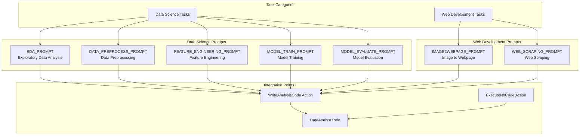
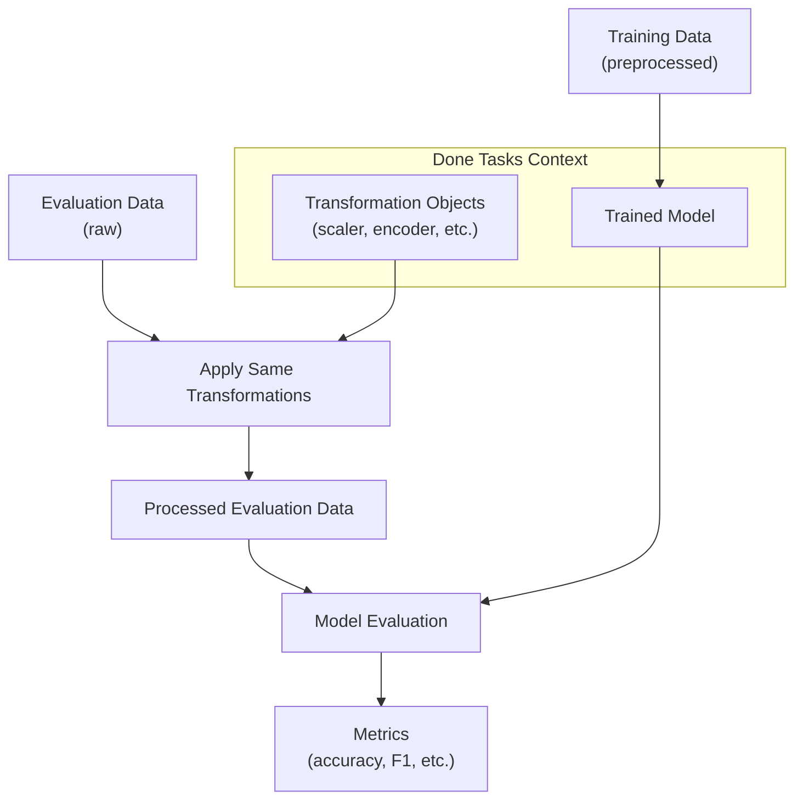
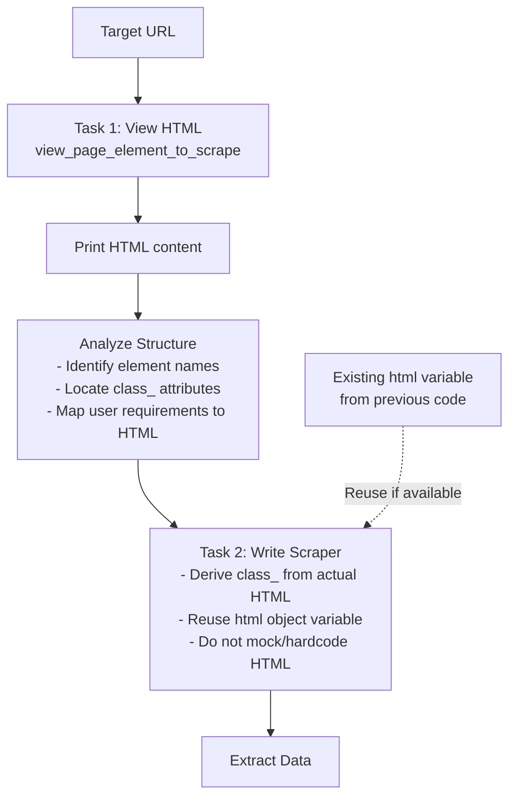
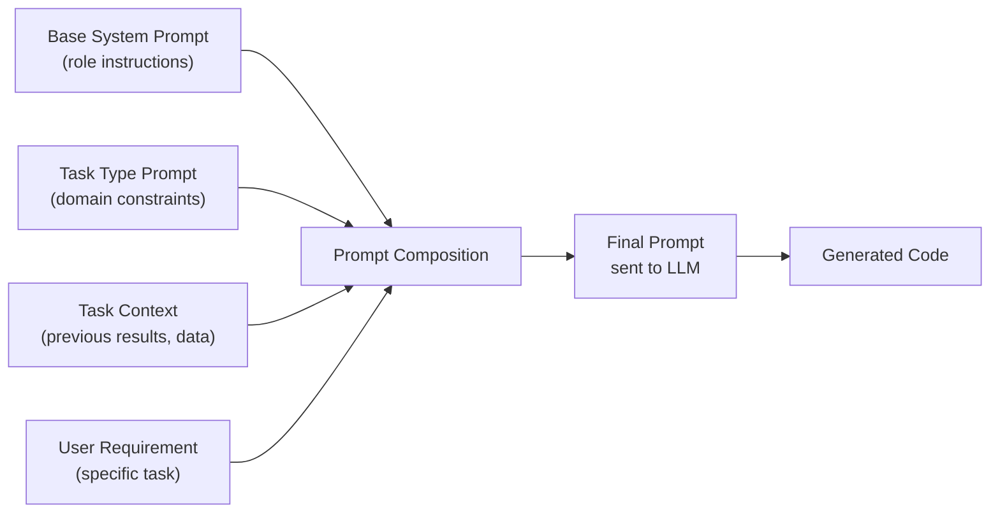

<!-- source: DeepWiki mcp.deepwiki.com · repo FoundationAgents/MetaGPT · page 7.6 Task Type Prompts · fetched 2026-10-30 -->

# Task Type Prompts

<details>
<summary>Relevant source files</summary>

The following files were used as context for generating this wiki page:

- [metagpt/prompts/task_type.py](metagpt/prompts/task_type.py)

</details>


## Purpose and Scope

This document describes the specialized prompt templates defined in [metagpt/prompts/task_type.py]() that provide domain-specific guidance for different types of tasks. These prompts augment the base Action system with task-specific constraints, best practices, and warnings to improve the quality of generated code for data science workflows, web development, and other specialized domains.

For general prompt generation and ActionNode compilation, see [Prompt Generation and Parsing](#7.2). For domain-specific ActionNode structures used in software development workflows, see [Domain-Specific ActionNodes](#7.5).

## Overview

Task type prompts are string constants that define behavioral guidelines for specific categories of work. They are injected into the LLM context to steer code generation toward domain-appropriate patterns and avoid common pitfalls.

**Task Type Prompt Architecture**



Sources: [metagpt/prompts/task_type.py:1-67]()

## Data Science Task Prompts

### EDA_PROMPT: Exploratory Data Analysis

The `EDA_PROMPT` provides guidance for exploratory data analysis tasks, focusing on proper column type handling and visualization.

**Key Guidelines:**
- Use `select_dtypes` to distinguish column types for tailored analysis
- Import numpy explicitly before using numpy functions
- Appropriate correlation analysis per data type

```python
EDA_PROMPT = """
The current task is about exploratory data analysis, please note the following:
- Distinguish column types with `select_dtypes` for tailored analysis and visualization, such as correlation.
- Remember to `import numpy as np` before using Numpy functions.
"""
```

**Use Cases:**
- Initial data inspection
- Statistical summaries
- Correlation analysis
- Distribution visualization

Sources: [metagpt/prompts/task_type.py:2-6]()

### DATA_PREPROCESS_PROMPT: Data Preprocessing

The `DATA_PREPROCESS_PROMPT` enforces strict rules for data preprocessing to maintain data integrity and pipeline consistency.

**Critical Constraints:**

| Constraint | Rationale |
|------------|-----------|
| Do NOT modify label column | Prevents data leakage and maintains target integrity |
| Process train and test separately | Ensures proper separation and prevents leakage |
| Always copy DataFrame | Prevents in-place mutations that break pipeline |
| Avoid one-hot encoding preference | Preserves flexibility for feature engineering |
| Monitor data types per column | Ensures type-appropriate transformations |

**Example Guidelines:**
```python
DATA_PREPROCESS_PROMPT = """
The current task is about data preprocessing, please note the following:
- Monitor data types per column, applying appropriate methods.
- Ensure operations are on existing dataset columns.
- Avoid writing processed data to files.
- **ATTENTION** Do NOT make any changes to the label column, such as standardization, etc.
- Prefer alternatives to one-hot encoding for categorical data.
- Only encode or scale necessary columns to allow for potential feature-specific engineering tasks (like time_extract, binning, extraction, etc.) later.
- Each step do data preprocessing to train, must do same for test separately at the same time.
- Always copy the DataFrame before processing it and use the copy to process.
"""
```

Sources: [metagpt/prompts/task_type.py:9-19]()

### FEATURE_ENGINEERING_PROMPT: Feature Engineering

The `FEATURE_ENGINEERING_PROMPT` guides the creation of diverse, impactful features while avoiding common pitfalls.

**Design Principles:**

```mermaid
graph LR
    Input["Raw Features"]
    
    subgraph "Feature Engineering Rules"
        Diversity["Generate diverse features<br/>step-by-step"]
        Tools["Use feature engineering tools"]
        NoRedundant["Avoid redundant features"]
        NoID["Exclude ID columns"]
        NoLabel["Do NOT use label column<br/>except for cat encoding"]
        SyncSets["Apply to train/dev/test<br/>simultaneously"]
        CopyDF["Always copy DataFrame"]
    end
    
    Output["Engineered Features"]
    
    Input --> Diversity
    Diversity --> Tools
    Tools --> NoRedundant
    NoRedundant --> NoID
    NoID --> NoLabel
    NoLabel --> SyncSets
    SyncSets --> CopyDF
    CopyDF --> Output
```



**Key Restrictions:**
- Do NOT use label column for feature creation (except categorical encoding)
- Remove ID columns entirely
- Apply operations to train and test sets simultaneously
- Use previous task results, never mock or reload data

Sources: [metagpt/prompts/task_type.py:22-32]()

### MODEL_TRAIN_PROMPT: Model Training

The `MODEL_TRAIN_PROMPT` prioritizes model performance and provides algorithm recommendations per data type.

**Algorithm Recommendations:**

| Data Type | Recommended Models |
|-----------|-------------------|
| Tabular | XGBoost, CatBoost, Random Forest, Extremely Randomized Trees, K-Nearest Neighbors, Linear Regression |
| Image | Swin Transformer, ViT, ResNet, EfficientNet |
| Text | Electra, DeBERTa, GPT-2, BERT |

**Performance Optimization:**
- Avoid SVM due to high training time
- Prioritize complex models (XGBoost, CatBoost) for effectiveness
- Perform label encoding for non-numeric columns
- Set suitable hyperparameters to maximize metrics
- Use data from previous task results directly

```python
MODEL_TRAIN_PROMPT = """
The current task is about training a model, please ensure high performance:
- For tabular datasets - you have access to XGBoost, CatBoost, random forest, extremely randomized trees, k-nearest neighbors, linear regression, etc.
- For image datasets - you have access to Swin Transformer, ViT, ResNet, EfficientNet, etc.
- For text datasets - you have access to Electra, DeBERTa, GPT-2, BERT, etc.
- Avoid the use of SVM because of its high training time.
- Keep in mind that your user prioritizes results and is highly focused on model performance. So, when needed, feel free to use models of any complexity to improve effectiveness, such as XGBoost, CatBoost, etc.
- If non-numeric columns exist, perform label encode together with all steps.
- Use the data from previous task result directly, do not mock or reload data yourself.
- Set suitable hyperparameters for the model, make metrics as high as possible.
"""
```

Sources: [metagpt/prompts/task_type.py:35-45]()

### MODEL_EVALUATE_PROMPT: Model Evaluation

The `MODEL_EVALUATE_PROMPT` ensures consistent data processing between training and evaluation.

**Evaluation Requirements:**
- Ensure evaluation data receives same preprocessing as training data
- Use transformation objects from previous tasks
- Load trained model from previous task results
- Do not mock or reload model independently

**Data Consistency Flow:**



Sources: [metagpt/prompts/task_type.py:48-52]()

## Web Development Task Prompts

### IMAGE2WEBPAGE_PROMPT: Image to Webpage Conversion

The `IMAGE2WEBPAGE_PROMPT` guides the conversion of image designs into functional webpage code.

**Generation Strategy:**
- **Single-Step Generation**: Execute entire HTML, CSS, and JavaScript generation in one step
- Avoid fragmenting code generation into multiple steps
- Maintain consistency across HTML structure, styling, and interactivity
- Use provided save method for webpage persistence

```python
IMAGE2WEBPAGE_PROMPT = """
The current task is about converting image into webpage code. please note the following:
- Single-Step Code Generation: Execute the entire code generation process in a single step, encompassing HTML, CSS, and JavaScript. Avoid fragmenting the code generation into multiple separate steps to maintain consistency and simplify the development workflow.
- Save webpages: Be sure to use the save method provided.
"""
```

Sources: [metagpt/prompts/task_type.py:55-59]()

### WEB_SCRAPING_PROMPT: Web Scraping

The `WEB_SCRAPING_PROMPT` enforces careful HTML structure analysis before data extraction.

**Scraping Workflow:**



**Critical Guidelines:**
1. **Separate viewing from scraping**: First view and print HTML content in a separate task to understand structure
2. **Analyze before coding**: User requirements may not match HTML element names directly
3. **Derive from actual HTML**: Ensure `class_` attributes come from actual HTML structure, not assumptions
4. **Reuse existing HTML objects**: Use html variable from previous code if available, do not mock

Sources: [metagpt/prompts/task_type.py:62-66]()

## Integration with Action System

Task type prompts integrate with the Action system through specialized actions that handle data science and web development workflows.

**Integration Architecture:**

```mermaid
graph TB
    subgraph "Prompt Source"
        TaskTypeModule["metagpt/prompts/task_type.py"]
        EDA_PROMPT_Const["EDA_PROMPT"]
        PREPROCESS_PROMPT_Const["DATA_PREPROCESS_PROMPT"]
        FEATURE_PROMPT_Const["FEATURE_ENGINEERING_PROMPT"]
        TRAIN_PROMPT_Const["MODEL_TRAIN_PROMPT"]
        EVAL_PROMPT_Const["MODEL_EVALUATE_PROMPT"]
        IMG2WEB_PROMPT_Const["IMAGE2WEBPAGE_PROMPT"]
        SCRAPE_PROMPT_Const["WEB_SCRAPING_PROMPT"]
    end
    
    subgraph "Action Layer"
        WriteAnalysisCodeAction["WriteAnalysisCode<br/>Action class"]
        ExecuteNbCodeAction["ExecuteNbCode<br/>Notebook execution"]
    end
    
    subgraph "Role Layer"
        DataAnalystRole["DataAnalyst<br/>RoleZero subclass"]
        Engineer2Role["Engineer2<br/>Code + deployment"]
    end
    
    subgraph "Task Execution"
        TaskContext["Task Context<br/>(task_type field)"]
        PromptSelection["Prompt Selection Logic"]
        LLMCall["LLM Call<br/>with task-specific prompt"]
    end
    
    TaskTypeModule --> EDA_PROMPT_Const
    TaskTypeModule --> PREPROCESS_PROMPT_Const
    TaskTypeModule --> FEATURE_PROMPT_Const
    TaskTypeModule --> TRAIN_PROMPT_Const
    TaskTypeModule --> EVAL_PROMPT_Const
    TaskTypeModule --> IMG2WEB_PROMPT_Const
    TaskTypeModule --> SCRAPE_PROMPT_Const
    
    WriteAnalysisCodeAction --> TaskContext
    ExecuteNbCodeAction --> TaskContext
    
    DataAnalystRole --> WriteAnalysisCodeAction
    DataAnalystRole --> ExecuteNbCodeAction
    Engineer2Role --> WriteAnalysisCodeAction
    
    TaskContext --> PromptSelection
    
    EDA_PROMPT_Const -.->|"task_type='eda'"| PromptSelection
    PREPROCESS_PROMPT_Const -.->|"task_type='data_preprocess'"| PromptSelection
    FEATURE_PROMPT_Const -.->|"task_type='feature_engineering'"| PromptSelection
    TRAIN_PROMPT_Const -.->|"task_type='model_train'"| PromptSelection
    EVAL_PROMPT_Const -.->|"task_type='model_evaluate'"| PromptSelection
    IMG2WEB_PROMPT_Const -.->|"task_type='image2webpage'"| PromptSelection
    SCRAPE_PROMPT_Const -.->|"task_type='web_scraping'"| PromptSelection
    
    PromptSelection --> LLMCall
```



Sources: [metagpt/prompts/task_type.py:1-67]()

## Usage Patterns

### Task Type Selection

Task type prompts are typically selected based on a `task_type` field in the task context. The prompt is appended to the base system prompt to provide task-specific guidance.

**Typical Usage Pattern:**

| Component | Responsibility |
|-----------|----------------|
| `DataAnalyst` Role | Analyzes task requirements, determines task type |
| `WriteAnalysisCode` Action | Selects appropriate prompt based on task type |
| `ExecuteNbCode` Action | Executes generated code in notebook context |
| Task Type Prompt | Provides domain-specific constraints to LLM |

### Prompt Composition Strategy



**Composition Order:**
1. Base system prompt (role-level instructions)
2. Task type prompt (domain-specific constraints)
3. Task context (previous task results, available data)
4. User requirement (specific task description)

### Data Science Pipeline Example

For a complete data science workflow, task type prompts are applied sequentially:

```
1. EDA_PROMPT → Exploratory analysis
2. DATA_PREPROCESS_PROMPT → Clean and prepare data
3. FEATURE_ENGINEERING_PROMPT → Create features
4. MODEL_TRAIN_PROMPT → Train model
5. MODEL_EVALUATE_PROMPT → Evaluate performance
```

Each prompt ensures:
- **Continuity**: Use outputs from previous tasks
- **Consistency**: Apply same transformations to all datasets
- **Integrity**: Protect label column and maintain data separation

Sources: [metagpt/prompts/task_type.py:1-67]()

## Best Practices

### Extending Task Type Prompts

When adding new task type prompts:

1. **Define clear constraints**: Specify what to do and what to avoid
2. **Emphasize common pitfalls**: Use **ATTENTION** markers for critical warnings
3. **Provide tool recommendations**: List available libraries and algorithms
4. **Ensure pipeline compatibility**: Reference previous task results
5. **Maintain data integrity**: Enforce separation between train/test sets

### Prompt Evolution

Task type prompts evolve based on:
- Common errors in generated code
- User feedback on code quality
- New libraries and algorithms
- Domain best practices

The prompts serve as a knowledge base that accumulates domain expertise, reducing the need for manual intervention in automated workflows.

Sources: [metagpt/prompts/task_type.py:1-67]()

---

