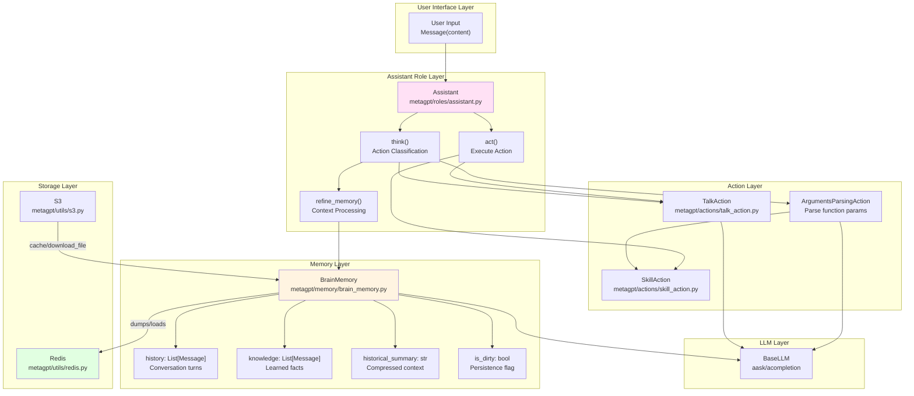
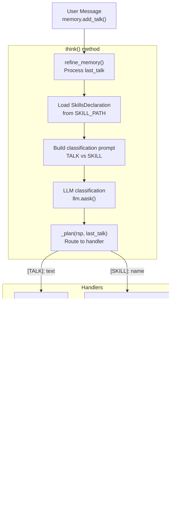
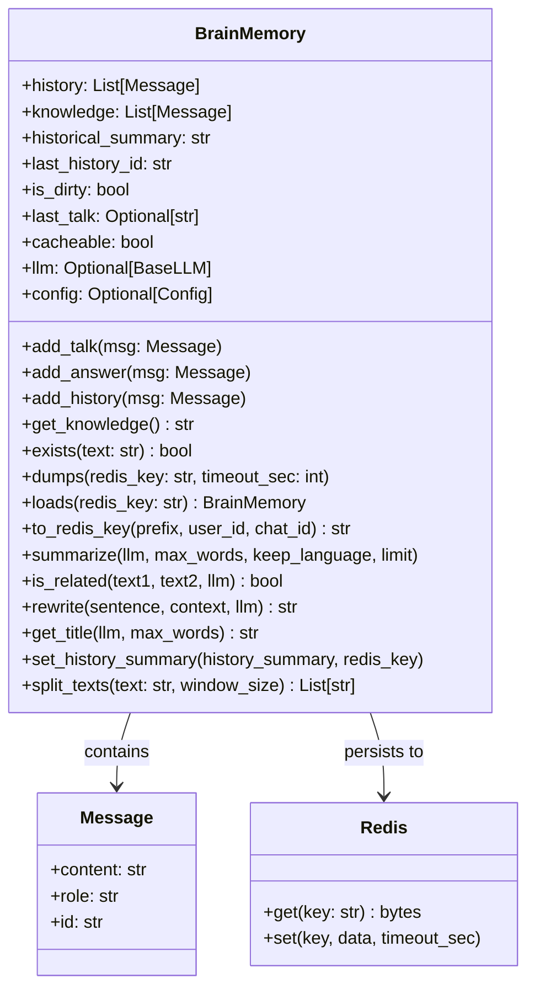
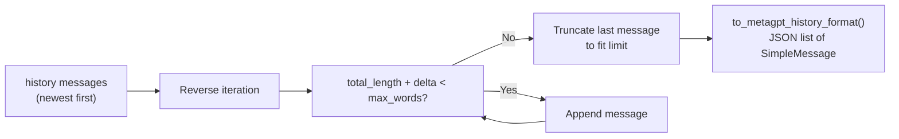
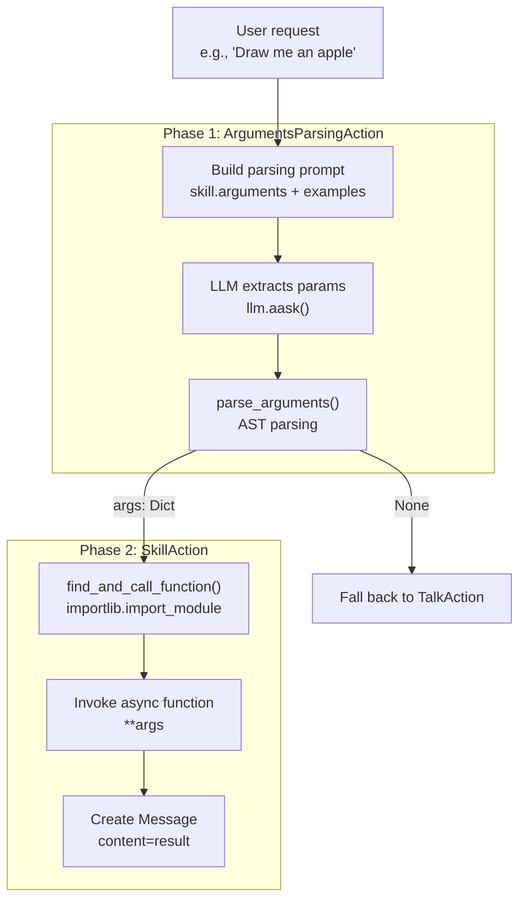
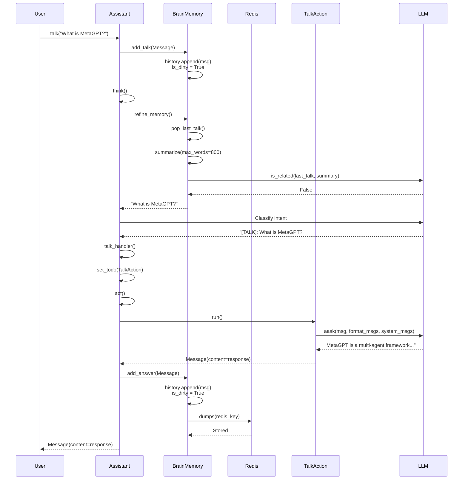
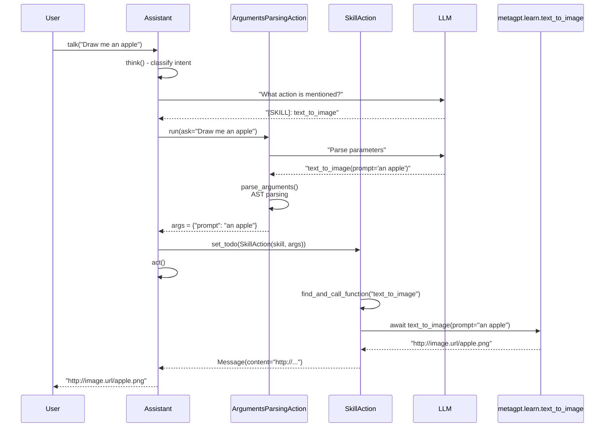

<!-- source: DeepWiki mcp.deepwiki.com · repo FoundationAgents/MetaGPT · page 8 Conversational Agents and Memory · fetched 2026-10-30 -->

# Conversational Agents and Memory

<details>
<summary>Relevant source files</summary>

The following files were used as context for generating this wiki page:

- [metagpt/actions/skill_action.py](metagpt/actions/skill_action.py)
- [metagpt/actions/talk_action.py](metagpt/actions/talk_action.py)
- [metagpt/memory/brain_memory.py](metagpt/memory/brain_memory.py)
- [metagpt/roles/assistant.py](metagpt/roles/assistant.py)
- [metagpt/utils/redis.py](metagpt/utils/redis.py)
- [metagpt/utils/s3.py](metagpt/utils/s3.py)
- [tests/metagpt/memory/test_brain_memory.py](tests/metagpt/memory/test_brain_memory.py)
- [tests/metagpt/roles/test_assistant.py](tests/metagpt/roles/test_assistant.py)
- [tests/metagpt/test_llm.py](tests/metagpt/test_llm.py)
- [tests/metagpt/utils/test_redis.py](tests/metagpt/utils/test_redis.py)
- [tests/metagpt/utils/test_s3.py](tests/metagpt/utils/test_s3.py)

</details>


## Purpose and Scope

This document covers MetaGPT's conversational agent system, which provides long-term memory and interactive dialogue capabilities through the `Assistant` role and `BrainMemory` system. This system differs from the standard software development roles (see [Core Multi-Agent Framework](#2)) and advanced tool-using roles (see [Dynamic Agent System (RoleZero)](#4)) by focusing on stateful, multi-turn conversations with Redis-backed persistence.

The conversational system supports two primary interaction modes:
- **Talk mode**: General LLM-based conversations using `TalkAction`
- **Skill mode**: Function calling and execution using `SkillAction`

For information about standard role memory (in-process message storage), see [Message Schema and Memory](#2.3).

---

## System Architecture Overview

The conversational agent system consists of three primary layers: the Assistant role for orchestration, BrainMemory for persistent state management, and action handlers for executing responses.



**Figure 1: Conversational Agent System Architecture**

Sources: [metagpt/roles/assistant.py:1-140](), [metagpt/memory/brain_memory.py:1-346](), [metagpt/actions/talk_action.py:1-169](), [metagpt/actions/skill_action.py:1-114]()

---

## Assistant Role Architecture

The `Assistant` class extends the base `Role` class to provide conversational capabilities with action classification and memory integration.

### Core Components

| Component | Type | Purpose |
|-----------|------|---------|
| `name` | `str` | Default: "Lily" |
| `profile` | `str` | Default: "An assistant" |
| `goal` | `str` | Default: "Help to solve problem" |
| `constraints` | `str` | Language constraints template |
| `memory` | `BrainMemory` | Persistent conversation state |
| `skills` | `SkillsDeclaration` | Optional function registry |

**Assistant Role Workflow**



**Figure 2: Assistant Think-Act Cycle**

Sources: [metagpt/roles/assistant.py:37-140]()

### Action Classification

The `think()` method implements a two-stage classification process:

1. **Memory Refinement** [metagpt/roles/assistant.py:118-130]()
   - Retrieves `last_talk` via `memory.pop_last_talk()`
   - Summarizes history if available: `memory.summarize(max_words=800)`
   - Checks semantic relatedness: `memory.is_related(text1, text2, llm)`
   - Rewrites query with context: `memory.rewrite(sentence, context, llm)`

2. **Intent Classification** [metagpt/roles/assistant.py:53-70]()
   - Builds prompt with skill descriptions
   - Asks LLM to classify as `[TALK]: text` or `[SKILL]: name`
   - Parses response using `BrainMemory.extract_info()` [metagpt/memory/brain_memory.py:249-254]()

**Classification Prompt Structure**:
```
If the text explicitly want you to {skill_desc}, return `[SKILL]: {skill_name}` brief and clear.
Otherwise, return `[TALK]: {talk}` brief and clear.

Now what specific action is explicitly mentioned in the text: {last_talk}
```

Sources: [metagpt/roles/assistant.py:53-95]()

### Handler Dispatch

The `_plan()` method routes to appropriate handlers [metagpt/roles/assistant.py:88-95]():

```python
handlers = {
    MessageType.Talk.value: self.talk_handler,
    MessageType.Skill.value: self.skill_handler,
}
handler = handlers.get(skill, self.talk_handler)
return await handler(text, **kwargs)
```

**Talk Handler** [metagpt/roles/assistant.py:97-103]()
- Creates `TalkAction` with history, knowledge, and current context
- Uses `memory.history_text` for conversation history
- Uses `memory.get_knowledge()` for facts

**Skill Handler** [metagpt/roles/assistant.py:105-116]()
- Retrieves skill from `SkillsDeclaration.get_skill(text)`
- Creates `ArgumentsParsingAction` to extract function parameters
- Creates `SkillAction` with parsed arguments
- Falls back to `talk_handler` if skill not found or parsing fails

Sources: [metagpt/roles/assistant.py:88-116]()

---

## BrainMemory System

`BrainMemory` provides persistent, Redis-backed conversation state with automatic summarization and semantic operations.

### Data Model



**Figure 3: BrainMemory Data Model**

Sources: [metagpt/memory/brain_memory.py:26-44]()

### Core Operations

#### Message Storage

**Adding User Input** [metagpt/memory/brain_memory.py:45-51]()
```python
def add_talk(self, msg: Message):
    msg.role = "user"
    self.add_history(msg)
    self.is_dirty = True
```

**Adding Assistant Response** [metagpt/memory/brain_memory.py:53-57]()
```python
def add_answer(self, msg: Message):
    msg.role = "assistant"
    self.add_history(msg)
    self.is_dirty = True
```

**History Management** [metagpt/memory/brain_memory.py:103-110]()
- Checks message ID to prevent duplicates
- Appends to `history` list
- Sets `is_dirty` flag for persistence

#### Redis Persistence

**Key Format** [metagpt/memory/brain_memory.py:87-89]()
```python
@staticmethod
def to_redis_key(prefix: str, user_id: str, chat_id: str):
    return f"{prefix}:{user_id}:{chat_id}"
```

**Serialization** [metagpt/memory/brain_memory.py:75-85]()
```python
async def dumps(self, redis_key: str, timeout_sec: int = 30 * 60):
    if not self.is_dirty:
        return
    redis = Redis(self.config.redis)
    v = self.model_dump_json()
    if self.cacheable:
        await redis.set(key=redis_key, data=v, timeout_sec=timeout_sec)
    self.is_dirty = False
```

**Deserialization** [metagpt/memory/brain_memory.py:63-73]()
```python
async def loads(self, redis_key: str) -> "BrainMemory":
    redis = Redis(self.config.redis)
    v = await redis.get(key=redis_key)
    if v:
        bm = BrainMemory.parse_raw(v)
        bm.is_dirty = False
        return bm
    return BrainMemory()
```

Sources: [metagpt/memory/brain_memory.py:45-110]()

### Summarization System

`BrainMemory` implements two summarization paths based on LLM type:

#### MetaGPT Path (Truncation)

For `MetaGPTLLM`, uses character-based truncation [metagpt/memory/brain_memory.py:152-175]():



**Figure 4: MetaGPT Summarization (Truncation)**

Output format: `[{"role": "user", "content": "..."}, {"role": "assistant", "content": "..."}]`

Sources: [metagpt/memory/brain_memory.py:152-180]()

#### OpenAI Path (LLM Summarization)

For other LLMs, uses recursive summarization [metagpt/memory/brain_memory.py:137-150]():

1. Concatenate `historical_summary` + `history` messages
2. If text length < limit, return as-is
3. Otherwise, invoke `_summarize()` method [metagpt/memory/brain_memory.py:276-304]()
   - Split text into windows if exceeds token limit
   - Summarize each window with `_get_summary()` [metagpt/memory/brain_memory.py:306-318]()
   - Recursively merge summaries until under limit
4. Store summary via `set_history_summary()` [metagpt/memory/brain_memory.py:91-101]()
5. Clear `history` list

**Text Splitting Algorithm** [metagpt/memory/brain_memory.py:321-345]()
```python
def split_texts(text: str, window_size) -> List[str]:
    # Sliding window with padding
    # window_size=100, padding_size=20
    # [0:100], [80:180], [160:260], ...
    padding_size = 20 if window_size > 20 else 0
    data_len = window_size - padding_size
    while idx < total_len:
        w = text[idx : idx + window_size]
        windows.append(w)
        idx += data_len
```

Sources: [metagpt/memory/brain_memory.py:137-318]()

### Semantic Operations

#### Relatedness Check

Determines if two text segments are semantically related [metagpt/memory/brain_memory.py:198-222]():

**MetaGPT Path**: Always returns `False` [metagpt/memory/brain_memory.py:203-205]()

**OpenAI Path**: Uses LLM classification [metagpt/memory/brain_memory.py:208-222]()
```python
context = f"## Paragraph 1\n{text2}\n---\n## Paragraph 2\n{text1}\n"
rsp = await llm.aask(
    msg=context,
    system_msgs=[
        "You are a tool capable of determining whether two paragraphs are semantically related.",
        'Return "TRUE" if "Paragraph 1" is semantically relevant to "Paragraph 2", otherwise return "FALSE".'
    ],
    stream=False,
)
result = True if "TRUE" in rsp else False
```

#### Context Rewriting

Augments a sentence with contextual information [metagpt/memory/brain_memory.py:224-246]():

**MetaGPT Path**: Returns sentence unchanged [metagpt/memory/brain_memory.py:229-231]()

**OpenAI Path**: Uses LLM augmentation [metagpt/memory/brain_memory.py:234-246]()
```python
prompt = f"## Context\n{context}\n---\n## Sentence\n{sentence}\n"
rsp = await llm.aask(
    msg=prompt,
    system_msgs=[
        'You are a tool augmenting the "Sentence" with information from the "Context".',
        "Do not supplement the context with information that is not present, especially regarding the subject and object.",
        "Return the augmented sentence.",
    ],
    stream=False,
)
```

Sources: [metagpt/memory/brain_memory.py:198-246]()

### Title Generation

Generates a short title for the conversation [metagpt/memory/brain_memory.py:182-196]():

**MetaGPT Path**: Returns first message content or "New"

**OpenAI Path**:
1. Summarize conversation to 500 words
2. Ask LLM to translate into title of max_words length
3. Respects `config.language` setting

Sources: [metagpt/memory/brain_memory.py:182-196]()

---

## TalkAction: LLM Conversation

`TalkAction` handles general conversational responses using the LLM with historical context.

### Configuration and Context

| Property | Source | Purpose |
|----------|--------|---------|
| `i_context` | User query | Current question/statement |
| `history_summary` | `BrainMemory.history_text` | Compressed conversation history |
| `knowledge` | `BrainMemory.get_knowledge()` | Learned facts |
| `agent_description` | `context.kwargs.agent_description` | Role-play persona |
| `language` | `context.kwargs.language` or `config.language` | Response language |

Sources: [metagpt/actions/talk_action.py:16-29]()

### Prompt Construction

**Standard Prompt Format** [metagpt/actions/talk_action.py:31-50]():

```
[If agent_description]
You are {agent_description}. Your responses should align with the role-play agreement, 
maintaining the character's persona and habits. When faced with unrelated questions, playfully 
decline to answer without revealing your AI nature to preserve the character's image.

[If knowledge]
Knowledge:
{knowledge}

{history_summary}

If the information is insufficient, you can search in the historical conversation or knowledge above.
Answer the following questions strictly in {language}, and the answers must follow the Markdown format.
{i_context}
```

**GPT-4 Optimized Format** [metagpt/actions/talk_action.py:53-65]():

Uses `TalkActionPrompt.FORMATION_LOOSE` template with structured tags:
- `[HISTORY_BEGIN]` ... `[HISTORY_END]`
- `[KNOWLEDGE_BEGIN]` ... `[KNOWLEDGE_END]`
- More formal role definitions (Capacity, Statement, Constraint, Personality, Insight, Initial)

Sources: [metagpt/actions/talk_action.py:31-168]()

### Execution

**LLM Call Structure** [metagpt/actions/talk_action.py:75-96]():

```python
async def run(self, with_message=None, **kwargs) -> Message:
    msg, format_msgs, system_msgs = self.aask_args
    rsp = await self.llm.aask(msg=msg, format_msgs=format_msgs, system_msgs=system_msgs, stream=False)
    self.rsp = Message(content=rsp, role="assistant", cause_by=self)
    return self.rsp
```

**System Messages** [metagpt/actions/talk_action.py:75-90]():
```python
system_msgs = [
    f"You are {self.agent_description}.",
    "Your responses should align with the role-play agreement...",
    "If the information is insufficient, you can search in the context or knowledge.",
    f"Answer the following questions strictly in {language}, and the answers must follow the Markdown format.",
]
```

**Format Messages** [metagpt/actions/talk_action.py:85-89]():
- Prepends knowledge as assistant message if available
- Prepends history_summary as assistant message if available

Sources: [metagpt/actions/talk_action.py:75-96]()

---

## SkillAction: Function Execution

`SkillAction` enables the Assistant to execute learned functions (skills) dynamically.

### Skill Definition

Skills are loaded from `SkillsDeclaration` [metagpt/roles/assistant.py:59-60]():
```python
skill_path = Path(self.context.kwargs.SKILL_PATH) if self.context.kwargs.SKILL_PATH else None
self.skills = await SkillsDeclaration.load(skill_yaml_file_name=skill_path)
```

Each `Skill` object contains [metagpt/actions/skill_action.py:25-26]():
- `name`: Function identifier
- `arguments`: Parameter descriptions (Dict)
- `examples`: Sample invocations with ask/answer pairs
- `description`: Human-readable purpose

Sources: [metagpt/roles/assistant.py:58-64]()

### Two-Phase Execution



**Figure 5: SkillAction Execution Flow**

Sources: [metagpt/actions/skill_action.py:1-114]()

### Phase 1: Argument Parsing

**Prompt Construction** [metagpt/actions/skill_action.py:31-46]():
```python
prompt = f"{self.skill.name} function parameters description:\n"
for k, v in self.skill.arguments.items():
    prompt += f"parameter `{k}`: {v}\n"
prompt += "\n---\n"
prompt += "Examples:\n"
for e in self.skill.examples:
    prompt += f"If want you to do `{e.ask}`, return `{e.answer}` brief and clear.\n"
prompt += f"\nNow I want you to do `{self.ask}`, return function parameters in Examples format..."
```

**Response Parsing** [metagpt/actions/skill_action.py:60-80]():

Expects LLM response in format: `function_name(param1="value1", param2="value2")`

Uses AST parsing to extract parameters:
```python
fake_expression = f"dict({args_txt})"  # Convert to dict literal
parsed_expression = ast.parse(fake_expression, mode="eval")
args = {}
for keyword in parsed_expression.body.keywords:
    key = keyword.arg
    value = ast.literal_eval(keyword.value)
    args[key] = value
```

Sources: [metagpt/actions/skill_action.py:24-81]()

### Phase 2: Function Invocation

**Dynamic Import and Call** [metagpt/actions/skill_action.py:103-113]():
```python
module = importlib.import_module("metagpt.learn")
function = getattr(module, function_name)
result = await function(**args, **kwargs)
```

All skills must be async functions in the `metagpt.learn` module.

**Error Handling** [metagpt/actions/skill_action.py:95-101]():
- Catches all exceptions
- Returns error message as assistant response
- Logs full traceback

Sources: [metagpt/actions/skill_action.py:83-114]()

---

## Redis Integration

The `Redis` utility provides async operations with automatic connection management.

### Configuration

**RedisConfig Structure** (from imports):
```python
class RedisConfig:
    host: str
    port: int
    username: Optional[str]
    password: Optional[str]
    db: int
    
    def to_url(self) -> str:
        # Returns redis:// URL
```

### Connection Management

**Lazy Connection** [metagpt/utils/redis.py:24-38]():
```python
async def _connect(self, force=False):
    if self._client and not force:
        return True
    
    try:
        self._client = await aioredis.from_url(
            self.config.to_url(),
            username=self.config.username,
            password=self.config.password,
            db=self.config.db,
        )
        return True
    except Exception as e:
        logger.warning(f"Redis initialization has failed:{e}")
    return False
```

Connections are established on first use and reused for subsequent operations.

Sources: [metagpt/utils/redis.py:19-38]()

### Operations

| Method | Parameters | Return | Purpose |
|--------|------------|--------|---------|
| `get()` | `key: str` | `bytes \| None` | Retrieve value |
| `set()` | `key: str, data: str, timeout_sec: int` | `None` | Store with TTL |
| `close()` | - | `None` | Cleanup connection |

**Get Operation** [metagpt/utils/redis.py:40-48]():
```python
async def get(self, key: str) -> bytes | None:
    if not await self._connect() or not key:
        return None
    try:
        v = await self._client.get(key)
        return v
    except Exception as e:
        logger.exception(f"{e}, stack:{traceback.format_exc()}")
        return None
```

**Set Operation** [metagpt/utils/redis.py:50-57]():
```python
async def set(self, key: str, data: str, timeout_sec: int = None):
    if not await self._connect() or not key:
        return
    try:
        ex = None if not timeout_sec else timedelta(seconds=timeout_sec)
        await self._client.set(key, data, ex=ex)
    except Exception as e:
        logger.exception(f"{e}, stack:{traceback.format_exc()}")
```

Sources: [metagpt/utils/redis.py:40-63]()

### Usage Pattern

**BrainMemory Integration**:
1. **Save**: `await memory.dumps(redis_key="prefix:user_id:chat_id", timeout_sec=1800)`
2. **Load**: `memory = await BrainMemory().loads(redis_key="prefix:user_id:chat_id")`

Default TTL: 30 minutes (1800 seconds) [metagpt/memory/brain_memory.py:75]()

Sources: [metagpt/memory/brain_memory.py:63-86](), [metagpt/utils/redis.py:1-64]()

---

## S3 Integration

The `S3` utility provides file storage operations for artifacts like images and documents.

### Configuration

**S3Config Structure** [metagpt/utils/s3.py:19-27]():
```python
class S3:
    def __init__(self, config: S3Config):
        self.session = aioboto3.Session()
        self.auth_config = {
            "service_name": "s3",
            "aws_access_key_id": config.access_key,
            "aws_secret_access_key": config.secret_key,
            "endpoint_url": config.endpoint,
        }
```

### Core Operations

| Method | Purpose | Parameters |
|--------|---------|------------|
| `upload_file()` | Upload local file to S3 | `bucket, local_path, object_name` |
| `download_file()` | Download S3 object to local | `bucket, object_name, local_path, chunk_size` |
| `get_object()` | Retrieve file as bytes | `bucket, object_name` |
| `get_object_url()` | Get downloadable URL | `bucket, object_name` |
| `cache()` | Store string/base64 data | `data, file_ext, format` |

Sources: [metagpt/utils/s3.py:16-155]()

### Cache Operation

**Workflow** [metagpt/utils/s3.py:133-154]():

```mermaid
graph LR
    Input["data: str<br/>file_ext: str<br/>format: str"]
    Generate["Generate UUID filename<br/>uuid4().hex + file_ext"]
    Decode["Decode base64 if needed<br/>or encode UTF-8"]
    WriteTemp["Write to temp file<br/>Path(__file__).parent / object_name"]
    Upload["upload_file()<br/>to S3 bucket"]
    GetURL["get_object_url()<br/>Return download URL"]
    Cleanup["Delete temp file<br/>pathname.unlink()"]
    
    Input --> Generate
    Generate --> Decode
    Decode --> WriteTemp
    WriteTemp --> Upload
    Upload --> GetURL
    GetURL --> Cleanup
    Cleanup --> Return["Return URL string"]
```



**Figure 6: S3 Cache Operation Flow**

Example usage in conversational context:
```python
# Store image data
url = await s3.cache(data=base64_image, file_ext=".png", format="base64")
# url: "https://s3.endpoint.com/bucket/system/abc123.png"
```

Sources: [metagpt/utils/s3.py:133-154]()

### Download Operation

**Chunked Streaming** [metagpt/utils/s3.py:105-131]():
```python
async def download_file(self, bucket: str, object_name: str, local_path: str, chunk_size: Optional[int] = 128 * 1024):
    async with self.session.client(**self.auth_config) as client:
        s3_object = await client.get_object(Bucket=bucket, Key=object_name)
        stream = s3_object["Body"]
        async with aiofiles.open(local_path, mode="wb") as writer:
            while True:
                file_data = await stream.read(chunk_size)
                if not file_data:
                    break
                await writer.write(file_data)
```

Default chunk size: 128 KB

Sources: [metagpt/utils/s3.py:105-131]()

---

## Integration Examples

### Complete Conversation Flow



**Figure 7: Complete Conversation Flow with Redis Persistence**

Sources: [metagpt/roles/assistant.py:37-140](), [metagpt/memory/brain_memory.py:26-175]()

### Skill Execution Flow



**Figure 8: Skill Execution Sequence**

Sources: [metagpt/roles/assistant.py:105-116](), [metagpt/actions/skill_action.py:24-114]()

---

## Testing Infrastructure

### BrainMemory Tests

**Basic Operations** [tests/metagpt/memory/test_brain_memory.py:16-34]():
- Message addition (talk/answer with role assignment)
- Redis serialization (dumps/loads)
- History existence checks
- Property accessors (is_history_available, history_text)

**LLM Operations** [tests/metagpt/memory/test_brain_memory.py:47-66]():
- `is_related()`: Semantic relatedness (expects False for "apple" vs "moon")
- `rewrite()`: Context augmentation (expects "Lily" in result)
- `summarize()`: History compression (expects non-empty summary)
- `get_title()`: Title generation (expects "Lily" in title)

**Pattern Extraction** [tests/metagpt/memory/test_brain_memory.py:37-44]():
```python
@pytest.mark.parametrize(
    ("input", "tag", "val"),
    [("[TALK]:Hello", "TALK", "Hello"), 
     ("Hello", None, "Hello"), 
     ("[TALK]Hello", None, "[TALK]Hello")]
)
def test_extract_info(input, tag, val):
    t, v = BrainMemory.extract_info(input)
    assert tag == t
    assert val == v
```

Sources: [tests/metagpt/memory/test_brain_memory.py:1-71]()

### Assistant Tests

**Full Conversation Test** [tests/metagpt/roles/test_assistant.py:21-101]():

Test scenarios with memory state, language, agent description, and expected action type:

| Scenario | Last Talk | Expected Action | Skills Required |
|----------|-----------|----------------|-----------------|
| Talk | "Do you have a poison apple?" | `TalkAction` | None |
| Skill | "Draw me an apple." | `SkillAction` | `text_to_image` |

**Memory Persistence Test** [tests/metagpt/roles/test_assistant.py:120-132]():
```python
role = Assistant(context=context)
role.load_memory(memory)  # Load from dict
val = role.get_memory()   # Serialize to JSON
assert val

await role.talk("draw apple")
await role.think()
assert isinstance(role.rc.todo, TalkAction)  # Verify action type
```

Sources: [tests/metagpt/roles/test_assistant.py:1-136]()

### Redis Mock Pattern

**Test Configuration** [tests/metagpt/utils/test_redis.py:15-33]():
```python
async def async_mock_from_url(*args, **kwargs):
    mock_client = AsyncMock()
    mock_client.set.return_value = None
    mock_client.get.return_value = b"test"
    return mock_client

mocker.patch("aioredis.from_url", return_value=async_mock_from_url())
mock_config = mocker.Mock()
mock_config.to_url.return_value = "http://mock.com"

conn = Redis(mock_config)
await conn.set("test", "test", timeout_sec=0)
assert await conn.get("test") == b"test"
```

Sources: [tests/metagpt/utils/test_redis.py:1-38]()

### S3 Mock Pattern

**Test Configuration** [tests/metagpt/utils/test_s3.py:20-58]():
```python
# Mock S3 client
mock_client = mocker.AsyncMock()
mock_client.put_object.return_value = None
mock_client.get_object.return_value = {"Body": reader_mock}
mocker.patch.object(aioboto3.Session, "client", return_value=mock_client)

# Mock config
mock_config.s3 = S3Config(
    access_key="mock_access_key",
    secret_key="mock_secret_key",
    endpoint="http://mock.endpoint",
    bucket="mock_bucket",
)

# Test operations
conn = S3(s3)
await conn.upload_file(bucket=s3.bucket, local_path=__file__, object_name="test.bak")
await conn.download_file(bucket=s3.bucket, object_name="test.bak", local_path=str(pathname))
url = await conn.get_object_url(bucket=s3.bucket, object_name="test.bak")
```

Sources: [tests/metagpt/utils/test_s3.py:1-73]()

---

## Configuration Examples

### Assistant Configuration

**Minimal Setup**:
```python
from metagpt.roles.assistant import Assistant
from metagpt.schema import Message

assistant = Assistant(
    name="MyAssistant",
    profile="A helpful assistant",
    language="English"
)

# Start conversation
await assistant.talk("Hello, how are you?")
msg = await assistant.run()
print(msg.content)
```

**With Memory Persistence**:
```python
from metagpt.memory.brain_memory import BrainMemory
from metagpt.config2 import Config

config = Config.default()
config.redis.key = "assistant:user123:chat456"

assistant = Assistant(config=config)
assistant.memory.cacheable = True  # Enable Redis persistence

# Conversation persists across sessions
await assistant.talk("Remember this fact")
await assistant.run()

# Later session
new_assistant = Assistant(config=config)
await new_assistant.memory.loads(redis_key=config.redis.key)
# Memory restored
```

**With Custom Skills**:
```python
from pathlib import Path

assistant = Assistant()
assistant.context.kwargs.SKILL_PATH = Path("/path/to/skills.yaml")

# Skills loaded on first think()
await assistant.talk("Use my custom skill")
await assistant.think()  # Loads skills here
await assistant.act()
```

Sources: [metagpt/roles/assistant.py:48-52](), [metagpt/memory/brain_memory.py:63-86]()

### Redis Configuration

**config2.yaml**:
```yaml
redis:
  host: localhost
  port: 6379
  username: ""
  password: ""
  db: 0
  key: ""  # Default key prefix
```

**Programmatic**:
```python
from metagpt.config2 import Config
from metagpt.configs.redis_config import RedisConfig

config = Config.default()
config.redis = RedisConfig(
    host="redis.example.com",
    port=6379,
    password="secret",
    db=1
)
```

Sources: [metagpt/utils/redis.py:19-23]()

### S3 Configuration

**config2.yaml**:
```yaml
s3:
  access_key: "ACCESS_KEY"
  secret_key: "SECRET_KEY"
  endpoint: "https://s3.amazonaws.com"
  bucket: "my-bucket"
```

**Programmatic**:
```python
from metagpt.config2 import Config, S3Config

config = Config.default()
config.s3 = S3Config(
    access_key="ACCESS_KEY",
    secret_key="SECRET_KEY",
    endpoint="https://s3.amazonaws.com",
    bucket="my-bucket"
)
```

Sources: [metagpt/utils/s3.py:19-27]()

---

## Summary Table

| Component | File Path | Primary Responsibility |
|-----------|-----------|------------------------|
| `Assistant` | [metagpt/roles/assistant.py]() | Orchestrates conversation flow, classifies intents, manages think-act cycle |
| `BrainMemory` | [metagpt/memory/brain_memory.py]() | Persistent conversation state with Redis backing, summarization, semantic operations |
| `TalkAction` | [metagpt/actions/talk_action.py]() | Generates LLM-based conversational responses with history/knowledge context |
| `SkillAction` | [metagpt/actions/skill_action.py]() | Executes learned functions from `metagpt.learn` module |
| `ArgumentsParsingAction` | [metagpt/actions/skill_action.py:24-81]() | Extracts function parameters using LLM + AST parsing |
| `Redis` | [metagpt/utils/redis.py]() | Async Redis client with connection pooling and error handling |
| `S3` | [metagpt/utils/s3.py]() | AWS S3 operations for file storage and retrieval |

**Key Distinguishing Features**:
- **Persistence**: Redis-backed state survives process restarts
- **Summarization**: Two paths (truncation for MetaGPT LLM, recursive for others)
- **Semantic Operations**: Context-aware rewriting and relatedness checking
- **Dual Mode**: Automatic classification between conversational and functional responses
- **Extensibility**: Skills loaded from YAML definitions, functions from `metagpt.learn`

Sources: All files cited throughout document

---

