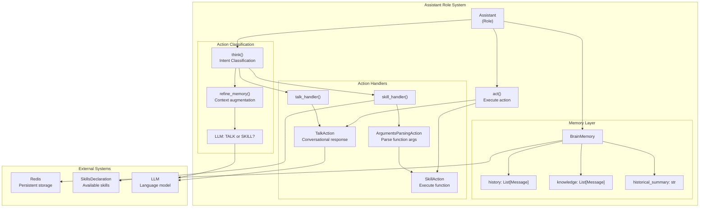
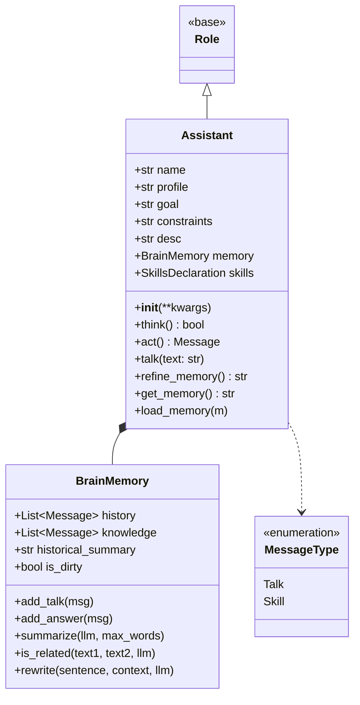
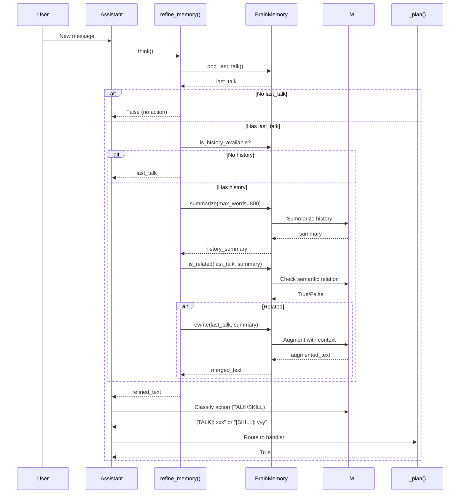
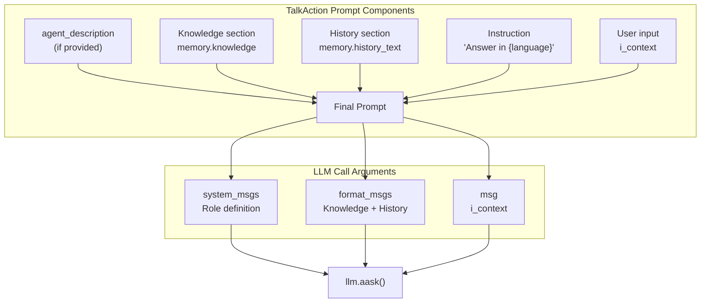
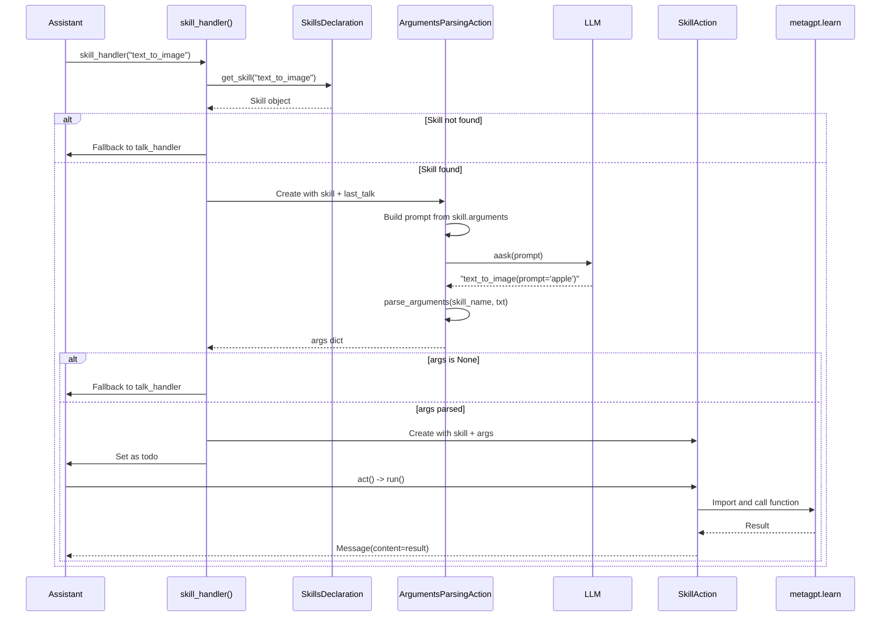
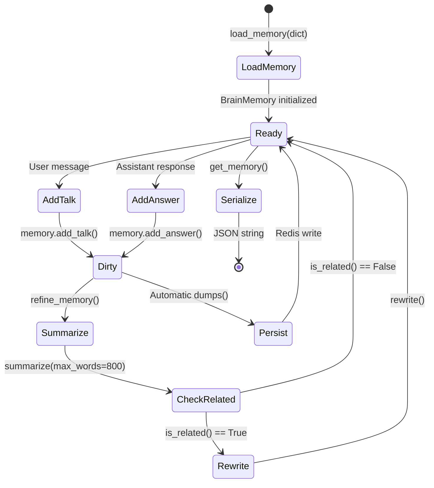
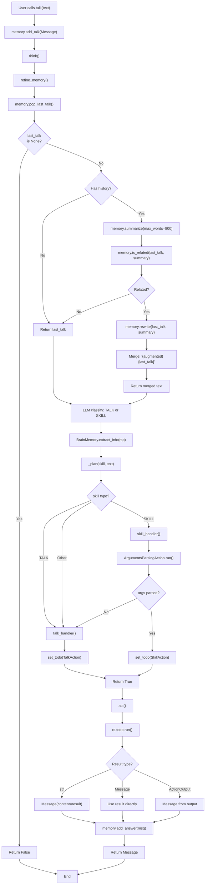
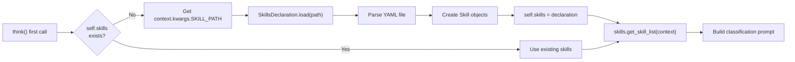

<!-- source: DeepWiki mcp.deepwiki.com · repo FoundationAgents/MetaGPT · page 8.1 Assistant Role Architecture · fetched 2026-10-30 -->

# Assistant Role Architecture

<details>
<summary>Relevant source files</summary>

The following files were used as context for generating this wiki page:

- [metagpt/actions/skill_action.py](metagpt/actions/skill_action.py)
- [metagpt/actions/talk_action.py](metagpt/actions/talk_action.py)
- [metagpt/memory/brain_memory.py](metagpt/memory/brain_memory.py)
- [metagpt/roles/assistant.py](metagpt/roles/assistant.py)
- [metagpt/utils/redis.py](metagpt/utils/redis.py)
- [metagpt/utils/s3.py](metagpt/utils/s3.py)
- [tests/metagpt/memory/test_brain_memory.py](tests/metagpt/memory/test_brain_memory.py)
- [tests/metagpt/roles/test_assistant.py](tests/metagpt/roles/test_assistant.py)
- [tests/metagpt/test_llm.py](tests/metagpt/test_llm.py)
- [tests/metagpt/utils/test_redis.py](tests/metagpt/utils/test_redis.py)
- [tests/metagpt/utils/test_s3.py](tests/metagpt/utils/test_s3.py)

</details>


## Purpose and Scope

This document describes the `Assistant` role architecture within MetaGPT's conversational agent system. The Assistant provides a flexible framework for handling mixed conversational and task-oriented interactions through dynamic action classification. It differs from standard roles ([2.1](#2.1)) by using Redis-backed long-term memory and from RoleZero agents ([4.1](#4.1)) by focusing on conversational context rather than tool execution.

For details on the `BrainMemory` system used by Assistant, see [8.2](#8.2). For Redis and S3 integration patterns, see [8.3](#8.3).

**Sources:** [metagpt/roles/assistant.py:1-140](), [metagpt/memory/brain_memory.py:1-346]()

---

## System Overview

The Assistant role implements a conversational agent that classifies user input into two action types: **TALK** (LLM-driven conversation) or **SKILL** (function execution). It maintains long-term conversational context through `BrainMemory`, enabling coherent multi-turn interactions with automatic summarization and context augmentation.



**Diagram: Assistant Role Component Architecture**

**Sources:** [metagpt/roles/assistant.py:37-140](), [metagpt/memory/brain_memory.py:26-36](), [metagpt/actions/talk_action.py:16-96](), [metagpt/actions/skill_action.py:24-114]()

---

## Assistant Class Structure

The `Assistant` class inherits from `Role` and defines conversational agent behavior through specialized fields and methods.

### Class Definition



**Diagram: Assistant Class Hierarchy**

| Field | Type | Default | Purpose |
|-------|------|---------|---------|
| `name` | `str` | `"Lily"` | Agent identifier |
| `profile` | `str` | `"An assistant"` | Role description |
| `goal` | `str` | `"Help to solve problem"` | Primary objective |
| `constraints` | `str` | `"Talk in {language}"` | Behavioral constraints |
| `memory` | `BrainMemory` | Factory instance | Long-term memory storage |
| `skills` | `SkillsDeclaration` | `None` | Available function skills |

**Sources:** [metagpt/roles/assistant.py:37-52](), [metagpt/memory/brain_memory.py:26-44]()

---

## Action Classification Pipeline

The `think()` method implements a two-stage pipeline: memory refinement followed by intent classification.

### Think Method Flow



**Diagram: Think Method Sequence**

### Classification Prompt Construction

The classification prompt is dynamically constructed from available skills:

[metagpt/roles/assistant.py:62-67]()

```python
for desc, name in skills.items():
    prompt += f"If the text explicitly want you to {desc}, return `[SKILL]: {name}` brief and clear. For instance: [SKILL]: {name}\n"
prompt += 'Otherwise, return `[TALK]: {talk}` brief and clear. For instance: if {talk} is "xxxx" return [TALK]: xxxx\n\n'
prompt += f"Now what specific action is explicitly mentioned in the text: {last_talk}\n"
```

The LLM response is parsed using `BrainMemory.extract_info()` [metagpt/memory/brain_memory.py:249-254](), which extracts the action type and text using regex pattern `r"\[([A-Z]+)\]:\s*(.+)"`.

**Sources:** [metagpt/roles/assistant.py:53-70](), [metagpt/roles/assistant.py:118-130](), [metagpt/memory/brain_memory.py:249-254]()

---

## Talk Handler and TalkAction

The `talk_handler` creates a `TalkAction` for conversational responses using historical context.

### Talk Handler Implementation

[metagpt/roles/assistant.py:97-103]()

```python
async def talk_handler(self, text, **kwargs) -> bool:
    history = self.memory.history_text
    text = kwargs.get("last_talk") or text
    self.set_todo(
        TalkAction(i_context=text, knowledge=self.memory.get_knowledge(), history_summary=history, llm=self.llm)
    )
    return True
```

### TalkAction Prompt Structure



**Diagram: TalkAction Prompt Construction**

The `aask_args` property [metagpt/actions/talk_action.py:75-90]() constructs three components:

1. **system_msgs**: Role definition and constraints
2. **format_msgs**: Knowledge and history as assistant messages
3. **msg**: Current user input

**Sources:** [metagpt/roles/assistant.py:97-103](), [metagpt/actions/talk_action.py:16-96](), [metagpt/actions/talk_action.py:75-90]()

---

## Skill Handler and SkillAction

The `skill_handler` implements a two-phase execution: argument parsing followed by function invocation.

### Skill Execution Flow



**Diagram: Skill Handler Execution Sequence**

### Argument Parsing

The `ArgumentsParsingAction` [metagpt/actions/skill_action.py:24-81]() generates a prompt from skill metadata:

- **Parameters**: Extracted from `skill.arguments` dict
- **Examples**: Provided in `skill.examples` list
- **Parsing**: Uses `ast.parse()` to extract function call arguments

The parsing logic [metagpt/actions/skill_action.py:60-80]() extracts the substring between `skill_name(` and `)`, then parses it as a dictionary using `ast.literal_eval()`.

**Sources:** [metagpt/roles/assistant.py:105-116](), [metagpt/actions/skill_action.py:24-114]()

---

## Memory Integration Pattern

The Assistant role integrates with `BrainMemory` for persistent conversational context across sessions.

### Memory Lifecycle



**Diagram: BrainMemory State Machine**

### Memory Operations

| Operation | Method | Purpose |
|-----------|--------|---------|
| Add user input | `memory.add_talk(Message)` | Append user message with role="user" |
| Add assistant response | `memory.add_answer(Message)` | Append response with role="assistant" |
| Retrieve context | `memory.history_text` | Get formatted history string |
| Get knowledge | `memory.get_knowledge()` | Join knowledge messages |
| Serialize | `get_memory()` | Export as JSON for persistence |
| Deserialize | `load_memory(dict)` | Restore from JSON |
| Check availability | `memory.is_history_available` | Boolean property for empty check |

**Sources:** [metagpt/roles/assistant.py:82-86](), [metagpt/roles/assistant.py:132-140](), [metagpt/memory/brain_memory.py:45-58](), [metagpt/memory/brain_memory.py:257-274]()

---

## Message Flow and Execution Cycle

The complete execution cycle follows the standard Role observe-think-act pattern with Assistant-specific behavior.

### Complete Execution Flow



**Diagram: Complete Assistant Execution Flow**

### Act Method Implementation

The `act()` method [metagpt/roles/assistant.py:72-83]() handles multiple result types:

1. **String result**: Wraps in Message with `cause_by=self.rc.todo`
2. **Message result**: Returns directly
3. **ActionOutput result**: Extracts content and creates Message

All results are added to memory via `memory.add_answer(msg)` before returning.

**Sources:** [metagpt/roles/assistant.py:53-130](), [metagpt/roles/assistant.py:72-83](), [metagpt/roles/assistant.py:88-95]()

---

## Configuration and Initialization

The Assistant role supports configuration through multiple channels:

### Initialization Pattern

[metagpt/roles/assistant.py:48-51]()

```python
def __init__(self, **kwargs):
    super().__init__(**kwargs)
    language = kwargs.get("language") or self.context.kwargs.language
    self.constraints = self.constraints.format(language=language)
```

Configuration sources (in priority order):
1. `**kwargs` passed to constructor
2. `self.context.kwargs` from runtime context
3. Default field values

### Runtime Configuration Access

The Assistant accesses configuration through `self.context.kwargs`:

| Configuration | Access Path | Purpose |
|---------------|-------------|---------|
| Language | `context.kwargs.language` | Response language |
| Agent description | `context.kwargs.agent_description` | Role-play persona |
| Agent skills | `context.kwargs.agent_skills` | Available skill list |
| Skill path | `context.kwargs.SKILL_PATH` | Skills YAML file location |

**Sources:** [metagpt/roles/assistant.py:48-60](), [metagpt/actions/talk_action.py:23-28]()

---

## Integration with SkillsDeclaration

Skills are loaded lazily on first `think()` invocation using the `SkillsDeclaration` loader.

### Skills Loading Process



**Diagram: Skills Loading Flow**

Skills are defined with the following metadata:
- `name`: Function name in `metagpt.learn` module
- `description`: Human-readable description for classification
- `arguments`: Parameter definitions for parsing
- `examples`: Example input/output pairs for argument parsing

**Sources:** [metagpt/roles/assistant.py:58-65](), [metagpt/actions/skill_action.py:25-46]()

---

