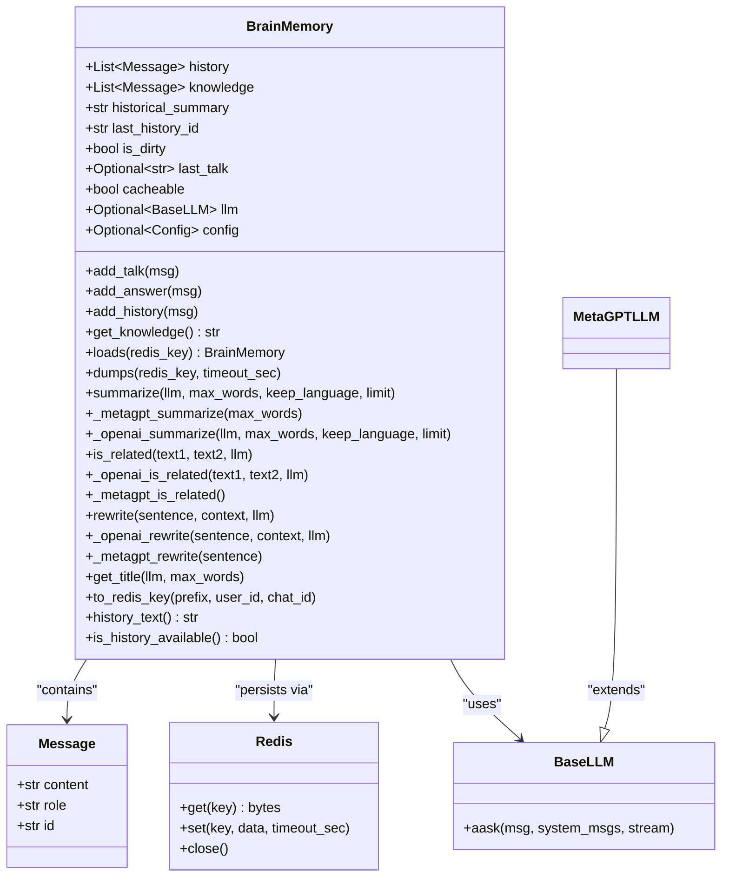
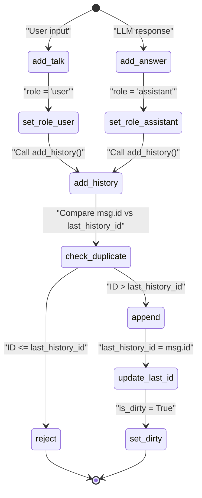
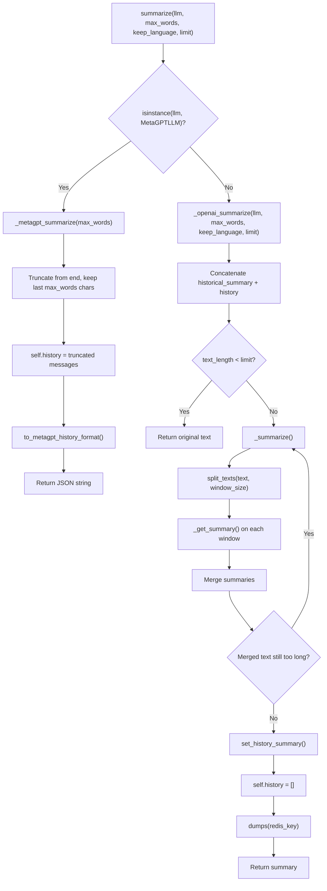
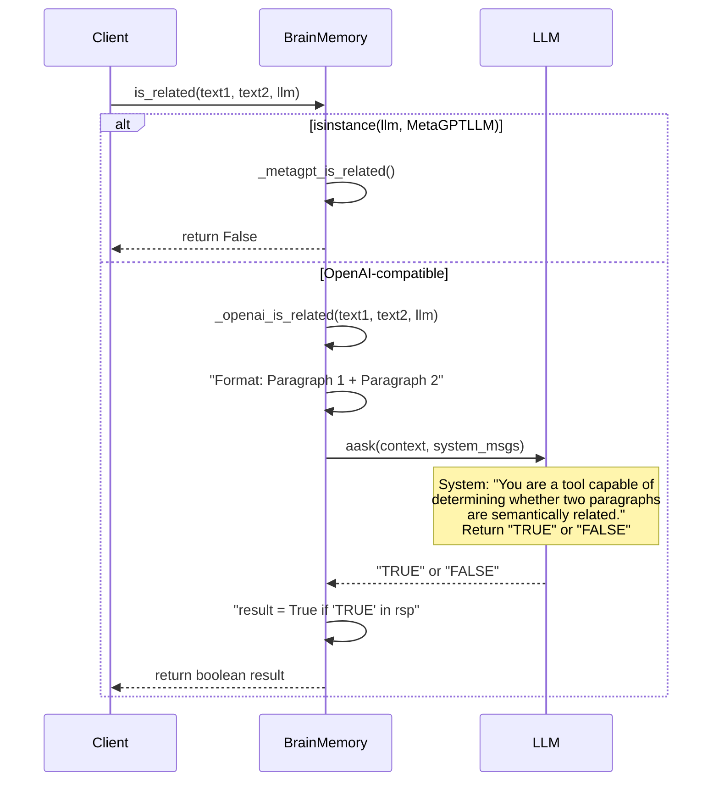
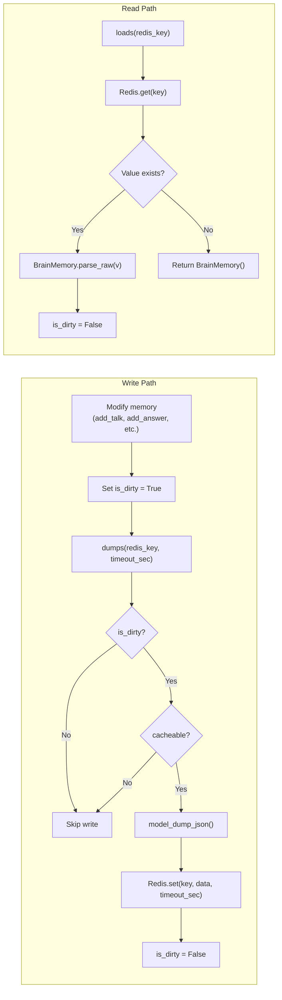
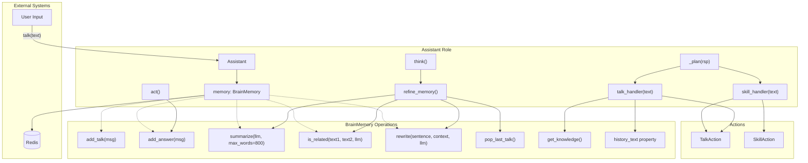
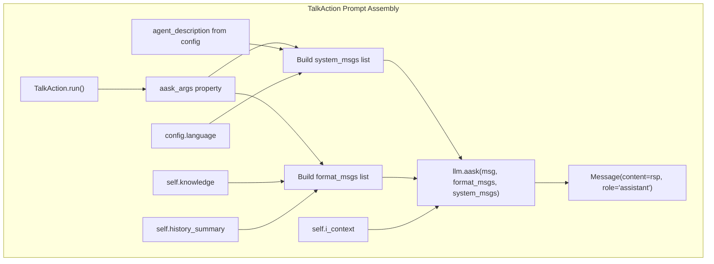
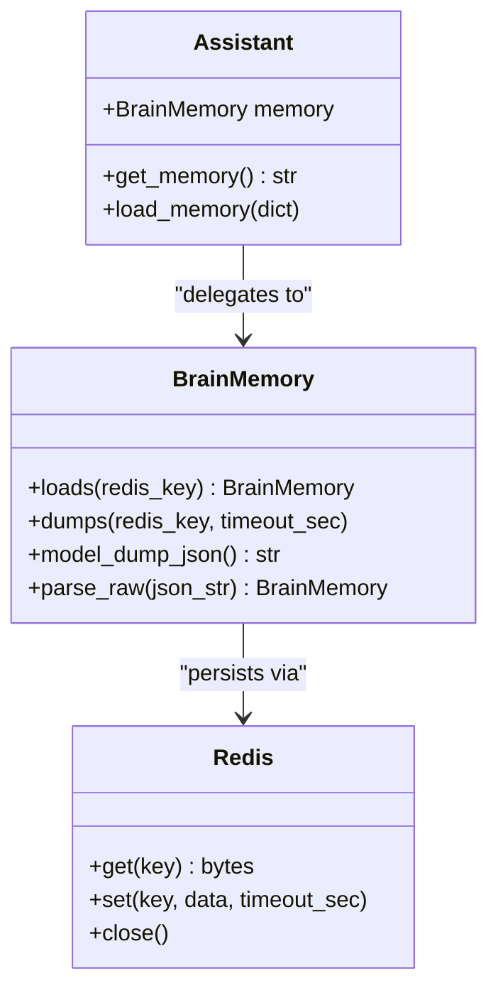

<!-- source: DeepWiki mcp.deepwiki.com · repo FoundationAgents/MetaGPT · page 8.2 BrainMemory System · fetched 2026-10-30 -->

# BrainMemory System

<details>
<summary>Relevant source files</summary>

The following files were used as context for generating this wiki page:

- [metagpt/actions/skill_action.py](metagpt/actions/skill_action.py)
- [metagpt/actions/talk_action.py](metagpt/actions/talk_action.py)
- [metagpt/memory/brain_memory.py](metagpt/memory/brain_memory.py)
- [metagpt/roles/assistant.py](metagpt/roles/assistant.py)
- [metagpt/utils/redis.py](metagpt/utils/redis.py)
- [metagpt/utils/s3.py](metagpt/utils/s3.py)
- [tests/metagpt/memory/test_brain_memory.py](tests/metagpt/memory/test_brain_memory.py)
- [tests/metagpt/roles/test_assistant.py](tests/metagpt/roles/test_assistant.py)
- [tests/metagpt/test_llm.py](tests/metagpt/test_llm.py)
- [tests/metagpt/utils/test_redis.py](tests/metagpt/utils/test_redis.py)
- [tests/metagpt/utils/test_s3.py](tests/metagpt/utils/test_s3.py)

</details>


## Overview

The `BrainMemory` class provides Redis-backed conversational memory for the Assistant role and other conversational agents. It maintains persistent history, knowledge base entries, and compressed summaries across multiple conversation turns, with automatic dirty tracking and LLM-based semantic analysis.

Key capabilities:
- **History Management**: Role-labeled message storage (user/assistant) with duplicate prevention
- **Summarization**: Two strategies (MetaGPT truncation vs OpenAI recursive windowing)
- **Semantic Analysis**: Relatedness checking and context-aware sentence rewriting
- **Persistence**: Redis serialization with dirty tracking and TTL support

For the Assistant role integration, see page 8.1. For standard Role memory, see page 2.3.

**Sources:** [metagpt/memory/brain_memory.py:1-25]()

---

## BrainMemory Data Structure

The `BrainMemory` class is a Pydantic model that maintains conversational state across multiple interactions. It stores message history, knowledge base entries, and metadata for efficient conversation management.

### Core Components



| Field | Type | Purpose |
|-------|------|---------|
| `history` | `List[Message]` | Sequential conversation messages with role labels ("user" or "assistant") |
| `knowledge` | `List[Message]` | Static knowledge base entries available to the agent |
| `historical_summary` | `str` | Compressed summary of old history to reduce token usage |
| `last_history_id` | `str` | ID of the most recent message to prevent duplicates |
| `is_dirty` | `bool` | Flag indicating unsaved changes requiring Redis persistence |
| `last_talk` | `Optional[str]` | Temporary storage for the most recent user input before processing |
| `cacheable` | `bool` | Whether to persist this memory to Redis (default: True) |
| `llm` | `Optional[BaseLLM]` | LLM instance for summarization and semantic analysis (excluded from serialization) |
| `config` | `Optional[Config]` | Configuration including Redis connection settings (defaults to Config.default()) |

**Sources:** [metagpt/memory/brain_memory.py:26-44]()

---

## Conversation History Management

BrainMemory distinguishes between user inputs and assistant responses using role labels, and prevents duplicate entries by tracking message IDs.

### Adding Messages



The `add_talk()` method marks messages as "user" role and the `add_answer()` method marks them as "assistant" role. Both delegate to `add_history()` which performs duplicate detection:

```python
# Add user message
memory.add_talk(Message(content="Hello"))  # role set to "user"

# Add assistant response
memory.add_answer(Message(content="Hi there!"))  # role set to "assistant"
```

The `add_history()` method uses integer comparison of message IDs to prevent adding old messages:

**Sources:** [metagpt/memory/brain_memory.py:45-110]()

### History Retrieval

The `history_text` property concatenates the historical summary with all history messages except the last one, providing context for the current turn:

```python
@property
def history_text(self):
    texts = [self.historical_summary] if self.historical_summary else []
    for m in self.history[:-1]:
        texts.append(m.content)
    return "\n".join(texts)
```

The `get_knowledge()` method joins all knowledge entries into a single string for prompt inclusion.

**Sources:** [metagpt/memory/brain_memory.py:59-62](), [metagpt/memory/brain_memory.py:261-274]()

---

## Summarization Strategies

BrainMemory provides two summarization strategies depending on the LLM provider: recursive OpenAI-style summarization with overlapping windows, and MetaGPT truncation that preserves the most recent messages.

### Strategy Selection



### MetaGPT Truncation Strategy

The MetaGPT provider uses a simple truncation approach that preserves the most recent conversation:

1. Iterate through `history` in reverse order
2. Accumulate messages until total length reaches `max_words` (character count)
3. Truncate the oldest message if needed to fit the limit
4. Store the truncated history and serialize as JSON

This strategy is fast and deterministic, requiring no LLM calls.

**Sources:** [metagpt/memory/brain_memory.py:130-136](), [metagpt/memory/brain_memory.py:152-180]()

### OpenAI Recursive Summarization

For OpenAI and compatible LLMs, BrainMemory uses a sophisticated recursive summarization with sliding windows:

#### Window Splitting Algorithm

```python
# Split long text into overlapping windows
window_size = DEFAULT_MAX_TOKENS  # Token budget per window
padding_size = 20  # Overlap between windows

# Example: text of length 10 with window_size=3, padding_size=1
# Windows: [1,2,3], [3,4,5], [5,6,7], [7,8,9], [9,10]
#          idx=0    idx=2    idx=4    idx=6    idx=8
```

The `split_texts()` method creates overlapping windows where each window shares `padding_size` characters with the next, ensuring context continuity across boundaries.

#### Recursive Process

| Step | Action |
|------|--------|
| 1 | Concatenate `historical_summary` and all messages in `history` |
| 2 | If total length < limit, return original text |
| 3 | Split text into windows sized to fit token budget (`DEFAULT_MAX_TOKENS`) |
| 4 | Call `_get_summary()` on each window with `max_words / num_windows` budget |
| 5 | Merge window summaries into a single text |
| 6 | If merged text still too long, repeat from step 3 (max 100 iterations) |
| 7 | Call `set_history_summary()` to store final summary |
| 8 | Clear `history` list and persist to Redis |

The `_get_summary()` method prompts the LLM with system messages requesting text summarization to a target word count:

**Sources:** [metagpt/memory/brain_memory.py:137-151](), [metagpt/memory/brain_memory.py:276-319](), [metagpt/memory/brain_memory.py:320-345]()

---

## Semantic Analysis Features

BrainMemory provides three semantic analysis capabilities using LLM calls: relatedness checking, sentence rewriting with context augmentation, and title generation.

### Relatedness Detection

The `is_related()` method determines if two text paragraphs are semantically related:



The system prompt instructs the LLM to act as a semantic relatedness classifier, returning "TRUE" if the paragraphs are related and "FALSE" otherwise.

**Sources:** [metagpt/memory/brain_memory.py:198-222]()

### Context-Based Rewriting

The `rewrite()` method augments a sentence with information from a provided context:

```python
# Example usage in Assistant role
history_summary = await self.memory.summarize(max_words=800, llm=self.llm)
if await self.memory.is_related(last_talk, history_summary, llm=self.llm):
    merged = await self.memory.rewrite(sentence=last_talk, context=history_summary, llm=self.llm)
    return f"{merged} {last_talk}"
```

The LLM is instructed to augment the sentence with context information without adding facts not present in the context, especially regarding subjects and objects. This helps resolve pronouns and implicit references using conversation history.

**Sources:** [metagpt/memory/brain_memory.py:224-246]()

### Title Generation

The `get_title()` method generates a concise title for a conversation:

1. For `MetaGPTLLM`: Return the first message content or "New"
2. For OpenAI-compatible: Summarize conversation to 500 words, then translate to a title in the configured language (max 5 words by default)

The two-step process ensures the title captures the overall topic while remaining concise.

**Sources:** [metagpt/memory/brain_memory.py:182-196]()

---

## Redis Persistence

BrainMemory uses Redis for durable storage with automatic dirty tracking and key generation utilities.

### Persistence Flow



### Redis Key Generation

The static method `to_redis_key()` generates structured keys for multi-tenancy:

```python
redis_key = BrainMemory.to_redis_key(
    prefix="brain",      # Service namespace
    user_id="user123",   # User identifier
    chat_id="chat456"    # Conversation identifier
)
# Result: "brain:user123:chat456"
```

### Dirty Tracking

The `is_dirty` flag optimizes Redis writes:
- Set to `True` when memory is modified (`add_talk`, `add_answer`, `add_history`, summarization)
- Checked in `dumps()` to skip unnecessary writes
- Cleared to `False` after successful persistence

The default timeout is 30 minutes (1800 seconds), after which Redis automatically expires the key.

**Sources:** [metagpt/memory/brain_memory.py:63-101](), [metagpt/utils/redis.py:19-63]()

---

## Integration with Assistant Role

The `Assistant` role uses `BrainMemory` to maintain conversational context across multiple turns, with automatic summarization and semantic analysis to handle long conversations.

### Assistant-BrainMemory Architecture



### Conversation Lifecycle

| Phase | Method | BrainMemory Operations |
|-------|--------|------------------------|
| **User Input** | `talk(text)` | `add_talk(Message(content=text))` - stores user message with role="user" |
| **Context Refinement** | `refine_memory()` | 1. `pop_last_talk()` - retrieves user input<br/>2. `summarize(max_words=800)` - compresses history<br/>3. `is_related(last_talk, summary)` - checks relevance<br/>4. `rewrite(last_talk, summary)` - augments with context |
| **Action Planning** | `think()` | Reads `history_text` and `get_knowledge()` for context |
| **Action Execution** | `act()` via `TalkAction` | Creates response using `i_context`, `knowledge`, and `history_summary` |
| **Response Storage** | `act()` | `add_answer(msg)` - stores LLM response with role="assistant" |

### Memory Refinement Example

```python
async def refine_memory(self) -> str:
    last_talk = self.memory.pop_last_talk()
    if not self.memory.is_history_available:
        return last_talk  # No history to merge
    
    # Compress history to 800 words
    history_summary = await self.memory.summarize(max_words=800, keep_language=True, llm=self.llm)
    
    # Check if current input relates to history
    if last_talk and await self.memory.is_related(text1=last_talk, text2=history_summary, llm=self.llm):
        # Augment current input with historical context
        merged = await self.memory.rewrite(sentence=last_talk, context=history_summary, llm=self.llm)
        return f"{merged} {last_talk}"
    
    return last_talk  # Unrelated, use as-is
```

This refinement resolves ambiguous pronouns and references by checking semantic relatedness and rewriting the user input to include relevant historical context.

**Sources:** [metagpt/roles/assistant.py:37-140]()

---

## TalkAction Integration

The `TalkAction` class uses BrainMemory's `knowledge`, `history_summary`, and current context to generate natural conversational responses.

### Prompt Construction



### Prompt Components

The `aask_args` property constructs a three-part prompt structure:

1. **System Messages** (role/persona setup):
```python
system_msgs = [
    f"You are {self.agent_description}.",
    "Your responses should align with the role-play agreement...",
    "If the information is insufficient, you can search in the context or knowledge.",
    f"Answer the following questions strictly in {language}..."
]
```

2. **Format Messages** (context from memory):
```python
format_msgs = []
if self.knowledge:
    format_msgs.append({"role": "assistant", "content": self.knowledge})
if self.history_summary:
    format_msgs.append({"role": "assistant", "content": self.history_summary})
```

3. **User Message** (current input):
```python
msg = self.i_context  # Current user query
```

This structure provides the LLM with role definition, long-term knowledge, compressed conversation history, and the current query in a format optimized for chat completion APIs.

**Sources:** [metagpt/actions/talk_action.py:16-96]()

---

## Persistence and State Management

BrainMemory provides serialization methods for saving and restoring complete conversational state.

### Serialization Methods



### Usage Pattern

```python
# Save memory state via Assistant
assistant = Assistant()
memory_json = assistant.get_memory()  # Returns JSON string via BrainMemory.model_dump_json()

# Restore memory state in new assistant instance
new_assistant = Assistant()
new_assistant.load_memory(memory_dict)  # Calls BrainMemory(**dict)

# Or use Redis persistence directly
redis_key = BrainMemory.to_redis_key("brain", "user_id", "chat_id")
await memory.dumps(redis_key=redis_key, timeout_sec=1800)  # Defaults to 30 minutes

# Later, restore from Redis
restored_memory = await BrainMemory().loads(redis_key=redis_key)
```

### State Preservation

All BrainMemory fields are serialized except `llm` (marked with `exclude=True`), which must be reinitialized when loading memory. The `is_dirty` flag is automatically reset to `False` after loading from Redis to prevent immediate re-writes.

**Sources:** [metagpt/roles/assistant.py:132-140](), [metagpt/memory/brain_memory.py:63-86]()

---

## Testing Strategy

The test suite validates BrainMemory's core functionality using mocked LLM responses and Redis connections.

### Test Coverage

| Test File | Focus Area | Key Assertions |
|-----------|------------|----------------|
| `test_brain_memory.py` | Basic operations | `add_talk/add_answer` role assignment, duplicate detection, `exists()`, `to_int()`, `pop_last_talk()`, `is_history_available`, `history_text` |
| `test_brain_memory.py` | Parsing utilities | `extract_info()` with `[TAG]:value` format |
| `test_brain_memory.py` | LLM operations | `is_related()` returns False for unrelated, `rewrite()` includes context, `summarize()` produces output, `get_title()` extracts title |
| `test_assistant.py` | Integration | Assistant loads/restores memory, `talk()` triggers correct action, conversation flow |
| `test_redis.py` | Persistence | `set()` and `get()` with timeout, async operations |

### Mock Strategy

```python
# Mock LLM for deterministic tests
@pytest.mark.parametrize("llm", [LLM()])
async def test_memory_llm(llm):
    memory = BrainMemory()
    for i in range(500):
        memory.add_talk(Message(content="Lily is a girl.\n"))
    
    res = await memory.is_related("apple", "moon", llm)
    assert not res  # Unrelated topics
    
    res = await memory.rewrite(sentence="apple Lily eating", context="", llm=llm)
    assert "Lily" in res  # Name preserved
```

The tests use pytest's `mocker` fixture to mock Redis connections and LLM API calls, enabling fast, isolated unit tests without external dependencies.

**Sources:** [tests/metagpt/memory/test_brain_memory.py:1-71](), [tests/metagpt/roles/test_assistant.py:1-136](), [tests/metagpt/utils/test_redis.py:1-38]()

---

