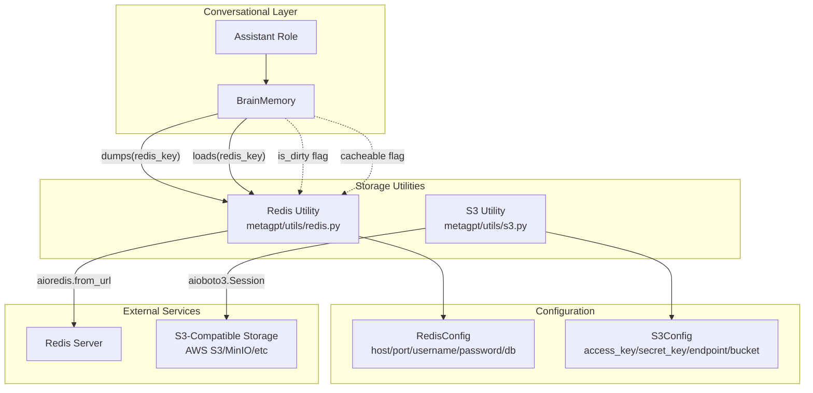
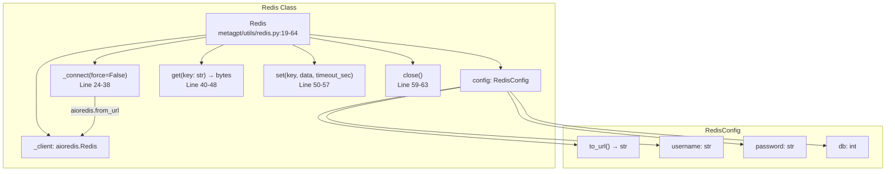
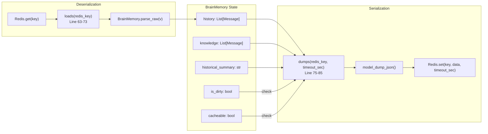
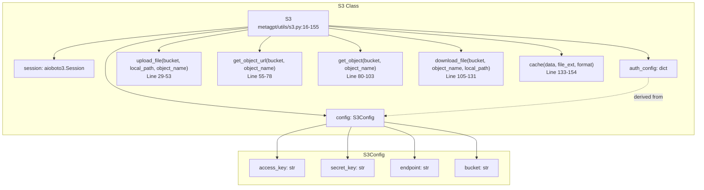
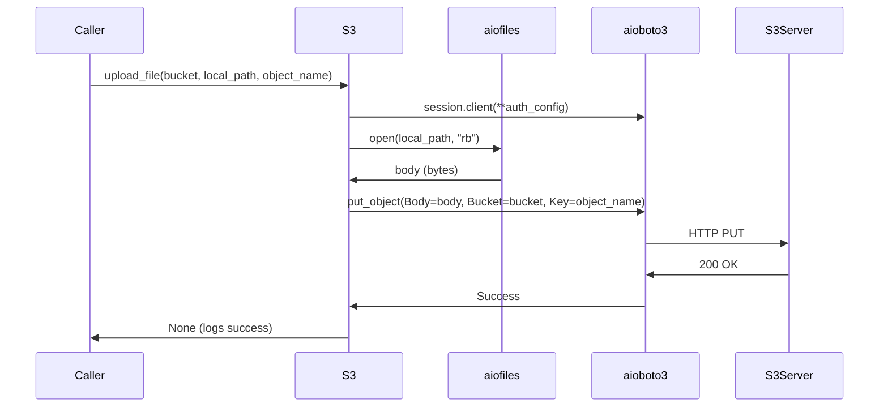
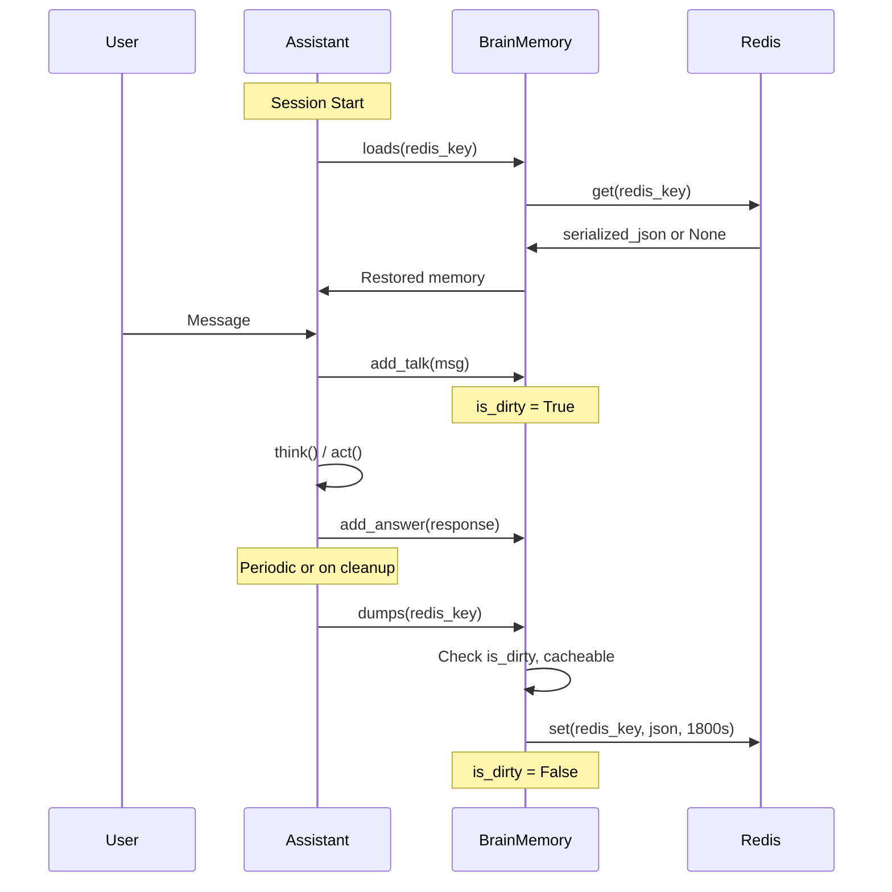

<!-- source: DeepWiki mcp.deepwiki.com · repo FoundationAgents/MetaGPT · page 8.3 Redis and S3 Integration · fetched 2026-10-30 -->

# Redis and S3 Integration

<details>
<summary>Relevant source files</summary>

The following files were used as context for generating this wiki page:

- [metagpt/actions/skill_action.py](metagpt/actions/skill_action.py)
- [metagpt/actions/talk_action.py](metagpt/actions/talk_action.py)
- [metagpt/memory/brain_memory.py](metagpt/memory/brain_memory.py)
- [metagpt/roles/assistant.py](metagpt/roles/assistant.py)
- [metagpt/utils/redis.py](metagpt/utils/redis.py)
- [metagpt/utils/s3.py](metagpt/utils/s3.py)
- [tests/metagpt/memory/test_brain_memory.py](tests/metagpt/memory/test_brain_memory.py)
- [tests/metagpt/roles/test_assistant.py](tests/metagpt/roles/test_assistant.py)
- [tests/metagpt/test_llm.py](tests/metagpt/test_llm.py)
- [tests/metagpt/utils/test_redis.py](tests/metagpt/utils/test_redis.py)
- [tests/metagpt/utils/test_s3.py](tests/metagpt/utils/test_s3.py)

</details>


This document describes the external storage integration layer for MetaGPT, specifically the Redis and S3 utilities that enable persistent state management. Redis is primarily used for caching conversational memory in the `BrainMemory` system, while S3 provides cloud-based file storage for artifacts and data.

For information about the `BrainMemory` system itself and how it's used by conversational agents, see [BrainMemory System](#8.2). For broader context on the Assistant role architecture, see [Assistant Role Architecture](#8.1).

## Overview

MetaGPT provides two external storage utilities that enable persistence beyond local filesystem:

- **Redis**: Asynchronous key-value cache for `BrainMemory` serialization, enabling conversational context to survive across sessions
- **S3**: Cloud object storage for file uploads, downloads, and URL generation

Both utilities are designed as thin async wrappers around their respective client libraries (`redis.asyncio` and `aioboto3`), with built-in error handling and logging.

**System Architecture**



Sources: [metagpt/utils/redis.py:1-64](), [metagpt/utils/s3.py:1-155](), [metagpt/memory/brain_memory.py:63-86]()

## Redis Utility

The `Redis` class provides asynchronous connection management and key-value operations for Redis server interaction.

### Redis Class Structure



Sources: [metagpt/utils/redis.py:19-64](), [metagpt/configs/redis_config.py]()

### Key Methods

| Method | Signature | Purpose | Line Reference |
|--------|-----------|---------|----------------|
| `_connect` | `async def _connect(force=False) → bool` | Establishes Redis connection lazily | [metagpt/utils/redis.py:24-38]() |
| `get` | `async def get(key: str) → bytes \| None` | Retrieves value by key, returns None on error | [metagpt/utils/redis.py:40-48]() |
| `set` | `async def set(key: str, data: str, timeout_sec: int = None)` | Stores key-value pair with optional expiration | [metagpt/utils/redis.py:50-57]() |
| `close` | `async def close()` | Closes Redis connection | [metagpt/utils/redis.py:59-63]() |

### Connection Management

The `_connect` method implements lazy connection initialization:

- Reuses existing connection unless `force=True` is specified
- Constructs URL from `RedisConfig.to_url()` with credentials
- Returns `True` on success, `False` on failure (logs warning)
- All failures are caught and logged rather than raised

[metagpt/utils/redis.py:24-38]()

### Error Handling Pattern

Both `get` and `set` methods follow a consistent error handling pattern:

1. Check connection via `await self._connect()`
2. Validate input parameters (e.g., `key` must be non-empty)
3. Execute Redis operation
4. Catch all exceptions, log with traceback
5. Return `None` (for `get`) or silently fail (for `set`)

This ensures that Redis failures don't crash the application, enabling graceful degradation.

Sources: [metagpt/utils/redis.py:40-57]()

### Timeout Configuration

The `set` method accepts an optional `timeout_sec` parameter that controls key expiration:

```python
ex = None if not timeout_sec else timedelta(seconds=timeout_sec)
await self._client.set(key, data, ex=ex)
```

If `timeout_sec` is None or 0, the key persists indefinitely. Otherwise, Redis automatically deletes the key after the specified duration.

Sources: [metagpt/utils/redis.py:54-55]()

## BrainMemory Redis Integration

`BrainMemory` uses Redis as its persistent storage backend, serializing its entire state including history, knowledge, and summaries.

### Serialization Flow



Sources: [metagpt/memory/brain_memory.py:63-86]()

### Key Format Convention

The static method `to_redis_key` constructs Redis keys using a hierarchical format:

```python
@staticmethod
def to_redis_key(prefix: str, user_id: str, chat_id: str):
    return f"{prefix}:{user_id}:{chat_id}"
```

This creates keys like `"assistant:user123:chat456"`, enabling:
- Namespace isolation via prefix
- User-level partitioning
- Chat-level granularity
- Easy pattern matching with Redis SCAN

Sources: [metagpt/memory/brain_memory.py:87-89]()

### Dirty State Tracking

`BrainMemory` uses the `is_dirty` flag to implement write-through caching:

| Operation | Sets `is_dirty = True` | Line Reference |
|-----------|------------------------|----------------|
| `add_talk(msg)` | Yes | [metagpt/memory/brain_memory.py:51]() |
| `add_answer(msg)` | Yes | [metagpt/memory/brain_memory.py:57]() |
| `add_history(msg)` | Yes | [metagpt/memory/brain_memory.py:110]() |
| `dumps(redis_key)` | Sets to False after write | [metagpt/memory/brain_memory.py:85]() |
| `loads(redis_key)` | Sets to False after read | [metagpt/memory/brain_memory.py:71]() |

The `dumps` method short-circuits if `is_dirty` is False, avoiding redundant Redis writes:

```python
async def dumps(self, redis_key: str, timeout_sec: int = 30 * 60):
    if not self.is_dirty:
        return
    # ... perform serialization ...
    self.is_dirty = False
```

Sources: [metagpt/memory/brain_memory.py:75-85]()

### Cacheable Flag

The `cacheable` boolean controls whether serialization writes to Redis:

```python
if self.cacheable:
    await redis.set(key=redis_key, data=v, timeout_sec=timeout_sec)
    logger.debug(f"REDIS SET {redis_key} {v}")
self.is_dirty = False
```

When `cacheable=False`, `dumps` only resets the dirty flag without writing to Redis. This allows in-memory-only operation for testing or privacy-sensitive scenarios.

Sources: [metagpt/memory/brain_memory.py:82-85]()

### Default Timeout

By default, `BrainMemory.dumps` sets Redis keys to expire after 30 minutes (1800 seconds):

```python
async def dumps(self, redis_key: str, timeout_sec: int = 30 * 60):
```

This prevents indefinite memory accumulation in Redis while allowing reasonable session persistence.

Sources: [metagpt/memory/brain_memory.py:75]()

### Serialization Format

`BrainMemory` uses Pydantic's `model_dump_json()` for serialization, producing JSON with the following structure:

```json
{
  "history": [
    {"content": "...", "role": "user", "id": "..."},
    {"content": "...", "role": "assistant"}
  ],
  "knowledge": [...],
  "historical_summary": "...",
  "last_history_id": "...",
  "is_dirty": false,
  "last_talk": null,
  "cacheable": true
}
```

The `parse_raw` method reconstructs the `BrainMemory` object from this JSON.

Sources: [metagpt/memory/brain_memory.py:70](), [metagpt/memory/brain_memory.py:81]()

## S3 Utility

The `S3` class provides asynchronous file operations for S3-compatible object storage services (AWS S3, MinIO, etc.).

### S3 Class Architecture



Sources: [metagpt/utils/s3.py:16-155]()

### Key Methods

| Method | Purpose | Return Type | Line Reference |
|--------|---------|-------------|----------------|
| `upload_file` | Upload local file to S3 bucket | `None` (raises on error) | [metagpt/utils/s3.py:29-53]() |
| `get_object_url` | Get downloadable URL for S3 object | `str` | [metagpt/utils/s3.py:55-78]() |
| `get_object` | Retrieve binary data from S3 | `bytes` | [metagpt/utils/s3.py:80-103]() |
| `download_file` | Download S3 object to local file | `None` | [metagpt/utils/s3.py:105-131]() |
| `cache` | Save data to S3 and return URL | `str` (None on error) | [metagpt/utils/s3.py:133-154]() |

### Authentication Configuration

The `S3` class constructs authentication parameters from `S3Config`:

```python
self.auth_config = {
    "service_name": "s3",
    "aws_access_key_id": config.access_key,
    "aws_secret_access_key": config.secret_key,
    "endpoint_url": config.endpoint,
}
```

This configuration is passed to `aioboto3.Session.client()` for each operation via async context manager.

Sources: [metagpt/utils/s3.py:22-27]()

### File Upload

The `upload_file` method reads local file asynchronously and uploads to S3:



Sources: [metagpt/utils/s3.py:29-53]()

**Error Handling**: Unlike Redis utilities, S3 methods raise exceptions on failure rather than returning None. Callers must handle exceptions explicitly.

### Object Download

The `download_file` method streams S3 object to local file in chunks:

```python
async def download_file(
    self, bucket: str, object_name: str, local_path: str, chunk_size: Optional[int] = 128 * 1024
) -> None:
```

**Chunked Streaming**: The method uses a configurable `chunk_size` (default 128 KB) to read and write data incrementally, enabling efficient handling of large files without loading them entirely into memory.

Sources: [metagpt/utils/s3.py:105-131]()

Implementation details:
1. Gets S3 object via `get_object(Bucket=bucket, Key=object_name)`
2. Obtains streaming `Body` from response
3. Opens local file in write-binary mode with `aiofiles`
4. Loops: read chunk, write chunk, until EOF
5. Closes file handles (async context managers)

Sources: [metagpt/utils/s3.py:119-128]()

### Cache Utility

The `cache` method provides a high-level interface for storing arbitrary data in S3 and retrieving a public URL:

**Flow**:
1. Generate random filename: `uuid.uuid4().hex + file_ext`
2. Decode data (base64 if `format == BASE64_FORMAT`, else UTF-8)
3. Write to temporary local file
4. Upload to S3 with normalized object path
5. Delete temporary file
6. Return URL via `get_object_url`

Sources: [metagpt/utils/s3.py:133-154]()

**Object Path Construction**:
```python
object_pathname = self.config.bucket or "system"
object_pathname += f"/{object_name}"
object_pathname = os.path.normpath(object_pathname)
```

This creates S3 keys like `"system/abc123.png"` or `"my-bucket/def456.json"`.

Sources: [metagpt/utils/s3.py:144-146]()

**Error Handling**: The `cache` method catches all exceptions, logs them with traceback, cleans up temporary file, and returns `None`. This enables graceful fallback when S3 is unavailable.

Sources: [metagpt/utils/s3.py:151-154]()

## Integration Patterns

### BrainMemory Persistence Pattern

The Assistant role uses `BrainMemory` with Redis as follows:



Sources: [metagpt/roles/assistant.py:1-140](), [metagpt/memory/brain_memory.py:63-86]()

The key points are:
- **Lazy loading**: Memory is restored only when needed
- **Optimistic writes**: Updates accumulate in memory (is_dirty=True)
- **Batched persistence**: `dumps` is called periodically, not per message
- **Expiration**: 30-minute TTL prevents stale data accumulation

### Memory Lifecycle in Assistant

The `Assistant` role demonstrates the complete lifecycle:

| Phase | Operations | Code Reference |
|-------|-----------|----------------|
| **Initialization** | `BrainMemory()` created with default fields | [metagpt/roles/assistant.py:45]() |
| **Talk** | `memory.add_talk(Message(content=text))` sets is_dirty | [metagpt/roles/assistant.py:86]() |
| **Think** | `memory.summarize()`, `memory.is_related()` | [metagpt/roles/assistant.py:124-125]() |
| **Act** | `memory.add_answer(msg)` sets is_dirty | [metagpt/roles/assistant.py:82]() |
| **Serialization** | Caller invokes `memory.dumps(redis_key)` | External to Assistant |

Note that `Assistant` itself does not call `dumps` or `loads` - these are typically invoked by a higher-level orchestration layer (e.g., web server managing sessions).

Sources: [metagpt/roles/assistant.py:37-140]()

### Configuration Requirements

**Redis Setup**:
```yaml
redis:
  host: localhost
  port: 6379
  username: ""
  password: ""
  db: 0
```

The `RedisConfig.to_url()` method constructs connection strings like `"redis://localhost:6379/0"`.

**S3 Setup**:
```yaml
s3:
  access_key: "AWS_ACCESS_KEY_ID"
  secret_key: "AWS_SECRET_ACCESS_KEY"
  endpoint: "https://s3.amazonaws.com"
  bucket: "my-metagpt-bucket"
```

Alternative endpoints enable S3-compatible services:
- MinIO: `"http://minio.example.com:9000"`
- Wasabi: `"https://s3.wasabisys.com"`
- Backblaze B2: `"https://s3.us-west-002.backblazeb2.com"`

Sources: [metagpt/configs/redis_config.py](), [metagpt/config2.py]()

## Testing

### Redis Testing Strategy

The Redis test suite uses mocking to avoid requiring a live Redis instance:

```python
mocker.patch("aioredis.from_url", return_value=async_mock_from_url())
```

The mock returns an `AsyncMock` client with predefined responses:
- `mock_client.set.return_value = None`
- `mock_client.get.return_value = b"test"`

This enables fast, deterministic testing of Redis integration logic without external dependencies.

Sources: [tests/metagpt/utils/test_redis.py:1-38]()

### S3 Testing Strategy

Similarly, S3 tests mock `aioboto3.Session.client()`:

```python
mocker.patch.object(aioboto3.Session, "client", return_value=mock_client)
```

The mock client provides:
- `put_object.return_value = None`
- `get_object.return_value = {"Body": reader_mock}`
- `reader_mock.read.side_effect = [data.encode("utf-8"), b""]`

This simulates file upload/download without requiring AWS credentials or S3 buckets.

Sources: [tests/metagpt/utils/test_s3.py:1-73]()

### BrainMemory Integration Test

The BrainMemory test verifies the complete Redis serialization cycle:

```python
memory = BrainMemory()
memory.add_talk(Message(content="talk"))
memory.add_answer(Message(content="answer"))
redis_key = BrainMemory.to_redis_key("none", "user_id", "chat_id")
await memory.dumps(redis_key=redis_key)

memory = await BrainMemory.loads(redis_key=redis_key)
assert memory
```

This confirms that `dumps` → `loads` round-trips preserve all state including history, roles, and dirty flags.

Sources: [tests/metagpt/memory/test_brain_memory.py:17-34]()

## Error Handling Summary

| Component | Error Strategy | Example |
|-----------|----------------|---------|
| `Redis.get` | Returns `None`, logs warning | `logger.exception(f"{e}, stack:{traceback.format_exc()}")` |
| `Redis.set` | Silently fails, logs exception | No return value check needed |
| `Redis._connect` | Returns `False`, logs warning | `logger.warning(f"Redis initialization has failed:{e}")` |
| `S3.upload_file` | Raises exception | Caller must catch and handle |
| `S3.download_file` | Raises exception | Caller must catch and handle |
| `S3.cache` | Returns `None`, logs exception | Suitable for optional caching |
| `BrainMemory.dumps` | Continues if Redis unavailable | Depends on Redis.set silent failure |

**Design Philosophy**: Redis utilities prefer graceful degradation (return None) to allow the application to continue with in-memory state. S3 utilities raise exceptions for explicit error handling, as file operations are often critical to correctness.

Sources: [metagpt/utils/redis.py:36-57](), [metagpt/utils/s3.py:51-53](), [metagpt/utils/s3.py:152-154]()

## Advanced Features

### BrainMemory Summarization with Redis

When `BrainMemory.summarize()` is called, the method updates the `historical_summary` field and conditionally persists to Redis:

```python
async def _metagpt_summarize(self, max_words=200):
    # ... compress history ...
    self.is_dirty = True
    await self.dumps(redis_key=self.config.redis.key)
    self.is_dirty = False
    return BrainMemory.to_metagpt_history_format(self.history)
```

This ensures that summary operations immediately persist, even if the caller doesn't explicitly call `dumps`.

Sources: [metagpt/memory/brain_memory.py:152-175]()

### S3 Base64 Format Support

The `cache` method supports two data formats:

```python
data = base64.b64decode(data) if format == BASE64_FORMAT else data.encode(encoding="utf-8")
```

- `format == "base64"`: Decodes base64 string to bytes (useful for images)
- `format` is anything else: Encodes string to UTF-8 bytes (useful for text)

Sources: [metagpt/utils/s3.py:140]()

### Redis Key Inspection

The `to_redis_key` format enables pattern-based operations:

- Get all conversations for a user: `SCAN 0 MATCH assistant:user123:*`
- Delete all assistant memories: `SCAN 0 MATCH assistant:*`
- Namespace isolation: Different prefixes prevent key collisions

While MetaGPT doesn't currently expose these operations, the consistent key format makes them feasible for future enhancements.

Sources: [metagpt/memory/brain_memory.py:87-89]()

---

