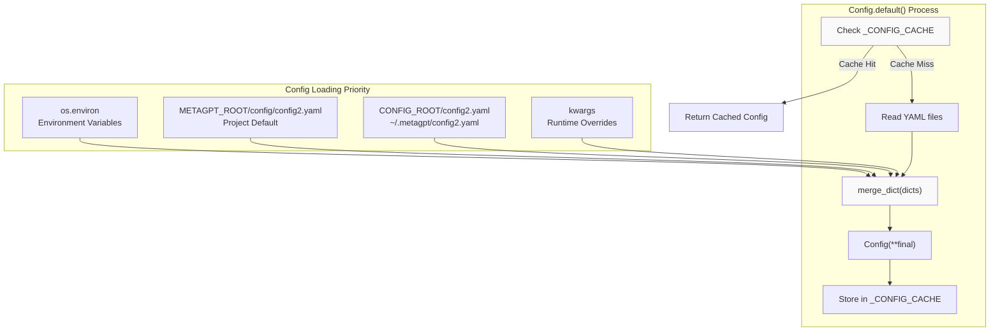
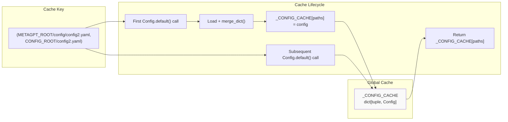
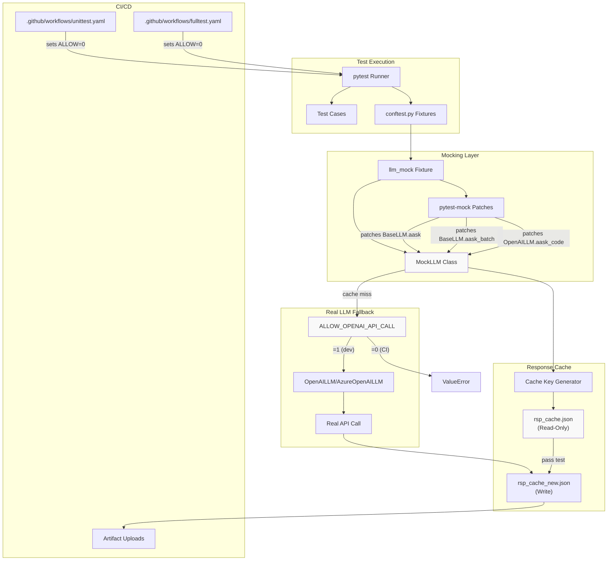
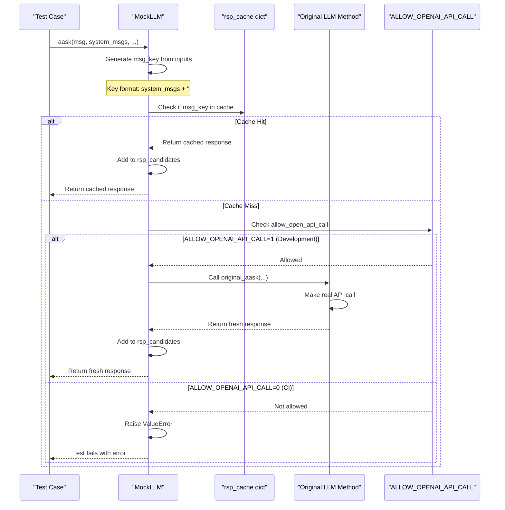
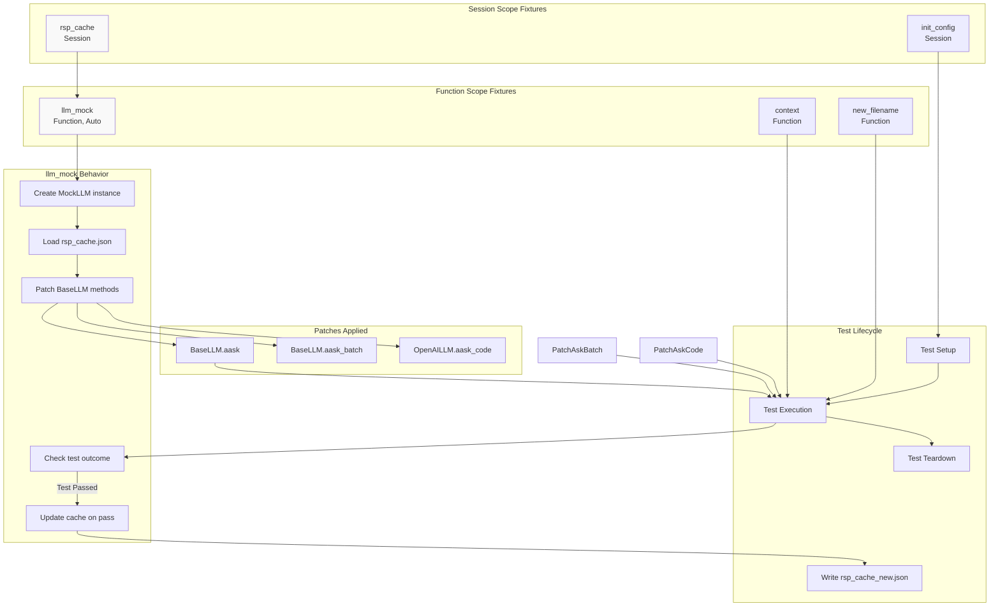
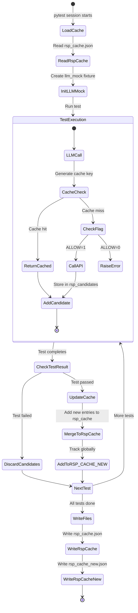
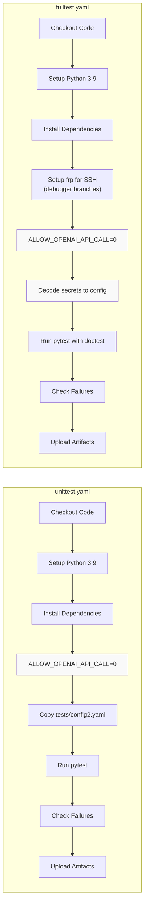
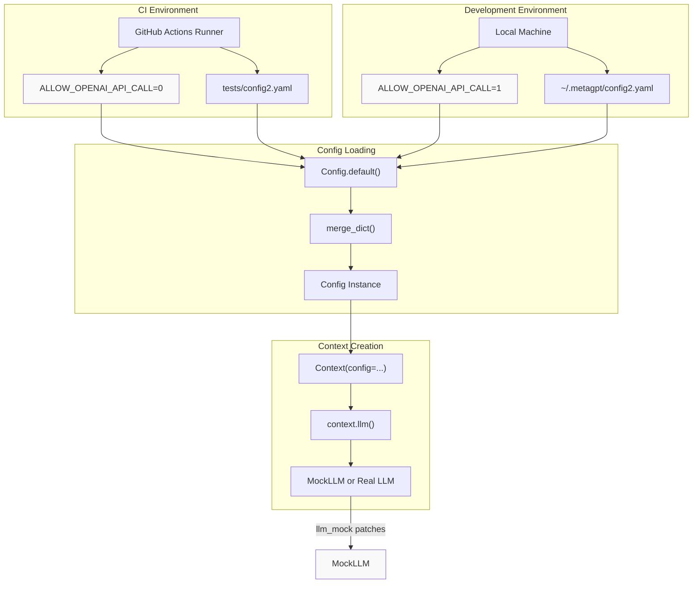
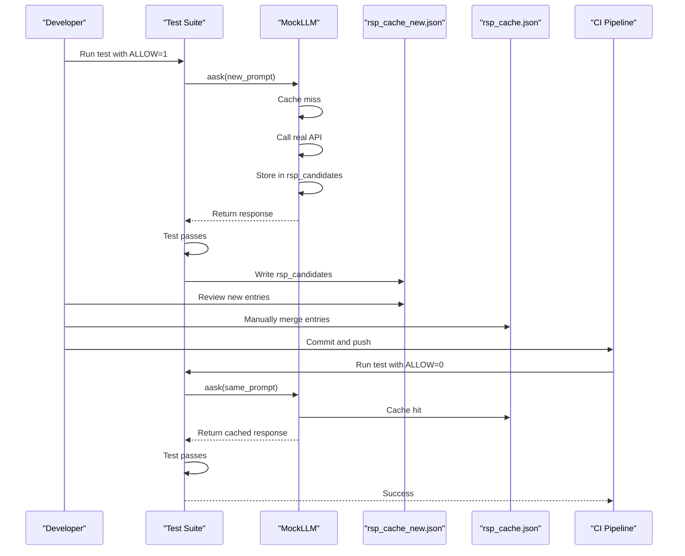

<!-- source: DeepWiki mcp.deepwiki.com · repo FoundationAgents/MetaGPT · page 9 Testing and Development Infrastructure · fetched 2026-10-30 -->

# Testing and Development Infrastructure

<details>
<summary>Relevant source files</summary>

The following files were used as context for generating this wiki page:

- [.github/workflows/fulltest.yaml](.github/workflows/fulltest.yaml)
- [.github/workflows/unittest.yaml](.github/workflows/unittest.yaml)
- [Dockerfile](Dockerfile)
- [README.md](README.md)
- [docs/ACADEMIC_WORK.md](docs/ACADEMIC_WORK.md)
- [docs/NEWS.md](docs/NEWS.md)
- [docs/README_CN.md](docs/README_CN.md)
- [docs/README_FR.md](docs/README_FR.md)
- [docs/README_JA.md](docs/README_JA.md)
- [metagpt/config2.py](metagpt/config2.py)
- [metagpt/context.py](metagpt/context.py)
- [metagpt/context_mixin.py](metagpt/context_mixin.py)
- [metagpt/software_company.py](metagpt/software_company.py)
- [metagpt/utils/mermaid.py](metagpt/utils/mermaid.py)
- [tests/conftest.py](tests/conftest.py)
- [tests/data/rsp_cache.json](tests/data/rsp_cache.json)
- [tests/metagpt/test_config.py](tests/metagpt/test_config.py)
- [tests/metagpt/test_context.py](tests/metagpt/test_context.py)
- [tests/metagpt/test_context_mixin.py](tests/metagpt/test_context_mixin.py)
- [tests/mock/mock_llm.py](tests/mock/mock_llm.py)

</details>


This document describes MetaGPT's testing and development infrastructure, covering configuration management, mock LLM testing, CI/CD workflows, and Docker deployment. The testing system enables deterministic, cost-free testing by mocking LLM API calls with cached responses.

---

## Configuration Management Deep Dive

MetaGPT's `Config` class provides a sophisticated configuration loading system with caching, priority-based merging, and multiple initialization methods.

### Config.default() with Caching

The `Config.default()` method implements a singleton pattern with caching to avoid repeated file I/O operations. Configuration is loaded from multiple sources and cached in a global `_CONFIG_CACHE` dictionary.



**Priority Order** (latter overwrites former):
1. Environment variables from `os.environ`
2. Project config: `METAGPT_ROOT/config/config2.yaml`
3. User config: `~/.metagpt/config2.yaml`
4. Runtime kwargs passed to `Config.default(**kwargs)`

Sources: [metagpt/config2.py:110-123](), [metagpt/config2.py:173-182]()

### Configuration Initialization Methods

The `Config` class provides multiple factory methods for different initialization scenarios:

| Method | Purpose | Source | Implementation |
|--------|---------|--------|----------------|
| `Config.default(reload=False, **kwargs)` | Load with priority merging and caching | Multiple sources | [metagpt/config2.py:110-123]() |
| `Config.from_home(path)` | Load from `~/.metagpt/` directory | `CONFIG_ROOT / path` | [metagpt/config2.py:102-107]() |
| `Config.from_llm_config(llm_config)` | Create from LLM config dict | Runtime dict | [metagpt/config2.py:126-137]() |
| `update_via_cli(...)` | Update from CLI arguments | Runtime args | [metagpt/config2.py:139-150]() |

**Example Usage**:
```python
# Load default config with caching
config = Config.default()

# Load specific user config
gpt4_config = Config.from_home("gpt-4-turbo.yaml")

# Create from LLM config dictionary
custom_config = Config.from_llm_config({
    "api_type": "openai",
    "api_key": "sk-...",
    "model": "gpt-4-turbo"
})

# Update from CLI parameters
config.update_via_cli(
    project_path="/path/to/project",
    project_name="my_project",
    inc=True,
    reqa_file="requirements.txt",
    max_auto_summarize_code=5
)
```

Sources: [metagpt/config2.py:102-150]()

### Configuration Cache Structure



**Cache Key**: The tuple of default config paths `(METAGPT_ROOT/config/config2.yaml, CONFIG_ROOT/config2.yaml)` serves as the cache key.

**Reload Behavior**: Passing `reload=True` to `Config.default(reload=True)` bypasses the cache and forces reloading from disk.

Sources: [metagpt/config2.py:110-123](), [metagpt/config2.py:181]()

### Configuration Sections

The `Config` class is structured with nested configuration objects for different subsystems:

```mermaid
graph TB
    Config["Config (Root)"]
    
    Config --> LLMConfig["llm: LLMConfig<br/>api_type, model, api_key"]
    Config --> EmbeddingConfig["embedding: EmbeddingConfig"]
    Config --> SearchConfig["search: SearchConfig"]
    Config --> WorkspaceConfig["workspace: WorkspaceConfig"]
    Config --> MermaidConfig["mermaid: MermaidConfig<br/>engine, path, puppeteer_config"]
    Config --> S3Config["s3: Optional[S3Config]"]
    Config --> RedisConfig["redis: Optional[RedisConfig]"]
    Config --> BrowserConfig["browser: BrowserConfig"]
    Config --> ExpPoolConfig["exp_pool: ExperiencePoolConfig"]
    Config --> RoleZeroConfig["role_zero: RoleZeroConfig"]
    
    style LLMConfig fill:#f9f9f9
    style WorkspaceConfig fill:#f9f9f9
    style MermaidConfig fill:#f9f9f9
```



Sources: [metagpt/config2.py:49-100]()

---

## Overview of Testing Architecture

MetaGPT's testing infrastructure consists of four main components: a mock LLM system that intercepts API calls, a pytest configuration layer that provides fixtures and patches, a response cache mechanism that stores and retrieves LLM outputs, and CI/CD workflows that enforce deterministic testing in continuous integration environments.

### Testing Infrastructure Components



**Purpose**: This diagram illustrates the complete flow of test execution, from pytest runner through mocking layers to response caching and CI/CD integration, showing how `ALLOW_OPENAI_API_CALL` controls the fallback to real API calls.

Sources: [tests/conftest.py:1-284](), [tests/mock/mock_llm.py:1-126](), [.github/workflows/unittest.yaml:1-60]()

---

## Mock LLM System

The `MockLLM` class intercepts all LLM API calls during testing and returns cached responses instead of making real API calls. This system is implemented in [tests/mock/mock_llm.py:1-126]() and integrates with the pytest fixture system to automatically mock all tests.

### MockLLM Implementation

The `MockLLM` class extends either `OpenAILLM` or `AzureOpenAILLM` depending on the configured `api_type`, inheriting their methods while overriding key functions to implement caching logic.

| Component | Purpose | Implementation |
|-----------|---------|----------------|
| `MockLLM.__init__` | Initialize with API call control flag | [tests/mock/mock_llm.py:17-24]() |
| `allow_open_api_call` | Controls whether real API calls are allowed | [tests/mock/mock_llm.py:22]() |
| `rsp_cache` | Dictionary mapping prompts to cached responses | [tests/mock/mock_llm.py:23]() |
| `rsp_candidates` | List of new responses generated during test run | [tests/mock/mock_llm.py:24]() |
| `aask` | Mocked version of text completion | [tests/mock/mock_llm.py:81-100]() |
| `aask_batch` | Mocked version of batch completion | [tests/mock/mock_llm.py:102-105]() |
| `aask_code` | Mocked version of function calling | [tests/mock/mock_llm.py:107-110]() |
| `_mock_rsp` | Core caching logic | [tests/mock/mock_llm.py:112-125]() |

### Response Caching Mechanism



**Purpose**: This sequence diagram shows the decision tree for handling LLM calls, including cache lookup, API call fallback based on the `ALLOW_OPENAI_API_CALL` flag, and response candidate tracking.

Sources: [tests/mock/mock_llm.py:81-125](), [tests/conftest.py:31-33]()

### Cache Key Generation

The `MockLLM` generates deterministic cache keys by serializing input parameters. Different methods use different key generation strategies:

**`aask` Method**:
- Concatenates list of message contents with `"#MSG_SEP#"` separator
- Prepends system messages with `"#SYSTEM_MSG_END#"` separator
- Example: `"system msg#SYSTEM_MSG_END#user msg 1#MSG_SEP#user msg 2"`

**`aask_batch` Method**:
- Joins message contents or message objects with `"#MSG_SEP#"`
- Example: `"msg 1#MSG_SEP#msg 2#MSG_SEP#msg 3"`

**`aask_code` Method**:
- Serializes entire message list as JSON
- Uses `json.dumps(self.format_msg(messages), ensure_ascii=False)`

Sources: [tests/mock/mock_llm.py:90-110]()

---

## Pytest Configuration and Fixtures

The [tests/conftest.py:1-284]() file provides pytest fixtures that are automatically applied to all tests, including the critical `llm_mock` fixture that patches LLM methods globally.

### Core Fixtures



**Purpose**: This diagram shows the fixture hierarchy and lifecycle, illustrating how `llm_mock` is automatically applied to all tests and how cache updates occur only when tests pass.

Sources: [tests/conftest.py:36-78](), [tests/conftest.py:147-161]()

### llm_mock Fixture Implementation

The `llm_mock` fixture is the cornerstone of the testing infrastructure. It is marked as `autouse=True`, meaning it is automatically applied to every test function without requiring explicit inclusion.

```python
# From tests/conftest.py:61-78
@pytest.fixture(scope="function", autouse=True)
def llm_mock(rsp_cache, mocker, request):
    llm = MockLLM(allow_open_api_call=ALLOW_OPENAI_API_CALL)
    llm.rsp_cache = rsp_cache
    mocker.patch("metagpt.provider.base_llm.BaseLLM.aask", llm.aask)
    mocker.patch("metagpt.provider.base_llm.BaseLLM.aask_batch", llm.aask_batch)
    mocker.patch("metagpt.provider.openai_api.OpenAILLM.aask_code", llm.aask_code)
    yield mocker
    if hasattr(request.node, "test_outcome") and request.node.test_outcome.passed:
        if llm.rsp_candidates:
            for rsp_candidate in llm.rsp_candidates:
                cand_key = list(rsp_candidate.keys())[0]
                cand_value = list(rsp_candidate.values())[0]
                if cand_key not in llm.rsp_cache:
                    logger.info(f"Added '{cand_key[:100]} ... -> {str(cand_value)[:20]} ...' to response cache")
                    llm.rsp_cache.update(rsp_candidate)
                RSP_CACHE_NEW.update(rsp_candidate)
```

**Key behaviors**:
1. Creates `MockLLM` instance with `ALLOW_OPENAI_API_CALL` setting
2. Loads `rsp_cache` from session fixture
3. Patches three LLM methods using `mocker.patch`
4. After test execution, checks if test passed using pytest hook `test_outcome`
5. Only updates cache with new responses if test passed
6. Writes new responses to global `RSP_CACHE_NEW` dictionary

Sources: [tests/conftest.py:61-78](), [tests/conftest.py:30-33]()

### Additional Testing Fixtures

| Fixture | Scope | Purpose | Key Features |
|---------|-------|---------|--------------|
| `rsp_cache` | session | Loads response cache file | Reads `rsp_cache.json`, writes both original and new cache on teardown |
| `context` | function | Provides test context with temp workspace | Creates GitRepository in temp directory, auto-cleanup via finalizer |
| `new_filename` | function | Mocks filename generation | Returns fixed `"20240101"` for reproducible tests |
| `aiohttp_mocker` | function | Mocks aiohttp HTTP requests | Used by search engine tests |
| `search_engine_mocker` | function | Combines HTTP mockers for search tests | Supports serpapi, serper, google, ddg |
| `mermaid_mocker` | function | Mocks mermaid diagram generation | Caches diagram rendering responses |

Sources: [tests/conftest.py:36-49](), [tests/conftest.py:147-161](), [tests/conftest.py:169-173](), [tests/conftest.py:198-245](), [tests/conftest.py:270-276]()

---

## Response Cache Structure

The response cache is stored in [tests/data/rsp_cache.json:1-64363]() as a JSON dictionary mapping cache keys to LLM responses. The cache format varies depending on which LLM method was called.

### Cache File Format

```json
{
  "prompt_key_1": "response_text_1",
  "prompt_key_2": "response_text_2",
  "prompt_key_3": {
    "key": "value for structured responses"
  }
}
```

The cache supports three response types:
- **String responses**: Direct text completions from `aask` and `aask_batch`
- **Dictionary responses**: Structured outputs from `aask_code` with function arguments
- **Complex objects**: Serialized responses with nested structures

### Cache Entry Examples

**WritePRD Response** (formatted JSON string):
```json
{
  "context_key": "[CONTENT]\n{\n    \"Language\": \"en_us\",\n    \"Programming Language\": \"Python\",\n    \"Original Requirements\": \"Create a 2048 game\",\n    \"Project Name\": \"game_2048\",\n    \"Product Goals\": [...],\n    \"User Stories\": [...]\n}\n[/CONTENT]"
}
```

**Simple Text Response**:
```json
{
  "hello world": "Hello! How can I assist you today?"
}
```

**Code Generation Response** (with TODO markers):
```json
{
  "code_generation_key": "```python\n## game.py\n\nfrom typing import List\n\nclass Position:\n    def __init__(self, x: int, y: int):\n        self.x = x\n        self.y = y\n...\n```"
}
```

Sources: [tests/data/rsp_cache.json:1-100]()

### Cache Management Workflow



**Purpose**: This state diagram shows the complete lifecycle of cache management from session start to teardown, including the conditional update logic that only persists responses from passing tests.

Sources: [tests/conftest.py:36-49](), [tests/conftest.py:61-78](), [tests/mock/mock_llm.py:112-125]()

---

## CI/CD Integration

MetaGPT uses GitHub Actions for continuous integration with two primary workflows: `unittest.yaml` for pull request validation and `fulltest.yaml` for comprehensive testing with secrets.

### Unit Test Workflow

The [.github/workflows/unittest.yaml:1-60]() workflow runs on all pull requests and pushes to main/dev branches with strict enforcement of cached responses.

| Step | Purpose | Key Commands |
|------|---------|--------------|
| Checkout | Clone repository at PR head SHA | `actions/checkout@v4` with `ref: ${{ github.event.pull_request.head.sha }}` |
| Setup Python | Install Python 3.9 with pip cache | `actions/setup-python@v4` with `cache: 'pip'` |
| Install Dependencies | Install MetaGPT with test extras | `pip install -e .[test]`<br/>`npm install -g @mermaid-js/mermaid-cli`<br/>`playwright install --with-deps` |
| Run Tests | Execute pytest with API calls disabled | `export ALLOW_OPENAI_API_CALL=0`<br/>`pytest \| tee unittest.txt` |
| Coverage Report | Display coverage summary | `coverage report -m` |
| Check Results | Verify no failures | `grep -E "FAILED tests\|ERROR tests" unittest.txt` |
| Upload Artifacts | Store test results and new cache | Uploads `unittest.txt`, `htmlcov/`, `rsp_cache_new.json` |

**Critical Configuration**:
```bash
export ALLOW_OPENAI_API_CALL=0
```
This ensures that any cache miss in CI will cause test failure rather than making expensive API calls.

Sources: [.github/workflows/unittest.yaml:1-60]()

### Full Test Workflow

The [.github/workflows/fulltest.yaml:1-87]() workflow provides extended testing capabilities with access to secrets and optional debugging features.

**Key Differences from Unit Test**:
1. **Environment**: Runs in `unittest` environment with access to secrets
2. **Configuration**: Loads secrets from base64-encoded YAML files
   ```bash
   echo "${{ secrets.METAGPT_KEY_YAML }}" | base64 -d > config/key.yaml
   echo "${{ secrets.METAGPT_CONFIG2_YAML }}" | base64 -d > ~/.metagpt/config2.yaml
   ```
3. **Debugging**: Supports `-debugger` branch suffix for SSH access via frp reverse proxy
4. **Coverage**: Includes doctest modules and generates XML coverage report for Codecov

Sources: [.github/workflows/fulltest.yaml:1-87]()

### CI Workflow Comparison



**Purpose**: This diagram compares the two CI workflows, highlighting the common structure and key differences in configuration and feature support.

Sources: [.github/workflows/unittest.yaml:1-60](), [.github/workflows/fulltest.yaml:1-87]()

---

## Configuration System Integration

The testing infrastructure integrates with MetaGPT's configuration system to support both mocked and real LLM calls during development.

### Test Configuration Loading

Tests can load configuration from multiple sources with the following precedence:

1. **Test-specific config**: `tests/config2.yaml` copied to `~/.metagpt/config2.yaml` in CI
2. **Environment variables**: `ALLOW_OPENAI_API_CALL` and LLM credentials
3. **Default config**: `Config.default()` from [metagpt/config2.py:110-123]()



**Purpose**: This diagram shows how configuration flows from environment-specific sources through the Config system to Context initialization, and how `llm_mock` intercepts the final LLM instance.

Sources: [metagpt/config2.py:110-123](), [metagpt/context.py:58-92](), [tests/conftest.py:61-68]()

### Context Fixture

The `context` fixture provides an isolated test environment with a temporary workspace:

```python
# From tests/conftest.py:147-161
@pytest.fixture(scope="function")
def context(request):
    ctx = MetagptContext()
    repo = GitRepository(local_path=DEFAULT_WORKSPACE_ROOT / f"unittest/{uuid.uuid4().hex}")
    ctx.config.project_path = str(repo.workdir)
    
    # Destroy git repo at the end of the test session.
    def fin():
        if ctx.config.project_path:
            git_repo = GitRepository(ctx.config.project_path)
            git_repo.delete_repository()
    
    # Register the function for destroying the environment.
    request.addfinalizer(fin)
    return ctx
```

**Features**:
- Creates unique workspace using `uuid.uuid4().hex`
- Initializes `GitRepository` for isolated project files
- Auto-cleanup via pytest finalizer to delete repository after test
- Provides full `Context` object with config, llm access, and cost tracking

Sources: [tests/conftest.py:147-161]()

---

## Development Workflow

The testing infrastructure supports a two-phase workflow for developing new features with LLM interactions.

### Phase 1: Development with Real API Calls

During feature development, set `ALLOW_OPENAI_API_CALL=1` to populate the cache:

```bash
# Enable real API calls
export ALLOW_OPENAI_API_CALL=1

# Run specific test
pytest tests/metagpt/roles/test_engineer.py -v

# Check new responses
cat tests/data/rsp_cache_new.json
```

**Behavior**:
1. Tests execute normally
2. Cache misses trigger real API calls
3. New responses stored in `rsp_candidates`
4. Passing tests update `rsp_cache_new.json`
5. Developer reviews and merges new entries into `rsp_cache.json`

### Phase 2: CI with Cached Responses

Once cache is populated, CI enforces deterministic testing:

```bash
# Disable real API calls (CI default)
export ALLOW_OPENAI_API_CALL=0

# Run all tests
pytest

# Any cache miss causes test failure
# ValueError: In current test setting, api call is not allowed...
```

### Cache Update Process



**Purpose**: This sequence diagram shows the complete workflow from development with real API calls through cache population and review to deterministic CI execution.

Sources: [tests/conftest.py:61-78](), [tests/mock/mock_llm.py:112-125]()

---

## Test Artifacts and Outputs

The CI workflows upload multiple artifacts for debugging and cache management.

### Artifact Types

| Artifact | File | Purpose | Retention |
|----------|------|---------|-----------|
| Test Results | `unittest.txt` | Complete pytest output with pass/fail status | 3 days |
| Coverage Report | `htmlcov/` | HTML coverage report showing untested code | 3 days |
| New Cache Entries | `rsp_cache_new.json` | New LLM responses for review and merging | 3 days |
| Coverage XML | `cov.xml` | Machine-readable coverage for external tools | 3 days (fulltest only) |

### Artifact Upload Configuration

```yaml
# From .github/workflows/unittest.yaml:50-59
- name: Upload pytest test results
  uses: actions/upload-artifact@v4
  with:
    name: pytest-results-${{ matrix.python-version }}
    path: |
      ./unittest.txt
      ./htmlcov/
      ./tests/data/rsp_cache_new.json
    retention-days: 3
  if: ${{ always() }}
```

The `if: ${{ always() }}` ensures artifacts are uploaded even when tests fail, enabling debugging of cache misses and test failures.

Sources: [.github/workflows/unittest.yaml:50-59](), [.github/workflows/fulltest.yaml:72-81]()

---

## Testing Best Practices

When writing tests for MetaGPT, follow these patterns to ensure compatibility with the mocking infrastructure.

### Writing Cache-Friendly Tests

**1. Use Deterministic Prompts**: Avoid timestamps, random values, or user-specific paths in prompts
```python
# Bad: includes timestamp
prompt = f"Generate code at {datetime.now()}"

# Good: deterministic
prompt = "Generate code for a 2048 game"
```

**2. Mock Non-LLM External Services**: Use additional fixtures for HTTP, file system, etc.
```python
@pytest.mark.asyncio
async def test_search_engine(search_engine_mocker):
    # Mocks HTTP calls to search APIs
    pass
```

**3. Use `new_filename` Fixture**: For tests involving file creation
```python
def test_write_code(new_filename):
    # Ensures deterministic filename "20240101"
    pass
```

### Handling Cache Misses

When encountering cache miss errors in CI:

1. **Local Development**: Run test with `ALLOW_OPENAI_API_CALL=1`
2. **Review Output**: Check `rsp_cache_new.json` for new entries
3. **Validate Response**: Ensure response is correct and deterministic
4. **Merge to Cache**: Add new entry to `rsp_cache.json`
5. **Commit Both Files**: Update both cache and test code

### Mock Configuration Override

Tests can override the default LLM configuration for specific scenarios:

```python
def test_custom_llm_config():
    from metagpt.config2 import Config
    from tests.metagpt.provider.mock_llm_config import mock_llm_config
    
    cfg = Config(llm=mock_llm_config)
    # MockLLM still intercepts calls via llm_mock fixture
    # But uses custom config for initialization
```

Sources: [tests/conftest.py:169-173](), [tests/metagpt/test_config.py:21-24](), [tests/metagpt/test_context_mixin.py:105-133]()

---

## Summary

MetaGPT's testing infrastructure achieves three critical goals:

1. **Cost Elimination**: All CI tests run with zero API costs by enforcing cached responses
2. **Determinism**: Tests produce identical results across runs using response cache
3. **Development Flexibility**: Developers can populate cache with real API calls in local environment

The system's architecture relies on four key components working together:
- `MockLLM` class that intercepts LLM API calls ([tests/mock/mock_llm.py:1-126]())
- `llm_mock` pytest fixture that patches all LLM methods ([tests/conftest.py:61-78]())
- `rsp_cache.json` that stores verified responses ([tests/data/rsp_cache.json:1-64363]())
- GitHub Actions workflows that enforce cache-only testing ([.github/workflows/unittest.yaml:1-60]())

The `ALLOW_OPENAI_API_CALL` environment variable serves as the control mechanism: set to `1` during development for cache population, and `0` in CI for strict enforcement of cached responses.

Sources: [tests/conftest.py:1-284](), [tests/mock/mock_llm.py:1-126](), [.github/workflows/unittest.yaml:1-60](), [.github/workflows/fulltest.yaml:1-87]()

---

