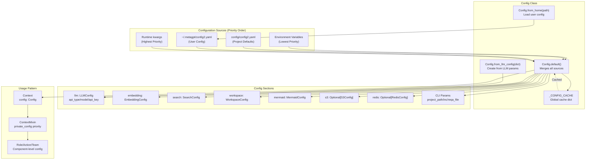
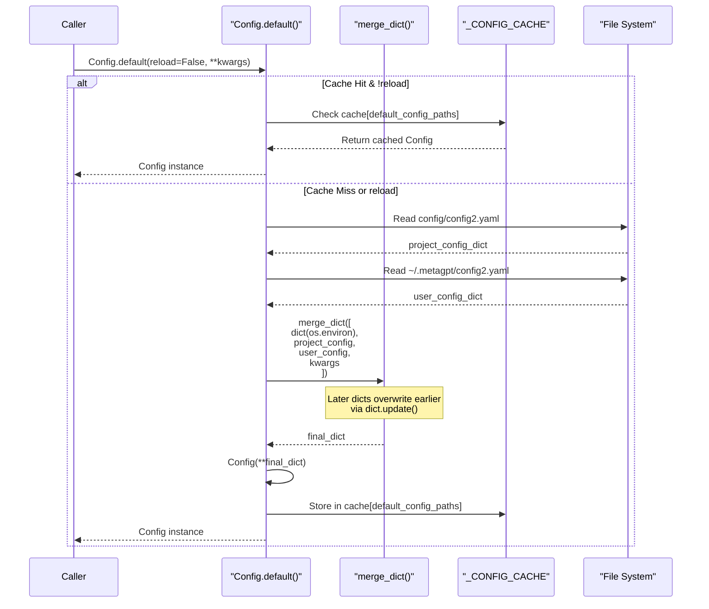
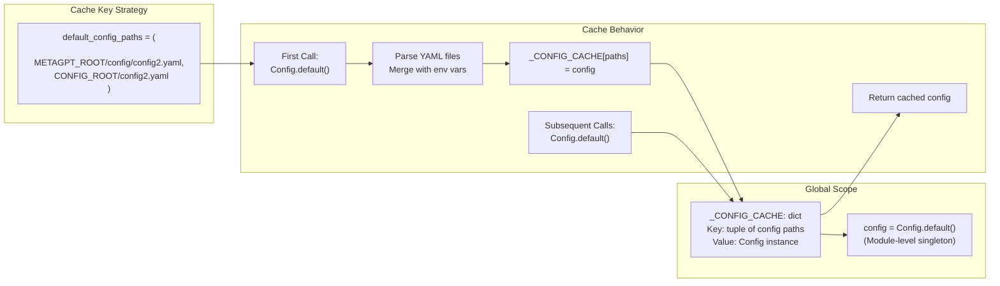
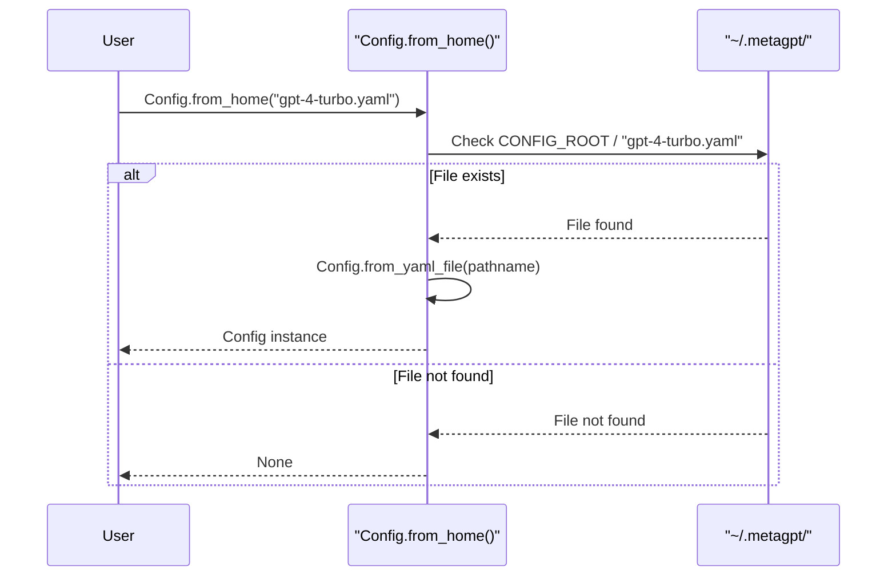
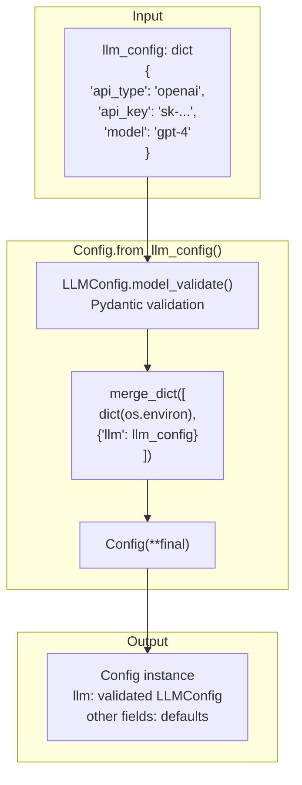
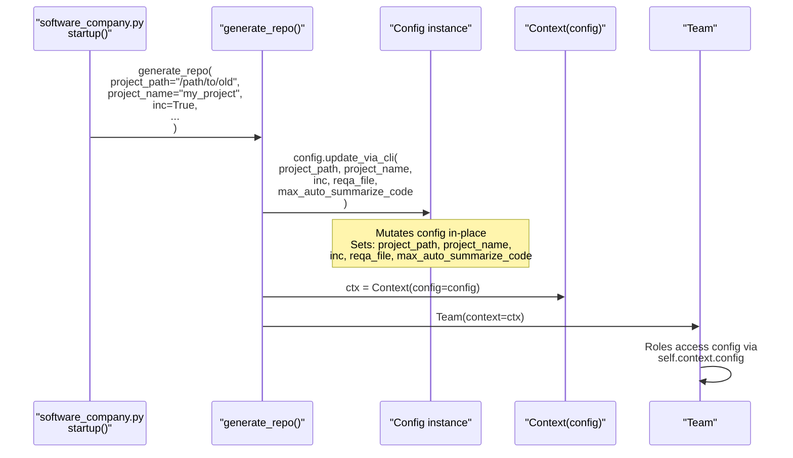
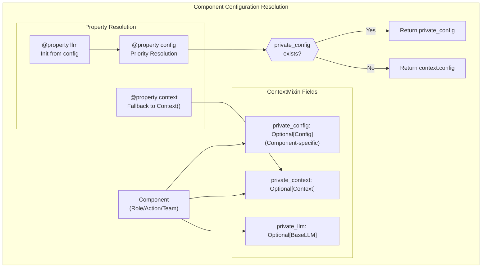
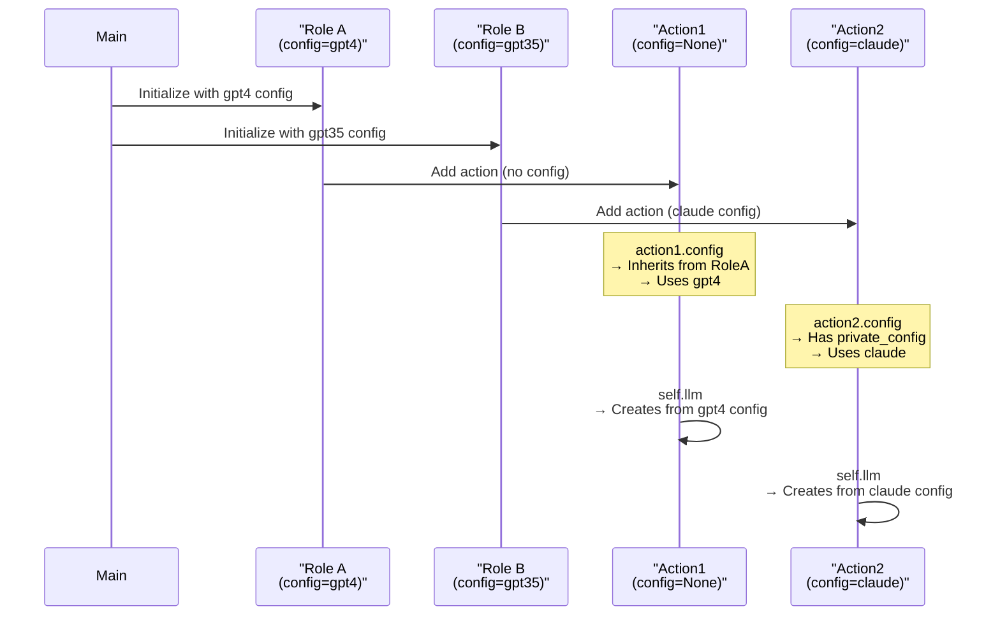
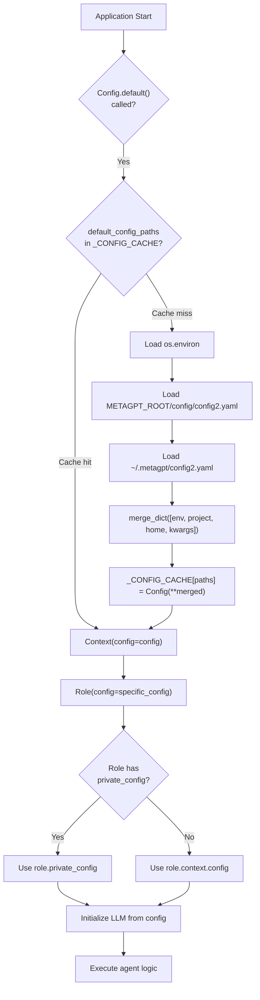

<!-- source: DeepWiki mcp.deepwiki.com · repo FoundationAgents/MetaGPT · page 9.1 Configuration Management Deep Dive · fetched 2026-10-30 -->

# Configuration Management Deep Dive

<details>
<summary>Relevant source files</summary>

The following files were used as context for generating this wiki page:

- [.github/workflows/fulltest.yaml](.github/workflows/fulltest.yaml)
- [.github/workflows/unittest.yaml](.github/workflows/unittest.yaml)
- [metagpt/config2.py](metagpt/config2.py)
- [metagpt/context.py](metagpt/context.py)
- [metagpt/context_mixin.py](metagpt/context_mixin.py)
- [metagpt/software_company.py](metagpt/software_company.py)
- [tests/conftest.py](tests/conftest.py)
- [tests/data/rsp_cache.json](tests/data/rsp_cache.json)
- [tests/metagpt/test_config.py](tests/metagpt/test_config.py)
- [tests/metagpt/test_context.py](tests/metagpt/test_context.py)
- [tests/metagpt/test_context_mixin.py](tests/metagpt/test_context_mixin.py)
- [tests/mock/mock_llm.py](tests/mock/mock_llm.py)

</details>


## Purpose and Scope

This document provides a detailed technical reference for MetaGPT's configuration management system, covering how configuration is loaded, cached, prioritized, and propagated throughout the framework. This includes the `Config` class structure, the multi-source configuration hierarchy, caching mechanisms, and factory methods for creating specialized configuration instances.

For information about the `Context` singleton and runtime management, see [Context and Runtime Management](#1.3). For LLM-specific configuration options, see [BaseLLM and Provider Registry](#3.1).

---

## Configuration System Architecture

MetaGPT's configuration system follows a hierarchical loading strategy where later sources override earlier ones. The system is designed to balance flexibility (environment-specific overrides) with convenience (sensible defaults).



**Sources:** [metagpt/config2.py:49-183](), [metagpt/context.py:58-128](), [metagpt/context_mixin.py:17-102]()

---

## Configuration Loading Hierarchy

The `Config.default()` method implements a multi-source merge strategy with explicit priority rules.

### Priority Order

1. **Environment Variables** (Lowest Priority)
2. **Project Config**: `METAGPT_ROOT/config/config2.yaml`
3. **User Config**: `~/.metagpt/config2.yaml` or `CONFIG_ROOT/config2.yaml`
4. **Runtime kwargs** (Highest Priority)

### Merge Strategy



**Sources:** [metagpt/config2.py:110-123](), [metagpt/config2.py:173-178]()

### Implementation Details

The `Config.default()` method uses tuple keys for caching to ensure different load paths don't interfere:

```python
# From metagpt/config2.py:115-123
default_config_paths = (
    METAGPT_ROOT / "config/config2.yaml",
    CONFIG_ROOT / "config2.yaml",
)
if reload or default_config_paths not in _CONFIG_CACHE:
    dicts = [dict(os.environ), *(Config.read_yaml(path) for path in default_config_paths), kwargs]
    final = merge_dict(dicts)
    _CONFIG_CACHE[default_config_paths] = Config(**final)
return _CONFIG_CACHE[default_config_paths]
```

The `merge_dict()` function performs a simple iterative update:

```python
# From metagpt/config2.py:173-178
def merge_dict(dicts: Iterable[Dict]) -> Dict:
    """Merge multiple dicts into one, with the latter dict overwriting the former"""
    result = {}
    for dictionary in dicts:
        result.update(dictionary)
    return result
```

**Sources:** [metagpt/config2.py:110-123](), [metagpt/config2.py:173-178]()

---

## Config Class Structure

The `Config` class inherits from both `CLIParams` (for CLI-specific parameters) and `YamlModel` (for YAML serialization support).

### Core Structure

| Section | Type | Purpose | Default |
|---------|------|---------|---------|
| `llm` | `LLMConfig` | Primary LLM configuration (required) | - |
| `embedding` | `EmbeddingConfig` | RAG embedding configuration | `EmbeddingConfig()` |
| `search` | `SearchConfig` | Search engine configuration | `SearchConfig()` |
| `workspace` | `WorkspaceConfig` | Workspace directory settings | `WorkspaceConfig()` |
| `mermaid` | `MermaidConfig` | Mermaid diagram generation | `MermaidConfig()` |
| `s3` | `Optional[S3Config]` | S3 storage configuration | `None` |
| `redis` | `Optional[RedisConfig]` | Redis configuration | `None` |
| `exp_pool` | `ExperiencePoolConfig` | Experience pool settings | `ExperiencePoolConfig()` |
| `roles` | `Optional[List[RoleCustomConfig]]` | Role-specific configs | `None` |
| `role_zero` | `RoleZeroConfig` | RoleZero agent configuration | `RoleZeroConfig()` |

### CLI Parameters

The `CLIParams` base class provides parameters passed via command line:

| Parameter | Type | Purpose |
|-----------|------|---------|
| `project_path` | `str` | Path to existing project for incremental mode |
| `project_name` | `str` | Project name |
| `inc` | `bool` | Enable incremental mode |
| `reqa_file` | `str` | Source file for QA code rewriting |
| `max_auto_summarize_code` | `int` | Max auto-summarize iterations |
| `git_reinit` | `bool` | Reinitialize git repository |

The `check_project_path` validator automatically sets `inc=True` when `project_path` is provided:

**Sources:** [metagpt/config2.py:30-46](), [metagpt/config2.py:49-100]()

---

## Configuration Caching Mechanism

MetaGPT uses a global cache to avoid re-parsing configuration files on every `Config.default()` call.



### Cache Invalidation

To force a cache refresh, pass `reload=True`:

```python
# Force reload from disk
config = Config.default(reload=True)
```

The cache key is based on the **tuple of configuration file paths**, not their contents. This means:
- Changes to config files are **not** automatically detected
- Different config file combinations create separate cache entries
- Use `reload=True` after modifying config files

**Sources:** [metagpt/config2.py:110-123](), [metagpt/config2.py:181-182]()

---

## Configuration Factory Methods

The `Config` class provides multiple factory methods for different initialization scenarios.

### Config.from_home(path)

Loads a specific configuration file from the user's home config directory (`~/.metagpt/`):



**Use Case**: Loading profile-specific configurations (e.g., different models per environment)

```python
# Example: Load GPT-4 Turbo configuration
gpt4t_config = Config.from_home("gpt-4-turbo.yaml")
if gpt4t_config:
    role = Role(config=gpt4t_config, ...)
```

**Sources:** [metagpt/config2.py:101-107]()

### Config.from_llm_config(llm_config)

Creates a minimal `Config` instance from LLM parameters only:



**Use Case**: Creating role-specific LLM configurations programmatically:

```python
# Example from tests/metagpt/test_context_mixin.py:105-132
llm_config = {"api_type": "openai", "api_key": "sk-xxx", "model": "gpt-4"}
gpt4 = Config.from_llm_config(llm_config)

role = Role(
    name="A",
    profile="Analyst",
    goal="Analyze data",
    actions=[action1],
    config=gpt4  # Use specialized config
)
```

**Sources:** [metagpt/config2.py:125-137](), [tests/metagpt/test_context_mixin.py:105-132]()

---

## CLI Configuration Updates

The `update_via_cli()` method provides runtime updates to configuration based on command-line parameters, primarily used in the `generate_repo` workflow.

### Method Signature and Behavior

```python
def update_via_cli(
    self,
    project_path: str,
    project_name: str,
    inc: bool,
    reqa_file: str,
    max_auto_summarize_code: int
) -> None:
    """Update config via cli"""
    # Auto-enable incremental mode if project_path provided
    if project_path:
        inc = True
        project_name = project_name or Path(project_path).name
    
    self.project_path = project_path
    self.project_name = project_name
    self.inc = inc
    self.reqa_file = reqa_file
    self.max_auto_summarize_code = max_auto_summarize_code
```

### Integration in generate_repo



**Key Parameters:**
- `project_path`: Triggers incremental mode, auto-sets `project_name` to directory name if not provided
- `inc`: Explicitly enables incremental development mode
- `max_auto_summarize_code`: Controls auto-summarization behavior (`-1` = unlimited, `0` = disabled)

**Sources:** [metagpt/config2.py:139-150](), [metagpt/software_company.py:14-74]()

---

## Configuration Priority in Components

MetaGPT components (Roles, Actions, Teams) use `ContextMixin` to implement a two-tier configuration priority system.

### ContextMixin Architecture



### Priority Rules

The `config` property implements the following resolution logic:

```python
# From metagpt/context_mixin.py:66-71
@property
def config(self) -> Config:
    """Role config: role config > context config"""
    if self.private_config:
        return self.private_config
    return self.context.config
```

**Priority Order:**
1. **Component-level `private_config`** (Highest Priority)
2. **Context-level `config`** (Fallback)

### Practical Example: Role-Specific LLM Models



### Override Behavior

The `set_config()` method supports an `override` parameter:

```python
# From metagpt/context_mixin.py:56-60
def set_config(self, config: Config, override=False):
    """Set config"""
    self.set("private_config", config, override)
    if config is not None:
        _ = self.llm  # init llm
```

- **`override=False`** (default): Does not overwrite existing `private_config`
- **`override=True`**: Replaces `private_config` even if already set

**Use Case**: Dynamically switching LLM providers at runtime:

```python
# From tests/metagpt/test_context_mixin.py:81-92
obj = ModelY(config=openai_config)
assert obj.config == openai_config

obj.set_config(claude_config, override=True)
assert obj.config == claude_config  # Successfully overridden
```

**Sources:** [metagpt/context_mixin.py:17-102](), [tests/metagpt/test_context_mixin.py:104-135]()

---

## Environment Variables

MetaGPT configuration supports environment variable injection at the lowest priority level. Environment variables are automatically loaded via `dict(os.environ)` in the merge hierarchy.

### Common Environment Variables

| Variable | Purpose | Example |
|----------|---------|---------|
| `OPENAI_API_KEY` | OpenAI API authentication | `sk-proj-...` |
| `OPENAI_BASE_URL` | Custom OpenAI endpoint | `https://api.openai.com/v1` |
| `ANTHROPIC_API_KEY` | Anthropic API authentication | `sk-ant-...` |
| `ALLOW_OPENAI_API_CALL` | Testing: enable real API calls | `0` (cache only) or `1` (allow) |

### Testing Environment Variables

The testing infrastructure uses `ALLOW_OPENAI_API_CALL` to control LLM behavior:

```yaml
# From .github/workflows/unittest.yaml:36
- name: Test with pytest
  run: |
    export ALLOW_OPENAI_API_CALL=0
    mkdir -p ~/.metagpt && cp tests/config2.yaml ~/.metagpt/config2.yaml
    pytest | tee unittest.txt
```

When `ALLOW_OPENAI_API_CALL=0`:
- `MockLLM` uses cached responses from `tests/data/rsp_cache.json`
- Real API calls raise `ValueError`
- New responses are saved to `rsp_cache_new.json`

When `ALLOW_OPENAI_API_CALL=1`:
- Real API calls are permitted
- Responses are cached for future test runs

**Sources:** [.github/workflows/unittest.yaml:34-38](), [tests/conftest.py:31-33](), [tests/mock/mock_llm.py:112-125]()

---

## Configuration File Format

MetaGPT uses YAML format for configuration files. The canonical example is provided in `software_company.py`:

```yaml
# From metagpt/software_company.py:127-135
llm:
  api_type: "openai"  # or azure / ollama / groq etc.
  model: "gpt-4-turbo"  # or gpt-3.5-turbo
  base_url: "https://api.openai.com/v1"  # or forward url / other llm url
  api_key: "YOUR_API_KEY"
```

### Initialization Command

MetaGPT provides a CLI command to initialize a default configuration:

```bash
metagpt --init-config
```

This creates `~/.metagpt/config2.yaml` with the default template, backing up any existing file to `.bak`.

**Sources:** [metagpt/software_company.py:127-154]()

---

## Summary: Configuration Resolution Flow



**Key Takeaways:**
1. Configuration is loaded once and cached globally via `_CONFIG_CACHE`
2. Priority: `kwargs` > user config > project config > environment variables
3. Components can override configuration at the instance level via `private_config`
4. LLM instances are lazily initialized from configuration when first accessed

**Sources:** [metagpt/config2.py:49-183](), [metagpt/context.py:58-128](), [metagpt/context_mixin.py:17-102]()

---

