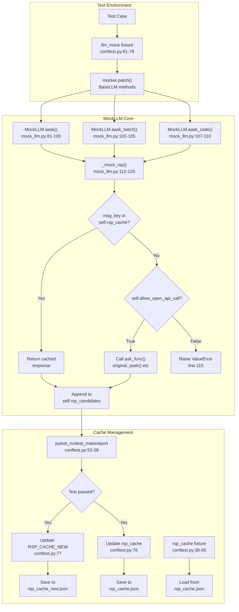
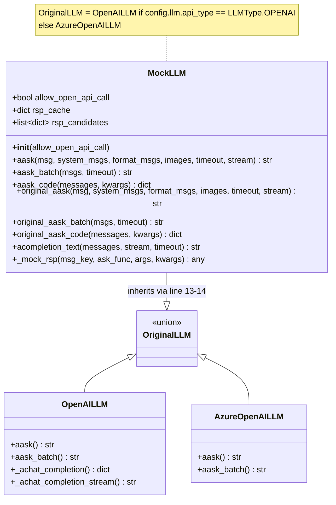
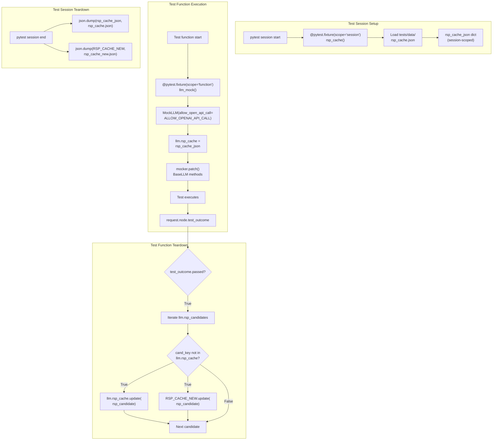
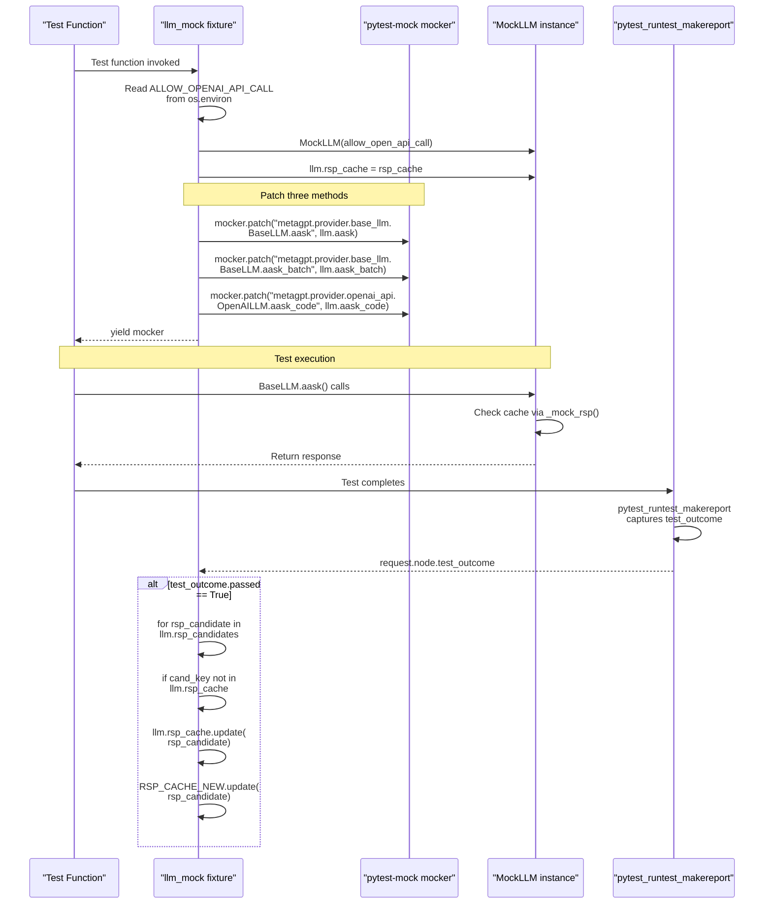
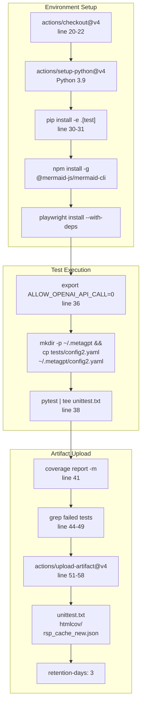

<!-- source: DeepWiki mcp.deepwiki.com · repo FoundationAgents/MetaGPT · page 9.2 Mock LLM and Response Caching · fetched 2026-10-30 -->

# Mock LLM and Response Caching

<details>
<summary>Relevant source files</summary>

The following files were used as context for generating this wiki page:

- [.github/workflows/fulltest.yaml](.github/workflows/fulltest.yaml)
- [.github/workflows/unittest.yaml](.github/workflows/unittest.yaml)
- [metagpt/config2.py](metagpt/config2.py)
- [metagpt/context.py](metagpt/context.py)
- [metagpt/context_mixin.py](metagpt/context_mixin.py)
- [metagpt/software_company.py](metagpt/software_company.py)
- [tests/conftest.py](tests/conftest.py)
- [tests/data/rsp_cache.json](tests/data/rsp_cache.json)
- [tests/metagpt/test_config.py](tests/metagpt/test_config.py)
- [tests/metagpt/test_context.py](tests/metagpt/test_context.py)
- [tests/metagpt/test_context_mixin.py](tests/metagpt/test_context_mixin.py)
- [tests/mock/mock_llm.py](tests/mock/mock_llm.py)

</details>


This document covers MetaGPT's mock LLM system and response caching infrastructure used for testing. The system enables deterministic testing by caching LLM responses and providing controlled API call behavior. For information about the actual LLM provider system, see [LLM Provider System](#3.1). For broader testing infrastructure, see [CI/CD and Automated Testing](#8.2).

## System Purpose and Architecture

The mock LLM system serves two primary functions: **deterministic testing** through response caching and **cost control** by limiting actual API calls during test execution. The system intercepts LLM calls and either returns cached responses or forwards requests to real LLM providers based on configuration.

### Mock LLM Architecture



Sources: [tests/mock/mock_llm.py:16-126](), [tests/conftest.py:36-50](), [tests/conftest.py:53-78]()

## MockLLM Implementation

The `MockLLM` class inherits from either `OpenAILLM` or `AzureOpenAILLM` depending on configuration and overrides key methods to implement caching behavior.

### Core MockLLM Class Structure



Sources: [tests/mock/mock_llm.py:13-126]()

### Method Override Pattern

The mock system follows a consistent pattern for each LLM method:

1. **Key Generation**: Create a unique `msg_key` from the input message
2. **Cache Delegation**: Pass `msg_key` and original function to `_mock_rsp()`
3. **Cache Lookup**: Check if `msg_key` exists in `self.rsp_cache`
4. **Response Handling**: Return cached response or call `ask_func()` (original method)
5. **Cache Update**: Append `{msg_key: rsp}` dict to `self.rsp_candidates` list

Key generation strategy by method:

| Method | Key Generation Code | Location |
|--------|-------------------|----------|
| `aask()` | If `system_msgs`: join with `"#MSG_SEP#"` + `"#SYSTEM_MSG_END#"` prefix<br/>If `isinstance(msg, list)`: join `[m["content"] for m in msg]` with `"#MSG_SEP#"`<br/>Else: use `msg` as-is | [tests/mock/mock_llm.py:91-98]() |
| `aask_batch()` | `"#MSG_SEP#".join([msg if isinstance(msg, str) else msg.content for msg in msgs])` | [tests/mock/mock_llm.py:103]() |
| `aask_code()` | `json.dumps(self.format_msg(messages), ensure_ascii=False)` | [tests/mock/mock_llm.py:108]() |

The `_mock_rsp()` method implements the core caching logic:
- If `msg_key` not in cache and `allow_open_api_call=False`: raises `ValueError` with guidance message
- If `msg_key` not in cache and `allow_open_api_call=True`: calls `await ask_func(*args, **kwargs)` 
- Always appends `{msg_key: rsp}` to `self.rsp_candidates` for later cache updates

Sources: [tests/mock/mock_llm.py:81-125]()

## Response Caching System

### Cache File Structure and Management



Sources: [tests/conftest.py:30](), [tests/conftest.py:36-50](), [tests/conftest.py:61-78]()

### Cache Key Generation Strategy

The system generates deterministic cache keys based on message content and context:

| Method | Key Generation Strategy |
|--------|------------------------|
| `aask()` | `system_msgs + "#SYSTEM_MSG_END#" + msg_content` |
| `aask_batch()` | `"#MSG_SEP#".join(message_contents)` |
| `aask_code()` | `json.dumps(formatted_messages)` |

This ensures identical requests always produce the same cache key, enabling reliable response retrieval.

Sources: [tests/mock/mock_llm.py:91-109]()

## Test Integration and Fixture System

### Pytest Fixture Configuration

The mock system integrates with pytest through the `llm_mock` fixture at [tests/conftest.py:61-78](), which patches three key LLM methods:



Patched method locations:
- `BaseLLM.aask` → `MockLLM.aask` [tests/conftest.py:65]()
- `BaseLLM.aask_batch` → `MockLLM.aask_batch` [tests/conftest.py:66]()
- `OpenAILLM.aask_code` → `MockLLM.aask_code` [tests/conftest.py:67]()

Sources: [tests/conftest.py:53-78]()

### Environment Variable Controls

The mock system behavior is controlled by the `ALLOW_OPENAI_API_CALL` environment variable:

| Variable | Default (Local) | CI Value | Purpose |
|----------|----------------|----------|---------|
| `ALLOW_OPENAI_API_CALL` | `1` | `0` | Controls whether `MockLLM` forwards cache misses to real LLM APIs |

**Local Development** (`ALLOW_OPENAI_API_CALL=1`):
- Cache misses call real LLM APIs via `original_aask()` methods
- New responses are stored in `rsp_candidates` 
- Passed tests update both `rsp_cache.json` and `rsp_cache_new.json`
- Enables cache population for new test cases

**CI Environment** (`ALLOW_OPENAI_API_CALL=0`):
- Cache misses raise `ValueError` with guidance message
- Enforces deterministic, cost-free testing
- All responses must be pre-cached in `rsp_cache.json`

Set via `export ALLOW_OPENAI_API_CALL=0` at:
- [.github/workflows/unittest.yaml:36]()
- [.github/workflows/fulltest.yaml:57]()

Retrieved at [tests/conftest.py:31-33]() and passed to `MockLLM.__init__()` at [tests/conftest.py:63]().

Sources: [tests/conftest.py:31-33](), [tests/mock/mock_llm.py:17-22](), [.github/workflows/unittest.yaml:36](), [.github/workflows/fulltest.yaml:57]()

## CI/CD Integration

### GitHub Actions Configuration

Two CI workflows enforce cached LLM responses:

**unittest.yaml** - Pull Request and Branch Tests:


**fulltest.yaml** - Full Test Suite:
- Similar structure with additional secret-based config at line 58-59
- Decodes `METAGPT_CONFIG2_YAML` from base64: `echo "${{ secrets.METAGPT_CONFIG2_YAML }}" | base64 -d`
- Same `ALLOW_OPENAI_API_CALL=0` enforcement at line 57

Both workflows upload `tests/data/rsp_cache_new.json` as artifacts, allowing developers to review and merge new cache entries from CI runs.

Sources: [.github/workflows/unittest.yaml:20-59](), [.github/workflows/fulltest.yaml:23-81]()

### Test Configuration Management

Tests use mock configuration loaded from `tests/config2.yaml` with placeholder values that prevent accidental real API calls:

**Mock Credentials:**
- `llm.api_key`: `"sk-xxx"` (invalid OpenAI key format)
- `llm.base_url`: `"https://api.openai.com/v1"`
- S3 credentials: `"YOUR_SECRET_KEY"`, `"YOUR_ACCESS_KEY"`
- TTS services: Placeholder keys for Azure TTS, iFlytek

**Configuration Loading:**
- CI copies to `~/.metagpt/config2.yaml`: [.github/workflows/unittest.yaml:37]()
- Loaded via `Config.default()` which merges `METAGPT_ROOT/config/config2.yaml` and `CONFIG_ROOT/config2.yaml`
- Environment variables can override any config value

The mock credentials ensure that even if `ALLOW_OPENAI_API_CALL=1` accidentally, API calls fail early with authentication errors rather than incurring costs.

Sources: [.github/workflows/unittest.yaml:37](), [metagpt/config2.py:110-123]()

## Usage Patterns and Best Practices

### Cache Management Workflow

For developers working with the mock system:

1. **Run Tests Locally**: Execute tests with `ALLOW_OPENAI_API_CALL=1` to generate new cache entries
2. **Review New Responses**: Check `tests/data/rsp_cache_new.json` for newly cached responses  
3. **Update Main Cache**: Merge useful responses into `tests/data/rsp_cache.json`
4. **Commit Cache Updates**: Include cache updates in pull requests for consistent testing

### Error Handling for Missing Cache Entries

When `ALLOW_OPENAI_API_CALL=0` and a cache entry is missing, the system raises a descriptive error:

```
ValueError: In current test setting, api call is not allowed, you should properly mock your tests, or add expected api response in tests/data/rsp_cache.json.
```

This guides developers to either add proper mocking or update the response cache.

Sources: [tests/mock/mock_llm.py:115-118]()

---

