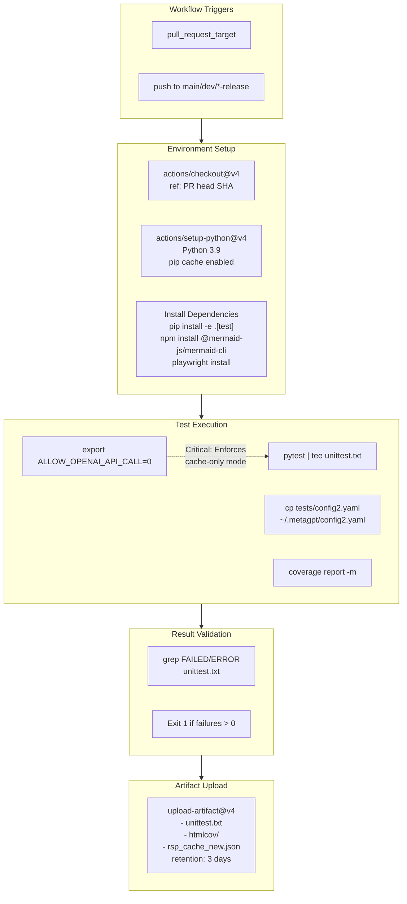
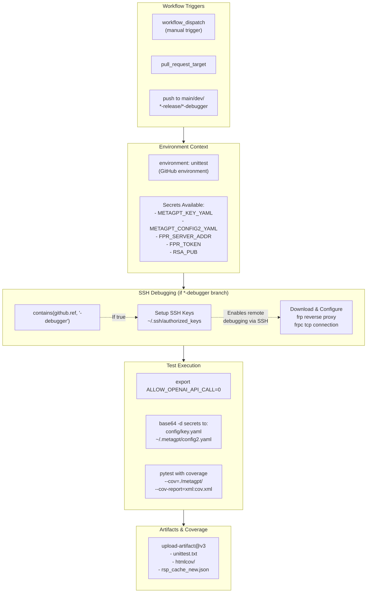
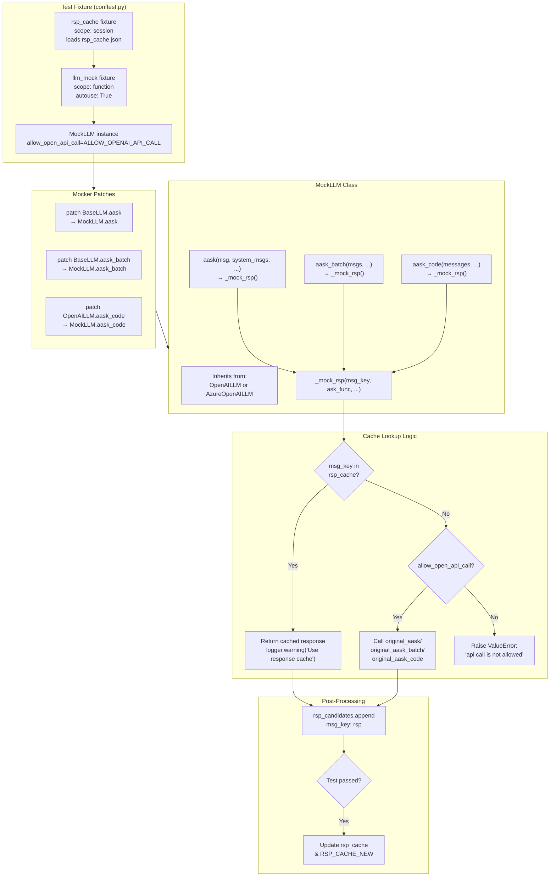
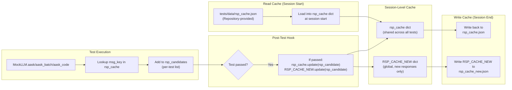
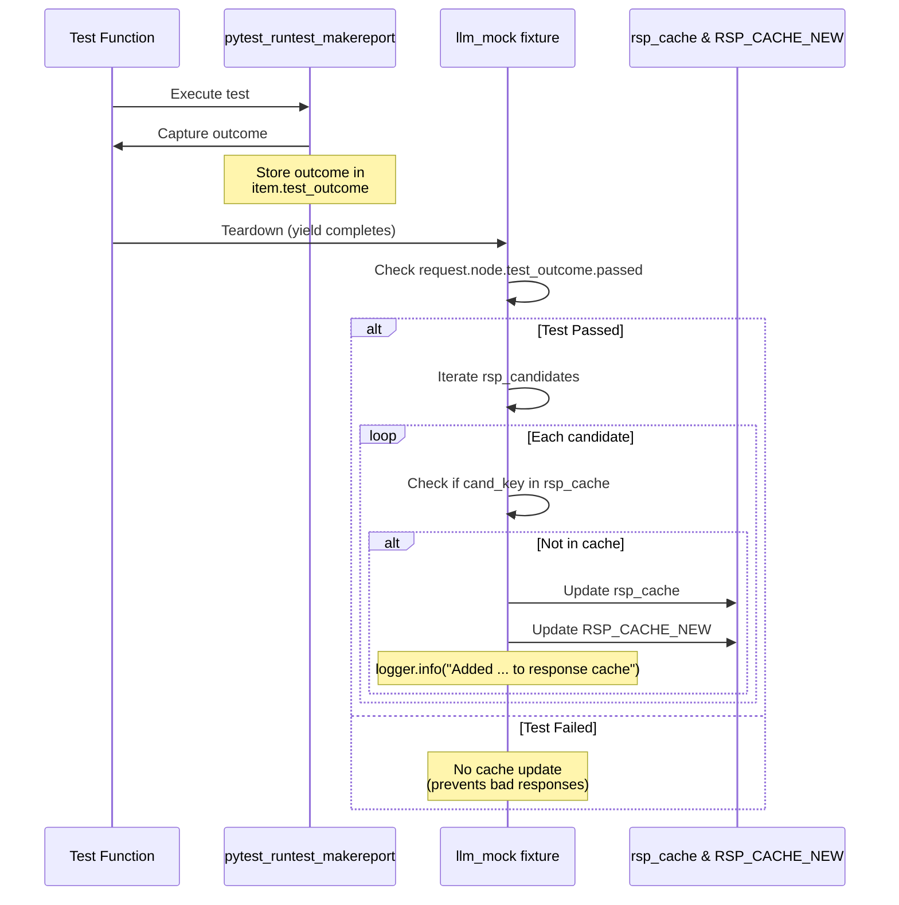
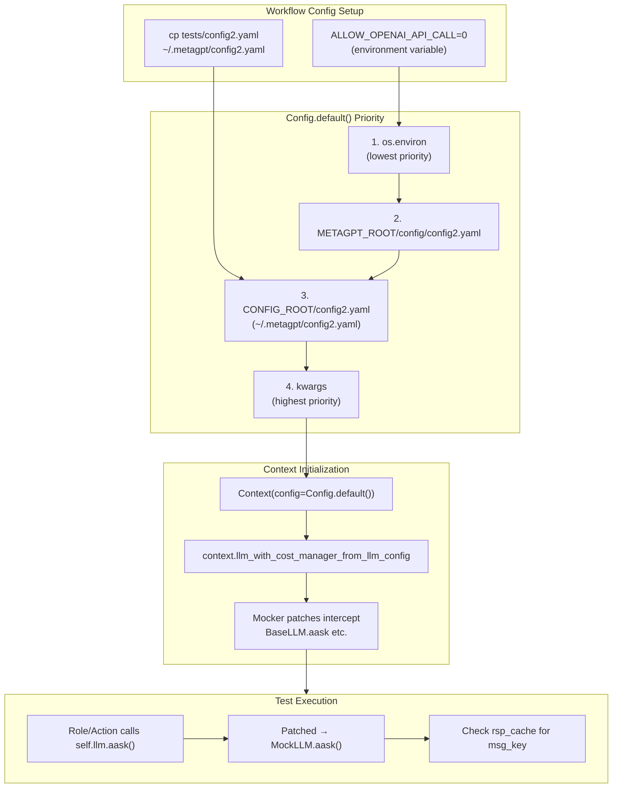
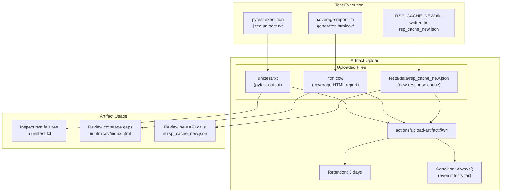
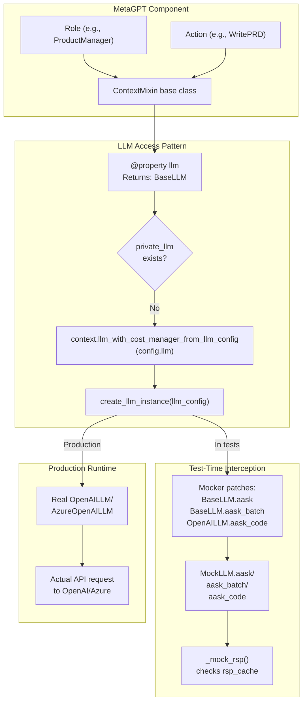

<!-- source: DeepWiki mcp.deepwiki.com · repo FoundationAgents/MetaGPT · page 9.3 CI/CD Workflows · fetched 2026-10-30 -->

# CI/CD Workflows

<details>
<summary>Relevant source files</summary>

The following files were used as context for generating this wiki page:

- [.github/workflows/fulltest.yaml](.github/workflows/fulltest.yaml)
- [.github/workflows/unittest.yaml](.github/workflows/unittest.yaml)
- [metagpt/config2.py](metagpt/config2.py)
- [metagpt/context.py](metagpt/context.py)
- [metagpt/context_mixin.py](metagpt/context_mixin.py)
- [metagpt/software_company.py](metagpt/software_company.py)
- [tests/conftest.py](tests/conftest.py)
- [tests/data/rsp_cache.json](tests/data/rsp_cache.json)
- [tests/metagpt/test_config.py](tests/metagpt/test_config.py)
- [tests/metagpt/test_context.py](tests/metagpt/test_context.py)
- [tests/metagpt/test_context_mixin.py](tests/metagpt/test_context_mixin.py)
- [tests/mock/mock_llm.py](tests/mock/mock_llm.py)

</details>


This document describes the Continuous Integration and Continuous Deployment (CI/CD) infrastructure for MetaGPT, including GitHub Actions workflows, the mock LLM testing system, response caching mechanisms, and artifact management.

For information about configuration management outside of testing contexts, see [Configuration System](#1.2). For details on context and runtime management, see [Context and Runtime Management](#1.3).

---

## Overview

MetaGPT's CI/CD infrastructure is designed to enable comprehensive testing without making real LLM API calls. This is achieved through a sophisticated mocking system that intercepts all LLM requests and returns cached responses, allowing deterministic, fast, and cost-free test execution.

The system comprises two primary GitHub Actions workflows:
- **unittest.yaml**: Executes with `ALLOW_OPENAI_API_CALL=0`, using only cached responses
- **fulltest.yaml**: Can make real API calls when necessary, includes secrets and SSH debugging

Sources: [.github/workflows/unittest.yaml](), [.github/workflows/fulltest.yaml]()

---

## GitHub Actions Workflows

### Unit Test Workflow (unittest.yaml)

The primary testing workflow runs on pull requests, pushes to main/dev branches, and release branches.



**Key Configuration**:
- **ALLOW_OPENAI_API_CALL=0**: Strictly enforces cache-only mode; any uncached request will fail the test [.github/workflows/unittest.yaml:36]()
- **Python Version**: Currently 3.9 (matrix supports 3.9, 3.10, 3.11 but only 3.9 is active) [.github/workflows/unittest.yaml:17]()
- **Dependency Installation**: Installs test extras, Mermaid CLI for diagram generation, and Playwright for browser automation [.github/workflows/unittest.yaml:29-33]()

Sources: [.github/workflows/unittest.yaml:1-60]()

### Full Test Workflow (fulltest.yaml)

The full test workflow includes additional capabilities for debugging and secrets management.



**SSH Debugging Feature**:
When a branch name contains `-debugger`, the workflow sets up SSH access via reverse proxy:
- Adds RSA public key to `~/.ssh/authorized_keys` [.github/workflows/fulltest.yaml:49]()
- Downloads frp (fast reverse proxy) [.github/workflows/fulltest.yaml:51-53]()
- Establishes reverse tunnel to debugging server [.github/workflows/fulltest.yaml:54]()
- Continues workflow even if SSH setup fails [.github/workflows/fulltest.yaml:39]()

**Secret Management**:
- `METAGPT_KEY_YAML` and `METAGPT_CONFIG2_YAML` are base64-encoded and decoded into config files [.github/workflows/fulltest.yaml:58-59]()
- Enables testing with real API keys when necessary

Sources: [.github/workflows/fulltest.yaml:1-87]()

---

## Mock LLM System

The `MockLLM` class is the cornerstone of deterministic testing, intercepting all LLM API calls and returning cached responses.

### Architecture



**MockLLM Implementation Details**:

The class inherits from `OpenAILLM` or `AzureOpenAILLM` based on `config.llm.api_type` [tests/mock/mock_llm.py:13]():

```python
OriginalLLM = OpenAILLM if config.llm.api_type == LLMType.OPENAI else AzureOpenAILLM
class MockLLM(OriginalLLM):
```

**Message Key Generation**:
- For string messages: `msg_key = msg` [tests/mock/mock_llm.py:94]()
- For list messages: `msg_key = "#MSG_SEP#".join([m["content"] for m in msg])` [tests/mock/mock_llm.py:92]()
- System messages prepended: `joined_system_msg + "#SYSTEM_MSG_END#" + msg_key` [tests/mock/mock_llm.py:97-98]()
- For code requests: `msg_key = json.dumps(self.format_msg(messages), ensure_ascii=False)` [tests/mock/mock_llm.py:108]()

Sources: [tests/mock/mock_llm.py:16-126](), [tests/conftest.py:62-78]()

### Original Method Preservation

`MockLLM` preserves the original LLM methods by creating `original_*` variants:

| Mocked Method | Original Method | Purpose |
|---------------|-----------------|---------|
| `aask()` | `original_aask()` | Single-turn async question-answer |
| `aask_batch()` | `original_aask_batch()` | Multi-turn batch processing |
| `aask_code()` | `original_aask_code()` | Code generation with function calling |

These original methods are called when `allow_open_api_call=1` and the message key is not in cache [tests/mock/mock_llm.py:35-80]().

Sources: [tests/mock/mock_llm.py:35-80]()

---

## Response Caching Mechanism

### Cache File Structure

MetaGPT uses two JSON files for response caching:



**rsp_cache.json**:
- Repository-committed cache with pre-recorded responses [tests/conftest.py:38]()
- Loaded at session start [tests/conftest.py:41-44]()
- Updated at session end with any new responses [tests/conftest.py:46-47]()

**rsp_cache_new.json**:
- Generated each test run, contains only newly cached responses [tests/conftest.py:39]()
- Useful for inspecting what new API calls were made [tests/conftest.py:48-49]()
- Uploaded as CI artifact for review [.github/workflows/unittest.yaml:57]()

Sources: [tests/conftest.py:30-50]()

### Cache Update Logic

The `llm_mock` fixture uses pytest hooks to update caches only for passing tests:



**Implementation**:
- Hook captures test outcome [tests/conftest.py:53-58]()
- Fixture checks `request.node.test_outcome.passed` [tests/conftest.py:69]()
- Only passing tests update cache to prevent corrupted responses from being saved [tests/conftest.py:70-77]()

Sources: [tests/conftest.py:53-78]()

---

## Configuration Management in Tests

### Configuration Loading Hierarchy

Tests use a specific configuration hierarchy to ensure reproducibility:



**Key Points**:
- `ALLOW_OPENAI_API_CALL` is set as environment variable, loaded via `os.environ` [tests/conftest.py:31-33]()
- Test config copied to `~/.metagpt/config2.yaml` takes precedence over project config [.github/workflows/unittest.yaml:37]()
- `Config.default()` merges all sources with later sources overwriting earlier ones [metagpt/config2.py:110-123]()

Sources: [.github/workflows/unittest.yaml:36-38](), [metagpt/config2.py:110-123](), [tests/conftest.py:31-33]()

### Test-Specific Fixtures

Common test fixtures for configuration and context:

| Fixture | Scope | Purpose | Key Features |
|---------|-------|---------|--------------|
| `rsp_cache` | session | Loads and saves response cache | Yields dict, persists on teardown [tests/conftest.py:36-50]() |
| `llm_mock` | function | Patches LLM methods | Autouse, updates cache on test pass [tests/conftest.py:62-78]() |
| `context` | function | Provides isolated test context | Creates unique workspace, cleans up on teardown [tests/conftest.py:148-161]() |
| `new_filename` | function | Mocks filename generation | Ensures reproducible file naming [tests/conftest.py:170-173]() |

**Context Fixture Details**:
```python
@pytest.fixture(scope="function")
def context(request):
    ctx = MetagptContext()
    repo = GitRepository(local_path=DEFAULT_WORKSPACE_ROOT / f"unittest/{uuid.uuid4().hex}")
    ctx.config.project_path = str(repo.workdir)
    
    def fin():
        if ctx.config.project_path:
            git_repo = GitRepository(ctx.config.project_path)
            git_repo.delete_repository()
    
    request.addfinalizer(fin)
    return ctx
```

Each test gets a unique workspace directory that's cleaned up after test completion [tests/conftest.py:148-161]().

Sources: [tests/conftest.py:36-173]()

---

## Artifact Management

### Uploaded Artifacts

Both workflows upload artifacts for post-run analysis:



**unittest.txt**:
- Contains full pytest output with test results [.github/workflows/unittest.yaml:38]()
- Used to extract failure count via grep [.github/workflows/unittest.yaml:44-49]()

**htmlcov/**:
- Generated by pytest-cov with `--cov-report=html:htmlcov` [.github/workflows/fulltest.yaml:60]()
- Provides line-by-line coverage visualization

**rsp_cache_new.json**:
- Contains only responses generated during this test run [tests/conftest.py:48-49]()
- Critical for identifying new LLM calls that may need review
- Should be empty when `ALLOW_OPENAI_API_CALL=0` unless test failures occurred

Sources: [.github/workflows/unittest.yaml:50-59](), [.github/workflows/fulltest.yaml:72-81]()

### Coverage Reporting

Coverage is collected and reported at multiple stages:

1. **Inline Report**: `coverage report -m` shows missing lines in workflow logs [.github/workflows/unittest.yaml:40-41]()
2. **HTML Report**: `htmlcov/` directory with interactive coverage viewer [.github/workflows/fulltest.yaml:60]()
3. **XML Report**: `cov.xml` for potential codecov integration (currently commented out) [.github/workflows/fulltest.yaml:60]()

Sources: [.github/workflows/unittest.yaml:39-42](), [.github/workflows/fulltest.yaml:60-63]()

---

## Failure Detection and Validation

### Failure Detection Logic

Both workflows use grep to detect test failures and exit with error code if any are found:

```bash
grep -E "FAILED tests|ERROR tests|[0-9]+ passed," unittest.txt
failed_count=$(grep -E "FAILED tests|ERROR tests" unittest.txt | wc -l | tr -d '[:space:]')
if [[ $failed_count -gt 0 ]]; then
  echo "$failed_count failed lines found! Task failed."
  exit 1
fi
```

**Detection Pattern**:
- Searches for lines containing `FAILED tests` or `ERROR tests` [.github/workflows/unittest.yaml:44]()
- Counts occurrences and fails if > 0 [.github/workflows/unittest.yaml:45-49]()
- Shows summary line with total passed count regardless [.github/workflows/unittest.yaml:44]()

Sources: [.github/workflows/unittest.yaml:42-49](), [.github/workflows/fulltest.yaml:64-71]()

---

## Integration with MetaGPT Components

### How Components Use MockLLM

All MetaGPT components that use LLMs automatically go through the mock system:



**ContextMixin Integration**:
- All roles and actions inherit from `ContextMixin` [metagpt/context_mixin.py:17]()
- `llm` property lazily initializes from `context.llm_with_cost_manager_from_llm_config(config.llm)` [metagpt/context_mixin.py:91-96]()
- In tests, the patches intercept at the `BaseLLM` method level, so all LLM calls go through mocking [tests/conftest.py:65-67]()

Sources: [metagpt/context_mixin.py:17-102](), [metagpt/context.py:94-100](), [tests/conftest.py:62-78]()

---

## Best Practices for Writing Tests

### Adding New Test Cases

When adding tests that make LLM calls:

1. **Run with ALLOW_OPENAI_API_CALL=1 locally** to generate real responses
2. **Verify responses are correct** before committing to cache
3. **Check rsp_cache_new.json** to see what was added
4. **Commit updates to rsp_cache.json** so other developers can use cached responses
5. **Ensure tests pass with ALLOW_OPENAI_API_CALL=0** in CI

### Debugging Failed Tests

When tests fail in CI:

1. **Download unittest.txt artifact** to see full pytest output
2. **Check rsp_cache_new.json** to identify any new LLM calls
3. **Look for "api call is not allowed" errors** indicating missing cache entries
4. **Review htmlcov/** to check if new code paths lack coverage

### Mock LLM Limitations

The mock system has some limitations:

| Scenario | Behavior | Workaround |
|----------|----------|------------|
| Non-deterministic prompts | Different msg_key each run | Mock at a higher level or fix prompt |
| Streaming responses | Not fully mocked | Use `stream=False` in tests |
| Function calling with dynamic tools | May generate different msg_key | Standardize tool order/format |
| Image inputs | Encoded images vary | Mock image encoding separately |

Sources: [tests/mock/mock_llm.py:112-125](), [tests/conftest.py:62-78]()

---

