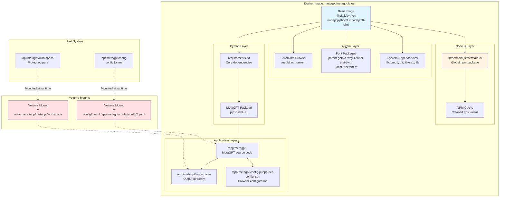
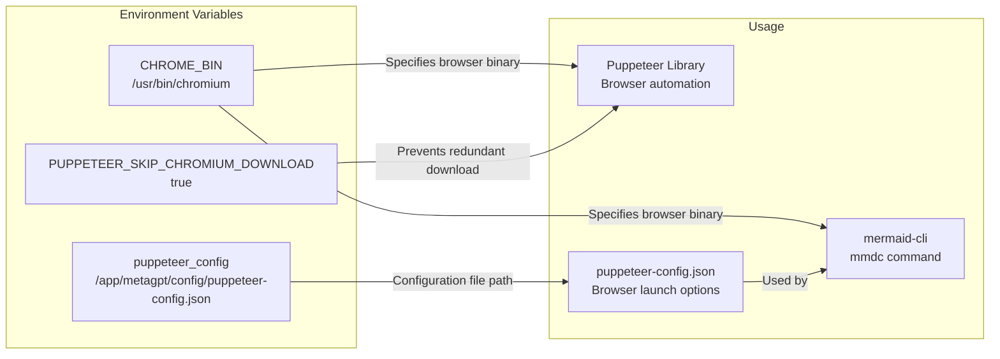
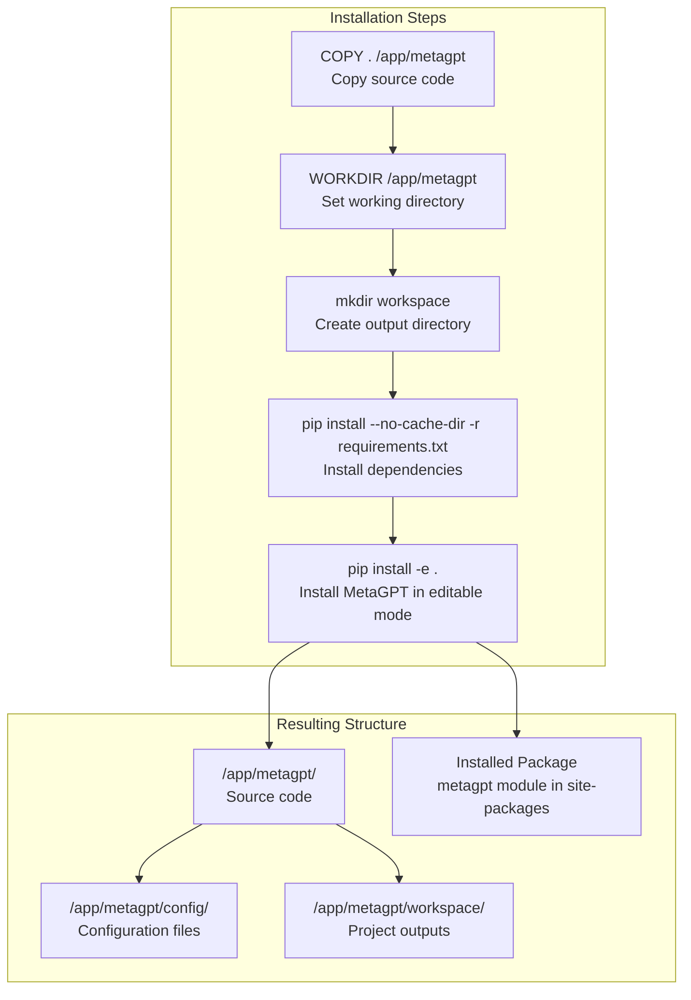
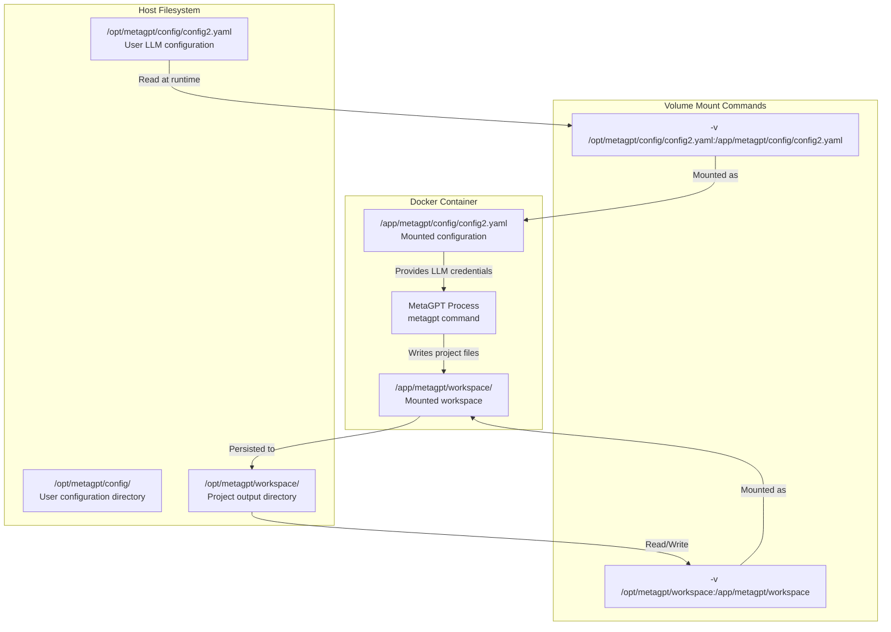
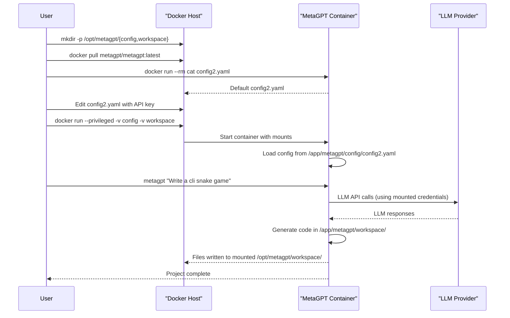
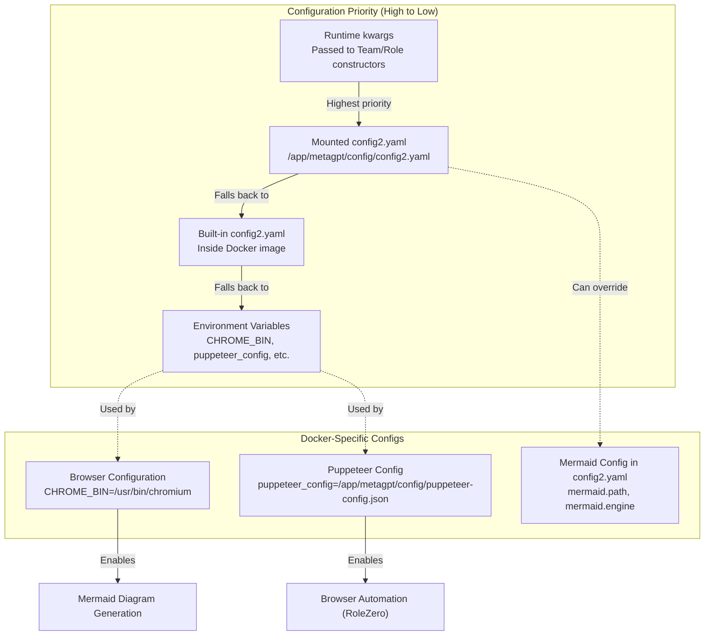

<!-- source: DeepWiki mcp.deepwiki.com · repo FoundationAgents/MetaGPT · page 9.4 Docker Deployment · fetched 2026-10-30 -->

# Docker Deployment

<details>
<summary>Relevant source files</summary>

The following files were used as context for generating this wiki page:

- [Dockerfile](Dockerfile)
- [README.md](README.md)
- [docs/ACADEMIC_WORK.md](docs/ACADEMIC_WORK.md)
- [docs/NEWS.md](docs/NEWS.md)
- [docs/README_CN.md](docs/README_CN.md)
- [docs/README_FR.md](docs/README_FR.md)
- [docs/README_JA.md](docs/README_JA.md)
- [metagpt/utils/mermaid.py](metagpt/utils/mermaid.py)

</details>


## Purpose and Scope

This document covers the Docker-based deployment of MetaGPT, including the official Docker image structure, volume mounts, environment configuration, and usage patterns. Docker deployment provides a pre-configured, isolated environment with all system dependencies (Python, Node.js, Chromium, Mermaid CLI) required to run MetaGPT without manual setup.

For general installation guidance, see [Installation and Setup](#1.1). For configuration details, see [Configuration System](#1.2).

---

## Docker Image Architecture

The MetaGPT Docker image is structured as a multi-layer container that bundles the complete runtime environment:



**Sources:** [Dockerfile:1-25](), [README.md:52-67](), [docs/README_CN.md:54-68]()

---

## Base Image and System Dependencies

### Base Image Selection

The Dockerfile uses `nikolaik/python-nodejs:python3.9-nodejs20-slim` as the base image, which provides:
- **Python 3.9**: Required Python version for MetaGPT (compatible with 3.9-3.11)
- **Node.js 20**: Required for Mermaid CLI diagram generation
- **Slim Debian base**: Minimized footprint for smaller image size

**Sources:** [Dockerfile:2]()

### System Dependencies Installation

The image installs critical system packages in a single layer to minimize image size:

| Package | Purpose |
|---------|---------|
| `chromium` | Headless browser for Puppeteer-based diagram rendering and web automation |
| `fonts-ipafont-gothic` | Japanese font support |
| `fonts-wqy-zenhei` | Chinese font support |
| `fonts-thai-tlwg` | Thai font support |
| `fonts-kacst` | Arabic font support |
| `fonts-freefont-ttf` | General Unicode font support |
| `libgomp1` | OpenMP library for parallel computing |
| `git` | Repository operations (clone, commit, push) |
| `libxss1` | X11 Screen Saver extension library for Chromium |
| `file` | File type identification |

The installation uses `--no-install-recommends` to avoid unnecessary packages and cleans up APT caches to reduce image size:

```dockerfile
RUN apt update &&\
    apt install -y libgomp1 git chromium fonts-ipafont-gothic fonts-wqy-zenhei fonts-thai-tlwg fonts-kacst fonts-freefont-ttf libxss1 --no-install-recommends file &&\
    apt clean && rm -rf /var/lib/apt/lists/*
```

**Sources:** [Dockerfile:5-7]()

---

## Environment Variables and Browser Configuration

### Environment Variables

Three critical environment variables are set in the Docker image:



| Variable | Value | Purpose |
|----------|-------|---------|
| `CHROME_BIN` | `/usr/bin/chromium` | Points Puppeteer to the system-installed Chromium binary |
| `puppeteer_config` | `/app/metagpt/config/puppeteer-config.json` | Configuration file for Puppeteer browser launch options |
| `PUPPETEER_SKIP_CHROMIUM_DOWNLOAD` | `true` | Prevents Puppeteer from downloading its own Chromium (uses system Chromium instead) |

**Sources:** [Dockerfile:10-12]()

### Mermaid CLI Integration

The global installation of `@mermaid-js/mermaid-cli` enables diagram generation. The environment variables ensure it uses the system Chromium:

```dockerfile
RUN npm install -g @mermaid-js/mermaid-cli &&\
    npm cache clean --force
```

This integrates with MetaGPT's mermaid utility, which supports multiple engines (`nodejs`, `playwright`, `pyppeteer`, `ink`) as configured in [metagpt/utils/mermaid.py:54-109](). The Docker image is pre-configured for the `nodejs` engine via the `mmdc` command.

**Sources:** [Dockerfile:13-14](), [metagpt/utils/mermaid.py:54-109]()

---

## Application Installation and Directory Structure

### Python Dependencies and Package Installation

The Dockerfile copies the MetaGPT source code and installs it in editable mode:



The installation process:
1. Copies the entire codebase to `/app/metagpt`
2. Sets the working directory to `/app/metagpt`
3. Creates `/app/metagpt/workspace` for output files
4. Installs Python dependencies from `requirements.txt` without caching
5. Installs MetaGPT in editable mode (`-e .`), allowing modifications to be reflected immediately

**Sources:** [Dockerfile:17-21]()

### Directory Structure

| Path | Purpose | Persistence |
|------|---------|-------------|
| `/app/metagpt/` | MetaGPT source code and modules | Built into image |
| `/app/metagpt/config/` | Configuration files (default config2.yaml) | Built into image, overridden by volume mount |
| `/app/metagpt/workspace/` | Output directory for generated projects | Created at build, typically replaced by volume mount |
| `/app/metagpt/config/puppeteer-config.json` | Puppeteer browser configuration | Built into image |

---

## Volume Mounts and Persistence Strategy

MetaGPT's Docker deployment uses two volume mounts to separate configuration from outputs and enable persistence:



### Configuration Volume Mount

**Purpose:** Inject user-specific LLM credentials and settings without rebuilding the image.

**Mount specification:** `-v /opt/metagpt/config/config2.yaml:/app/metagpt/config/config2.yaml`

**Workflow:**
1. Extract default configuration from the image:
   ```bash
   docker run --rm metagpt/metagpt:latest cat /app/metagpt/config/config2.yaml > /opt/metagpt/config/config2.yaml
   ```
2. Edit the extracted file to add API keys, model names, etc.
3. Mount the edited file at runtime

The configuration system follows the priority hierarchy documented in [Configuration System](#1.2), with the mounted file taking precedence.

**Sources:** [README.md:58](), [docs/README_CN.md:58]()

### Workspace Volume Mount

**Purpose:** Persist generated projects, code artifacts, and documents on the host filesystem.

**Mount specification:** `-v /opt/metagpt/workspace:/app/metagpt/workspace`

**Behavior:**
- MetaGPT writes all project outputs to `/app/metagpt/workspace/` inside the container
- Files are immediately visible on the host at `/opt/metagpt/workspace/`
- Enables inspection, version control, and backup of generated code outside the container
- Survives container restarts and removals

**Windows Note:** On Windows, replace `/opt/metagpt` with a Windows path like `D:\Users\x\metagpt` where Docker has write permissions.

**Sources:** [README.md:65-66](), [docs/README_CN.md:52]()

---

## Running MetaGPT in Docker

### Standard Usage Pattern

The typical workflow for running MetaGPT in Docker:



**Sources:** [README.md:54-67](), [docs/README_CN.md:54-67]()

### One-Shot Execution

Execute a single MetaGPT command and exit:

```bash
docker run --rm \
    --privileged \
    -v /opt/metagpt/config/config2.yaml:/app/metagpt/config/config2.yaml \
    -v /opt/metagpt/workspace:/app/metagpt/workspace \
    metagpt/metagpt:latest \
    metagpt "Write a cli snake game"
```

**Flags:**
- `--rm`: Automatically remove the container when it exits
- `--privileged`: Grant extended privileges for browser execution (required for Chromium/Puppeteer)
- `-v`: Volume mounts for configuration and workspace

**Sources:** [README.md:62-67](), [docs/README_JA.md:169-174]()

### Interactive Container

Run a persistent container for multiple commands:

```bash
# Start container in background
docker run --name metagpt -d \
    --privileged \
    -v /opt/metagpt/config/config2.yaml:/app/metagpt/config/config2.yaml \
    -v /opt/metagpt/workspace:/app/metagpt/workspace \
    metagpt/metagpt:latest

# Execute commands inside running container
docker exec -it metagpt /bin/bash
$ metagpt "Write a cli snake game"
$ metagpt "Create a 2048 game" --no-implement
```

**Advantages:**
- Reuse the same container for multiple projects
- Faster startup for subsequent commands (container already running)
- Access to shell for debugging

**Sources:** [docs/README_JA.md:177-184]()

### Default Container Behavior

The Dockerfile's `CMD` keeps the container running indefinitely:

```dockerfile
CMD ["sh", "-c", "tail -f /dev/null"]
```

This is useful for interactive usage but is overridden when passing commands directly to `docker run`.

**Sources:** [Dockerfile:24]()

---

## Building Custom Docker Images

To build a custom MetaGPT Docker image from source:

```mermaid
graph LR
    subgraph "Build Process"
        Clone["git clone<br/>github.com/geekan/MetaGPT"]
        Navigate["cd MetaGPT"]
        Build["docker build -t metagpt:custom ."]
    end
    
    subgraph "Build Steps (Dockerfile)"
        PullBase["Pull base image<br/>python-nodejs:python3.9-nodejs20-slim"]
        InstallSys["Install system packages<br/>apt install chromium fonts ..."]
        InstallMermaid["Install Mermaid CLI<br/>npm install -g mermaid-cli"]
        CopySource["Copy source code<br/>COPY . /app/metagpt"]
        InstallPython["Install Python dependencies<br/>pip install -r requirements.txt"]
        InstallPackage["Install MetaGPT<br/>pip install -e ."]
    end
    
    Clone --> Navigate
    Navigate --> Build
    
    Build --> PullBase
    PullBase --> InstallSys
    InstallSys --> InstallMermaid
    InstallMermaid --> CopySource
    CopySource --> InstallPython
    InstallPython --> InstallPackage
    
    subgraph "Result"
        CustomImage["Custom Image<br/>metagpt:custom"]
    end
    
    InstallPackage --> CustomImage
```



### Build Commands

```bash
# Clone the repository
git clone https://github.com/geekan/MetaGPT.git
cd MetaGPT

# Build custom image
docker build -t metagpt:custom .

# Use custom image
docker run --rm \
    --privileged \
    -v /opt/metagpt/config/config2.yaml:/app/metagpt/config/config2.yaml \
    -v /opt/metagpt/workspace:/app/metagpt/workspace \
    metagpt:custom \
    metagpt "Write a cli snake game"
```

### Customization Options

| Modification | Dockerfile Location | Use Case |
|--------------|---------------------|----------|
| Change Python version | Line 2: base image | Compatibility testing |
| Add system packages | Line 6: `apt install` | Additional tools (e.g., PostgreSQL client) |
| Install Python extras | Line 20: `requirements.txt` | Enable RAG, selenium, or other extras |
| Modify Chromium config | Line 11: `puppeteer-config.json` | Browser launch options |
| Change working directory | Line 18: `WORKDIR` | Different installation path |

**Sources:** [Dockerfile:1-25](), [docs/README_JA.md:196-200]()

---

## Docker Image Size Optimization

The Dockerfile employs several techniques to minimize image size:

| Technique | Implementation | Benefit |
|-----------|----------------|---------|
| Slim base image | `python3.9-nodejs20-slim` | Smaller starting point |
| Single-layer apt install | Combined `RUN` with cleanup | Reduces layer count |
| `--no-install-recommends` | apt flag | Avoids unnecessary packages |
| `apt clean` + cache removal | `rm -rf /var/lib/apt/lists/*` | Removes package manager cache |
| `npm cache clean --force` | Post-install cleanup | Removes npm download cache |
| `pip --no-cache-dir` | Pip flag | Prevents pip cache storage |

The image size (as of latest version) is optimized for production deployment while maintaining all required functionality for MetaGPT operations including diagram generation, code execution, and multi-language support.

**Sources:** [Dockerfile:5-7](), [Dockerfile:13-14](), [Dockerfile:20]()

---

## Privileged Mode Requirement

The `--privileged` flag is **required** for MetaGPT Docker containers to enable:

1. **Chromium Execution**: Puppeteer-based browser automation requires elevated permissions for sandbox creation
2. **Mermaid Diagram Generation**: The `mmdc` command uses Chromium under the hood via Puppeteer
3. **Terminal Tool**: RoleZero agents using the Terminal tool may need extended permissions for certain operations

Without `--privileged`, you may encounter errors like:
- `Failed to launch the browser process`
- `Navigation timeout exceeded`
- Diagram generation failures

**Security Consideration**: The privileged flag grants the container nearly all capabilities of the host. For production deployments, consider:
- Using a non-privileged user inside the container
- Running on isolated hosts
- Implementing network policies
- Using specific capabilities instead of full `--privileged` if possible

**Sources:** [README.md:62](), [docs/README_CN.md:62](), [docs/README_JA.md:169](), [docs/README_JA.md:189]()

---

## Integration with MetaGPT Configuration System

The Docker deployment integrates with MetaGPT's configuration hierarchy:



The mounted `config2.yaml` typically contains:

```yaml
llm:
  api_type: "openai"
  model: "gpt-4-turbo"
  base_url: "https://api.openai.com/v1"
  api_key: "YOUR_API_KEY"

mermaid:
  engine: "nodejs"  # Pre-installed in Docker
  path: "mmdc"      # Available in PATH

workspace:
  path: "/app/metagpt/workspace"  # Mounted volume
```

This configuration is automatically loaded by the `Config.default()` method as documented in [Configuration Management Deep Dive](#9.1).

**Sources:** [README.md:78-84](), [Dockerfile:10-12]()

---

## Platform-Specific Considerations

### Linux

Standard path: `/opt/metagpt/config` and `/opt/metagpt/workspace`

No special considerations. All examples in documentation use Linux paths.

### macOS

Same as Linux. Ensure Docker Desktop has file sharing enabled for the mount paths.

### Windows

**Path Translation Required:**

```bash
# ❌ Linux path (won't work on Windows)
docker run -v /opt/metagpt/config/config2.yaml:/app/metagpt/config/config2.yaml ...

# ✅ Windows path (use forward slashes or escaped backslashes)
docker run -v D:/Users/x/metagpt/config/config2.yaml:/app/metagpt/config/config2.yaml ...
```

**Requirements:**
- Docker Desktop must have access to the drive (e.g., D:\)
- File sharing settings in Docker Desktop must include the path
- Use forward slashes in `-v` mount specifications

**Sources:** [docs/README_CN.md:52](), [docs/README_JA.md:159]()

---

## Troubleshooting Common Issues

### Issue: "Permission denied" when mounting volumes

**Cause:** Docker doesn't have permission to access the host directory.

**Solutions:**
- On Linux: Ensure the directory is owned by your user or has appropriate permissions
- On Windows/macOS: Enable file sharing for the drive in Docker Desktop settings
- Use `chmod` on Linux to grant read/write permissions

### Issue: Mermaid diagram generation fails

**Cause:** Puppeteer can't launch Chromium.

**Solutions:**
- Ensure `--privileged` flag is used
- Verify `CHROME_BIN` environment variable is set: `docker exec <container> echo $CHROME_BIN`
- Check Chromium installation: `docker exec <container> which chromium`

### Issue: "ALLOW_OPENAI_API_CALL" errors in logs

**Cause:** Test mode is enabled (not typically an issue in Docker deployment).

**Solution:** This is expected in test environments. In production, ensure your `config2.yaml` has valid LLM credentials.

### Issue: Container exits immediately

**Cause:** No command provided and default CMD is overridden.

**Solution:** Either provide a command (`metagpt "..."`) or run in interactive mode (`-d` flag).

**Sources:** [Dockerfile:10-12](), [Dockerfile:24]()

---

## Summary

MetaGPT's Docker deployment provides a batteries-included environment with:
- **Python 3.9 + Node.js 20** runtime
- **Chromium browser** for diagram generation and web automation
- **Multi-language font support** for international use cases
- **Mermaid CLI** pre-installed and configured
- **Volume mounts** for configuration and workspace persistence
- **Privileged mode** for browser execution

The image is optimized for size while maintaining full functionality, making it suitable for both development and production deployments. Users only need to provide LLM credentials via the mounted configuration file to start generating software projects.

**Sources:** [Dockerfile:1-25](), [README.md:52-67](), [docs/README_CN.md:51-70](), [docs/README_JA.md:158-200]()

---

