# Page: Introduction to MetaGPT

# Introduction to MetaGPT

<details>
<summary>Relevant source files</summary>

The following files were used as context for generating this wiki page:

- [.gitignore](.gitignore)
- [Dockerfile](Dockerfile)
- [MANIFEST.in](MANIFEST.in)
- [README.md](README.md)
- [docs/ACADEMIC_WORK.md](docs/ACADEMIC_WORK.md)
- [docs/NEWS.md](docs/NEWS.md)
- [docs/README_CN.md](docs/README_CN.md)
- [docs/README_FR.md](docs/README_FR.md)
- [docs/README_JA.md](docs/README_JA.md)
- [metagpt/llm.py](metagpt/llm.py)
- [metagpt/utils/mermaid.py](metagpt/utils/mermaid.py)
- [requirements.txt](requirements.txt)
- [setup.py](setup.py)

</details>


## Purpose and Scope

This document provides a high-level introduction to MetaGPT, a multi-agent framework that enables Large Language Models (LLMs) to collaborate as a software company. It covers the core philosophy, system architecture, primary entry points, and basic usage patterns. For detailed information about specific subsystems:

- Installation and configuration details: see [Installation and Setup](#1.1) and [Configuration System](#1.2)
- Multi-agent role architecture: see [Core Multi-Agent Framework](#2)
- LLM provider integration: see [LLM Provider Integration](#3)
- Advanced agent capabilities: see [Dynamic Agent System (RoleZero)](#4)
- Software development workflows: see [Software Development Workflow](#5)

Sources: [README.md:1-178]()

## What is MetaGPT?

MetaGPT is a multi-agent framework that assigns different roles to GPTs to form a collaborative software company capable of handling complex tasks. It transforms a single-line natural language requirement into complete software artifacts including user stories, competitive analysis, requirements documents, data structures, APIs, and functional code.

The framework internally simulates an entire software company structure with specialized roles (Product Managers, Architects, Project Managers, Engineers, QA Engineers) that follow carefully orchestrated Standard Operating Procedures (SOPs).

**Key Characteristics:**

| Aspect | Description |
|--------|-------------|
| **Input** | One-line natural language requirement |
| **Output** | Complete project artifacts: PRD, design docs, APIs, code, tests |
| **Architecture** | Multi-agent system with role-based collaboration |
| **Core Philosophy** | `Code = SOP(Team)` - SOPs applied to LLM teams |
| **Primary Interface** | CLI via `metagpt` command or Python API via `generate_repo()` |

Sources: [README.md:40-48](), [README.md:87-103]()

## Core Philosophy: Code = SOP(Team)

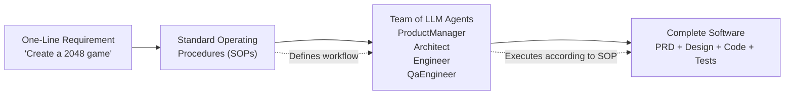

**Diagram: The Code = SOP(Team) Philosophy**

MetaGPT's foundational principle is `Code = SOP(Team)`: software is produced by materializing Standard Operating Procedures and applying them to teams composed of LLMs. This approach:

1. **Materializes SOPs**: Converts abstract software development processes into concrete, executable workflows
2. **Assigns Specialized Roles**: Each LLM agent takes on a specific role with defined responsibilities
3. **Enforces Sequential Handoffs**: Agents communicate through structured documents, mimicking real software companies
4. **Produces Structured Artifacts**: Each role generates specific outputs (PRD, design docs, code, tests) that serve as inputs to downstream roles

Sources: [README.md:44](), [docs/README_CN.md:21-23]()

## System Architecture Overview

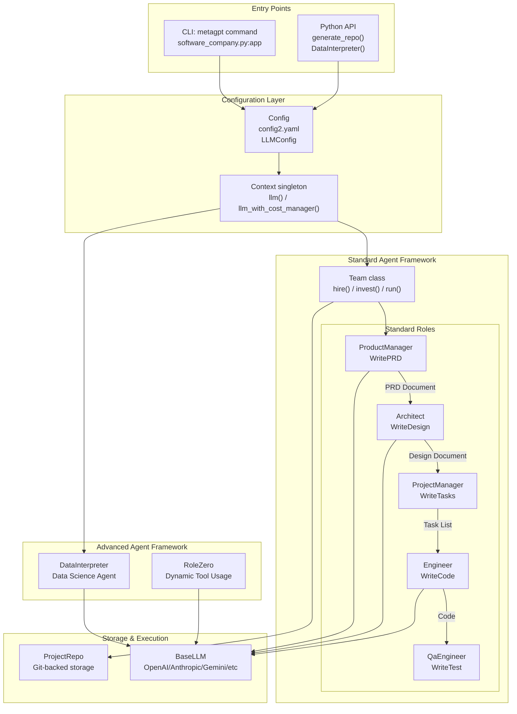

**Diagram: MetaGPT System Architecture with Code Entities**

MetaGPT consists of several layers:

1. **Entry Points**: `metagpt` CLI command and Python API functions (`generate_repo()`, `DataInterpreter`)
2. **Configuration**: `Config` class manages settings; `Context` singleton provides LLM instances
3. **Agent Framework**: 
   - Standard roles follow sequential SOPs (`ProductManager` → `Architect` → `Engineer` → `QaEngineer`)
   - Advanced agents like `DataInterpreter` and `RoleZero` provide specialized capabilities
4. **Storage**: `ProjectRepo` manages Git-backed project artifacts
5. **LLM Integration**: `BaseLLM` abstraction supports 15+ providers

Sources: [README.md:88-103](), [setup.py:98-122](), [metagpt/llm.py:1-21]()

## Primary Entry Points

### CLI Entry Point

The `metagpt` command provides command-line access to the framework:

```bash
metagpt "Create a 2048 game"  # Creates a repository in ./workspace
```

The CLI is defined as a console script entry point in `setup.py`:

```python
entry_points={
    "console_scripts": [
        "metagpt=metagpt.software_company:app",
    ],
}
```

Sources: [setup.py:116-120](), [README.md:90-92]()

### Python API Entry Point

#### generate_repo()

The primary Python API for software generation:

```python
from metagpt.software_company import generate_repo
from metagpt.utils.project_repo import ProjectRepo

repo: ProjectRepo = generate_repo("Create a 2048 game")
print(repo)  # Displays repository structure
```

**Function Signature:**
- **Input**: Natural language requirement (string)
- **Output**: `ProjectRepo` object containing all generated artifacts
- **Process**: Orchestrates `Team` with standard roles through multiple rounds of collaboration

Sources: [README.md:96-102]()

#### DataInterpreter

A specialized agent for data science tasks:

```python
import asyncio
from metagpt.roles.di.data_interpreter import DataInterpreter

async def main():
    di = DataInterpreter()
    await di.run("Run data analysis on sklearn Iris dataset, include a plot")

asyncio.run(main())
```

**Capabilities:**
- Executes data analysis tasks
- Generates and runs Python code
- Creates visualizations
- Handles Jupyter notebooks

Sources: [README.md:104-115](), [README.md:136]()

## Core Use Cases

### Use Case 1: Software Project Generation

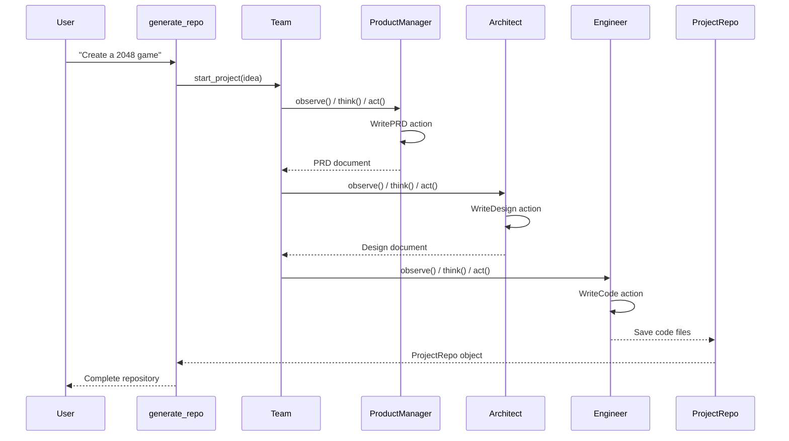

**Diagram: Software Generation Workflow**

**Workflow:**
1. User provides a natural language requirement
2. `generate_repo()` initializes a `Team` with standard roles
3. Roles execute in sequence: `ProductManager` → `Architect` → `ProjectManager` → `Engineer` → `QaEngineer`
4. Each role produces structured documents as output
5. Final artifacts stored in `ProjectRepo` (Git-backed)

**Output Structure:**
- `docs/prd/`: Product requirements documents
- `docs/system_design/`: Architecture and API designs  
- `docs/task/`: Task breakdowns
- `src/`: Source code
- `tests/`: Test files

Sources: [README.md:40-48]()

### Use Case 2: Data Science Analysis

**Workflow:**
1. User provides data science task description
2. `DataInterpreter` analyzes requirements
3. Generates Python code for analysis
4. Executes code with error handling
5. Produces visualizations and results

**Example Tasks:**
- Exploratory data analysis (EDA)
- Data preprocessing and cleaning
- Feature engineering
- Model training and evaluation
- Visualization generation

Sources: [README.md:104-115](), [README.md:136]()

## Installation Quick Start

### Installation Methods

| Method | Command |
|--------|---------|
| **PyPI (Stable)** | `pip install --upgrade metagpt` |
| **Git (Latest)** | `pip install --upgrade git+https://github.com/geekan/MetaGPT.git` |
| **Development** | `git clone https://github.com/geekan/MetaGPT && cd MetaGPT && pip install -e .` |
| **Docker** | `docker pull metagpt/metagpt:latest` |

**Requirements:**
- Python 3.9 or higher, but less than 3.12
- Node.js and pnpm (for Mermaid diagram generation)

**Verify Installation:**
```bash
python --version  # Should show 3.9+
metagpt --init-config  # Creates ~/.metagpt/config2.yaml
```

Sources: [README.md:52-66](), [setup.py:110]()

### Docker Installation

```bash
# Step 1: Pull image and prepare config
docker pull metagpt/metagpt:latest
mkdir -p /opt/metagpt/{config,workspace}
docker run --rm metagpt/metagpt:latest cat /app/metagpt/config/config2.yaml > /opt/metagpt/config/config2.yaml

# Step 2: Edit configuration
vim /opt/metagpt/config/config2.yaml

# Step 3: Run MetaGPT
docker run --rm \
    --privileged \
    -v /opt/metagpt/config/config2.yaml:/app/metagpt/config/config2.yaml \
    -v /opt/metagpt/workspace:/app/metagpt/workspace \
    metagpt/metagpt:latest \
    metagpt "Write a cli snake game"
```

**Docker Image Contents:**
- Base: `python3.9-nodejs20-slim` ([Dockerfile:2]())
- System dependencies: Chromium, fonts ([Dockerfile:5-7]())
- Mermaid CLI for diagram generation ([Dockerfile:9-14]())
- Volume mounts: `/opt/metagpt/config` and `/opt/metagpt/workspace`

Sources: [Dockerfile:1-25](), [README.md:156-175]()

## Configuration Essentials

### Minimum Configuration

Create `~/.metagpt/config2.yaml`:

```yaml
llm:
  api_type: "openai"  # or azure / ollama / anthropic / gemini
  model: "gpt-4-turbo"  # or gpt-3.5-turbo
  base_url: "https://api.openai.com/v1"
  api_key: "YOUR_API_KEY"
```

**Configuration Priority:**
1. Kwargs passed to functions (highest)
2. `~/.metagpt/config2.yaml` (user config)
3. `config/config2.yaml` (project config)
4. Environment variables (lowest)

Sources: [README.md:68-84]()

### Supported LLM Providers

MetaGPT supports 15+ LLM providers through the `BaseLLM` abstraction:

**International Providers:**
- OpenAI (GPT-4, GPT-3.5-turbo)
- Anthropic (Claude)
- Google (Gemini)
- AWS Bedrock
- Ollama (local models)
- Fireworks, Moonshot, Mistral, DeepSeek, OpenRouter, etc.

**Chinese Providers:**
- Qianfan (Baidu)
- DashScope (Alibaba)
- ZhiPu AI
- Volcano Engine
- Spark (iFlytek)

Each provider is registered via `@register_provider` decorator and accessed through `LLMType` enum.

Sources: [requirements.txt:16](), [requirements.txt:34](), [requirements.txt:55](), [requirements.txt:80-87]()

## Core Dependencies

**Essential Libraries:**

| Category | Libraries | Purpose |
|----------|-----------|---------|
| **LLM SDKs** | openai, anthropic, google-generativeai | LLM provider integrations |
| **Data Processing** | pandas, numpy, scikit-learn | Data analysis capabilities |
| **Async I/O** | aiohttp, aiofiles | Asynchronous operations |
| **Storage** | redis, faiss-cpu, qdrant-client | Memory and vector storage |
| **Code Execution** | ipykernel, nbclient, nbformat | Jupyter notebook support |
| **Version Control** | gitpython | Git integration |
| **Web Automation** | playwright, beautifulsoup4 | Browser automation |
| **Utilities** | pydantic, loguru, tenacity | Validation, logging, retries |

**Optional Extras:**
- `pip install metagpt[selenium]` - Web scraping with Selenium
- `pip install metagpt[rag]` - RAG capabilities with llama-index
- `pip install metagpt[test]` - Testing dependencies

Sources: [requirements.txt:1-90](), [setup.py:26-96]()

## Basic Usage Patterns

### Pattern 1: CLI Usage

```bash
# Basic project generation
metagpt "Create a 2048 game"

# Skip implementation phase (design only)
metagpt "Create a 2048 game" --no-implement

# Enable code review
metagpt "Create a 2048 game" --code_review

# Specify platform/tools
metagpt "Write a cli snake game based on pygame"
```

Sources: [README.md:88-92](), [docs/README_JA.md:216-221]()

### Pattern 2: Library Usage

```python
from metagpt.software_company import generate_repo
from metagpt.utils.project_repo import ProjectRepo

# Generate from requirement
repo: ProjectRepo = generate_repo("Create a 2048 game")

# Or load existing repo
repo = ProjectRepo("/path/to/workspace/project")

# Inspect repository
print(repo)  # Displays file structure
```

Sources: [README.md:96-102]()

### Pattern 3: Custom Team Composition

```python
from metagpt.team import Team
from metagpt.roles import ProductManager, Architect, Engineer

async def startup(idea: str, investment: float = 3.0, n_round: int = 5):
    """Run a startup with custom team."""
    company = Team()
    company.hire([ProductManager(), Architect(), Engineer()])
    company.invest(investment)
    company.start_project(idea)
    await company.run(n_round=n_round)
```

**Key Classes:**
- `Team`: Orchestrates multi-agent collaboration
- `Role`: Base class for all agents (ProductManager, Architect, etc.)
- `Environment`: Message broker for agent communication
- `ProjectRepo`: Git-backed storage for artifacts

Sources: [docs/README_JA.md:266-276]()

## Output Artifacts

When MetaGPT generates a project, it creates a structured workspace:

```
workspace/
└── project_name/
    ├── docs/
    │   ├── prd/           # Product Requirements (JSON)
    │   ├── system_design/ # Architecture & APIs (JSON)
    │   └── task/          # Task breakdowns (JSON)
    ├── resources/
    │   ├── prd/           # PRD in Markdown/PDF
    │   ├── system_design/ # Diagrams (SVG/PNG)
    │   └── api_spec_and_task/
    ├── src/               # Source code
    └── tests/             # Test files
```

**Document Types:**
- **PRD**: User stories, requirements, competitive analysis
- **System Design**: Data structures, API specifications, sequence diagrams
- **Tasks**: Detailed implementation tasks
- **Code**: Functional implementation
- **Tests**: Unit and integration tests

Sources: [.gitignore:168]()

## Next Steps

This introduction covers the fundamentals of MetaGPT. For deeper exploration:

- **Installation Details**: See [Installation and Setup](#1.1) for comprehensive installation instructions, dependency management, and troubleshooting
- **Configuration**: See [Configuration System](#1.2) for detailed config options, LLM provider setup, and environment variables
- **Role System**: See [Core Multi-Agent Framework](#2) to understand how roles collaborate and communicate
- **LLM Integration**: See [LLM Provider Integration](#3) for multi-provider setup, token management, and cost control
- **Advanced Agents**: See [Dynamic Agent System (RoleZero)](#4) for tool-using agents with dynamic capabilities

Sources: [README.md:125-141]()

---

# Page: Installation and Setup

# Installation and Setup

<details>
<summary>Relevant source files</summary>

The following files were used as context for generating this wiki page:

- [.gitignore](.gitignore)
- [Dockerfile](Dockerfile)
- [MANIFEST.in](MANIFEST.in)
- [README.md](README.md)
- [docs/ACADEMIC_WORK.md](docs/ACADEMIC_WORK.md)
- [docs/NEWS.md](docs/NEWS.md)
- [docs/README_CN.md](docs/README_CN.md)
- [docs/README_FR.md](docs/README_FR.md)
- [docs/README_JA.md](docs/README_JA.md)
- [metagpt/llm.py](metagpt/llm.py)
- [metagpt/utils/mermaid.py](metagpt/utils/mermaid.py)
- [requirements.txt](requirements.txt)
- [setup.py](setup.py)

</details>


This document covers the installation requirements, dependency management, and initial configuration for MetaGPT. It focuses on getting the multi-agent framework operational with various LLM providers and optional features.

For information about runtime configuration management, see [Configuration System](#1.2). For details about LLM provider integration, see [LLM Provider System](#3.1).

## Prerequisites

MetaGPT requires Python 3.9 or higher, with explicit support up to Python 3.11. The framework is built around asynchronous operations and requires several system-level dependencies depending on the features you plan to use.

**System Requirements:**
- Python: `>=3.9, <3.12` [setup.py:110]()
- Node.js (optional): Required for Mermaid diagram generation
- Git: Required for repository management features
- Redis (optional): Required for memory persistence features

## Basic Installation

### Standard Installation

The core MetaGPT installation provides the fundamental multi-agent framework with basic LLM integration:

```bash
pip install metagpt
```

This installs the base requirements from [requirements.txt:1-91](), including:
- Core dependencies: `aiohttp`, `fire`, `typer`, `loguru`, `pydantic`, `PyYAML`
- LLM integration: `openai`, `anthropic`, `tiktoken`, `zhipuai`, `google-generativeai`
- Vector processing: `faiss_cpu`, `numpy`, `pandas`
- Development tools: `gitpython`, `beautifulsoup4`, `rich`

### Development Installation

For development or contributing to MetaGPT:

```bash
git clone https://github.com/geekan/MetaGPT
cd MetaGPT
pip install -e .
```

**Sources:** [setup.py:98-122](), [requirements.txt:1-91]()

## Installation Architecture

The following diagram shows the relationship between installation components and runtime systems:

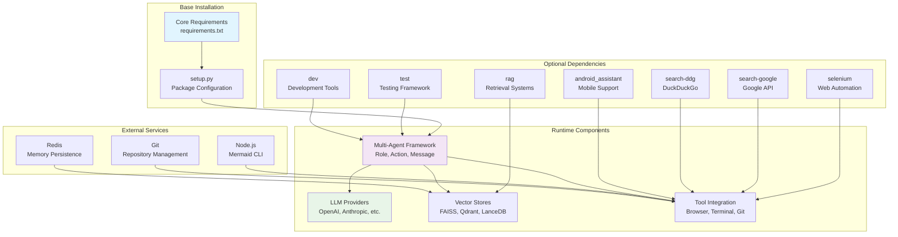

**Sources:** [setup.py:26-96](), [requirements.txt:1-91]()

## Modular Installation Options

MetaGPT supports modular installation through setuptools extras to minimize dependencies for specific use cases:

### Web Automation and Search
```bash
# Selenium-based web automation
pip install metagpt[selenium]

# Google Search integration  
pip install metagpt[search-google]

# DuckDuckGo Search integration
pip install metagpt[search-ddg]
```

### Retrieval-Augmented Generation (RAG)
```bash
pip install metagpt[rag]
```

This installs comprehensive RAG capabilities including:
- LlamaIndex ecosystem: `llama-index-core`, `llama-index-embeddings-*`, `llama-index-vector-stores-*`
- Multiple embedding providers: OpenAI, Azure OpenAI, Gemini, Ollama
- Vector stores: FAISS, Elasticsearch, Chroma
- Reranking: Cohere, ColBERT, Flag Embedding
- Document processing: `docx2txt`

### Development and Testing
```bash
# Full testing suite
pip install metagpt[test]

# Development tools
pip install metagpt[dev]

# Legacy browser automation (unmaintained)
pip install metagpt[pyppeteer]
```

### Specialized Features
```bash
# Android assistant capabilities
pip install metagpt[android_assistant]
```

**Sources:** [setup.py:26-96]()

## Configuration Flow

This diagram illustrates how installation components connect to the runtime configuration system:

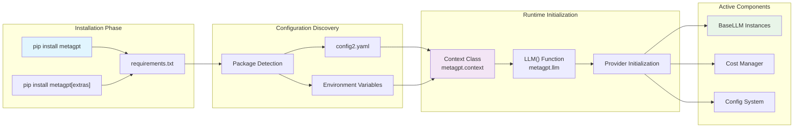

**Sources:** [metagpt/llm.py:15-20](), [setup.py:98-122]()

## Post-Installation Setup

### Mermaid CLI Installation (Optional)

For diagram generation capabilities, install the Mermaid CLI:

```bash
python setup.py install_mermaid
```

This executes the custom command defined in [setup.py:8-19]() which runs:
```bash
npm install -g @mermaid-js/mermaid-cli
```

### Console Script Access

After installation, MetaGPT provides a command-line interface through the `metagpt` command, configured as an entry point in [setup.py:116-120]():

```bash
metagpt --help
```

This launches the main application defined in `metagpt.software_company:app`.

### Verification

Verify your installation by checking core imports:

```python
from metagpt.llm import LLM
from metagpt.context import Context
from metagpt.roles.product_manager import ProductManager
```

The `LLM()` function from [metagpt/llm.py:15-20]() should initialize without errors, indicating proper configuration discovery.

**Sources:** [setup.py:8-19](), [setup.py:116-120](), [metagpt/llm.py:15-20]()

## Installation Dependencies Table

| Category | Key Packages | Purpose |
|----------|--------------|---------|
| **Core Framework** | `pydantic>=2.5.3`, `PyYAML==6.0.1`, `fire==0.4.0`, `typer==0.9.0` | Configuration, CLI, validation |
| **LLM Providers** | `openai~=1.64.0`, `anthropic==0.47.2`, `zhipuai~=2.1.5`, `google-generativeai==0.4.1` | Multi-provider LLM support |
| **Vector Processing** | `faiss_cpu==1.7.4`, `qdrant-client==1.7.0`, `lancedb==0.4.0` | Vector storage and similarity search |
| **Web & Automation** | `playwright>=1.26`, `beautifulsoup4==4.12.3`, `selenium>4` | Web scraping and browser automation |
| **Development Tools** | `gitpython==3.1.40`, `rich==13.6.0`, `nbclient==0.9.0`, `ipython==8.17.2` | Repository management, UI, notebooks |
| **Memory & Caching** | `redis~=5.0.0`, `tenacity==8.2.3` | Persistence and retry mechanisms |

**Sources:** [requirements.txt:1-91](), [setup.py:26-48]()

---

# Page: Configuration System

# Configuration System

<details>
<summary>Relevant source files</summary>

The following files were used as context for generating this wiki page:

- [.github/workflows/fulltest.yaml](.github/workflows/fulltest.yaml)
- [.github/workflows/unittest.yaml](.github/workflows/unittest.yaml)
- [.gitignore](.gitignore)
- [MANIFEST.in](MANIFEST.in)
- [metagpt/config2.py](metagpt/config2.py)
- [metagpt/context.py](metagpt/context.py)
- [metagpt/context_mixin.py](metagpt/context_mixin.py)
- [metagpt/llm.py](metagpt/llm.py)
- [metagpt/software_company.py](metagpt/software_company.py)
- [requirements.txt](requirements.txt)
- [setup.py](setup.py)
- [tests/conftest.py](tests/conftest.py)
- [tests/data/rsp_cache.json](tests/data/rsp_cache.json)
- [tests/metagpt/test_config.py](tests/metagpt/test_config.py)
- [tests/metagpt/test_context.py](tests/metagpt/test_context.py)
- [tests/metagpt/test_context_mixin.py](tests/metagpt/test_context_mixin.py)
- [tests/mock/mock_llm.py](tests/mock/mock_llm.py)

</details>


## Purpose and Scope

The Configuration System is the central component responsible for managing all configuration parameters, environment settings, and runtime context in MetaGPT. It provides a unified interface for loading configuration from multiple sources (YAML files, environment variables, programmatic settings), managing LLM provider configurations, and maintaining runtime context across the multi-agent framework.

For information about LLM provider configuration and integration, see [LLM Provider System](#3.1). For details about role-specific configuration usage, see [Role System](#2.1).

## Architecture Overview

The configuration system follows a layered architecture with four key components: configuration sources with priority-based merging, the `Config` class for centralized settings, the `Context` class for runtime state, and the `ContextMixin` pattern for dependency injection.

**Configuration System Architecture**

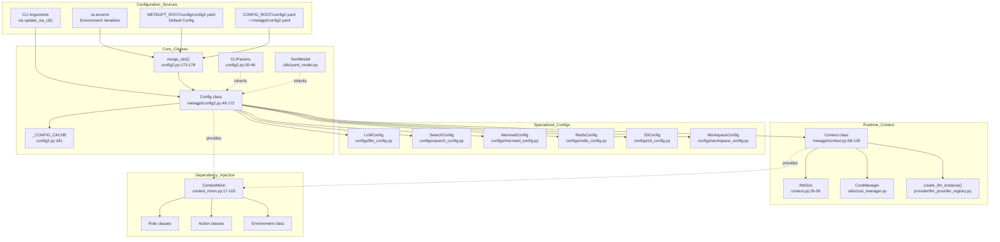

Sources: [metagpt/config2.py:1-183](), [metagpt/context.py:1-128](), [metagpt/context_mixin.py:1-102]()

## Core Configuration Classes

### Config Class

The `Config` class is the central configuration object that inherits from both `CLIParams` and `YamlModel`, providing comprehensive configuration management:

```mermaid
graph TD
    subgraph "Config_Class_Hierarchy"
        Config["Config<br/>metagpt.config2.Config<br/>Lines 49-172"]
        CLIParams["CLIParams<br/>metagpt.config2.CLIParams<br/>Lines 30-46"]
        YamlModel["YamlModel<br/>metagpt.utils.yaml_model.YamlModel"]
        BaseModel["BaseModel<br/>pydantic.BaseModel"]
    end
    
    subgraph "Factory_Methods"
        default_method["default(reload=False, **kwargs)<br/>Line 110-123"]
        from_home_method["from_home(path)<br/>Lines 102-107"]
        from_llm_config_method["from_llm_config(llm_config)<br/>Lines 126-137"]
        update_via_cli_method["update_via_cli(...)<br/>Lines 139-150"]
    end
    
    subgraph "Required_Fields"
        llm_field["llm: LLMConfig<br/>Required LLM configuration<br/>Line 53"]
    end
    
    subgraph "Optional_Config_Fields"
        embedding_field["embedding: EmbeddingConfig<br/>RAG embeddings, Line 56"]
        search_field["search: SearchConfig<br/>Search engine config, Line 65"]
        browser_field["browser: BrowserConfig<br/>Browser automation, Line 67"]
        exp_pool_field["exp_pool: ExperiencePoolConfig<br/>Experience caching, Line 82"]
        role_zero_field["role_zero: RoleZeroConfig<br/>RoleZero settings, Line 99"]
        roles_field["roles: List[RoleCustomConfig]<br/>Role-specific configs, Line 96"]
        workspace_field["workspace: WorkspaceConfig<br/>Workspace management, Line 77"]
    end
    
    Config --> CLIParams
    Config --> YamlModel
    YamlModel --> BaseModel
    
    Config --> default_method
    Config --> from_home_method
    Config --> from_llm_config_method
    Config --> update_via_cli_method
    
    Config --> llm_field
    Config --> embedding_field
    Config --> search_field
    Config --> browser_field
    Config --> exp_pool_field
    Config --> role_zero_field
    Config --> roles_field
    Config --> workspace_field
```

Key configuration caching mechanism using `_CONFIG_CACHE` dict for performance optimization:

```python
# Global config instance and caching from config2.py:181-182
_CONFIG_CACHE = {}
config = Config.default()
```

Sources: [metagpt/config2.py:49-172](), [metagpt/config2.py:30-46](), [metagpt/config2.py:181-182]()

### Configuration Loading Priority

The configuration system implements a priority-based loading mechanism in `Config.default()` where later sources override earlier ones:

| Priority | Source | Code Reference | Description |
|----------|--------|----------------|-------------|
| 1 (Lowest) | Environment Variables | `dict(os.environ)` | OS environment variables like `OPENAI_API_KEY` |
| 2 | Default Config | `METAGPT_ROOT/config/config2.yaml` | Repository default configuration |
| 3 | User Config | `CONFIG_ROOT/config2.yaml` (`~/.metagpt/config2.yaml`) | User-specific configuration |
| 4 (Highest) | CLI Arguments | `update_via_cli()` kwargs | Command-line parameters |

**Configuration Merging and Caching**

The `merge_dict()` function at [metagpt/config2.py:173-178]() implements simple dictionary merging where later values overwrite earlier ones. The `Config.default()` method uses caching to avoid re-parsing configuration files on repeated calls:

```python
# From config2.py:115-123
default_config_paths = (
    METAGPT_ROOT / "config/config2.yaml",  # Repository default
    CONFIG_ROOT / "config2.yaml",          # User home directory
)
if reload or default_config_paths not in _CONFIG_CACHE:
    dicts = [dict(os.environ), *(Config.read_yaml(path) for path in default_config_paths), kwargs]
    final = merge_dict(dicts)
    _CONFIG_CACHE[default_config_paths] = Config(**final)
return _CONFIG_CACHE[default_config_paths]
```

The global `config` instance at [metagpt/config2.py:182]() is initialized with `Config.default()` and can be imported directly: `from metagpt.config2 import config`.

Sources: [metagpt/config2.py:110-123](), [metagpt/config2.py:173-178](), [metagpt/config2.py:181-182]()

## Context Management

### Context Class Architecture

The `Context` class at [metagpt/context.py:58-128]() provides runtime environment management and serves as the bridge between configuration and execution. It manages the global `Config` instance, lazy-initializes LLM instances, and tracks costs.

**Context Class Structure**

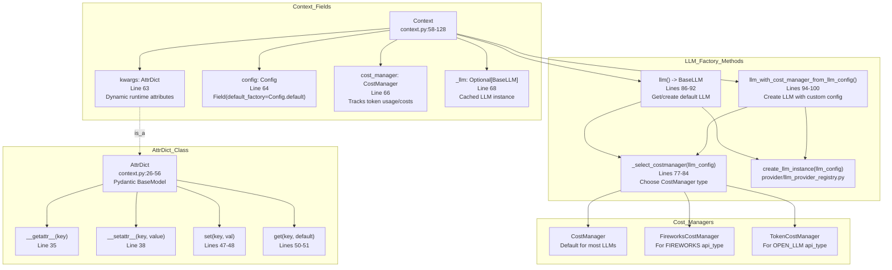

**LLM Lazy Initialization**

The `Context.llm()` method implements lazy initialization with cost manager injection:

```python
# From context.py:86-92
def llm(self) -> BaseLLM:
    """Return a LLM instance, fixme: support cache"""
    # if self._llm is None:
    self._llm = create_llm_instance(self.config.llm)
    if self._llm.cost_manager is None:
        self._llm.cost_manager = self._select_costmanager(self.config.llm)
    return self._llm
```

The `_select_costmanager()` method at [metagpt/context.py:77-84]() chooses the appropriate cost tracking implementation based on the LLM provider type:
- `FireworksCostManager` for `LLMType.FIREWORKS`
- `TokenCostManager` for `LLMType.OPEN_LLM`
- Default `CostManager` for all other providers (OpenAI, Anthropic, etc.)

**AttrDict for Dynamic Attributes**

The `AttrDict` class at [metagpt/context.py:26-56]() extends Pydantic's `BaseModel` with dict-like attribute access, allowing dynamic runtime attributes to be stored in `Context.kwargs`. This is used for storing temporary state like `project_path` during execution.

Sources: [metagpt/context.py:26-56](), [metagpt/context.py:58-128](), [metagpt/context.py:77-92]()

## ContextMixin Pattern

### Dependency Injection Architecture

The `ContextMixin` class at [metagpt/context_mixin.py:17-102]() implements a sophisticated dependency injection pattern that allows `Role`, `Action`, and `Environment` classes to access configuration, context, and LLM instances with flexible priority resolution.

**ContextMixin Class Structure**

```mermaid
graph TB
    subgraph "ContextMixin_Fields"
        ContextMixin["ContextMixin<br/>context_mixin.py:17-102<br/>Pydantic BaseModel"]
        private_context["private_context: Optional[Context]<br/>Line 28<br/>Instance-specific context"]
        private_config["private_config: Optional[Config]<br/>Line 30<br/>Instance-specific config"]
        private_llm["private_llm: Optional[BaseLLM]<br/>Line 33<br/>Instance-specific LLM"]
    end
    
    subgraph "Setter_Methods"
        set_context["set_context(context, override=True)<br/>Lines 52-54"]
        set_config["set_config(config, override=False)<br/>Lines 56-60"]
        set_llm["set_llm(llm, override=False)<br/>Lines 62-64"]
        set_generic["set(k, v, override=False)<br/>Lines 47-50"]
    end
    
    subgraph "Property_Resolution"
        context_prop["@property context -> Context<br/>Lines 78-83<br/>private_context or Context()"]
        config_prop["@property config -> Config<br/>Lines 66-71<br/>private_config or context.config"]
        llm_prop["@property llm -> BaseLLM<br/>Lines 90-96<br/>private_llm or context.llm()"]
    end
    
    subgraph "Inheriting_Classes"
        Role["Role class<br/>roles/role.py"]
        Action["Action class<br/>actions/action.py"]
        Environment["Environment class<br/>environment/base_env.py"]
    end
    
    ContextMixin --> private_context
    ContextMixin --> private_config
    ContextMixin --> private_llm
    
    ContextMixin --> set_context
    ContextMixin --> set_config
    ContextMixin --> set_llm
    ContextMixin --> set_generic
    
    ContextMixin --> context_prop
    ContextMixin --> config_prop
    ContextMixin --> llm_prop
    
    ContextMixin -.inherited_by.-> Role
    ContextMixin -.inherited_by.-> Action
    ContextMixin -.inherited_by.-> Environment
    
    config_prop --> context_prop
    llm_prop --> context_prop
```

**Priority Resolution Logic**

The property accessors implement a fallback chain that provides flexibility:

1. **`config` property** (Lines 66-71): Returns `private_config` if set, otherwise `context.config`
2. **`llm` property** (Lines 90-96): Returns `private_llm` if set, otherwise creates from `context.llm_with_cost_manager_from_llm_config(self.config.llm)`
3. **`context` property** (Lines 78-83): Returns `private_context` if set, otherwise a default `Context()` instance

This allows fine-grained control: a specific `Action` can use a different LLM than its parent `Role`, or a `Role` can use different configuration than the global default.

**Configuration Override Behavior**

The `set_config()` method at [metagpt/context_mixin.py:56-60]() has `override=False` by default, meaning if `private_config` is already set, calling `set_config()` again won't replace it. This prevents accidental configuration changes. However, `set_context()` uses `override=True` by default, allowing context to be replaced freely.

Sources: [metagpt/context_mixin.py:17-102](), [metagpt/context_mixin.py:47-64](), [metagpt/context_mixin.py:66-96]()

### ContextMixin Usage Examples

**Role with Custom LLM Configuration**

From the test at [tests/metagpt/test_context_mixin.py:105-133]():

```python
# Different roles with different LLM configs
gpt4 = Config.default()
gpt4.llm.model = "gpt-4-0613"
gpt35 = Config.default()
gpt35.llm.model = "gpt-4-turbo"

# Action with its own config (won't be overridden by role)
a1 = Action(config=gpt4t, name="Say", instruction="Say your opinion")
# Action without config (will inherit from role)
a2 = Action(name="Say", instruction="Say your opinion")

# Role A has config=gpt4, but a1 keeps its own config
A = Role(name="A", profile="Candidate", goal="Win", actions=[a1], config=gpt4)
# Role B has config=gpt4, a2 will use gpt4
B = Role(name="B", profile="Candidate", goal="Win", actions=[a2], config=gpt4)
# Role C has config=gpt35
C = Role(name="C", profile="Voter", goal="Vote", actions=[a3], config=gpt35)

# Final LLM assignments:
# a1.llm.model == "gpt-4-turbo" (from its own config)
# a2.llm.model == "gpt-4-0613" (inherited from Role B)
# a3.llm.model == "gpt-4-turbo" (inherited from Role C)
```

This demonstrates the priority chain: `Action.private_config` > `Role.private_config` > `Context.config`.

Sources: [tests/metagpt/test_context_mixin.py:105-133](), [metagpt/context_mixin.py:56-60]()

## Specialized Configuration Modules

MetaGPT provides specialized configuration classes for different subsystems, all accessible as fields on the main `Config` class:

### LLM Configuration

The `LLMConfig` class at [metagpt/configs/llm_config.py]() manages LLM provider settings:

| Field | Type | Description |
|-------|------|-------------|
| `api_type` | `LLMType` | Provider type (OPENAI, AZURE, ANTHROPIC, etc.) |
| `model` | `str` | Model name (gpt-4-turbo, claude-3-opus, etc.) |
| `api_key` | `str` | API key for authentication |
| `base_url` | `str` | API endpoint URL |
| `proxy` | `str` | Optional HTTP proxy |

### Storage and Tool Configurations

| Configuration Class | File Path | Key Fields |
|---------------------|-----------|------------|
| `SearchConfig` | `configs/search_config.py` | `api_type`, `api_key`, `engine` |
| `BrowserConfig` | `configs/browser_config.py` | `engine` (playwright, selenium) |
| `MermaidConfig` | `configs/mermaid_config.py` | `engine` (nodejs, playwright, pyppeteer, ink), `path` |
| `RedisConfig` | `configs/redis_config.py` | `host`, `port`, `password`, `db` |
| `S3Config` | `configs/s3_config.py` | `access_key`, `secret_key`, `endpoint`, `bucket` |
| `WorkspaceConfig` | `configs/workspace_config.py` | `path`, `use_uid` |

### Experience Pool Configuration

The `ExperiencePoolConfig` at [metagpt/configs/exp_pool_config.py]() manages the experience caching system:

| Field | Type | Default | Description |
|-------|------|---------|-------------|
| `enabled` | `bool` | `False` | Enable experience pool |
| `enable_read` | `bool` | `True` | Allow reading from pool |
| `enable_write` | `bool` | `True` | Allow writing to pool |
| `persist_path` | `str` | `.experience_pool` | Storage directory |
| `retrieval_type` | `ExperiencePoolRetrievalType` | `BM25` | BM25 or CHROMA |
| `use_llm_ranker` | `bool` | `False` | Use LLM for re-ranking |

### RoleZero Configuration

The `RoleZeroConfig` at [metagpt/configs/role_zero_config.py]() manages the advanced reactive agent:

| Field | Type | Default | Description |
|-------|------|---------|-------------|
| `enable_longterm_memory` | `bool` | `False` | Enable long-term memory |
| `longterm_memory_persist_path` | `str` | `.role_memory_data` | Memory storage path |
| `memory_k` | `int` | `200` | Short-term memory size |
| `similarity_top_k` | `int` | `5` | Long-term retrieval count |
| `use_llm_ranker` | `bool` | `False` | Enable LLM ranking |

Sources: [metagpt/config2.py:49-99](), [metagpt/configs/llm_config.py](), [metagpt/configs/exp_pool_config.py](), [metagpt/configs/role_zero_config.py]()

## Configuration Usage Patterns

### Initialization and Setup

The configuration system supports multiple initialization patterns:

1. **Default Configuration Loading:**
```python
from metagpt.config2 import config  # Global default config
```

2. **Custom Configuration from LLM Config:**
```python
llm_config = {"api_type": "openai", "api_key": "xxx", "model": "gpt-4"}
custom_config = Config.from_llm_config(llm_config)
```

3. **Configuration with Context:**
```python
from metagpt.context import Context
ctx = Context(config=config)
llm = ctx.llm()  # Get LLM instance with cost manager
```

Sources: [metagpt/config2.py:182](), [metagpt/config2.py:126-137](), [metagpt/software_company.py:29-41]()

### CLI Integration

The configuration system integrates with CLI commands through the `CLIParams` class and `update_via_cli` method:

```python
def update_via_cli(self, project_path, project_name, inc, reqa_file, max_auto_summarize_code):
    if project_path:
        inc = True
        project_name = project_name or Path(project_path).name
    self.project_path = project_path
    self.project_name = project_name
    self.inc = inc
    self.reqa_file = reqa_file
    self.max_auto_summarize_code = max_auto_summarize_code
```

Sources: [metagpt/config2.py:139-150](), [metagpt/software_company.py:77-124]()

### Role-Specific Configuration

The configuration system supports role-specific LLM configurations through the `roles` field:

```yaml
roles:
  - role: "ProductManager"
    llm:
      api_type: "openai"
      model: "gpt-4-turbo-1106"
  - role: "Architect"
    llm:
      api_type: "openai"
      model: "gpt-35-turbo"
```

This allows different roles to use different LLM providers or models based on their specific requirements.

Sources: [config/config2.example.yaml:24-52](), [metagpt/config2.py:95-96]()

---

# Page: Context and Runtime Management

# Context and Runtime Management

<details>
<summary>Relevant source files</summary>

The following files were used as context for generating this wiki page:

- [.github/workflows/fulltest.yaml](.github/workflows/fulltest.yaml)
- [.github/workflows/unittest.yaml](.github/workflows/unittest.yaml)
- [metagpt/config2.py](metagpt/config2.py)
- [metagpt/context.py](metagpt/context.py)
- [metagpt/context_mixin.py](metagpt/context_mixin.py)
- [metagpt/software_company.py](metagpt/software_company.py)
- [tests/conftest.py](tests/conftest.py)
- [tests/data/rsp_cache.json](tests/data/rsp_cache.json)
- [tests/metagpt/test_config.py](tests/metagpt/test_config.py)
- [tests/metagpt/test_context.py](tests/metagpt/test_context.py)
- [tests/metagpt/test_context_mixin.py](tests/metagpt/test_context_mixin.py)
- [tests/mock/mock_llm.py](tests/mock/mock_llm.py)

</details>


This document covers MetaGPT's runtime context system, which provides centralized management of configuration, LLM instances, cost tracking, and flexible runtime state. For information about the configuration system itself (config2.yaml structure, loading priority), see [Configuration System](#1.2). For information about cost tracking internals and token management, see [Token Management and Cost Control](#3.5).

## Purpose and Scope

The Context and ContextMixin system solves three core problems:
1. **Centralized State Management**: Provides a single source of truth for runtime configuration, LLM instances, and execution state
2. **Dependency Injection**: Enables components (Roles, Actions, Tools) to inherit or override configuration without explicit passing
3. **Cost Tracking**: Attaches cost managers to LLM instances automatically, tracking token usage across all operations

This system is fundamental to all MetaGPT operations—every Role, Action, Team, and Tool uses Context either directly or through ContextMixin inheritance.

---

## System Overview

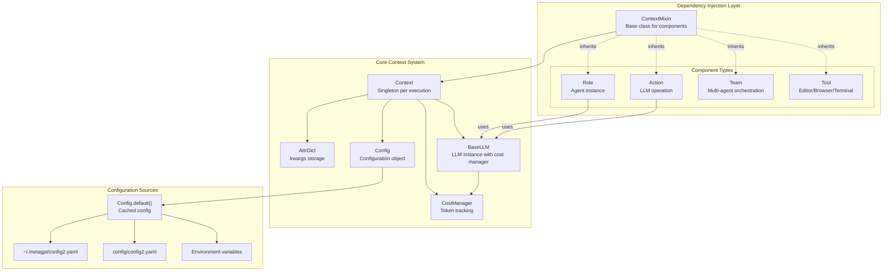

**Diagram: Context System Architecture**

The Context acts as a runtime container that combines configuration, LLM instances, cost tracking, and flexible state storage. ContextMixin provides the dependency injection mechanism that allows components to access or override this context.

**Sources:** [metagpt/context.py:1-128](), [metagpt/context_mixin.py:1-102](), [metagpt/config2.py:49-183]()

---

## AttrDict: Flexible Runtime State Storage

`AttrDict` is a Pydantic-based dictionary that supports both dictionary-style (`obj['key']`) and attribute-style (`obj.key`) access patterns. It serves as the flexible storage mechanism within Context for runtime state that doesn't fit into predefined fields.

### Implementation Details

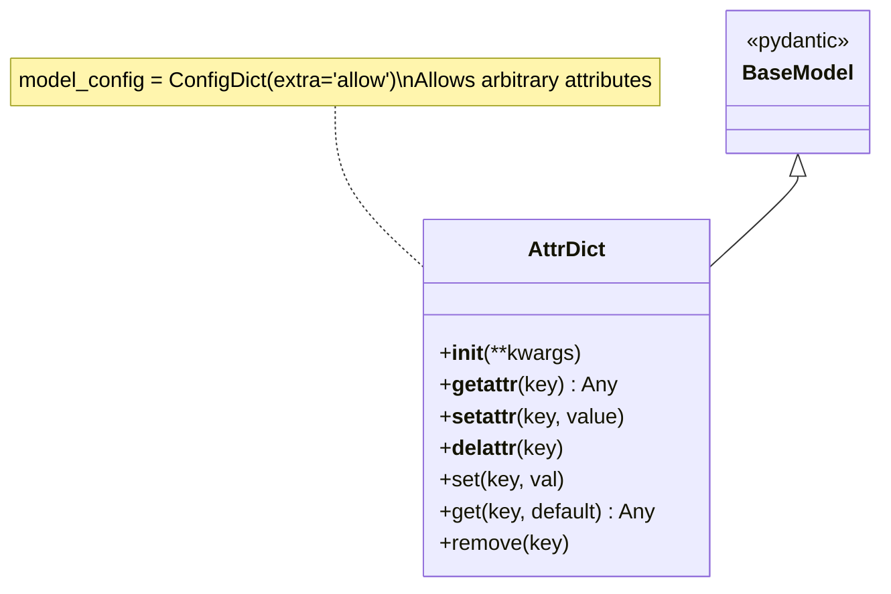

**Diagram: AttrDict Class Structure**

### Key Characteristics

| Feature | Implementation | Purpose |
|---------|---------------|---------|
| **Attribute Access** | `__getattr__` returns `self.__dict__.get(key, None)` | Access via `obj.key`, returns None if missing |
| **Dict Access** | `__dict__` stores all attributes | Compatible with dict operations |
| **Type Safety** | Inherits from `BaseModel` | Pydantic validation support |
| **Extra Fields** | `extra="allow"` in model_config | Accepts arbitrary keyword arguments |
| **Default Returns** | Returns None for missing keys | No KeyError exceptions |

### Usage Pattern

```python
# From tests/metagpt/test_context.py
ad = AttrDict(name="John", age=30)
assert ad.name == "John"           # Attribute access
assert ad.age == 30                # Attribute access
assert ad.height is None           # Missing key returns None

ad.height = 180                    # Set new attribute
assert ad.height == 180

del ad.age                         # Delete attribute
assert ad.age is None              # Returns None after deletion
```

**Sources:** [metagpt/context.py:26-56](), [tests/metagpt/test_context.py:12-43]()

---

## Context Class Architecture

The `Context` class is the central runtime container that manages configuration, LLM instances, and cost tracking for an entire execution session.

### Core Structure

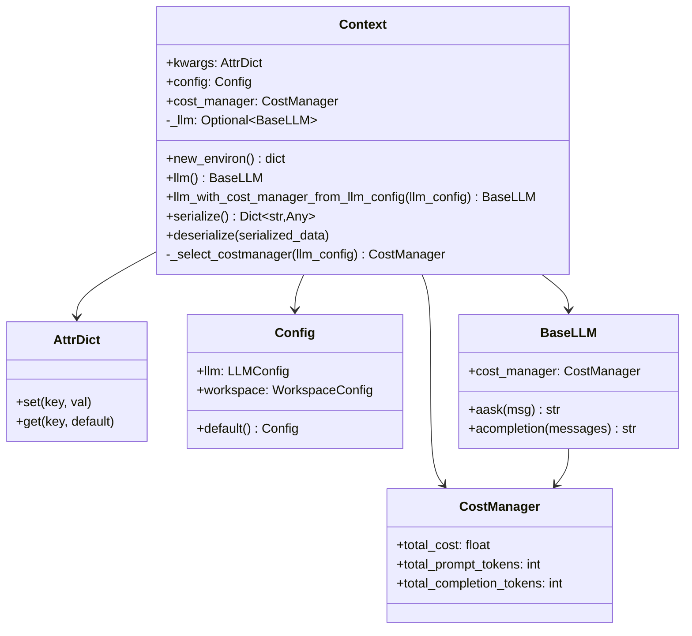

**Diagram: Context Class Relationships**

### Core Attributes

| Attribute | Type | Default | Purpose |
|-----------|------|---------|---------|
| `kwargs` | `AttrDict` | `AttrDict()` | Flexible runtime state storage |
| `config` | `Config` | `Config.default()` | Configuration object with LLM settings |
| `cost_manager` | `CostManager` | `CostManager()` | Token usage and cost tracking |
| `_llm` | `Optional[BaseLLM]` | `None` | Cached LLM instance |

**Sources:** [metagpt/context.py:58-67]()

### LLM Instance Management

The Context provides two methods for obtaining LLM instances:

#### 1. Primary LLM Instance (`llm()`)

```python
def llm(self) -> BaseLLM:
    """Return a LLM instance, fixme: support cache"""
    self._llm = create_llm_instance(self.config.llm)
    if self._llm.cost_manager is None:
        self._llm.cost_manager = self._select_costmanager(self.config.llm)
    return self._llm
```

- Uses `self.config.llm` configuration
- Creates LLM instance via provider registry
- Attaches appropriate cost manager
- Always creates fresh instance (caching is commented as TODO)

#### 2. Custom LLM from Config (`llm_with_cost_manager_from_llm_config()`)

```python
def llm_with_cost_manager_from_llm_config(self, llm_config: LLMConfig) -> BaseLLM:
    """Return a LLM instance, fixme: support cache"""
    llm = create_llm_instance(llm_config)
    if llm.cost_manager is None:
        llm.cost_manager = self._select_costmanager(llm_config)
    return llm
```

- Accepts custom `LLMConfig` parameter
- Used by ContextMixin to create role/action-specific LLMs
- Enables per-component LLM configuration

**Sources:** [metagpt/context.py:86-100]()

### Cost Manager Selection

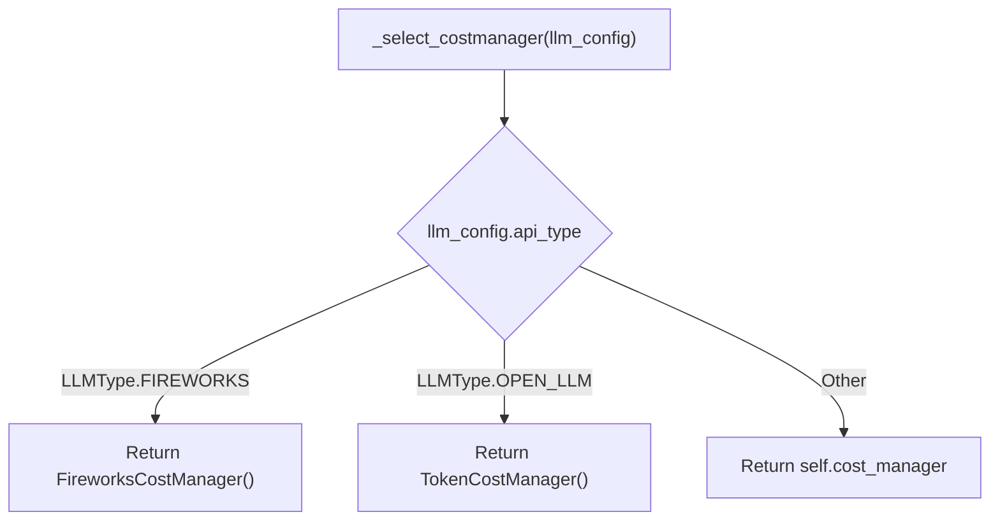

**Diagram: Cost Manager Selection Logic**

Different LLM providers require different cost tracking strategies:
- **Fireworks**: Uses `FireworksCostManager` (specialized billing model)
- **Open LLM**: Uses `TokenCostManager` (generic token tracking)
- **Others**: Uses context-level `CostManager` (shared across calls)

**Sources:** [metagpt/context.py:77-84]()

### Serialization Support

Context supports state persistence for recovery of interrupted executions:

```python
def serialize(self) -> Dict[str, Any]:
    """Serialize the object's attributes into a dictionary."""
    return {
        "kwargs": {k: v for k, v in self.kwargs.__dict__.items()},
        "cost_manager": self.cost_manager.model_dump_json(),
    }

def deserialize(self, serialized_data: Dict[str, Any]):
    """Deserialize the given serialized data and update the object's attributes accordingly."""
    if not serialized_data:
        return
    kwargs = serialized_data.get("kwargs")
    if kwargs:
        for k, v in kwargs.items():
            self.kwargs.set(k, v)
    cost_manager = serialized_data.get("cost_manager")
    if cost_manager:
        self.cost_manager.model_validate_json(cost_manager)
```

**Note:** Only `kwargs` and `cost_manager` are serialized. The `config` and `_llm` are not persisted—they must be reconstructed on recovery.

**Sources:** [metagpt/context.py:102-127]()

---

## ContextMixin: Dependency Injection Pattern

`ContextMixin` is a Pydantic mixin class that provides the dependency injection mechanism. Classes inheriting from ContextMixin (Role, Action, Team, Tool) gain automatic access to context, config, and LLM with sophisticated fallback logic.

### Class Structure

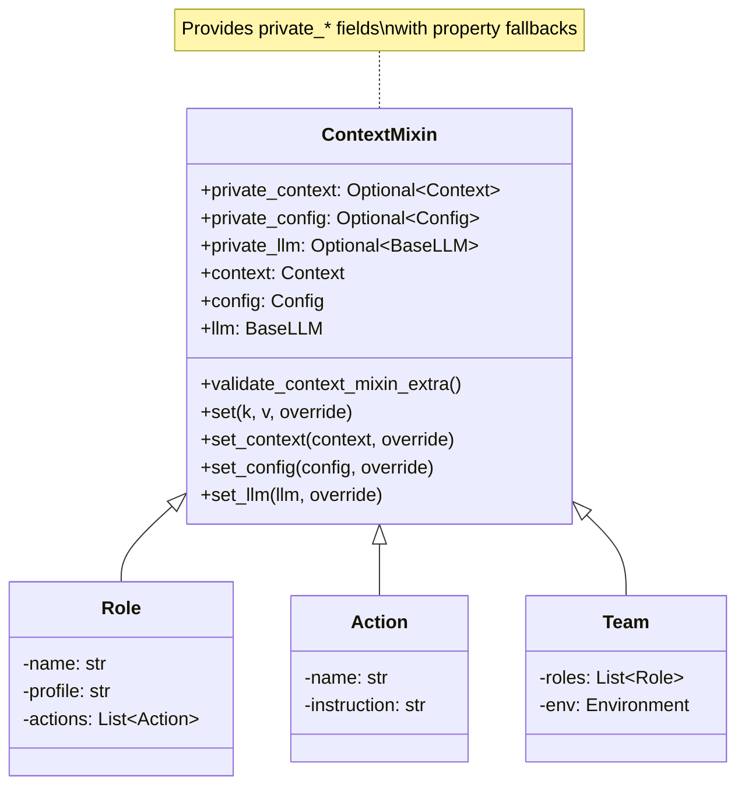

**Diagram: ContextMixin Inheritance Hierarchy**

### Property Resolution with Fallback Logic

Each property follows a priority chain:

```mermaid
graph TB
    subgraph "config Property Resolution"
        ConfigStart["Access obj.config"]
        CheckPrivate{"private_config<br/>set?"}
        ReturnPrivate["Return private_config"]
        ReturnContext["Return context.config"]
        
        ConfigStart --> CheckPrivate
        CheckPrivate -->|"Yes"| ReturnPrivate
        CheckPrivate -->|"No"| ReturnContext
    end
    
    subgraph "context Property Resolution"
        ContextStart["Access obj.context"]
        CheckPrivateCtx{"private_context<br/>set?"}
        ReturnPrivateCtx["Return private_context"]
        ReturnNewCtx["Return Context()"]
        
        ContextStart --> CheckPrivateCtx
        CheckPrivateCtx -->|"Yes"| ReturnPrivateCtx
        CheckPrivateCtx -->|"No"| ReturnNewCtx
    end
    
    subgraph "llm Property Resolution"
        LLMStart["Access obj.llm"]
        CheckPrivateLLM{"private_llm<br/>set?"}
        ReturnPrivateLLM["Return private_llm"]
        CreateLLM["Create from context.llm_with_cost_manager_from_llm_config(config.llm)"]
        
        LLMStart --> CheckPrivateLLM
        CheckPrivateLLM -->|"Yes"| ReturnPrivateLLM
        CheckPrivateLLM -->|"No"| CreateLLM
    end
```

**Diagram: ContextMixin Property Resolution Flow**

### Configuration Priority in Practice

```python
# From tests/metagpt/test_context_mixin.py:105-133
gpt4t = Config.from_home("gpt-4-turbo.yaml")  # User-specific config
gpt4 = Config.default()
gpt4.llm.model = "gpt-4-0613"

a1 = Action(config=gpt4t, name="Say", ...)      # Action has own config
a2 = Action(name="Say", ...)                    # Action has no config
a3 = Action(name="Vote", ...)                   # Action has no config

# Role A: a1 keeps its config (gpt4t), ignores role config
A = Role(name="A", actions=[a1], config=gpt4)

# Role B: a2 inherits role config (gpt4)
B = Role(name="B", actions=[a2], config=gpt4)

# Role C: a3 inherits role config (different model)
C = Role(name="C", actions=[a3], config=gpt35)

# Results:
# a1.llm.model == "gpt-4-turbo" (own config)
# a2.llm.model == "gpt-4-0613"  (inherited from Role B)
# a3.llm.model == "gpt-4-turbo" (inherited from Role C)
```

**Priority Rule:** `private_config` > `context.config`

Once a component has its own config, it ignores the context config unless explicitly overridden with `set_config(config, override=True)`.

**Sources:** [metagpt/context_mixin.py:17-102](), [tests/metagpt/test_context_mixin.py:104-133]()

### Initialization and Validation

```python
@model_validator(mode="after")
def validate_context_mixin_extra(self):
    self._process_context_mixin_extra()
    return self

def _process_context_mixin_extra(self):
    """Process the extra field"""
    kwargs = self.model_extra or {}
    self.set_context(kwargs.pop("context", None))
    self.set_config(kwargs.pop("config", None))
    self.set_llm(kwargs.pop("llm", None))
```

The Pydantic validator extracts `context`, `config`, and `llm` from `model_extra` (kwargs passed to constructor) and sets them appropriately. This enables both explicit and implicit initialization:

```python
# Explicit initialization
role = Role(name="A", config=my_config)

# Implicit via Team
team = Team(context=ctx)
team.hire([role])  # role inherits ctx through ContextMixin
```

**Sources:** [metagpt/context_mixin.py:35-45]()

---

## Context Lifecycle in Execution

### Typical Execution Flow

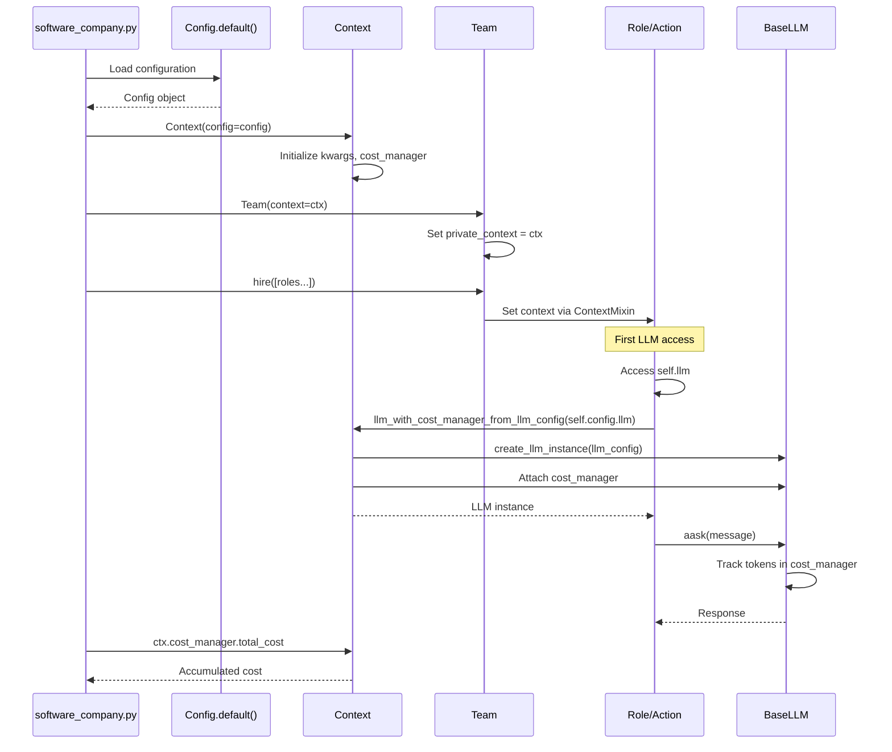

**Diagram: Context Lifecycle in generate_repo()**

### Code Example from software_company.py

```python
# From metagpt/software_company.py:28-73
def generate_repo(idea, investment=3.0, n_round=5, ...):
    from metagpt.config2 import config
    from metagpt.context import Context
    from metagpt.team import Team
    
    # 1. Load configuration
    config.update_via_cli(project_path, project_name, inc, ...)
    
    # 2. Create context with config
    ctx = Context(config=config)
    
    if not recover_path:
        # 3. Create team with context
        company = Team(context=ctx)
        
        # 4. Hire roles (they inherit context)
        company.hire([
            TeamLeader(),
            ProductManager(),
            Architect(),
            ...
        ])
    else:
        # Recovery path: deserialize team and context
        company = Team.deserialize(stg_path=stg_path, context=ctx)
    
    # 5. Execute
    asyncio.run(company.run(n_round=n_round, idea=idea))
    
    # 6. Access runtime state from context
    return ctx.kwargs.get("project_path")
```

**Sources:** [metagpt/software_company.py:14-74]()

### State Storage via kwargs

The `ctx.kwargs` AttrDict accumulates runtime state during execution:

```python
# During execution, roles can store state:
self.context.kwargs.set("project_path", workspace_path)
self.context.kwargs.set("git_repo", repository)

# Later, main script retrieves it:
project_path = ctx.kwargs.get("project_path")
```

This pattern enables stateless main functions—all state resides in the Context.

**Sources:** [metagpt/software_company.py:74]()

---

## Integration with Configuration System

Context bridges the configuration system (static YAML files) with runtime execution (dynamic state).

### Configuration Loading Flow

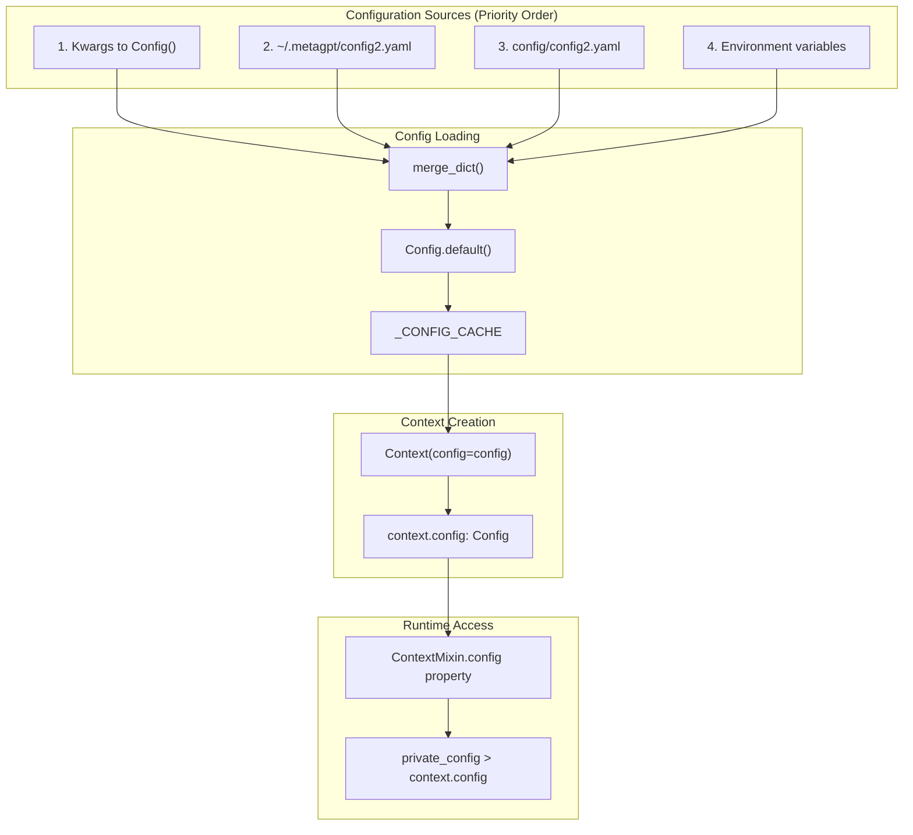

**Diagram: Configuration to Context Integration**

### Config Caching

```python
# From metagpt/config2.py:101-123
_CONFIG_CACHE = {}

@classmethod
def default(cls, reload: bool = False, **kwargs) -> "Config":
    """Load default config
    - Priority: env < default_config_paths
    - Inside default_config_paths, the latter one overwrites the former one
    """
    default_config_paths = (
        METAGPT_ROOT / "config/config2.yaml",
        CONFIG_ROOT / "config2.yaml",  # ~/.metagpt/
    )
    if reload or default_config_paths not in _CONFIG_CACHE:
        dicts = [dict(os.environ), 
                 *(Config.read_yaml(path) for path in default_config_paths), 
                 kwargs]
        final = merge_dict(dicts)
        _CONFIG_CACHE[default_config_paths] = Config(**final)
    return _CONFIG_CACHE[default_config_paths]
```

**Key Points:**
- Configuration is cached globally per path tuple
- `reload=False` by default (returns cached instance)
- Subsequent `Config.default()` calls return same object
- Context typically uses cached config, ensuring consistency

**Sources:** [metagpt/config2.py:101-123](), [metagpt/config2.py:181-182]()

### Custom LLM Configuration Pattern

```python
# From metagpt/config2.py:126-137
@classmethod
def from_llm_config(cls, llm_config: dict):
    """user config llm
    example:
    llm_config = {"api_type": "xxx", "api_key": "xxx", "model": "xxx"}
    gpt4 = Config.from_llm_config(llm_config)
    A = Role(name="A", profile="...", config=gpt4)
    """
    llm_config = LLMConfig.model_validate(llm_config)
    dicts = [dict(os.environ)]
    dicts += [{"llm": llm_config}]
    final = merge_dict(dicts)
    return Config(**final)
```

This pattern enables per-role LLM configuration without modifying global config files.

**Sources:** [metagpt/config2.py:126-137]()

---

## Testing and Mocking

The Context system integrates with MetaGPT's testing infrastructure, particularly for response caching and mock LLM management.

### Test Context Fixture

```python
# From tests/conftest.py:147-161
@pytest.fixture(scope="function")
def context(request):
    ctx = MetagptContext()
    repo = GitRepository(local_path=DEFAULT_WORKSPACE_ROOT / f"unittest/{uuid.uuid4().hex}")
    ctx.config.project_path = str(repo.workdir)
    
    # Destroy git repo at the end of the test session.
    def fin():
        if ctx.config.project_path:
            git_repo = GitRepository(ctx.config.project_path)
            git_repo.delete_repository()
    
    # Register the function for destroying the environment.
    request.addfinalizer(fin)
    return ctx
```

Each test gets a fresh Context with a unique temporary workspace that is cleaned up automatically.

**Sources:** [tests/conftest.py:147-161]()

### Mock LLM Integration

```python
# From tests/conftest.py:61-78
@pytest.fixture(scope="function", autouse=True)
def llm_mock(rsp_cache, mocker, request):
    llm = MockLLM(allow_open_api_call=ALLOW_OPENAI_API_CALL)
    llm.rsp_cache = rsp_cache
    mocker.patch("metagpt.provider.base_llm.BaseLLM.aask", llm.aask)
    mocker.patch("metagpt.provider.base_llm.BaseLLM.aask_batch", llm.aask_batch)
    mocker.patch("metagpt.provider.openai_api.OpenAILLM.aask_code", llm.aask_code)
    yield mocker
    # After test: update rsp_cache with new responses
```

The mock system intercepts all LLM calls at the Context level:
1. Context creates LLM instance via `create_llm_instance()`
2. LLM methods are patched globally
3. MockLLM checks `rsp_cache` for cached responses
4. If `ALLOW_OPENAI_API_CALL=0`, real API calls are blocked
5. New responses are cached for future tests

**Sources:** [tests/conftest.py:30-78](), [tests/mock/mock_llm.py:16-125]()

### Response Caching Mechanism

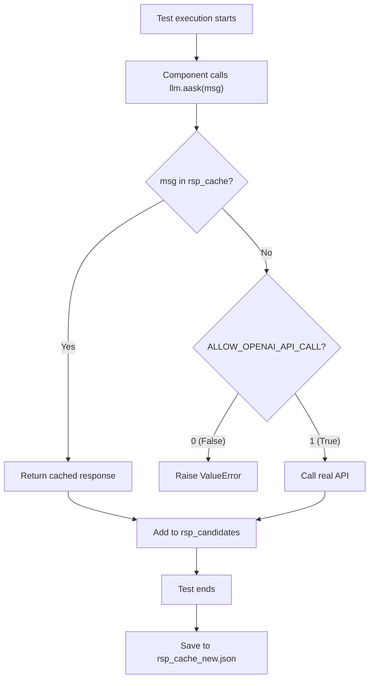

**Diagram: Test Response Caching Flow**

**Key Files:**
- `tests/data/rsp_cache.json` - Pre-recorded responses (read-only)
- `tests/data/rsp_cache_new.json` - New responses from current test run

**Sources:** [tests/conftest.py:30-49](), [.github/workflows/unittest.yaml:34-38]()

### CI/CD Integration

```yaml
# From .github/workflows/unittest.yaml:34-38
- name: Test with pytest
  run: |
    export ALLOW_OPENAI_API_CALL=0
    mkdir -p ~/.metagpt && cp tests/config2.yaml ~/.metagpt/config2.yaml
    pytest | tee unittest.txt
```

In CI, `ALLOW_OPENAI_API_CALL=0` forces all tests to use cached responses only. Any test requiring uncached API calls will fail, ensuring:
1. Tests are reproducible
2. No API costs during CI
3. Response cache completeness is enforced

**Sources:** [.github/workflows/unittest.yaml:1-59]()

---

## Summary Table: Context System Components

| Component | Purpose | Key Methods/Properties | Inheritance |
|-----------|---------|----------------------|-------------|
| **AttrDict** | Flexible dict+attribute access | `set()`, `get()`, `remove()` | BaseModel |
| **Context** | Runtime container | `llm()`, `serialize()`, `cost_manager` | BaseModel |
| **ContextMixin** | Dependency injection | `context`, `config`, `llm` properties | BaseModel |
| **CostManager** | Token/cost tracking | `total_cost`, `total_tokens` | BaseModel |
| **Config** | Configuration object | `default()`, `from_llm_config()` | YamlModel |

### Property Priority Rules

```
Component Access Priority:
1. private_config     (component-specific)
2. context.config     (team-level)
3. Config.default()   (global cached)

LLM Creation Priority:
1. private_llm        (explicit override)
2. Created from private_config
3. Created from context.config
```

**Sources:** [metagpt/context.py:1-128](), [metagpt/context_mixin.py:1-102](), [metagpt/config2.py:1-183]()

---

# Page: Core Multi-Agent Framework

# Core Multi-Agent Framework

<details>
<summary>Relevant source files</summary>

The following files were used as context for generating this wiki page:

- [metagpt/actions/action.py](metagpt/actions/action.py)
- [metagpt/actions/design_api.py](metagpt/actions/design_api.py)
- [metagpt/actions/project_management.py](metagpt/actions/project_management.py)
- [metagpt/actions/summarize_code.py](metagpt/actions/summarize_code.py)
- [metagpt/actions/write_code.py](metagpt/actions/write_code.py)
- [metagpt/actions/write_code_review.py](metagpt/actions/write_code_review.py)
- [metagpt/actions/write_prd.py](metagpt/actions/write_prd.py)
- [metagpt/const.py](metagpt/const.py)
- [metagpt/memory/memory.py](metagpt/memory/memory.py)
- [metagpt/roles/architect.py](metagpt/roles/architect.py)
- [metagpt/roles/engineer.py](metagpt/roles/engineer.py)
- [metagpt/roles/product_manager.py](metagpt/roles/product_manager.py)
- [metagpt/roles/project_manager.py](metagpt/roles/project_manager.py)
- [metagpt/roles/qa_engineer.py](metagpt/roles/qa_engineer.py)
- [metagpt/roles/role.py](metagpt/roles/role.py)
- [metagpt/schema.py](metagpt/schema.py)
- [metagpt/utils/common.py](metagpt/utils/common.py)

</details>


## Purpose and Scope

This page documents the **standard role-based multi-agent framework** in MetaGPT, which implements the core philosophy `Code = SOP(Team)`. It covers the `Role` base class, the observe-think-act execution loop, the `Action` system, and the standard software development roles (`ProductManager`, `Architect`, `ProjectManager`, `Engineer`, `QaEngineer`) that execute in a sequential SOP-driven workflow.

For dynamic tool-based agents (RoleZero descendants), see [Dynamic Agent System (RoleZero)](#4). For conversational agents with long-term memory, see [Conversational Agents and Memory](#8). For action-specific details and structured prompting, see [Action System](#2.2) and [ActionNode and Structured Output](#7).

---

## Role Architecture Overview

The standard multi-agent framework is built on the `Role` base class, which all agent roles inherit from. Each role follows an **observe-think-act loop**, where it:
1. **Observes** new messages from its environment
2. **Thinks** about which action to take
3. **Acts** by executing an action and publishing results

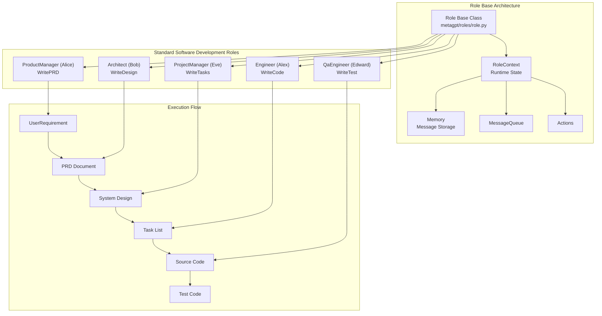

**Sources:** [metagpt/roles/role.py:125-593](), [metagpt/roles/product_manager.py:1-65](), [metagpt/roles/architect.py:1-59](), [metagpt/roles/project_manager.py:1-51](), [metagpt/roles/engineer.py:1-493](), [metagpt/roles/qa_engineer.py:1-229]()

---

## Role Base Class and RoleContext

### Role Class Structure

The `Role` class ([metagpt/roles/role.py:125]()) is the foundation for all agents. It inherits from `BaseRole`, `SerializationMixin`, `ContextMixin`, and `BaseModel`.

**Key Attributes:**

| Attribute | Type | Description |
|-----------|------|-------------|
| `name` | `str` | Agent's name (e.g., "Alice", "Bob") |
| `profile` | `str` | Role type (e.g., "Product Manager", "Engineer") |
| `goal` | `str` | Primary objective of the role |
| `constraints` | `str` | Operating constraints or guidelines |
| `actions` | `list[Action]` | Available actions the role can perform |
| `rc` | `RoleContext` | Runtime context holding state and memory |
| `addresses` | `set[str]` | Message routing addresses the role subscribes to |
| `enable_memory` | `bool` | Whether to persist messages in memory (default: True) |

**Sources:** [metagpt/roles/role.py:125-160]()

### RoleContext

`RoleContext` ([metagpt/roles/role.py:92-123]()) encapsulates the runtime state of a role:

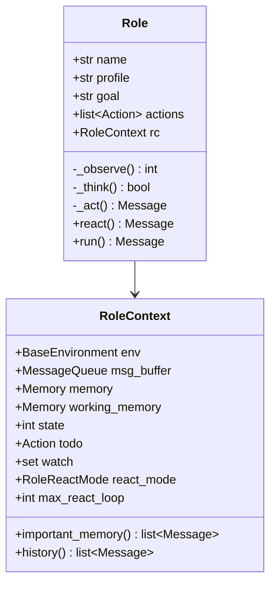

**Key RoleContext Fields:**

- **`env`**: Reference to the `Environment` broker where messages are published
- **`msg_buffer`**: `MessageQueue` for asynchronously receiving messages ([metagpt/schema.py:713-783]())
- **`memory`**: `Memory` object storing all observed messages indexed by `cause_by`
- **`state`**: Current action index in the action sequence (−1 = initial/termination state)
- **`todo`**: The next `Action` to execute
- **`watch`**: Set of action class names this role observes (filters incoming messages)
- **`react_mode`**: Strategy for selecting actions (`REACT`, `BY_ORDER`, `PLAN_AND_ACT`)
- **`max_react_loop`**: Maximum number of think-act iterations before terminating

**Sources:** [metagpt/roles/role.py:92-123](), [metagpt/schema.py:713-783]()

---

## Observe-Think-Act Execution Loop

The core execution pattern is implemented in the `run()` method ([metagpt/roles/role.py:530-554]()), which orchestrates the observe-think-act cycle:

```mermaid
sequenceDiagram
    participant Env as Environment
    participant Role as Role
    participant RC as RoleContext
    participant Action as Action
    
    Env->>RC: publish_message(msg)
    RC->>RC: msg_buffer.push(msg)
    
    Role->>Role: run()
    Role->>Role: _observe()
    Role->>RC: msg_buffer.pop_all()
    RC-->>Role: news messages
    Role->>RC: memory.add_batch(news)
    Role->>RC: filter by watch
    
    Role->>Role: _think()
    Role->>RC: check react_mode
    alt react_mode == BY_ORDER
        Role->>RC: state += 1
        Role->>RC: todo = actions[state]
    else react_mode == REACT
        Role->>Role: llm.aask(STATE_TEMPLATE)
        Role->>RC: todo = actions[next_state]
    end
    
    Role->>Role: react()
    loop max_react_loop times
        Role->>Role: _think()
        Role->>Role: _act()
        Role->>Action: run(history)
        Action-->>Role: response
        Role->>RC: memory.add(response)
        Role->>Env: publish_message(response)
    end
```

**Sources:** [metagpt/roles/role.py:399-470](), [metagpt/roles/role.py:530-554]()

### 1. Observe Phase (`_observe`)

The `_observe()` method ([metagpt/roles/role.py:399-427]()) retrieves new messages from the message buffer and filters them based on the role's `watch` list:

```python
# Pseudo-code from metagpt/roles/role.py:399-427
async def _observe(self) -> int:
    news = self.rc.msg_buffer.pop_all()  # Get all unprocessed messages
    old_messages = self.rc.memory.get()  # Existing memory
    
    # Filter messages: must be in watch list or addressed to this role
    self.rc.news = [
        n for n in news 
        if (n.cause_by in self.rc.watch or self.name in n.send_to) 
        and n not in old_messages
    ]
    
    # Add to memory
    self.rc.memory.add_batch(self.rc.news)
    self.latest_observed_msg = self.rc.news[-1] if self.rc.news else None
    
    return len(self.rc.news)
```

**Key Points:**
- Filters messages by `cause_by` (action type) and `send_to` (recipient)
- Stores filtered messages in `rc.news` for processing
- Updates `memory` with new messages
- Returns count of new messages

**Sources:** [metagpt/roles/role.py:399-427]()

### 2. Think Phase (`_think`)

The `_think()` method ([metagpt/roles/role.py:340-379]()) decides which action to execute next based on the `react_mode`:

```mermaid
flowchart TD
    Start["_think()"] --> CheckActions{len(actions) == 1?}
    CheckActions -->|Yes| SetState0["set state = 0<br/>RETURN True"]
    CheckActions -->|No| CheckMode{react_mode?}
    
    CheckMode -->|BY_ORDER| IncrementState["state += 1<br/>todo = actions[state]"]
    IncrementState --> CheckBounds{state < len(actions)?}
    CheckBounds -->|Yes| ReturnTrue["RETURN True"]
    CheckBounds -->|No| ReturnFalse["RETURN False"]
    
    CheckMode -->|REACT| AskLLM["llm.aask(STATE_TEMPLATE)"]
    AskLLM --> ParseState["parse next_state"]
    ParseState --> ValidateState{-1 <= next_state < len(states)?}
    ValidateState -->|Yes| SetState["state = next_state<br/>todo = actions[state]"]
    ValidateState -->|No| SetStateNeg1["state = -1"]
    SetState --> ReturnTrue
    SetStateNeg1 --> ReturnTrue
```

**React Modes** (defined in [metagpt/roles/role.py:82-90]()):

| Mode | Behavior |
|------|----------|
| `REACT` | Uses LLM to dynamically select next action based on conversation history |
| `BY_ORDER` | Executes actions sequentially in defined order |
| `PLAN_AND_ACT` | Creates a plan upfront, then executes action sequence |

**Sources:** [metagpt/roles/role.py:340-379](), [metagpt/roles/role.py:82-90]()

### 3. Act Phase (`_act`)

The `_act()` method ([metagpt/roles/role.py:381-397]()) executes the current `todo` action:

```python
# Pseudo-code from metagpt/roles/role.py:381-397
async def _act(self) -> Message:
    logger.info(f"{self._setting}: to do {self.rc.todo}({self.rc.todo.name})")
    response = await self.rc.todo.run(self.rc.history)
    
    # Wrap response in AIMessage if needed
    if isinstance(response, (ActionOutput, ActionNode)):
        msg = AIMessage(
            content=response.content,
            instruct_content=response.instruct_content,
            cause_by=self.rc.todo,
            sent_from=self
        )
    else:
        msg = AIMessage(content=response or "", cause_by=self.rc.todo, sent_from=self)
    
    self.rc.memory.add(msg)
    return msg
```

**Key Points:**
- Invokes `action.run(history)` with conversation history
- Wraps output in `AIMessage` with proper metadata
- Stores result in `memory` for future reference
- Returns message for publishing to environment

**Sources:** [metagpt/roles/role.py:381-397]()

### React Loop

The `react()` method ([metagpt/roles/role.py:512-523]()) orchestrates the think-act loop:

```python
# Pseudo-code from metagpt/roles/role.py:512-523
async def react(self) -> Message:
    if self.rc.react_mode == RoleReactMode.REACT or self.rc.react_mode == RoleReactMode.BY_ORDER:
        rsp = await self._react()  # Standard think-act loop
    elif self.rc.react_mode == RoleReactMode.PLAN_AND_ACT:
        rsp = await self._plan_and_act()  # Plan-based execution
    
    self._set_state(state=-1)  # Reset state after completion
    return rsp
```

The `_react()` method ([metagpt/roles/role.py:454-470]()) implements the loop:

```python
# Pseudo-code from metagpt/roles/role.py:454-470
async def _react(self) -> Message:
    actions_taken = 0
    rsp = AIMessage(content="No actions taken yet", cause_by=Action)
    
    while actions_taken < self.rc.max_react_loop:
        has_todo = await self._think()  # Decide next action
        if not has_todo:
            break
        
        rsp = await self._act()  # Execute action
        actions_taken += 1
    
    return rsp  # Return last action's output
```

**Sources:** [metagpt/roles/role.py:454-470](), [metagpt/roles/role.py:512-523]()

---

## Action System

Actions are the atomic units of work that roles perform. Each action encapsulates a specific task like writing a PRD, designing an API, or generating code.

### Action Base Class

The `Action` class ([metagpt/actions/action.py:29-120]()) provides the foundation:

**Key Attributes:**

| Attribute | Type | Description |
|-----------|------|-------------|
| `name` | `str` | Action name (auto-set to class name if empty) |
| `i_context` | `Union[dict, Context, str]` | Input context for the action |
| `prefix` | `str` | System message prefix (role description) |
| `desc` | `str` | Human-readable description |
| `node` | `ActionNode` | Optional structured prompt node |
| `llm_name_or_type` | `str` | LLM model override (optional) |

**Key Methods:**

```mermaid
classDiagram
    class Action {
        +str name
        +str prefix
        +ActionNode node
        +set_prefix(prefix) Action
        +_aask(prompt, system_msgs) str
        +run(*args, **kwargs) Any
    }
    
    class WritePRD {
        +ProjectRepo repo
        +run(with_messages) AIMessage
        -_new_prd(requirement) ActionNode
        -_handle_new_requirement(req) ActionOutput
        -_handle_requirement_update(req, docs) ActionOutput
    }
    
    class WriteDesign {
        +ProjectRepo repo
        +run(with_messages) AIMessage
        -_new_system_design(context) ActionNode
        -_merge(prd_doc, design_doc) Document
        -_save_data_api_design(doc) None
        -_save_seq_flow(doc) None
    }
    
    class WriteCode {
        +ProjectRepo repo
        +run() CodingContext
        +write_code(prompt) str
        +get_codes(task_doc, exclude, repo) str
    }
    
    Action <|-- WritePRD
    Action <|-- WriteDesign
    Action <|-- WriteCode
```

**Sources:** [metagpt/actions/action.py:29-120]()

### Standard Software Development Actions

The framework includes predefined actions for each stage of software development:

| Action | File | Purpose | Output |
|--------|------|---------|--------|
| `WritePRD` | [metagpt/actions/write_prd.py:76-326]() | Product requirements document | PRD JSON + competitive analysis |
| `WriteDesign` | [metagpt/actions/design_api.py:53-280]() | System architecture design | Design JSON + class/sequence diagrams |
| `WriteTasks` | [metagpt/actions/project_management.py:46-202]() | Project task breakdown | Task list JSON + requirements.txt |
| `WriteCode` | [metagpt/actions/write_code.py:88-229]() | Code implementation | Source code files |
| `WriteCodeReview` | [metagpt/actions/write_code_review.py:141-221]() | Code review and rewrite | Reviewed/rewritten code |
| `WriteTest` | QaEngineer uses this | Test generation | Unit test files |
| `SummarizeCode` | [metagpt/actions/summarize_code.py:93-124]() | Code review summary | Summary markdown |

**Sources:** [metagpt/actions/write_prd.py:76-326](), [metagpt/actions/design_api.py:53-280](), [metagpt/actions/project_management.py:46-202](), [metagpt/actions/write_code.py:88-229](), [metagpt/actions/write_code_review.py:141-221](), [metagpt/actions/summarize_code.py:93-124]()

### Action Execution Pattern

Actions follow a standard execution pattern:

1. **Receive context**: Input via `with_messages` or direct parameters
2. **Prepare prompt**: Construct prompt from templates and context
3. **LLM call**: Invoke `_aask()` or `llm.aask()` to get response
4. **Parse output**: Extract structured data from LLM response
5. **Persist artifacts**: Save to `ProjectRepo` (docs, resources, source code)
6. **Return message**: Create `AIMessage` with output and routing metadata

Example from `WritePRD` ([metagpt/actions/write_prd.py:209-216]()):

```python
# Simplified from metagpt/actions/write_prd.py:209-230
async def _new_prd(self, requirement: str) -> ActionNode:
    context = CONTEXT_TEMPLATE.format(
        requirements=requirement, 
        project_name=self.project_name
    )
    node = await WRITE_PRD_NODE.fill(
        req=context, 
        llm=self.llm, 
        schema=self.prompt_schema
    )
    return node
```

**Sources:** [metagpt/actions/write_prd.py:209-230]()

---

## Message Schema and Memory

### Message Class

The `Message` class ([metagpt/schema.py:232-417]()) is the primary communication unit between roles:

**Key Fields:**

| Field | Type | Description |
|-------|------|-------------|
| `id` | `str` | Unique message identifier (UUID) |
| `content` | `str` | Natural language content |
| `instruct_content` | `BaseModel` | Structured data payload (optional) |
| `role` | `str` | Sender role (`user`, `assistant`, `system`) |
| `cause_by` | `str` | Action class name that created this message |
| `sent_from` | `str` | Sender role class name |
| `send_to` | `set[str]` | Recipient role class names |
| `metadata` | `dict` | Additional key-value metadata |

**Key Message Subclasses:**

```mermaid
classDiagram
    class Message {
        +str id
        +str content
        +BaseModel instruct_content
        +str role
        +str cause_by
        +str sent_from
        +set~str~ send_to
        +dict metadata
        +to_dict() dict
        +dump() str
        +load(val) Message
    }
    
    class UserMessage {
        +__init__(content, role="user")
    }
    
    class SystemMessage {
        +__init__(content, role="system")
    }
    
    class AIMessage {
        +__init__(content, role="assistant")
        +with_agent(name) AIMessage
        +agent() str
    }
    
    Message <|-- UserMessage
    Message <|-- SystemMessage
    Message <|-- AIMessage
```

**Message Routing Constants** ([metagpt/const.py:77-84]()):

- `MESSAGE_ROUTE_TO_ALL = "<all>"`: Broadcast to all roles
- `MESSAGE_ROUTE_TO_NONE = "<none>"`: No routing (terminal message)
- `MESSAGE_ROUTE_TO_SELF = "<self>"`: Route back to sender

**Sources:** [metagpt/schema.py:232-451](), [metagpt/const.py:77-84]()

### Memory Class

The `Memory` class ([metagpt/memory/memory.py:20-113]()) provides storage and indexing for messages:

**Key Operations:**

```mermaid
classDiagram
    class Memory {
        +list~Message~ storage
        +dict~str, list~Message~~ index
        +bool ignore_id
        +add(message) None
        +add_batch(messages) None
        +get(k=0) list~Message~
        +get_by_action(action) list~Message~
        +get_by_actions(actions) list~Message~
        +delete(message) None
        +clear() None
        +count() int
        +try_remember(keyword) list~Message~
    }
```

**Indexing Strategy:**

Messages are indexed by `cause_by` (action class name) for efficient retrieval:

```python
# From metagpt/memory/memory.py:27-35
def add(self, message: Message):
    if message in self.storage:
        return
    self.storage.append(message)
    if message.cause_by:
        self.index[message.cause_by].append(message)
```

**Retrieval Examples:**

```python
# Get all messages from a specific action type
prd_messages = memory.get_by_action(WritePRD)

# Get messages from multiple action types
design_messages = memory.get_by_actions({WritePRD, WriteDesign})

# Get most recent k messages
recent = memory.get(k=5)

# Search by keyword
matching = memory.try_remember("authentication")
```

**Sources:** [metagpt/memory/memory.py:20-113]()

### MessageQueue

The `MessageQueue` class ([metagpt/schema.py:713-783]()) provides asynchronous message buffering:

**Key Methods:**

| Method | Description |
|--------|-------------|
| `push(msg)` | Add message to queue (non-blocking) |
| `pop()` | Remove and return one message (non-blocking) |
| `pop_all()` | Remove and return all messages |
| `empty()` | Check if queue is empty |
| `dump()` | Serialize queue to JSON string |
| `load(data)` | Deserialize queue from JSON string |

**Implementation Details:**

- Uses `asyncio.Queue` internally for thread-safe operations
- Supports serialization for context persistence
- Used in `RoleContext.msg_buffer` for asynchronous message delivery

**Sources:** [metagpt/schema.py:713-783]()

---

## Standard Role Pipeline

The standard software development workflow consists of five roles executing in sequence:

```mermaid
graph LR
    UR["UserRequirement"] --> PM["ProductManager<br/>(Alice)"]
    PM -->|WritePRD| PRD["PRD Document"]
    PRD --> Arch["Architect<br/>(Bob)"]
    Arch -->|WriteDesign| Design["System Design"]
    Design --> ProjM["ProjectManager<br/>(Eve)"]
    ProjM -->|WriteTasks| Tasks["Task List"]
    Tasks --> Eng["Engineer<br/>(Alex)"]
    Eng -->|WriteCode<br/>WriteCodeReview| Code["Source Code"]
    Code --> QA["QaEngineer<br/>(Edward)"]
    QA -->|WriteTest<br/>RunCode<br/>DebugError| Tests["Test Code"]
    Tests -.->|Bugs Found| Eng
    Eng -->|SummarizeCode| Summary["Code Summary"]
    Summary -.->|Issues| Eng
```

**Sources:** [metagpt/roles/product_manager.py:21-65](), [metagpt/roles/architect.py:17-59](), [metagpt/roles/project_manager.py:13-51](), [metagpt/roles/engineer.py:73-493](), [metagpt/roles/qa_engineer.py:39-229]()

### 1. ProductManager (Alice)

**Role Definition** ([metagpt/roles/product_manager.py:21-48]()):

```python
class ProductManager(RoleZero):
    name: str = "Alice"
    profile: str = "Product Manager"
    goal: str = "Create a Product Requirement Document"
    
    def __init__(self, **kwargs):
        super().__init__(**kwargs)
        self.set_actions([PrepareDocuments, WritePRD])
        self._watch([UserRequirement, PrepareDocuments])
        self.rc.react_mode = RoleReactMode.BY_ORDER
```

**Execution Flow:**

1. **PrepareDocuments**: Parses user requirements, initializes project repository
2. **WritePRD**: Generates PRD document with:
   - Project name and goals
   - User stories and requirements
   - Competitive analysis
   - UI/UX considerations

**Output Artifacts:**

- `docs/prd/{filename}.json`: Structured PRD data
- `resources/prd/{filename}.md`: Human-readable PRD
- `resources/competitive_analysis/{filename}.svg`: Competitive quadrant chart

**Sources:** [metagpt/roles/product_manager.py:21-65](), [metagpt/actions/write_prd.py:76-326]()

### 2. Architect (Bob)

**Role Definition** ([metagpt/roles/architect.py:17-59]()):

```python
class Architect(RoleZero):
    name: str = "Bob"
    profile: str = "Architect"
    goal: str = "design a concise, usable, complete software system"
    
    def __init__(self, **kwargs):
        super().__init__(**kwargs)
        self.set_actions([WriteDesign])
        self._watch({WritePRD})
```

**Execution Flow:**

1. **WriteDesign**: Reads PRD documents and generates:
   - Data structures and interfaces
   - Program call flow
   - File list
   - Class diagrams (mermaid)
   - Sequence diagrams (mermaid)

**Output Artifacts:**

- `docs/system_design/{filename}.json`: Structured design data
- `resources/system_design/{filename}.md`: Human-readable design
- `resources/data_api_design/{filename}.svg`: Class diagram
- `resources/seq_flow/{filename}.svg`: Sequence diagram

**Sources:** [metagpt/roles/architect.py:17-59](), [metagpt/actions/design_api.py:53-280]()

### 3. ProjectManager (Eve)

**Role Definition** ([metagpt/roles/project_manager.py:13-51]()):

```python
class ProjectManager(RoleZero):
    name: str = "Eve"
    profile: str = "Project Manager"
    goal: str = "break down tasks according to PRD/technical design"
    
    def __init__(self, **kwargs):
        super().__init__(**kwargs)
        self.set_actions([WriteTasks])
        self._watch([WriteDesign])
```

**Execution Flow:**

1. **WriteTasks**: Reads system design and generates:
   - Task breakdown (file list)
   - Task dependencies
   - Required Python packages
   - API specifications

**Output Artifacts:**

- `docs/task/{filename}.json`: Structured task data
- `resources/api_spec_and_task/{filename}.md`: Human-readable task list
- `requirements.txt`: Python package dependencies

**Sources:** [metagpt/roles/project_manager.py:13-51](), [metagpt/actions/project_management.py:46-202]()

### 4. Engineer (Alex)

**Role Definition** ([metagpt/roles/engineer.py:73-106]()):

```python
class Engineer(Role):
    name: str = "Alex"
    profile: str = "Engineer"
    goal: str = "write elegant, readable, extensible, efficient code"
    use_code_review: bool = False
    
    def __init__(self, **kwargs):
        super().__init__(**kwargs)
        self.set_actions([WriteCode])
        self._watch([WriteTasks, SummarizeCode, WriteCode, WriteCodeReview, FixBug])
```

**Execution Flow:**

The Engineer has a multi-phase workflow:

```mermaid
stateDiagram-v2
    [*] --> CheckIncMode
    CheckIncMode --> WriteCodePlanAndChange: config.inc = True
    CheckIncMode --> WriteCode: config.inc = False
    
    WriteCodePlanAndChange --> WriteCode: Planning done
    
    WriteCode --> WriteCodeReview: use_code_review = True
    WriteCode --> SummarizeCode: use_code_review = False
    WriteCodeReview --> SummarizeCode
    
    SummarizeCode --> CheckSummary
    CheckSummary --> WriteCode: Issues found
    CheckSummary --> [*]: All tests pass
```

**Phase 1: Code Planning (Optional)**

If `config.inc = True` (incremental mode), Engineer first runs `WriteCodePlanAndChange` ([metagpt/roles/engineer.py:455-483]()):

```python
async def _new_code_plan_and_change_action(self, cause_by: str):
    code_plan_and_change_ctx = CodePlanAndChangeContext(
        requirement=requirement,
        prd_filename=...,
        design_filename=...,
        task_filename=...
    )
    self.rc.todo = WriteCodePlanAndChange(i_context=code_plan_and_change_ctx, ...)
```

**Phase 2: Code Writing**

The `WriteCode` action ([metagpt/actions/write_code.py:100-165]()):

1. Loads coding context (design doc, task doc, existing code)
2. Constructs prompt with template
3. Invokes LLM to generate code
4. Saves code to `src/{filename}`

**Phase 3: Code Review (Optional)**

If `use_code_review = True`, runs `WriteCodeReview` ([metagpt/actions/write_code_review.py:167-221]()):

1. Reviews generated code for bugs/issues
2. Returns `LGTM` (looks good to me) or `LBTM` (looks bad to me)
3. If `LBTM`, rewrites code and repeats up to `k` times

**Phase 4: Summarization**

Runs `SummarizeCode` ([metagpt/actions/summarize_code.py:104-123]()):

1. Reviews all source files
2. Generates call flow diagram
3. Identifies TODOs and issues
4. If issues found, loops back to WriteCode (up to `max_auto_summarize_code` times)

**Output Artifacts:**

- `src/{filename}.py`: Source code files
- `docs/code_summary/{design_filename}.json`: Summary with TODOs
- `resources/code_summary/{design_filename}.md`: Human-readable summary

**Sources:** [metagpt/roles/engineer.py:73-493](), [metagpt/actions/write_code.py:88-229](), [metagpt/actions/write_code_review.py:141-221](), [metagpt/actions/summarize_code.py:93-124]()

### 5. QaEngineer (Edward)

**Role Definition** ([metagpt/roles/qa_engineer.py:39-60]()):

```python
class QaEngineer(Role):
    name: str = "Edward"
    profile: str = "QaEngineer"
    goal: str = "Write comprehensive and robust tests"
    test_round_allowed: int = 5
    
    def __init__(self, **kwargs):
        super().__init__(**kwargs)
        self.set_actions([WriteTest])
        self._watch([SummarizeCode, WriteTest, RunCode, DebugError])
```

**Execution Flow:**

The QA Engineer cycles through test-run-debug phases:

```mermaid
stateDiagram-v2
    [*] --> WriteTest
    WriteTest --> RunCode
    RunCode --> CheckResult
    CheckResult --> DebugError: Tests fail
    CheckResult --> [*]: Tests pass
    DebugError --> WriteTest: Fix applied
    
    note right of CheckResult
        Max test_round_allowed = 5
    end note
```

**Actions:**

1. **WriteTest** ([metagpt/roles/qa_engineer.py:62-103]()): Generates unit tests for each source file
2. **RunCode**: Executes tests and captures stdout/stderr
3. **DebugError**: Fixes test failures based on error logs

**Output Artifacts:**

- `tests/test_{filename}.py`: Unit test files
- `test_outputs/test_{filename}.py.json`: Test execution results

**Sources:** [metagpt/roles/qa_engineer.py:39-229]()

---

## React Modes and State Management

Roles can operate in different execution modes via `RoleReactMode` ([metagpt/roles/role.py:82-90]()):

### Mode Comparison

| Mode | Action Selection | Use Case | Example |
|------|------------------|----------|---------|
| `REACT` | LLM dynamically chooses based on state | Complex reasoning tasks | Research agent |
| `BY_ORDER` | Sequential execution in defined order | Fixed SOP workflows | Standard dev pipeline |
| `PLAN_AND_ACT` | Create plan first, then execute sequence | Multi-step projects | Data analysis tasks |

**Sources:** [metagpt/roles/role.py:82-90]()

### BY_ORDER Mode

Used by the standard software development roles ([metagpt/roles/role.py:353-357]()):

```python
if self.rc.react_mode == RoleReactMode.BY_ORDER:
    if self.rc.max_react_loop != len(self.actions):
        self.rc.max_react_loop = len(self.actions)
    self._set_state(self.rc.state + 1)
    return self.rc.state >= 0 and self.rc.state < len(self.actions)
```

- Executes actions in the order they were added via `set_actions()`
- `max_react_loop` automatically set to number of actions
- State increments sequentially: 0 → 1 → 2 → ... → n−1

**Sources:** [metagpt/roles/role.py:353-357]()

### REACT Mode

Uses LLM to select next action ([metagpt/roles/role.py:359-378]()):

```python
prompt = self._get_prefix()
prompt += STATE_TEMPLATE.format(
    history=self.rc.history,
    states="\n".join(self.states),
    n_states=len(self.states) - 1,
    previous_state=self.rc.state,
)

next_state = await self.llm.aask(prompt)
next_state = extract_state_value_from_output(next_state)

if int(next_state) == -1:
    logger.info(f"End actions with {next_state=}")
self._set_state(next_state)
```

**STATE_TEMPLATE** ([metagpt/roles/role.py:54-69]()):

```
Here are your conversation records. You can decide which stage you should enter 
or stay in based on these records.

Your previous stage: {previous_state}

Now choose one of the following stages you need to go to in the next step:
{states}

Just answer a number between 0-{n_states}, choose the most suitable stage 
according to the understanding of the conversation.
If you think you have completed your goal and don't need to go to any of 
the stages, return -1.
```

**Sources:** [metagpt/roles/role.py:54-69](), [metagpt/roles/role.py:359-378]()

### PLAN_AND_ACT Mode

Creates a task plan and executes it ([metagpt/roles/role.py:472-496]()):

```python
async def _plan_and_act(self) -> Message:
    if not self.planner.plan.goal:
        goal = self.rc.memory.get()[-1].content
        await self.planner.update_plan(goal=goal)
    
    while self.planner.current_task:
        task = self.planner.current_task
        task_result = await self._act_on_task(task)
        await self.planner.process_task_result(task_result)
    
    rsp = self.planner.get_useful_memories()[0]
    return rsp
```

Uses the `Planner` class to manage a task dependency graph with topological sorting.

**Sources:** [metagpt/roles/role.py:472-496]()

---

## Message Publishing and Routing

### Publishing Messages

Roles publish messages via `publish_message()` ([metagpt/roles/role.py:429-446]()):

```python
def publish_message(self, msg):
    # Handle MESSAGE_ROUTE_TO_SELF
    if MESSAGE_ROUTE_TO_SELF in msg.send_to:
        msg.send_to.add(any_to_str(self))
        msg.send_to.remove(MESSAGE_ROUTE_TO_SELF)
    
    # Set sent_from if not set
    if not msg.sent_from:
        msg.sent_from = any_to_str(self)
    
    # If message is only to self, put directly in buffer
    if all(to in {any_to_str(self), self.name} for to in msg.send_to):
        self.put_message(msg)
        return
    
    # Otherwise publish to environment
    if isinstance(msg, AIMessage) and not msg.agent:
        msg.with_agent(self._setting)
    self.rc.env.publish_message(msg)
```

**Key Points:**

- `MESSAGE_ROUTE_TO_SELF` replaced with actual role address
- `sent_from` automatically populated if missing
- Messages to self bypass environment (direct to `msg_buffer`)
- Agent metadata added for tracking

**Sources:** [metagpt/roles/role.py:429-446]()

### Receiving Messages

Messages are delivered via `put_message()` ([metagpt/roles/role.py:448-452]()):

```python
def put_message(self, message):
    """Place the message into the Role object's private message buffer."""
    if not message:
        return
    self.rc.msg_buffer.push(message)
```

The environment routes messages based on `send_to` addresses. Each role subscribes to specific addresses via `addresses` set ([metagpt/roles/role.py:211-214]()):

```python
@model_validator(mode="after")
def check_addresses(self):
    if not self.addresses:
        self.addresses = {any_to_str(self), self.name} if self.name else {any_to_str(self)}
    return self
```

Default addresses include:
- Full class name (e.g., `"metagpt.roles.engineer.Engineer"`)
- Role name (e.g., `"Alex"`)

**Sources:** [metagpt/roles/role.py:448-452](), [metagpt/roles/role.py:211-214]()

---

## Role Initialization and Configuration

### Setting Actions

Actions are configured via `set_actions()` ([metagpt/roles/role.py:239-260]()):

```python
def set_actions(self, actions: list[Union[Action, Type[Action]]]):
    self._reset()  # Clear existing actions
    for action in actions:
        # Instantiate if class passed
        if not isinstance(action, Action):
            i = action(context=self.context)
        else:
            i = action
        
        # Configure action with role's context and LLM
        self._init_action(i)
        self.actions.append(i)
        self.states.append(f"{len(self.actions) - 1}. {action}")
```

The `_init_action()` method ([metagpt/roles/role.py:229-233]()):

```python
def _init_action(self, action: Action):
    action.set_context(self.context)
    override = not action.private_config
    action.set_llm(self.llm, override=override)
    action.set_prefix(self._get_prefix())
```

**Key Operations:**

1. Sets action's context to role's context
2. Assigns role's LLM to action (unless action has private LLM config)
3. Sets action's system prompt prefix to role's prefix

**Sources:** [metagpt/roles/role.py:229-260]()

### Watching Actions

Roles specify which message types to observe via `_watch()` ([metagpt/roles/role.py:284-288]()):

```python
def _watch(self, actions: Iterable[Type[Action]] | Iterable[Action]):
    """Watch Actions of interest. Role will select Messages caused by these Actions from its personal message
    buffer during _observe.
    """
    self.rc.watch = {any_to_str(t) for t in actions}
```

Example from Engineer ([metagpt/roles/engineer.py:106]()):

```python
self._watch([WriteTasks, SummarizeCode, WriteCode, WriteCodeReview, FixBug, WriteCodePlanAndChange])
```

This filters messages in `_observe()` to only those caused by these specific action types.

**Sources:** [metagpt/roles/role.py:284-288](), [metagpt/roles/engineer.py:106]()

### Role Prefix

The system prompt prefix is constructed by `_get_prefix()` ([metagpt/roles/role.py:323-338]()):

```python
def _get_prefix(self):
    if self.desc:
        return self.desc
    
    prefix = PREFIX_TEMPLATE.format(
        profile=self.profile, 
        name=self.name, 
        goal=self.goal
    )
    
    if self.constraints:
        prefix += CONSTRAINT_TEMPLATE.format(constraints=self.constraints)
    
    if self.rc.env and self.rc.env.desc:
        all_roles = self.rc.env.role_names()
        other_role_names = ", ".join([r for r in all_roles if r != self.name])
        env_desc = f"You are in {self.rc.env.desc} with roles({other_role_names})."
        prefix += env_desc
    
    return prefix
```

**PREFIX_TEMPLATE** ([metagpt/roles/role.py:51]()):

```
You are a {profile}, named {name}, your goal is {goal}.
```

This prefix is injected into every LLM call as the system message, providing role-specific context.

**Sources:** [metagpt/roles/role.py:51-52](), [metagpt/roles/role.py:323-338]()

---

## Complete Workflow Example

Here's how the standard pipeline executes for a new project:

```mermaid
sequenceDiagram
    participant User
    participant PM as ProductManager
    participant Arch as Architect
    participant ProjM as ProjectManager
    participant Eng as Engineer
    participant QA as QaEngineer
    participant Env as Environment
    participant Repo as ProjectRepo
    
    User->>Env: UserRequirement("Build snake game")
    Env->>PM: deliver message
    
    PM->>PM: _observe() → msg in watch
    PM->>PM: _think() → PrepareDocuments
    PM->>PM: _act() → create repo
    PM->>Repo: save requirement.txt
    
    PM->>PM: _think() → WritePRD
    PM->>PM: _act() → generate PRD
    PM->>Repo: save docs/prd/xxx.json
    PM->>Env: publish AIMessage(cause_by=WritePRD)
    
    Env->>Arch: deliver message (watches WritePRD)
    Arch->>Arch: _observe() → new PRD
    Arch->>Arch: _think() → WriteDesign
    Arch->>Arch: _act() → generate design
    Arch->>Repo: save docs/system_design/xxx.json
    Arch->>Env: publish AIMessage(cause_by=WriteDesign)
    
    Env->>ProjM: deliver message (watches WriteDesign)
    ProjM->>ProjM: _observe() → new design
    ProjM->>ProjM: _think() → WriteTasks
    ProjM->>ProjM: _act() → generate tasks
    ProjM->>Repo: save docs/task/xxx.json
    ProjM->>Repo: save requirements.txt
    ProjM->>Env: publish AIMessage(cause_by=WriteTasks)
    
    Env->>Eng: deliver message (watches WriteTasks)
    Eng->>Eng: _observe() → new tasks
    
    loop For each task file
        Eng->>Eng: _think() → WriteCode
        Eng->>Eng: _act() → generate code
        Eng->>Repo: save src/{filename}.py
    end
    
    Eng->>Eng: _think() → SummarizeCode
    Eng->>Eng: _act() → review code
    Eng->>Repo: save docs/code_summary/xxx.json
    Eng->>Env: publish AIMessage(cause_by=SummarizeCode)
    
    Env->>QA: deliver message (watches SummarizeCode)
    QA->>QA: _observe() → code complete
    
    loop test_round < test_round_allowed
        QA->>QA: _think() → WriteTest
        QA->>QA: _act() → generate tests
        QA->>Repo: save tests/test_{filename}.py
        
        QA->>QA: _think() → RunCode
        QA->>QA: _act() → execute tests
        QA->>Repo: save test_outputs/test_{filename}.py.json
        
        alt Tests fail
            QA->>QA: _think() → DebugError
            QA->>QA: _act() → fix tests
        else Tests pass
            break
        end
    end
    
    QA->>Env: publish AIMessage(cause_by=WriteTest, send_to=NONE)
    Env->>User: Project complete
```

**Sources:** [metagpt/roles/role.py:399-554](), [metagpt/roles/product_manager.py:21-65](), [metagpt/roles/architect.py:17-59](), [metagpt/roles/project_manager.py:13-51](), [metagpt/roles/engineer.py:73-493](), [metagpt/roles/qa_engineer.py:39-229]()

---

## Summary

The Core Multi-Agent Framework provides:

1. **Role Base Class**: Standardized observe-think-act execution loop with configurable react modes
2. **Action System**: Atomic work units with LLM integration and structured output
3. **Message Protocol**: Typed messages with routing metadata for inter-role communication
4. **Memory Management**: Indexed storage for conversation history and action results
5. **Standard Roles**: Pre-built software development team (PM, Architect, ProjectManager, Engineer, QA)
6. **SOP Workflows**: Sequential execution with document handoffs between roles

This architecture enables the `Code = SOP(Team)` philosophy, where complex software development tasks are decomposed into role-specific actions that execute in a coordinated pipeline.

For advanced dynamic agents with tool usage, see [Dynamic Agent System (RoleZero)](#4). For structured prompt engineering, see [ActionNode and Structured Output](#7).

---

# Page: Role Architecture

# Role Architecture

<details>
<summary>Relevant source files</summary>

The following files were used as context for generating this wiki page:

- [metagpt/actions/action.py](metagpt/actions/action.py)
- [metagpt/actions/design_api.py](metagpt/actions/design_api.py)
- [metagpt/actions/project_management.py](metagpt/actions/project_management.py)
- [metagpt/actions/summarize_code.py](metagpt/actions/summarize_code.py)
- [metagpt/actions/write_code.py](metagpt/actions/write_code.py)
- [metagpt/actions/write_code_review.py](metagpt/actions/write_code_review.py)
- [metagpt/actions/write_prd.py](metagpt/actions/write_prd.py)
- [metagpt/const.py](metagpt/const.py)
- [metagpt/memory/memory.py](metagpt/memory/memory.py)
- [metagpt/roles/architect.py](metagpt/roles/architect.py)
- [metagpt/roles/engineer.py](metagpt/roles/engineer.py)
- [metagpt/roles/product_manager.py](metagpt/roles/product_manager.py)
- [metagpt/roles/project_manager.py](metagpt/roles/project_manager.py)
- [metagpt/roles/qa_engineer.py](metagpt/roles/qa_engineer.py)
- [metagpt/roles/role.py](metagpt/roles/role.py)
- [metagpt/schema.py](metagpt/schema.py)
- [metagpt/utils/common.py](metagpt/utils/common.py)

</details>


## Overview

The `Role` class at [metagpt/roles/role.py:125-593]() is the base class for all agents in MetaGPT. It implements a standardized observe-think-act lifecycle that enables autonomous, multi-step reasoning and action execution. Each Role instance maintains its own state, memory, and action queue while communicating with other roles through a message-based system.

Key architectural components:
- **Role**: Main agent class with identity, goals, and behavior configuration
- **RoleContext**: Runtime state container managing memory, actions, and execution mode
- **RoleReactMode**: Execution strategy enum (REACT/BY_ORDER/PLAN_AND_ACT)
- **Memory**: Message storage and retrieval system
- **MessageQueue**: Asynchronous message buffer

For information about actions that roles execute, see page 2.2. For message schema details, see page 2.3. For multi-role orchestration, see page 2.4.

## Role Base Class Structure

### Class Definition and Core Attributes

**Role Class Attributes and Relationships**
```mermaid
classDiagram
    class Role {
        +str name
        +str profile  
        +str goal
        +str constraints
        +str desc
        +bool is_human
        +bool enable_memory
        +str role_id
        +list states
        +list actions
        +RoleContext rc
        +set addresses
        +Planner planner
        +bool recovered
        +Message latest_observed_msg
        +_process_role_extra()
        +set_actions(actions)
        +_watch(actions)
        +_set_state(state)
        +_observe() int
        +_think() bool 
        +_act() Message
        +_react() Message
        +react() Message
        +run(with_message) Message
    }
    
    class RoleContext {
        +BaseEnvironment env
        +MessageQueue msg_buffer
        +Memory memory
        +Memory working_memory
        +int state
        +Action todo
        +set watch
        +list news
        +RoleReactMode react_mode
        +int max_react_loop
        +important_memory
        +history
    }
    
    class RoleReactMode {
        <<enumeration>>
        REACT
        BY_ORDER  
        PLAN_AND_ACT
    }
    
    class Action {
        +str name
        +str prefix
        +run()
    }
    
    class Memory {
        +list storage
        +dict index
        +add(message)
        +get(k)
        +get_by_action(action)
        +get_by_actions(actions)
    }
    
    class MessageQueue {
        +Queue _queue
        +pop()
        +pop_all()
        +push(msg)
        +empty()
    }
    
    Role --> RoleContext
    Role --> Action
    RoleContext --> RoleReactMode
    RoleContext --> Memory
    RoleContext --> MessageQueue
    RoleContext --> Action
```

The `Role` class defines core attributes at [metagpt/roles/role.py:130-158]():

**Identity Attributes**:
- `name`: Unique identifier for the role instance (e.g., "Alice", "Bob")
- `profile`: Role type description (e.g., "Product Manager", "Engineer")
- `goal`: Primary objective of the role
- `constraints`: Limitations or guidelines for the role's behavior
- `desc`: Optional detailed description used as system prompt prefix

**Behavioral Attributes**:
- `is_human`: If `True`, uses `HumanProvider` for LLM interactions (manual input mode)
- `enable_memory`: Controls whether messages are persisted in memory
- `actions`: List of `Action` instances the role can execute
- `states`: String descriptions of each action (used for state selection prompts)

**Runtime State**:
- `rc`: `RoleContext` instance managing execution state
- `addresses`: Set of identifiers for message routing (role name, profile)
- `planner`: Optional `Planner` instance for PLAN_AND_ACT mode
- `recovered`: Flag indicating role was restored from serialization
- `latest_observed_msg`: Last message observed (for recovery)

Sources: [metagpt/roles/role.py:125-160](), [metagpt/roles/role.py:130-158]()

## Role Initialization

### Construction and Configuration

Role initialization happens through the `__init__` method and post-initialization validators. The process at [metagpt/roles/role.py:161-181]() follows this sequence:

1. **Pydantic Model Initialization**: Base attributes are set from constructor kwargs
2. **Extra Processing** (`_process_role_extra`): Configures role-specific behavior
3. **Action Setup**: Initializes actions with proper context and LLM
4. **Watch List Setup**: Configures which action types trigger the role
5. **Address Registration**: Sets up message routing identifiers

**Key Initialization Methods**:

```python
# Setting actions for a role
def set_actions(self, actions: list[Union[Action, Type[Action]]]):
    """Add actions to the role."""
    self._reset()  # Clear existing actions
    for action in actions:
        if not isinstance(action, Action):
            i = action(context=self.context)  # Instantiate if class
        else:
            i = action
        self._init_action(i)  # Set context, LLM, prefix
        self.actions.append(i)
        self.states.append(f"{len(self.actions) - 1}. {action}")
```

From [metagpt/roles/role.py:239-260]().

**Action Initialization** (`_init_action` at [metagpt/roles/role.py:229-233]()):
- Sets action's context to role's context
- Assigns role's LLM to action (unless action has private config)
- Sets action's prefix for system prompts

**Watch Configuration** (`_watch` at [metagpt/roles/role.py:284-288]()):
- Converts action types/instances to string identifiers
- Stores in `rc.watch` set
- Used to filter messages in `_observe()`

```python
def _watch(self, actions: Iterable[Type[Action]] | Iterable[Action]):
    """Watch Actions of interest."""
    self.rc.watch = {any_to_str(t) for t in actions}
```

**Address Setup** (`check_addresses` at [metagpt/roles/role.py:211-214]()):
- Automatically generates addresses from role name and class
- Used for message routing (see page 2.4)

Sources: [metagpt/roles/role.py:161-181](), [metagpt/roles/role.py:239-260](), [metagpt/roles/role.py:229-233](), [metagpt/roles/role.py:284-288](), [metagpt/roles/role.py:211-214]()

## RoleContext Deep Dive

The `RoleContext` class at [metagpt/roles/role.py:92-123]() is a container for all runtime state of a Role. It manages message buffers, memory, action queue, and execution mode.

### RoleContext Components

**RoleContext Structure**
```mermaid
graph TB
    subgraph RC["RoleContext"]
        direction TB
        env["env: BaseEnvironment<br/>(excluded from serialization)"]
        msg_buffer["msg_buffer: MessageQueue<br/>(async message buffer)"]
        memory["memory: Memory<br/>(persistent storage)"]
        working_memory["working_memory: Memory<br/>(task-specific)"]
        state["state: int<br/>(-1 = idle, >=0 = active)"]
        todo["todo: Action<br/>(current action to execute)"]
        watch["watch: set[str]<br/>(action types to observe)"]
        news["news: list[Message]<br/>(filtered new messages)"]
        react_mode["react_mode: RoleReactMode<br/>(execution strategy)"]
        max_react_loop["max_react_loop: int<br/>(iteration limit)"]
    end
    
    subgraph Props["Computed Properties"]
        important["important_memory<br/>get_by_actions(watch)"]
        history["history<br/>memory.get()"]
    end
    
    memory --> important
    memory --> history
```

### Message Buffer (msg_buffer)

The `msg_buffer` attribute is a `MessageQueue` instance that provides asynchronous message handling:

- **Type**: `MessageQueue` at [metagpt/schema.py:713-783]()
- **Exclusion**: Marked `exclude=True` in field definition (not serialized)
- **Operations**:
  - `push(msg)`: Add message to queue
  - `pop()`: Remove and return one message (returns `None` if empty)
  - `pop_all()`: Remove and return all messages as list
  - `empty()`: Check if queue is empty

The buffer is populated by:
- `Environment.publish_message()` routing messages to roles
- `Role.put_message()` adding messages directly
- Self-messages via `MESSAGE_ROUTE_TO_SELF`

Used in `_observe()` at [metagpt/roles/role.py:406]() to retrieve new messages.

### Memory (memory and working_memory)

**memory**: Persistent `Memory` instance at [metagpt/memory/memory.py:20-113]()
- Stores all messages the role has processed
- Indexed by `cause_by` (action type) for fast retrieval
- Methods:
  - `add(message)`: Store message and update index
  - `get(k)`: Get last k messages (all if k=0)
  - `get_by_action(action)`: Get messages caused by specific action
  - `get_by_actions(actions)`: Get messages caused by any of multiple actions
  - `try_remember(keyword)`: Search messages by content keyword

**working_memory**: Separate `Memory` instance for temporary task context
- Used in PLAN_AND_ACT mode by `Planner`
- Can store intermediate results without polluting main memory
- Cleared between major task transitions

**Memory Control**:
- If `enable_memory=False`, `_observe()` skips duplicate detection
- Used for stateless roles or roles with external storage

### State Management (state and todo)

**state**: Integer tracking role's position in action sequence
- `-1`: Idle/terminated state (no action to perform)
- `0` to `len(actions)-1`: Index of current action in `actions` list
- Set via `_set_state(state)` at [metagpt/roles/role.py:302-306]()

**todo**: Current `Action` instance to execute
- Automatically set when `state` changes via `_set_state()`
- `None` when `state = -1`
- Retrieved via `@property todo` at [metagpt/roles/role.py:183-185]()
- Set via `set_todo(value)` at [metagpt/roles/role.py:187-191]()

**State Transition Flow**:
```mermaid
stateDiagram-v2
    [*] --> Idle: state = -1, todo = None
    Idle --> Active: _set_state(n), n >= 0
    Active --> Active: _set_state(n+1)
    Active --> Idle: _set_state(-1)
    Idle --> [*]
    
    note right of Active
        state = n
        todo = actions[n]
    end note
```

### Watch List (watch)

The `watch` attribute is a set of action type strings that determine which messages trigger the role:

```python
# Example from Engineer role
self._watch([WriteTasks, SummarizeCode, WriteCode, WriteCodeReview, FixBug])
# Results in watch = {
#   "metagpt.actions.write_tasks.WriteTasks",
#   "metagpt.actions.summarize_code.SummarizeCode",
#   ...
# }
```

Used in `_observe()` filtering at [metagpt/roles/role.py:410-411]():
```python
self.rc.news = [
    n for n in news if (n.cause_by in self.rc.watch or self.name in n.send_to)
]
```

Special case: If `observe_all_msg_from_buffer=True`, watch list is bypassed and all messages are saved.

### News List (news)

Temporary list of newly observed messages after filtering:
- Populated by `_observe()` each cycle
- Contains messages matching watch criteria or addressed to role
- Cleared implicitly on next `_observe()` call
- Used by `_think()` and `_act()` to determine actions

### React Mode Configuration (react_mode and max_react_loop)

**react_mode**: `RoleReactMode` enum controlling execution strategy (detailed in next section)
**max_react_loop**: Maximum iterations in one `react()` call
- REACT mode: Limit LLM-driven action selection loops
- BY_ORDER mode: Automatically set to `len(actions)`
- PLAN_AND_ACT mode: Controlled by plan execution

### Computed Properties

**important_memory** at [metagpt/roles/role.py:116-118]():
```python
@property
def important_memory(self) -> list[Message]:
    """Retrieve information corresponding to the attention action."""
    return self.memory.get_by_actions(self.watch)
```
Returns messages caused by actions in the watch list.

**history** at [metagpt/roles/role.py:120-122]():
```python
@property
def history(self) -> list[Message]:
    return self.memory.get()
```
Returns all messages in memory.

Sources: [metagpt/roles/role.py:92-123](), [metagpt/schema.py:713-783](), [metagpt/memory/memory.py:20-113](), [metagpt/roles/role.py:302-306](), [metagpt/roles/role.py:183-191](), [metagpt/roles/role.py:116-122]()

## The Observe-Think-Act Cycle

The Role's execution follows a three-phase cycle: observation, thinking, and action. This cycle is orchestrated by the `react()` method at [metagpt/roles/role.py:512-523]() and executed repeatedly until completion.

### Cycle Entry Point: run() Method

The `run()` method at [metagpt/roles/role.py:530-554]() is the main entry point:

**Execution Flow**:
```mermaid
graph TB
    start["run(with_message)"] --> check_msg{"with_message<br/>provided?"}
    check_msg -->|Yes| put_msg["put_message(msg)"]
    check_msg -->|No| observe
    put_msg --> observe["_observe()"]
    observe --> has_news{"New messages?"}
    has_news -->|No| wait["Log 'no news. waiting'<br/>return None"]
    has_news -->|Yes| react["react()"]
    react --> reset["set_todo(None)"]
    reset --> publish["publish_message(rsp)"]
    publish --> return["return rsp"]
    wait --> return_none["return None"]
```

Key behaviors:
- Accepts optional `with_message` parameter for direct message injection
- Returns `None` if no new messages to process (role waits)
- Resets `todo` to `None` after each reaction
- Publishes result message to environment

Sources: [metagpt/roles/role.py:530-554]()

### Phase 1: Observation (_observe)

The `_observe()` method at [metagpt/roles/role.py:399-427]() retrieves and filters incoming messages:

**Observation Process**:
```mermaid
flowchart TD
    start["_observe()"] --> check_recovered{"recovered=True and<br/>latest_observed_msg?"}
    check_recovered -->|Yes| find_news["news = memory.find_news(latest_observed_msg, k=10)"]
    check_recovered -->|No| pop_buffer["news = msg_buffer.pop_all()"]
    find_news --> filter
    pop_buffer --> filter["Filter messages:<br/>- cause_by in watch<br/>- name in send_to<br/>- not in old_messages"]
    filter --> update_rc_news["rc.news = filtered messages"]
    update_rc_news --> check_observe_all{"observe_all_msg_from_buffer?"}
    check_observe_all -->|Yes| add_all["memory.add_batch(news)"]
    check_observe_all -->|No| add_filtered["memory.add_batch(rc.news)"]
    add_all --> update_latest
    add_filtered --> update_latest["latest_observed_msg = rc.news[-1]"]
    update_latest --> return_count["return len(rc.news)"]
```

**Message Filtering Logic** at [metagpt/roles/role.py:410-411]():
```python
self.rc.news = [
    n for n in news 
    if (n.cause_by in self.rc.watch or self.name in n.send_to) 
    and n not in old_messages
]
```

**Recovery Support**:
- If `recovered=True`, searches memory for messages after `latest_observed_msg`
- Allows resuming from interruption point
- Limited to 10 recent messages to avoid excessive processing

**Memory Management**:
- If `enable_memory=True`, checks for duplicates against `memory.get()`
- If `observe_all_msg_from_buffer=True`, saves all messages (not just filtered)
- Updates `latest_observed_msg` for future recovery

Sources: [metagpt/roles/role.py:399-427](), [metagpt/roles/role.py:410-418]()

### Phase 2: Thinking (_think)

The `_think()` method at [metagpt/roles/role.py:340-379]() determines which action to execute next:

**Thinking Decision Tree**:
```mermaid
flowchart TD
    start["_think()"] --> check_single{"len(actions) == 1?"}
    check_single -->|Yes| set_state0["_set_state(0)<br/>return True"]
    check_single -->|No| check_recovered{"recovered and<br/>rc.state >= 0?"}
    check_recovered -->|Yes| restore["_set_state(rc.state)<br/>recovered = False<br/>return True"]
    check_recovered -->|No| check_mode{"rc.react_mode?"}
    check_mode -->|BY_ORDER| by_order["_set_state(rc.state + 1)<br/>return state < len(actions)"]
    check_mode -->|REACT/PLAN_AND_ACT| llm_select["Build STATE_TEMPLATE prompt<br/>llm.aask(prompt)"]
    llm_select --> parse["Parse state number<br/>from LLM response"]
    parse --> validate{"Valid state<br/>(-1 to n_states-1)?"}
    validate -->|No| default["Log warning<br/>next_state = -1"]
    validate -->|Yes| set_state
    default --> set_state["_set_state(next_state)<br/>return True"]
```

**Action Selection Strategies**:

1. **Single Action Mode** (lines [metagpt/roles/role.py:342-346]()):
   - If only one action defined, always select it
   - Sets `state=0`, `todo=actions[0]`

2. **Recovery Mode** (lines [metagpt/roles/role.py:348-351]()):
   - If `recovered=True` and `state >= 0`, resume from saved state
   - Clears `recovered` flag to prevent re-triggering

3. **BY_ORDER Mode** (lines [metagpt/roles/role.py:353-357]()):
   - Increments `state` by 1 each call
   - Adjusts `max_react_loop` to match action count
   - Returns `False` when state exceeds action list

4. **REACT/PLAN_AND_ACT Mode** (lines [metagpt/roles/role.py:359-378]()):
   - Constructs prompt using `STATE_TEMPLATE` at [metagpt/roles/role.py:54-69]()
   - Includes conversation history and available states
   - LLM returns integer state choice (-1 to terminate)
   - Validates response and defaults to -1 if invalid

**STATE_TEMPLATE Structure** at [metagpt/roles/role.py:54-69]():
```python
STATE_TEMPLATE = """Here are your conversation records...
===
{history}
===

Your previous stage: {previous_state}

Now choose one of the following stages you need to go to in the next step:
{states}

Just answer a number between 0-{n_states}, choose the most suitable stage...
If you think you have completed your goal and don't need to go to any of the stages, return -1.
"""
```

Sources: [metagpt/roles/role.py:340-379](), [metagpt/roles/role.py:54-69](), [metagpt/roles/role.py:342-378]()

### Phase 3: Action Execution (_act)

The `_act()` method at [metagpt/roles/role.py:381-397]() executes the current `todo` action:

**Action Execution Flow**:
```mermaid
flowchart TD
    start["_act()"] --> log["Log: 'to do {todo}({todo.name})'"]
    log --> run["response = todo.run(rc.history)"]
    run --> check_type{"response type?"}
    check_type -->|"ActionOutput or<br/>ActionNode"| create_ai_msg1["msg = AIMessage(<br/>  content=response.content,<br/>  instruct_content=response.instruct_content,<br/>  cause_by=todo,<br/>  sent_from=self<br/>)"]
    check_type -->|Message| use_msg["msg = response"]
    check_type -->|"Other (str, etc)"| create_ai_msg2["msg = AIMessage(<br/>  content=response or '',<br/>  cause_by=todo,<br/>  sent_from=self<br/>)"]
    create_ai_msg1 --> add_memory
    use_msg --> add_memory
    create_ai_msg2 --> add_memory["rc.memory.add(msg)"]
    add_memory --> return["return msg"]
```

**Action Invocation** at [metagpt/roles/role.py:383]():
```python
response = await self.rc.todo.run(self.rc.history)
```
- Passes conversation history to action for context
- Action returns `ActionOutput`, `ActionNode`, `Message`, or string

**Response Conversion** at [metagpt/roles/role.py:384-394]():
- `ActionOutput`/`ActionNode`: Extracts `content` and `instruct_content`
- `Message`: Uses directly
- Other types: Wraps in `AIMessage` with string content

**Message Properties**:
- `cause_by`: Set to executed action (enables watch filtering)
- `sent_from`: Set to role instance (for routing)
- `content`: Natural language result
- `instruct_content`: Structured data result (optional)

**Memory Update**:
- Result message added to `rc.memory` at [metagpt/roles/role.py:395]()
- Indexed by `cause_by` for fast retrieval

Sources: [metagpt/roles/role.py:381-397](), [metagpt/roles/role.py:383-395]()

### Cycle Orchestration: react() Method

The `react()` method at [metagpt/roles/role.py:512-523]() coordinates the observe-think-act cycle:

**react() Implementation**:
```python
async def react(self) -> Message:
    """Entry to one of three strategies by which Role reacts to the observed Message"""
    if self.rc.react_mode == RoleReactMode.REACT or self.rc.react_mode == RoleReactMode.BY_ORDER:
        rsp = await self._react()
    elif self.rc.react_mode == RoleReactMode.PLAN_AND_ACT:
        rsp = await self._plan_and_act()
    else:
        raise ValueError(f"Unsupported react mode: {self.rc.react_mode}")
    self._set_state(state=-1)  # Reset to idle
    return rsp
```

Delegates to mode-specific implementations:
- **REACT/BY_ORDER**: `_react()` at [metagpt/roles/role.py:454-470]()
- **PLAN_AND_ACT**: `_plan_and_act()` at [metagpt/roles/role.py:472-496]()

After execution, resets state to -1 (idle).

Sources: [metagpt/roles/role.py:512-523](), [metagpt/roles/role.py:454-470](), [metagpt/roles/role.py:472-496]()

## Message-Driven Communication

Roles communicate through a structured message system that enables loose coupling and asynchronous interaction.

### Message Routing Architecture

```mermaid
graph TB
    subgraph "Message Flow"
        role1["Role A"] 
        env["Environment"]
        role2["Role B"]
        role3["Role C"]
    end
    
    subgraph "Message Properties"  
        cause_by["cause_by: Action class"]
        sent_from["sent_from: Role name"]
        send_to["send_to: Set[Role names]"]
        content["content: String"]
    end
    
    role1 -->|"publish_message()"| env
    env -->|"Route by addresses"| role2
    env -->|"Route by addresses"| role3
    
    role2 -->|"put_message()"| role2
    role3 -->|"put_message()"| role3
```

Message routing uses the `addresses` system where each role subscribes to messages by:
- **Role Name**: Messages sent directly to the role
- **Profile**: Messages sent to the role type (e.g., "Engineer")  
- **Broadcast**: Messages sent to `<all>` reach every role

Sources: [metagpt/roles/role.py:293-300](), [metagpt/roles/role.py:429-446](), [metagpt/schema.py:232-279]()

### Watch and React Patterns

Roles use the `_watch()` method at [metagpt/roles/role.py:284-288]() to subscribe to specific action types:

```python
# Example from Engineer role
self._watch([WriteTasks, SummarizeCode, WriteCode, WriteCodeReview, FixBug])
```

When a message arrives with a matching `cause_by` field, the role includes it in the next `_observe()` cycle.

Sources: [metagpt/roles/role.py:284-291](), [metagpt/roles/engineer.py:106]()

## Specialized Role Implementations

MetaGPT provides several specialized roles that implement domain-specific behaviors while following the common Role lifecycle.

### Software Development Roles

```mermaid
graph TB
    subgraph "Traditional Software Development Roles"
        ProductManager["ProductManager 'Alice'<br/>Actions: WritePRD<br/>Watches: UserRequirement"]
        Architect["Architect 'Bob'<br/>Actions: WriteDesign<br/>Watches: WritePRD"] 
        ProjectManager["ProjectManager 'Eve'<br/>Actions: WriteTasks<br/>Watches: WriteDesign"]
        Engineer["Engineer 'Alex'<br/>Actions: WriteCode, WriteCodeReview<br/>Watches: WriteTasks, SummarizeCode"]
        QaEngineer["QaEngineer 'Edward'<br/>Actions: WriteTest, RunCode, DebugError<br/>Watches: SummarizeCode"]
    end
    
    subgraph "Communication Flow"
        ProductManager -->|"WritePRD"| Architect
        Architect -->|"WriteDesign"| ProjectManager  
        ProjectManager -->|"WriteTasks"| Engineer
        Engineer -->|"SummarizeCode"| QaEngineer
        QaEngineer -->|"WriteTest"| Engineer
    end
```

**ProductManager** at [metagpt/roles/product_manager.py:21-65]():
- **Goal**: Create Product Requirement Documents and market research
- **Actions**: `WritePRD`, `PrepareDocuments`  
- **Behavior**: Processes user requirements and produces structured PRD documents

**Engineer** at [metagpt/roles/engineer.py:73-493]():
- **Goal**: Write elegant, readable, extensible, efficient code
- **Actions**: `WriteCode`, `WriteCodeReview`, `SummarizeCode`
- **Behavior**: Complex multi-step workflow with code generation, review, and summarization

**QaEngineer** at [metagpt/roles/qa_engineer.py:39-228]():
- **Goal**: Write comprehensive and robust tests
- **Actions**: `WriteTest`, `RunCode`, `DebugError`
- **Behavior**: Iterative test-debug cycle with configurable retry limits

Sources: [metagpt/roles/product_manager.py:21-48](), [metagpt/roles/engineer.py:73-110](), [metagpt/roles/qa_engineer.py:39-61]()

### Role Configuration and Initialization

Each specialized role configures its behavior through constructor parameters:

```python
# Engineer role initialization
def __init__(self, **kwargs) -> None:
    super().__init__(**kwargs)
    self.set_actions([WriteCode])
    self._watch([WriteTasks, SummarizeCode, WriteCode, WriteCodeReview, FixBug])
    self.next_todo_action = any_to_name(WriteCode)
```

Key configuration elements:
- **Actions List**: Available behaviors for the role
- **Watch List**: Message types that trigger role activation  
- **React Mode**: Execution strategy (REACT/BY_ORDER/PLAN_AND_ACT)
- **Memory Settings**: Whether to persist conversation history

Sources: [metagpt/roles/engineer.py:102-109](), [metagpt/roles/qa_engineer.py:52-60](), [metagpt/roles/product_manager.py:41-47]()

## Role Interaction Patterns

The Role System supports several interaction patterns that enable complex collaborative workflows.

### Sequential Workflow Pattern

```mermaid
sequenceDiagram
    participant User
    participant ProductManager  
    participant Architect
    participant ProjectManager
    participant Engineer
    participant QaEngineer
    
    User->>ProductManager: "User Requirement"
    ProductManager->>ProductManager: "WritePRD"
    ProductManager->>Architect: "PRD Document"
    Architect->>Architect: "WriteDesign" 
    Architect->>ProjectManager: "System Design"
    ProjectManager->>ProjectManager: "WriteTasks"
    ProjectManager->>Engineer: "Task List"
    Engineer->>Engineer: "WriteCode"
    Engineer->>QaEngineer: "Code Summary"  
    QaEngineer->>QaEngineer: "WriteTest + RunCode"
    QaEngineer->>Engineer: "Test Results"
```

This pattern implements the traditional software development lifecycle where each role has specific responsibilities and hand-offs.

Sources: [metagpt/roles/product_manager.py:44-46](), [metagpt/roles/engineer.py:106](), [metagpt/roles/qa_engineer.py:59]()

### Iterative Feedback Pattern

The Engineer and QaEngineer demonstrate an iterative feedback loop:

1. **Engineer** generates code and runs `SummarizeCode`
2. **QaEngineer** receives summary, writes tests, and runs them
3. If tests fail, **QaEngineer** runs `DebugError` and sends results back
4. **Engineer** receives debug information and updates code
5. Process repeats until tests pass or retry limit reached

```python
# QaEngineer retry logic
test_round_allowed: int = 5
test_round: int = 0

if self.test_round > self.test_round_allowed:
    # Stop testing and report results
    result_msg = AIMessage(content=f"Exceeding {self.test_round_allowed} rounds")
```

Sources: [metagpt/roles/qa_engineer.py:47-48](), [metagpt/roles/qa_engineer.py:162-176](), [metagpt/roles/engineer.py:152-165]()

### State Recovery and Persistence

The Role System includes recovery mechanisms for handling interruptions:

- **Latest Message Tracking**: `latest_observed_msg` enables resuming from interruption point
- **Recovery Mode**: `recovered` flag adjusts behavior after restoration  
- **State Persistence**: Role state can be serialized and restored

```python
# Recovery logic in _think()
if self.recovered and self.rc.state >= 0:
    self._set_state(self.rc.state)  # Resume from saved state
    self.recovered = False
    return True
```

Sources: [metagpt/roles/role.py:348-351](), [metagpt/roles/role.py:155-157](), [metagpt/roles/role.py:179-180]()

---

# Page: Action System

# Action System

<details>
<summary>Relevant source files</summary>

The following files were used as context for generating this wiki page:

- [metagpt/actions/action.py](metagpt/actions/action.py)
- [metagpt/actions/design_api.py](metagpt/actions/design_api.py)
- [metagpt/actions/project_management.py](metagpt/actions/project_management.py)
- [metagpt/actions/summarize_code.py](metagpt/actions/summarize_code.py)
- [metagpt/actions/write_code.py](metagpt/actions/write_code.py)
- [metagpt/actions/write_code_review.py](metagpt/actions/write_code_review.py)
- [metagpt/actions/write_prd.py](metagpt/actions/write_prd.py)
- [metagpt/const.py](metagpt/const.py)
- [metagpt/memory/memory.py](metagpt/memory/memory.py)
- [metagpt/roles/architect.py](metagpt/roles/architect.py)
- [metagpt/roles/engineer.py](metagpt/roles/engineer.py)
- [metagpt/roles/product_manager.py](metagpt/roles/product_manager.py)
- [metagpt/roles/project_manager.py](metagpt/roles/project_manager.py)
- [metagpt/roles/qa_engineer.py](metagpt/roles/qa_engineer.py)
- [metagpt/roles/role.py](metagpt/roles/role.py)
- [metagpt/schema.py](metagpt/schema.py)
- [metagpt/utils/common.py](metagpt/utils/common.py)

</details>


The Action System is the atomic unit of work in MetaGPT's multi-agent framework. Actions encapsulate discrete tasks that agents (Roles) perform, such as writing a PRD, designing an API, or generating code. Each Action is an LLM-powered component that transforms input context into structured output through prompt-based interaction.

**Scope**: This document covers the Action base class, standard action implementations, context objects, and the integration patterns between Actions and Roles. For information about ActionNode-based structured prompting, see [ActionNode and Structured Output](#7). For Role-level orchestration and the observe-think-act loop, see [Role Architecture](#2.1).

## Action Base Class Architecture

The `Action` class ([metagpt/actions/action.py:29-120]()) serves as the foundation for all action implementations in MetaGPT. It inherits from `SerializationMixin`, `ContextMixin`, and `BaseModel` to provide serialization, context management, and validation capabilities.

```mermaid
classDiagram
    class Action {
        +str name
        +Union i_context
        +str prefix
        +str desc
        +ActionNode node
        +Optional~str~ llm_name_or_type
        +set_prefix(prefix)
        +run(*args, **kwargs)
        +_aask(prompt, system_msgs)
        +_run_action_node(*args, **kwargs)
    }
    
    class SerializationMixin {
        +serialize(file_path)
        +deserialize(file_path)
    }
    
    class ContextMixin {
        +context: Context
        +llm: BaseLLM
        +config: Config
        +set_context(context)
        +set_llm(llm)
    }
    
    class BaseModel {
        <<pydantic>>
    }
    
    Action --|> SerializationMixin
    Action --|> ContextMixin
    Action --|> BaseModel
    
    class WritePRD {
        +repo: ProjectRepo
        +input_args: BaseModel
        +run(with_messages, user_requirement, output_pathname)
    }
    
    class WriteCode {
        +i_context: Document
        +repo: ProjectRepo
        +write_code(prompt)
        +run(*args, **kwargs)
        +get_codes(task_doc, exclude, project_repo)
    }
    
    class WriteDesign {
        +repo: ProjectRepo
        +run(with_messages, user_requirement, prd_filename)
    }
    
    class WriteTasks {
        +repo: ProjectRepo
        +run(with_messages, user_requirement, design_filename)
    }
    
    WritePRD --|> Action
    WriteCode --|> Action
    WriteDesign --|> Action
    WriteTasks --|> Action
```

**Key Attributes:**
- `name`: Identifier for the action, defaults to class name ([metagpt/actions/action.py:32]())
- `i_context`: Input context, can be various types including `CodingContext`, `TestingContext`, or simple strings ([metagpt/actions/action.py:33-35]())
- `prefix`: System message prefix added during LLM interaction ([metagpt/actions/action.py:36]())
- `desc`: Description for skill manager integration ([metagpt/actions/action.py:37]())
- `node`: Optional `ActionNode` for structured prompting ([metagpt/actions/action.py:38]())
- `llm_name_or_type`: Override LLM configuration per action ([metagpt/actions/action.py:41]())

**Sources:** [metagpt/actions/action.py:29-75](), [metagpt/actions/action.py:85-120]()

## Action Lifecycle and Configuration

Actions follow a well-defined lifecycle managed by Roles. The lifecycle includes initialization, prefix configuration, and execution.

```mermaid
sequenceDiagram
    participant Role
    participant Action
    participant LLM
    participant Context
    
    Role->>Action: __init__(context=context)
    Note over Action: Model validators run
    Action->>Action: set_name_if_empty()
    Action->>Action: _update_private_llm()
    
    Role->>Action: set_prefix(prefix)
    Action->>Action: self.prefix = prefix
    Action->>LLM: llm.system_prompt = prefix
    Action->>Action: node.llm = llm (if node exists)
    
    Role->>Action: run(*args, **kwargs)
    alt Has ActionNode
        Action->>Action: _run_action_node()
        Action->>Context: Build context from history
        Action->>Action: node.fill(req=context)
        Action-->>Role: Return ActionNode result
    else Standard Action
        Action->>Action: Custom run() implementation
        Action->>Action: _aask(prompt)
        Action->>LLM: llm.aask(prompt)
        LLM-->>Action: LLM response
        Action-->>Role: Return parsed result
    end
```

### Initialization and Validation

Actions are initialized with context and undergo validation through Pydantic model validators:

1. **Name Assignment**: If not provided, the action name defaults to the class name ([metagpt/actions/action.py:69-74]())
2. **ActionNode Initialization**: If an `instruction` parameter is provided, an ActionNode is created automatically ([metagpt/actions/action.py:76-83]())
3. **LLM Configuration**: If `llm_name_or_type` is specified, a private LLM instance is created with the appropriate configuration ([metagpt/actions/action.py:43-51]())

### Prefix Configuration

The prefix system allows Roles to inject their context into Actions. When a Role initializes an Action, it calls `set_prefix()` with role-specific context:

```python
# From metagpt/roles/role.py:229-233
def _init_action(self, action: Action):
    action.set_context(self.context)
    action.set_llm(self.llm, override=override)
    action.set_prefix(self._get_prefix())
```

The prefix template includes role profile, name, goal, constraints, and environment description ([metagpt/roles/role.py:323-338]()).

**Sources:** [metagpt/actions/action.py:43-51](), [metagpt/actions/action.py:69-83](), [metagpt/actions/action.py:85-91](), [metagpt/roles/role.py:229-233](), [metagpt/roles/role.py:323-338]()

## Standard Actions in the SOP Pipeline

MetaGPT implements a sequential Standard Operating Procedure (SOP) where specific actions are executed in order to transform user requirements into working software. Each action corresponds to a phase in the software development lifecycle.

```mermaid
graph LR
    UserReq["UserRequirement"] --> WritePRD["WritePRD<br/>(ProductManager)"]
    WritePRD --> WriteDesign["WriteDesign<br/>(Architect)"]
    WriteDesign --> WriteTasks["WriteTasks<br/>(ProjectManager)"]
    WriteTasks --> WriteCode["WriteCode<br/>(Engineer)"]
    WriteCode --> WriteCodeReview["WriteCodeReview<br/>(Engineer)"]
    WriteCodeReview --> WriteTest["WriteTest<br/>(QaEngineer)"]
    WriteTest --> RunCode["RunCode<br/>(QaEngineer)"]
    RunCode --> DebugError["DebugError<br/>(QaEngineer)"]
    WriteCode --> SummarizeCode["SummarizeCode<br/>(Engineer)"]
    SummarizeCode --> WriteCode
```

### WritePRD Action

`WritePRD` generates Product Requirement Documents and handles three scenarios: bugfix detection, new requirements, and requirement updates.

**Key Methods:**
- `run()`: Main entry point, determines scenario and delegates to appropriate handler ([metagpt/actions/write_prd.py:86-189]())
- `_new_prd()`: Creates a new PRD from scratch using `WRITE_PRD_NODE` ([metagpt/actions/write_prd.py:209-216]())
- `_is_bugfix()`: Checks if requirement is a bug report using `WP_ISSUE_TYPE_NODE` ([metagpt/actions/write_prd.py:238-242]())
- `_is_related()`: Determines if new requirement relates to existing PRD ([metagpt/actions/write_prd.py:249-252]())
- `_merge()`: Updates existing PRD with new requirements using `REFINED_PRD_NODE` ([metagpt/actions/write_prd.py:254-261]())

**Output:**
- PRD JSON document saved to `docs/prd/` directory
- Competitive analysis Mermaid diagram saved to `resources/competitive_analysis/`
- Returns `AIMessage` with `WritePRDOutput` instruct content

**Sources:** [metagpt/actions/write_prd.py:76-326]()

### WriteDesign Action

`WriteDesign` creates system design documents including data structures, interfaces, and program call flows.

**Key Methods:**
- `run()`: Processes changed PRDs and generates/updates system designs ([metagpt/actions/design_api.py:64-175]())
- `_new_system_design()`: Creates new design using `DESIGN_API_NODE` ([metagpt/actions/design_api.py:177-179]())
- `_merge()`: Updates existing design with `REFINED_DESIGN_NODE` ([metagpt/actions/design_api.py:181-185]())
- `_save_data_api_design()`: Extracts and renders class diagrams ([metagpt/actions/design_api.py:209-218]())
- `_save_seq_flow()`: Extracts and renders sequence diagrams ([metagpt/actions/design_api.py:220-229]())

**Output:**
- System design JSON saved to `docs/system_design/`
- Class diagram SVG saved to `resources/data_api_design/`
- Sequence diagram SVG saved to `resources/seq_flow/`
- Returns `AIMessage` with `WriteDesignOutput` instruct content

**Sources:** [metagpt/actions/design_api.py:53-280]()

### WriteTasks Action

`WriteTasks` decomposes system design into executable tasks with dependency information and package requirements.

**Key Methods:**
- `run()`: Processes system designs and generates task breakdowns ([metagpt/actions/project_management.py:52-132]())
- `_run_new_tasks()`: Creates new task list using `PM_NODE` ([metagpt/actions/project_management.py:155-157]())
- `_merge()`: Updates existing tasks using `REFINED_PM_NODE` ([metagpt/actions/project_management.py:159-163]())
- `_update_requirements()`: Aggregates Python package dependencies ([metagpt/actions/project_management.py:165-176]())

**Output:**
- Task JSON saved to `docs/task/` with task list and dependencies
- `requirements.txt` updated with required packages
- Returns `AIMessage` with `WriteTaskOutput` instruct content

**Sources:** [metagpt/actions/project_management.py:46-202]()

### WriteCode Action

`WriteCode` generates source code based on design documents, tasks, and existing code context.

**Core Logic:**

```mermaid
flowchart TD
    Start["WriteCode.run()"] --> LoadContext["Load CodingContext<br/>from i_context"]
    LoadContext --> LoadDocs["Load documents:<br/>- design_doc<br/>- task_doc<br/>- code_plan_and_change_doc<br/>- test_doc<br/>- summary_doc"]
    LoadDocs --> GetCodes["get_codes()<br/>Exclude current file<br/>Include related files"]
    GetCodes --> BuildPrompt["Build prompt<br/>PROMPT_TEMPLATE or<br/>REFINED_TEMPLATE"]
    BuildPrompt --> WriteCode["write_code(prompt)<br/>@retry decorator"]
    WriteCode --> ParseCode["CodeParser.parse_code()"]
    ParseCode --> SaveContext["Update code_doc.content"]
    SaveContext --> Return["Return CodingContext"]
```

**Key Methods:**
- `run()`: Main execution, loads context and generates code ([metagpt/actions/write_code.py:100-165]())
- `write_code()`: LLM interaction with retry logic ([metagpt/actions/write_code.py:94-98]())
- `get_codes()`: Static method to gather related code files, supports incremental mode ([metagpt/actions/write_code.py:167-228]())

**Context Structure:**
The input `i_context` is a serialized `Document` containing a JSON-encoded `CodingContext` with:
- `filename`: Target file to generate
- `design_doc`: System design document
- `task_doc`: Task breakdown document
- `code_doc`: Existing code (if any)
- `code_plan_and_change_doc`: Incremental change plan (optional)

**Sources:** [metagpt/actions/write_code.py:88-229](), [metagpt/schema.py:797-803]()

### WriteCodeReview Action

`WriteCodeReview` validates generated code and iteratively rewrites it until it passes review (LGTM) or reaches maximum iterations.

**Review Process:**

```mermaid
stateDiagram-v2
    [*] --> LoadContext
    LoadContext --> BuildPrompt
    BuildPrompt --> SendReview
    SendReview --> ParseResult
    ParseResult --> LGTM: Code Review Result = LGTM
    ParseResult --> LBTM: Code Review Result = LBTM
    LBTM --> Rewrite
    Rewrite --> CheckIterations
    CheckIterations --> BuildPrompt: i < k
    CheckIterations --> Return: i >= k
    LGTM --> Return
    Return --> [*]
```

**Key Components:**
- `write_code_review_and_rewrite()`: Performs review and conditional rewrite ([metagpt/actions/write_code_review.py:147-165]())
- Review criteria include: requirement fulfillment, logic correctness, design adherence, function completeness, dependency imports, and code reuse ([metagpt/actions/write_code_review.py:52-58]())
- Maximum iterations controlled by `config.code_validate_k_times` ([metagpt/actions/write_code_review.py:169]())

**Output:** Updated `CodingContext` with validated code

**Sources:** [metagpt/actions/write_code_review.py:141-221]()

### SummarizeCode Action

`SummarizeCode` reviews all code files in a module, identifies bugs, generates call flow diagrams, and produces a TODO list for fixes.

**Key Methods:**
- `run()`: Loads design, task, and code documents, then generates summary ([metagpt/actions/summarize_code.py:104-123]())
- `summarize_code()`: LLM interaction with retry logic ([metagpt/actions/summarize_code.py:99-102]())

**Output Format:**
- Code Review All: Per-file bug analysis
- Call flow: Mermaid flowchart of function calls
- Summary: High-level overview
- TODOs: Dict of files needing modification and reasons

**Sources:** [metagpt/actions/summarize_code.py:93-124]()

## Context Objects for Action Input

Actions consume structured context objects defined as Pydantic models in `metagpt/schema.py`. These contexts standardize parameter passing between actions and enable serialization.

| Context Type | Purpose | Key Fields | Used By |
|--------------|---------|------------|---------|
| `CodingContext` | Code generation input | `filename`, `design_doc`, `task_doc`, `code_doc`, `code_plan_and_change_doc` | `WriteCode`, `WriteCodeReview` |
| `TestingContext` | Test generation input | `filename`, `code_doc`, `test_doc` | `WriteTest` |
| `RunCodeContext` | Code execution parameters | `mode`, `command`, `code_filename`, `test_filename`, `working_directory` | `RunCode` |
| `CodeSummarizeContext` | Code review input | `design_filename`, `task_filename`, `codes_filenames` | `SummarizeCode` |
| `CodePlanAndChangeContext` | Incremental planning | `requirement`, `issue`, `prd_filename`, `design_filename`, `task_filename` | `WriteCodePlanAndChange` |

### CodingContext

`CodingContext` ([metagpt/schema.py:797-803]()) is the primary context for code generation:

```python
class CodingContext(BaseContext):
    filename: str
    design_doc: Optional[Document] = None
    task_doc: Optional[Document] = None
    code_doc: Optional[Document] = None
    code_plan_and_change_doc: Optional[Document] = None
```

**Usage in Engineer Role:**
The Engineer role constructs `CodingContext` instances from task documents:

```mermaid
sequenceDiagram
    participant Engineer
    participant WriteCode
    participant ProjectRepo
    participant Document
    
    Engineer->>ProjectRepo: docs.task.get(filename)
    ProjectRepo-->>Engineer: task_doc
    Engineer->>ProjectRepo: docs.system_design.get(filename)
    ProjectRepo-->>Engineer: design_doc
    Engineer->>ProjectRepo: srcs.get(filename)
    ProjectRepo-->>Engineer: code_doc (existing)
    
    Engineer->>Engineer: Create CodingContext
    Note over Engineer: context = CodingContext(<br/>filename=filename,<br/>design_doc=design_doc,<br/>task_doc=task_doc,<br/>code_doc=code_doc)
    
    Engineer->>Document: Document(content=context.model_dump_json())
    Document-->>Engineer: coding_doc
    
    Engineer->>WriteCode: WriteCode(i_context=coding_doc)
    WriteCode->>WriteCode: CodingContext.loads(i_context.content)
    WriteCode->>WriteCode: run()
    WriteCode-->>Engineer: Updated CodingContext
```

**Sources:** [metagpt/schema.py:797-803](), [metagpt/roles/engineer.py:290-327]()

### RunCodeContext

`RunCodeContext` ([metagpt/schema.py:811-822]()) encapsulates parameters for executing and testing code:

```python
class RunCodeContext(BaseContext):
    mode: str = "script"
    code: Optional[str] = None
    code_filename: str = ""
    test_code: Optional[str] = None
    test_filename: str = ""
    command: List[str] = Field(default_factory=list)
    working_directory: str = ""
    additional_python_paths: List[str] = Field(default_factory=list)
    output_filename: Optional[str] = None
    output: Optional[str] = None
```

This context flows from `WriteTest` → `RunCode` → `DebugError` in the QA cycle.

**Sources:** [metagpt/schema.py:811-822](), [metagpt/roles/qa_engineer.py:92-101]()

## Action Integration with Roles

Roles execute actions through their `_act()` method as part of the observe-think-act loop. The integration involves action initialization, execution, and result handling.

### Action Initialization by Roles

Roles initialize actions in two phases:

1. **Static Initialization**: Actions are added to the role during `__init__()` via `set_actions()` ([metagpt/roles/role.py:239-260]())
2. **Dynamic Initialization**: Per-execution context is injected when an action becomes the current `todo` ([metagpt/roles/role.py:187-192]())

```mermaid
flowchart TD
    RoleInit["Role.__init__()"] --> SetActions["set_actions([Action1, Action2])"]
    SetActions --> LoopActions["For each action"]
    LoopActions --> CheckInstance{"isinstance(action, Action)?"}
    CheckInstance -->|No| Instantiate["action = action(context=context)"]
    CheckInstance -->|Yes| UseExisting["i = action"]
    Instantiate --> InitAction["_init_action(i)"]
    UseExisting --> InitAction
    InitAction --> SetContext["action.set_context(context)"]
    SetContext --> SetLLM["action.set_llm(llm)"]
    SetLLM --> SetPrefix["action.set_prefix(_get_prefix())"]
    SetPrefix --> Append["actions.append(i)"]
    Append --> UpdateStates["states.append(str(action))"]
```

**Sources:** [metagpt/roles/role.py:224-260]()

### Action Execution in _act()

The `_act()` method executes the current `todo` action and wraps the result in a `Message`:

```python
# From metagpt/roles/role.py:381-397
async def _act(self) -> Message:
    logger.info(f"{self._setting}: to do {self.rc.todo}({self.rc.todo.name})")
    response = await self.rc.todo.run(self.rc.history)
    if isinstance(response, (ActionOutput, ActionNode)):
        msg = AIMessage(
            content=response.content,
            instruct_content=response.instruct_content,
            cause_by=self.rc.todo,
            sent_from=self,
        )
    elif isinstance(response, Message):
        msg = response
    else:
        msg = AIMessage(content=response or "", cause_by=self.rc.todo, sent_from=self)
    self.rc.memory.add(msg)
    return msg
```

**Message Construction:**
- `content`: Natural language output for display
- `instruct_content`: Structured data (Pydantic model) for inter-agent communication
- `cause_by`: Action that generated this message
- `sent_from`: Role that executed the action
- `send_to`: Recipient roles (defaults to `MESSAGE_ROUTE_TO_ALL`)

**Sources:** [metagpt/roles/role.py:381-397]()

### Engineer Role Action Orchestration

The `Engineer` role demonstrates complex action orchestration with multiple action types and conditional execution:

```mermaid
stateDiagram-v2
    [*] --> _think
    _think --> WriteCodePlanAndChange: config.inc and<br/>msg from PrepareDocuments/WriteTasks/FixBug
    _think --> WriteCode: msg from WriteTasks/<br/>WriteCodePlanAndChange/<br/>SummarizeCode
    _think --> SummarizeCode: msg from WriteCode/<br/>WriteCodeReview<br/>and sent_from=self
    
    WriteCodePlanAndChange --> _act_code_plan_and_change
    _act_code_plan_and_change --> SaveDocs["Save to docs/code_plan_and_change/<br/>and resources/code_plan_and_change/"]
    SaveDocs --> ReturnMessage1["Return AIMessage<br/>cause_by=WriteCodePlanAndChange<br/>send_to=MESSAGE_ROUTE_TO_SELF"]
    
    WriteCode --> _act_write_code
    _act_write_code --> _act_sp_with_cr
    _act_sp_with_cr --> RunWriteCode["For each todo:<br/>WriteCode.run()"]
    RunWriteCode --> ConditionalReview{"use_code_review?"}
    ConditionalReview -->|Yes| WriteCodeReview["WriteCodeReview.run()"]
    ConditionalReview -->|No| SaveCode["Save to srcs/"]
    WriteCodeReview --> SaveCode
    SaveCode --> ReturnMessage2["Return AIMessage<br/>cause_by=WriteCode/WriteCodeReview<br/>send_to=MESSAGE_ROUTE_TO_SELF"]
    
    SummarizeCode --> _act_summarize
    _act_summarize --> RunSummarize["For each summarize_todo:<br/>SummarizeCode.run()"]
    RunSummarize --> SaveSummary["Save to resources/code_summary/<br/>and docs/code_summary/"]
    SaveSummary --> CheckPass{"_is_pass(summary)?"}
    CheckPass -->|No| CreateTask["Add task to list<br/>for re-coding"]
    CheckPass -->|Yes| DeleteDoc["Delete code_summary doc"]
    CreateTask --> CheckMaxRounds{"n_summarize <<br/>max_auto_summarize_code?"}
    DeleteDoc --> CheckMaxRounds
    CheckMaxRounds -->|Yes| ReturnMessage3["Return AIMessage<br/>cause_by=SummarizeCode<br/>send_to=MESSAGE_ROUTE_TO_SELF"]
    CheckMaxRounds -->|No| ReturnMessage4["Return AIMessage<br/>cause_by=SummarizeCode<br/>send_to='Edward' (QaEngineer)"]
    
    ReturnMessage1 --> [*]
    ReturnMessage2 --> [*]
    ReturnMessage3 --> [*]
    ReturnMessage4 --> [*]
```

**Action State Management:**
The Engineer maintains state through:
- `code_todos`: List of `WriteCode` actions to execute ([metagpt/roles/engineer.py:95]())
- `summarize_todos`: List of `SummarizeCode` actions ([metagpt/roles/engineer.py:96]())
- `next_todo_action`: String indicating next action type ([metagpt/roles/engineer.py:97]())
- `n_summarize`: Counter for summarization rounds ([metagpt/roles/engineer.py:98]())

**Sources:** [metagpt/roles/engineer.py:152-289]()

## LLM Interaction Patterns

Actions interact with LLMs through the `_aask()` method, which appends the action's prefix to the prompt before sending it to the LLM.

### Basic LLM Call

```mermaid
sequenceDiagram
    participant Action
    participant BaseLLM
    participant LLMProvider
    
    Action->>Action: _aask(prompt, system_msgs)
    Note over Action: Prefix already set in llm.system_prompt
    Action->>BaseLLM: llm.aask(prompt, system_msgs)
    BaseLLM->>BaseLLM: format_msg([system_msgs, prompt])
    BaseLLM->>LLMProvider: acompletion(messages)
    LLMProvider-->>BaseLLM: LLM response
    BaseLLM->>BaseLLM: get_choice_text(response)
    BaseLLM->>BaseLLM: count_output_tokens(response)
    BaseLLM->>BaseLLM: cost_manager.update_cost()
    BaseLLM-->>Action: response_text
    Action-->>Action: Parse response
```

**Key Points:**
- System prompt (prefix) is set once during action initialization ([metagpt/actions/action.py:85-91]())
- `_aask()` is a simple wrapper that delegates to `self.llm.aask()` ([metagpt/actions/action.py:99-101]())
- Token counting and cost tracking happen automatically in the LLM layer
- Response parsing is action-specific (e.g., `CodeParser.parse_code()` for WriteCode)

**Sources:** [metagpt/actions/action.py:99-101](), [metagpt/actions/write_code.py:94-98]()

### Retry Logic

Many actions implement retry logic using the `tenacity` library to handle transient LLM failures:

```python
# From metagpt/actions/write_code.py:94-98
@retry(wait=wait_random_exponential(min=1, max=60), stop=stop_after_attempt(6))
async def write_code(self, prompt) -> str:
    code_rsp = await self._aask(prompt)
    code = CodeParser.parse_code(text=code_rsp)
    return code
```

This pattern ensures robustness against:
- Rate limiting
- Temporary service unavailability  
- Network errors
- Invalid responses that fail parsing

**Sources:** [metagpt/actions/write_code.py:94-98](), [metagpt/actions/write_code_review.py:147](), [metagpt/actions/summarize_code.py:99-102]()

### Response Parsing Utilities

Actions use `CodeParser` and `OutputParser` from `metagpt/utils/common.py` to extract structured data from LLM responses:

| Method | Purpose | Example Usage |
|--------|---------|---------------|
| `parse_code(text, lang)` | Extract code blocks | `code = CodeParser.parse_code(text=rsp, lang="python")` |
| `parse_blocks(text)` | Split by `##` sections | `blocks = CodeParser.parse_blocks(text)` |
| `parse_block(block, text)` | Extract specific section | `result = CodeParser.parse_block("Code Review Result", rsp)` |
| `extract_struct(text, type)` | Extract list/dict | `data = OutputParser.extract_struct(text, dict)` |

**Sources:** [metagpt/utils/common.py:250-321]()

## Action and Message Flow in Multi-Agent System

Actions generate `Message` objects that flow through the `Environment` to other roles, enabling multi-agent collaboration.

```mermaid
graph TB
    subgraph "Role A (ProductManager)"
        A_Think["_think()<br/>Decide on WritePRD"]
        A_Act["_act()<br/>Execute WritePRD"]
        A_Publish["publish_message(msg)"]
    end
    
    subgraph "WritePRD Action"
        WP_Run["run()"]
        WP_LLM["_aask(prompt)"]
        WP_Save["Save PRD to repo"]
        WP_Return["Return AIMessage<br/>cause_by=WritePRD"]
    end
    
    subgraph "Environment"
        E_Publish["publish_message(msg)"]
        E_Route["Route based on send_to"]
        E_Buffer["Put to role msg_buffers"]
    end
    
    subgraph "Role B (Architect)"
        B_Observe["_observe()<br/>Check msg_buffer"]
        B_Filter["Filter by cause_by<br/>in rc.watch"]
        B_Memory["rc.memory.add(msg)"]
        B_Think["_think()<br/>Decide on WriteDesign"]
    end
    
    A_Think --> A_Act
    A_Act --> WP_Run
    WP_Run --> WP_LLM
    WP_LLM --> WP_Save
    WP_Save --> WP_Return
    WP_Return --> A_Act
    A_Act --> A_Publish
    A_Publish --> E_Publish
    E_Publish --> E_Route
    E_Route --> E_Buffer
    E_Buffer --> B_Observe
    B_Observe --> B_Filter
    B_Filter --> B_Memory
    B_Memory --> B_Think
```

**Message Attributes for Routing:**
- `cause_by`: Action class name that generated the message ([metagpt/schema.py:239]())
- `sent_from`: Role instance that executed the action ([metagpt/schema.py:240]())
- `send_to`: Set of recipient addresses, defaults to `MESSAGE_ROUTE_TO_ALL` ([metagpt/schema.py:241]())

**Watch Mechanism:**
Roles subscribe to specific action types via `_watch()`:

```python
# From metagpt/roles/engineer.py:106
self._watch([WriteTasks, SummarizeCode, WriteCode, WriteCodeReview, FixBug, WriteCodePlanAndChange])
```

The `_observe()` method filters messages based on this watch list:

```python
# From metagpt/roles/role.py:410-412
self.rc.news = [
    n for n in news if (n.cause_by in self.rc.watch or self.name in n.send_to) and n not in old_messages
]
```

**Sources:** [metagpt/roles/role.py:399-427](), [metagpt/roles/role.py:429-446](), [metagpt/roles/engineer.py:106]()

## Action Registration and Tool Integration

Actions can be registered as tools for dynamic invocation by advanced roles like `RoleZero` and its subclasses.

### Tool Registration Decorator

The `@register_tool` decorator exposes action methods as callable tools:

```python
# From metagpt/actions/write_prd.py:75-76
@register_tool(include_functions=["run"])
class WritePRD(Action):
    ...
```

This registration enables:
1. **Discovery**: Tools are indexed in a global registry
2. **Schema Generation**: Function signatures and docstrings are extracted
3. **Invocation**: Dynamic calls with argument validation
4. **Documentation**: Auto-generated tool descriptions for LLM context

**Registered Actions:**
- `WritePRD.run` ([metagpt/actions/write_prd.py:75]())
- `WriteDesign.run` ([metagpt/actions/design_api.py:52]())
- `WriteTasks.run` ([metagpt/actions/project_management.py:45]())
- `WriteCodeReview.run` ([metagpt/actions/write_code_review.py:224]())

**Sources:** [metagpt/actions/write_prd.py:75-76](), [metagpt/actions/design_api.py:52](), [metagpt/actions/project_management.py:45]()

### RoleZero Tool Execution

`RoleZero` and subclasses (ProductManager, Architect, ProjectManager) use a `tool_execution_map` to invoke registered actions:

```mermaid
sequenceDiagram
    participant RoleZero
    participant ToolExecutionMap
    participant WritePRD
    participant LLM
    
    RoleZero->>RoleZero: _update_tool_execution()
    RoleZero->>WritePRD: wp = WritePRD()
    RoleZero->>ToolExecutionMap: tool_execution_map["WritePRD.run"] = wp.run
    
    Note over RoleZero: During execution...
    RoleZero->>LLM: Generate action with parameters
    LLM-->>RoleZero: {"action": "WritePRD.run", "args": {...}}
    RoleZero->>RoleZero: Parse action and args
    RoleZero->>ToolExecutionMap: Get function for "WritePRD.run"
    ToolExecutionMap-->>RoleZero: wp.run
    RoleZero->>WritePRD: await wp.run(**args)
    WritePRD-->>RoleZero: Result (str or AIMessage)
```

**Example from ProductManager:**

```python
# From metagpt/roles/product_manager.py:49-51
def _update_tool_execution(self):
    wp = WritePRD()
    self.tool_execution_map.update(tool2name(WritePRD, ["run"], wp.run))
```

This allows the LLM to dynamically choose and invoke actions based on context.

**Sources:** [metagpt/roles/product_manager.py:49-51](), [metagpt/roles/architect.py:57-58](), [metagpt/roles/project_manager.py:43-50]()

---

# Page: Message Schema and Memory

# Message Schema and Memory

<details>
<summary>Relevant source files</summary>

The following files were used as context for generating this wiki page:

- [metagpt/actions/action.py](metagpt/actions/action.py)
- [metagpt/actions/design_api.py](metagpt/actions/design_api.py)
- [metagpt/actions/project_management.py](metagpt/actions/project_management.py)
- [metagpt/actions/summarize_code.py](metagpt/actions/summarize_code.py)
- [metagpt/actions/write_code.py](metagpt/actions/write_code.py)
- [metagpt/actions/write_code_review.py](metagpt/actions/write_code_review.py)
- [metagpt/actions/write_prd.py](metagpt/actions/write_prd.py)
- [metagpt/const.py](metagpt/const.py)
- [metagpt/memory/memory.py](metagpt/memory/memory.py)
- [metagpt/roles/architect.py](metagpt/roles/architect.py)
- [metagpt/roles/engineer.py](metagpt/roles/engineer.py)
- [metagpt/roles/product_manager.py](metagpt/roles/product_manager.py)
- [metagpt/roles/project_manager.py](metagpt/roles/project_manager.py)
- [metagpt/roles/qa_engineer.py](metagpt/roles/qa_engineer.py)
- [metagpt/roles/role.py](metagpt/roles/role.py)
- [metagpt/schema.py](metagpt/schema.py)
- [metagpt/utils/common.py](metagpt/utils/common.py)

</details>


## Purpose and Scope

This document describes the data structures used for communication and storage in MetaGPT's multi-agent system. The `Message` class defines the schema for communication units that flow between agents, while the `Memory` and `MessageQueue` classes provide storage and buffering mechanisms.

Key topics covered:
- **Message schema**: Structure and attributes of communication units
- **MessageQueue**: FIFO buffer for asynchronous message delivery
- **Memory**: Indexed storage for message retrieval and context management

For information about how messages are routed and consumed in the agent lifecycle, see [2.1 Role Architecture](#2.1) and [2.4 Team Orchestration and Environment](#2.4).

---

## Message Schema

The `Message` class serves as the fundamental communication unit between agents. It provides both human-readable content and machine-readable structured data, along with comprehensive routing metadata.

### Core Attributes

The Message schema consists of eight primary attributes:

| Attribute | Type | Default | Description |
|-----------|------|---------|-------------|
| `id` | `str` | Auto-generated UUID | Unique identifier for the message (RFC 135, Section 2.2.3.1.1) |
| `content` | `str` | Required | Natural language content for human or LLM consumption |
| `instruct_content` | `Optional[BaseModel]` | `None` | Structured Pydantic model for machine parsing |
| `role` | `str` | `"user"` | Message sender role: `"system"`, `"user"`, or `"assistant"` |
| `cause_by` | `str` | `"UserRequirement"` | Action class name that generated this message |
| `sent_from` | `str` | `""` | Sender's identity (role class name or custom address) |
| `send_to` | `set[str]` | `{MESSAGE_ROUTE_TO_ALL}` | Set of recipient addresses for routing |
| `metadata` | `Dict[str, Any]` | `{}` | Additional key-value pairs (e.g., agent name via AGENT constant) |

```mermaid
classDiagram
    class Message {
        +str id
        +str content
        +BaseModel instruct_content
        +str role
        +str cause_by
        +str sent_from
        +set[str] send_to
        +dict metadata
        +to_dict() dict
        +dump() str
        +load(val) Message
    }
    
    class AIMessage {
        +with_agent(name) AIMessage
        +agent() str
    }
    
    class UserMessage {
        +role = "user"
    }
    
    class SystemMessage {
        +role = "system"
    }
    
    Message <|-- AIMessage
    Message <|-- UserMessage
    Message <|-- SystemMessage
    
    note for Message "Dual content model:\n- content: human-readable\n- instruct_content: machine-readable"
```

**Sources:** [metagpt/schema.py:232-417]()

### Dual Content Model

Messages support two parallel content streams:

1. **Natural Language (`content`)**: Human-readable text used for display and LLM prompts
2. **Structured Data (`instruct_content`)**: Pydantic models containing parsed, typed data for automated processing

The `instruct_content` field enables type-safe data exchange. For example, an Engineer role sends task completion data using `AIMessage.create_instruct_value()`:

```python
# Example from Engineer role
kvs = {
    "project_path": str(self.repo.workdir),
    "changed_src_filenames": [str(file) for file in changed_files],
}
msg = AIMessage(
    content="Coding is complete",
    instruct_content=AIMessage.create_instruct_value(kvs, "SummarizeCodeOutput"),
    cause_by=WriteCode
)
```

**Sources:** [metagpt/schema.py:232-265](), [metagpt/roles/engineer.py:217-227]()

---

### Routing-Related Attributes

Three attributes control message routing (detailed routing logic is covered in [2.4 Team Orchestration and Environment](#2.4)):

| Attribute | Purpose | Common Values |
|-----------|---------|---------------|
| `cause_by` | Identifies the action that created the message | `WritePRD`, `WriteCode`, `UserRequirement` |
| `sent_from` | Identifies the sending role | Role class name (e.g., `metagpt.roles.engineer.Engineer`) |
| `send_to` | Set of recipient addresses | `{MESSAGE_ROUTE_TO_ALL}`, `{"Alex"}`, `{MESSAGE_ROUTE_TO_SELF}` |

Routing constants defined in [metagpt/const.py:77-83]():

```python
MESSAGE_ROUTE_TO_ALL = "<all>"    # Broadcast to all roles
MESSAGE_ROUTE_TO_NONE = "<none>"  # No recipients
MESSAGE_ROUTE_TO_SELF = "<self>"  # Send to self
```

**Sources:** [metagpt/const.py:77-83](), [metagpt/schema.py:239-241]()

---

## MessageQueue

The `MessageQueue` class provides an asynchronous buffer for incoming messages. Each Role maintains a private `msg_buffer` in its `RoleContext` to receive messages before processing.

### MessageQueue API

The `MessageQueue` class wraps Python's `asyncio.Queue` to provide FIFO message buffering:

| Method | Return Type | Description |
|--------|-------------|-------------|
| `push(msg)` | `None` | Add message to queue (non-blocking) |
| `pop()` | `Message \| None` | Remove and return one message, or `None` if empty |
| `pop_all()` | `List[Message]` | Remove and return all queued messages |
| `empty()` | `bool` | Check if queue is empty |
| `dump()` | `str` | Serialize queue to JSON string (async) |
| `load(data)` | `MessageQueue` | Deserialize JSON string to queue (static) |

**Implementation Details:**

```mermaid
classDiagram
    class MessageQueue {
        -Queue _queue
        +pop() Message
        +pop_all() List[Message]
        +push(msg: Message)
        +empty() bool
        +dump() str
        +load(data) MessageQueue
    }
    
    class RoleContext {
        +MessageQueue msg_buffer
        +Memory memory
        +set[str] watch
        +list[Message] news
    }
    
    class Role {
        +RoleContext rc
        +put_message(msg)
        +_observe() int
    }
    
    RoleContext *-- MessageQueue : contains
    Role *-- RoleContext : contains
    
    note for MessageQueue "Private attribute _queue\nstores asyncio.Queue instance"
```

**Sources:** [metagpt/schema.py:713-783](), [metagpt/roles/role.py:92-103]()

### Queue Lifecycle in Role Context

The `msg_buffer` is embedded in `RoleContext` and used during the observe phase:

1. **Push Phase**: External entities call `role.put_message(msg)`, which executes `self.rc.msg_buffer.push(msg)`
2. **Pop Phase**: During `_observe()`, role calls `self.rc.msg_buffer.pop_all()` to retrieve all buffered messages
3. **Processing**: Retrieved messages are filtered and stored in `rc.memory`

The queue provides temporary storage between message receipt and observation, enabling asynchronous message delivery without blocking the sender.

**Sources:** [metagpt/roles/role.py:448-452](), [metagpt/roles/role.py:399-406]()

---

## Memory System

The `Memory` class provides indexed storage for messages, enabling efficient retrieval by action type. Unlike the transient `MessageQueue`, Memory persists messages across execution cycles.

### Memory Structure and Indexing

The `Memory` class maintains two parallel data structures:

1. **storage** (`list[Message]`): Sequential list preserving insertion order
2. **index** (`DefaultDict[str, list[Message]]`): Dictionary mapping `cause_by` action names to message lists

**Memory Indexing Diagram:**

```mermaid
graph TB
    subgraph Storage["storage: list[Message]"]
        M1["msg1<br/>cause_by=WritePRD"]
        M2["msg2<br/>cause_by=WritePRD"]
        M3["msg3<br/>cause_by=WriteDesign"]
        M4["msg4<br/>cause_by=WriteTasks"]
        M5["msg5<br/>cause_by=WriteTasks"]
        M1 --> M2 --> M3 --> M4 --> M5
    end
    
    subgraph Index["index: dict[str, list[Message]]"]
        WritePRD["'WritePRD'"]
        WriteDesign["'WriteDesign'"]
        WriteTasks["'WriteTasks'"]
        
        WritePRD --> M1
        WritePRD --> M2
        WriteDesign --> M3
        WriteTasks --> M4
        WriteTasks --> M5
    end
    
    note["Index enables O(1) lookup by action type"]
```

The index is automatically maintained when messages are added via `add()` or `add_batch()`. Each message's `cause_by` attribute becomes a key in the index dictionary.

**Sources:** [metagpt/memory/memory.py:20-39]()

### Core Memory Operations

| Method | Purpose | Example |
|--------|---------|---------|
| `add(message)` | Add message to storage and index by `cause_by` | `memory.add(msg)` |
| `add_batch(messages)` | Batch add multiple messages | `memory.add_batch(self.rc.news)` |
| `get(k=0)` | Retrieve most recent k messages (all if k=0) | `memory.get(k=5)` |
| `get_by_action(action)` | Get all messages caused by specific action | `memory.get_by_action(WritePRD)` |
| `get_by_actions(actions)` | Get messages from multiple action types | `memory.get_by_actions(self.rc.watch)` |
| `find_news(observed, k)` | Find previously unseen messages | `memory.find_news([msg], k=10)` |
| `delete(message)` | Remove message from storage and index | `memory.delete(msg)` |

**Sources:** [metagpt/memory/memory.py:20-113]()

### Memory Integration with RoleContext

The `Memory` instance lives in `RoleContext` and provides three key properties:

```python
# From RoleContext in metagpt/roles/role.py:92-124
class RoleContext(BaseModel):
    memory: Memory = Field(default_factory=Memory)
    working_memory: Memory = Field(default_factory=Memory)
    
    @property
    def important_memory(self) -> list[Message]:
        """Retrieve messages caused by watched actions."""
        return self.memory.get_by_actions(self.watch)
    
    @property
    def history(self) -> list[Message]:
        """Return all stored messages."""
        return self.memory.get()
```

**Memory vs. Working Memory:**
- `memory`: Persistent storage across action cycles
- `working_memory`: Temporary storage for plan execution (used by `Planner`)
- `important_memory`: Property that filters messages by watched action types

**Sources:** [metagpt/roles/role.py:92-124]()

---

## Message Lifecycle in Role Observation

Messages flow through MessageQueue and Memory during the role's observation phase. The complete sequence is documented in [metagpt/roles/role.py:399-428]():

**Message Observation Flow:**

```mermaid
sequenceDiagram
    participant Buffer as "rc.msg_buffer<br/>(MessageQueue)"
    participant Role as "Role._observe()"
    participant Memory as "rc.memory<br/>(Memory)"
    
    Note over Buffer: Messages pushed by<br/>Environment or self
    
    Role->>Buffer: pop_all()
    Buffer-->>Role: news: List[Message]
    
    Note over Role: Filter messages:<br/>1. Check cause_by in watch<br/>2. Check name in send_to<br/>3. Deduplicate
    
    Role->>Memory: get() to fetch old_messages
    Memory-->>Role: old_messages
    
    Note over Role: Create rc.news from<br/>filtered messages
    
    alt observe_all_msg_from_buffer
        Role->>Memory: add_batch(news)
    else
        Role->>Memory: add_batch(rc.news)
    end
    
    Role-->>Role: Return len(rc.news)
```

**Key Steps:**

1. **Pop**: Retrieve all messages from `msg_buffer` using `pop_all()`
2. **Filter**: Apply routing rules and deduplication checks
3. **Store**: Add filtered messages to `memory` via `add_batch()`
4. **Expose**: Filtered messages become available in `rc.news` for `_think()` and `_act()` phases

**Sources:** [metagpt/roles/role.py:399-428]()

---

## Message Specialization Classes

MetaGPT provides three specialized message classes that inherit from `Message`:

| Class | Role Value | Purpose |
|-------|------------|---------|
| `UserMessage` | `"user"` | User input or requirements |
| `SystemMessage` | `"system"` | System-level instructions |
| `AIMessage` | `"assistant"` | Agent-generated responses |

### AIMessage Extensions

`AIMessage` adds agent tracking capabilities:

```python
# From metagpt/schema.py:439-455
class AIMessage(Message):
    def with_agent(self, name: str):
        """Add agent name to metadata."""
        self.add_metadata(key=AGENT, value=name)
        return self
    
    @property
    def agent(self) -> str:
        """Retrieve agent name from metadata."""
        return self.metadata.get(AGENT, "")
```

**Usage Example from Engineer:**

```python
# Engineer creates message with agent metadata
msg = AIMessage(
    content="Coding is complete",
    instruct_content=output_model,
    cause_by=SummarizeCode,
    send_to="Edward"
)
msg.with_agent(self._setting)  # Adds "Alex(Engineer)" to metadata
```

**Sources:** [metagpt/schema.py:439-455](), [metagpt/roles/engineer.py:217-227]()

---

## Message Serialization

### JSON Serialization Methods

Messages support bidirectional JSON serialization for persistence and context recovery:

| Method | Type | Description |
|--------|------|-------------|
| `dump()` | instance | Serialize message to JSON string |
| `load(val)` | static | Deserialize JSON string to Message object |
| `to_dict()` | instance | Convert to dict with `role` and `content` keys for LLM calls |

**Serialization Example:**

```python
# From metagpt/schema.py:336-357
# Serialize
json_str = message.dump()  # Uses model_dump_json()

# Deserialize
message = Message.load(json_str)  # Handles JSONDecodeError gracefully

# LLM-compatible format
llm_dict = message.to_dict()  # Returns {"role": "user", "content": "..."}
```

### Special Handling for instruct_content

The `instruct_content` field requires custom serialization logic to preserve type information:

- **ActionNode models**: Serialized with `mapping` field containing field definitions
- **BaseModel subclasses**: Serialized with `module` field for class import path

This enables dynamic reconstruction of Pydantic models during deserialization (see [metagpt/schema.py:249-264]()).

**Sources:** [metagpt/schema.py:232-357]()

### MessageQueue Serialization

`MessageQueue` provides async-aware serialization:

```python
# From metagpt/schema.py:748-783
# Serialize (async)
queue_json = await message_queue.dump()

# Deserialize (static)
restored_queue = MessageQueue.load(queue_json)
```

The `dump()` method uses `asyncio.wait_for()` to safely drain the queue with a 1-second timeout, then restores all messages back to the queue.

**Sources:** [metagpt/schema.py:748-783]()

---

## Summary

MetaGPT's message communication system provides:

1. **Dual Content Model**: Natural language (`content`) for LLMs and humans, structured data (`instruct_content`) for machines
2. **Flexible Routing**: Broadcast, direct addressing, and self-loop modes controlled by `send_to`
3. **Action-Based Filtering**: Publish-subscribe pattern using `cause_by` and `watch` for decoupled communication
4. **Asynchronous Buffering**: `MessageQueue` enables non-blocking message delivery
5. **Indexed Storage**: `Memory` provides efficient retrieval by action type
6. **Deduplication**: Automatic filtering of duplicate messages to prevent redundant processing

This architecture enables complex multi-agent workflows where roles communicate without direct references, supporting dynamic composition and workflow evolution.

---

# Page: Team Orchestration and Environment

# Team Orchestration and Environment

<details>
<summary>Relevant source files</summary>

The following files were used as context for generating this wiki page:

- [metagpt/actions/action.py](metagpt/actions/action.py)
- [metagpt/actions/design_api.py](metagpt/actions/design_api.py)
- [metagpt/actions/project_management.py](metagpt/actions/project_management.py)
- [metagpt/actions/summarize_code.py](metagpt/actions/summarize_code.py)
- [metagpt/actions/write_code.py](metagpt/actions/write_code.py)
- [metagpt/actions/write_code_review.py](metagpt/actions/write_code_review.py)
- [metagpt/actions/write_prd.py](metagpt/actions/write_prd.py)
- [metagpt/const.py](metagpt/const.py)
- [metagpt/memory/memory.py](metagpt/memory/memory.py)
- [metagpt/roles/architect.py](metagpt/roles/architect.py)
- [metagpt/roles/engineer.py](metagpt/roles/engineer.py)
- [metagpt/roles/product_manager.py](metagpt/roles/product_manager.py)
- [metagpt/roles/project_manager.py](metagpt/roles/project_manager.py)
- [metagpt/roles/qa_engineer.py](metagpt/roles/qa_engineer.py)
- [metagpt/roles/role.py](metagpt/roles/role.py)
- [metagpt/schema.py](metagpt/schema.py)
- [metagpt/utils/common.py](metagpt/utils/common.py)

</details>


## Purpose and Scope

This document explains how MetaGPT orchestrates multiple roles through the `Environment` message broker and the `Team` class. It covers message routing mechanisms, role-to-role communication patterns, and the integration between roles and their execution environment. This page focuses on the infrastructure that enables multi-agent collaboration.

For information about individual role execution loops and action selection, see [Role Architecture](#2.1). For details about message data structures and memory storage, see [Message Schema and Memory](#2.3).

---

## Environment as Message Broker

The `Environment` class serves as a central message broker that facilitates asynchronous communication between roles. It maintains role registrations, routes messages based on addressing rules, and manages the distribution of information across the agent team.

### Environment Core Responsibilities

```mermaid
graph TB
    subgraph "Environment Message Broker"
        Env[BaseEnvironment]
        RoleRegistry["Role Registry<br/>roles: dict[Role, Set[str]]"]
        PublishQueue["Message Queue<br/>Async Distribution"]
        
        Env --> RoleRegistry
        Env --> PublishQueue
    end
    
    subgraph "Registered Roles"
        Role1["Role: ProductManager<br/>addresses: {'Alice', 'metagpt.roles.ProductManager'}"]
        Role2["Role: Architect<br/>addresses: {'Bob', 'metagpt.roles.Architect'}"]
        Role3["Role: Engineer<br/>addresses: {'Alex', 'metagpt.roles.Engineer'}"]
    end
    
    subgraph "Message Flow"
        Publish["role.publish_message(msg)"]
        EnvPublish["env.publish_message(msg)"]
        RouteCheck["is_send_to(msg, role.addresses)"]
        PutMsg["role.put_message(msg)"]
    end
    
    Publish --> EnvPublish
    EnvPublish --> RouteCheck
    RouteCheck -->|"match"| PutMsg
    
    Role1 -.registered.-> RoleRegistry
    Role2 -.registered.-> RoleRegistry
    Role3 -.registered.-> RoleRegistry
    
    PutMsg --> Role1
    PutMsg --> Role2
    PutMsg --> Role3
```

**Sources:** [metagpt/roles/role.py:308-316](), [metagpt/roles/role.py:429-446](), [metagpt/const.py:77-83]()

### Role Registration and Addressing

Roles register with the environment through the `set_env` method, which establishes bidirectional awareness. Each role has a set of `addresses` (string identifiers) that the environment uses for message routing.

| Registration Component | Purpose | Example Values |
|------------------------|---------|----------------|
| `Role.addresses` | String identifiers for this role | `{"Alice", "metagpt.roles.product_manager.ProductManager"}` |
| `Role.name` | Human-readable role name | `"Alice"` |
| `Role.profile` | Role type identifier | `"Product Manager"` |
| `env.set_addresses(role, addresses)` | Registers role with environment | Called during `set_env` |

The `addresses` set is automatically populated with the role's class string representation and name. This allows messages to target roles by either their instance name or their class type.

**Sources:** [metagpt/roles/role.py:210-214](), [metagpt/roles/role.py:293-300](), [metagpt/roles/role.py:308-316]()

---

## Message Routing System

MetaGPT implements a flexible addressing system that allows messages to be broadcast to all roles, sent to specific recipients, or looped back to the sender for iterative processing.

### Message Routing Fields

```mermaid
classDiagram
    class Message {
        +str id
        +str content
        +BaseModel instruct_content
        +str role
        +str cause_by
        +str sent_from
        +set[str] send_to
        +dict metadata
    }
    
    class RoutingConstants {
        MESSAGE_ROUTE_TO_ALL = "<all>"
        MESSAGE_ROUTE_TO_NONE = "<none>"
        MESSAGE_ROUTE_TO_SELF = "<self>"
        MESSAGE_ROUTE_FROM = "sent_from"
        MESSAGE_ROUTE_TO = "send_to"
        MESSAGE_ROUTE_CAUSE_BY = "cause_by"
    }
    
    Message --> RoutingConstants : uses
```

**Sources:** [metagpt/schema.py:232-242](), [metagpt/const.py:77-83]()

### Routing Field Semantics

| Field | Type | Purpose | Example |
|-------|------|---------|---------|
| `send_to` | `set[str]` | Recipient addresses or routing constants | `{"Alice"}`, `{"<all>"}`, `{"<self>"}` |
| `sent_from` | `str` | Originating role identifier | `"metagpt.roles.engineer.Engineer"` |
| `cause_by` | `str` | Action class that generated this message | `"metagpt.actions.write_code.WriteCode"` |

The `send_to` field supports three special routing constants:

- **`MESSAGE_ROUTE_TO_ALL` (`"<all>"`)**: Broadcast to all roles registered with the environment
- **`MESSAGE_ROUTE_TO_SELF` (`"<self>"`)**: Send back to the originating role's message buffer
- **`MESSAGE_ROUTE_TO_NONE` (`"<none>"`)**: No routing (message is terminal)

**Sources:** [metagpt/schema.py:276-283](), [metagpt/const.py:81-83]()

### Routing Logic Flow

The routing determination follows this logic:

```mermaid
flowchart TD
    Start["Message published"]
    CheckSelf{"send_to contains<br/>MESSAGE_ROUTE_TO_SELF?"}
    ReplaceSelf["Replace '<self>' with sender's address"]
    CheckAll{"send_to contains<br/>MESSAGE_ROUTE_TO_ALL?"}
    BroadcastAll["Route to all registered roles"]
    CheckAddresses["Check role.addresses against send_to"]
    Match{"Address match?"}
    PutBuffer["role.put_message(msg)"]
    Skip["Skip this role"]
    
    Start --> CheckSelf
    CheckSelf -->|Yes| ReplaceSelf
    ReplaceSelf --> CheckAll
    CheckSelf -->|No| CheckAll
    CheckAll -->|Yes| BroadcastAll
    CheckAll -->|No| CheckAddresses
    BroadcastAll --> PutBuffer
    CheckAddresses --> Match
    Match -->|Yes| PutBuffer
    Match -->|No| Skip
```

**Sources:** [metagpt/roles/role.py:429-446](), [metagpt/utils/common.py:423-431]()

The `is_send_to` utility function implements the address matching logic:

```python
# From metagpt/utils/common.py:423-431
def is_send_to(message: "Message", addresses: set):
    """Return whether it's consumer"""
    if MESSAGE_ROUTE_TO_ALL in message.send_to:
        return True

    for i in addresses:
        if i in message.send_to:
            return True
    return False
```

**Sources:** [metagpt/utils/common.py:423-431]()

---

## Team Orchestration

While the `Team` class implementation is not directly visible in the provided files, the infrastructure in `Role` shows how teams coordinate execution through standardized workflows.

### Multi-Role Coordination Pattern

Standard SOP-driven workflows follow a sequential handoff pattern where each role processes messages triggered by specific actions:

```mermaid
sequenceDiagram
    participant User
    participant PM as ProductManager<br/>Alice
    participant Arch as Architect<br/>Bob
    participant ProjM as ProjectManager<br/>Eve
    participant Eng as Engineer<br/>Alex
    participant QA as QaEngineer<br/>Edward
    participant Env as Environment

    User->>Env: UserRequirement message
    Env->>PM: route to PM (watches UserRequirement)
    PM->>PM: _observe() -> _think() -> _act()
    PM->>Env: publish_message(WritePRD output)
    
    Env->>Arch: route to Arch (watches WritePRD)
    Arch->>Arch: _observe() -> _think() -> _act()
    Arch->>Env: publish_message(WriteDesign output)
    
    Env->>ProjM: route to ProjM (watches WriteDesign)
    ProjM->>ProjM: _observe() -> _think() -> _act()
    ProjM->>Env: publish_message(WriteTasks output)
    
    Env->>Eng: route to Eng (watches WriteTasks)
    Eng->>Eng: _observe() -> _think() -> _act()
    Eng->>Env: publish_message(WriteCode output)
    
    Env->>QA: route to QA (watches SummarizeCode)
    QA->>QA: _observe() -> _think() -> _act()
    QA->>Env: publish_message(WriteTest output)
```

**Sources:** [metagpt/roles/product_manager.py:41-47](), [metagpt/roles/architect.py:43-52](), [metagpt/roles/project_manager.py:36-41](), [metagpt/roles/engineer.py:102-106](), [metagpt/roles/qa_engineer.py:52-60]()

### Role Watch Patterns

Roles declare which action types they're interested in through the `_watch` method. This creates a subscription mechanism where roles only process messages caused by specific actions:

| Role | Watches (Action Types) | Purpose |
|------|------------------------|---------|
| `ProductManager` | `UserRequirement`, `PrepareDocuments` | Processes user input and generates PRDs |
| `Architect` | `WritePRD` | Designs system architecture from requirements |
| `ProjectManager` | `WriteDesign` | Breaks down design into tasks |
| `Engineer` | `WriteTasks`, `SummarizeCode`, `WriteCode`, `WriteCodeReview`, `FixBug`, `WriteCodePlanAndChange` | Implements code based on tasks and feedback |
| `QaEngineer` | `SummarizeCode`, `WriteTest`, `RunCode`, `DebugError` | Tests code and debugs issues |

**Sources:** [metagpt/roles/engineer.py:106](), [metagpt/roles/qa_engineer.py:59](), [metagpt/roles/product_manager.py:46](), [metagpt/roles/architect.py:52](), [metagpt/roles/project_manager.py:41]()

---

## Role-Environment Integration

Each role maintains a reference to its environment and uses it to send and receive messages. The integration happens through the `RoleContext` and explicit message handling methods.

### Role Context Structure

```mermaid
classDiagram
    class RoleContext {
        +BaseEnvironment env
        +MessageQueue msg_buffer
        +Memory memory
        +Memory working_memory
        +int state
        +Action todo
        +set[str] watch
        +list[Message] news
        +RoleReactMode react_mode
        +int max_react_loop
    }
    
    class Role {
        +str name
        +str profile
        +set[str] addresses
        +RoleContext rc
        +void set_env(env)
        +void publish_message(msg)
        +void put_message(msg)
        -int _observe()
        -bool _think()
        -Message _act()
    }
    
    class BaseEnvironment {
        +void publish_message(msg)
        +void set_addresses(role, addresses)
        +str desc
        +list[str] role_names()
    }
    
    Role --> RoleContext : has
    RoleContext --> BaseEnvironment : references
    RoleContext --> MessageQueue : buffers messages
    Role ..> BaseEnvironment : publishes to
```

**Sources:** [metagpt/roles/role.py:92-123](), [metagpt/roles/role.py:125-159]()

### Environment Setup

When a role is added to an environment, bidirectional setup occurs:

```python
# From metagpt/roles/role.py:308-316
def set_env(self, env: BaseEnvironment):
    """Set the environment in which the role works. The role can talk to the environment and can also receive
    messages by observing."""
    self.rc.env = env
    if env:
        env.set_addresses(self, self.addresses)
        self.llm.system_prompt = self._get_prefix()
        self.llm.cost_manager = self.context.cost_manager
        self.set_actions(self.actions)  # reset actions to update llm and prefix
```

This setup:
1. Stores environment reference in `rc.env`
2. Registers role's addresses with the environment
3. Updates system prompt with environment context (e.g., other roles present)
4. Reinitializes actions with updated context

**Sources:** [metagpt/roles/role.py:308-316](), [metagpt/roles/role.py:323-338]()

### Message Publication Methods

Roles have two distinct methods for handling messages:

| Method | Purpose | Routing Behavior |
|--------|---------|------------------|
| `publish_message(msg)` | Broadcast message through environment | Sends to environment → routes to recipients |
| `put_message(msg)` | Add message to private buffer | Direct to own `msg_buffer` only |

```python
# From metagpt/roles/role.py:429-446
def publish_message(self, msg):
    """If the role belongs to env, then the role's messages will be broadcast to env"""
    if not msg:
        return
    if MESSAGE_ROUTE_TO_SELF in msg.send_to:
        msg.send_to.add(any_to_str(self))
        msg.send_to.remove(MESSAGE_ROUTE_TO_SELF)
    if not msg.sent_from or msg.sent_from == MESSAGE_ROUTE_TO_SELF:
        msg.sent_from = any_to_str(self)
    if all(to in {any_to_str(self), self.name} for to in msg.send_to):  # Message to myself
        self.put_message(msg)
        return
    if not self.rc.env:
        # If env does not exist, do not publish the message
        return
    if isinstance(msg, AIMessage) and not msg.agent:
        msg.with_agent(self._setting)
    self.rc.env.publish_message(msg)
```

**Sources:** [metagpt/roles/role.py:429-446](), [metagpt/roles/role.py:448-452]()

### Message Observation and Filtering

The `_observe` method retrieves messages from the buffer and filters them based on the role's watch list and addressing:

```python
# From metagpt/roles/role.py:399-427
async def _observe(self) -> int:
    """Prepare new messages for processing from the message buffer and other sources."""
    # Read unprocessed messages from the msg buffer.
    news = []
    if self.recovered and self.latest_observed_msg:
        news = self.rc.memory.find_news(observed=[self.latest_observed_msg], k=10)
    if not news:
        news = self.rc.msg_buffer.pop_all()
    # Store the read messages in your own memory to prevent duplicate processing.
    old_messages = [] if not self.enable_memory else self.rc.memory.get()
    # Filter in messages of interest.
    self.rc.news = [
        n for n in news if (n.cause_by in self.rc.watch or self.name in n.send_to) and n not in old_messages
    ]
    if self.observe_all_msg_from_buffer:
        # save all new messages from the buffer into memory, the role may not react to them but can be aware of them
        self.rc.memory.add_batch(news)
    else:
        # only save messages of interest into memory
        self.rc.memory.add_batch(self.rc.news)
    self.latest_observed_msg = self.rc.news[-1] if self.rc.news else None  # record the latest observed msg
    # ...
    return len(self.rc.news)
```

Messages are filtered by two criteria:
1. `n.cause_by in self.rc.watch`: Message was caused by an action this role is watching
2. `self.name in n.send_to`: Message is explicitly addressed to this role

**Sources:** [metagpt/roles/role.py:399-427](), [metagpt/roles/role.py:284-291]()

---

## Communication Patterns

### Broadcast Pattern

Used for sequential workflows where downstream roles need to react to upstream outputs:

```mermaid
flowchart LR
    PM["ProductManager"]
    WritePRD["WritePRD Action"]
    Msg1["Message<br/>cause_by: WritePRD<br/>send_to: {<all>}"]
    Env["Environment"]
    Arch["Architect<br/>(watches WritePRD)"]
    ProjM["ProjectManager"]
    Eng["Engineer"]
    
    PM --> WritePRD
    WritePRD --> Msg1
    Msg1 --> Env
    Env --> Arch
    Env -.not watching.-> ProjM
    Env -.not watching.-> Eng
```

The `MESSAGE_ROUTE_TO_ALL` constant is the default value for `Message.send_to`, making broadcast the standard pattern unless explicitly overridden.

**Sources:** [metagpt/schema.py:241](), [metagpt/const.py:81](), [metagpt/actions/write_prd.py:180-189]()

### Direct Messaging Pattern

Used when a role needs to send output to a specific recipient:

```python
# From metagpt/actions/write_prd.py:191-207
async def _handle_bugfix(self, req: Document) -> AIMessage:
    # ... bugfix logic ...
    await self.repo.docs.save(filename=BUGFIX_FILENAME, content=req.content)
    await self.repo.docs.save(filename=REQUIREMENT_FILENAME, content="")
    return AIMessage(
        content=f"A new issue is received: {BUGFIX_FILENAME}",
        cause_by=FixBug,
        instruct_content=AIMessage.create_instruct_value(
            {
                "project_path": str(self.repo.workdir),
                "issue_filename": str(self.repo.docs.workdir / BUGFIX_FILENAME),
                "requirements_filename": str(self.repo.docs.workdir / REQUIREMENT_FILENAME),
            },
            class_name="IssueDetail",
        ),
        send_to="Alex",  # the name of Engineer
    )
```

Here, the bugfix message is sent directly to "Alex" (the Engineer role) by name, bypassing other roles.

**Sources:** [metagpt/actions/write_prd.py:191-207](), [metagpt/actions/summarize_code.py:217-227]()

### Self-Messaging Pattern

Used for iterative work where a role needs to perform multiple actions in sequence:

```python
# From metagpt/roles/engineer.py:167-171
async def _act_write_code(self):
    await self._act_sp_with_cr(review=self.use_code_review)
    return AIMessage(
        content="", cause_by=WriteCodeReview if self.use_code_review else WriteCode, send_to=MESSAGE_ROUTE_TO_SELF
    )
```

The `MESSAGE_ROUTE_TO_SELF` constant ensures the message loops back to the Engineer's own buffer, allowing it to continue processing (e.g., moving from writing code to summarizing it).

**Sources:** [metagpt/roles/engineer.py:167-171](), [metagpt/roles/engineer.py:231](), [metagpt/const.py:83]()

### Multi-Round Iteration Example

The QaEngineer demonstrates complex self-messaging for test-write-run-debug cycles:

```mermaid
stateDiagram-v2
    [*] --> WriteTest
    WriteTest --> RunCode: send_to=MESSAGE_ROUTE_TO_SELF
    RunCode --> DebugError: send_to=MESSAGE_ROUTE_TO_SELF<br/>(if test fails)
    RunCode --> Complete: send_to=Engineer<br/>(if test passes)
    DebugError --> RunCode: send_to=MESSAGE_ROUTE_TO_SELF
    Complete --> [*]
    
    note right of WriteTest
        QaEngineer._write_test()
        generates test code
    end note
    
    note right of RunCode
        QaEngineer._run_code()
        executes tests
    end note
    
    note right of DebugError
        QaEngineer._debug_error()
        fixes test issues
    end note
```

**Sources:** [metagpt/roles/qa_engineer.py:62-104](), [metagpt/roles/qa_engineer.py:105-149](), [metagpt/roles/qa_engineer.py:150-159]()

### Terminal Message Pattern

When work is complete or should not propagate further, roles use `MESSAGE_ROUTE_TO_NONE`:

```python
# From metagpt/roles/qa_engineer.py:169-175
result_msg = AIMessage(
    content=f"Exceeding {self.test_round_allowed} rounds of tests, stop. "
    + "\n".join(list(self.repo.tests.changed_files.keys())),
    cause_by=WriteTest,
    instruct_content=AIMessage.create_instruct_value(kvs=kvs, class_name="WriteTestOutput"),
    send_to=MESSAGE_ROUTE_TO_NONE,
)
```

This prevents the environment from routing the message to any other roles, effectively terminating the workflow branch.

**Sources:** [metagpt/roles/qa_engineer.py:169-175](), [metagpt/const.py:82]()

---

## Summary

The Team orchestration and Environment system in MetaGPT provides:

1. **Centralized Message Broker**: The `Environment` class routes messages between roles based on addresses and routing constants
2. **Flexible Addressing**: Roles can broadcast (`MESSAGE_ROUTE_TO_ALL`), target specific recipients by name, or loop back to themselves (`MESSAGE_ROUTE_TO_SELF`)
3. **Watch-Based Filtering**: Roles declare which action types they're interested in, creating implicit subscription patterns
4. **Dual Message Paths**: `publish_message` for environment-mediated communication, `put_message` for direct buffer access
5. **Sequential Coordination**: Standard workflows follow a pipeline pattern where each role watches for specific upstream action outputs

This architecture enables both rigid SOP-driven workflows (ProductManager → Architect → Engineer) and flexible iterative patterns (QaEngineer's test-debug loops) within the same framework.

**Sources:** [metagpt/roles/role.py:92-123](), [metagpt/roles/role.py:308-316](), [metagpt/roles/role.py:429-446](), [metagpt/schema.py:232-283](), [metagpt/const.py:77-83]()

---

# Page: LLM Provider Integration

# LLM Integration

<details>
<summary>Relevant source files</summary>

The following files were used as context for generating this wiki page:

- [.gitignore](.gitignore)
- [MANIFEST.in](MANIFEST.in)
- [metagpt/llm.py](metagpt/llm.py)
- [metagpt/provider/base_llm.py](metagpt/provider/base_llm.py)
- [metagpt/provider/dashscope_api.py](metagpt/provider/dashscope_api.py)
- [metagpt/provider/human_provider.py](metagpt/provider/human_provider.py)
- [metagpt/provider/openai_api.py](metagpt/provider/openai_api.py)
- [metagpt/provider/qianfan_api.py](metagpt/provider/qianfan_api.py)
- [requirements.txt](requirements.txt)
- [setup.py](setup.py)
- [tests/metagpt/provider/mock_llm_config.py](tests/metagpt/provider/mock_llm_config.py)
- [tests/metagpt/provider/req_resp_const.py](tests/metagpt/provider/req_resp_const.py)
- [tests/metagpt/provider/test_base_llm.py](tests/metagpt/provider/test_base_llm.py)
- [tests/metagpt/provider/test_bedrock_api.py](tests/metagpt/provider/test_bedrock_api.py)
- [tests/metagpt/provider/test_openai.py](tests/metagpt/provider/test_openai.py)

</details>


The LLM Integration system provides a unified abstraction layer for interacting with multiple Large Language Model providers within MetaGPT. This system enables seamless switching between different LLM services (OpenAI, Anthropic, Bedrock, etc.) while maintaining consistent interfaces for chat completion, token management, cost tracking, and streaming responses.

This document covers the core LLM abstraction layer and provider implementations. For specific role-based LLM usage patterns, see [Software Development Roles](#5). For token management and cost control details, see [Token Management and Cost Control](#3.2). For configuration of LLM providers, see [Configuration System](#1.2).

## Core LLM Architecture

The LLM integration system is built around the `BaseLLM` abstract class that defines standard interfaces, with concrete provider implementations registered through a decorator-based registry system.

### LLM Provider Architecture

```mermaid
graph TB
    subgraph "LLM Abstraction Layer"
        BaseLLM["BaseLLM (Abstract)"]
        Registry["@register_provider Registry"]
        Config["LLMConfig"]
    end
    
    subgraph "OpenAI-Compatible Providers"
        OpenAILLM["OpenAILLM"]
        Providers["OPENAI, FIREWORKS, MOONSHOT<br/>MISTRAL, YI, DEEPSEEK<br/>SILICONFLOW, LLAMA_API"]
    end
    
    subgraph "Regional/Specialized Providers"
        QianFanLLM["QianFanLLM"]
        DashScopeLLM["DashScopeLLM"] 
        BedrockLLM["BedrockLLM"]
        AnthropicLLM["AnthropicLLM"]
    end
    
    subgraph "Special Providers"
        HumanProvider["HumanProvider"]
        MockLLM["MockLLM (Testing)"]
    end
    
    subgraph "Core Services"
        CostManager["CostManager"]
        TokenCounter["Token Counter"]
        StreamLogger["log_llm_stream"]
    end
    
    BaseLLM --> OpenAILLM
    BaseLLM --> QianFanLLM
    BaseLLM --> DashScopeLLM
    BaseLLM --> BedrockLLM
    BaseLLM --> AnthropicLLM
    BaseLLM --> HumanProvider
    BaseLLM --> MockLLM
    
    Registry --> OpenAILLM
    Registry --> QianFanLLM
    Registry --> DashScopeLLM
    Registry --> BedrockLLM
    
    Config --> OpenAILLM
    Config --> QianFanLLM
    Config --> DashScopeLLM
    
    OpenAILLM --> Providers
    OpenAILLM --> CostManager
    OpenAILLM --> TokenCounter
    OpenAILLM --> StreamLogger
    
    QianFanLLM --> CostManager
    DashScopeLLM --> CostManager
```

Sources: [metagpt/provider/base_llm.py:35-413](), [metagpt/provider/openai_api.py:43-57](), [metagpt/provider/qianfan_api.py:23-24](), [metagpt/provider/dashscope_api.py:156-157]()

## BaseLLM Abstract Interface

The `BaseLLM` class defines the core interface that all LLM providers must implement:

### Core Abstract Methods

| Method | Purpose | Return Type |
|--------|---------|-------------|
| `acompletion()` | Standard chat completion interface | `ChatCompletion` or provider-specific |
| `_achat_completion()` | Internal completion implementation | Provider-specific response |
| `_achat_completion_stream()` | Streaming completion implementation | `str` |

### Standard Interface Methods

The base class provides concrete implementations that delegate to abstract methods:

- **`aask()`** - High-level question interface with system prompts and message formatting
- **`aask_batch()`** - Sequential questioning with conversation context
- **`aask_code()`** - Function calling interface for code generation
- **`acompletion_text()`** - Text-only completion with retry logic

Sources: [metagpt/provider/base_llm.py:179-264]()

### Message Processing Pipeline

```mermaid
graph TD
    Input["User Input<br/>str | Message | list[dict]"]
    FormatMsg["format_msg()"]
    SystemMsgs["Add System Messages"]
    MaskBase64["mask_base64_data()"]
    Compress["compress_messages()"]
    
    subgraph "Provider Implementation"
        ChatCompletion["_achat_completion()<br/>or _achat_completion_stream()"]
        ParseResponse["get_choice_text()<br/>or get_choice_function_arguments()"]
    end
    
    UpdateCosts["_update_costs()"]
    Response["Response Text"]
    
    Input --> FormatMsg
    FormatMsg --> SystemMsgs
    SystemMsgs --> MaskBase64
    MaskBase64 --> Compress
    Compress --> ChatCompletion
    ChatCompletion --> ParseResponse
    ParseResponse --> UpdateCosts
    UpdateCosts --> Response
```

Sources: [metagpt/provider/base_llm.py:94-116](), [metagpt/provider/base_llm.py:147-177](), [metagpt/provider/base_llm.py:340-412]()

## Provider Registration System

The system uses a decorator-based registry for automatic provider discovery and instantiation:

```python
@register_provider([LLMType.OPENAI, LLMType.FIREWORKS, ...])
class OpenAILLM(BaseLLM):
    # Implementation
```

The `@register_provider` decorator maps LLM types to their implementing classes, enabling dynamic provider selection based on configuration.

Sources: [metagpt/provider/openai_api.py:43-57](), [metagpt/provider/llm_provider_registry.py]()

## OpenAI-Compatible Implementation

The `OpenAILLM` class serves as the primary implementation, supporting multiple OpenAI-compatible providers:

### Supported Provider Types
- **OPENAI** - Official OpenAI API
- **FIREWORKS** - Fireworks AI
- **MOONSHOT** - Moonshot AI
- **MISTRAL** - Mistral AI
- **YI** - Yi Models
- **DEEPSEEK** - DeepSeek
- **SILICONFLOW** - SiliconFlow
- **LLAMA_API** - Llama API

### Key Implementation Features

#### Client Configuration
The `OpenAILLM` class handles various configuration scenarios including proxy settings and authentication:

```python
def _make_client_kwargs(self) -> dict:
    kwargs = {"api_key": self.config.api_key, "base_url": self.config.base_url}
    if proxy_params := self._get_proxy_params():
        kwargs["http_client"] = AsyncHttpxClientWrapper(**proxy_params)
    return kwargs
```

#### Streaming Response Handling
The streaming implementation handles different provider response formats and usage reporting patterns:

- **Chunk-based streaming** with usage tracking
- **Provider-specific quirks** (Fireworks usage in chunk, Moonshot usage in choice)
- **Reasoning content extraction** for models like DeepSeek

Sources: [metagpt/provider/openai_api.py:74-91](), [metagpt/provider/openai_api.py:92-136]()

#### Function Calling Support
The implementation provides robust function calling with error handling and argument parsing:

```python
async def aask_code(self, messages: list[dict], timeout: int = USE_CONFIG_TIMEOUT, **kwargs) -> dict:
    if "tools" not in kwargs:
        configs = {"tools": [{"type": "function", "function": GENERAL_FUNCTION_SCHEMA}]}
        kwargs.update(configs)
    rsp = await self._achat_completion_function(messages, **kwargs)
    return self.get_choice_function_arguments(rsp)
```

Sources: [metagpt/provider/openai_api.py:189-227]()

## Message Formatting and Validation

The system provides comprehensive message formatting that handles different input types and multimodal content:

### Supported Input Types
- **String messages** - Converted to user messages
- **Message objects** - MetaGPT Message schema with metadata
- **Dict messages** - Raw OpenAI format
- **Mixed lists** - Combinations of the above

### Multimodal Support
For vision-capable models, the system automatically formats image inputs:

```python
def _user_msg_with_imgs(self, msg: str, images: Optional[Union[str, list[str]]]):
    content = [{"type": "text", "text": msg}]
    for image in images:
        url = image if image.startswith("http") else f"data:image/jpeg;base64,{image}"
        content.append({"type": "image_url", "image_url": {"url": url}})
    return {"role": "user", "content": content}
```

Sources: [metagpt/provider/base_llm.py:71-83](), [metagpt/provider/base_llm.py:91-92]()

## Message Compression and Context Management

The system includes sophisticated message compression to handle context length limits:

### Compression Strategies
- **`NO_COMPRESS`** - No compression applied
- **`POST_CUT_BY_TOKEN`** - Keep latest messages within token limit
- **`POST_CUT_BY_MSG`** - Keep latest complete messages
- **`PRE_CUT_BY_TOKEN`** - Keep earliest messages within token limit
- **`PRE_CUT_BY_MSG`** - Keep earliest complete messages

The compression system preserves system messages and intelligently truncates user/assistant message history based on token counts.

Sources: [metagpt/provider/base_llm.py:340-412]()

## Error Handling and Retry Logic

The LLM integration includes comprehensive error handling:

### Retry Configuration
```python
@retry(
    wait=wait_random_exponential(min=1, max=60),
    stop=stop_after_attempt(6),
    after=after_log(logger, logger.level("WARNING").name),
    retry=retry_if_exception_type(APIConnectionError),
    retry_error_callback=log_and_reraise,
)
```

### Exception Handling
- **Connection errors** - Automatic retry with exponential backoff
- **JSON parsing errors** - Fallback argument parsing for function calls
- **Token limit errors** - Context compression and truncation
- **Usage calculation failures** - Graceful degradation with warnings

Sources: [metagpt/provider/openai_api.py:165-171](), [metagpt/provider/openai_api.py:245-251]()

## Regional Provider Implementations

### QianFan (Baidu)
Supports ERNIE models with system prompt capability detection and environment-based authentication:

```python
support_system_pairs = [
    ("ERNIE-Bot-4", "completions_pro"),
    ("ERNIE-Bot-8k", "ernie_bot_8k"),
    ("ERNIE-Bot", "completions"),
    ("ERNIE-Bot-turbo", "eb-instant"),
]
```

### DashScope (Alibaba)
Handles Qwen and other models with specific message formatting and streaming support.

### Bedrock (AWS)
Provides unified interface for multiple foundation models including Anthropic Claude, Meta Llama, and others.

Sources: [metagpt/provider/qianfan_api.py:57-70](), [metagpt/provider/dashscope_api.py:171-180]()

## Human-in-the-Loop Integration

The `HumanProvider` enables human participation in the LLM workflow:

```python
def ask(self, msg: str, timeout=USE_CONFIG_TIMEOUT) -> str:
    logger.info("It's your turn, please type in your response...")
    rsp = input(msg)
    if rsp in ["exit", "quit"]:
        exit()
    return rsp
```

This allows replacing any LLM with human input for debugging, evaluation, or interactive workflows.

Sources: [metagpt/provider/human_provider.py:23-28]()

---

# Page: BaseLLM and Provider Registry

# BaseLLM and Provider Registry

<details>
<summary>Relevant source files</summary>

The following files were used as context for generating this wiki page:

- [metagpt/provider/base_llm.py](metagpt/provider/base_llm.py)
- [metagpt/provider/dashscope_api.py](metagpt/provider/dashscope_api.py)
- [metagpt/provider/human_provider.py](metagpt/provider/human_provider.py)
- [metagpt/provider/openai_api.py](metagpt/provider/openai_api.py)
- [metagpt/provider/qianfan_api.py](metagpt/provider/qianfan_api.py)
- [tests/metagpt/provider/mock_llm_config.py](tests/metagpt/provider/mock_llm_config.py)
- [tests/metagpt/provider/req_resp_const.py](tests/metagpt/provider/req_resp_const.py)
- [tests/metagpt/provider/test_base_llm.py](tests/metagpt/provider/test_base_llm.py)
- [tests/metagpt/provider/test_bedrock_api.py](tests/metagpt/provider/test_bedrock_api.py)
- [tests/metagpt/provider/test_openai.py](tests/metagpt/provider/test_openai.py)

</details>


## Purpose and Scope

This page documents the LLM provider abstraction layer in MetaGPT, which enables the framework to work with 15+ different LLM services through a unified interface. The `BaseLLM` abstract class defines the standard interface, while the provider registry system enables automatic provider discovery and instantiation based on configuration.

For information about cost management and token counting, see [Token Management and Cost Control](#3.5). For message processing strategies like compression, see [Message Processing and Streaming](#3.6). For specific provider implementations, see [OpenAI-Compatible Providers](#3.2), [Specialized Providers](#3.3), and [AWS Bedrock Integration](#3.4).

---

## Core Architecture

The provider system uses an abstract factory pattern with decorator-based registration:

```mermaid
graph TB
    subgraph "Configuration Layer"
        LLMConfig["LLMConfig<br/>api_type, model, api_key<br/>base_url, temperature"]
        LLMType["LLMType Enum<br/>OPENAI, ANTHROPIC<br/>QIANFAN, BEDROCK, etc."]
    end
    
    subgraph "Abstraction Layer"
        BaseLLM["BaseLLM (ABC)<br/>metagpt/provider/base_llm.py"]
        Registry["@register_provider<br/>Decorator"]
    end
    
    subgraph "Provider Implementations"
        OpenAILLM["OpenAILLM<br/>11 compatible providers"]
        AnthropicLLM["AnthropicLLM"]
        GeminiLLM["GeminiLLM"]
        BedrockLLM["BedrockLLM<br/>6 sub-providers"]
        QianFanLLM["QianFanLLM"]
        DashScopeLLM["DashScopeLLM"]
        OllamaLLM["OllamaLLM"]
        HumanProvider["HumanProvider"]
    end
    
    subgraph "Client Code"
        Context["Context.llm_with_cost_manager"]
        Action["Action._aask"]
        Role["Role methods"]
    end
    
    LLMConfig --> Registry
    LLMType --> Registry
    Registry --> BaseLLM
    
    BaseLLM --> OpenAILLM
    BaseLLM --> AnthropicLLM
    BaseLLM --> GeminiLLM
    BaseLLM --> BedrockLLM
    BaseLLM --> QianFanLLM
    BaseLLM --> DashScopeLLM
    BaseLLM --> OllamaLLM
    BaseLLM --> HumanProvider
    
    Context --> BaseLLM
    Action --> BaseLLM
    Role --> BaseLLM
```

**Sources:** [metagpt/provider/base_llm.py:35-62](), [metagpt/provider/openai_api.py:43-58](), [metagpt/provider/qianfan_api.py:23-24]()

---

## BaseLLM Abstract Interface

The `BaseLLM` class at [metagpt/provider/base_llm.py:35-413]() defines the standard interface all providers must implement. It provides both abstract methods (must be overridden) and concrete utility methods (can be used as-is or overridden).

### Class Structure

```mermaid
classDiagram
    class BaseLLM {
        <<abstract>>
        +LLMConfig config
        +Optional[CostManager] cost_manager
        +Optional[str] model
        +Optional[str] pricing_plan
        +bool use_system_prompt
        +str system_prompt
        
        +__init__(config: LLMConfig)*
        +format_msg(messages) list[dict]
        +aask(msg, system_msgs, images, timeout) str
        +aask_batch(msgs, timeout) str
        +aask_code(messages, timeout) dict
        +_update_costs(usage, model)
        +get_costs() Costs
        +compress_messages(messages, compress_type) list[dict]
        +count_tokens(messages) int
        +get_timeout(timeout) int
        
        +_achat_completion(messages, timeout)*
        +acompletion(messages, timeout)*
        +_achat_completion_stream(messages, timeout)*
        +acompletion_text(messages, stream, timeout) str
        
        +get_choice_text(rsp) str
        +get_choice_function(rsp) dict
        +get_choice_function_arguments(rsp) dict
        
        #_user_msg(msg, images) dict
        #_assistant_msg(msg) dict
        #_system_msg(msg) dict
        #_user_msg_with_imgs(msg, images) dict
    }
    
    class OpenAILLM {
        +AsyncOpenAI aclient
        +_init_client()
        +_make_client_kwargs() dict
        +_cons_kwargs(messages) dict
        +_calc_usage(messages, rsp) CompletionUsage
        +_get_max_tokens(messages) int
    }
    
    class QianFanLLM {
        +ChatCompletion aclient
        +__init_qianfan()
        +_const_kwargs(messages, stream) dict
    }
    
    class BedrockLLM {
        +BaseBedrockProvider provider
        +invoke_model(body) dict
        +invoke_model_with_response_stream(body) dict
    }
    
    BaseLLM <|-- OpenAILLM
    BaseLLM <|-- QianFanLLM
    BaseLLM <|-- BedrockLLM
```

**Sources:** [metagpt/provider/base_llm.py:35-413](), [metagpt/provider/openai_api.py:58-328](), [metagpt/provider/qianfan_api.py:24-137]()

### Key Methods

| Method | Type | Description | Returns |
|--------|------|-------------|---------|
| `__init__(config)` | Abstract | Initialize provider with LLMConfig | None |
| `aask(msg, system_msgs, images, timeout)` | Concrete | High-level async ask with system prompts | str |
| `aask_batch(msgs, timeout)` | Concrete | Sequential questioning with context | str |
| `aask_code(messages, timeout)` | Concrete | Request code via function calling | dict |
| `_achat_completion(messages, timeout)` | Abstract | Low-level completion (non-streaming) | Provider-specific |
| `acompletion(messages, timeout)` | Abstract | Standard completion interface | Provider-specific |
| `_achat_completion_stream(messages, timeout)` | Abstract | Low-level streaming completion | str |
| `acompletion_text(messages, stream, timeout)` | Concrete | Completion returning text with retry logic | str |
| `format_msg(messages)` | Concrete | Normalize messages to list[dict] | list[dict] |
| `compress_messages(messages, compress_type)` | Concrete | Compress context by token/message limit | list[dict] |
| `get_choice_text(rsp)` | Concrete | Extract text from response | str |
| `get_choice_function_arguments(rsp)` | Concrete | Extract function arguments | dict |

**Sources:** [metagpt/provider/base_llm.py:60-413]()

### Abstract Methods Contract

All provider implementations must override these three methods:

1. **`__init__(config: LLMConfig)`** [metagpt/provider/base_llm.py:61-62](): Initialize the provider with configuration, set up client, and configure cost manager.

2. **`_achat_completion(messages: list[dict], timeout)`** [metagpt/provider/base_llm.py:230-232](): Core non-streaming completion. Must return provider-specific response format.

3. **`acompletion(messages: list[dict], timeout)`** [metagpt/provider/base_llm.py:234-243](): Standard OpenAI-compatible completion interface. Should call `_achat_completion`.

4. **`_achat_completion_stream(messages: list[dict], timeout)`** [metagpt/provider/base_llm.py:246-247](): Streaming completion. Must return complete response string after streaming.

**Sources:** [metagpt/provider/base_llm.py:60-247]()

---

## Message Format Standardization

The `format_msg` method [metagpt/provider/base_llm.py:94-116]() normalizes various input types into the standard OpenAI message format:

```mermaid
graph LR
    subgraph "Input Types"
        Str["str<br/>'hello'"]
        Dict["dict<br/>{'role': 'user', 'content': 'hello'}"]
        Message["Message object<br/>UserMessage('hello')"]
        MsgWithImages["Message with images<br/>metadata[IMAGES] = [...]"]
        ListInputs["list of any above"]
    end
    
    subgraph "format_msg Processing"
        Formatter["BaseLLM.format_msg"]
        CheckType["Check instance type"]
        UserMsg["_user_msg helper"]
        UserMsgWithImgs["_user_msg_with_imgs"]
        ToDict["message.to_dict"]
    end
    
    subgraph "Output Format"
        StandardMsg["list[dict]<br/>[{'role': 'user', 'content': '...'}]"]
        MultiModalMsg["list[dict] with images<br/>[{'role': 'user', 'content': [<br/>  {'type': 'text', 'text': '...'},<br/>  {'type': 'image_url', 'image_url': {...}}<br/>]}]"]
    end
    
    Str --> Formatter
    Dict --> Formatter
    Message --> Formatter
    MsgWithImages --> Formatter
    ListInputs --> Formatter
    
    Formatter --> CheckType
    CheckType --> UserMsg
    CheckType --> ToDict
    CheckType --> UserMsgWithImgs
    
    UserMsg --> StandardMsg
    ToDict --> StandardMsg
    UserMsgWithImgs --> MultiModalMsg
```

**Message Helper Methods:**

- **`_user_msg(msg, images)`** [metagpt/provider/base_llm.py:64-69](): Creates user role message, delegates to `_user_msg_with_imgs` if images present.
- **`_assistant_msg(msg)`** [metagpt/provider/base_llm.py:85-86](): Creates assistant role message.
- **`_system_msg(msg)`** [metagpt/provider/base_llm.py:88-89](): Creates system role message.
- **`_user_msg_with_imgs(msg, images)`** [metagpt/provider/base_llm.py:71-83](): Creates multi-modal message with images as URLs or base64.

**Multi-Modal Support:**

The `support_image_input()` method [metagpt/provider/base_llm.py:91-92]() checks if the current model supports image inputs by matching against `MULTI_MODAL_MODELS` constant [metagpt/provider/constant.py](). Models like `gpt-4o`, `gpt-4-vision`, `claude-3`, and `gemini-1.5` are supported.

**Sources:** [metagpt/provider/base_llm.py:64-116](), [tests/metagpt/provider/test_base_llm.py:169-201]()

---

## Provider Registry System

The provider registry enables automatic provider discovery and instantiation based on `LLMType` enum values. Providers register themselves using the `@register_provider` decorator.

### Registration Mechanism

```mermaid
graph TB
    subgraph "Provider Module"
        Decorator["@register_provider([<br/>  LLMType.OPENAI,<br/>  LLMType.FIREWORKS,<br/>  LLMType.MOONSHOT,<br/>  ...<br/>])"]
        ProviderClass["class OpenAILLM(BaseLLM)"]
    end
    
    subgraph "Registry"
        LLMTypeEnum["LLMType Enum<br/>OPENAI = 'openai'<br/>FIREWORKS = 'fireworks'<br/>..."]
        ProviderMap["Provider Registry Dict<br/>{LLMType.OPENAI: OpenAILLM,<br/> LLMType.FIREWORKS: OpenAILLM,<br/> ...}"]
    end
    
    subgraph "Factory Usage"
        Config["LLMConfig<br/>api_type='openai'"]
        Factory["get_provider_class(LLMType)"]
        Instance["provider_instance = cls(config)"]
    end
    
    Decorator --> ProviderClass
    Decorator --> ProviderMap
    LLMTypeEnum --> ProviderMap
    
    Config --> Factory
    Factory --> ProviderMap
    ProviderMap --> Instance
    ProviderClass --> Instance
```

**Registration Example from OpenAILLM:**

```python
# metagpt/provider/openai_api.py:43-58
@register_provider(
    [
        LLMType.OPENAI,
        LLMType.FIREWORKS,
        LLMType.OPEN_LLM,
        LLMType.MOONSHOT,
        LLMType.MISTRAL,
        LLMType.YI,
        LLMType.OPEN_ROUTER,
        LLMType.DEEPSEEK,
        LLMType.SILICONFLOW,
        LLMType.OPENROUTER,
        LLMType.LLAMA_API,
    ]
)
class OpenAILLM(BaseLLM):
    ...
```

**Single Provider Registration:**

```python
# metagpt/provider/qianfan_api.py:23-24
@register_provider(LLMType.QIANFAN)
class QianFanLLM(BaseLLM):
    ...
```

The decorator accepts either a single `LLMType` or a list of `LLMType` values, allowing one implementation to serve multiple provider types (especially useful for OpenAI-compatible APIs).

**Sources:** [metagpt/provider/openai_api.py:43-58](), [metagpt/provider/qianfan_api.py:23-24](), [metagpt/provider/dashscope_api.py:156-157]()

---

## Cost Management Integration

The `BaseLLM` class integrates with the `CostManager` to track token usage and costs across all LLM requests.

### Cost Tracking Flow

```mermaid
sequenceDiagram
    participant Client
    participant BaseLLM
    participant Provider
    participant CostManager
    participant TokenCosts
    
    Client->>BaseLLM: aask(msg)
    BaseLLM->>Provider: _achat_completion(messages)
    Provider->>Provider: Make API call
    Provider->>Provider: Extract usage from response
    Provider->>BaseLLM: _update_costs(usage, model)
    
    BaseLLM->>CostManager: update_cost(prompt_tokens, completion_tokens, model)
    CostManager->>TokenCosts: Look up costs[model]
    TokenCosts-->>CostManager: {prompt: 0.03, completion: 0.06}
    CostManager->>CostManager: Accumulate costs
    
    Provider-->>BaseLLM: response
    BaseLLM-->>Client: text response
    
    Client->>BaseLLM: get_costs()
    BaseLLM->>CostManager: get_costs()
    CostManager-->>Client: Costs(total_prompt_tokens, total_completion_tokens, total_cost, total_budget)
```

### _update_costs Method

The `_update_costs` method [metagpt/provider/base_llm.py:124-140]() is called by provider implementations after each completion:

```python
def _update_costs(self, usage: Union[dict, BaseModel], model: str = None, local_calc_usage: bool = True):
    """Update each request's token cost
    Args:
        model (str): model name or endpoint
        local_calc_usage (bool): some models don't calculate usage, overrides LLMConfig.calc_usage
    """
    calc_usage = self.config.calc_usage and local_calc_usage
    model = model or self.pricing_plan or self.model
    usage = usage.model_dump() if isinstance(usage, BaseModel) else usage
    if calc_usage and self.cost_manager and usage:
        try:
            prompt_tokens = int(usage.get("prompt_tokens", 0))
            completion_tokens = int(usage.get("completion_tokens", 0))
            self.cost_manager.update_cost(prompt_tokens, completion_tokens, model)
        except Exception as e:
            logger.error(f"{self.__class__.__name__} updates costs failed! exp: {e}")
```

**Key Features:**

1. **Flexible Usage Input:** Accepts dict or Pydantic BaseModel (from different providers)
2. **Configurable Calculation:** Respects `config.calc_usage` flag
3. **Model Fallback Chain:** Uses `model` parameter, then `pricing_plan`, then `self.model`
4. **Error Handling:** Logs errors without disrupting the response flow

**Provider-Specific Usage Calculation:**

Some providers (like OpenAI) return usage in the response. Others require local calculation:

```python
# metagpt/provider/openai_api.py:269-280
def _calc_usage(self, messages: list[dict], rsp: str) -> CompletionUsage:
    usage = CompletionUsage(prompt_tokens=0, completion_tokens=0, total_tokens=0)
    if not self.config.calc_usage:
        return usage
    
    try:
        usage.prompt_tokens = count_message_tokens(messages, self.pricing_plan)
        usage.completion_tokens = count_output_tokens(rsp, self.pricing_plan)
    except Exception as e:
        logger.warning(f"usage calculation failed: {e}")
    
    return usage
```

**Sources:** [metagpt/provider/base_llm.py:124-145](), [metagpt/provider/openai_api.py:269-280](), [metagpt/provider/qianfan_api.py:101-105]()

---

## Provider Implementation Pattern

### Minimum Implementation Requirements

To create a new provider, you must:

1. **Inherit from BaseLLM**
2. **Implement the abstract methods**
3. **Register with @register_provider**
4. **Initialize client and cost manager**

### Implementation Template

```mermaid
graph TB
    subgraph "Required Implementation"
        Init["__init__(config: LLMConfig)<br/>- Store config<br/>- Initialize client<br/>- Set model name<br/>- Create CostManager"]
        
        AChatCompletion["_achat_completion(messages, timeout)<br/>- Call provider API<br/>- Extract usage<br/>- Call _update_costs(usage)<br/>- Return provider response"]
        
        ACompletion["acompletion(messages, timeout)<br/>- Call _achat_completion<br/>- Return response"]
        
        Stream["_achat_completion_stream(messages, timeout)<br/>- Call streaming API<br/>- Collect chunks<br/>- Extract usage from final chunk<br/>- Call _update_costs(usage)<br/>- Return complete string"]
    end
    
    subgraph "Optional Overrides"
        GetChoiceText["get_choice_text(rsp)<br/>- Extract text from response<br/>- Default: rsp['choices'][0]['message']['content']"]
        
        CountTokens["count_tokens(messages)<br/>- Accurate token counting<br/>- Default: heuristic estimation"]
        
        ConstKwargs["_cons_kwargs / _const_kwargs<br/>- Build API request parameters"]
    end
    
    subgraph "Inherited Features"
        FormatMsg["format_msg - Message normalization"]
        Aask["aask - High-level interface"]
        Compress["compress_messages - Context management"]
    end
    
    Init --> AChatCompletion
    AChatCompletion --> ACompletion
    AChatCompletion --> Stream
    
    GetChoiceText -.Optional.-> AChatCompletion
    CountTokens -.Optional.-> AChatCompletion
    ConstKwargs -.Optional.-> AChatCompletion
    
    FormatMsg -.Inherited.-> Aask
    Compress -.Inherited.-> Aask
```

### OpenAILLM Example

The `OpenAILLM` class [metagpt/provider/openai_api.py:58-328]() demonstrates the complete pattern:

**1. Class Declaration with Registration:**
```python
# Lines 43-58
@register_provider([LLMType.OPENAI, LLMType.FIREWORKS, ...])
class OpenAILLM(BaseLLM):
```

**2. Initialization:**
```python
# Lines 61-72
def __init__(self, config: LLMConfig):
    self.config = config
    self._init_client()
    self.auto_max_tokens = False
    self.cost_manager: Optional[CostManager] = None

def _init_client(self):
    self.model = self.config.model
    self.pricing_plan = self.config.pricing_plan or self.model
    kwargs = self._make_client_kwargs()
    self.aclient = AsyncOpenAI(**kwargs)
```

**3. Abstract Method Implementations:**

- **`_achat_completion`** [metagpt/provider/openai_api.py:156-160](): Non-streaming completion
- **`acompletion`** [metagpt/provider/openai_api.py:162-163](): Wrapper for standard interface
- **`_achat_completion_stream`** [metagpt/provider/openai_api.py:92-136](): Streaming with chunk collection

**4. Helper Methods:**

- **`_cons_kwargs`** [metagpt/provider/openai_api.py:138-154](): Build request parameters
- **`_make_client_kwargs`** [metagpt/provider/openai_api.py:74-81](): Client configuration
- **`_calc_usage`** [metagpt/provider/openai_api.py:269-280](): Local token counting fallback

**5. Response Parsing:**

- **`get_choice_text`** [metagpt/provider/openai_api.py:265-267](): Extract text from ChatCompletion
- **`get_choice_function_arguments`** [metagpt/provider/openai_api.py:230-263](): Parse function call arguments

**Sources:** [metagpt/provider/openai_api.py:43-328](), [metagpt/provider/base_llm.py:35-413]()

---

## Provider-Specific Features

### OpenAI-Compatible Providers

The `OpenAILLM` class supports 11 different providers that use OpenAI-compatible APIs:

| LLMType | Description | Notes |
|---------|-------------|-------|
| `OPENAI` | Official OpenAI API | Full feature support |
| `FIREWORKS` | Fireworks.ai | Includes usage in chunks |
| `MOONSHOT` | Moonshot AI | Usage in choice object |
| `MISTRAL` | Mistral AI | No `n` parameter |
| `YI` | Yi models | OpenAI-compatible |
| `DEEPSEEK` | DeepSeek | Includes reasoning_content |
| `SILICONFLOW` | Silicon Flow | OpenAI-compatible |
| `OPEN_LLM` | Open source models | May lack usage data |
| `OPEN_ROUTER` | OpenRouter aggregator | OpenAI-compatible |
| `OPENROUTER` | Alternate spelling | OpenAI-compatible |
| `LLAMA_API` | Llama API service | OpenAI-compatible |

**Streaming Variance Handling:**

Different services return usage information in different locations within streaming responses [metagpt/provider/openai_api.py:100-125]():

```python
# Fireworks: usage as chunk attribute
if chunk_has_usage:
    usage = CompletionUsage(**chunk.usage)
    
# Moonshot: usage in choice object
elif hasattr(choice0, "usage"):
    usage = CompletionUsage(**choice0.usage)
    
# OpenAI/OpenLLM: no usage, calculate locally
if not usage:
    usage = self._calc_usage(messages, full_reply_content)
```

**Sources:** [metagpt/provider/openai_api.py:43-57](), [metagpt/provider/openai_api.py:92-136]()

### Chinese LLM Providers

**QianFanLLM (Baidu):**

[metagpt/provider/qianfan_api.py:24-137]() implements Baidu's Qianfan (Wenxin Yiyan) API with:

- **Authentication:** Supports both access_key/secret_key (system-level) and api_key/secret_key (application-level)
- **System Prompt Support:** Only ERNIE-Bot series models support system prompts [qianfan_api.py:57-69]()
- **Endpoint vs Model:** Can specify either `model` name or `endpoint` identifier
- **Custom Cost Tables:** Uses `QIANFAN_MODEL_TOKEN_COSTS` and `QIANFAN_ENDPOINT_TOKEN_COSTS`

**DashScopeLLM (Alibaba):**

[metagpt/provider/dashscope_api.py:157-233]() implements Alibaba's DashScope API with:

- **System Prompt Support:** Qwen, Llama2, Baichuan2-7b, ChatGLM3 models [dashscope_api.py:171-179]()
- **Async Generator Pattern:** Custom `AGeneration` class for async streaming [dashscope_api.py:107-154]()
- **Incremental Output:** Enables `incremental_output=True` for streaming [dashscope_api.py:193]()

**Sources:** [metagpt/provider/qianfan_api.py:24-137](), [metagpt/provider/dashscope_api.py:157-233]()

### Special Provider: HumanProvider

The `HumanProvider` [metagpt/provider/human_provider.py:14-57]() replaces LLM calls with human input:

```python
async def aask(self, msg: str, ...) -> str:
    logger.info("It's your turn, please type in your response.")
    rsp = input(msg)
    if rsp in ["exit", "quit"]:
        exit()
    return rsp
```

**Use Cases:**
- Debugging agent workflows with human-in-the-loop
- Testing role interactions without LLM costs
- Hybrid human-AI collaboration scenarios

**Sources:** [metagpt/provider/human_provider.py:14-57]()

---

## Configuration and Instantiation

### LLMConfig Structure

The `LLMConfig` class (from [metagpt/configs/llm_config.py]()) drives provider selection:

| Field | Type | Purpose |
|-------|------|---------|
| `api_type` / `llm_type` | str | Maps to LLMType enum value |
| `model` | str | Model name (e.g., "gpt-4o", "claude-3-opus") |
| `api_key` | str | Authentication key |
| `base_url` | Optional[str] | Custom endpoint URL |
| `temperature` | float | Sampling temperature (default: 0.0) |
| `max_token` | int | Max completion tokens |
| `calc_usage` | bool | Enable cost tracking (default: True) |
| `timeout` | int | Request timeout in seconds |
| `proxy` | Optional[str] | HTTP proxy URL |

### Instantiation Flow

```mermaid
graph TB
    subgraph "Configuration"
        YAML["config2.yaml<br/>llm:<br/>  api_type: openai<br/>  model: gpt-4o<br/>  api_key: sk-..."]
        ConfigObj["LLMConfig object<br/>LLMType.OPENAI"]
    end
    
    subgraph "Context Layer"
        Context["Context.llm_with_cost_manager_from_llm_config"]
        GetProvider["get_provider_class(llm_type)"]
        Registry["Provider Registry<br/>{LLMType.OPENAI: OpenAILLM}"]
    end
    
    subgraph "Provider Layer"
        ProviderClass["OpenAILLM class"]
        Instance["instance = OpenAILLM(config)"]
        InitClient["_init_client()<br/>aclient = AsyncOpenAI(...)"]
        InitCostMgr["cost_manager = CostManager()"]
    end
    
    YAML --> ConfigObj
    ConfigObj --> Context
    Context --> GetProvider
    GetProvider --> Registry
    Registry --> ProviderClass
    ProviderClass --> Instance
    Instance --> InitClient
    Instance --> InitCostMgr
```

**Context Integration:**

The `Context` class provides factory methods for LLM instantiation with cost tracking:

```python
# From Context class
def llm_with_cost_manager_from_llm_config(self, llm_config: LLMConfig) -> BaseLLM:
    """Create LLM with attached CostManager"""
    provider_class = get_provider_class(llm_config.api_type)
    llm_instance = provider_class(llm_config)
    llm_instance.cost_manager = self.cost_manager
    return llm_instance
```

**Sources:** [metagpt/provider/openai_api.py:61-72](), [tests/metagpt/provider/mock_llm_config.py:11-19]()

---

## Testing Infrastructure

### MockLLM Pattern

The test suite uses a `MockBaseLLM` class [tests/metagpt/provider/test_base_llm.py:26-44]() to verify interface compliance without making real API calls:

```python
class MockBaseLLM(BaseLLM):
    def __init__(self, config: LLMConfig = None):
        self.config = config or mock_llm_config

    async def _achat_completion(self, messages: list[dict], timeout=3):
        pass

    async def acompletion(self, messages: list[dict], timeout=3):
        return get_part_chat_completion(name)

    async def _achat_completion_stream(self, messages: list[dict], timeout: int = 3) -> str:
        pass

    async def acompletion_text(self, messages: list[dict], stream=False, timeout=3) -> str:
        return default_resp_cont
```

### Response Fixtures

The test suite provides standardized response fixtures [tests/metagpt/provider/req_resp_const.py]():

| Function | Purpose | Format |
|----------|---------|--------|
| `get_openai_chat_completion(name)` | Full ChatCompletion object | OpenAI format |
| `get_openai_chat_completion_chunk(name)` | Streaming chunk | OpenAI format |
| `get_qianfan_response(name)` | QfResponse object | Qianfan format |
| `get_dashscope_response(name)` | GenerationResponse | DashScope format |
| `get_anthropic_response(name, stream)` | Message or events | Anthropic format |

**Patching Strategy:**

Tests patch specific methods to avoid real API calls [tests/metagpt/provider/test_openai.py:156-168]():

```python
async def mock_openai_acompletions_create(self, stream: bool = False, **kwargs):
    if stream:
        class Iterator(object):
            async def __aiter__(self):
                yield default_resp_chunk
        return Iterator()
    else:
        return default_resp

mocker.patch("openai.resources.chat.completions.AsyncCompletions.create", 
             mock_openai_acompletions_create)
```

**Sources:** [tests/metagpt/provider/test_base_llm.py:26-109](), [tests/metagpt/provider/test_openai.py:144-168](), [tests/metagpt/provider/req_resp_const.py:40-95]()

---

## Summary

The BaseLLM and Provider Registry system provides a robust abstraction layer for multi-provider LLM support:

1. **Unified Interface:** `BaseLLM` defines standard methods for completion, streaming, and function calling
2. **Automatic Registration:** `@register_provider` decorator enables provider discovery via `LLMType` enum
3. **Message Standardization:** `format_msg` normalizes diverse input types to OpenAI format
4. **Cost Tracking:** Integrated `CostManager` tracks token usage across all providers
5. **Flexible Implementation:** Concrete and abstract methods balance consistency with provider-specific features
6. **Extensive Coverage:** Supports 15+ providers including OpenAI-compatible APIs, Chinese services, and AWS Bedrock

This architecture enables MetaGPT to seamlessly switch between providers by changing configuration, without modifying agent or action code.

---

# Page: OpenAI-Compatible Providers

# OpenAI-Compatible Providers

<details>
<summary>Relevant source files</summary>

The following files were used as context for generating this wiki page:

- [metagpt/provider/base_llm.py](metagpt/provider/base_llm.py)
- [metagpt/provider/dashscope_api.py](metagpt/provider/dashscope_api.py)
- [metagpt/provider/human_provider.py](metagpt/provider/human_provider.py)
- [metagpt/provider/openai_api.py](metagpt/provider/openai_api.py)
- [metagpt/provider/qianfan_api.py](metagpt/provider/qianfan_api.py)
- [tests/metagpt/provider/mock_llm_config.py](tests/metagpt/provider/mock_llm_config.py)
- [tests/metagpt/provider/req_resp_const.py](tests/metagpt/provider/req_resp_const.py)
- [tests/metagpt/provider/test_base_llm.py](tests/metagpt/provider/test_base_llm.py)
- [tests/metagpt/provider/test_bedrock_api.py](tests/metagpt/provider/test_bedrock_api.py)
- [tests/metagpt/provider/test_openai.py](tests/metagpt/provider/test_openai.py)

</details>


## Purpose and Scope

This page documents the `OpenAILLM` provider implementation, which serves as the primary LLM interface for OpenAI's API and 10+ API-compatible services including Fireworks, Moonshot, Mistral, DeepSeek, and others. This provider handles standard chat completion, streaming, function calling, and multi-modal capabilities through a unified interface.

For information about the provider abstraction layer and registry system, see [BaseLLM and Provider Registry](#3.1). For specialized providers like Anthropic, Gemini, and Chinese LLMs, see [Specialized Providers](#3.3). For AWS Bedrock integration, see [AWS Bedrock Integration](#3.4).

---

## Supported Provider Types

The `OpenAILLM` class is registered to handle 11 distinct LLM types through the `@register_provider` decorator, all sharing OpenAI's API specification:

| LLM Type | Service | Base URL Pattern |
|----------|---------|------------------|
| `OPENAI` | OpenAI | `https://api.openai.com/v1` |
| `FIREWORKS` | Fireworks AI | `https://api.fireworks.ai/inference/v1` |
| `OPEN_LLM` | Generic OpenAI-compatible | Configurable |
| `MOONSHOT` | Moonshot AI | `https://api.moonshot.cn/v1` |
| `MISTRAL` | Mistral AI | `https://api.mistral.ai/v1` |
| `YI` | Yi (01.AI) | `https://api.01.ai/v1` |
| `OPEN_ROUTER` | OpenRouter | `https://openrouter.ai/api/v1` |
| `DEEPSEEK` | DeepSeek | `https://api.deepseek.com` |
| `SILICONFLOW` | SiliconFlow | `https://api.siliconflow.cn/v1` |
| `OPENROUTER` | OpenRouter (alias) | `https://openrouter.ai/api/v1` |
| `LLAMA_API` | Llama API | `https://api.llama-api.com` |

**Sources:** [metagpt/provider/openai_api.py:43-57]()

---

## Architecture Overview

```mermaid
graph TB
    subgraph "Configuration Layer"
        Config["LLMConfig<br/>api_key, base_url, model<br/>temperature, max_token"]
        Context["Context<br/>llm_with_cost_manager_from_llm_config"]
    end
    
    subgraph "Provider Registry"
        Registry["@register_provider<br/>LLMType.OPENAI, FIREWORKS, etc."]
        Factory["Provider Factory<br/>create_llm_instance"]
    end
    
    subgraph "OpenAILLM Implementation"
        Init["__init__<br/>_init_client"]
        Client["aclient: AsyncOpenAI<br/>AsyncHttpxClientWrapper (proxy)"]
        
        subgraph "Core Methods"
            MakeKwargs["_cons_kwargs<br/>Build request params"]
            ACompletion["_achat_completion<br/>Non-streaming"]
            AStream["_achat_completion_stream<br/>Streaming with usage"]
            AskCode["aask_code<br/>Function calling"]
        end
        
        subgraph "Response Handling"
            GetText["get_choice_text<br/>Extract content"]
            GetFunc["get_choice_function_arguments<br/>Parse function calls"]
            ParseArgs["_parse_arguments<br/>Fallback parser"]
        end
        
        subgraph "Usage Tracking"
            CalcUsage["_calc_usage<br/>count_message_tokens"]
            UpdateCosts["_update_costs<br/>CostManager integration"]
        end
    end
    
    subgraph "Special Features"
        O1Handler["O1 Series Handler<br/>temperature=1, no max_tokens"]
        DeepSeekReason["DeepSeek Reasoning<br/>reasoning_content extraction"]
        UsageVariants["Usage Attribute Locations<br/>Fireworks, Moonshot, OpenAI"]
    end
    
    subgraph "Additional APIs"
        GenImage["gen_image<br/>DALL-E integration"]
        TTS["atext_to_speech<br/>Audio generation"]
        STT["aspeech_to_text<br/>Whisper transcription"]
        Moderation["amoderation<br/>Content safety"]
    end
    
    Config --> Context
    Context --> Registry
    Registry --> Factory
    Factory --> Init
    Init --> Client
    
    Client --> ACompletion
    Client --> AStream
    Client --> AskCode
    
    MakeKwargs --> ACompletion
    MakeKwargs --> AStream
    MakeKwargs --> O1Handler
    
    ACompletion --> GetText
    AStream --> GetText
    AStream --> DeepSeekReason
    AStream --> UsageVariants
    
    AskCode --> GetFunc
    GetFunc --> ParseArgs
    
    ACompletion --> CalcUsage
    AStream --> CalcUsage
    CalcUsage --> UpdateCosts
    
    Client --> GenImage
    Client --> TTS
    Client --> STT
    Client --> Moderation
    
    style OpenAILLM fill:#f9f9f9
    style Client fill:#e1f5ff
    style UsageVariants fill:#fff4e1
```

**OpenAI-Compatible Provider Architecture**

The architecture consists of five layers: configuration management through `LLMConfig`, provider registration via decorators, the core `OpenAILLM` implementation with `AsyncOpenAI` client, specialized handling for provider variations, and additional API features. The provider handles both standard OpenAI endpoints and compatible services by adapting to their specific response formats and usage reporting patterns.

**Sources:** [metagpt/provider/openai_api.py:58-328](), [metagpt/provider/base_llm.py:35-413]()

---

## Client Initialization and Configuration

### Initialization Flow

```mermaid
graph LR
    LLMConfig["LLMConfig Object<br/>api_type, model, api_key<br/>base_url, proxy"]
    
    Init["OpenAILLM.__init__<br/>config: LLMConfig"]
    InitClient["_init_client()"]
    MakeKwargs["_make_client_kwargs()"]
    ProxyCheck["_get_proxy_params()"]
    
    AsyncOpenAI["AsyncOpenAI(**kwargs)<br/>api_key, base_url<br/>http_client (optional)"]
    
    HttpClient["AsyncHttpxClientWrapper<br/>proxy, base_url"]
    
    ModelSetup["self.model = config.model<br/>self.pricing_plan = config.pricing_plan or model<br/>self.auto_max_tokens = False"]
    
    LLMConfig --> Init
    Init --> InitClient
    InitClient --> MakeKwargs
    MakeKwargs --> ProxyCheck
    
    ProxyCheck -->|"has proxy"| HttpClient
    HttpClient --> AsyncOpenAI
    ProxyCheck -->|"no proxy"| AsyncOpenAI
    
    MakeKwargs --> AsyncOpenAI
    AsyncOpenAI --> ModelSetup
    
    style AsyncOpenAI fill:#e1f5ff
    style HttpClient fill:#fff4e1
```

**Client Initialization Flow**

The `OpenAILLM` initialization creates an `AsyncOpenAI` client with configuration from `LLMConfig`. When a proxy is specified, an `AsyncHttpxClientWrapper` is injected to route requests through the proxy server. The `pricing_plan` attribute determines which token cost database to use for usage tracking.

**Sources:** [metagpt/provider/openai_api.py:61-91]()

### Configuration Parameters

The `_make_client_kwargs()` method constructs client initialization parameters:

```python
# Core parameters
{
    "api_key": self.config.api_key,        # Provider API key
    "base_url": self.config.base_url,      # Service endpoint URL
    "http_client": AsyncHttpxClientWrapper # Optional proxy wrapper
}
```

**Proxy Configuration:** When `config.proxy` is set, the method creates proxy parameters and wraps them in `AsyncHttpxClientWrapper` for OpenAI v1 compatibility:

```python
proxy_params = {
    "proxy": self.config.proxy,           # e.g., "http://localhost:8080"
    "base_url": self.config.base_url      # Original base URL preserved
}
```

**Sources:** [metagpt/provider/openai_api.py:74-90]()

---

## Request Parameter Construction

### Standard Request Flow

```mermaid
graph TB
    Input["messages: list[dict]<br/>timeout: int<br/>extra_kwargs: dict"]
    
    ConsKwargs["_cons_kwargs()"]
    
    GetMaxTokens["_get_max_tokens(messages)<br/>auto_max_tokens check"]
    
    GetTimeout["get_timeout(timeout)<br/>config.timeout or LLM_API_TIMEOUT"]
    
    BaseParams["Base Parameters<br/>messages, max_tokens<br/>temperature, model<br/>timeout"]
    
    O1Check{"Model contains<br/>'o1-'?"}
    
    O1Adjust["O1 Adjustments<br/>temperature = 1<br/>pop max_tokens"]
    
    ExtraKwargs["Update with<br/>extra_kwargs<br/>tools, stream, etc."]
    
    FinalKwargs["Final kwargs dict"]
    
    Input --> ConsKwargs
    ConsKwargs --> GetMaxTokens
    ConsKwargs --> GetTimeout
    GetMaxTokens --> BaseParams
    GetTimeout --> BaseParams
    BaseParams --> O1Check
    
    O1Check -->|"Yes"| O1Adjust
    O1Check -->|"No"| ExtraKwargs
    O1Adjust --> ExtraKwargs
    ExtraKwargs --> FinalKwargs
    
    style O1Check fill:#fff4e1
    style O1Adjust fill:#ffe1e1
```

**Request Parameter Construction Flow**

The `_cons_kwargs()` method builds request parameters from configuration and runtime inputs. It handles model-specific requirements, most notably the OpenAI O1 series which requires `temperature=1` and omits `max_tokens`. The method also enforces token limits and applies configured timeouts.

**Sources:** [metagpt/provider/openai_api.py:138-154](), [metagpt/provider/openai_api.py:282-287]()

### Parameter Details

| Parameter | Source | Notes |
|-----------|--------|-------|
| `messages` | Input | Formatted message list |
| `max_tokens` | `_get_max_tokens()` | Capped at 4096 for compatibility |
| `temperature` | `config.temperature` | Overridden to 1 for O1 models |
| `model` | `self.model` | Provider-specific model ID |
| `timeout` | `get_timeout(timeout)` | Config → param → default (180s) |
| `tools` | `extra_kwargs` | Function calling schemas |
| `stream` | `extra_kwargs` | Streaming mode flag |

**Token Limit Calculation:** The `_get_max_tokens()` method uses `get_max_completion_tokens()` from the token counter utility, but caps the result at 4096 to work around provider limitations:

```python
# FIXME: https://community.openai.com/t/why-is-gpt-3-5-turbo-1106-max-tokens-limited-to-4096/494973/3
return min(get_max_completion_tokens(messages, self.model, self.config.max_token), 4096)
```

**Sources:** [metagpt/provider/openai_api.py:282-287]()

---

## Streaming and Non-Streaming Completion

### Response Flow Comparison

```mermaid
graph TB
    subgraph "Non-Streaming Path"
        NC1["_achat_completion(messages, timeout)"]
        NC2["aclient.chat.completions.create<br/>**_cons_kwargs(messages, timeout)<br/>stream=False"]
        NC3["rsp: ChatCompletion<br/>choices[0].message.content<br/>usage: CompletionUsage"]
        NC4["_update_costs(rsp.usage)"]
        NC5["Return ChatCompletion"]
        
        NC1 --> NC2
        NC2 --> NC3
        NC3 --> NC4
        NC4 --> NC5
    end
    
    subgraph "Streaming Path"
        SC1["_achat_completion_stream(messages, timeout)"]
        SC2["aclient.chat.completions.create<br/>**_cons_kwargs(messages, timeout)<br/>stream=True"]
        SC3["response: AsyncStream[ChatCompletionChunk]<br/>async for chunk in response"]
        
        SC4{"chunk.choices?"}
        
        SC5["choice0 = chunk.choices[0]<br/>choice_delta = choice0.delta"]
        
        SC6{"Has reasoning_content?<br/>(DeepSeek)"}
        
        SC7["Collect reasoning_content<br/>self.reasoning_content"]
        
        SC8["chunk_message = choice_delta.content<br/>log_llm_stream(chunk_message)<br/>collected_messages.append"]
        
        SC9{"finish_reason?"}
        
        SC10["Extract usage from:<br/>chunk.usage (Fireworks)<br/>choice0.usage (Moonshot)<br/>_calc_usage() (OpenAI)"]
        
        SC11["_update_costs(usage)"]
        SC12["Return ''.join(collected_messages)"]
        
        SC1 --> SC2
        SC2 --> SC3
        SC3 --> SC4
        SC4 -->|"Yes"| SC5
        SC4 -->|"No"| SC3
        SC5 --> SC6
        SC6 -->|"Yes"| SC7
        SC6 -->|"No"| SC8
        SC7 --> SC3
        SC8 --> SC9
        SC9 -->|"Yes"| SC10
        SC9 -->|"No"| SC3
        SC10 --> SC11
        SC11 --> SC12
    end
    
    style SC6 fill:#fff4e1
    style SC10 fill:#ffe1e1
```

**Streaming vs Non-Streaming Response Handling**

Non-streaming completion returns a single `ChatCompletion` object with usage information included. Streaming completion iterates through `ChatCompletionChunk` objects, aggregating content while handling provider-specific variations: DeepSeek returns reasoning content in `choice_delta.reasoning_content`, Fireworks includes usage in `chunk.usage`, Moonshot in `choice0.usage`, and OpenAI requires manual calculation.

**Sources:** [metagpt/provider/openai_api.py:92-136](), [metagpt/provider/openai_api.py:156-178]()

### Provider-Specific Usage Handling

The streaming implementation handles three distinct usage reporting patterns:

**Pattern 1: Chunk-Level Usage (Fireworks)**
```python
if chunk_has_usage:
    usage = CompletionUsage(**chunk.usage) if isinstance(chunk.usage, dict) else chunk.usage
```

**Pattern 2: Choice-Level Usage (Moonshot)**
```python
elif hasattr(choice0, "usage"):
    usage = CompletionUsage(**choice0.usage)
```

**Pattern 3: Manual Calculation (OpenAI, OpenLLM)**
```python
if not usage:
    usage = self._calc_usage(messages, full_reply_content)
```

**DeepSeek Reasoning Content:** For models with reasoning capabilities, the provider extracts intermediate reasoning steps:
```python
if hasattr(choice_delta, "reasoning_content") and choice_delta.reasoning_content:
    collected_reasoning_messages.append(choice_delta.reasoning_content)
    continue  # Skip adding to main content
```

**Sources:** [metagpt/provider/openai_api.py:106-136]()

---

## Function Calling and Code Generation

### Function Calling Architecture

```mermaid
graph TB
    AskCode["aask_code(messages, timeout, **kwargs)<br/>Use function/tools to ask a code"]
    
    CheckTools{"'tools' in<br/>kwargs?"}
    
    DefaultSchema["Add default schema<br/>tools: [{'type': 'function',<br/>'function': GENERAL_FUNCTION_SCHEMA}]"]
    
    AChatFunc["_achat_completion_function<br/>(messages, timeout, **chat_configs)"]
    
    FormatMsg["format_msg(messages)<br/>Normalize to list[dict]"]
    
    ConsKwargs["_cons_kwargs(messages, timeout, **kwargs)<br/>Include tools parameter"]
    
    CreateCall["aclient.chat.completions.create(**kwargs)"]
    
    Response["rsp: ChatCompletion"]
    
    GetFuncArgs["get_choice_function_arguments(rsp)<br/>Parse function call response"]
    
    CheckToolCalls{"message.tool_calls<br/>exists?"}
    
    ParseJSON["json.loads(tool_calls[0].function.arguments)"]
    
    JSONError{"JSONDecodeError?"}
    
    Fallback["_parse_arguments(arguments)<br/>Regex-based fallback parser"]
    
    CheckContent{"message.content<br/>is code block?"}
    
    ParseCode["CodeParser.parse_code(message.content)<br/>Extract code from markdown"]
    
    ReturnDict["Return dict:<br/>{'language': str, 'code': str}"]
    
    AskCode --> CheckTools
    CheckTools -->|"No"| DefaultSchema
    CheckTools -->|"Yes"| AChatFunc
    DefaultSchema --> AChatFunc
    
    AChatFunc --> FormatMsg
    FormatMsg --> ConsKwargs
    ConsKwargs --> CreateCall
    CreateCall --> Response
    Response --> GetFuncArgs
    
    GetFuncArgs --> CheckToolCalls
    CheckToolCalls -->|"Yes"| ParseJSON
    ParseJSON --> JSONError
    JSONError -->|"No"| ReturnDict
    JSONError -->|"Yes"| Fallback
    Fallback --> ReturnDict
    
    CheckToolCalls -->|"No, has content"| CheckContent
    CheckContent -->|"Is code block"| ParseCode
    CheckContent -->|"Is text"| ReturnDict
    ParseCode --> ReturnDict
    
    style JSONError fill:#ffe1e1
    style Fallback fill:#fff4e1
```

**Function Calling Flow for Code Generation**

The `aask_code()` method implements a robust function calling pipeline with multiple fallback strategies. It first attempts standard OpenAI function calling with `GENERAL_FUNCTION_SCHEMA`, then falls back to regex-based argument parsing if JSON decoding fails, and finally handles cases where the LLM returns code directly in the message content instead of function arguments.

**Sources:** [metagpt/provider/openai_api.py:189-263]()

### Response Parsing Strategies

**Strategy 1: Standard Function Call Response**
```python
message.tool_calls[0].function.arguments
# {"language": "python", "code": "print('Hello, World!')"}
```

**Strategy 2: Invalid JSON Fallback**
When `json.loads()` fails due to malformed JSON (e.g., mixed quotes), the `_parse_arguments()` method uses regex patterns:
```python
# Extract language
language_pattern = r'["\']?language["\']?\s*:\s*["\']([^"\']+?)["\']'
# Extract code
code_pattern = r'(["\'`]{3}|["\'`])([\s\S]*?)\1'
```

**Strategy 3: Direct Code Response**
Some models return code directly in `message.content` wrapped in markdown code blocks:
```python
if message.content.startswith("```") and message.content.endswith("```"):
    code = CodeParser.parse_code(text=message.content)
    return {"language": "python", "code": code}
```

**Strategy 4: Plain Text Response**
When the response is explanatory text rather than code:
```python
return {"language": "markdown", "code": self.get_choice_text(rsp)}
```

**Sources:** [metagpt/provider/openai_api.py:205-263]()

### GENERAL_FUNCTION_SCHEMA

The default function schema for code generation is defined in `metagpt.provider.constant.GENERAL_FUNCTION_SCHEMA`:

```python
{
    "name": "execute",
    "description": "Execute code and return the result",
    "parameters": {
        "type": "object",
        "properties": {
            "language": {
                "type": "string",
                "description": "Programming language (e.g., python, javascript)"
            },
            "code": {
                "type": "string",
                "description": "The code to execute"
            }
        },
        "required": ["language", "code"]
    }
}
```

**Sources:** [metagpt/provider/constant.py](), [metagpt/provider/openai_api.py:200-201]()

---

## Token Counting and Cost Management

### Token Counting Flow

```mermaid
graph TB
    CalcUsage["_calc_usage(messages, rsp: str)<br/>Called when usage unavailable"]
    
    CheckConfig{"config.calc_usage?"}
    
    ReturnZero["Return CompletionUsage:<br/>prompt_tokens=0<br/>completion_tokens=0"]
    
    CountPrompt["count_message_tokens(messages, pricing_plan)<br/>Use tiktoken for accurate count"]
    
    CountCompletion["count_output_tokens(rsp, pricing_plan)<br/>Count output tokens"]
    
    TryCatch["try/except Exception<br/>Log warning on failure"]
    
    CreateUsage["CompletionUsage:<br/>prompt_tokens<br/>completion_tokens<br/>total_tokens"]
    
    UpdateCosts["_update_costs(usage)<br/>Update CostManager"]
    
    CalcUsage --> CheckConfig
    CheckConfig -->|"No"| ReturnZero
    CheckConfig -->|"Yes"| CountPrompt
    CountPrompt --> CountCompletion
    CountCompletion --> TryCatch
    TryCatch --> CreateUsage
    CreateUsage --> UpdateCosts
    
    style TryCatch fill:#fff4e1
```

**Token Counting and Cost Tracking Flow**

The provider calculates token usage when the API doesn't provide it (OpenAI, OpenLLM). It uses `count_message_tokens()` from the token counter utility, which leverages `tiktoken` for accurate token counting based on the model's tokenizer. The `pricing_plan` attribute (defaulting to `self.model`) determines which cost database to consult.

**Sources:** [metagpt/provider/openai_api.py:269-280](), [metagpt/utils/token_counter.py:36-40]()

### Cost Manager Integration

The `_update_costs()` method inherited from `BaseLLM` integrates with the `CostManager`:

```python
def _update_costs(self, usage: Union[dict, BaseModel], model: str = None, local_calc_usage: bool = True):
    calc_usage = self.config.calc_usage and local_calc_usage
    model = model or self.pricing_plan or self.model
    
    if calc_usage and self.cost_manager and usage:
        prompt_tokens = int(usage.get("prompt_tokens", 0))
        completion_tokens = int(usage.get("completion_tokens", 0))
        self.cost_manager.update_cost(prompt_tokens, completion_tokens, model)
```

The cost manager looks up pricing in `TOKEN_COSTS` dictionary using the model/pricing_plan as the key:

```python
# Example pricing structure
TOKEN_COSTS = {
    "gpt-4": {"prompt": 0.03, "completion": 0.06},       # per 1K tokens
    "gpt-3.5-turbo": {"prompt": 0.0015, "completion": 0.002},
    "claude-3-opus": {"prompt": 0.015, "completion": 0.075},
    # ... OpenAI-compatible services often use same pricing
}
```

**Sources:** [metagpt/provider/base_llm.py:124-140](), [metagpt/utils/cost_manager.py]()

---

## Additional API Features

### Multi-Modal and Audio APIs

The `OpenAILLM` implementation provides direct access to OpenAI's additional API endpoints beyond chat completion:

```mermaid
graph LR
    subgraph "Image Generation"
        GenImage["gen_image(prompt, size, quality, model, resp_format)"]
        ImageAPI["aclient.images.generate<br/>model: dall-e-2/dall-e-3"]
        DecodeImage["decode_image(url_or_b64)<br/>Return PIL.Image"]
        
        GenImage --> ImageAPI
        ImageAPI --> DecodeImage
    end
    
    subgraph "Audio APIs"
        TTS["atext_to_speech(**kwargs)"]
        STT["aspeech_to_text(**kwargs)"]
        
        TTSClient["aclient.audio.speech.create<br/>model: tts-1/tts-1-hd<br/>voice: alloy/echo/fable/..."]
        
        STTClient["aclient.audio.transcriptions.create<br/>model: whisper-1<br/>file: audio file"]
        
        TTS --> TTSClient
        STT --> STTClient
    end
    
    subgraph "Content Moderation"
        Moderation["amoderation(content)<br/>@handle_exception"]
        ModAPI["aclient.moderations.create<br/>input: str or list[str]"]
        
        Moderation --> ModAPI
    end
    
    style GenImage fill:#e1f5ff
    style TTS fill:#fff4e1
    style Moderation fill:#ffe1e1
```

**Additional API Features**

The provider wraps OpenAI's specialized endpoints for image generation (DALL-E), text-to-speech (TTS), speech-to-text (Whisper), and content moderation. These features are typically available only for the native OpenAI service, not for compatible providers.

**Sources:** [metagpt/provider/openai_api.py:290-321]()

### Image Generation Details

The `gen_image()` method supports DALL-E 2 and DALL-E 3 with configurable parameters:

| Parameter | Values | Default |
|-----------|--------|---------|
| `size` | "1024x1024", "1792x1024", "1024x1792" | "1024x1024" |
| `quality` | "standard", "hd" | "standard" |
| `model` | "dall-e-2", "dall-e-3" | Uses `self.model` |
| `resp_format` | "url", "b64_json" | "url" |

The method returns a list of `PIL.Image` objects, handling both URL and base64 responses:

```python
for item in res.data:
    img_url_or_b64 = item.url if resp_format == "url" else item.b64_json
    imgs.append(decode_image(img_url_or_b64))  # Returns PIL.Image
return imgs
```

**Sources:** [metagpt/provider/openai_api.py:302-321]()

### Audio API Usage

**Text-to-Speech Example:**
```python
resp = await llm.atext_to_speech(
    model="tts-1",
    voice="alloy",  # alloy, echo, fable, onyx, nova, shimmer
    input="Text to convert to speech"
)
# resp.response.status_code == 200
```

**Speech-to-Text Example:**
```python
audio_file = open("audio.mp3", "rb")
resp = await llm.aspeech_to_text(
    file=audio_file,
    model="whisper-1"
)
# resp.text contains transcription
```

**Sources:** [metagpt/provider/openai_api.py:294-300](), [tests/metagpt/provider/test_openai.py:40-55]()

---

## Testing and Mocking

### Mock LLM Configuration

The test suite uses mock configurations to test provider behavior without making real API calls:

```python
# From tests/metagpt/provider/mock_llm_config.py
mock_llm_config = LLMConfig(
    llm_type="mock",
    api_key="mock_api_key",
    base_url="mock_base_url",
    model="mock_model",
)

mock_llm_config_proxy = LLMConfig(
    llm_type="mock",
    api_key="mock_api_key",
    base_url="mock_base_url",
    proxy="http://localhost:8080",  # Proxy configuration
)
```

**Sources:** [tests/metagpt/provider/mock_llm_config.py:11-27]()

### Response Mocking Strategy

```mermaid
graph TB
    Test["Test Function"]
    
    Mocker["mocker.patch<br/>'openai.resources.chat.completions.AsyncCompletions.create'"]
    
    MockFunc["mock_openai_acompletions_create<br/>Custom mock function"]
    
    StreamCheck{"stream parameter?"}
    
    StreamResp["Return AsyncIterator<br/>yields ChatCompletionChunk"]
    
    SingleResp["Return ChatCompletion<br/>Direct response object"]
    
    CreateLLM["llm = OpenAILLM(mock_llm_config)"]
    
    CallMethod["await llm.acompletion(messages)<br/>await llm.aask(prompt)"]
    
    Assert["Assert response content<br/>Assert usage tracking"]
    
    Test --> Mocker
    Mocker --> MockFunc
    MockFunc --> CreateLLM
    CreateLLM --> CallMethod
    CallMethod --> StreamCheck
    StreamCheck -->|"True"| StreamResp
    StreamCheck -->|"False"| SingleResp
    StreamResp --> Assert
    SingleResp --> Assert
    
    style MockFunc fill:#fff4e1
```

**Mocking Strategy for OpenAI API**

Tests mock the `AsyncCompletions.create` method to return pre-defined `ChatCompletion` or `ChatCompletionChunk` objects. The mock function detects streaming mode and returns an async iterator for streaming tests or a single response object for non-streaming tests.

**Sources:** [tests/metagpt/provider/test_openai.py:144-167]()

### Test Response Fixtures

The test suite defines standard response objects:

```python
# Non-streaming response
default_resp = ChatCompletion(
    id="cmpl-a6652c1bb181caae8dd19ad8",
    model="xx/xxx",
    choices=[
        Choice(
            finish_reason="stop",
            message=ChatCompletionMessage(role="assistant", content="I'm AI assistant")
        )
    ],
    usage=CompletionUsage(prompt_tokens=92, completion_tokens=110, total_tokens=202)
)

# Streaming response chunk
default_resp_chunk = ChatCompletionChunk(
    id="cmpl-a6652c1bb181caae8dd19ad8",
    choices=[
        AChoice(
            delta=ChoiceDelta(role="assistant", content="I'm AI assistant"),
            finish_reason="stop"
        )
    ],
    usage={"completion_tokens": 110, "prompt_tokens": 92, "total_tokens": 202}
)
```

**Sources:** [tests/metagpt/provider/req_resp_const.py:58-95]()

### Testing Function Calling Edge Cases

The test suite includes fixtures for testing function calling error handling:

**Test Case 1: Tool Calls Response**
```python
tool_calls = [ChatCompletionMessageToolCall(
    type="function",
    id="call_0",
    function=Function(
        arguments='{\n"language": "python",\n"code": "print(\'hello world\')"}',
        name="execute"
    )
)]
```

**Test Case 2: JSON Decode Error (Mixed Quotes)**
```python
function_rsp = Function(
    arguments='{\n"language": \'python\',\n"code": "print(\'hello world\')"}',  # Invalid JSON
    name="execute"
)
# Tests _parse_arguments() fallback
```

**Test Case 3: Code in Content (Bug Workaround)**
```python
message = ChatCompletionMessage(
    content="```python\nprint('hello world')```",  # Code in content, not tool_calls
    role="assistant",
    tool_calls=None
)
# Tests CodeParser.parse_code() fallback
```

**Sources:** [tests/metagpt/provider/test_openai.py:59-129]()

---

## Configuration Examples

### Basic OpenAI Configuration

```yaml
# config/config2.yaml
llm:
  api_type: "openai"
  model: "gpt-4"
  api_key: "sk-..."
  base_url: "https://api.openai.com/v1"
  temperature: 0.7
  max_token: 4096
  calc_usage: true
```

### Compatible Provider Configurations

**Fireworks:**
```yaml
llm:
  api_type: "fireworks"
  model: "accounts/fireworks/models/llama-v3-70b-instruct"
  api_key: "fw_..."
  base_url: "https://api.fireworks.ai/inference/v1"
```

**Moonshot:**
```yaml
llm:
  api_type: "moonshot"
  model: "moonshot-v1-8k"
  api_key: "sk-..."
  base_url: "https://api.moonshot.cn/v1"
```

**DeepSeek:**
```yaml
llm:
  api_type: "deepseek"
  model: "deepseek-chat"
  api_key: "sk-..."
  base_url: "https://api.deepseek.com"
```

**OpenRouter:**
```yaml
llm:
  api_type: "openrouter"
  model: "anthropic/claude-3-opus"
  api_key: "sk-or-..."
  base_url: "https://openrouter.ai/api/v1"
```

**SiliconFlow (Chinese Market):**
```yaml
llm:
  api_type: "siliconflow"
  model: "deepseek-ai/DeepSeek-Coder-V2-Instruct"
  api_key: "sk-..."
  base_url: "https://api.siliconflow.cn/v1"
```

**Sources:** [metagpt/configs/llm_config.py]()

### Proxy Configuration

For providers behind corporate proxies or in regions requiring VPN:

```yaml
llm:
  api_type: "openai"
  model: "gpt-4"
  api_key: "sk-..."
  base_url: "https://api.openai.com/v1"
  proxy: "http://proxy.company.com:8080"
```

The proxy configuration creates an `AsyncHttpxClientWrapper` with the proxy settings, ensuring all requests route through the specified proxy server.

**Sources:** [metagpt/provider/openai_api.py:78-89](), [tests/metagpt/provider/mock_llm_config.py:22-27]()

---

## Integration with MetaGPT Framework

### Usage in Actions and Roles

Actions access the OpenAI-compatible provider through the inherited LLM instance:

```python
from metagpt.actions import Action
from metagpt.llm import LLM

class WriteCode(Action):
    async def run(self, context: str):
        prompt = f"Write Python code for: {context}"
        code = await self.llm.aask(prompt)
        return code
```

The LLM instance is automatically configured based on `config2.yaml` and injected through the `Context` system:

```python
# In metagpt.context
context.llm_with_cost_manager_from_llm_config(llm_config)
# Returns OpenAILLM instance with attached CostManager
```

**Sources:** [metagpt/provider/openai_api.py:1-328](), [metagpt/actions/action.py]()

### Token Limit and Compression

When messages exceed the model's context window, the provider applies compression strategies configured in `config2.yaml`:

```yaml
llm:
  compress_type: "POST_CUT_BY_TOKEN"  # or POST_CUT_BY_MSG, PRE_CUT_BY_TOKEN, PRE_CUT_BY_MSG
```

The `compress_messages()` method from `BaseLLM` handles compression before calling the provider's completion methods. For OpenAI-compatible providers, token limits are looked up in `TOKEN_MAX`:

```python
TOKEN_MAX = {
    "gpt-4": 8192,
    "gpt-4-32k": 32768,
    "gpt-3.5-turbo": 4096,
    "gpt-3.5-turbo-16k": 16385,
    # ...
}
```

**Sources:** [metagpt/provider/base_llm.py:340-412](), [metagpt/utils/token_counter.py:54-85]()

---

## Summary of Key Classes and Methods

| Class/Method | Purpose | File |
|--------------|---------|------|
| `OpenAILLM` | Main provider implementation for OpenAI-compatible APIs | [openai_api.py:58-328]() |
| `_init_client()` | Initialize AsyncOpenAI client with proxy support | [openai_api.py:67-72]() |
| `_make_client_kwargs()` | Construct client configuration including proxy | [openai_api.py:74-81]() |
| `_cons_kwargs()` | Build request parameters with model-specific handling | [openai_api.py:138-154]() |
| `_achat_completion()` | Non-streaming completion | [openai_api.py:156-160]() |
| `_achat_completion_stream()` | Streaming completion with usage extraction | [openai_api.py:92-136]() |
| `aask_code()` | Function calling for code generation | [openai_api.py:189-203]() |
| `get_choice_function_arguments()` | Parse function call responses with fallbacks | [openai_api.py:230-263]() |
| `_parse_arguments()` | Regex-based fallback parser for malformed JSON | [openai_api.py:205-227]() |
| `_calc_usage()` | Calculate token usage when unavailable | [openai_api.py:269-280]() |
| `gen_image()` | DALL-E image generation | [openai_api.py:302-321]() |
| `atext_to_speech()` | Text-to-speech API | [openai_api.py:294-296]() |
| `aspeech_to_text()` | Speech-to-text API (Whisper) | [openai_api.py:298-300]() |
| `amoderation()` | Content moderation API | [openai_api.py:290-292]() |

**Sources:** [metagpt/provider/openai_api.py:1-328]()

---

# Page: Specialized Providers

# Specialized Providers

<details>
<summary>Relevant source files</summary>

The following files were used as context for generating this wiki page:

- [examples/llm_vision.py](examples/llm_vision.py)
- [metagpt/provider/general_api_base.py](metagpt/provider/general_api_base.py)
- [metagpt/provider/general_api_requestor.py](metagpt/provider/general_api_requestor.py)
- [metagpt/provider/google_gemini_api.py](metagpt/provider/google_gemini_api.py)
- [metagpt/provider/ollama_api.py](metagpt/provider/ollama_api.py)
- [metagpt/provider/spark_api.py](metagpt/provider/spark_api.py)
- [metagpt/provider/zhipuai/async_sse_client.py](metagpt/provider/zhipuai/async_sse_client.py)
- [metagpt/provider/zhipuai/zhipu_model_api.py](metagpt/provider/zhipuai/zhipu_model_api.py)
- [metagpt/provider/zhipuai_api.py](metagpt/provider/zhipuai_api.py)
- [tests/metagpt/provider/test_anthropic_api.py](tests/metagpt/provider/test_anthropic_api.py)
- [tests/metagpt/provider/test_google_gemini_api.py](tests/metagpt/provider/test_google_gemini_api.py)
- [tests/metagpt/provider/test_ollama_api.py](tests/metagpt/provider/test_ollama_api.py)
- [tests/metagpt/provider/test_qianfan_api.py](tests/metagpt/provider/test_qianfan_api.py)
- [tests/metagpt/provider/test_spark_api.py](tests/metagpt/provider/test_spark_api.py)
- [tests/metagpt/provider/test_zhipuai_api.py](tests/metagpt/provider/test_zhipuai_api.py)

</details>


This document covers specialized LLM provider implementations that require custom integration logic beyond OpenAI API compatibility. These providers have unique authentication methods, message formats, or API structures that necessitate dedicated implementations.

**Scope**: This page documents AnthropicLLM, GeminiLLM, OllamaLLM, ZhiPuAILLM, SparkLLM, and references to Chinese providers (QianfanLLM, DashscopeLLM). For OpenAI-compatible providers, see [OpenAI-Compatible Providers](#3.2). For AWS Bedrock providers, see [AWS Bedrock Integration](#3.4). For base abstractions and registry mechanics, see [BaseLLM and Provider Registry](#3.1).

---

## Overview of Specialized Providers

Specialized providers implement the `BaseLLM` interface but require custom message formatting, authentication, or API interaction patterns. Each provider is registered via the `@register_provider` decorator and implements provider-specific logic.

### Provider Summary

| Provider | LLMType | Key Features | Primary Use Case |
|----------|---------|--------------|------------------|
| AnthropicLLM | `ANTHROPIC` | AsyncAnthropic client, system messages in API | Claude models |
| GeminiLLM | `GEMINI` | Google generativeai, role/parts format | Gemini models, vision support |
| OllamaLLM | `OLLAMA`, `OLLAMA_GENERATE`, `OLLAMA_EMBED`, `OLLAMA_EMBEDDINGS` | Self-hosted, multiple API modes, metaclass message handling | Local model deployment |
| ZhiPuAILLM | `ZHIPUAI` | ZhiPuModelAPI, Chinese GLM models | ChatGLM-3/4 series |
| SparkLLM | `SPARK` | ChatSparkLLM, Xunfei platform | Xunfei Spark models |
| QianfanLLM | `QIANFAN` | Baidu Qianfan platform | ERNIE-Bot series |
| DashscopeLLM | `DASHSCOPE` | Alibaba Tongyi models | Qwen series |

Sources: [metagpt/provider/ollama_api.py:1-333](), [metagpt/provider/google_gemini_api.py:1-165](), [metagpt/provider/zhipuai_api.py:1-90](), [metagpt/provider/spark_api.py:1-96]()

---

## Provider Architecture Diagram

```mermaid
graph TB
    BaseLLM["BaseLLM<br/>aask/acompletion/format_msg"]
    
    subgraph "International Providers"
        AnthropicLLM["AnthropicLLM<br/>@register_provider(ANTHROPIC)"]
        GeminiLLM["GeminiLLM<br/>@register_provider(GEMINI)"]
        OllamaLLM["OllamaLLM<br/>@register_provider(OLLAMA)"]
    end
    
    subgraph "Chinese Providers"
        ZhiPuAILLM["ZhiPuAILLM<br/>@register_provider(ZHIPUAI)"]
        SparkLLM["SparkLLM<br/>@register_provider(SPARK)"]
        QianfanLLM["QianfanLLM<br/>@register_provider(QIANFAN)"]
        DashscopeLLM["DashscopeLLM<br/>@register_provider(DASHSCOPE)"]
    end
    
    BaseLLM --> AnthropicLLM
    BaseLLM --> GeminiLLM
    BaseLLM --> OllamaLLM
    BaseLLM --> ZhiPuAILLM
    BaseLLM --> SparkLLM
    BaseLLM --> QianfanLLM
    BaseLLM --> DashscopeLLM
    
    AnthropicLLM --> AsyncAnthropic["AsyncAnthropic client<br/>anthropic library"]
    GeminiLLM --> GenerativeModel["GeminiGenerativeModel<br/>google.generativeai"]
    OllamaLLM --> GeneralAPIRequestor["GeneralAPIRequestor<br/>HTTP-based requests"]
    ZhiPuAILLM --> ZhiPuModelAPI["ZhiPuModelAPI<br/>zhipuai library"]
    SparkLLM --> ChatSparkLLM["ChatSparkLLM<br/>sparkai library"]
    
    subgraph "Message Handling"
        OllamaMessage["OllamaMessageBase<br/>OllamaMessageMeta"]
        OllamaChat["OllamaMessageChat<br/>api_type=CHAT"]
        OllamaGenerate["OllamaMessageGenerate<br/>api_type=GENERATE"]
        OllamaEmbeddings["OllamaMessageEmbeddings<br/>api_type=EMBEDDINGS"]
        
        OllamaMessage --> OllamaChat
        OllamaMessage --> OllamaGenerate
        OllamaMessage --> OllamaEmbeddings
        OllamaLLM --> OllamaMessage
    end
```

Sources: [metagpt/provider/ollama_api.py:189-333](), [metagpt/provider/google_gemini_api.py:42-56](), [metagpt/provider/zhipuai_api.py:26-43](), [metagpt/provider/spark_api.py:22-42]()

---

## AnthropicLLM (Claude Models)

### Implementation

`AnthropicLLM` provides integration with Anthropic's Claude models via the `anthropic` Python library. It uses `AsyncAnthropic` for asynchronous API calls.

**Key characteristics**:
- Registered as `LLMType.ANTHROPIC`
- System messages passed separately via `system` parameter in API calls
- Response format: `Message` object with `content` list containing `TextBlock` objects
- Streaming support via async iteration

**Configuration**: Requires `api_key` in `LLMConfig`. Optional `base_url` for custom endpoints.

**Message format**: Standard OpenAI format internally, converted to Anthropic's structure:
```python
# System message extracted separately
system_text: str = "system prompt"

# User/assistant messages
messages: list[dict] = [
    {"role": "user", "content": "..."},
    {"role": "assistant", "content": "..."}
]
```

Sources: [tests/metagpt/provider/test_anthropic_api.py:1-47]()

---

## GeminiLLM (Google Gemini Models)

### Implementation

`GeminiLLM` integrates Google's Gemini models via the `google.generativeai` library. It implements custom message formatting and token counting.

**Key characteristics**:
- Registered as `LLMType.GEMINI`
- Uses `role` and `parts` message structure (not standard OpenAI format)
- No system prompt support (`use_system_prompt = False`)
- Custom token counting via `count_tokens()` and `count_tokens_async()`
- Proxy support via environment variables

### Message Format

Gemini requires a distinct message structure:

```python
# User message
{"role": "user", "parts": ["message content"]}

# Assistant message (called "model" in Gemini)
{"role": "model", "parts": ["response content"]}
```

The `format_msg()` method [metagpt/provider/google_gemini_api.py:75-99]() converts between MetaGPT's standard format and Gemini's format:
- Maps `"user"` role → `"user"`
- Maps `"assistant"` role → `"model"`
- Wraps content in `"parts"` list

### Token Counting

`GeminiGenerativeModel` extends `GenerativeModel` to provide token counting:

```python
# Synchronous
resp: glm.CountTokensResponse = llm.count_tokens(contents=contents)
tokens: int = resp.total_tokens

# Asynchronous
resp: glm.CountTokensResponse = await llm.count_tokens_async(contents=contents)
tokens: int = resp.total_tokens
```

Implementation at [metagpt/provider/google_gemini_api.py:27-40]().

### Streaming

Streaming responses iterate over chunks, handling potential `BlockedPromptException` for content policy violations [metagpt/provider/google_gemini_api.py:139-157]().

Sources: [metagpt/provider/google_gemini_api.py:1-165](), [tests/metagpt/provider/test_google_gemini_api.py:1-82]()

---

## OllamaLLM (Self-Hosted Models)

### Architecture

`OllamaLLM` provides integration with self-hosted Ollama models, which are **not** OpenAI API compatible. It implements a sophisticated message handling system using metaclasses to support multiple API modes.

### Message Handling System

Ollama supports four distinct API modes, each with different message formats:

```mermaid
graph TB
    OllamaMessageBase["OllamaMessageBase<br/>Abstract base class"]
    OllamaMessageMeta["OllamaMessageMeta<br/>Metaclass registry"]
    
    subgraph "API Types"
        CHAT["OllamaMessageAPI.CHAT<br/>/chat endpoint"]
        GENERATE["OllamaMessageAPI.GENERATE<br/>/generate endpoint"]
        EMBED["OllamaMessageAPI.EMBED<br/>/embed endpoint"]
        EMBEDDINGS["OllamaMessageAPI.EMBEDDINGS<br/>/embeddings endpoint"]
    end
    
    OllamaMessageMeta -->|"registers"| CHAT
    OllamaMessageMeta -->|"registers"| GENERATE
    OllamaMessageMeta -->|"registers"| EMBED
    OllamaMessageMeta -->|"registers"| EMBEDDINGS
    
    subgraph "Concrete Implementations"
        OllamaMessageChat["OllamaMessageChat<br/>api_type=CHAT<br/>messages array"]
        OllamaMessageGenerate["OllamaMessageGenerate<br/>api_type=GENERATE<br/>single prompt"]
        OllamaMessageEmbeddings["OllamaMessageEmbeddings<br/>api_type=EMBEDDINGS<br/>prompt string"]
        OllamaMessageEmbed["OllamaMessageEmbed<br/>api_type=EMBED<br/>input array"]
    end
    
    OllamaMessageBase --> OllamaMessageChat
    OllamaMessageBase --> OllamaMessageGenerate
    OllamaMessageBase --> OllamaMessageEmbeddings
    OllamaMessageBase --> OllamaMessageEmbed
    
    OllamaLLM["OllamaLLM<br/>_llama_api_inuse property"]
    OllamaGenerate["OllamaGenerate<br/>LLMType.OLLAMA_GENERATE"]
    OllamaEmbeddingsLLM["OllamaEmbeddings<br/>LLMType.OLLAMA_EMBEDDINGS"]
    OllamaEmbedLLM["OllamaEmbed<br/>LLMType.OLLAMA_EMBED"]
    
    OllamaLLM -->|"uses"| OllamaMessageChat
    OllamaGenerate -->|"uses"| OllamaMessageGenerate
    OllamaEmbeddingsLLM -->|"uses"| OllamaMessageEmbeddings
    OllamaEmbedLLM -->|"uses"| OllamaMessageEmbed
```

Sources: [metagpt/provider/ollama_api.py:18-187]()

### Metaclass Registration Pattern

The `OllamaMessageMeta` metaclass automatically registers message handler classes:

```python
class OllamaMessageMeta(type):
    registed_message = {}
    
    def __init__(cls, name, bases, attrs):
        # Auto-register based on api_type attribute
        api_type = attrs["api_type"]
        OllamaMessageMeta.registed_message[api_type] = cls
    
    @classmethod
    def get_message(cls, input_type: OllamaMessageAPI):
        return cls.registed_message[input_type]
```

Each concrete message class inherits from `OllamaMessageBase` with `metaclass=OllamaMessageMeta` and defines:
- `api_type`: The API mode (CHAT, GENERATE, etc.)
- `api_suffix`: The URL endpoint path
- `apply(messages)`: Converts MetaGPT messages to Ollama format
- `get_choice(response_dict)`: Extracts text from response

Implementation at [metagpt/provider/ollama_api.py:59-74]().

### Message Format Transformation

#### CHAT Mode (`/chat` endpoint)

Transforms messages into Ollama's chat format with support for multi-modal content:

```python
# Input: OpenAI-style message
[{"role": "user", "content": [
    {"type": "text", "text": "Describe this image"},
    {"type": "image_url", "url": "data:image/jpeg;base64,..."}
]}]

# Output: Ollama format
{
    "model": "llava",
    "messages": [
        {"role": "user", "content": "Describe this image", "images": ["base64_data"]}
    ]
}
```

Implementation at [metagpt/provider/ollama_api.py:76-112]().

#### GENERATE Mode (`/generate` endpoint)

Single-turn generation without conversation history:

```python
# Input: message list
[{"role": "user", "content": "Write a poem"}]

# Output: Ollama format
{
    "model": "llama2",
    "prompt": "Write a poem",
    "images": []  # if any images present
}
```

Implementation at [metagpt/provider/ollama_api.py:114-143]().

### Provider Variants

Four registered provider classes share the base implementation:

| Class | LLMType | API Mode | Purpose |
|-------|---------|----------|---------|
| `OllamaLLM` | `OLLAMA` | CHAT | Conversational chat |
| `OllamaGenerate` | `OLLAMA_GENERATE` | GENERATE | Single-turn generation |
| `OllamaEmbeddings` | `OLLAMA_EMBEDDINGS` | EMBEDDINGS | Text embeddings |
| `OllamaEmbed` | `OLLAMA_EMBED` | EMBED | Alternative embedding API |

Each variant overrides `_llama_api_inuse` property to specify its API mode [metagpt/provider/ollama_api.py:283-333]().

### HTTP Transport

All Ollama variants use `GeneralAPIRequestor` for HTTP-based communication:

```python
self.client = GeneralAPIRequestor(base_url=config.base_url, key=config.api_key)

resp, _, _ = await self.client.arequest(
    method="post",
    url=self.ollama_message.api_suffix,  # e.g., "/chat"
    params=self.ollama_message.apply(messages=messages),
    request_timeout=timeout,
    stream=stream
)
```

Implementation at [metagpt/provider/ollama_api.py:195-256]().

### Streaming Support

Streaming responses are handled via async generator [metagpt/provider/ollama_api.py:263-280]():

```python
async for chunk in response:
    # Extract content until done=True
    if not chunk.get("done", False):
        content = self.ollama_message.get_choice(chunk)
        collected_content.append(content)
    else:
        # Final chunk contains usage stats
        usage = self.get_usage(chunk)
```

Sources: [metagpt/provider/ollama_api.py:1-333](), [tests/metagpt/provider/test_ollama_api.py:1-54]()

---

## ZhiPuAILLM (Chinese GLM Models)

### Implementation

`ZhiPuAILLM` integrates with Zhipu AI's ChatGLM models (glm-3-turbo, glm-4) via the `zhipuai` library.

**Key characteristics**:
- Registered as `LLMType.ZHIPUAI`
- Supports system prompts
- Uses `ZhiPuModelAPI` wrapper for async operations
- Custom streaming implementation via `AsyncSSEClient`

### API Wrapper

`ZhiPuModelAPI` extends the `ZhipuAI` client to provide async methods:

```python
class ZhiPuModelAPI(ZhipuAI):
    async def acreate(self, **kwargs) -> dict:
        # Async non-streaming completion
        
    async def acreate_stream(self, **kwargs) -> AsyncSSEClient:
        # Async streaming via SSE
```

The wrapper uses `GeneralAPIRequestor` to make HTTP requests to Zhipu's API [metagpt/provider/zhipuai/zhipu_model_api.py:14-55]().

### Configuration

```python
# In config2.yaml
llm:
  api_type: zhipuai
  api_key: "your_key"
  model: "glm-4"  # or "glm-3-turbo"
```

### Usage Tracking

Response includes usage information:

```python
resp: dict = await llm.acompletion(messages)
usage = resp.get("usage", {})
# {
#     "prompt_tokens": 100,
#     "completion_tokens": 50,
#     "total_tokens": 150
# }
```

Implementation at [metagpt/provider/zhipuai_api.py:26-90]().

### Streaming with AsyncSSEClient

The `AsyncSSEClient` wraps the async event source to maintain compatibility with Zhipu's SSE format [metagpt/provider/zhipuai/async_sse_client.py:10-32]():

```python
async for chunk in response.stream():
    # Each chunk is a dict with:
    # {"choices": [{"delta": {"content": "...", "role": "assistant"}}]}
    
    finish_reason = chunk.get("choices")[0].get("finish_reason")
    if finish_reason == "stop":
        usage = chunk.get("usage", {})
    else:
        content = chunk["choices"][0]["delta"]["content"]
```

Sources: [metagpt/provider/zhipuai_api.py:1-90](), [metagpt/provider/zhipuai/zhipu_model_api.py:1-55](), [metagpt/provider/zhipuai/async_sse_client.py:1-32](), [tests/metagpt/provider/test_zhipuai_api.py:1-64]()

---

## SparkLLM (Xunfei Spark Models)

### Implementation

`SparkLLM` integrates with Xunfei's (iFlytek) Spark models via the `sparkai` library.

**Key characteristics**:
- Registered as `LLMType.SPARK`
- Uses `ChatSparkLLM` client from `sparkai.llm.llm`
- Message conversion via `sparkai.core.messages` utilities
- Domain-based model specification (not model names)
- Custom token costs via `SPARK_TOKENS`

### Configuration

Spark requires multiple authentication parameters:

```python
# In config2.yaml
llm:
  api_type: spark
  base_url: "wss://spark-api.xf-yun.com/v3.5/chat"
  app_id: "your_app_id"
  api_key: "your_api_key"
  api_secret: "your_api_secret"
  domain: "generalv3.5"  # Model domain, not model name
```

Note: `domain` field specifies the model version (e.g., `generalv3.5`, `generalv3`) instead of a traditional model name [metagpt/provider/spark_api.py:28-42]().

### Message Conversion

Spark uses `BaseMessage` objects from the `sparkai` library:

```python
from sparkai.core.messages import convert_to_messages, _convert_to_message

# Convert string to SystemMessage/HumanMessage/AIMessage
message: BaseMessage = _convert_to_message(msg)

# Convert list[dict] to list[BaseMessage]
messages: list[BaseMessage] = convert_to_messages(messages)
```

The `BaseLLM` message format methods are overridden to return `BaseMessage` types [metagpt/provider/spark_api.py:44-51]().

### Streaming

Streaming returns `AIMessageChunk` objects:

```python
response = await self.client.astream(messages)
async for chunk in response:
    content = chunk.content  # String content
    if hasattr(chunk, "additional_kwargs"):
        usage = chunk.additional_kwargs.get("token_usage", {})
```

Implementation at [metagpt/provider/spark_api.py:72-85]().

### Token Costs

Spark uses a custom token cost structure defined in `SPARK_TOKENS` [metagpt/utils/token_counter.py]():

```python
cost_manager = CostManager(token_costs=SPARK_TOKENS)
```

Sources: [metagpt/provider/spark_api.py:1-96](), [tests/metagpt/provider/test_spark_api.py:1-56]()

---

## Chinese Providers (Qianfan, DashScope)

### QianfanLLM (Baidu ERNIE-Bot)

Integrates with Baidu's Qianfan platform for ERNIE-Bot models.

**Key characteristics**:
- Uses `qianfan` library
- Registered as `LLMType.QIANFAN`
- Supports ERNIE-Bot, ERNIE-Bot-turbo series
- Custom token cost database `QIANFAN_MODEL_TOKEN_COSTS`

**Authentication**: Requires `api_key` and `secret_key` from Baidu AI Cloud.

Sources: [tests/metagpt/provider/test_qianfan_api.py:1-57]()

### DashscopeLLM (Alibaba Tongyi)

Integrates with Alibaba's DashScope platform for Qwen models.

**Key characteristics**:
- Uses `dashscope` library
- Registered as `LLMType.DASHSCOPE`
- Supports Qwen series models
- Custom token cost database `DASHSCOPE_TOKEN_COSTS`

**Authentication**: Requires API key from Alibaba Cloud.

---

## Message Format Comparison

```mermaid
graph LR
    subgraph "OpenAI Format"
        OAI["role: user/assistant/system<br/>content: string"]
    end
    
    subgraph "Gemini Format"
        GEM["role: user/model<br/>parts: list of string"]
    end
    
    subgraph "Ollama CHAT Format"
        OLL["role: user/assistant<br/>content: string<br/>images: list optional"]
    end
    
    subgraph "Spark Format"
        SPK["BaseMessage objects<br/>HumanMessage/AIMessage/SystemMessage"]
    end
    
    subgraph "Anthropic Format"
        ANT["messages: list of role/content<br/>system: separate parameter"]
    end
    
    MetaGPT["MetaGPT Standard<br/>list of dict<br/>role + content"]
    
    MetaGPT -->|"format_msg"| OAI
    MetaGPT -->|"format_msg"| GEM
    MetaGPT -->|"apply"| OLL
    MetaGPT -->|"convert_to_messages"| SPK
    MetaGPT -->|"format + extract system"| ANT
```

Sources: [metagpt/provider/google_gemini_api.py:75-99](), [metagpt/provider/ollama_api.py:83-104](), [metagpt/provider/spark_api.py:44-51]()

---

## HTTP Request Flow for Non-SDK Providers

```mermaid
sequenceDiagram
    participant Provider as "OllamaLLM/ZhiPuAILLM"
    participant Requestor as "GeneralAPIRequestor"
    participant Session as "aiohttp.ClientSession"
    participant API as "Provider API"
    
    Provider->>Provider: "format messages via<br/>apply() or custom logic"
    Provider->>Requestor: "arequest(method, url, params)"
    Requestor->>Requestor: "_prepare_request_raw()<br/>build abs_url, headers, data"
    Requestor->>Session: "session.request(**kwargs)"
    Session->>API: "HTTP POST with JSON body"
    API-->>Session: "HTTP Response (stream or complete)"
    Session-->>Requestor: "aiohttp.ClientResponse"
    Requestor->>Requestor: "_interpret_async_response()<br/>parse stream or body"
    Requestor-->>Provider: "OpenAIResponse or AsyncGenerator"
    Provider->>Provider: "decode() and extract content"
    Provider-->>Provider: "return formatted response"
```

Sources: [metagpt/provider/general_api_requestor.py:37-141](), [metagpt/provider/general_api_base.py:236-582]()

---

## Cost Management

Each specialized provider implements usage tracking via `_update_costs()` inherited from `BaseLLM`:

### Token Extraction Patterns

**GeminiLLM**: Explicit token counting via API
```python
usage = {
    "prompt_tokens": prompt_resp.total_tokens,
    "completion_tokens": completion_resp.total_tokens
}
self._update_costs(usage)
```

**OllamaLLM**: Extract from response
```python
usage = {
    "prompt_tokens": resp.get("prompt_eval_count", 0),
    "completion_tokens": resp.get("eval_count", 0)
}
self._update_costs(usage)
```

**ZhiPuAILLM**: Standard usage field
```python
usage = resp.get("usage", {})
# {"prompt_tokens": X, "completion_tokens": Y, "total_tokens": Z}
self._update_costs(usage)
```

**SparkLLM**: From message metadata
```python
usage = message.additional_kwargs.get("token_usage", {})
self._update_costs(usage)
```

Sources: [metagpt/provider/google_gemini_api.py:108-120](), [metagpt/provider/ollama_api.py:219-220](), [metagpt/provider/zhipuai_api.py:63-67](), [metagpt/provider/spark_api.py:56-61]()

---

## Vision Support

### GeminiLLM

Gemini natively supports multi-modal input via the `parts` list structure. Images can be included directly in parts.

### OllamaLLM

Ollama supports vision through the `images` field in CHAT and GENERATE modes:

```python
# Multi-modal message parsing
def _parse_input_msg(self, msg: dict) -> Tuple[Optional[str], Optional[str]]:
    if msg["type"] == "text":
        return msg["text"], None
    elif msg["type"] == "image_url":
        # Strip data:image/jpeg;base64, prefix
        return None, msg["image_url"]["url"][self._image_b64_rms:]
```

Implementation at [metagpt/provider/ollama_api.py:46-56]().

Images are collected and added to the request:
```python
{
    "model": "llava",
    "messages": [
        {"role": "user", "content": "prompt", "images": ["base64_1", "base64_2"]}
    ]
}
```

Sources: [metagpt/provider/ollama_api.py:83-104](), [examples/llm_vision.py:1-24]()

---

## Testing Specialized Providers

### Mock Patterns

Each provider has dedicated test files with provider-specific mocks:

**Gemini**: Mock `generate_content` and `count_tokens`
```python
@pytest.mark.asyncio
async def test_gemini_acompletion(mocker):
    mocker.patch("metagpt.provider.google_gemini_api.GeminiGenerativeModel.count_tokens", ...)
    mocker.patch("google.generativeai.generative_models.GenerativeModel.generate_content", ...)
```

**Ollama**: Mock `GeneralAPIRequestor.arequest`
```python
async def mock_ollama_arequest(self, stream: bool = False, **kwargs):
    if stream:
        # Return async generator
    else:
        return OpenAIResponse(json.dumps(response).encode(), {})
```

**ZhiPuAI**: Mock `ZhiPuModelAPI` methods
```python
mocker.patch("metagpt.provider.zhipuai.zhipu_model_api.ZhiPuModelAPI.acreate", ...)
mocker.patch("metagpt.provider.zhipuai.zhipu_model_api.ZhiPuModelAPI.acreate_stream", ...)
```

**Spark**: Mock `ChatSparkLLM.agenerate` and `astream`
```python
async def mock_spark_acreate(self, messages, stream):
    if stream:
        return chunk_iterator(chunks)
    else:
        return LLMResult(generations=[...])
```

Sources: [tests/metagpt/provider/test_google_gemini_api.py:55-82](), [tests/metagpt/provider/test_ollama_api.py:23-54](), [tests/metagpt/provider/test_zhipuai_api.py:22-57](), [tests/metagpt/provider/test_spark_api.py:39-56]()

---

## Configuration Examples

### config2.yaml Examples

**Anthropic (Claude)**:
```yaml
llm:
  api_type: anthropic
  api_key: sk-ant-...
  model: claude-3-opus-20240229
  max_token: 4096
```

**Google Gemini**:
```yaml
llm:
  api_type: gemini
  api_key: AIza...
  model: gemini-pro
  proxy: http://proxy:8080  # Optional
```

**Ollama (Self-Hosted)**:
```yaml
llm:
  api_type: ollama
  base_url: http://localhost:11434
  model: llama2
```

**ZhiPu AI (ChatGLM)**:
```yaml
llm:
  api_type: zhipuai
  api_key: ...
  model: glm-4
  max_token: 2048
```

**Xunfei Spark**:
```yaml
llm:
  api_type: spark
  base_url: wss://spark-api.xf-yun.com/v3.5/chat
  app_id: ...
  api_key: ...
  api_secret: ...
  domain: generalv3.5
```

Sources: [metagpt/provider/google_gemini_api.py:48-62](), [metagpt/provider/ollama_api.py:195-217](), [metagpt/provider/zhipuai_api.py:33-43](), [metagpt/provider/spark_api.py:28-42]()

---

# Page: AWS Bedrock Integration

# HTTP Infrastructure and Bedrock Integration

<details>
<summary>Relevant source files</summary>

The following files were used as context for generating this wiki page:

- [metagpt/configs/llm_config.py](metagpt/configs/llm_config.py)
- [metagpt/provider/__init__.py](metagpt/provider/__init__.py)
- [metagpt/provider/anthropic_api.py](metagpt/provider/anthropic_api.py)
- [metagpt/provider/bedrock/__init__.py](metagpt/provider/bedrock/__init__.py)
- [metagpt/provider/bedrock/base_provider.py](metagpt/provider/bedrock/base_provider.py)
- [metagpt/provider/bedrock/bedrock_provider.py](metagpt/provider/bedrock/bedrock_provider.py)
- [metagpt/provider/bedrock/utils.py](metagpt/provider/bedrock/utils.py)
- [metagpt/provider/bedrock_api.py](metagpt/provider/bedrock_api.py)
- [metagpt/utils/token_counter.py](metagpt/utils/token_counter.py)

</details>


## Purpose and Scope

This document details MetaGPT's HTTP-based LLM integration infrastructure, focusing on two primary components: the `GeneralAPIRequestor` for providers without official Python SDKs, and the AWS Bedrock integration with its provider factory pattern. For general LLM provider architecture and registration mechanisms, see [LLM Provider System](#3.1). For cost tracking across all providers, see [Token Management and Cost Control](#3.2).

The HTTP infrastructure enables MetaGPT to integrate LLM providers that expose HTTP/REST APIs without requiring vendor-specific SDKs, while the Bedrock integration provides a unified interface for AWS Bedrock's diverse model families (Anthropic Claude, Meta Llama, Mistral, Cohere, Amazon Titan, AI21 Jurassic/Jamba).

---

## GeneralAPIRequestor Architecture

### Core HTTP Client

The `GeneralAPIRequestor` class provides a generic HTTP client for LLM providers that lack official Python SDKs or when direct HTTP control is preferred. It extends the legacy `APIRequestor` base class from OpenAI SDK 0.x, adapting its request/response handling for arbitrary HTTP-based LLM APIs.

```mermaid
graph TB
    subgraph "Client Classes"
        OllamaLLM["OllamaLLM"]
        ZhiPuAILLM["ZhiPuAILLM"]
        CustomLLM["Other Custom LLMs"]
    end
    
    subgraph "HTTP Infrastructure"
        GAR["GeneralAPIRequestor"]
        APIReq["APIRequestor<br/>(base class)"]
        GAR --> APIReq
    end
    
    subgraph "Request Processing"
        PrepareReq["_prepare_request_raw()<br/>Build URL, headers, body"]
        ARequest["arequest()<br/>Async entry point"]
        ARequestRaw["arequest_raw()<br/>Execute HTTP call"]
        InterpretResp["_interpret_async_response()<br/>Parse response/stream"]
    end
    
    subgraph "HTTP Libraries"
        Aiohttp["aiohttp.ClientSession"]
        Requests["requests.Session"]
    end
    
    subgraph "Response Handling"
        OpenAIResp["OpenAIResponse<br/>Wrapper object"]
        StreamGen["AsyncGenerator<br/>For streaming"]
        ParseStream["parse_stream()<br/>SSE parsing"]
    end
    
    OllamaLLM --> GAR
    ZhiPuAILLM --> GAR
    CustomLLM --> GAR
    
    GAR --> ARequest
    ARequest --> ARequestRaw
    ARequestRaw --> PrepareReq
    ARequestRaw --> Aiohttp
    PrepareReq -.-> Requests
    
    ARequest --> InterpretResp
    InterpretResp --> OpenAIResp
    InterpretResp --> StreamGen
    StreamGen --> ParseStream
    
    style GAR fill:#e1f5ff
    style OpenAIResp fill:#fff4e1
    style Aiohttp fill:#ffe1e1
```

**Sources:** [metagpt/provider/general_api_requestor.py:37-141](), [metagpt/provider/general_api_base.py:236-563]()

### Request Flow

The request lifecycle follows a multi-stage pipeline:

| Stage | Method | Responsibility |
|-------|--------|----------------|
| 1. Entry | `arequest()` | Initialize aiohttp session context, dispatch to raw request |
| 2. Preparation | `_prepare_request_raw()` | Build absolute URL, validate headers, serialize params to JSON |
| 3. Execution | `arequest_raw()` | Execute HTTP call via `aiohttp.ClientSession.request()` |
| 4. Interpretation | `_interpret_async_response()` | Detect streaming vs non-streaming, wrap in `OpenAIResponse` |
| 5. Cleanup | Context manager | Close aiohttp session after response consumption |

**Example usage pattern:**

```python
# From OllamaLLM implementation
requester = GeneralAPIRequestor(base_url=config.base_url, key=config.api_key)
resp, _, _ = await requester.arequest(
    method="post",
    url="/chat",
    params={"model": self.model, "messages": messages},
    request_timeout=timeout,
    stream=True
)
```

The `_prepare_request_raw()` method [metagpt/provider/general_api_base.py:441-475]() handles URL construction, parameter encoding, and header generation:
- GET/DELETE requests: URL-encodes params into query string
- POST/PUT requests: JSON-encodes params into request body with `Content-Type: application/json`
- Injects authentication headers via `request_headers()` [metagpt/provider/general_api_base.py:389-419]()

**Sources:** [metagpt/provider/general_api_requestor.py:37-141](), [metagpt/provider/general_api_base.py:346-387](), [metagpt/provider/general_api_base.py:522-562]()

### OpenAIResponse Wrapper

The `OpenAIResponse` class [metagpt/provider/general_api_base.py:124-160]() wraps raw HTTP response bytes and headers, providing a consistent interface regardless of the underlying HTTP library (aiohttp or requests):

```mermaid
graph LR
    subgraph "OpenAIResponse Properties"
        Data["data: bytes<br/>Raw response body"]
        Headers["_headers: dict<br/>HTTP headers"]
    end
    
    subgraph "Extracted Metadata"
        ReqID["request_id<br/>X-Request-Id header"]
        RetryAfter["retry_after<br/>Retry-After header"]
        OpLoc["operation_location<br/>Long-running ops"]
        RespMs["response_ms<br/>Processing time"]
    end
    
    subgraph "Parsing Methods"
        DecodeJSON["decode_asjson()<br/>Parse JSON response"]
        ParseSSE["SSE line parsing<br/>Handle data: prefix"]
    end
    
    Data --> DecodeJSON
    Headers --> ReqID
    Headers --> RetryAfter
    Headers --> OpLoc
    Headers --> RespMs
    Data --> ParseSSE
    
    style Data fill:#e1f5ff
    style DecodeJSON fill:#fff4e1
```

The `decode_asjson()` method [metagpt/provider/general_api_base.py:153-159]() handles both standard JSON responses and Server-Sent Events (SSE) format by detecting the `data:` prefix and stripping it before JSON parsing.

**Sources:** [metagpt/provider/general_api_base.py:124-160]()

### Streaming Response Handling

MetaGPT supports two streaming formats via content-type detection in `_interpret_async_response()` [metagpt/provider/general_api_requestor.py:100-140]():

1. **Server-Sent Events (SSE)** - `Content-Type: text/event-stream`
2. **Newline-Delimited JSON (NDJSON)** - `Content-Type: application/x-ndjson`

The streaming parser [metagpt/provider/general_api_requestor.py:15-27]() extracts data from SSE frames:

```python
def parse_stream_helper(line: bytes) -> Optional[bytes]:
    if line and line.startswith(b"data:"):
        line = line[len(b"data: "):] if line.startswith(b"data: ") else line[len(b"data:"):]
        if line.strip() == b"[DONE]":
            return None  # End of stream
        return line
    return None
```

When streaming is detected, `_interpret_async_response()` returns an `AsyncGenerator[OpenAIResponse, None]` that yields parsed chunks as they arrive. Non-streaming responses return a single `OpenAIResponse` after reading the full body via `await result.read()`.

**Streaming consumption pattern (from OllamaLLM):**

```python
async for raw_chunk in ag_openai_resp:
    chunk = self.ollama_message.decode(raw_chunk)
    if not chunk.get("done", False):
        content = self.ollama_message.get_choice(chunk)
        collected_content.append(content)
        log_llm_stream(content)
    else:
        usage = self.get_usage(chunk)
```

**Sources:** [metagpt/provider/general_api_requestor.py:15-140](), [metagpt/provider/ollama_api.py:263-280]()

---

## Bedrock Integration Architecture

### BedrockLLM Overview

The `BedrockLLM` class [metagpt/provider/bedrock_api.py:22-170]() provides the entry point for AWS Bedrock, which acts as a meta-provider hosting multiple model families. Unlike direct API providers, Bedrock requires AWS credentials and uses boto3 for authentication.

```mermaid
graph TB
    subgraph "BedrockLLM Class"
        Init["__init__()<br/>Initialize boto3 client"]
        Client["__client: boto3.client"]
        Provider["__provider: BaseBedrockProvider<br/>Model-specific handler"]
    end
    
    subgraph "AWS Configuration"
        Creds["AWS Credentials<br/>access_key, secret_key, session_token"]
        Region["region_name<br/>e.g., us-east-1"]
        Session["boto3.Session"]
    end
    
    subgraph "Request Methods"
        InvokeModel["invoke_model()<br/>Non-streaming"]
        InvokeStream["invoke_model_with_response_stream()<br/>Streaming"]
        Acompletion["acompletion()"]
        AcompletionStream["_achat_completion_stream()"]
    end
    
    subgraph "Provider Factory"
        GetProvider["get_provider()<br/>Factory function"]
        ProviderMap["PROVIDERS dict<br/>anthropic, meta, mistral, etc."]
    end
    
    subgraph "Cost Tracking"
        BedrockCosts["BEDROCK_TOKEN_COSTS<br/>Provider-specific pricing"]
        CostMgr["CostManager"]
    end
    
    Init --> Creds
    Init --> Region
    Init --> Session
    Init --> Client
    Init --> GetProvider
    GetProvider --> ProviderMap
    GetProvider --> Provider
    
    Acompletion --> InvokeModel
    AcompletionStream --> InvokeStream
    InvokeModel --> Client
    InvokeStream --> Client
    
    Init --> CostMgr
    CostMgr --> BedrockCosts
    
    style Provider fill:#e1ffe1
    style GetProvider fill:#fff4e1
    style Client fill:#ffe1e1
```

**Key initialization steps:**

1. **AWS Client Setup** [metagpt/provider/bedrock_api.py:34-45](): Creates boto3 client for `bedrock-runtime` service using credentials from environment variables or `LLMConfig`
2. **Provider Selection** [metagpt/provider/bedrock_api.py:27-29](): Calls `get_provider(model_id)` to instantiate the appropriate model-specific provider
3. **Cost Manager** [metagpt/provider/bedrock_api.py:30](): Initializes `CostManager` with `BEDROCK_TOKEN_COSTS` pricing table

**Sources:** [metagpt/provider/bedrock_api.py:22-45](), [metagpt/utils/token_counter.py:358-405]()

### Provider Factory Pattern

The Bedrock provider factory [metagpt/provider/bedrock/bedrock_provider.py:188-217]() maps model IDs to provider classes, enabling model family-specific request formatting and response parsing:

```mermaid
graph TB
    subgraph "Model ID Format"
        ModelID["model_id examples:<br/>anthropic.claude-3-5-sonnet-20240620-v1:0<br/>meta.llama3-70b-instruct-v1:0<br/>mistral.mixtral-8x7b-instruct-v0:1"]
    end
    
    subgraph "get_provider() Logic"
        Split["Split by '.'<br/>Extract provider name"]
        Lookup["PROVIDERS dict lookup"]
        Special["Handle special cases:<br/>- meta: llama2 vs llama3<br/>- ai21: j2 vs jamba<br/>- cohere: R/R+ vs older"]
    end
    
    subgraph "PROVIDERS Registry"
        Anthropic["anthropic: AnthropicProvider"]
        Meta["meta: MetaProvider"]
        Mistral["mistral: MistralProvider"]
        Cohere["cohere: CohereProvider"]
        AI21["ai21: Ai21Provider"]
        Amazon["amazon: AmazonProvider"]
    end
    
    subgraph "BaseBedrockProvider Interface"
        MsgToPrompt["messages_to_prompt()<br/>Convert to model format"]
        GetReqBody["get_request_body()<br/>Build JSON request"]
        GetChoice["_get_completion_from_dict()<br/>Extract response text"]
        GetChoiceStream["get_choice_text_from_stream()<br/>Parse streaming chunks"]
    end
    
    ModelID --> Split
    Split --> Lookup
    Lookup --> Anthropic
    Lookup --> Meta
    Lookup --> Mistral
    Lookup --> Cohere
    Lookup --> AI21
    Lookup --> Amazon
    Special --> Meta
    Special --> AI21
    Special --> Cohere
    
    Anthropic --> MsgToPrompt
    Meta --> MsgToPrompt
    Anthropic --> GetReqBody
    Meta --> GetReqBody
    Anthropic --> GetChoice
    Meta --> GetChoice
    Anthropic --> GetChoiceStream
    Meta --> GetChoiceStream
    
    style Lookup fill:#fff4e1
    style MsgToPrompt fill:#e1f5ff
    style GetReqBody fill:#ffe1e1
```

**Provider selection algorithm** [metagpt/provider/bedrock/bedrock_provider.py:198-217]():

```python
def get_provider(model_id: str, reasoning: bool = False, reasoning_max_token: int = 4000):
    arr = model_id.split(".")
    if len(arr) == 2:
        provider, model_name = arr
    elif len(arr) == 3:
        _, provider, model_name = arr  # Handle us.anthropic.* format
    
    if provider == "meta":
        return MetaProvider(model_name[:6])  # "llama2" or "llama3"
    elif provider == "ai21":
        return Ai21Provider(model_name.split("-")[0])  # "j2" or "jamba"
    elif provider == "cohere":
        return CohereProvider(model_name)  # Distinguish R/R+ models
    return PROVIDERS[provider](reasoning=reasoning, reasoning_max_token=reasoning_max_token)
```

**Sources:** [metagpt/provider/bedrock/bedrock_provider.py:188-217]()

### Model-Specific Providers

Each provider class inherits from `BaseBedrockProvider` [metagpt/provider/bedrock/base_provider.py:6-35]() and customizes request/response handling for its model family:

#### AnthropicProvider

Handles Claude models with extended thinking support for reasoning models:

| Feature | Implementation |
|---------|----------------|
| System messages | Extracted to separate `system` field [metagpt/provider/bedrock/bedrock_provider.py:26-34]() |
| Request format | JSON with `messages`, `anthropic_version`, `system`, `max_tokens` [metagpt/provider/bedrock/bedrock_provider.py:41-50]() |
| Reasoning mode | Adds `thinking` field with budget tokens [metagpt/provider/bedrock/bedrock_provider.py:38-39]() |
| Response parsing | Extracts `content[0].text` or `content[0].thinking` + `content[1].text` [metagpt/provider/bedrock/bedrock_provider.py:52-55]() |
| Streaming | Detects `content_block_delta` events, separates reasoning/text deltas [metagpt/provider/bedrock/bedrock_provider.py:57-76]() |

**Sources:** [metagpt/provider/bedrock/bedrock_provider.py:21-77]()

#### MetaProvider (Llama)

Handles Llama 2/3 with different chat templates:

```python
class MetaProvider(BaseBedrockProvider):
    def __init__(self, llama_version: Literal["llama2", "llama3"]):
        self.llama_version = llama_version
    
    def messages_to_prompt(self, messages: list[dict]):
        if self.llama_version == "llama2":
            return messages_to_prompt_llama2(messages)  # <s>[INST]...[/INST]
        else:
            return messages_to_prompt_llama3(messages)  # <|begin_of_text|>...
```

**Llama 2 template** [metagpt/provider/bedrock/utils.py:105-124]():
```
<s>[INST]<<SYS>>
{system_message}
<</SYS>>

{user_message}[/INST]{assistant_message}
```

**Llama 3 template** [metagpt/provider/bedrock/utils.py:127-140]():
```
<|begin_of_text|><|start_header_id|>system<|end_header_id|>

{system_message}<|eot_id|><|start_header_id|>user<|end_header_id|>

{user_message}<|eot_id|><|start_header_id|>assistant<|end_header_id|>
```

**Sources:** [metagpt/provider/bedrock/bedrock_provider.py:116-132](), [metagpt/provider/bedrock/utils.py:105-140]()

#### CohereProvider

Handles Command and Command R/R+ models with different message formats:

| Model Type | Message Format | Notes |
|------------|---------------|-------|
| Command R/R+ | `[{"role": "USER"/"CHATBOT", "message": "text"}]` | Uses chat_history parameter |
| Command (older) | Plain text: `"user: text\nassistant: text"` | Concatenated string format |

**Sources:** [metagpt/provider/bedrock/bedrock_provider.py:79-113]()

#### Ai21Provider

Supports both Jurassic-2 and Jamba model families:

| Model | max_tokens field | Request format | Response extraction |
|-------|-----------------|----------------|-------------------|
| j2 (Jurassic-2) | `maxTokens` | `{"prompt": "...", "maxTokens": 2048}` | `completions[0].data.text` |
| jamba | `max_tokens` | `{"messages": [...], "max_tokens": 2048}` | `choices[0].message.content` |

**Sources:** [metagpt/provider/bedrock/bedrock_provider.py:134-168]()

### Bedrock Request/Response Flow

```mermaid
sequenceDiagram
    participant User
    participant BedrockLLM
    participant Provider as "BaseBedrockProvider"
    participant Boto3 as "boto3.client"
    participant Bedrock as "AWS Bedrock API"
    
    User->>BedrockLLM: acompletion(messages)
    BedrockLLM->>Provider: get_request_body(messages, kwargs)
    Provider->>Provider: messages_to_prompt()
    Provider->>Provider: Build JSON body with max_tokens
    Provider-->>BedrockLLM: request_body: str (JSON)
    
    BedrockLLM->>Boto3: invoke_model(modelId, body)
    Note over BedrockLLM,Boto3: Uses asyncio.run_in_executor<br/>for async execution
    Boto3->>Bedrock: HTTP POST with credentials
    Bedrock-->>Boto3: Response with body + headers
    Boto3-->>BedrockLLM: Response dict
    
    BedrockLLM->>BedrockLLM: _get_usage(response)<br/>Extract token counts from headers
    BedrockLLM->>BedrockLLM: _update_costs(usage)
    BedrockLLM->>BedrockLLM: _get_response_body(response)<br/>Parse JSON body
    BedrockLLM->>Provider: get_choice_text(response_body)
    Provider->>Provider: _get_completion_from_dict()
    Provider-->>BedrockLLM: Extracted text
    BedrockLLM-->>User: Response dict
```

**Non-streaming invocation** [metagpt/provider/bedrock_api.py:73-81]():

```python
async def invoke_model(self, request_body: str) -> dict:
    loop = asyncio.get_running_loop()
    response = await loop.run_in_executor(
        None, 
        partial(self.client.invoke_model, modelId=self.model, body=request_body)
    )
    usage = self._get_usage(response)  # Extract from x-amzn-bedrock-*-token-count headers
    self._update_costs(usage, self.model)
    response_body = self._get_response_body(response)
    return response_body
```

**Token usage extraction** [metagpt/provider/bedrock_api.py:161-169]():

```python
def _get_usage(self, response) -> dict[str, int]:
    headers = response.get("ResponseMetadata", {}).get("HTTPHeaders", {})
    prompt_tokens = int(headers.get("x-amzn-bedrock-input-token-count", 0))
    completion_tokens = int(headers.get("x-amzn-bedrock-output-token-count", 0))
    return {"prompt_tokens": prompt_tokens, "completion_tokens": completion_tokens}
```

**Sources:** [metagpt/provider/bedrock_api.py:73-169]()

### Streaming Support in Bedrock

Bedrock streaming uses `invoke_model_with_response_stream()` which returns a `botocore.eventstream.EventStream`. The provider's `get_choice_text_from_stream()` method parses each event:

**AnthropicProvider streaming** [metagpt/provider/bedrock/bedrock_provider.py:57-76]():

```python
def get_choice_text_from_stream(self, event) -> Union[bool, str]:
    rsp_dict = json.loads(event["chunk"]["bytes"])
    if rsp_dict["type"] == "content_block_delta":
        reasoning = False
        delta_type = rsp_dict["delta"]["type"]
        if delta_type == "text_delta":
            completions = rsp_dict["delta"]["text"]
        elif delta_type == "thinking_delta":
            completions = rsp_dict["delta"]["thinking"]
            reasoning = True  # Signal this is reasoning content
        return reasoning, completions
    elif rsp_dict["type"] == "message_stop":
        # Extract final usage from metadata
        self.usage = {
            "prompt_tokens": rsp_dict.get("amazon-bedrock-invocationMetrics", {}).get("inputTokenCount", 0),
            "completion_tokens": rsp_dict.get("amazon-bedrock-invocationMetrics", {}).get("outputTokenCount", 0),
        }
    return False, ""
```

The `BedrockLLM._get_stream_response_body()` [metagpt/provider/bedrock_api.py:143-159]() consumes the event stream in a thread executor and separates reasoning content from regular content:

```python
async def _get_stream_response_body(self, stream_response) -> List[str]:
    def collect_content() -> str:
        collected_content = []
        collected_reasoning_content = []
        for event in stream_response["body"]:
            reasoning, chunk_text = self.__provider.get_choice_text_from_stream(event)
            if reasoning:
                collected_reasoning_content.append(chunk_text)
            else:
                collected_content.append(chunk_text)
                log_llm_stream(chunk_text)
        if collected_reasoning_content:
            self.reasoning_content = "".join(collected_reasoning_content)
        return collected_content
    
    loop = asyncio.get_running_loop()
    return await loop.run_in_executor(None, collect_content)
```

**Model streaming support matrix** [metagpt/provider/bedrock/utils.py:4-100]():

| Model Family | Streaming Support | max_tokens |
|-------------|------------------|------------|
| Claude 3/3.5/3.7 | ✅ Yes | 4096-131072 |
| Llama 2/3/3.1/3.2 | ✅ Yes | 2048 |
| Mistral | ✅ Yes | 4096-8192 |
| Command R/R+ | ✅ Yes | 4096 |
| Titan Text | ✅ Yes | 3072-8192 |
| Jamba | ✅ Yes | 4096 |
| Jurassic-2 Mid/Ultra | ❌ No | 8191 |

**Sources:** [metagpt/provider/bedrock_api.py:83-159](), [metagpt/provider/bedrock/bedrock_provider.py:57-76](), [metagpt/provider/bedrock/utils.py:4-100]()

### Reasoning Model Support

Both `BedrockLLM` and individual providers support extended thinking for reasoning models like Claude 3.7 Sonnet with thinking mode:

**Configuration** [metagpt/configs/llm_config.py:112-114]():
```python
reasoning: bool = False
reasoning_max_token: int = 4000  # Budget for reasoning tokens
```

**AnthropicProvider reasoning injection** [metagpt/provider/bedrock/bedrock_provider.py:37-39]():
```python
if self.reasoning:
    generate_kwargs["temperature"] = 1  # Required for thinking mode
    generate_kwargs["thinking"] = {"type": "enabled", "budget_tokens": self.reasoning_max_token}
```

**Response separation** [metagpt/provider/bedrock/bedrock_provider.py:52-55]():
```python
def _get_completion_from_dict(self, rsp_dict: dict) -> dict[str, Tuple[str, str]]:
    if self.reasoning:
        return {
            "reasoning_content": rsp_dict["content"][0]["thinking"], 
            "content": rsp_dict["content"][1]["text"]
        }
    return rsp_dict["content"][0]["text"]
```

The reasoning content is stored separately in `BedrockLLM.reasoning_content` [metagpt/provider/bedrock_api.py:110-112]() for inspection while the main content flows through normal channels.

**Sources:** [metagpt/provider/bedrock_api.py:27-29,107-112](), [metagpt/provider/bedrock/bedrock_provider.py:37-55](), [metagpt/configs/llm_config.py:112-114]()

---

## Usage Patterns

### Integrating a New HTTP-Based Provider

To add a provider without an official SDK:

1. **Create provider class inheriting from `BaseLLM`** [metagpt/provider/ollama_api.py:190-202]():
```python
@register_provider(LLMType.YOUR_PROVIDER)
class YourProviderLLM(BaseLLM):
    def __init__(self, config: LLMConfig):
        self.client = GeneralAPIRequestor(base_url=config.base_url, key=config.api_key)
        self.config = config
        self.model = config.model
        self.http_method = "post"
```

2. **Implement `_achat_completion()`** [metagpt/provider/ollama_api.py:222-234]():
```python
async def _achat_completion(self, messages: list[dict], timeout: int = USE_CONFIG_TIMEOUT) -> dict:
    resp, _, _ = await self.client.arequest(
        method=self.http_method,
        url="/your/api/endpoint",
        params=self.format_request(messages),
        request_timeout=self.get_timeout(timeout),
    )
    if isinstance(resp, AsyncGenerator):
        return await self._processing_openai_response_async_generator(resp)
    elif isinstance(resp, OpenAIResponse):
        return self._processing_openai_response(resp)
```

3. **Handle response format** [metagpt/provider/ollama_api.py:257-261]():
```python
def _processing_openai_response(self, openai_resp: OpenAIResponse):
    resp = json.loads(openai_resp.data.decode("utf-8"))
    usage = self.get_usage(resp)
    self._update_costs(usage)
    return resp
```

**Sources:** [metagpt/provider/ollama_api.py:190-281](), [metagpt/provider/zhipuai_api.py:26-90]()

### Bedrock Configuration

Configure Bedrock in `config2.yaml`:

```yaml
llm:
  api_type: bedrock
  model: anthropic.claude-3-5-sonnet-20240620-v1:0
  region_name: us-east-1
  # Credentials from AWS_ACCESS_KEY_ID, AWS_SECRET_ACCESS_KEY env vars
  # Or specify directly:
  access_key: YOUR_ACCESS_KEY
  secret_key: YOUR_SECRET_KEY
  max_token: 4096
  temperature: 0.3
  
  # For reasoning models
  reasoning: true
  reasoning_max_token: 4000
```

**Credential resolution order** [metagpt/provider/bedrock_api.py:37-42]():
1. Environment variables (`AWS_ACCESS_KEY_ID`, `AWS_SECRET_ACCESS_KEY`, `AWS_SESSION_TOKEN`, `AWS_DEFAULT_REGION`)
2. LLMConfig fields (`access_key`, `secret_key`, `session_token`, `region_name`)

**List available models** [metagpt/provider/bedrock_api.py:55-71]():
```python
bedrock_llm = BedrockLLM(config)
bedrock_llm.list_models()
# Output:
# ai21.jamba-instruct-v1:0                    Support Streaming:True
# anthropic.claude-3-5-sonnet-20240620-v1:0   Support Streaming:True
# meta.llama3-70b-instruct-v1:0               Support Streaming:True
# ...
```

**Sources:** [metagpt/provider/bedrock_api.py:23-71](), [metagpt/configs/llm_config.py:97-114]()

---

# Page: Token Management and Cost Control

# Token Management and Cost Control

<details>
<summary>Relevant source files</summary>

The following files were used as context for generating this wiki page:

- [metagpt/configs/llm_config.py](metagpt/configs/llm_config.py)
- [metagpt/provider/__init__.py](metagpt/provider/__init__.py)
- [metagpt/provider/anthropic_api.py](metagpt/provider/anthropic_api.py)
- [metagpt/provider/base_llm.py](metagpt/provider/base_llm.py)
- [metagpt/provider/bedrock/__init__.py](metagpt/provider/bedrock/__init__.py)
- [metagpt/provider/bedrock/base_provider.py](metagpt/provider/bedrock/base_provider.py)
- [metagpt/provider/bedrock/bedrock_provider.py](metagpt/provider/bedrock/bedrock_provider.py)
- [metagpt/provider/bedrock/utils.py](metagpt/provider/bedrock/utils.py)
- [metagpt/provider/bedrock_api.py](metagpt/provider/bedrock_api.py)
- [metagpt/provider/dashscope_api.py](metagpt/provider/dashscope_api.py)
- [metagpt/provider/human_provider.py](metagpt/provider/human_provider.py)
- [metagpt/provider/openai_api.py](metagpt/provider/openai_api.py)
- [metagpt/provider/qianfan_api.py](metagpt/provider/qianfan_api.py)
- [metagpt/utils/token_counter.py](metagpt/utils/token_counter.py)
- [tests/metagpt/provider/mock_llm_config.py](tests/metagpt/provider/mock_llm_config.py)
- [tests/metagpt/provider/req_resp_const.py](tests/metagpt/provider/req_resp_const.py)
- [tests/metagpt/provider/test_base_llm.py](tests/metagpt/provider/test_base_llm.py)
- [tests/metagpt/provider/test_bedrock_api.py](tests/metagpt/provider/test_bedrock_api.py)
- [tests/metagpt/provider/test_openai.py](tests/metagpt/provider/test_openai.py)

</details>


## Purpose and Scope

This document covers MetaGPT's token management and cost control infrastructure, which provides:

1. **Token Counting**: Accurate token measurement for both input messages and output completions across multiple LLM providers
2. **Cost Tracking**: Real-time calculation and accumulation of API costs based on per-token pricing
3. **Context Window Enforcement**: Automatic detection and handling of context limit violations
4. **Message Compression**: Strategies to truncate conversation history when approaching token limits

For information about LLM provider configuration and selection, see [3.1](#3.1). For message processing and response parsing, see [3.6](#3.6).

---

## Token Counting Architecture

MetaGPT implements provider-specific token counting to ensure accurate usage measurement regardless of which LLM service is being used.

### Token Counting Flow

```mermaid
graph TB
    subgraph "LLM Request/Response Cycle"
        Messages["messages: list[dict]"]
        LLMCall["BaseLLM.acompletion_text"]
        Response["response: str"]
    end
    
    subgraph "Token Counting Layer"
        CountInput["count_message_tokens"]
        CountOutput["count_output_tokens"]
        
        TiktokenEnc["tiktoken.encoding_for_model"]
        AnthropicClient["anthropic.Client.count_tokens"]
        FallbackCounter["Heuristic Counter<br/>len(content) * 0.5"]
    end
    
    subgraph "Usage Tracking"
        CalcUsage["_calc_usage"]
        UsageObject["CompletionUsage<br/>prompt_tokens<br/>completion_tokens"]
        UpdateCosts["_update_costs"]
    end
    
    Messages --> CountInput
    CountInput --> TiktokenEnc
    CountInput --> AnthropicClient
    CountInput --> FallbackCounter
    
    Messages --> LLMCall
    LLMCall --> Response
    
    Response --> CountOutput
    CountOutput --> TiktokenEnc
    CountOutput --> AnthropicClient
    
    CountInput --> CalcUsage
    CountOutput --> CalcUsage
    CalcUsage --> UsageObject
    UsageObject --> UpdateCosts
    
    style CountInput fill:#e1f5ff
    style CountOutput fill:#e1f5ff
    style UpdateCosts fill:#fff4e1
```

**Sources:** [metagpt/utils/token_counter.py:430-531](), [metagpt/provider/openai_api.py:269-280](), [metagpt/provider/base_llm.py:332-338]()

### Token Counting Implementation

The `count_message_tokens` function handles multiple model families with different encoding schemes:

| Model Family | Encoding Method | Implementation |
|--------------|----------------|----------------|
| OpenAI (gpt-3.5, gpt-4, gpt-4o, o1) | tiktoken library | `tiktoken.encoding_for_model(model)` |
| Anthropic (claude-*) | Anthropic API | `anthropic.Client.beta.messages.count_tokens()` |
| Other models | Heuristic fallback | `len(content) * 0.5` per message |

**Key implementation details:**

- **Message formatting overhead**: OpenAI models add 3-4 tokens per message for formatting (`<|start|>`, `<|message|>`, etc.)
- **Multi-modal content**: For vision models (gpt-4v, gpt-4o), extracts text from multi-part content arrays
- **Claude-specific**: Uses separate input_tokens count from Anthropic's API response

```python
# Token counting for OpenAI models
# metagpt/utils/token_counter.py:430-507
def count_message_tokens(messages, model="gpt-3.5-turbo-0125"):
    if "claude" in model:
        return count_claude_message_tokens(messages, model)
    
    encoding = tiktoken.encoding_for_model(model)
    tokens_per_message = 3  # Format overhead
    
    num_tokens = 0
    for message in messages:
        num_tokens += tokens_per_message
        for key, value in message.items():
            # Handle multi-modal content for vision models
            content = value
            if isinstance(value, list):
                for item in value:
                    if isinstance(item, dict) and item.get("type") == "text":
                        content = item.get("text", "")
            num_tokens += len(encoding.encode(content))
```

**Sources:** [metagpt/utils/token_counter.py:430-507](), [metagpt/utils/token_counter.py:416-427](), [metagpt/utils/token_counter.py:510-530]()

---

## Cost Management System

### CostManager and Cost Tracking Flow

```mermaid
graph TB
    subgraph "LLM Provider Layer"
        OpenAILLM["OpenAILLM"]
        AnthropicLLM["AnthropicLLM"]
        BedrockLLM["BedrockLLM"]
        QianFanLLM["QianFanLLM"]
        DashScopeLLM["DashScopeLLM"]
    end
    
    subgraph "Cost Calculation"
        UpdateCosts["BaseLLM._update_costs<br/>usage, model, calc_usage"]
        
        ExtractTokens["Extract Tokens<br/>prompt_tokens<br/>completion_tokens"]
        
        CostManager["CostManager.update_cost<br/>prompt_tokens, completion_tokens, model"]
    end
    
    subgraph "Cost Database Selection"
        TokenCosts["TOKEN_COSTS<br/>OpenAI/Anthropic/Gemini"]
        QianfanCosts["QIANFAN_MODEL_TOKEN_COSTS"]
        DashscopeCosts["DASHSCOPE_TOKEN_COSTS"]
        BedrockCosts["BEDROCK_TOKEN_COSTS"]
        SparkCosts["SPARK_TOKENS"]
    end
    
    subgraph "Cost Accumulation"
        CalculateCost["cost = prompt_tokens * prompt_price<br/>+ completion_tokens * completion_price"]
        AccumulateCost["total_prompt_tokens += prompt_tokens<br/>total_completion_tokens += completion_tokens<br/>total_cost += cost"]
    end
    
    OpenAILLM --> UpdateCosts
    AnthropicLLM --> UpdateCosts
    BedrockLLM --> UpdateCosts
    QianFanLLM --> UpdateCosts
    DashScopeLLM --> UpdateCosts
    
    UpdateCosts --> ExtractTokens
    ExtractTokens --> CostManager
    
    CostManager --> TokenCosts
    CostManager --> QianfanCosts
    CostManager --> DashscopeCosts
    CostManager --> BedrockCosts
    CostManager --> SparkCosts
    
    TokenCosts --> CalculateCost
    QianfanCosts --> CalculateCost
    DashscopeCosts --> CalculateCost
    BedrockCosts --> CalculateCost
    SparkCosts --> CalculateCost
    
    CalculateCost --> AccumulateCost
    
    style CostManager fill:#fff4e1
    style CalculateCost fill:#e1ffe1
```

**Sources:** [metagpt/provider/base_llm.py:124-145](), [metagpt/provider/openai_api.py:269-280](), [metagpt/provider/bedrock_api.py:28-30]()

### _update_costs Implementation

Each LLM provider calls `_update_costs` after receiving a response from the API:

```python
# metagpt/provider/base_llm.py:124-140
def _update_costs(self, usage: Union[dict, BaseModel], model: str = None, local_calc_usage: bool = True):
    """update each request's token cost
    Args:
        model (str): model name or in some scenarios called endpoint
        local_calc_usage (bool): some models don't calculate usage, it will overwrite LLMConfig.calc_usage
    """
    calc_usage = self.config.calc_usage and local_calc_usage
    model = model or self.pricing_plan
    model = model or self.model
    usage = usage.model_dump() if isinstance(usage, BaseModel) else usage
    if calc_usage and self.cost_manager and usage:
        try:
            prompt_tokens = int(usage.get("prompt_tokens", 0))
            completion_tokens = int(usage.get("completion_tokens", 0))
            self.cost_manager.update_cost(prompt_tokens, completion_tokens, model)
        except Exception as e:
            logger.error(f"{self.__class__.__name__} updates costs failed! exp: {e}")
```

**Configuration control:**

- **calc_usage** flag in `LLMConfig` enables/disables cost tracking ([metagpt/configs/llm_config.py:104]())
- **local_calc_usage** parameter allows provider-level override (e.g., self-deployed models on Qianfan don't calculate usage)
- **pricing_plan** field allows using different pricing tier than the model name

**Sources:** [metagpt/provider/base_llm.py:124-145](), [metagpt/configs/llm_config.py:104](), [metagpt/provider/openai_api.py:61-70]()

---

## Token Cost Databases

MetaGPT maintains separate pricing databases for each LLM provider ecosystem. Costs are specified per 1,000 tokens in USD.

### TOKEN_COSTS (OpenAI and Compatible Providers)

```mermaid
graph TB
    subgraph "TOKEN_COSTS Database"
        OpenAIModels["OpenAI Models<br/>gpt-3.5-turbo, gpt-4, gpt-4o, o1"]
        AnthropicModels["Anthropic Models<br/>claude-3-*, claude-3.5-*"]
        GeminiModels["Gemini Models<br/>gemini-1.0-pro, gemini-1.5-*"]
        MoonshotModels["Moonshot Models<br/>moonshot-v1-8k/32k/128k"]
        MistralModels["Mistral Models<br/>open-mistral-7b, mistral-large"]
        DeepSeekModels["DeepSeek Models<br/>deepseek-chat, deepseek-coder"]
        YiModels["Yi Models<br/>yi-34b-chat, yi-large"]
        GLMModels["GLM Models<br/>glm-3-turbo, glm-4"]
        OpenRouterModels["OpenRouter Prefixed<br/>openai/*, anthropic/*"]
    end
    
    subgraph "Price Structure"
        PromptPrice["prompt: $X per 1K tokens"]
        CompletionPrice["completion: $Y per 1K tokens"]
    end
    
    OpenAIModels --> PromptPrice
    AnthropicModels --> PromptPrice
    GeminiModels --> PromptPrice
    
    OpenAIModels --> CompletionPrice
    AnthropicModels --> CompletionPrice
    GeminiModels --> CompletionPrice
```

**Example pricing entries:**

| Model | Prompt ($/1K) | Completion ($/1K) |
|-------|---------------|-------------------|
| gpt-4o | 0.005 | 0.015 |
| gpt-4o-mini | 0.00015 | 0.0006 |
| claude-3-5-sonnet | 0.003 | 0.015 |
| claude-3-haiku | 0.00025 | 0.00125 |
| gemini-1.5-flash | 0.000075 | 0.0003 |
| deepseek-chat | 0.00027 | 0.0011 |

**Sources:** [metagpt/utils/token_counter.py:18-120]()

### Provider-Specific Cost Databases

```mermaid
graph TB
    subgraph "Qianfan (Baidu)"
        QianfanDB["QIANFAN_MODEL_TOKEN_COSTS<br/>QIANFAN_ENDPOINT_TOKEN_COSTS"]
        ErnieBot["ERNIE-Bot-4: 0.017/0.017<br/>ERNIE-Bot-turbo: 0.0011/0.0011<br/>BLOOMZ-7B: 0.00056/0.00056"]
    end
    
    subgraph "DashScope (Alibaba)"
        DashscopeDB["DASHSCOPE_TOKEN_COSTS"]
        QwenModels["qwen2.5-72b: 0.00057/0.0017<br/>qwen-max: 0.0055/0.0166<br/>qwen-turbo: 0.00028/0.00083"]
    end
    
    subgraph "AWS Bedrock"
        BedrockDB["BEDROCK_TOKEN_COSTS"]
        BedrockProviders["amazon.titan-*<br/>anthropic.claude-*<br/>meta.llama3-*<br/>mistral.*<br/>cohere.*<br/>ai21.*"]
    end
    
    subgraph "Spark (Xunfei)"
        SparkDB["SPARK_TOKENS"]
        SparkModels["general: 0.0/0.0<br/>generalv3: 0.0035/0.0035<br/>generalv3.5: 0.0035/0.0035"]
    end
    
    QianfanDB --> ErnieBot
    DashscopeDB --> QwenModels
    BedrockDB --> BedrockProviders
    SparkDB --> SparkModels
    
    style QianfanDB fill:#e1f5ff
    style DashscopeDB fill:#e1f5ff
    style BedrockDB fill:#e1f5ff
    style SparkDB fill:#e1f5ff
```

**Key differences:**

- **Qianfan**: Has both model-based (`QIANFAN_MODEL_TOKEN_COSTS`) and endpoint-based (`QIANFAN_ENDPOINT_TOKEN_COSTS`) pricing. Uses "Tokens post-payment" as the statistical method.
- **DashScope**: Includes both legacy (qwen-*) and new (qwen2.5-*) models with different pricing tiers
- **Bedrock**: Provider-specific pricing (amazon.*, anthropic.*, meta.*, etc.) with regional variations (us.anthropic.*)
- **Spark**: Limited free tier for "general" model, paid tiers for v3 and v3.5

**Sources:** [metagpt/utils/token_counter.py:127-149](), [metagpt/utils/token_counter.py:181-227](), [metagpt/utils/token_counter.py:358-405](), [metagpt/utils/token_counter.py:408-413]()

---

## Context Window Enforcement

### TOKEN_MAX Database

The `TOKEN_MAX` dictionary defines maximum context window sizes for each model:

```mermaid
graph TB
    subgraph "TOKEN_MAX Enforcement"
        CheckLimit["Check if token count<br/>exceeds TOKEN_MAX[model]"]
        
        GetMaxTokens["get_max_completion_tokens<br/>messages, model, default"]
        
        CalcAvailable["available = TOKEN_MAX[model]<br/>- count_message_tokens(messages)<br/>- 1"]
        
        CompressDecision{"Tokens exceed<br/>threshold?"}
        
        NoCompress["Use original messages"]
        Compress["compress_messages<br/>compress_type, max_token"]
    end
    
    subgraph "Context Limits by Model"
        OpenAILimits["gpt-4o: 128K<br/>gpt-4-turbo: 128K<br/>gpt-3.5-turbo: 16K"]
        ClaudeLimits["claude-3-5-sonnet: 200K<br/>claude-3-haiku: 200K"]
        GeminiLimits["gemini-1.5-flash: 1M<br/>gemini-1.5-pro: 2M"]
        DeepSeekLimits["deepseek-chat: 128K<br/>deepseek-coder: 128K"]
    end
    
    CheckLimit --> GetMaxTokens
    GetMaxTokens --> CalcAvailable
    CalcAvailable --> CompressDecision
    
    CompressDecision -->|No| NoCompress
    CompressDecision -->|Yes| Compress
    
    OpenAILimits -.-> GetMaxTokens
    ClaudeLimits -.-> GetMaxTokens
    GeminiLimits -.-> GetMaxTokens
    DeepSeekLimits -.-> GetMaxTokens
```

**Sources:** [metagpt/utils/token_counter.py:247-353](), [metagpt/utils/token_counter.py:533-545](), [metagpt/provider/openai_api.py:282-287]()

### Context Limit Examples

| Model Category | Example Model | Context Window | Use Case |
|----------------|---------------|----------------|----------|
| Large Context | gemini-1.5-pro | 2,000,000 | Long document analysis |
| Extended Context | claude-3-5-sonnet | 200,000 | Multi-document reasoning |
| Standard Context | gpt-4o | 128,000 | General-purpose tasks |
| Legacy Context | gpt-3.5-turbo-0613 | 4,096 | Quick interactions |

**Auto max_tokens calculation:**

```python
# metagpt/provider/openai_api.py:282-287
def _get_max_tokens(self, messages: list[dict]):
    if not self.auto_max_tokens:
        return self.config.max_token
    # Calculate remaining tokens for completion
    return min(get_max_completion_tokens(messages, self.model, self.config.max_token), 4096)
```

**Sources:** [metagpt/utils/token_counter.py:247-353](), [metagpt/provider/openai_api.py:282-287]()

---

## Message Compression Strategies

When messages exceed context limits, MetaGPT can automatically compress them using configurable strategies defined in `CompressType`.

### Compression Strategy Overview

```mermaid
graph TB
    subgraph "Compression Trigger"
        CountTokens["count_tokens(messages)"]
        CheckThreshold{"tokens > threshold<br/>(80% of TOKEN_MAX)?"}
        NoCompressPath["NO_COMPRESS:<br/>Return original messages"]
    end
    
    subgraph "Compression Strategies"
        PreCutToken["PRE_CUT_BY_TOKEN:<br/>Keep earliest messages,<br/>truncate first overflow"]
        PreCutMsg["PRE_CUT_BY_MSG:<br/>Keep earliest messages,<br/>discard first overflow"]
        PostCutToken["POST_CUT_BY_TOKEN:<br/>Keep latest messages,<br/>truncate last overflow"]
        PostCutMsg["POST_CUT_BY_MSG:<br/>Keep latest messages,<br/>discard last overflow"]
    end
    
    subgraph "Preserved Elements"
        SystemMsgs["Always preserve<br/>system messages"]
        UserAssistant["Compress only<br/>user/assistant messages"]
    end
    
    CountTokens --> CheckThreshold
    CheckThreshold -->|No| NoCompressPath
    CheckThreshold -->|Yes| PreCutToken
    CheckThreshold -->|Yes| PreCutMsg
    CheckThreshold -->|Yes| PostCutToken
    CheckThreshold -->|Yes| PostCutMsg
    
    SystemMsgs --> PreCutToken
    SystemMsgs --> PreCutMsg
    SystemMsgs --> PostCutToken
    SystemMsgs --> PostCutMsg
    
    UserAssistant --> PreCutToken
    UserAssistant --> PreCutMsg
    UserAssistant --> PostCutToken
    UserAssistant --> PostCutMsg
    
    style PreCutToken fill:#e1f5ff
    style PostCutToken fill:#e1f5ff
```

**Sources:** [metagpt/provider/base_llm.py:340-412](), [metagpt/configs/compress_msg_config.py]()

### Compression Implementation Details

The `compress_messages` method implements four distinct strategies:

**1. POST_CUT_BY_TOKEN** (recommended for conversational agents):
- Keeps most recent messages within token budget
- Truncates the earliest message if it causes overflow
- Ensures latest context is preserved

**2. POST_CUT_BY_MSG**:
- Keeps most recent complete messages
- Discards entire messages that don't fit
- Avoids partial message content

**3. PRE_CUT_BY_TOKEN**:
- Keeps earliest messages within budget
- Truncates the latest message if it causes overflow
- Useful for maintaining conversation history

**4. PRE_CUT_BY_MSG**:
- Keeps earliest complete messages
- Discards entire messages that don't fit

```python
# metagpt/provider/base_llm.py:376-392
# POST_CUT_BY_TOKEN implementation example
for i, msg in enumerate(reversed(user_assistant_msgs)):
    token_count = self.count_tokens([msg])
    if current_token_count + token_count <= keep_token:
        compressed.insert(len(system_msgs), msg)
        current_token_count += token_count
    else:
        if compress_type == CompressType.POST_CUT_BY_TOKEN or len(compressed) == len(system_msgs):
            # Truncate message to fit remaining tokens
            truncated_content = msg["content"][-(keep_token - current_token_count):]
            compressed.insert(len(system_msgs), {"role": msg["role"], "content": truncated_content})
        logger.warning(
            f"Truncated messages with {compress_type} to fit within the token limit. "
            f"The first user or assistant message after truncation: {compressed[len(system_msgs)]}."
        )
        break
```

**Configuration:**

- Set via `LLMConfig.compress_type` field
- Default: `CompressType.NO_COMPRESS` (no automatic compression)
- Applied in `BaseLLM.aask` before sending to API

**Sources:** [metagpt/provider/base_llm.py:340-412](), [metagpt/provider/base_llm.py:207-209]()

---

## Integration with LLM Providers

### Provider-Specific Usage Tracking

Different providers return usage information in different formats:

```mermaid
graph TB
    subgraph "OpenAI-Compatible"
        OpenAIResp["ChatCompletion.usage<br/>CompletionUsage object"]
        OpenAICalc["_calc_usage fallback<br/>when usage not provided"]
        OpenAIStream["Stream chunks<br/>usage in final chunk or choice"]
    end
    
    subgraph "Anthropic"
        AnthropicResp["Message.usage<br/>input_tokens, output_tokens"]
        AnthropicUpdate["_update_costs<br/>maps to prompt_tokens/completion_tokens"]
    end
    
    subgraph "AWS Bedrock"
        BedrockHeaders["Response Headers<br/>x-amzn-bedrock-input-token-count<br/>x-amzn-bedrock-output-token-count"]
        BedrockUsage["_get_usage<br/>extracts from headers"]
    end
    
    subgraph "Qianfan"
        QianfanBody["resp.body.usage<br/>prompt_tokens, completion_tokens"]
        QianfanEndpoint["Uses model or endpoint<br/>for cost lookup"]
    end
    
    subgraph "DashScope"
        DashscopeUsage["resp.usage<br/>input_tokens, output_tokens"]
    end
    
    OpenAIResp --> OpenAICalc
    OpenAIStream --> OpenAICalc
    AnthropicResp --> AnthropicUpdate
    BedrockHeaders --> BedrockUsage
    
    style OpenAICalc fill:#fff4e1
    style AnthropicUpdate fill:#fff4e1
    style BedrockUsage fill:#fff4e1
```

**Sources:** [metagpt/provider/openai_api.py:92-136](), [metagpt/provider/anthropic_api.py:40-43](), [metagpt/provider/bedrock_api.py:161-169](), [metagpt/provider/qianfan_api.py:101-105]()

### CostManager Initialization by Provider

Each provider initializes its `CostManager` with the appropriate cost database:

| Provider Class | Cost Database | Code Reference |
|----------------|---------------|----------------|
| `OpenAILLM` | Uses default from `CostManager` (TOKEN_COSTS) | [metagpt/provider/openai_api.py:65]() |
| `BedrockLLM` | `BEDROCK_TOKEN_COSTS` | [metagpt/provider/bedrock_api.py:30]() |
| `QianFanLLM` | `QIANFAN_MODEL_TOKEN_COSTS` + `QIANFAN_ENDPOINT_TOKEN_COSTS` | [metagpt/provider/qianfan_api.py:37](), [metagpt/provider/qianfan_api.py:74-75]() |
| `DashScopeLLM` | `DASHSCOPE_TOKEN_COSTS` | [metagpt/provider/dashscope_api.py:162]() |
| `AnthropicLLM` | Uses default (TOKEN_COSTS contains Claude pricing) | Implicit |

**Example initialization:**

```python
# metagpt/provider/bedrock_api.py:28-30
def __init__(self, config: LLMConfig):
    self.config = config
    self.model = config.model
    # ... other initialization
    self.cost_manager = CostManager(token_costs=BEDROCK_TOKEN_COSTS)
```

**Sources:** [metagpt/provider/openai_api.py:61-65](), [metagpt/provider/bedrock_api.py:23-30](), [metagpt/provider/qianfan_api.py:33-37](), [metagpt/provider/dashscope_api.py:158-162]()

---

## Usage Examples and Best Practices

### Enabling Cost Tracking

Cost tracking is controlled via the `calc_usage` flag in `LLMConfig`:

```python
# Enable cost tracking (default: True)
llm_config = LLMConfig(
    api_type="openai",
    api_key="sk-...",
    model="gpt-4o",
    calc_usage=True  # Enable cost calculation
)
```

**Sources:** [metagpt/configs/llm_config.py:104]()

### Retrieving Cost Information

Access accumulated costs through the `CostManager`:

```python
# Get cost summary
costs = llm.get_costs()
# Returns: Costs(total_prompt_tokens, total_completion_tokens, total_cost, total_budget)
```

**Sources:** [metagpt/provider/base_llm.py:142-145]()

### Configuring Message Compression

```python
# Enable POST_CUT_BY_TOKEN compression for conversational agents
llm_config = LLMConfig(
    model="deepseek-ai/DeepSeek-Coder-V2-Instruct",  # 32K context limit
    compress_type=CompressType.POST_CUT_BY_TOKEN  # Auto-compress when near limit
)

# The compression will trigger when messages exceed 80% of TOKEN_MAX
# For this model: 32,000 * 0.8 = 25,600 tokens
```

**Sources:** [metagpt/configs/llm_config.py:107](), [tests/metagpt/provider/test_openai.py:202-213]()

### Manual Token Counting

For pre-flight checks or custom logic:

```python
from metagpt.utils.token_counter import count_message_tokens, TOKEN_MAX

messages = [
    {"role": "system", "content": "You are a helpful assistant"},
    {"role": "user", "content": "Write a long essay about..."}
]

token_count = count_message_tokens(messages, model="gpt-4o")
max_tokens = TOKEN_MAX.get("gpt-4o", 128000)

if token_count > max_tokens * 0.8:
    # Take action before sending
    pass
```

**Sources:** [metagpt/utils/token_counter.py:430-507](), [tests/metagpt/provider/test_openai.py:170-183]()

### Provider-Specific Considerations

**OpenAI Stream Handling:**
- Usage may be in final chunk's `chunk.usage` (Fireworks, OneAPI)
- Usage may be in `chunk.choices[0].usage` (Moonshot)
- May require manual calculation if not provided ([metagpt/provider/openai_api.py:92-136]())

**Qianfan Self-Deployed Models:**
- Set `calc_usage=False` for self-deployed endpoints (charged by resource pool rental, not tokens)
- Uses endpoint name instead of model name for cost lookup ([metagpt/provider/qianfan_api.py:78](), [metagpt/provider/qianfan_api.py:101-105]())

**Bedrock Models:**
- Usage extracted from response headers, not body
- Different field names: `x-amzn-bedrock-input-token-count` / `x-amzn-bedrock-output-token-count` ([metagpt/provider/bedrock_api.py:161-169]())

**Sources:** [metagpt/provider/openai_api.py:92-136](), [metagpt/provider/qianfan_api.py:78](), [metagpt/provider/bedrock_api.py:161-169]()

---

# Page: Message Processing and Streaming

# Message Processing and Streaming

<details>
<summary>Relevant source files</summary>

The following files were used as context for generating this wiki page:

- [examples/llm_vision.py](examples/llm_vision.py)
- [metagpt/provider/base_llm.py](metagpt/provider/base_llm.py)
- [metagpt/provider/dashscope_api.py](metagpt/provider/dashscope_api.py)
- [metagpt/provider/general_api_base.py](metagpt/provider/general_api_base.py)
- [metagpt/provider/general_api_requestor.py](metagpt/provider/general_api_requestor.py)
- [metagpt/provider/google_gemini_api.py](metagpt/provider/google_gemini_api.py)
- [metagpt/provider/human_provider.py](metagpt/provider/human_provider.py)
- [metagpt/provider/ollama_api.py](metagpt/provider/ollama_api.py)
- [metagpt/provider/openai_api.py](metagpt/provider/openai_api.py)
- [metagpt/provider/qianfan_api.py](metagpt/provider/qianfan_api.py)
- [metagpt/provider/spark_api.py](metagpt/provider/spark_api.py)
- [metagpt/provider/zhipuai/async_sse_client.py](metagpt/provider/zhipuai/async_sse_client.py)
- [metagpt/provider/zhipuai/zhipu_model_api.py](metagpt/provider/zhipuai/zhipu_model_api.py)
- [metagpt/provider/zhipuai_api.py](metagpt/provider/zhipuai_api.py)
- [tests/metagpt/provider/mock_llm_config.py](tests/metagpt/provider/mock_llm_config.py)
- [tests/metagpt/provider/req_resp_const.py](tests/metagpt/provider/req_resp_const.py)
- [tests/metagpt/provider/test_anthropic_api.py](tests/metagpt/provider/test_anthropic_api.py)
- [tests/metagpt/provider/test_base_llm.py](tests/metagpt/provider/test_base_llm.py)
- [tests/metagpt/provider/test_bedrock_api.py](tests/metagpt/provider/test_bedrock_api.py)
- [tests/metagpt/provider/test_google_gemini_api.py](tests/metagpt/provider/test_google_gemini_api.py)
- [tests/metagpt/provider/test_ollama_api.py](tests/metagpt/provider/test_ollama_api.py)
- [tests/metagpt/provider/test_openai.py](tests/metagpt/provider/test_openai.py)
- [tests/metagpt/provider/test_qianfan_api.py](tests/metagpt/provider/test_qianfan_api.py)
- [tests/metagpt/provider/test_spark_api.py](tests/metagpt/provider/test_spark_api.py)
- [tests/metagpt/provider/test_zhipuai_api.py](tests/metagpt/provider/test_zhipuai_api.py)

</details>


This document describes the message processing pipeline in MetaGPT's LLM provider abstraction layer, covering message format normalization, compression strategies, streaming response handling, and response parsing. For information about the provider registry and LLM configuration, see [3.1](#3.1). For token counting and cost management, see [3.5](#3.5).

## Purpose and Scope

The message processing system standardizes how messages flow through different LLM providers, handling:
- Conversion of various input formats to provider-specific message schemas
- Token-aware message compression when context limits are exceeded
- Streaming response collection and aggregation
- Response parsing and structured output extraction
- Multi-modal content (text + images) processing

---

## Message Format Normalization

### Overview

The `format_msg` method in `BaseLLM` converts diverse input types into the standardized `list[dict]` format expected by LLM APIs.

**Supported Input Types:**
- `str`: Single user message
- `dict`: Pre-formatted message with "role" and "content" keys
- `Message` object: MetaGPT schema object with metadata
- `list` of any of the above

### Message Format Normalization Flow

```mermaid
graph TB
    Input["Input: str | Message | dict | list"]
    FormatMsg["format_msg()"]
    CheckType{"Check Type"}
    
    String["str → user message"]
    Dict["dict → validate keys"]
    MsgObj["Message → extract content"]
    List["list → process each"]
    
    Images{"Has Images?"}
    UserMsgImg["_user_msg_with_imgs()"]
    UserMsg["_user_msg()"]
    
    Output["Output: list[dict]<br/>[{'role': 'user', 'content': ...}]"]
    
    Input --> FormatMsg
    FormatMsg --> CheckType
    
    CheckType -->|str| String
    CheckType -->|dict| Dict
    CheckType -->|Message| MsgObj
    CheckType -->|list| List
    
    String --> Images
    MsgObj --> Images
    Dict --> Output
    List --> Output
    
    Images -->|Yes| UserMsgImg
    Images -->|No| UserMsg
    
    UserMsgImg --> Output
    UserMsg --> Output
```

Sources: [metagpt/provider/base_llm.py:94-116]()

### Implementation Details

**Basic Message Construction:**

| Method | Purpose | Output Format |
|--------|---------|---------------|
| `_user_msg(msg, images)` | User message with optional images | `{"role": "user", "content": ...}` |
| `_assistant_msg(msg)` | Assistant response | `{"role": "assistant", "content": msg}` |
| `_system_msg(msg)` | System prompt | `{"role": "system", "content": msg}` |

**Multi-Modal Message Handling:**

When images are present, `_user_msg_with_imgs` creates a structured content array:

```python
{
    "role": "user",
    "content": [
        {"type": "text", "text": msg},
        {"type": "image_url", "image_url": {"url": "data:image/jpeg;base64,..."}}
    ]
}
```

The method supports:
- Single image (string) or multiple images (list)
- HTTP(S) URLs or base64-encoded data
- Automatic URL prefix handling for base64 data

Sources: [metagpt/provider/base_llm.py:64-83]()

### Provider-Specific Overrides

Different providers override format methods to match their API schemas:

**Gemini Format:**
```python
# Gemini uses "parts" instead of "content"
{"role": "user", "parts": [msg]}  # user
{"role": "model", "parts": [msg]}  # assistant
```

**Spark Format:**
```python
# Uses Spark SDK's message types
HumanMessage(content=msg)
AIMessage(content=msg)
SystemMessage(content=msg)
```

Sources: [metagpt/provider/google_gemini_api.py:64-94](), [metagpt/provider/spark_api.py:44-51]()

### Base64 Image Masking

For logging purposes, `mask_base64_data` replaces long base64 strings with placeholders:

```python
# Original
{"type": "image_url", "image_url": {"url": "data:image/jpeg;base64,iVBORw0KG..."}}

# Masked for logging
{"type": "image_url", "image_url": {"url": "<Image base64 data has been omitted>"}}
```

Sources: [metagpt/provider/base_llm.py:147-177]()

---

## Message Compression Strategies

### Overview

The `compress_messages` method automatically truncates message history when token counts exceed model context limits. This enables long-running conversations without manual context management.

### Compression Types

MetaGPT supports four compression strategies via `CompressType` enum:

| Type | Behavior | Use Case |
|------|----------|----------|
| `NO_COMPRESS` | No compression | Default for short contexts |
| `PRE_CUT_BY_TOKEN` | Keep earliest messages, truncate last | Preserve conversation start |
| `PRE_CUT_BY_MSG` | Keep earliest messages, drop last | Preserve conversation start |
| `POST_CUT_BY_TOKEN` | Keep latest messages, truncate first | Preserve recent context |
| `POST_CUT_BY_MSG` | Keep latest messages, drop first | Preserve recent context |

### Compression Algorithm

```mermaid
graph TB
    Start["compress_messages(messages, type, max_token, threshold)"]
    CheckType{"compress_type?"}
    
    NoCompress["Return messages unchanged"]
    
    GetMaxToken["Get TOKEN_MAX[model]<br/>or use max_token param"]
    CalcKeep["keep_token = max_token * threshold<br/>(default 0.8 = 80%)"]
    
    SplitMsgs["Split system_msgs<br/>from user_assistant_msgs"]
    InitCompressed["compressed = system_msgs<br/>current_tokens = count(system_msgs)"]
    
    PreCut{"PRE_CUT?"}
    PostCut{"POST_CUT?"}
    
    IterateForward["Iterate user_assistant_msgs<br/>forward"]
    IterateReverse["Iterate user_assistant_msgs<br/>reverse"]
    
    CheckFit{"current_tokens<br/>+ msg_tokens<br/>≤ keep_token?"}
    
    Append["Append message"]
    
    CutByToken{"CUT_BY_TOKEN?"}
    
    TruncateMsg["Truncate message content<br/>to fit remaining tokens"]
    DropMsg["Drop message"]
    
    LogWarning["Log truncation warning"]
    Break["Break loop"]
    
    Return["Return compressed"]
    
    Start --> CheckType
    
    CheckType -->|NO_COMPRESS| NoCompress
    CheckType -->|Other| GetMaxToken
    
    NoCompress --> Return
    
    GetMaxToken --> CalcKeep
    CalcKeep --> SplitMsgs
    SplitMsgs --> InitCompressed
    
    InitCompressed --> PreCut
    PreCut -->|Yes| IterateForward
    PreCut -->|No| PostCut
    PostCut -->|Yes| IterateReverse
    
    IterateForward --> CheckFit
    IterateReverse --> CheckFit
    
    CheckFit -->|Yes| Append
    CheckFit -->|No| CutByToken
    
    Append --> CheckFit
    
    CutByToken -->|Yes| TruncateMsg
    CutByToken -->|No| DropMsg
    
    TruncateMsg --> LogWarning
    DropMsg --> LogWarning
    LogWarning --> Break
    
    Break --> Return
```

Sources: [metagpt/provider/base_llm.py:340-412]()

### Implementation Details

**Step 1: Token Limit Calculation**

```python
max_token = TOKEN_MAX.get(self.model, max_token)  # From TOKEN_MAX dict or parameter
keep_token = int(max_token * threshold)           # Reserve 20% for completion by default
```

**Step 2: System Message Preservation**

System messages are always kept and exempt from compression:
```python
system_msgs = [msg for msg in messages if msg["role"] == "system"]
user_assistant_msgs = [msg for msg in messages if msg["role"] != "system"]
compressed.extend(system_msgs)
```

**Step 3: Compression Loop**

For `POST_CUT` (most common):
```python
for i, msg in enumerate(reversed(user_assistant_msgs)):
    token_count = self.count_tokens([msg])
    if current_token_count + token_count <= keep_token:
        compressed.insert(len(system_msgs), msg)  # Insert after system messages
        current_token_count += token_count
    else:
        # Handle truncation or drop
        break
```

**Step 4: Truncation vs. Dropping**

- `*_BY_TOKEN`: Truncate the last message to fit exactly within limit
- `*_BY_MSG`: Drop the entire message if it doesn't fit

Sources: [metagpt/provider/base_llm.py:376-410]()

### Token Counting

Token counting varies by provider:

**Accurate Counting (OpenAI):**
```python
from metagpt.utils.token_counter import count_message_tokens
tokens = count_message_tokens(messages, model="gpt-4o")
```

**Heuristic Counting (Other Providers):**
```python
# Fallback in BaseLLM: ~0.5 tokens per character
sum([int(len(msg["content"]) * 0.5) for msg in messages])
```

Sources: [metagpt/provider/base_llm.py:332-338](), [metagpt/provider/openai_api.py:269-280]()

### Usage Example

```python
# Configured via LLMConfig
llm.config.compress_type = CompressType.POST_CUT_BY_TOKEN

# Automatic compression during aask
compressed_messages = llm.compress_messages(
    messages, 
    compress_type=llm.config.compress_type
)
rsp = await llm.acompletion_text(compressed_messages)
```

Sources: [metagpt/provider/base_llm.py:207](), [tests/metagpt/provider/test_openai.py:203-212]()

---

## Streaming Response Handling

### Overview

Streaming allows real-time token-by-token display of LLM responses. All providers implement `_achat_completion_stream` to handle streaming responses uniformly.

### Streaming Architecture

```mermaid
graph TB
    Entry["acompletion_text(messages, stream=True)"]
    Stream["_achat_completion_stream(messages)"]
    
    InitResponse["Create stream request"]
    
    LoopChunks["async for chunk in response"]
    
    ExtractContent{"Extract content<br/>from chunk"}
    
    OpenAI["OpenAI: chunk.choices[0].delta.content"]
    Ollama["Ollama: chunk['message']['content']"]
    Gemini["Gemini: chunk.text"]
    Anthropic["Anthropic: chunk.delta.text"]
    
    LogStream["log_llm_stream(content)"]
    CollectContent["collected_messages.append(content)"]
    
    CheckUsage{"Usage data<br/>available?"}
    
    ExtractUsage["Extract usage:<br/>- chunk.usage (OpenAI)<br/>- chunk.choices[0].usage (Moonshot)<br/>- chunk body (others)"]
    CalcUsage["Calculate usage from<br/>messages + response"]
    
    UpdateCosts["_update_costs(usage)"]
    
    Join["full_content = ''.join(collected_messages)"]
    Return["Return full_content"]
    
    Entry --> Stream
    Stream --> InitResponse
    InitResponse --> LoopChunks
    
    LoopChunks --> ExtractContent
    
    ExtractContent --> OpenAI
    ExtractContent --> Ollama
    ExtractContent --> Gemini
    ExtractContent --> Anthropic
    
    OpenAI --> LogStream
    Ollama --> LogStream
    Gemini --> LogStream
    Anthropic --> LogStream
    
    LogStream --> CollectContent
    CollectContent --> LoopChunks
    
    LoopChunks -->|Stream ended| CheckUsage
    
    CheckUsage -->|Yes| ExtractUsage
    CheckUsage -->|No| CalcUsage
    
    ExtractUsage --> UpdateCosts
    CalcUsage --> UpdateCosts
    
    UpdateCosts --> Join
    Join --> Return
```

Sources: [metagpt/provider/openai_api.py:92-136](), [metagpt/provider/ollama_api.py:242-280](), [metagpt/provider/google_gemini_api.py:139-157]()

### OpenAI Streaming Implementation

The OpenAI provider handles multiple streaming variants and edge cases:

**Stream Response Processing:**

```mermaid
graph TB
    AsyncFor["async for chunk in response"]
    
    CheckChoices{"chunk.choices<br/>exists?"}
    Continue1["continue"]
    
    GetChoice["choice0 = chunk.choices[0]"]
    GetDelta["choice_delta = choice0.delta"]
    
    CheckReasoning{"Has reasoning_content?<br/>(DeepSeek feature)"}
    SaveReasoning["collected_reasoning_messages.append()"]
    Continue2["continue"]
    
    ExtractContent["chunk_message = choice_delta.content or ''"]
    GetFinish["finish_reason = choice0.finish_reason"]
    
    LogChunk["log_llm_stream(chunk_message)"]
    AppendChunk["collected_messages.append(chunk_message)"]
    
    CheckUsageAttr{"hasattr(chunk, 'usage')"}
    
    HasFinished{"has_finished?"}
    
    SetFlag["has_finished = True"]
    
    ExtractUsageChunk["Extract usage from chunk.usage<br/>(Fireworks)"]
    ExtractUsageChoice["Extract usage from choice0.usage<br/>(Moonshot)"]
    
    CheckFinish{"finish_reason<br/>not None?"}
    
    AsyncFor --> CheckChoices
    CheckChoices -->|No| Continue1
    CheckChoices -->|Yes| GetChoice
    Continue1 --> AsyncFor
    
    GetChoice --> GetDelta
    GetDelta --> CheckReasoning
    
    CheckReasoning -->|Yes| SaveReasoning
    CheckReasoning -->|No| ExtractContent
    SaveReasoning --> Continue2
    Continue2 --> AsyncFor
    
    ExtractContent --> GetFinish
    GetFinish --> LogChunk
    LogChunk --> AppendChunk
    AppendChunk --> CheckUsageAttr
    
    CheckUsageAttr -->|Yes| HasFinished
    
    HasFinished -->|Yes - OneAPI| ExtractUsageChunk
    HasFinished -->|No| CheckFinish
    
    CheckFinish -->|Yes| ExtractUsageChoice
    CheckFinish -->|No| AsyncFor
    
    ExtractUsageChunk --> SetFlag
    ExtractUsageChoice --> SetFlag
    SetFlag --> AsyncFor
```

Sources: [metagpt/provider/openai_api.py:92-136]()

**Key Features:**

1. **DeepSeek Reasoning Content:** Lines 106-108 handle special `reasoning_content` field for DeepSeek models that support chain-of-thought reasoning.

2. **Multiple Usage Formats:**
   - **Fireworks:** `chunk.usage` as dict or CompletionUsage object (lines 116-121)
   - **Moonshot:** `choice0.usage` attribute (lines 122-124)
   - **OneAPI:** Separate usage chunk after finish (lines 114-117)
   - **OpenAI/OpenLLM:** No usage data, calculate locally (lines 131-133)

3. **Empty Content Handling:** Uses `content or ""` to handle None values (line 109)

4. **Finish Reason Detection:** Tracks when streaming completes (line 110)

Sources: [metagpt/provider/openai_api.py:100-133]()

### Ollama Streaming Implementation

Ollama uses a custom message handling system with provider-specific formats:

**Message Processing Pipeline:**

```mermaid
graph TB
    Request["GeneralAPIRequestor.arequest(stream=True)"]
    
    CheckType{"Response type?"}
    
    AsyncGen["AsyncGenerator[OpenAIResponse]"]
    OpenAIResp["OpenAIResponse"]
    
    ProcessGen["_processing_openai_response_async_generator()"]
    ProcessResp["_processing_openai_response()"]
    
    InitCollect["collected_content = []<br/>usage = {}"]
    
    AsyncForChunk["async for raw_chunk in ag_openai_resp"]
    
    Decode["chunk = ollama_message.decode(raw_chunk)"]
    
    CheckDone{"chunk.get('done', False)?"}
    
    GetChoice["content = ollama_message.get_choice(chunk)"]
    AppendContent["collected_content.append(content)"]
    LogContent["log_llm_stream(content)"]
    
    GetUsage["usage = self.get_usage(chunk)"]
    
    UpdateCosts["_update_costs(usage)"]
    JoinContent["full_content = ''.join(collected_content)"]
    
    Return["Return full_content"]
    
    Request --> CheckType
    
    CheckType -->|AsyncGenerator| AsyncGen
    CheckType -->|OpenAIResponse| OpenAIResp
    
    AsyncGen --> ProcessGen
    OpenAIResp --> ProcessResp
    
    ProcessGen --> InitCollect
    InitCollect --> AsyncForChunk
    
    AsyncForChunk --> Decode
    Decode --> CheckDone
    
    CheckDone -->|No| GetChoice
    CheckDone -->|Yes| GetUsage
    
    GetChoice --> AppendContent
    AppendContent --> LogContent
    LogContent --> AsyncForChunk
    
    GetUsage --> UpdateCosts
    UpdateCosts --> JoinContent
    JoinContent --> Return
```

Sources: [metagpt/provider/ollama_api.py:242-280]()

**Ollama Message Types:**

Ollama supports multiple API endpoints with different message formats:

| API Type | Endpoint | Message Format |
|----------|----------|----------------|
| CHAT | `/chat` | `{"role": "user", "content": ..., "images": [...]}` |
| GENERATE | `/generate` | `{"prompt": "...", "images": [...]}` |
| EMBEDDINGS | `/embeddings` | `{"prompt": "..."}` |
| EMBED | `/embed` | `{"input": [...]}` |

Each type has a dedicated class inheriting from `OllamaMessageBase`:
- `OllamaMessageChat`
- `OllamaMessageGenerate`
- `OllamaMessageEmbeddings`
- `OllamaMessageEmbed`

Sources: [metagpt/provider/ollama_api.py:18-187]()

### Gemini Streaming Implementation

Gemini uses Google's GenerativeAI SDK with custom async handling:

**Stream Processing:**

```python
resp = await self.llm.generate_content_async(**self._const_kwargs(messages, stream=True))
collected_content = []
async for chunk in resp:
    try:
        content = chunk.text
    except Exception as e:
        logger.warning(f"messages: {messages}\nerrors: {e}\n{BlockedPromptException(str(chunk))}")
        raise BlockedPromptException(str(chunk))
    log_llm_stream(content)
    collected_content.append(content)
```

**Key Features:**
- Exception handling for blocked prompts
- Uses `chunk.text` to extract content
- Post-stream usage calculation via `aget_usage`

Sources: [metagpt/provider/google_gemini_api.py:139-157]()

### Stream Protocol Handling

The `GeneralAPIRequestor` provides low-level stream parsing:

**SSE (Server-Sent Events) Parsing:**

```python
def parse_stream_helper(line: bytes) -> Optional[bytes]:
    if line and line.startswith(b"data:"):
        if line.startswith(b"data: "):
            line = line[len(b"data: "):]
        else:
            line = line[len(b"data:"):]
        if line.strip() == b"[DONE]":
            return None  # End of stream
        else:
            return line
    return None
```

**Content Type Detection:**

```python
content_type = result.headers.get("Content-Type", "")
if stream and ("text/event-stream" in content_type or "application/x-ndjson" in content_type):
    # Return generator
    return (
        self._interpret_response_line(line, result.status, result.headers, stream=True)
        async for line in result.content
    ), True
```

Sources: [metagpt/provider/general_api_requestor.py:15-27](), [metagpt/provider/general_api_requestor.py:113-123]()

---

## Response Parsing

### Overview

Response parsing extracts structured data from LLM provider responses. Each provider implements format-specific parsers while adhering to common interfaces.

### Standard Response Methods

```mermaid
graph LR
    Response["Provider Response<br/>(ChatCompletion, dict, etc)"]
    
    GetText["get_choice_text(rsp)"]
    GetFunc["get_choice_function(rsp)"]
    GetArgs["get_choice_function_arguments(rsp)"]
    
    Text["str: response content"]
    Function["dict: function name + arguments"]
    Arguments["dict: parsed function arguments"]
    
    Response --> GetText
    Response --> GetFunc
    Response --> GetArgs
    
    GetText --> Text
    GetFunc --> Function
    GetArgs --> Arguments
```

Sources: [metagpt/provider/base_llm.py:265-314]()

### Text Extraction

**OpenAI Format:**
```python
def get_choice_text(self, rsp: ChatCompletion) -> str:
    return rsp.choices[0].message.content if rsp.choices else ""
```

**Dictionary Format (Base):**
```python
def get_choice_text(self, rsp: dict) -> str:
    message = rsp.get("choices")[0]["message"]
    if "reasoning_content" in message:
        self.reasoning_content = message["reasoning_content"]
    return message["content"]
```

**Provider-Specific:**
- **Gemini:** `resp.text` (direct attribute access)
- **QianFan:** `resp.get("result", "")`
- **DashScope:** `output.get("choices", [{}])[0].get("message", {}).get("content", "")`
- **Ollama:** `ollama_message.get_choice(rsp)` (delegated to message handler)

Sources: [metagpt/provider/openai_api.py:265-267](), [metagpt/provider/base_llm.py:265-270](), [metagpt/provider/google_gemini_api.py:105-106](), [metagpt/provider/qianfan_api.py:107-108](), [metagpt/provider/dashscope_api.py:200-201](), [metagpt/provider/ollama_api.py:236-237]()

### Function Call Parsing

Function calling enables structured output extraction for code generation and tool use.

**Function Call Structure:**

```mermaid
graph TB
    Response["ChatCompletion Response"]
    
    Message["choices[0].message"]
    
    ToolCalls["tool_calls[0]"]
    Function["function"]
    
    FuncName["name: 'execute'"]
    FuncArgs["arguments: JSON string"]
    
    Parse["json.loads(arguments)"]
    
    Output["{'language': 'python',<br/>'code': 'print(...)'}"]
    
    Response --> Message
    Message --> ToolCalls
    ToolCalls --> Function
    Function --> FuncName
    Function --> FuncArgs
    FuncArgs --> Parse
    Parse --> Output
```

Sources: [metagpt/provider/openai_api.py:230-263]()

**Implementation:**

```python
def get_choice_function_arguments(self, rsp: ChatCompletion) -> dict:
    message = rsp.choices[0].message
    if (
        message.tool_calls is not None
        and message.tool_calls[0].function is not None
        and message.tool_calls[0].function.arguments is not None
    ):
        try:
            return json.loads(message.tool_calls[0].function.arguments, strict=False)
        except json.decoder.JSONDecodeError as e:
            logger.error(f"Got JSONDecodeError for \n{message.tool_calls[0].function.arguments}, {str(e)}")
            return self._parse_arguments(message.tool_calls[0].function.arguments)
    # Fallback: content as code
    elif message.tool_calls is None and message.content is not None:
        if message.content.startswith("```") and message.content.endswith("```"):
            code = CodeParser.parse_code(text=message.content)
            return {"language": "python", "code": code}
        return {"language": "markdown", "code": self.get_choice_text(rsp)}
```

**Fallback Parsing:**

When JSON parsing fails, `_parse_arguments` uses regex:

```python
def _parse_arguments(self, arguments: str) -> dict:
    # Match language
    language_pattern = re.compile(r'[\"\']?language[\"\']?\s*:\s*["\']([^"\']+?)["\']', re.DOTALL)
    language_match = language_pattern.search(arguments)
    language_value = language_match.group(1) if language_match else "python"
    
    # Match code (handles quotes/backticks)
    code_pattern = r'(["\'`]{3}|["\'`])([\s\S]*?)\1'
    code_value = re.findall(code_pattern, arguments)[-1][-1]
    
    return {"language": language_value, "code": code_value}
```

Sources: [metagpt/provider/openai_api.py:205-227]()

### Response Format Table

| Provider | Text Method | Function Method | Special Fields |
|----------|-------------|-----------------|----------------|
| OpenAI | `rsp.choices[0].message.content` | `tool_calls[0].function.arguments` | `reasoning_content` (DeepSeek) |
| Gemini | `rsp.text` | N/A | N/A |
| Anthropic | `rsp.content[0].text` | N/A | N/A |
| QianFan | `rsp.get("result")` | N/A | N/A |
| DashScope | `output.choices[0].message.content` | N/A | N/A |
| ZhiPuAI | `rsp["choices"][0]["message"]["content"]` | N/A | N/A |
| Spark | `rsp.generations[0][0].text` | N/A | N/A |
| Ollama | `ollama_message.get_choice()` | N/A | Delegated to message handler |

Sources: [metagpt/provider/openai_api.py:265-267](), [metagpt/provider/google_gemini_api.py:105-106](), [metagpt/provider/qianfan_api.py:107-108](), [metagpt/provider/dashscope_api.py:200-201](), [metagpt/provider/zhipuai_api.py:63-67](), [metagpt/provider/spark_api.py:53-54](), [metagpt/provider/ollama_api.py:236-237]()

---

## Provider-Specific Message Formats

### Overview

Different LLM providers require different message schemas. MetaGPT abstracts these differences through provider-specific implementations of format methods.

### Message Format Comparison

```mermaid
graph TB
    Input["Input: 'Hello'"]
    
    OpenAI["OpenAI Format"]
    Gemini["Gemini Format"]
    Spark["Spark Format"]
    Ollama["Ollama Format"]
    
    OpenAIMsg["{'role': 'user',<br/>'content': 'Hello'}"]
    GeminiMsg["{'role': 'user',<br/>'parts': ['Hello']}"]
    SparkMsg["HumanMessage(<br/>content='Hello')"]
    OllamaMsg["{'role': 'user',<br/>'content': 'Hello',<br/>'images': []}"]
    
    Input --> OpenAI
    Input --> Gemini
    Input --> Spark
    Input --> Ollama
    
    OpenAI --> OpenAIMsg
    Gemini --> GeminiMsg
    Spark --> SparkMsg
    Ollama --> OllamaMsg
```

Sources: [metagpt/provider/base_llm.py:64-89](), [metagpt/provider/google_gemini_api.py:64-73](), [metagpt/provider/spark_api.py:44-51](), [metagpt/provider/ollama_api.py:83-104]()

### OpenAI/Compatible Format

The standard format used by OpenAI and compatible providers (Fireworks, Moonshot, Mistral, etc.):

**Text Message:**
```python
{"role": "user", "content": "Hello"}
{"role": "assistant", "content": "Hi there"}
{"role": "system", "content": "You are a helpful assistant."}
```

**Multi-Modal Message:**
```python
{
    "role": "user",
    "content": [
        {"type": "text", "text": "What's in this image?"},
        {
            "type": "image_url",
            "image_url": {
                "url": "data:image/jpeg;base64,/9j/4AAQSkZJRg..."
            }
        }
    ]
}
```

Sources: [metagpt/provider/base_llm.py:64-83](), [metagpt/provider/openai_api.py:58-328]()

### Gemini Format

Google Gemini uses "parts" instead of "content":

**Format Methods:**
```python
def _user_msg(self, msg: str, images=None) -> dict:
    return {"role": "user", "parts": [msg]}

def _assistant_msg(self, msg: str) -> dict:
    return {"role": "model", "parts": [msg]}

def _system_msg(self, msg: str) -> dict:
    return {"role": "user", "parts": [msg]}  # No native system role
```

**Message Validation:**
```python
def format_msg(self, messages):
    # ...
    elif isinstance(msg, dict):
        assert set(msg.keys()) == set(["role", "parts"])
        processed_messages.append(msg)
```

**Role Mapping:**
- User → "user"
- Assistant → "model" (not "assistant")
- System → "user" (no native support)

Sources: [metagpt/provider/google_gemini_api.py:64-99]()

### Spark Format

iFlytek Spark uses SDK-specific message objects:

**SDK Message Types:**
```python
from sparkai.core.messages import HumanMessage, AIMessage, SystemMessage

def _user_msg(self, msg: str, **kwargs) -> HumanMessage:
    return _convert_to_message(msg)

def _assistant_msg(self, msg: str) -> AIMessage:
    return _convert_to_message(msg)

def _system_msg(self, msg: str) -> SystemMessage:
    return _convert_to_message(msg)
```

**Conversion:**
```python
# Before API call
messages = convert_to_messages(messages)  # List[dict] → List[BaseMessage]

# In response
rsp.generations[0][0].text  # Extract text from LLMResult
```

Sources: [metagpt/provider/spark_api.py:44-95]()

### Ollama Format

Ollama supports multiple API types with different formats:

**CHAT API (default):**
```python
{
    "model": "llama2",
    "messages": [
        {
            "role": "user",
            "content": "Hello",
            "images": ["base64_data"]  # Optional
        }
    ]
}
```

**GENERATE API:**
```python
{
    "model": "llama2",
    "prompt": "Hello",
    "images": ["base64_data"]  # Optional
}
```

**Message Handler Selection:**

```python
class OllamaLLM(BaseLLM):
    @property
    def _llama_api_inuse(self) -> OllamaMessageAPI:
        return OllamaMessageAPI.CHAT  # Or GENERATE, EMBED, EMBEDDINGS
    
    def __init_ollama(self, config: LLMConfig):
        ollama_message = OllamaMessageMeta.get_message(self._llama_api_inuse)
        self.ollama_message = ollama_message(model=self.model, **self._llama_api_kwargs)
```

**Image Handling:**

```python
def _parse_input_msg(self, msg: dict) -> Tuple[Optional[str], Optional[str]]:
    if msg["type"] == "text":
        return msg["text"], None
    elif msg["type"] == "image_url":
        # Strip "data:image/jpeg;base64," prefix
        return None, msg["image_url"]["url"][len("data:image/jpeg;base64,"):]
```

Sources: [metagpt/provider/ollama_api.py:18-333]()

### QianFan Format

Baidu QianFan uses standard format but with special system prompt handling:

**System Prompt Extraction:**

```python
def _const_kwargs(self, messages: list[dict], stream: bool = False) -> dict:
    kwargs = {"messages": messages, "stream": stream}
    
    if self.use_system_prompt:  # Only some models support
        if messages[0]["role"] == "system":
            kwargs["messages"] = messages[1:]  # Remove from messages
            kwargs["system"] = messages[0]["content"]  # Pass separately
    
    return kwargs
```

**Supported Models:**
- ERNIE-Bot-4
- ERNIE-Bot-8k
- ERNIE-Bot
- ERNIE-Bot-turbo
- ERNIE-Speed
- EB-turbo-AppBuilder

Sources: [metagpt/provider/qianfan_api.py:81-99]()

### DashScope Format

Alibaba DashScope follows OpenAI format but with model-specific system prompt support:

**System Prompt Check:**

```python
def __init_dashscope(self):
    support_system_models = [
        "qwen-",      # All Qwen models
        "llama2-",    # All Llama2 models
        "baichuan2-7b-chat-v1",
        "chatglm3-6b",
    ]
    for support_model in support_system_models:
        if support_model in self.model:
            self.use_system_prompt = True
```

Sources: [metagpt/provider/dashscope_api.py:171-179]()

---

## Usage Tracking in Streaming

### Overview

Usage tracking in streaming mode is challenging because providers report token counts at different points in the stream. MetaGPT handles multiple patterns uniformly.

### Usage Reporting Patterns

```mermaid
graph TB
    Provider["Provider"]
    
    ChunkUsage["In Chunks<br/>(Fireworks)"]
    FinalChunk["Final Chunk<br/>(Most Providers)"]
    ChoiceUsage["Choice Attribute<br/>(Moonshot)"]
    NoUsage["No Usage<br/>(OpenAI, OpenLLM)"]
    
    Provider --> ChunkUsage
    Provider --> FinalChunk
    Provider --> ChoiceUsage
    Provider --> NoUsage
    
    ChunkEach["Every chunk has<br/>chunk.usage"]
    ChunkLast["Last chunk has<br/>chunk.usage"]
    ChoiceAttr["chunk.choices[0].usage"]
    Calculate["Calculate locally:<br/>count_message_tokens()<br/>count_output_tokens()"]
    
    ChunkUsage --> ChunkEach
    FinalChunk --> ChunkLast
    ChoiceUsage --> ChoiceAttr
    NoUsage --> Calculate
```

Sources: [metagpt/provider/openai_api.py:113-133]()

### Usage Extraction Logic

**OpenAI Streaming Usage Handling:**

```python
async for chunk in response:
    # ... extract content ...
    
    chunk_has_usage = hasattr(chunk, "usage") and chunk.usage
    
    if has_finished:
        # Handle OneAPI pattern: usage chunk AFTER finish
        if chunk_has_usage:
            usage = CompletionUsage(**chunk.usage) if isinstance(chunk.usage, dict) else chunk.usage
    
    if finish_reason:
        if chunk_has_usage:
            # Fireworks: usage in chunk
            usage = CompletionUsage(**chunk.usage) if isinstance(chunk.usage, dict) else chunk.usage
        elif hasattr(choice0, "usage"):
            # Moonshot: usage in choice
            usage = CompletionUsage(**choice0.usage)
        has_finished = True

# After loop: fallback calculation
if not usage:
    usage = self._calc_usage(messages, full_reply_content)
```

**Local Calculation:**

```python
def _calc_usage(self, messages: list[dict], rsp: str) -> CompletionUsage:
    usage = CompletionUsage(prompt_tokens=0, completion_tokens=0, total_tokens=0)
    if not self.config.calc_usage:
        return usage
    
    try:
        usage.prompt_tokens = count_message_tokens(messages, self.pricing_plan)
        usage.completion_tokens = count_output_tokens(rsp, self.pricing_plan)
    except Exception as e:
        logger.warning(f"usage calculation failed: {e}")
    
    return usage
```

Sources: [metagpt/provider/openai_api.py:113-136](), [metagpt/provider/openai_api.py:269-280]()

### Provider-Specific Usage Extraction

**Ollama:**
```python
def get_usage(self, resp: dict) -> dict:
    return {
        "prompt_tokens": resp.get("prompt_eval_count", 0),
        "completion_tokens": resp.get("eval_count", 0)
    }

# In stream: usage in final chunk
async for chunk in response:
    if chunk.get("done", False):
        usage = self.get_usage(chunk)
```

**Gemini:**
```python
# Post-stream calculation
async def aget_usage(self, messages: list[dict], resp_text: str) -> dict:
    req_text = messages[-1]["parts"][0] if messages else ""
    prompt_resp = await self.llm.count_tokens_async(
        contents={"role": "user", "parts": [{"text": req_text}]}
    )
    completion_resp = await self.llm.count_tokens_async(
        contents={"role": "model", "parts": [{"text": resp_text}]}
    )
    return {
        "prompt_tokens": prompt_resp.total_tokens,
        "completion_tokens": completion_resp.total_tokens
    }
```

**Spark:**
```python
def get_usage(self, response: LLMResult):
    message = response.generations[0][0].message
    if hasattr(message, "additional_kwargs"):
        return message.additional_kwargs.get("token_usage", {})
    return {}

# In stream: usage in final chunk
async for chunk in response:
    if hasattr(chunk, "additional_kwargs"):
        usage = chunk.additional_kwargs.get("token_usage", {})
```

Sources: [metagpt/provider/ollama_api.py:219-220](), [metagpt/provider/google_gemini_api.py:115-120](), [metagpt/provider/spark_api.py:56-61]()

### Cost Update

After usage extraction, all providers call `_update_costs`:

```python
def _update_costs(self, usage: Union[dict, BaseModel], model: str = None, local_calc_usage: bool = True):
    calc_usage = self.config.calc_usage and local_calc_usage
    model = model or self.pricing_plan or self.model
    usage = usage.model_dump() if isinstance(usage, BaseModel) else usage
    
    if calc_usage and self.cost_manager and usage:
        try:
            prompt_tokens = int(usage.get("prompt_tokens", 0))
            completion_tokens = int(usage.get("completion_tokens", 0))
            self.cost_manager.update_cost(prompt_tokens, completion_tokens, model)
        except Exception as e:
            logger.error(f"{self.__class__.__name__} updates costs failed! exp: {e}")
```

This enables unified cost tracking across all providers. For more on cost management, see [3.5](#3.5).

Sources: [metagpt/provider/base_llm.py:124-140]()

---

## Stream Logging

### Overview

MetaGPT provides unified logging for streaming responses via the `log_llm_stream` utility function.

### Implementation

```python
from metagpt.logs import log_llm_stream

# In streaming loop
async for chunk in response:
    content = extract_content(chunk)
    log_llm_stream(content)  # Print without newline
    collected_messages.append(content)

log_llm_stream("\n")  # Final newline
```

**Behavior:**
- Prints chunks immediately to stdout without buffering
- Uses `print(..., end="", flush=True)` for real-time display
- Controlled by logging configuration

**Usage Across Providers:**
- OpenAI: Line 111
- Ollama: Line 272
- Gemini: Line 150
- ZhiPuAI: Line 83
- Spark: Line 78
- QianFan: Line 130
- DashScope: Line 227

Sources: [metagpt/provider/openai_api.py:111](), [metagpt/provider/ollama_api.py:272](), [metagpt/provider/google_gemini_api.py:150](), [metagpt/provider/zhipuai_api.py:83](), [metagpt/provider/spark_api.py:78](), [metagpt/provider/qianfan_api.py:130](), [metagpt/provider/dashscope_api.py:227]()

---

This document covered the complete message processing pipeline in MetaGPT's LLM provider layer, from input normalization through streaming response handling to structured output extraction. For information about selecting and configuring providers, see [3.1](#3.1). For cost tracking details, see [3.5](#3.5).

---

# Page: Dynamic Agent System (RoleZero)

# Dynamic Agent System (RoleZero)

<details>
<summary>Relevant source files</summary>

The following files were used as context for generating this wiki page:

- [metagpt/environment/mgx/mgx_env.py](metagpt/environment/mgx/mgx_env.py)
- [metagpt/prompts/di/data_analyst.py](metagpt/prompts/di/data_analyst.py)
- [metagpt/prompts/di/engineer2.py](metagpt/prompts/di/engineer2.py)
- [metagpt/prompts/di/role_zero.py](metagpt/prompts/di/role_zero.py)
- [metagpt/prompts/di/team_leader.py](metagpt/prompts/di/team_leader.py)
- [metagpt/roles/di/data_analyst.py](metagpt/roles/di/data_analyst.py)
- [metagpt/roles/di/engineer2.py](metagpt/roles/di/engineer2.py)
- [metagpt/roles/di/role_zero.py](metagpt/roles/di/role_zero.py)
- [metagpt/roles/di/team_leader.py](metagpt/roles/di/team_leader.py)
- [metagpt/strategy/experience_retriever.py](metagpt/strategy/experience_retriever.py)
- [metagpt/strategy/thinking_command.py](metagpt/strategy/thinking_command.py)
- [metagpt/tools/libs/editor.py](metagpt/tools/libs/editor.py)
- [metagpt/tools/libs/index_repo.py](metagpt/tools/libs/index_repo.py)
- [metagpt/tools/libs/linter.py](metagpt/tools/libs/linter.py)
- [metagpt/utils/file.py](metagpt/utils/file.py)
- [tests/metagpt/environment/mgx_env/run_mgx_env.py](tests/metagpt/environment/mgx_env/run_mgx_env.py)
- [tests/metagpt/roles/di/run_engineer2.py](tests/metagpt/roles/di/run_engineer2.py)
- [tests/metagpt/tools/libs/test_editor.py](tests/metagpt/tools/libs/test_editor.py)

</details>


## Purpose and Scope

This document describes the **RoleZero** dynamic agent system in MetaGPT, which provides a flexible, tool-based agent architecture for complex task execution. Unlike the standard role-based system (see [Core Multi-Agent Framework](#2)) that follows predefined SOPs with sequential handoffs, RoleZero enables agents to dynamically select and execute tools, manage plans, and adapt to new information through a think-act-react cycle.

**Covered in this document:**
- RoleZero base class architecture and execution flow
- Tool integration system (Editor, Browser, Terminal, Planner)
- Specialized RoleZero agents (TeamLeader, Engineer2, DataAnalyst, SWEAgent)
- Experience retrieval and learning mechanisms
- Message orchestration through MGXEnv

**For related systems, see:**
- [Action System](#2.2) - For standard SOP-driven actions
- [LLM Provider Integration](#3) - For underlying LLM abstraction
- [Tool Integration System](#4.2) - For detailed tool architecture
- [Project Repository and Artifact Management](#6) - For file operations and storage

Sources: [metagpt/roles/di/role_zero.py:1-492]()

---

## RoleZero Core Architecture

### Class Structure and Initialization

The `RoleZero` class extends the base `Role` class with dynamic tool execution capabilities. Key attributes define the agent's behavior:

```mermaid
classDiagram
    class Role {
        +name: str
        +profile: str
        +goal: str
        +_think() bool
        +_act() Message
        +_react() Message
    }
    
    class RoleZero {
        +name: str = "Zero"
        +profile: str = "RoleZero"
        +system_prompt: str
        +cmd_prompt: str
        +instruction: str
        +max_react_loop: int = 50
        +tools: list[str]
        +tool_execution_map: dict
        +editor: Editor
        +browser: Browser
        +planner: Planner
        +experience_retriever: ExpRetriever
        +memory_k: int = 200
        +respond_language: str
        +_think() bool
        +_act() Message
        +_react() Message
        +_quick_think() Tuple
        +_run_commands(commands) str
        +ask_human(question) str
        +reply_to_human(content) str
    }
    
    class Editor {
        +read(path) FileBlock
        +write(path, content)
        +open_file(path, line_number)
        +edit_file_by_replace()
        +insert_content_at_line()
    }
    
    class Browser {
        +goto(url)
        +click(selector)
        +scroll()
    }
    
    class Planner {
        +plan: Plan
        +append_task()
        +finish_current_task()
    }
    
    Role <|-- RoleZero
    RoleZero *-- Editor
    RoleZero *-- Browser
    RoleZero *-- Planner
```

**Initialization Flow:**

1. **Tool Setup** (`set_plan_and_tool`): Configures react mode, initializes `BM25ToolRecommender` if tools are specified, and sets up the `Planner` with auto-run enabled
2. **Tool Execution Map** (`set_tool_execution`): Builds a dictionary mapping command names to callable functions for Plan operations, Editor operations, Browser operations, and custom operations
3. **Long-term Memory** (`set_longterm_memory`): Optionally sets up `RoleZeroLongTermMemory` with vector-based retrieval if `config.role_zero.enable_longterm_memory` is True

Sources: [metagpt/roles/di/role_zero.py:54-194]()

---

### Think-Act-React Cycle

The core execution loop differs from standard roles by maintaining continuous observation within `_react`:

```mermaid
sequenceDiagram
    participant User
    participant RoleZero
    participant LLM
    participant Tools
    participant Planner
    
    User->>RoleZero: UserRequirement message
    RoleZero->>RoleZero: _react() starts
    
    loop "max_react_loop times (default 50)"
        RoleZero->>RoleZero: _quick_think()
        alt "QUICK or AMBIGUOUS intent"
            RoleZero->>LLM: aask with original context
            LLM-->>RoleZero: Quick response
            RoleZero->>User: reply_to_human()
            Note over RoleZero: Exit loop
        else "SEARCH intent"
            RoleZero->>Tools: SearchEnhancedQA.run()
            Tools-->>RoleZero: Search results
            RoleZero->>User: reply_to_human()
            Note over RoleZero: Exit loop
        else "TASK intent"
            RoleZero->>RoleZero: _observe() - get new messages
            RoleZero->>RoleZero: _think() - generate commands
            RoleZero->>Planner: get_plan_status()
            RoleZero->>LLM: aask with plan, tools, experience
            LLM-->>RoleZero: command_rsp (JSON commands)
            RoleZero->>RoleZero: parse_commands()
            RoleZero->>RoleZero: _act() - execute commands
            RoleZero->>Tools: Execute each command
            Tools-->>RoleZero: Command outputs
            RoleZero->>RoleZero: Check if done
        end
    end
```

**Key Differences from Standard Roles:**

| Aspect | Standard Role | RoleZero |
|--------|--------------|----------|
| State Management | `_set_state(0)` once per run | `_set_state(0)` on each `_react()` entry |
| Observation | Once before thinking | Continuous within react loop |
| Action Selection | Fixed SOP sequence | Dynamic tool selection via LLM |
| Loop Control | `max_react_loop` for iterations | `max_react_loop` for total actions |
| Memory Usage | All history | Configurable `memory_k` (default 200) |

Sources: [metagpt/roles/di/role_zero.py:198-336]()

---

### Quick Think Intent Classification

Before entering the full think-act cycle, RoleZero performs intent classification to handle simple queries efficiently:

```mermaid
graph TB
    UserMsg["User Message"]
    QuickThink["_quick_think()"]
    Classify["LLM: Classify Intent"]
    
    QUICK["QUICK Intent:<br/>Common-sense questions,<br/>greetings, math"]
    SEARCH["SEARCH Intent:<br/>Time-sensitive info,<br/>current events"]
    TASK["TASK Intent:<br/>Complex operations,<br/>tool usage required"]
    AMBIGUOUS["AMBIGUOUS Intent:<br/>Unclear, missing info,<br/>outside capabilities"]
    
    QuickResp["LLM: Generate response<br/>from original context"]
    SearchResp["SearchEnhancedQA.run()"]
    TaskResp["Enter full think-act cycle"]
    
    UserMsg --> QuickThink
    QuickThink --> Classify
    Classify --> QUICK
    Classify --> SEARCH
    Classify --> TASK
    Classify --> AMBIGUOUS
    
    QUICK --> QuickResp
    AMBIGUOUS --> QuickResp
    SEARCH --> SearchResp
    TASK --> TaskResp
    
    QuickResp --> AddMemory["Add to memory<br/>with QUICK_THINK_TAG"]
    SearchResp --> AddMemory
    AddMemory --> ReplyHuman["reply_to_human()"]
    ReplyHuman --> Exit["Return AIMessage,<br/>skip full cycle"]
```

**Intent Categories:**

- **QUICK**: Straightforward questions answerable directly (common-sense, legal/logical, basic math, greetings, casual chat, team inquiries)
- **SEARCH**: Queries requiring up-to-date information (current events, weather, time-sensitive questions)
- **TASK**: Requests involving tool usage or multiple steps (software development, project planning, computer operations)
- **AMBIGUOUS**: Unclear requests lacking critical details, vague scope, or missing files

The classification uses `QUICK_THINK_PROMPT` and `QUICK_THINK_SYSTEM_PROMPT` with examples to guide the LLM. If misclassification occurs (e.g., QUICK response contains "command_name"), it's corrected to TASK.

Sources: [metagpt/roles/di/role_zero.py:342-383](), [metagpt/prompts/di/role_zero.py:148-234]()

---

### Command Execution System

Commands are generated as JSON arrays by the LLM and parsed into executable operations:

**Command Structure:**
```json
[
    {
        "command_name": "ClassName.method_name",
        "args": {"arg_name": "arg_value"}
    }
]
```

**Command Parsing Flow:**

```mermaid
flowchart TD
    LLMResp["LLM Response<br/>(command_rsp)"]
    ParseCmd["parse_commands()"]
    ExtractJSON["Extract JSON from<br/>```json ... ```"]
    ValidateJSON["json.loads()"]
    
    CheckSpecial{"Is special<br/>command?"}
    SpecialHandler["_run_special_command()"]
    ToolMap{"In tool_<br/>execution_map?"}
    Execute["Execute via<br/>tool_execution_map"]
    NotFound["Command not found"]
    
    DupCheck["check_duplicates()"]
    ExclusiveCheck["Remove duplicates<br/>of exclusive commands"]
    
    LLMResp --> ParseCmd
    ParseCmd --> DupCheck
    DupCheck --> ExclusiveCheck
    ExclusiveCheck --> ExtractJSON
    ExtractJSON --> ValidateJSON
    ValidateJSON --> CheckSpecial
    
    CheckSpecial -->|Yes| SpecialHandler
    CheckSpecial -->|No| ToolMap
    ToolMap -->|Yes| Execute
    ToolMap -->|No| NotFound
    
    SpecialHandler --> Output["Collect outputs"]
    Execute --> Output
    NotFound --> Output
```

**Special Commands:**

| Command | Handler | Description |
|---------|---------|-------------|
| `Plan.finish_current_task` | Inline | Marks current task complete, moves to next task |
| `end` | `_end()` | Terminates execution, optionally summarizes |
| `Terminal.run_command` | `format_terminal_output()` | Decorates bash output for visibility |
| `RoleZero.ask_human` | `ask_human()` | Requests human input, can trigger `end` if response includes "stop" |

**Exclusive Tool Commands:**

Multiple instances of these commands in a single response are deduplicated, keeping only the first occurrence:
- `Editor.edit_file_by_replace`
- `Editor.insert_content_at_line`
- `Editor.append_file`
- `Editor.open_file`

This prevents line number conflicts when editing the same file multiple times in one turn.

Sources: [metagpt/roles/di/role_zero.py:280-415](), [metagpt/utils/role_zero_utils.py:1-200]()

---

### Experience Caching

RoleZero uses the `@exp_cache` decorator to memoize LLM calls and reuse successful patterns:

```python
@exp_cache(context_builder=RoleZeroContextBuilder(), serializer=RoleZeroSerializer())
async def llm_cached_aask(self, *, req: list[dict], system_msgs: list[str], **kwargs) -> str:
    """Use `exp_cache` to automatically manage experiences.
    
    The `RoleZeroContextBuilder` attempts to add experiences to `req`.
    The `RoleZeroSerializer` extracts essential parts of `req` for the experience pool,
    trimming lengthy entries to retain only necessary parts.
    """
    return await self.llm.aask(req, system_msgs=system_msgs)
```

**Experience Workflow:**

1. **Context Building**: `RoleZeroContextBuilder` adds relevant past experiences to the request based on similarity
2. **LLM Call**: Execute the LLM request with augmented context
3. **Serialization**: `RoleZeroSerializer` extracts and stores the essential request-response pair for future retrieval

For details on experience retrieval strategies, see [Experience Retrieval and Learning](#4.6).

Sources: [metagpt/roles/di/role_zero.py:267-274](), [metagpt/exp_pool/context_builders.py:1-100](), [metagpt/exp_pool/serializers.py:1-100]()

---

## Tool Integration System

### Tool Execution Map

The `tool_execution_map` is a dictionary that maps command names (strings) to callable functions or methods. This map is built during initialization and can be extended by subclasses.

**Default Tool Execution Map:**

```mermaid
graph LR
    subgraph "Plan Commands"
        Plan.append_task
        Plan.reset_task
        Plan.replace_task
    end
    
    subgraph "RoleZero Commands"
        RoleZero.ask_human
        RoleZero.reply_to_human
    end
    
    subgraph "Search Commands"
        SearchEnhancedQA.run
    end
    
    subgraph "Browser Commands"
        Browser.click
        Browser.close_tab
        Browser.go_back
        Browser.go_forward
        Browser.goto
        Browser.hover
        Browser.press
        Browser.scroll
        Browser.tab_focus
        Browser.type
    end
    
    subgraph "Editor Commands"
        Editor.append_file
        Editor.create_file
        Editor.edit_file_by_replace
        Editor.find_file
        Editor.goto_line
        Editor.insert_content_at_line
        Editor.open_file
        Editor.read
        Editor.scroll_down
        Editor.scroll_up
        Editor.search_dir
        Editor.search_file
        Editor.similarity_search
        Editor.write
    end
```

**Tool Registration:**

Tools are registered using the `@register_tool` decorator with an `include_functions` list:

```python
@register_tool(include_functions=["ask_human", "reply_to_human"])
class RoleZero(Role):
    ...
```

This decorator enables:
1. Automatic tool discovery by `ToolRecommender`
2. Schema generation for LLM prompts
3. Function signature extraction for documentation

Sources: [metagpt/roles/di/role_zero.py:118-171](), [metagpt/tools/tool_registry.py:1-100]()

---

### Editor Tool

The `Editor` tool provides file manipulation capabilities with automatic linting and safety features.

**Core Operations:**

```mermaid
classDiagram
    class Editor {
        +current_file: Path
        +current_line: int
        +window: int = 200
        +enable_auto_lint: bool
        +working_dir: Path
        
        +read(path) FileBlock
        +write(path, content) str
        +open_file(path, line_number, context_lines) str
        +goto_line(line_number) str
        +scroll_down() str
        +scroll_up() str
        +create_file(filename) str
        +edit_file_by_replace(file_name, first_replaced_line_number, ...) str
        +insert_content_at_line(file_name, line_number, insert_content) str
        +append_file(file_name, content) str
        +search_dir(search_term, dir_path) str
        +search_file(search_term, file_path) str
        +find_file(file_name, dir_path) str
        +similarity_search(query, file_path) str
    }
    
    class Linter {
        +lint(file_path) LintResult
    }
    
    class IndexRepo {
        +search(query, filenames) List
    }
    
    Editor *-- Linter
    Editor *-- IndexRepo
```

**File Editing with Safety:**

The `_edit_file_impl` method uses temporary files and linting to ensure safe edits:

1. **Backup**: Original file content is copied to a temporary backup file
2. **Lint Original**: If `enable_auto_lint=True`, run linter on original file to establish baseline errors
3. **Apply Edit**: Write new content to a temporary file
4. **Atomic Move**: Replace original file with temporary file using `shutil.move`
5. **Lint Result**: Run linter on modified file
6. **Error Detection**: Compare new errors against baseline; if new syntax errors are introduced, restore from backup and return detailed error message with:
   - Linter error output
   - Window showing modified code
   - Window showing original code
   - Indentation guidance

**Line Number Display:**

All file reading operations display line numbers in the format `NNN|content` (e.g., `001|def main():`). This is critical for the `edit_file_by_replace` and `insert_content_at_line` operations to specify exact locations.

**Semantic Search Integration:**

The `similarity_search` method uses `IndexRepo` to perform vector-based search across files:

```python
async def similarity_search(self, query: str, file_path: str = None) -> str:
    """
    Semantic search using vector embeddings.
    Returns relevant code snippets ranked by similarity.
    """
```

This enables agents to find relevant code without knowing exact file names or locations.

Sources: [metagpt/tools/libs/editor.py:1-1000](), [metagpt/tools/libs/linter.py:1-234](), [metagpt/tools/libs/index_repo.py:1-450]()

---

### Browser Tool

The `Browser` tool provides web automation capabilities through Playwright integration.

**Key Methods:**

| Method | Signature | Description |
|--------|-----------|-------------|
| `goto` | `goto(url: str)` | Navigate to URL |
| `click` | `click(selector: str)` | Click element matching selector |
| `scroll` | `scroll(direction: str = "down")` | Scroll page |
| `type` | `type(selector: str, text: str)` | Type text into input field |
| `press` | `press(key: str)` | Press keyboard key |
| `hover` | `hover(selector: str)` | Hover over element |
| `tab_focus` | `tab_focus(index: int)` | Switch to tab by index |
| `close_tab` | `close_tab()` | Close current tab |
| `go_back` | `go_back()` | Navigate back |
| `go_forward` | `go_forward()` | Navigate forward |

**Memory Augmentation:**

The `parse_browser_actions` utility enriches browser command outputs in memory by capturing page content:

```python
async def parse_browser_actions(memory, browser):
    """
    For messages caused by browser commands, append current page content
    to help LLM understand what was displayed.
    """
```

This ensures the LLM has context about what the browser displayed after each action.

Sources: [metagpt/tools/libs/browser.py:1-500](), [metagpt/utils/role_zero_utils.py:1-200]()

---

### Terminal Tool

The `Terminal` tool executes shell commands with working directory management:

```python
class Terminal:
    def __init__(self, cwd: str = None):
        self.cwd = cwd or os.getcwd()
    
    async def run_command(self, cmd: str, timeout: int = 60) -> str:
        """
        Execute shell command in the configured working directory.
        Returns stdout + stderr combined.
        """
```

**Output Formatting:**

Terminal outputs are wrapped with decorative markers to ensure visibility, especially for commands with minimal output:

```python
def format_terminal_output(cmd: dict, raw_output: str) -> str:
    """
    Wraps terminal output in a clear format:
    ========== Command ==========
    $ {command}
    ========== Output ===========
    {raw_output}
    =============================
    """
```

This prevents the LLM from overlooking empty or brief outputs.

Sources: [metagpt/tools/libs/terminal.py:1-100](), [metagpt/utils/role_zero_utils.py:100-200]()

---

### Planner Tool

The `Planner` manages task decomposition and execution order:

```mermaid
classDiagram
    class Planner {
        +plan: Plan
        +goal: str
        +working_memory: Memory
        +auto_run: bool
        
        +update_plan() Task
    }
    
    class Plan {
        +goal: str
        +context: str
        +tasks: list[Task]
        +current_task: Task
        +current_task_id: str
        
        +append_task(task_id, dependent_task_ids, instruction, assignee)
        +reset_task(task_id)
        +replace_task(task_id, new_dependent_task_ids, new_instruction, new_assignee)
        +finish_current_task()
        +is_plan_finished() bool
        +get_finished_tasks() list[Task]
    }
    
    class Task {
        +task_id: str
        +dependent_task_ids: list[str]
        +instruction: str
        +task_type: str
        +assignee: str
        +task_result: TaskResult
        +is_finished: bool
        
        +update_task_result(task_result)
    }
    
    Planner *-- Plan
    Plan *-- Task
```

**Plan Status Reporting:**

The `get_plan_status` utility generates a formatted string showing plan progress:

```python
def get_plan_status(planner: Planner) -> Tuple[str, str]:
    """
    Returns:
        (plan_status: str, current_task: str)
    
    plan_status format:
    ## Finished Tasks
    - task_id: 1, assignee: Alice, instruction: Create PRD, result: PRD created
    
    ## Waiting Tasks
    - task_id: 2, assignee: Bob, instruction: Design architecture
    
    current_task format:
    task_id: 1, assignee: Alice, instruction: Create PRD
    """
```

This status is included in the command prompt to help the LLM decide next actions.

Sources: [metagpt/strategy/planner.py:1-300](), [metagpt/utils/role_zero_utils.py:200-300]()

---

## Specialized RoleZero Agents

### TeamLeader

The `TeamLeader` orchestrates multi-agent collaboration by assigning tasks to specialized team members.

**Team Structure:**

```mermaid
graph TB
    User["User/Human"]
    TL["TeamLeader (Mike)"]
    
    PM["ProductManager (Alice)<br/>WritePRD"]
    Arch["Architect (Bob)<br/>WriteDesign"]
    PM2["ProjectManager (Eve)<br/>WriteTasks"]
    Eng["Engineer2 (Alex)<br/>Code + Deploy"]
    DA["DataAnalyst (David)<br/>Data Science"]
    
    User -->|"Requirement"| TL
    TL -->|"Assign: Create PRD"| PM
    TL -->|"Assign: Design system"| Arch
    TL -->|"Assign: Break down tasks"| PM2
    TL -->|"Assign: Write code"| Eng
    TL -->|"Assign: Data analysis"| DA
    
    PM -->|"PRD complete"| TL
    Arch -->|"Design complete"| TL
    PM2 -->|"Tasks complete"| TL
    Eng -->|"Code complete"| TL
    DA -->|"Analysis complete"| TL
    
    TL -->|"Progress update"| User
```

**Key Responsibilities:**

1. **Task Routing**: Determines which team member is best suited for each requirement
2. **Plan Management**: Creates, tracks, and updates the plan based on team feedback
3. **Information Bridging**: Ensures team members have necessary context (paths, links, requirements)
4. **Progress Reporting**: Keeps user informed via `reply_to_human` after each milestone

**Assignment Logic:**

The `TL_INSTRUCTION` prompt guides task assignment:

| Requirement Type | Assignment | Decomposition |
|------------------|------------|---------------|
| Data-related (analysis, ML, web scraping) | Single task to DataAnalyst | None - analyst handles internally |
| Software development (XS-S complexity) | Direct to Engineer | Optional PRD/Design skipped |
| Software development (M-XL complexity) | Multi-step process | PM→Arch→PM→Engineer sequence |
| Common-sense/logical questions | No assignment | TeamLeader answers directly |
| Ambiguous requirements | No assignment | Ask human for clarification |

**Complexity Estimation (T-shirt sizing):**

- **XS**: Snake game, static homepage, basic calculator
- **S**: Photo gallery, file upload, feedback form
- **M**: Menu ordering, news aggregator
- **L**: Booking system, inventory management
- **XL**: Social media, e-commerce, multiplayer game

**Message Publishing:**

```python
def publish_team_message(self, content: str, send_to: str):
    """
    Publish a message to a team member. This triggers their work start.
    DONT omit any necessary info (path, link, environment, programming language,
    framework, requirement, constraint) because you are their sole info source.
    """
```

The TeamLeader includes full original requirements plus additional context in messages.

Sources: [metagpt/roles/di/team_leader.py:1-91](), [metagpt/prompts/di/team_leader.py:1-64](), [metagpt/strategy/experience_retriever.py:471-614]()

---

### Engineer2

`Engineer2` specializes in software development with deployment capabilities.

**Enhanced Capabilities:**

```mermaid
graph TB
    subgraph "Engineer2 Tools"
        Plan["Plan Management"]
        Editor["Editor<br/>(file operations)"]
        Terminal["Terminal<br/>(shell commands)"]
        Browser["Browser<br/>(web navigation)"]
        CR["CodeReview<br/>(validation)"]
        Deployer["Deployer<br/>(public hosting)"]
        ImageGetter["ImageGetter<br/>(fetch images)"]
        WriteCode["write_new_code<br/>(full file generation)"]
        Git["git_create_pull<br/>(PR creation)"]
    end
    
    Engineer2 --> Plan
    Engineer2 --> Editor
    Engineer2 --> Terminal
    Engineer2 --> Browser
    Engineer2 --> CR
    Engineer2 --> Deployer
    Engineer2 --> ImageGetter
    Engineer2 --> WriteCode
    Engineer2 --> Git
```

**State Awareness:**

Engineer2 dynamically updates its instruction with current state:

```python
async def _format_instruction(self):
    """
    Display the current terminal and editor state.
    This information will be dynamically added to the command prompt.
    """
    current_directory = (await self.terminal.run_command("pwd")).strip()
    self.editor._set_workdir(current_directory)
    state = {
        "editor_open_file": self.editor.current_file,
        "current_directory": current_directory,
    }
    self.cmd_prompt_current_state = CURRENT_STATE.format(**state).strip()
```

This ensures the agent always knows:
- Current working directory
- Currently open file in editor

**Code Writing Method:**

`write_new_code` generates complete files using a specialized prompt:

```python
async def write_new_code(self, path: str, file_description: str = "") -> str:
    """
    Write a new code file.
    
    Args:
        path: Absolute path for the file
        file_description: Brief description and important notes (optional)
    """
    plan_status, _ = get_plan_status(planner=self.planner)
    prompt = WRITE_CODE_PROMPT.format(
        user_requirement=self.planner.plan.goal,
        plan_status=plan_status,
        file_path=path,
        file_description=file_description,
        file_name=os.path.basename(path),
    )
    memory = self.rc.memory.get(self.memory_k)[:-1]
    context = self.llm.format_msg(memory + [UserMessage(content=prompt)])
    
    rsp = await self.llm.aask(context, system_msgs=[WRITE_CODE_SYSTEM_PROMPT])
    code = CodeParser.parse_code(text=rsp)
    await awrite(path, code)
    return f"The file {path} has been successfully created"
```

This method is preferred over `Editor.write` for new files as it uses a specialized system prompt emphasizing completeness and production-readiness.

**Deployment Integration:**

```python
async def _deploy_to_public(self, dist_dir):
    """
    Deploy web project to public hosting.
    
    Args:
        dist_dir: Absolute path to dist directory after build
    """
    if not Path(dist_dir).is_absolute():
        dist_dir = self.editor._try_fix_path(dist_dir)
    return await self.deployer.deploy_to_public(dist_dir)
```

After building a web project (typically Vite + React/Vue), Engineer2 can deploy the `dist/` folder to public hosting.

**Evaluation Mode:**

When `run_eval=True`, Engineer2 modifies behavior for benchmarking:
- `Terminal.run_command` intercepts git operations (pull/push/commit) and triggers `_end()`
- `ask_human` and `reply_to_human` trigger `_end()`

This ensures evaluation runs terminate at natural stopping points.

Sources: [metagpt/roles/di/engineer2.py:1-172](), [metagpt/prompts/di/engineer2.py:1-105]()

---

### DataAnalyst

`DataAnalyst` handles data science workflows including EDA, preprocessing, feature engineering, model training, and evaluation.

**Workflow Cycle:**

```mermaid
sequenceDiagram
    participant User
    participant DA as DataAnalyst
    participant Planner
    participant WriteCode as WriteAnalysisCode
    participant ExecuteCode as ExecuteNbCode
    participant WM as WorkingMemory
    
    User->>DA: Data analysis requirement
    DA->>Planner: Create plan with task types
    
    loop "For each task"
        DA->>DA: write_and_exec_code()
        DA->>Planner: Get plan_status
        DA->>DA: Get tool_info (Terminal, Editor, etc.)
        DA->>DA: _check_data() if needed
        
        loop "Max 3 attempts"
            DA->>WriteCode: run(requirement, plan_status, tool_info, memory)
            WriteCode-->>DA: Generated code
            DA->>WM: Add code to working memory
            DA->>ExecuteCode: run(code)
            ExecuteCode-->>DA: (result, success)
            DA->>WM: Add result to working memory
            
            alt "Success"
                DA->>Planner: Update current_task with TaskResult
                Note over DA: Break retry loop
            else "Failure and use_reflection=True"
                Note over DA: Retry with reflection
            end
        end
        
        DA->>WM: Clear working memory
        DA->>User: Return status + result
    end
```

**Task Types:**

The `TASK_TYPE_DESC` defines specialized prompts for each data science phase:

| Task Type | Description |
|-----------|-------------|
| `EDA` | Exploratory data analysis: check missing values, distributions, correlations, outliers |
| `DATA_PREPROCESS` | Data preprocessing: handle missing values, encoding, normalization |
| `FEATURE_ENGINEERING` | Feature engineering: create/select features to improve model |
| `MODEL_TRAIN` | Model training: train on training set, tune hyperparameters |
| `MODEL_EVALUATE` | Model evaluation: evaluate on test set, generate metrics/visualizations |

**Code Execution Context:**

`ExecuteNbCode` maintains a persistent Jupyter kernel for the entire plan:

```python
async def init_code(self):
    """Initialize IPython kernel for interactive execution"""
    self.kernel_manager = AsyncKernelManager()
    await self.kernel_manager.start_kernel()
    self.kernel_client = self.kernel_manager.client()
    self.kernel_client.start_channels()

async def run(self, code: str) -> Tuple[str, bool]:
    """
    Execute code in the persistent kernel.
    Returns: (output, success)
    """
```

This allows variables and imports to persist across tasks, mimicking a real data science workflow.

**Reflection:**

After the first failed execution, `use_reflection=True` is passed to `WriteAnalysisCode`, which includes the previous failure in the prompt to help the LLM correct mistakes.

**Data Info Updates:**

Between tasks, `_check_data()` runs a generated code snippet to print current data info (shape, columns, dtypes). This is added to working memory so subsequent tasks know the current data state.

Sources: [metagpt/roles/di/data_analyst.py:1-155](), [metagpt/prompts/di/data_analyst.py:1-27](), [metagpt/actions/di/write_analysis_code.py:1-300]()

---

### SWEAgent

`SWEAgent` (not shown in provided files but referenced in diagrams) specializes in GitHub issue resolution:

**Capabilities:**
1. **Issue Navigation**: Uses Browser to read GitHub issue page
2. **Repository Operations**: Clones repo, creates branch, makes fixes
3. **Git Workflow**: Commits changes, pushes branch
4. **PR Creation**: Creates pull request with fixes

The workflow follows standard SWE-bench benchmarks for automated bug fixing.

Sources: Referenced in [metagpt/roles/di/engineer2.py:82-94]() via git_create_pull tool

---

## Experience Retrieval and Learning

### ExpRetriever Interface

The `ExpRetriever` base class defines the interface for experience retrieval:

```python
class ExpRetriever(BaseModel):
    """Interface for experience retriever"""
    
    def retrieve(self, context: str = "") -> str:
        raise NotImplementedError
```

**Implementation Hierarchy:**

```mermaid
classDiagram
    class ExpRetriever {
        <<interface>>
        +retrieve(context: str) str
    }
    
    class DummyExpRetriever {
        +EXAMPLE: str = ""
        +retrieve(context) str
    }
    
    class SimpleExpRetriever {
        +EXAMPLE: str
        +retrieve(context) str
    }
    
    class KeywordExpRetriever {
        +EXAMPLES: dict
        +retrieve(context) str
    }
    
    ExpRetriever <|-- DummyExpRetriever
    ExpRetriever <|-- SimpleExpRetriever
    ExpRetriever <|-- KeywordExpRetriever
```

Sources: [metagpt/strategy/experience_retriever.py:1-20]()

---

### DummyExpRetriever

Returns no examples (empty string). Used as default for `RoleZero`:

```python
class DummyExpRetriever(ExpRetriever):
    """A dummy experience retriever that returns empty string."""
    
    def retrieve(self, context: str = "") -> str:
        return self.EXAMPLE
    
    EXAMPLE: str = ""
```

Sources: [metagpt/strategy/experience_retriever.py:13-20]()

---

### SimpleExpRetriever

Returns a fixed example regardless of context. Used by `TeamLeader`:

```python
class SimpleExpRetriever(ExpRetriever):
    def retrieve(self, context: str = "") -> str:
        return self.EXAMPLE
    
    EXAMPLE: str = """
## example 1
User Requirement: Create a cli snake game.
Explanation: The requirement is about software development. Assign each tasks 
to a different team member based on their expertise.
```json
[
    {
        "command_name": "Plan.append_task",
        "args": {
            "task_id": "1",
            "dependent_task_ids": [],
            "instruction": "Create a product requirement document (PRD)",
            "assignee": "Alice"
        }
    },
    ...
]
```
"""
```

The example demonstrates the expected JSON command format and assignment logic.

Sources: [metagpt/strategy/experience_retriever.py:471-614]()

---

### KeywordExpRetriever

Performs keyword-based matching to select relevant examples. Used by `DataAnalyst`:

```python
class KeywordExpRetriever(ExpRetriever):
    EXAMPLES: dict = {
        "web_scraping": WEB_SCRAPING_EXAMPLE,
        "machine_learning": ML_EXAMPLE,
        "data_analysis": DATA_ANALYSIS_EXAMPLE,
        ...
    }
    
    def retrieve(self, context: str = "") -> str:
        """
        Match keywords in context to select appropriate example.
        Returns most relevant example or empty string.
        """
        for keyword, example in self.EXAMPLES.items():
            if keyword.lower() in context.lower():
                return example
        return ""
```

This helps provide task-specific guidance for different data science scenarios.

Sources: [metagpt/strategy/experience_retriever.py:615-800]()

---

### RoleZeroContextBuilder and Serializer

The `@exp_cache` decorator uses two components for experience management:

**RoleZeroContextBuilder:**
- Receives the current request (`req`) before LLM call
- Searches experience pool for similar past requests
- Injects relevant experiences into system prompt or user message
- Returns augmented request

**RoleZeroSerializer:**
- Receives the request and response after LLM call
- Extracts essential components (plan status, current task, tool info)
- Trims lengthy memory entries to save storage
- Returns serialized experience for storage

Together, they create a feedback loop where successful patterns are learned and reused.

Sources: [metagpt/roles/di/role_zero.py:267-274](), [metagpt/exp_pool/context_builders.py:1-100](), [metagpt/exp_pool/serializers.py:1-100]()

---

## Message Orchestration (MGXEnv)

### MGXEnv Architecture

`MGXEnv` extends the base `Environment` to provide team-based message routing:

```mermaid
graph TB
    subgraph "MGXEnv Message Flow"
        User["User/Human"]
        TL["TeamLeader (Mike)"]
        Alice["Alice (PM)"]
        Bob["Bob (Architect)"]
        Alex["Alex (Engineer2)"]
        David["David (DataAnalyst)"]
        
        User -->|"1. UserMessage"| Env["MGXEnv"]
        Env -->|"2. Route to ALL"| TL
        
        TL -->|"3. publish_team_message"| Env
        Env -->|"4. send_to: Alice"| Alice
        
        Alice -->|"5. AIMessage (work done)"| Env
        Env -->|"6. Route to TL"| TL
        
        TL -->|"7. reply_to_human"| Env
        Env -->|"8. Human receives"| User
    end
```

**Key Features:**

1. **Message Routing**: All messages go through TeamLeader unless direct chat is initiated
2. **Direct Chat**: User can directly address a role using `@role_name`; TeamLeader is bypassed
3. **Public vs Private**: `is_public_chat` flag controls whether messages are broadcast
4. **Message Formatting**: `move_message_info_to_content` converts metadata to content

Sources: [metagpt/environment/mgx/mgx_env.py:1-100]()

---

### Message Info Conversion

`move_message_info_to_content` transforms message metadata into human-readable content:

```python
def move_message_info_to_content(self, message: Message) -> Message:
    """
    Two things here:
    1. Convert role, since role field must be reserved for LLM API
    2. Add sender and recipient info to content
    """
    converted_msg = message.model_copy(deep=True)
    if converted_msg.role not in ["system", "user", "assistant"]:
        converted_msg.role = "assistant"
    
    sent_from = converted_msg.metadata[AGENT] if AGENT in converted_msg.metadata else converted_msg.sent_from
    
    # Display routing: <all> -> Mike; {Alice} -> Alice; {Alice, <all>} -> Alice
    if converted_msg.send_to == {MESSAGE_ROUTE_TO_ALL}:
        send_to = TEAMLEADER_NAME
    else:
        send_to = ", ".join({role for role in converted_msg.send_to if role != MESSAGE_ROUTE_TO_ALL})
    
    converted_msg.content = f"[Message] from {sent_from or 'User'} to {send_to}: {converted_msg.content}"
    return converted_msg
```

**Example Transformation:**

Before:
```python
Message(
    content="Create a snake game",
    sent_from="User",
    send_to={"<all>"},
    role="user"
)
```

After:
```python
Message(
    content="[Message] from User to Mike: Create a snake game",
    sent_from="User",
    send_to={"<all>"},
    role="user"
)
```

This ensures the LLM sees sender and recipient information in the content, as it cannot access metadata.

Sources: [metagpt/environment/mgx/mgx_env.py:73-89]()

---

### Human Interaction

`MGXEnv` provides two methods for human interaction:

```python
async def ask_human(self, question: str, sent_from: Role = None) -> str:
    """Request input from human user"""
    rsp = await get_human_input(question)
    return "Human response: " + rsp

async def reply_to_human(self, content: str, sent_from: Role = None) -> str:
    """Send message to human user"""
    return "SUCCESS, human has received your reply. Refrain from resending duplicate messages. If you no longer need to take action, use the command 'end' to stop."
```

These methods can be overridden in remote settings (e.g., web UI) to provide custom interaction channels.

Sources: [metagpt/environment/mgx/mgx_env.py:64-72]()

---

### Direct Chat Mode

When a user directly addresses a role with `@role_name`, MGXEnv enters direct chat mode:

```python
if user_defined_recipient:
    # User starts a new direct chat with a certain role
    for role_name in message.send_to:
        if self.get_role(role_name).is_idle:
            # Expecting a direct chat response from the role
            self.direct_chat_roles.add(role_name)
    self._publish_message(message)
```

In direct chat mode:
- TeamLeader is bypassed (does not receive or process the message)
- The addressed role responds directly to the user
- Other roles in the environment are not involved
- When the role finishes its response, it's removed from `direct_chat_roles`

This enables focused interaction for debugging or specific guidance without team-wide coordination.

Sources: [metagpt/environment/mgx/mgx_env.py:24-62]()

---

### Multi-Modal Support

`MGXEnv` attaches images to messages for vision-capable models:

```python
def attach_images(self, message: Message) -> Message:
    if message.role == "user":
        images = extract_and_encode_images(message.content)
        if images:
            message.add_metadata(IMAGES, images)
    return message
```

The `extract_and_encode_images` utility:
1. Searches message content for image paths or URLs
2. Reads image files as binary data
3. Base64 encodes the images
4. Attaches to message metadata

This enables roles to process visual information when available.

Sources: [metagpt/environment/mgx/mgx_env.py:91-96](), [metagpt/utils/common.py:500-600]()

---

## Prompt Engineering

### System Prompt Structure

The RoleZero system prompt follows a structured format:

```python
SYSTEM_PROMPT = """
# Basic Info
{role_info}

# Data Structure
class Task(BaseModel):
    task_id: str = ""
    dependent_task_ids: list[str] = []
    instruction: str = ""
    task_type: str = ""
    assignee: str = ""

# Available Task Types
{task_type_desc}

# Available Commands
{available_commands}
Special Command: Use {{"command_name": "end"}} to indicate completion.

# Example
{example}

# Instruction
{instruction}
"""
```

**Components:**

| Component | Source | Purpose |
|-----------|--------|---------|
| `role_info` | `_get_prefix()` | Name, profile, goal, current time |
| `task_type_desc` | `self.task_type_desc` | Available task types (for DataAnalyst) |
| `available_commands` | `tool_recommender.recommend_tools()` | Recommended tool schemas based on context |
| `example` | `experience_retriever.retrieve()` | Relevant past successful examples |
| `instruction` | `self.instruction` | Role-specific behavioral guidelines |

Sources: [metagpt/prompts/di/role_zero.py:25-50]()

---

### Command Prompt Structure

The command prompt (CMD_PROMPT) is used during the `_think` phase:

```python
CMD_PROMPT = """
# Past Experience
{EXPERIENCE_MASK}

# Tool State
{current_state}

# Current Plan
{plan_status}

# Current Task
{current_task}

# Response Language
you must respond in {respond_language}.

Pay close attention to the Example provided, you can reuse the example for your current situation if it fits.
If you open a file, the line number is displayed at the front of each line.
You may use any of the available commands to create a plan or update the plan.
If you finish current task, use Plan.finish_current_task, DON'T append a new task.
Using Editor.insert_content_at_line and Editor.edit_file_by_replace more than once is forbidden.
In your response, include at least one command.

# Your commands in a json array:
```json
[
    {{
        "command_name": "ClassName.method_name",
        "args": {{"arg_name": arg_value}}
    }},
    ...
]
```
Notice: your output JSON data section must start with **```json [**
"""
```

**Dynamic Components:**

- `current_state`: Current directory and open file (Engineer2 only)
- `plan_status`: Formatted plan with finished/waiting tasks
- `current_task`: The task currently being worked on
- `respond_language`: Detected language for user-facing messages

Sources: [metagpt/prompts/di/role_zero.py:57-93]()

---

### Quick Think Prompts

Quick think uses a separate system prompt optimized for intent classification:

```python
QUICK_THINK_SYSTEM_PROMPT = """
{role_info}
Your role is to determine the appropriate response category for the given request.

# Response Categories
## QUICK: 
For straightforward questions or requests that can be answered directly.

## SEARCH
For queries that require retrieving up-to-date or detailed information.

## TASK
For requests that involve tool utilizations, computer operations, multiple steps.

## AMBIGUOUS
For requests that are unclear, lack sufficient detail, or are outside capabilities.

{examples}
"""
```

The prompt includes examples of each category to guide the LLM in classification.

Sources: [metagpt/prompts/di/role_zero.py:148-176]()

---

### Role-Specific Instructions

Each specialized role overrides the `instruction` attribute:

**Engineer2:**
```python
ENGINEER2_INSTRUCTION = ROLE_INSTRUCTION + """
You are an autonomous programmer
The special interface consists of a file editor that shows you 100 lines at a time.
You can use terminal commands by calling Terminal.run_command.
NOTE ABOUT THE EDIT COMMAND: Indentation really matters!
When using Editor.edit_file_by_replace, ensure proper indentation.
When planning, initially list the files for coding, then outline all tasks.
Write only one code file each time and provide its full implementation.
The priority to select technology stacks: System Design > Vite, React, MUI, Tailwind
...
"""
```

**DataAnalyst:**
```python
EXTRA_INSTRUCTION = """
6. Carefully consider how you handle web tasks:
 - Use SearchEnhancedQA for general information searching
 - Use Browser for reading, navigating, or in-domain searching
 - Use write_and_execute_code for web scraping
7. When making plan, append all tasks in first response
7.1. When inquiring about a document, read it first WITHOUT a plan
...
"""
```

**TeamLeader:**
```python
TL_INSTRUCTION = """
You are a team leader, responsible for drafting tasks and routing to team members.
Your team member:
{team_info}
You should NOT assign consecutive tasks to the same team member.
When drafting tasks, ALWAYS include necessary info (path, link, environment).
If requirement is DATA-RELATED, DON'T decompose it, assign to Data Analyst directly.
If requirement is software development, decompose into: PRD → Design → Tasks → Code.
...
"""
```

These instructions encode domain-specific best practices and constraints.

Sources: [metagpt/prompts/di/engineer2.py:6-71](), [metagpt/prompts/di/data_analyst.py:3-15](), [metagpt/prompts/di/team_leader.py:3-40]()

---

### Output Format Enforcement

All prompts enforce JSON output format with explicit markers:

```
# Your commands in a json array:
```json
[
    {{
        "command_name": "ClassName.method_name",
        "args": {{"arg_name": arg_value}}
    }}
]
```
Notice: your output JSON data section must start with **```json [**
```

The parsing function `parse_commands` uses regex to extract JSON between these markers, providing robustness against LLM output variations.

If JSON parsing fails, `JSON_REPAIR_PROMPT` is used to ask the LLM to fix the format:

```python
JSON_REPAIR_PROMPT = """
## json data
{json_data}

## json decode error
{json_decode_error}

Help check if there are any formatting issues with the JSON data?
Do not use escape characters in json data, particularly within file paths.
Output the JSON data in a format that can be loaded by json.loads().
"""
```

Sources: [metagpt/prompts/di/role_zero.py:131-146](), [metagpt/utils/role_zero_utils.py:1-100]()

---

## Summary

The RoleZero dynamic agent system provides:

1. **Flexible Tool Execution**: Dynamic command generation and execution through `tool_execution_map`
2. **Adaptive Thinking**: Quick think for simple queries, full think-act cycle for complex tasks
3. **Specialized Roles**: TeamLeader for orchestration, Engineer2 for development, DataAnalyst for data science
4. **Learning Capabilities**: Experience retrieval and caching for pattern reuse
5. **Robust Editing**: Editor tool with automatic linting and safety features
6. **Team Coordination**: MGXEnv for message routing and multi-agent collaboration

The system enables agents to tackle diverse tasks through:
- Dynamic tool selection based on context
- Plan management with task dependencies
- Human-in-the-loop interaction when needed
- Multi-modal input support for vision tasks
- Continuous observation and adaptation within execution loops

For standard SOP-driven workflows, see [Core Multi-Agent Framework](#2). For details on LLM integration, see [LLM Provider Integration](#3). For structured output generation, see [ActionNode and Structured Output](#7).

Sources: [metagpt/roles/di/role_zero.py:1-492](), [metagpt/environment/mgx/mgx_env.py:1-100](), [metagpt/prompts/di/role_zero.py:1-268]()

---

# Page: RoleZero Core Architecture

# RoleZero Core Architecture

<details>
<summary>Relevant source files</summary>

The following files were used as context for generating this wiki page:

- [metagpt/environment/mgx/mgx_env.py](metagpt/environment/mgx/mgx_env.py)
- [metagpt/prompts/di/data_analyst.py](metagpt/prompts/di/data_analyst.py)
- [metagpt/prompts/di/engineer2.py](metagpt/prompts/di/engineer2.py)
- [metagpt/prompts/di/role_zero.py](metagpt/prompts/di/role_zero.py)
- [metagpt/prompts/di/team_leader.py](metagpt/prompts/di/team_leader.py)
- [metagpt/roles/di/data_analyst.py](metagpt/roles/di/data_analyst.py)
- [metagpt/roles/di/engineer2.py](metagpt/roles/di/engineer2.py)
- [metagpt/roles/di/role_zero.py](metagpt/roles/di/role_zero.py)
- [metagpt/roles/di/team_leader.py](metagpt/roles/di/team_leader.py)
- [metagpt/strategy/experience_retriever.py](metagpt/strategy/experience_retriever.py)
- [metagpt/strategy/thinking_command.py](metagpt/strategy/thinking_command.py)
- [metagpt/tools/libs/editor.py](metagpt/tools/libs/editor.py)
- [metagpt/tools/libs/index_repo.py](metagpt/tools/libs/index_repo.py)
- [metagpt/tools/libs/linter.py](metagpt/tools/libs/linter.py)
- [metagpt/utils/file.py](metagpt/utils/file.py)
- [tests/metagpt/environment/mgx_env/run_mgx_env.py](tests/metagpt/environment/mgx_env/run_mgx_env.py)
- [tests/metagpt/roles/di/run_engineer2.py](tests/metagpt/roles/di/run_engineer2.py)
- [tests/metagpt/tools/libs/test_editor.py](tests/metagpt/tools/libs/test_editor.py)

</details>


## Purpose and Scope

This document describes the architecture of the RoleZero agent system, a dynamic multi-agent framework that enables agents to think, plan, and execute actions using tools. RoleZero agents can adaptively respond to requirements by dynamically selecting and executing tools based on context. This page covers the core RoleZero base class, the think-act-react cycle, tool integration, experience retrieval, and planning mechanisms.

For information about:
- **Standard role-based agents** (ProductManager, Architect, Engineer, QaEngineer with fixed SOPs), see [2](#2)
- **Specialized RoleZero implementations** (Engineer2, DataAnalyst, TeamLeader, SWEAgent), see [4.4](#4.4)
- **Tool system details** (Editor, Browser, Terminal, Planner), see [4.2](#4.2)
- **Environment and message orchestration** (MGXEnv, message routing), see [4.5](#4.5)

---

## Overview

RoleZero represents a paradigm shift from fixed SOP-driven agents to dynamic, tool-wielding agents. Unlike standard roles that follow predetermined action sequences, RoleZero agents dynamically determine what to do next based on context, available tools, and past experiences.

```mermaid
graph TB
    subgraph "RoleZero Agent"
        RZ[RoleZero Base]
        Think["_think()<br/>Dynamic Decision Making"]
        Act["_act()<br/>Command Execution"]
        React["_react()<br/>Observe-Think-Act Loop"]
        QuickThink["_quick_think()<br/>Intent Classification"]
    end
    
    subgraph "Core Components"
        Planner["Planner<br/>Task Management"]
        ToolMap["tool_execution_map<br/>Command → Function"]
        ExpRetriever["Experience Retriever<br/>Learn from Past"]
        Memory["RoleZeroMemory<br/>Context Storage"]
    end
    
    subgraph "Integrated Tools"
        Editor["Editor<br/>File Operations"]
        Browser["Browser<br/>Web Navigation"]
        Terminal["Terminal<br/>Shell Commands"]
        SearchQA["SearchEnhancedQA<br/>Web Search"]
    end
    
    subgraph "Specialized Agents"
        Engineer2["Engineer2<br/>Code Development"]
        DataAnalyst["DataAnalyst<br/>Data Science"]
        TeamLeader["TeamLeader<br/>Task Delegation"]
    end
    
    RZ --> Think
    RZ --> Act
    RZ --> React
    RZ --> QuickThink
    
    Think --> Planner
    Think --> ExpRetriever
    Think --> ToolMap
    
    Act --> ToolMap
    
    ToolMap --> Editor
    ToolMap --> Browser
    ToolMap --> Terminal
    ToolMap --> SearchQA
    ToolMap --> Planner
    
    React --> Memory
    
    RZ -.->|"extends"| Engineer2
    RZ -.->|"extends"| DataAnalyst
    RZ -.->|"extends"| TeamLeader
```

**Sources:** [metagpt/roles/di/role_zero.py:55-492]()

---

## Core Class Structure

The `RoleZero` class is defined in [metagpt/roles/di/role_zero.py:55-492]() and serves as the foundation for all dynamic agents.

### Class Definition and Key Fields

| Field | Type | Purpose |
|-------|------|---------|
| `name` | `str` | Agent identifier (default: "Zero") |
| `profile` | `str` | Agent type descriptor (default: "RoleZero") |
| `react_mode` | `Literal["react"]` | Execution mode (always "react") |
| `max_react_loop` | `int` | Maximum action cycles (default: 50) |
| `tools` | `list[str]` | Available tool names |
| `tool_execution_map` | `dict[str, Callable]` | Command name → function mapping |
| `editor` | `Editor` | File operation tool |
| `browser` | `Browser` | Web automation tool |
| `planner` | `Planner` | Task planning system |
| `experience_retriever` | `ExpRetriever` | Learning from past experiences |
| `memory_k` | `int` | Number of historical messages to use (default: 200) |
| `respond_language` | `str` | Language for human responses |

**Sources:** [metagpt/roles/di/role_zero.py:58-101]()

### Initialization and Setup

RoleZero uses Pydantic validators to set up its components during initialization:

```mermaid
sequenceDiagram
    participant Init as "__init__"
    participant SetPlan as "set_plan_and_tool"
    participant SetTool as "set_tool_execution"
    participant SetMem as "set_longterm_memory"
    
    Init->>SetPlan: @model_validator
    SetPlan->>SetPlan: _set_react_mode()
    SetPlan->>SetPlan: BM25ToolRecommender()
    SetPlan->>SetPlan: set_actions([RunCommand])
    SetPlan->>SetPlan: Planner(auto_run=True)
    
    Init->>SetTool: @model_validator
    SetTool->>SetTool: Map Plan commands
    SetTool->>SetTool: Map Browser methods
    SetTool->>SetTool: Map Editor methods
    SetTool->>SetTool: _update_tool_execution()
    
    Init->>SetMem: @model_validator
    SetMem->>SetMem: RoleZeroLongTermMemory?
```

**Sources:** [metagpt/roles/di/role_zero.py:102-196]()

The `set_tool_execution` validator [metagpt/roles/di/role_zero.py:119-171]() builds the `tool_execution_map` dictionary:

| Command Pattern | Mapped Function | Description |
|----------------|-----------------|-------------|
| `Plan.append_task` | `self.planner.plan.append_task` | Add task to plan |
| `Plan.reset_task` | `self.planner.plan.reset_task` | Reset task status |
| `Plan.replace_task` | `self.planner.plan.replace_task` | Replace task definition |
| `RoleZero.ask_human` | `self.ask_human` | Request human input |
| `RoleZero.reply_to_human` | `self.reply_to_human` | Send response to human |
| `SearchEnhancedQA.run` | `SearchEnhancedQA().run` | Web search |
| `Browser.<method>` | `self.browser.<method>` | Browser actions (click, goto, etc.) |
| `Editor.<method>` | `self.editor.<method>` | File operations (read, write, edit, etc.) |

---

## Think-Act-React Cycle

RoleZero implements a continuous observe-think-act loop for adaptive behavior. The cycle allows the agent to respond to new information at any time.

### Overall React Flow

```mermaid
flowchart TD
    Start["_react() called"]
    SetState["_set_state(0)<br/>Enable processing"]
    QuickCheck["_quick_think()<br/>Check for simple query"]
    QuickRsp{"Quick response<br/>possible?"}
    InitLoop["actions_taken = 0"]
    
    Observe["_observe()<br/>Get new messages"]
    Think["_think()<br/>Decide next action"]
    HasTodo{"has_todo?"}
    Act["_act()<br/>Execute commands"]
    IncrAction["actions_taken++"]
    CheckMax{"actions_taken >=<br/>max_react_loop?"}
    AskContinue["ask_human()<br/>Continue?"]
    UserSays{"User says<br/>yes?"}
    ResetCount["actions_taken = 0"]
    Return["return rsp"]
    
    Start --> SetState
    SetState --> QuickCheck
    QuickCheck --> QuickRsp
    QuickRsp -->|"Yes"| Return
    QuickRsp -->|"No"| InitLoop
    InitLoop --> Observe
    Observe --> Think
    Think --> HasTodo
    HasTodo -->|"Yes"| Act
    HasTodo -->|"No"| Return
    Act --> IncrAction
    IncrAction --> CheckMax
    CheckMax -->|"< max"| Observe
    CheckMax -->|">= max"| AskContinue
    AskContinue --> UserSays
    UserSays -->|"Yes"| ResetCount
    UserSays -->|"No"| Return
    ResetCount --> Observe
```

**Sources:** [metagpt/roles/di/role_zero.py:303-336]()

### Quick Thinking: Intent Classification

Before entering the full think-act loop, RoleZero performs a lightweight intent classification to handle simple queries directly [metagpt/roles/di/role_zero.py:342-383]():

```mermaid
flowchart LR
    UserMsg["User Message"]
    Classify["LLM Classification<br/>QUICK_THINK_PROMPT"]
    
    Intent{"Intent Type"}
    
    Quick["QUICK:<br/>Direct Answer"]
    Search["SEARCH:<br/>SearchEnhancedQA"]
    Task["TASK:<br/>Full Think-Act Loop"]
    Ambig["AMBIGUOUS:<br/>Direct Answer"]
    
    QuickLLM["llm.aask()<br/>QUICK_RESPONSE_SYSTEM_PROMPT"]
    SearchQA["SearchEnhancedQA.run()"]
    FullLoop["Continue to _think()"]
    
    UserMsg --> Classify
    Classify --> Intent
    Intent -->|"QUICK"| Quick
    Intent -->|"SEARCH"| Search
    Intent -->|"TASK"| Task
    Intent -->|"AMBIGUOUS"| Ambig
    
    Quick --> QuickLLM
    Ambig --> QuickLLM
    Search --> SearchQA
    Task --> FullLoop
    
    QuickLLM --> Reply["reply_to_human()"]
    SearchQA --> Reply
```

Intent categories defined in [metagpt/prompts/di/role_zero.py:148-176]():

| Intent | Description | Examples |
|--------|-------------|----------|
| **QUICK** | Straightforward questions answerable directly | "What's 2+2?", "What is a decorator in Python?", "Who is the first man on Moon?" |
| **SEARCH** | Requires up-to-date/detailed information | "What's the weather today?", "Latest research papers on deep learning" |
| **TASK** | Requires tool usage, multiple steps | "Create a 2048 game", "Analyze this dataset" |
| **AMBIGUOUS** | Unclear, lacks details, or impossible | "Redesign this logo" (no logo provided), "Summarize this document" (no document path) |

**Sources:** [metagpt/roles/di/role_zero.py:342-383](), [metagpt/prompts/di/role_zero.py:148-229]()

### Think: Dynamic Decision Making

The `_think()` method [metagpt/roles/di/role_zero.py:198-265]() is where RoleZero decides what to do next:

```mermaid
sequenceDiagram
    participant Think as "_think()"
    participant Exp as "experience_retriever"
    participant Plan as "planner"
    participant TR as "tool_recommender"
    participant Parse as "parse_* utilities"
    participant LLM as "llm"
    participant Cache as "@exp_cache"
    
    Think->>Plan: Get plan status
    Plan-->>Think: plan_status, current_task
    
    Think->>Exp: retrieve(context)
    Exp-->>Think: example
    
    Think->>TR: recommend_tools()
    TR-->>Think: tool_info (JSON schemas)
    
    Think->>Think: Format system_prompt<br/>SYSTEM_PROMPT.format(...)
    Think->>Think: Format cmd_prompt<br/>CMD_PROMPT.format(...)
    
    Think->>Think: Get memory (memory_k=200)
    Think->>Parse: parse_browser_actions()
    Think->>Parse: parse_editor_result()
    Think->>Parse: parse_images()
    Parse-->>Think: formatted memory
    
    Think->>LLM: format_msg(memory + prompt)
    Think->>Cache: llm_cached_aask(req, system_msgs)
    Cache->>LLM: aask()
    LLM-->>Cache: command_rsp
    Cache-->>Think: command_rsp
    
    Think->>Think: check_duplicates()
    Think-->>Think: return True
```

Key steps in `_think()`:

1. **Experience Retrieval** [metagpt/roles/di/role_zero.py:213](): Fetch relevant examples from past similar tasks
2. **Plan Status** [metagpt/roles/di/role_zero.py:216](): Get current task and progress
3. **Tool Recommendation** [metagpt/roles/di/role_zero.py:219-220](): Get schemas for available tools using BM25 matching
4. **Prompt Construction** [metagpt/roles/di/role_zero.py:224-238](): Build system prompt and command prompt with context
5. **Memory Parsing** [metagpt/roles/di/role_zero.py:241-244](): Process recent observations (browser actions, editor results, images)
6. **LLM Call** [metagpt/roles/di/role_zero.py:254](): Get command decision from LLM
7. **Duplicate Check** [metagpt/roles/di/role_zero.py:257-263](): Ensure not repeating failed commands

**Sources:** [metagpt/roles/di/role_zero.py:198-265]()

### Act: Command Execution

The `_act()` method [metagpt/roles/di/role_zero.py:280-301]() parses and executes the commands returned by `_think()`:

```mermaid
flowchart TD
    Start["_act() called"]
    Parse["parse_commands()<br/>Extract JSON commands"]
    Success{"Parse<br/>successful?"}
    
    AddAI["Add AIMessage(command_rsp)<br/>to memory"]
    AddErr["Add UserMessage(error)<br/>to memory"]
    ReturnErr["return error_msg"]
    
    RunLoop["for cmd in commands"]
    IsSpecial{"Is special<br/>command?"}
    RunSpecial["_run_special_command(cmd)"]
    InToolMap{"In<br/>tool_execution_map?"}
    GetFunc["tool_obj = tool_execution_map[cmd_name]"]
    IsAsync{"Is async<br/>function?"}
    AwaitCall["await tool_obj(**args)"]
    SyncCall["tool_obj(**args)"]
    NotFound["Command not found"]
    
    AppendOut["Append output"]
    JoinOut["Join all outputs"]
    AddUser["Add UserMessage(outputs)<br/>to memory"]
    Return["return AIMessage"]
    
    Start --> Parse
    Parse --> Success
    Success -->|"No"| AddErr
    AddErr --> ReturnErr
    Success -->|"Yes"| AddAI
    AddAI --> RunLoop
    
    RunLoop --> IsSpecial
    IsSpecial -->|"Yes"| RunSpecial
    IsSpecial -->|"No"| InToolMap
    
    InToolMap -->|"Yes"| GetFunc
    InToolMap -->|"No"| NotFound
    
    GetFunc --> IsAsync
    IsAsync -->|"Yes"| AwaitCall
    IsAsync -->|"No"| SyncCall
    
    RunSpecial --> AppendOut
    AwaitCall --> AppendOut
    SyncCall --> AppendOut
    NotFound --> AppendOut
    
    AppendOut --> RunLoop
    RunLoop -->|"Done"| JoinOut
    JoinOut --> AddUser
    AddUser --> Return
```

**Command Parsing** [metagpt/utils/role_zero_utils.py](): The `parse_commands()` function extracts JSON command arrays from LLM responses, handling:
- Multiple JSON blocks in response
- Malformed JSON (attempts repair)
- Duplicate exclusive commands (keeps first occurrence only)

**Special Commands** [metagpt/roles/di/role_zero.py:417-447]() require custom handling:

| Command | Behavior |
|---------|----------|
| `Plan.finish_current_task` | Marks current task complete, moves to next task |
| `end` | Calls `_end()` to summarize and terminate |
| `Terminal.run_command` | Decorates output with formatting for visibility |
| `RoleZero.ask_human` | Blocks for human input; if response contains "stop", triggers `_end()` |

**Sources:** [metagpt/roles/di/role_zero.py:280-301](), [metagpt/roles/di/role_zero.py:385-415](), [metagpt/roles/di/role_zero.py:417-447]()

---

## Tool Execution System

RoleZero's tool system maps command names to Python functions, enabling dynamic tool invocation.

### Tool Execution Map Architecture

```mermaid
classDiagram
    class RoleZero {
        +tool_execution_map: dict~str, Callable~
        +editor: Editor
        +browser: Browser
        +planner: Planner
        +_update_tool_execution()
        -_run_commands(commands)
    }
    
    class Editor {
        +read(path)
        +write(path, content)
        +open_file(path, line_number)
        +edit_file_by_replace(...)
        +insert_content_at_line(...)
        +append_file(...)
        +search_dir(pattern)
        +search_file(pattern)
        +find_file(name)
        +similarity_search(query)
    }
    
    class Browser {
        +goto(url)
        +click(selector)
        +scroll(direction)
        +type(selector, text)
        +press(key)
        +hover(selector)
        +close_tab()
        +go_back()
        +go_forward()
        +tab_focus(index)
    }
    
    class Planner {
        +plan: Plan
        +append_task(...)
        +reset_task(...)
        +replace_task(...)
        +finish_current_task()
    }
    
    class SearchEnhancedQA {
        +run(query): str
    }
    
    RoleZero --> Editor : uses
    RoleZero --> Browser : uses
    RoleZero --> Planner : uses
    RoleZero --> SearchEnhancedQA : uses
```

### Default Tool Mappings

The base `tool_execution_map` is built in [metagpt/roles/di/role_zero.py:119-171]():

```python
# Plan commands
"Plan.append_task" → self.planner.plan.append_task
"Plan.reset_task" → self.planner.plan.reset_task
"Plan.replace_task" → self.planner.plan.replace_task

# Human interaction
"RoleZero.ask_human" → self.ask_human
"RoleZero.reply_to_human" → self.reply_to_human

# Web search (if enabled)
"SearchEnhancedQA.run" → SearchEnhancedQA().run

# Browser actions
"Browser.click" → self.browser.click
"Browser.goto" → self.browser.goto
"Browser.scroll" → self.browser.scroll
# ... (10 browser methods total)

# Editor actions
"Editor.read" → self.editor.read
"Editor.write" → self.editor.write
"Editor.open_file" → self.editor.open_file
"Editor.edit_file_by_replace" → self.editor.edit_file_by_replace
"Editor.insert_content_at_line" → self.editor.insert_content_at_line
# ... (14 editor methods total)
```

### Tool Registration with @register_tool

Tools are decorated with `@register_tool` to expose their methods [metagpt/tools/tool_registry.py]():

```python
# Example from Editor
@register_tool(include_functions=[
    "write", "read", "open_file", "edit_file_by_replace",
    "insert_content_at_line", "append_file", "search_dir",
    "search_file", "find_file", "similarity_search"
])
class Editor(BaseModel):
    ...
```

This enables the `BM25ToolRecommender` to:
1. Extract function signatures and docstrings
2. Recommend relevant tools based on task context
3. Provide JSON schemas to LLM for structured command generation

**Sources:** [metagpt/roles/di/role_zero.py:119-171](), [metagpt/tools/libs/editor.py:84-101]()

### Exclusive and Special Commands

**Exclusive Commands** [metagpt/roles/di/role_zero.py:80-85](): Only the first occurrence is kept when duplicates appear:
- `Editor.edit_file_by_replace`
- `Editor.insert_content_at_line`
- `Editor.append_file`
- `Editor.open_file`

This prevents conflicts when multiple edits to the same file would invalidate line numbers.

**Special Commands** [metagpt/roles/di/role_zero.py:77](): Require custom execution logic:
- `Plan.finish_current_task`
- `end`
- `Terminal.run_command`
- `RoleZero.ask_human`

**Sources:** [metagpt/roles/di/role_zero.py:77-85]()

---

## Planning System Integration

RoleZero uses a `Planner` instance for task management, enabling multi-step problem solving.

### Planner Initialization

The planner is created during `set_plan_and_tool` validation [metagpt/roles/di/role_zero.py:114]():

```python
self.planner = Planner(
    goal="",  # Set later from first user message
    working_memory=self.rc.working_memory,
    auto_run=True
)
```

### Plan Status in Think Cycle

During `_think()`, the agent retrieves plan information [metagpt/roles/di/role_zero.py:216]():

```python
plan_status, current_task = get_plan_status(planner=self.planner)
```

This provides context like:

```
## Current Plan
Task 1: Read dataset [FINISHED]
Task 2: Analyze data [CURRENT]
Task 3: Train model [PENDING]

## Current Task
Task ID: 2
Instruction: Perform exploratory data analysis on the dataset
Dependencies: [1]
```

### Plan Manipulation Commands

| Command | Function | Description |
|---------|----------|-------------|
| `Plan.append_task` | Add new task to end | Creates task with id, dependencies, instruction |
| `Plan.reset_task` | Mark task as unfinished | Also resets all dependent tasks |
| `Plan.replace_task` | Replace task definition | Updates task and resets dependents |
| `Plan.finish_current_task` | Complete current task | Moves to next task in sequence |

**Goal Setting** [metagpt/roles/di/role_zero.py:209-211](): The plan goal is set from the first user message:

```python
if not self.planner.plan.goal:
    self.planner.plan.goal = self.get_memories()[-1].content
```

**Sources:** [metagpt/roles/di/role_zero.py:209-216](), [metagpt/utils/role_zero_utils.py]()

---

## Experience Retrieval System

RoleZero learns from past experiences through the `ExpRetriever` interface, which provides relevant examples during `_think()`.

### Experience Retriever Interface

```mermaid
classDiagram
    class ExpRetriever {
        <<interface>>
        +retrieve(context: str) str
    }
    
    class DummyExpRetriever {
        +EXAMPLE: str = ""
        +retrieve(context) str
    }
    
    class SimpleExpRetriever {
        +EXAMPLE: str
        +retrieve(context) str
    }
    
    class KeywordExpRetriever {
        +retrieve(context) str
    }
    
    ExpRetriever <|-- DummyExpRetriever
    ExpRetriever <|-- SimpleExpRetriever
    ExpRetriever <|-- KeywordExpRetriever
    
    class RoleZero {
        +experience_retriever: ExpRetriever
        -_retrieve_experience() str
    }
    
    RoleZero --> ExpRetriever : uses
```

### Retriever Implementations

| Retriever | Behavior | Used By |
|-----------|----------|---------|
| `DummyExpRetriever` | Returns empty string | Base RoleZero (default) |
| `SimpleExpRetriever` | Returns fixed example string | TeamLeader |
| `KeywordExpRetriever` | Keyword-based matching (future) | DataAnalyst |

**Sources:** [metagpt/strategy/experience_retriever.py:1-469]()

### Experience Integration in Think

The experience is retrieved and injected into the system prompt [metagpt/roles/di/role_zero.py:213-228]():

```python
# During _think()
example = self._retrieve_experience()

system_prompt = self.system_prompt.format(
    role_info=self._get_prefix(),
    task_type_desc=self.task_type_desc,
    available_commands=tool_info,
    example=example,  # ← Injected here
    instruction=instruction,
)
```

### Cached LLM Calls with @exp_cache

RoleZero uses the `@exp_cache` decorator [metagpt/roles/di/role_zero.py:267-274]() to automatically manage experiences:

```python
@exp_cache(context_builder=RoleZeroContextBuilder(), serializer=RoleZeroSerializer())
async def llm_cached_aask(self, *, req: list[dict], system_msgs: list[str], **kwargs) -> str:
    return await self.llm.aask(req, system_msgs=system_msgs)
```

- `RoleZeroContextBuilder`: Attempts to add relevant experiences to `req`
- `RoleZeroSerializer`: Extracts essential parts of `req` for experience pool storage

**Sources:** [metagpt/roles/di/role_zero.py:213-228](), [metagpt/roles/di/role_zero.py:267-274](), [metagpt/exp_pool/context_builders.py](), [metagpt/exp_pool/serializers.py]()

---

## Human Interaction

RoleZero provides bidirectional communication with humans through two key methods.

### Ask Human

```python
async def ask_human(self, question: str) -> str:
    """Use this when you fail the current task or if you are unsure 
    of the situation encountered."""
```

**Behavior** [metagpt/roles/di/role_zero.py:456-463]():
1. Checks if running in `MGXEnv`
2. Calls `env.ask_human(question, sent_from=self)`
3. Returns human response string
4. If response contains "stop" or "<stop>", triggers `_end()` [metagpt/roles/di/role_zero.py:435-441]()

### Reply to Human

```python
async def reply_to_human(self, content: str) -> str:
    """Reply to human user with the content provided. Use this when you 
    have a clear answer or solution to the user's question."""
```

**Behavior** [metagpt/roles/di/role_zero.py:465-472]():
1. Checks if running in `MGXEnv`
2. Calls `env.reply_to_human(content, sent_from=self)`
3. Returns success confirmation
4. Prevents duplicate replies by checking recent memory [metagpt/roles/di/role_zero.py:478]()

### Automatic Reply Before End

When `end` command is executed, RoleZero ensures a final reply is sent [metagpt/roles/di/role_zero.py:474-491]():

```python
async def _end(self, **kwarg):
    self._set_state(-1)
    memory = self.rc.memory.get(self.memory_k)
    
    # Check if reply already sent
    if not any(["reply_to_human" in memory.content for memory in self.get_memories(k=5)]):
        # Generate and send final reply
        reply_content = await self.llm.aask(...)
        await self.reply_to_human(content=reply_content)
    
    # Optional summary
    if self.use_summary:
        outputs = await self.llm.aask(...)
    return outputs
```

**Sources:** [metagpt/roles/di/role_zero.py:456-491]()

---

## Memory Management

RoleZero uses a sophisticated memory system to maintain context across interactions.

### Memory Architecture

```mermaid
graph TB
    subgraph "Memory Types"
        ShortTerm["rc.memory<br/>RoleMemory"]
        Working["rc.working_memory<br/>Working context"]
        LongTerm["RoleZeroLongTermMemory<br/>(optional)"]
    end
    
    subgraph "Storage"
        Messages["Messages:<br/>UserMessage, AIMessage"]
        Index["Index by cause_by"]
        VectorDB["Vector DB<br/>(long-term only)"]
    end
    
    subgraph "Operations"
        Add["add(message)"]
        Get["get(k=memory_k)"]
        GetMemories["get_memories(k)"]
    end
    
    ShortTerm --> Messages
    ShortTerm --> Index
    LongTerm --> VectorDB
    
    Messages --> Add
    Messages --> Get
    Messages --> GetMemories
    
    RoleZero["RoleZero"] --> ShortTerm
    RoleZero --> Working
    RoleZero --> LongTerm
```

### Memory Configuration

**memory_k** [metagpt/roles/di/role_zero.py:97](): Number of recent messages to use as context (default: 200)

**Long-term Memory** [metagpt/roles/di/role_zero.py:174-193](): Optionally enabled via config:

```python
if self.config.role_zero.enable_longterm_memory:
    self.rc.memory = RoleZeroLongTermMemory(
        **self.rc.memory.model_dump(),
        persist_path=self.config.role_zero.longterm_memory_persist_path,
        collection_name=self.name.replace(" ", ""),
        memory_k=self.config.role_zero.memory_k,
        similarity_top_k=self.config.role_zero.similarity_top_k,
        use_llm_ranker=self.config.role_zero.use_llm_ranker,
    )
```

### Memory Usage in Think

During `_think()`, memory is retrieved and parsed [metagpt/roles/di/role_zero.py:241-244]():

```python
memory = self.rc.memory.get(self.memory_k)
memory = await parse_browser_actions(memory, browser=self.browser)
memory = await parse_editor_result(memory)
memory = await parse_images(memory, llm=self.llm)
```

**Parsing Functions**:
- `parse_browser_actions`: Enriches browser commands with visible page content
- `parse_editor_result`: Formats file operation results
- `parse_images`: Converts image paths to base64 for vision models

**Sources:** [metagpt/roles/di/role_zero.py:97](), [metagpt/roles/di/role_zero.py:174-193](), [metagpt/roles/di/role_zero.py:241-244](), [metagpt/memory/role_zero_memory.py]()

---

## Prompts and Instructions

RoleZero's behavior is guided by carefully crafted prompts defined in [metagpt/prompts/di/role_zero.py:1-268]().

### Core Prompts

| Prompt | Purpose | Location |
|--------|---------|----------|
| `ROLE_INSTRUCTION` | Base instructions for all RoleZero agents | [metagpt/prompts/di/role_zero.py:3-14]() |
| `SYSTEM_PROMPT` | System message template with placeholders | [metagpt/prompts/di/role_zero.py:25-50]() |
| `CMD_PROMPT` | Command generation prompt | [metagpt/prompts/di/role_zero.py:57-93]() |
| `QUICK_THINK_SYSTEM_PROMPT` | Intent classification system message | [metagpt/prompts/di/role_zero.py:148-176]() |
| `QUICK_THINK_PROMPT` | Intent classification user prompt | [metagpt/prompts/di/role_zero.py:178-188]() |
| `QUICK_RESPONSE_SYSTEM_PROMPT` | Direct answer system message | [metagpt/prompts/di/role_zero.py:230-233]() |

### System Prompt Structure

The `SYSTEM_PROMPT` is formatted during `_think()` [metagpt/prompts/di/role_zero.py:25-50]():

```
# Basic Info
{role_info}  ← Name, profile, goal, timestamp

# Data Structure
class Task(BaseModel):
    task_id: str = ""
    dependent_task_ids: list[str] = []
    instruction: str = ""
    task_type: str = ""
    assignee: str = ""

# Available Task Types
{task_type_desc}  ← Task type descriptions (optional)

# Available Commands
{available_commands}  ← JSON schemas from tool_recommender
Special Command: Use {"command_name": "end"} to indicate completion

# Example
{example}  ← From experience_retriever

# Instruction
{instruction}  ← Role-specific guidelines
```

### Command Prompt Structure

The `CMD_PROMPT` guides command generation [metagpt/prompts/di/role_zero.py:57-93]():

```
# Past Experience
{EXPERIENCE_MASK}  ← Placeholder for cached experiences

# Tool State
{current_state}  ← Editor open file, terminal directory

# Current Plan
{plan_status}  ← Task list with status

# Current Task
{current_task}  ← Current task details

# Response Language
you must respond in {respond_language}.

[Guidelines...]

# Output format:
```json
[
    {
        "command_name": "ClassName.method_name" or "function_name",
        "args": {"arg_name": arg_value, ...}
    },
    ...
]
```
```

### Language Detection

RoleZero detects the user's language to respond appropriately [metagpt/roles/di/role_zero.py:210-211]():

```python
detect_language_prompt = DETECT_LANGUAGE_PROMPT.format(requirement=self.planner.plan.goal)
self.respond_language = await self.llm.aask(detect_language_prompt)
```

**Sources:** [metagpt/prompts/di/role_zero.py:1-268](), [metagpt/roles/di/role_zero.py:210-211](), [metagpt/roles/di/role_zero.py:224-238]()

---

## Specialized RoleZero Implementations

Three main specialized agents extend RoleZero for specific domains.

### Specialization Comparison

| Agent | Profile | Goal | Custom Tools | Tool Recommender | Experience |
|-------|---------|------|--------------|------------------|------------|
| **Engineer2** | Engineer | Game/app/web dev & deployment | `write_new_code`, `CodeReview`, `Deployer` | Default (BM25) | `ENGINEER_EXAMPLE` |
| **DataAnalyst** | DataAnalyst | Data science, ML, web scraping | `write_and_exec_code` | BM25 + Custom tools | `KeywordExpRetriever` |
| **TeamLeader** | Team Leader | Manage team, delegate tasks | `publish_team_message` | Default (BM25) | `SimpleExpRetriever` |

### Engineer2 Architecture

```mermaid
graph TB
    subgraph "Engineer2 Extensions"
        WriteCode["write_new_code()<br/>Full file generation"]
        CR["CodeReview<br/>Review & fix code"]
        Deploy["Deployer<br/>Deploy to public"]
        Terminal2["Terminal<br/>Shell commands"]
        
        FormatInstr["_format_instruction()<br/>Set cmd_prompt_current_state"]
    end
    
    subgraph "Base RoleZero"
        Think2["_think()"]
        Act2["_act()"]
        React2["_react()"]
    end
    
    Think2 -->|"calls"| FormatInstr
    FormatInstr --> WriteCode
    Act2 --> WriteCode
    Act2 --> CR
    Act2 --> Deploy
    
    WriteCode -->|"Uses"| EditorDir["Editor working_dir"]
    Deploy -->|"Uses"| EditorDir
```

**Key Features**:
- `write_new_code()` [metagpt/roles/di/engineer2.py:112-142](): Generates complete file content using LLM
- `_format_instruction()` [metagpt/roles/di/engineer2.py:62-73](): Displays current directory and open file in prompts
- Code review integration via `CodeReview` tool [metagpt/tools/libs/cr.py]()

**Sources:** [metagpt/roles/di/engineer2.py:1-172](), [metagpt/prompts/di/engineer2.py:1-105]()

### DataAnalyst Architecture

```mermaid
graph TB
    subgraph "DataAnalyst Extensions"
        WriteExec["write_and_exec_code()<br/>Write + Execute in notebook"]
        WriteCode2["WriteAnalysisCode<br/>Generate analysis code"]
        ExecCode["ExecuteNbCode<br/>Execute in Jupyter"]
        CheckData["CheckData<br/>Verify data updates"]
    end
    
    subgraph "Tool System"
        Browser2["Browser<br/>Web navigation"]
        EditorLimited["Editor<br/>write, read, similarity_search"]
        SearchQA2["SearchEnhancedQA<br/>Web search"]
        CustomTools["Custom Tools:<br/>web scraping, Terminal"]
    end
    
    subgraph "Task Types"
        EDA["EDA<br/>Exploratory Data Analysis"]
        Preprocess["DATA_PREPROCESS"]
        FeatureEng["FEATURE_ENGINEERING"]
        ModelTrain["MODEL_TRAIN"]
        ModelEval["MODEL_EVALUATE"]
    end
    
    WriteExec --> WriteCode2
    WriteExec --> ExecCode
    WriteCode2 --> EDA
    WriteCode2 --> Preprocess
    
    DataAnalyst["DataAnalyst"] --> WriteExec
    DataAnalyst --> Browser2
    DataAnalyst --> EditorLimited
    DataAnalyst --> SearchQA2
    DataAnalyst --> CustomTools
```

**Key Features**:
- `write_and_exec_code()` [metagpt/roles/di/data_analyst.py:61-125](): Iterative code generation with reflection
- Task type descriptions [metagpt/prompts/di/data_analyst.py:17]() for specialized data science tasks
- Custom tool recommender [metagpt/roles/di/data_analyst.py:50-52]() for web scraping and terminal
- Automatic data checking [metagpt/roles/di/data_analyst.py:127-142]() after preprocessing/feature engineering

**Sources:** [metagpt/roles/di/data_analyst.py:1-155](), [metagpt/prompts/di/data_analyst.py:1-27]()

### TeamLeader Architecture

```mermaid
graph TB
    subgraph "TeamLeader Extensions"
        PubMsg["publish_team_message()<br/>Send to team member"]
        GetTeam["_get_team_info()<br/>List team members"]
        FormatPrefix["_get_prefix()<br/>Add team context"]
    end
    
    subgraph "Team Environment"
        Env["MGXEnv<br/>Multi-agent environment"]
        Roles["Team Members:<br/>Alice (PM), Bob (Arch)<br/>Eve (ProjMgr), Alex (Eng)<br/>David (DataAnalyst)"]
    end
    
    subgraph "Tools"
        Plan["Plan<br/>append/reset/replace/finish"]
        Ask["RoleZero.ask_human"]
        Reply["RoleZero.reply_to_human"]
    end
    
    TeamLeader["TeamLeader"] --> PubMsg
    TeamLeader --> GetTeam
    TeamLeader --> Plan
    
    PubMsg -->|"publishes to"| Env
    Env --> Roles
    
    GetTeam --> Roles
```

**Key Features**:
- `publish_team_message()` [metagpt/roles/di/team_leader.py:75-86](): Sends UserMessage to specific team member
- Limited `max_react_loop=3` [metagpt/roles/di/team_leader.py:29](): Usually acts once per turn
- Custom message routing [metagpt/roles/di/team_leader.py:64-73](): Overrides default publish to send to no one unless specified
- Team complexity estimation [metagpt/prompts/di/team_leader.py:19-25](): T-shirt sizing (XS to XL) to determine if standard SOP is needed

**Sources:** [metagpt/roles/di/team_leader.py:1-91](), [metagpt/prompts/di/team_leader.py:1-64]()

---

## Integration Points

### Editor Tool Integration

The `Editor` class [metagpt/tools/libs/editor.py:102-869]() provides file operations with safety features:

**Key Methods Mapped to RoleZero**:
- `read(path)`: Read entire file with line numbers [metagpt/tools/libs/editor.py:133-158]()
- `open_file(path, line_number, context_lines)`: View file window [metagpt/tools/libs/editor.py:279-314]()
- `edit_file_by_replace(...)`: Replace lines with validation [metagpt/tools/libs/editor.py:703-876]()
- `insert_content_at_line(...)`: Insert content with linting [metagpt/tools/libs/editor.py:878-949]()
- `similarity_search(query, paths)`: Semantic file search using `IndexRepo` [metagpt/tools/libs/editor.py:984-1027]()

**Auto-linting** [metagpt/tools/libs/editor.py:202-215](): When `enable_auto_lint=True`, uses `Linter` to check Python syntax and provide error guidance.

**Sources:** [metagpt/tools/libs/editor.py:102-1027]()

### IndexRepo for Semantic Search

`IndexRepo` [metagpt/tools/libs/index_repo.py:47-407]() provides semantic file search capabilities:

```python
# Used by Editor.similarity_search()
repo = IndexRepo(
    persist_path="/data/.index/uploads",
    root_path="/data/uploads",
    min_token_count=10000,
    max_token_count=100000000
)

# Search returns nodes with scores
results = await repo.search(query="authentication logic", filenames=file_list)
```

**Features**:
- FAISS-based vector search
- Automatic indexing of text files
- Fingerprint-based change detection
- LLM ranker for result reranking

**Sources:** [metagpt/tools/libs/index_repo.py:47-407](), [metagpt/tools/libs/editor.py:984-1027]()

### MGXEnv Message Orchestration

`MGXEnv` [metagpt/environment/mgx/mgx_env.py:11-100]() orchestrates multi-agent communication:

**Key Features**:
- `publish_message()` [metagpt/environment/mgx/mgx_env.py:24-62](): Routes messages through TeamLeader
- `move_message_info_to_content()` [metagpt/environment/mgx/mgx_env.py:73-89](): Adds sender/recipient info to content
- `attach_images()` [metagpt/environment/mgx/mgx_env.py:91-96](): Extracts and encodes images for multi-modal support
- `direct_chat_roles` [metagpt/environment/mgx/mgx_env.py:14](): Tracks direct human-agent conversations

**Message Flow**:
1. User message → Publishes to environment
2. If direct chat (e.g., "@Alex"), bypasses TeamLeader
3. Otherwise, message sent to TeamLeader
4. TeamLeader processes and routes to appropriate role
5. Role completes work and responds
6. Response goes back to TeamLeader
7. TeamLeader replies to user

**Sources:** [metagpt/environment/mgx/mgx_env.py:11-100]()

---

# Page: Tool Integration System

# Tool Integration

<details>
<summary>Relevant source files</summary>

The following files were used as context for generating this wiki page:

- [metagpt/environment/mgx/mgx_env.py](metagpt/environment/mgx/mgx_env.py)
- [metagpt/prompts/di/data_analyst.py](metagpt/prompts/di/data_analyst.py)
- [metagpt/prompts/di/engineer2.py](metagpt/prompts/di/engineer2.py)
- [metagpt/prompts/di/role_zero.py](metagpt/prompts/di/role_zero.py)
- [metagpt/prompts/di/team_leader.py](metagpt/prompts/di/team_leader.py)
- [metagpt/roles/di/data_analyst.py](metagpt/roles/di/data_analyst.py)
- [metagpt/roles/di/engineer2.py](metagpt/roles/di/engineer2.py)
- [metagpt/roles/di/role_zero.py](metagpt/roles/di/role_zero.py)
- [metagpt/roles/di/team_leader.py](metagpt/roles/di/team_leader.py)
- [metagpt/strategy/experience_retriever.py](metagpt/strategy/experience_retriever.py)
- [metagpt/strategy/thinking_command.py](metagpt/strategy/thinking_command.py)
- [metagpt/tools/libs/editor.py](metagpt/tools/libs/editor.py)
- [metagpt/tools/libs/index_repo.py](metagpt/tools/libs/index_repo.py)
- [metagpt/tools/libs/linter.py](metagpt/tools/libs/linter.py)
- [metagpt/utils/file.py](metagpt/utils/file.py)
- [tests/metagpt/environment/mgx_env/run_mgx_env.py](tests/metagpt/environment/mgx_env/run_mgx_env.py)
- [tests/metagpt/roles/di/run_engineer2.py](tests/metagpt/roles/di/run_engineer2.py)
- [tests/metagpt/tools/libs/test_editor.py](tests/metagpt/tools/libs/test_editor.py)

</details>


This document covers the tool integration system within MetaGPT's RoleZero framework, which enables dynamic agents to utilize various tools for task execution. This system provides a structured approach to register, recommend, and execute tools based on agent needs. For information about the broader RoleZero architecture, see [RoleZero Architecture](#4.1). For details on experience and memory management related to tool usage, see [Experience and Memory Management](#4.3).

## Tool Registration System

MetaGPT uses a decorator-based tool registration system that allows tools to expose their functionality to the agent framework. Tools are registered using the `@register_tool` decorator, which specifies which functions to include as callable commands.

```mermaid
graph TD
    decorator["@register_tool(include_functions=[...])"] --> tool_class["Tool Class"]
    tool_class --> RoleZero_tools["RoleZero.tools list"]
    RoleZero_tools --> tool_recommender["ToolRecommender"]
    tool_class --> tool_execution_map["tool_execution_map"]
    
    tool_execution_map --> Editor_functions["'Editor.edit_file_by_replace'<br/>'Editor.open_file'<br/>etc."]
    tool_execution_map --> Browser_functions["'Browser.click'<br/>'Browser.goto'<br/>etc."]
    tool_execution_map --> Plan_functions["'Plan.append_task'<br/>'Plan.finish_current_task'<br/>etc."]
    
    tool_recommender --> BM25["BM25 Ranking"]
    BM25 --> recommended_schemas["Tool Schemas for LLM"]
```

**Tool Registration and Execution Flow**

Sources: [metagpt/roles/di/role_zero.py:74-78](), [metagpt/roles/di/role_zero.py:119-171](), [metagpt/tools/libs/editor.py:84-101]()

The registration system connects tools to the execution framework:
- `include_functions`: List of method names to expose as commands (e.g., `["edit_file_by_replace", "open_file"]`)
- Registered tools are referenced in `RoleZero.tools` list as strings like `"Editor"` or `"Browser:goto,scroll"`
- The `tool_execution_map` dictionary maps command names (e.g., `"Editor.open_file"`) to callable functions
- Tool schemas are extracted and provided to the LLM for command generation

## Built-in Tool Categories

The RoleZero framework includes three primary categories of built-in tools:

| Tool Category | Primary Class | Key Capabilities |
|---------------|---------------|------------------|
| File Management | `Editor` | File editing, reading, searching, creation |
| Web Interaction | `Browser` | Web browsing, clicking, form interaction |
| System Interaction | `Terminal` | Command execution, environment management |

### File Management Tools

The `Editor` class provides comprehensive file manipulation capabilities through a window-based interface that shows limited lines at a time for efficient processing.

```mermaid
graph LR
    Editor --> read["read()"]
    Editor --> write["write()"] 
    Editor --> open_file["open_file()"]
    Editor --> edit_file_by_replace["edit_file_by_replace()"]
    Editor --> insert_content_at_line["insert_content_at_line()"]
    Editor --> search_file["search_file()"]
    Editor --> find_file["find_file()"]
    Editor --> create_file["create_file()"]
    
    read --> FileBlock["FileBlock output"]
    write --> file_creation["File Creation"]
    open_file --> windowed_view["Windowed File View"]
    edit_file_by_replace --> content_replacement["Content Replacement"]
```

**Editor Tool Operations**

Sources: [metagpt/tools/libs/editor.py:102-167](), [metagpt/tools/libs/editor.py:279-314](), [metagpt/tools/libs/editor.py:703-776]()

Key features include:
- **Windowed viewing**: Shows files in 200-line windows for efficient processing
- **Syntax validation**: Optional auto-linting for code files using the `Linter` class
- **Safe editing**: Atomic file operations with rollback on syntax errors
- **Content-aware operations**: Handles different file types (text, PDF, DOCX)

### Web Interaction Tools

The `Browser` class enables web navigation and interaction through Playwright, providing accessibility tree-based element interaction.

```mermaid
graph TB
    Browser --> playwright["Playwright Backend"]
    Browser --> accessibility_tree["Accessibility Tree"]
    
    playwright --> browser_instance["Browser Instance"]
    playwright --> browser_ctx["Browser Context"]
    playwright --> page["Page Object"]
    
    accessibility_tree --> element_id["Element ID Mapping"]
    element_id --> click["click(element_id)"]
    element_id --> type["type(element_id, content)"]
    element_id --> hover["hover(element_id)"]
    
    Browser --> goto["goto(url)"]
    Browser --> scroll["scroll(direction)"]
    Browser --> press["press(key_comb)"]
```

**Browser Tool Architecture**

Sources: [metagpt/tools/libs/browser.py:47-81](), [metagpt/tools/libs/browser.py:98-125](), [metagpt/tools/libs/browser.py:162-167]()

The browser tool provides:
- **Element-based interaction**: Uses accessibility tree for reliable element targeting
- **Asynchronous operations**: All browser actions are async for responsiveness
- **State management**: Maintains browser context across multiple operations
- **Visual feedback**: Reports page content and URLs after each action

### System Interaction Tools

The `Terminal` class provides command execution capabilities with persistent shell sessions and real-time output streaming.

```mermaid
graph LR
    Terminal --> persistent_shell["Persistent Shell Process"]
    Terminal --> command_queue["Command Queue"]
    Terminal --> output_stream["Output Streaming"]
    
    persistent_shell --> bash_process["Bash Process"]
    command_queue --> command_execution["Command Execution"]
    output_stream --> real_time_output["Real-time Output"]
    
    Terminal --> run_command["run_command(cmd)"]
    Terminal --> execute_in_conda_env["execute_in_conda_env()"]
    
    run_command --> forbidden_check["Forbidden Command Check"]
    forbidden_check --> command_filtering["Command Filtering"]
```

**Terminal Tool Operations**

Sources: [metagpt/tools/libs/terminal.py:16-36](), [metagpt/tools/libs/terminal.py:57-96](), [metagpt/tools/libs/terminal.py:98-120]()

Terminal features include:
- **Persistent session**: Maintains state across command executions
- **Security filtering**: Blocks potentially harmful commands
- **Environment management**: Conda environment execution support
- **Real-time streaming**: Live output for long-running processes

## Tool Execution Framework

The RoleZero class implements a command-based tool execution framework that parses LLM-generated JSON commands into structured tool calls, with special handling for certain command types.

```mermaid
sequenceDiagram
    participant LLM as "LLM"
    participant RoleZero as "RoleZero._act()"
    participant Parser as "parse_commands()"
    participant SpecialHandler as "_run_special_command()"
    participant ToolMap as "tool_execution_map"
    participant Tool as "Tool Instance"
    
    LLM->>RoleZero: command_rsp (JSON text)
    RoleZero->>Parser: command_rsp
    Parser->>RoleZero: list of commands
    
    loop for each command
        RoleZero->>RoleZero: check if special command
        alt is special command
            RoleZero->>SpecialHandler: handle special logic
            Note over SpecialHandler: Plan.finish_current_task<br/>end<br/>Terminal.run_command<br/>RoleZero.ask_human
        else regular command
            RoleZero->>ToolMap: lookup command_name
            ToolMap->>Tool: execute(**args)
            Tool->>RoleZero: tool output
        end
        RoleZero->>RoleZero: add output to memory
    end
```

**Tool Command Execution Flow**

Sources: [metagpt/roles/di/role_zero.py:284-301](), [metagpt/roles/di/role_zero.py:385-415](), [metagpt/roles/di/role_zero.py:417-447]()

The execution framework includes:

**Command Categories**:
- **Regular commands**: Executed via `tool_execution_map` lookup (e.g., `Editor.open_file`, `Browser.goto`)
- **Special commands**: Require custom handling logic defined in `_run_special_command()` (e.g., `Plan.finish_current_task`, `end`, `RoleZero.ask_human`)
- **Exclusive commands**: Cannot be executed multiple times in the same command batch (e.g., `Editor.edit_file_by_replace`, `Editor.insert_content_at_line`)

**Execution Process**:
1. Parse JSON command array from LLM response
2. Check if command is in `special_tool_commands` list
3. For special commands, execute custom logic; for regular commands, lookup and call from `tool_execution_map`
4. Capture exceptions and format as error messages
5. Stop execution if any command fails
6. Add all outputs to agent memory

Sources: [metagpt/roles/di/role_zero.py:77-85](), [metagpt/roles/di/role_zero.py:417-447]()

## Tool Recommendation System

RoleZero uses a BM25-based tool recommendation system (`BM25ToolRecommender`) to dynamically suggest relevant tools based on the current task context, reducing prompt size while maintaining tool availability.

```mermaid
graph TB
    subgraph "Initialization"
        tools_list["tools: list[str]"]
        tools_list --> tool_recommender["BM25ToolRecommender(tools, force=True)"]
    end
    
    subgraph "Think Phase"
        think["RoleZero._think()"]
        think --> recommend["tool_recommender.recommend_tools()"]
        recommend --> bm25["BM25 Ranking Algorithm"]
        
        context["Current Context:<br/>- planner.plan.goal<br/>- current_task.instruction<br/>- recent memory"]
        context --> bm25
        
        bm25 --> top_tools["Top Ranked Tools"]
    end
    
    subgraph "Schema Generation"
        top_tools --> schemas["Extract Tool Schemas"]
        schemas --> tool_info["tool_info JSON"]
        tool_info --> system_prompt["System Prompt:<br/>available_commands"]
    end
    
    system_prompt --> llm["LLM Command Generation"]
```

**Tool Recommendation Flow**

Sources: [metagpt/roles/di/role_zero.py:108-110](), [metagpt/roles/di/role_zero.py:218-220]()

### Recommendation Process

**Initialization** [metagpt/roles/di/role_zero.py:108-110]():
```python
if self.tools and not self.tool_recommender:
    self.tool_recommender = BM25ToolRecommender(tools=self.tools, force=True)
```
- `force=True`: Always includes all specified tools, regardless of ranking
- Parses tool strings to extract tool names and allowed functions

**Dynamic Recommendation** [metagpt/roles/di/role_zero.py:218-220]():
```python
tools = await self.tool_recommender.recommend_tools()
tool_info = json.dumps({tool.name: tool.schemas for tool in tools})
```
- BM25 algorithm ranks tools based on textual similarity to current context
- Returns `ToolType` objects containing tool name and JSON schemas
- Schemas describe function signatures, parameters, and descriptions
- `tool_info` is injected into system prompt as `available_commands`

### Context-Aware Selection

The recommendation considers:
- **Goal**: `planner.plan.goal` - overall task objective
- **Current Task**: `current_task.instruction` - specific step being executed
- **Recent Memory**: Recent messages and observations
- **Plan Status**: Progress through task list

This context is used as query text for BM25 ranking, ensuring the LLM receives the most relevant tools for the current situation.

Sources: [metagpt/roles/di/role_zero.py:108-110](), [metagpt/roles/di/role_zero.py:218-220](), [metagpt/roles/di/role_zero.py:223-230]()

## Dynamic Tool Integration in RoleZero

RoleZero supports dynamic tool integration through customizable execution maps and specialized tool commands.

```mermaid
graph TD
    RoleZero --> default_tools["Default Tools"]
    RoleZero --> custom_tools["Custom Tool Extensions"]
    
    default_tools --> plan_commands["Plan Commands"]
    default_tools --> editor_commands["Editor Commands"] 
    default_tools --> browser_commands["Browser Commands"]
    default_tools --> search_commands["Search Commands"]
    
    custom_tools --> update_tool_execution["_update_tool_execution()"]
    update_tool_execution --> specialized_roles["Specialized Role Tools"]
    
    plan_commands --> Plan_append_task["Plan.append_task"]
    plan_commands --> Plan_finish_current_task["Plan.finish_current_task"]
    
    editor_commands --> Editor_edit_file["Editor.edit_file_by_replace"]
    editor_commands --> Editor_open_file["Editor.open_file"]
    
    browser_commands --> Browser_click["Browser.click"]
    browser_commands --> Browser_goto["Browser.goto"]
    
    specialized_roles --> DataAnalyst["DataAnalyst Extensions"]
    specialized_roles --> Engineer2["Engineer2 Extensions"]
```

**Dynamic Tool Integration Architecture**

Sources: [metagpt/roles/di/role_zero.py:119-171](), [metagpt/roles/di/role_zero.py:195-196](), [metagpt/roles/di/data_analyst.py:54-59]()

Key integration mechanisms include:

**Execution Map Structure**:
- Default mappings for core plan and interaction commands
- Dynamic updates through `_update_tool_execution()` method
- Specialized command handling for complex operations

**Special Command Categories**:
- **Plan commands**: Task management and workflow control
- **Human interaction**: `ask_human()` and `reply_to_human()` for user communication
- **Exclusive commands**: Commands that cannot be executed simultaneously

**Role-Specific Extensions**:
- `DataAnalyst` adds `write_and_exec_code` for notebook execution
- `Engineer2` adds `write_new_code` for file creation and deployment tools
- `TeamLeader` adds `publish_team_message` for team coordination

Sources: [metagpt/roles/di/role_zero.py:54-171](), [metagpt/tools/libs/editor.py:84-167](), [metagpt/tools/libs/browser.py:32-81](), [metagpt/tools/libs/terminal.py:15-96](), [metagpt/roles/di/data_analyst.py:25-59](), [metagpt/roles/di/engineer2.py:31-107]()

---

# Page: Editor Tool Deep Dive

# Editor Tool Deep Dive

<details>
<summary>Relevant source files</summary>

The following files were used as context for generating this wiki page:

- [metagpt/environment/mgx/mgx_env.py](metagpt/environment/mgx/mgx_env.py)
- [metagpt/prompts/di/data_analyst.py](metagpt/prompts/di/data_analyst.py)
- [metagpt/prompts/di/engineer2.py](metagpt/prompts/di/engineer2.py)
- [metagpt/prompts/di/role_zero.py](metagpt/prompts/di/role_zero.py)
- [metagpt/prompts/di/team_leader.py](metagpt/prompts/di/team_leader.py)
- [metagpt/roles/di/data_analyst.py](metagpt/roles/di/data_analyst.py)
- [metagpt/roles/di/engineer2.py](metagpt/roles/di/engineer2.py)
- [metagpt/roles/di/role_zero.py](metagpt/roles/di/role_zero.py)
- [metagpt/roles/di/team_leader.py](metagpt/roles/di/team_leader.py)
- [metagpt/strategy/experience_retriever.py](metagpt/strategy/experience_retriever.py)
- [metagpt/strategy/thinking_command.py](metagpt/strategy/thinking_command.py)
- [metagpt/tools/libs/editor.py](metagpt/tools/libs/editor.py)
- [metagpt/tools/libs/index_repo.py](metagpt/tools/libs/index_repo.py)
- [metagpt/tools/libs/linter.py](metagpt/tools/libs/linter.py)
- [metagpt/utils/file.py](metagpt/utils/file.py)
- [tests/metagpt/environment/mgx_env/run_mgx_env.py](tests/metagpt/environment/mgx_env/run_mgx_env.py)
- [tests/metagpt/roles/di/run_engineer2.py](tests/metagpt/roles/di/run_engineer2.py)
- [tests/metagpt/tools/libs/test_editor.py](tests/metagpt/tools/libs/test_editor.py)

</details>


## Purpose and Scope

The Editor tool is a comprehensive file operations system that enables RoleZero-based agents to read, navigate, edit, and search code files programmatically. It serves as the primary interface for autonomous code manipulation within the MetaGPT framework, providing agents with human-like file editing capabilities enhanced by automatic linting and semantic search.

This document covers the Editor tool's architecture, operations, and integration patterns. For information about the RoleZero agent framework that uses this tool, see [RoleZero Core Architecture](#4.1). For details on tool registration and recommendation, see [Tool Integration System](#4.2).

Sources: [metagpt/tools/libs/editor.py:102-107]()

## Core Architecture

### Editor Class Structure

```mermaid
classDiagram
    class Editor {
        +EditorReporter resource
        +Path current_file
        +int current_line
        +int window
        +bool enable_auto_lint
        +Path working_dir
        +write(path, content) str
        +read(path) FileBlock
        +open_file(path, line_number, context_lines) str
        +goto_line(line_number) str
        +scroll_down() str
        +scroll_up() str
        +create_file(filename) str
        +edit_file_by_replace(...) str
        +insert_content_at_line(...) str
        +append_file(file_name, content) str
        +search_dir(search_term, dir_path) str
        +search_file(search_term, file_path) str
        +find_file(file_name, dir_path) str
        +similarity_search(query, paths) str
    }
    class FileBlock {
        +str file_path
        +str block_content
    }
    class Linter {
        +lint(fname, cmd) LintResult
        +py_lint(fname, rel_fname, code) LintResult
    }
    class IndexRepo {
        +search(query, filenames) List~NodeWithScore~
        +merge(query, indices_list) List~NodeWithScore~
    }
    class EditorReporter {
        +report(path, type) None
        +async_report(data, type) None
    }
    
    Editor --> FileBlock : returns
    Editor --> Linter : uses for validation
    Editor --> IndexRepo : uses for semantic search
    Editor --> EditorReporter : reports file operations
```

The `Editor` class is the central component, decorated with `@register_tool` to make it available to RoleZero agents. It maintains state including the currently open file, cursor position, and window size for navigation.

Sources: [metagpt/tools/libs/editor.py:84-114]()

## File Reading Operations

### Read Methods

The Editor provides multiple read strategies based on file size and type:

```mermaid
graph TB
    read["Editor.read(path)"]
    check_size["Check file size"]
    check_tokens["Count tokens"]
    is_large["Token count > min_token_count"]
    
    read --> check_size
    check_size --> check_tokens
    check_tokens --> is_large
    
    is_large -->|Yes| error["Return error message<br/>suggest similarity_search"]
    is_large -->|No| read_content["File.read_text_file(path)"]
    read_content --> format["Add line numbers<br/>format as 001|, 002|, etc"]
    format --> return_block["Return FileBlock"]
    
    error --> return_block
```

The `read()` method includes a safety mechanism that prevents reading excessively large files (> 5 * DEFAULT_MIN_TOKEN_COUNT bytes or > DEFAULT_MIN_TOKEN_COUNT tokens). For large files, it returns an error message suggesting the use of `similarity_search()` instead.

Sources: [metagpt/tools/libs/editor.py:133-158]()

### Supported File Types

The Editor integrates with `File.read_text_file()` to support multiple file formats:
- Plain text files (via aiofiles)
- PDF documents (via llama-index PDFReader or OmniParse)
- DOCX documents (via read_docx utility or OmniParse)

Sources: [metagpt/tools/libs/editor.py:133-158](), [metagpt/utils/file.py:109-147]()

## File Navigation

### Window-Based Viewing

The Editor uses a windowed view system to display portions of files with configurable context:

```mermaid
graph LR
    open["open_file(path, line_number, context_lines)"]
    calc["Calculate window bounds:<br/>start = line - window/2<br/>end = line + window/2"]
    print["_print_window(file_path, line, window)"]
    format["Format output:<br/>- Header with total lines<br/>- Context indicators<br/>- Line numbers as 001|, 002|<br/>- More lines indicators"]
    
    open --> calc
    calc --> print
    print --> format
```

**Navigation Commands:**
- `open_file(path, line_number=1, context_lines=100)`: Opens file and displays lines around target
- `goto_line(line_number)`: Jumps to specific line number
- `scroll_down()`: Moves window down by 200 lines (default window size)
- `scroll_up()`: Moves window up by 200 lines

The default window size is 200 lines, configurable up to 2000 lines maximum.

Sources: [metagpt/tools/libs/editor.py:279-355]()

### Window Calculation Logic

The `_print_window()` method implements smart boundary handling:

```python
# Ensures at least one line above and below target when possible
if start == 1:
    end = min(total_lines, start + window - 1)
if end == total_lines:
    start = max(1, end - window + 1)
```

This creates a consistent viewing experience where the cursor is centered unless near file boundaries.

Sources: [metagpt/tools/libs/editor.py:217-261]()

## File Editing Operations

### Edit Implementation Architecture

```mermaid
graph TB
    edit_api["Public APIs:<br/>edit_file_by_replace()<br/>insert_content_at_line()<br/>append_file()"]
    impl["_edit_file_impl(file_name, start, end, content, is_insert, is_append)"]
    
    validate["Validation:<br/>- Check filename validity<br/>- Check path accessibility<br/>- Create directories"]
    
    backup["Create temp backup file"]
    
    original_lint{enable_auto_lint?}
    original_lint_yes["Lint original file<br/>Store errors"]
    
    read_lines["Read file lines"]
    
    operation{Operation Type}
    append_impl["_append_impl(lines, content)"]
    insert_impl["_insert_impl(lines, start, content)"]
    edit_impl["_edit_impl(lines, start, end, content)"]
    
    write_temp["Write to temp file"]
    atomic_move["Atomic move:<br/>shutil.move(temp, original)"]
    
    new_lint{enable_auto_lint?}
    new_lint_yes["Lint modified file"]
    compare["Compare errors:<br/>subtract_strings(old, new)"]
    has_new_errors{New errors?}
    
    recover["Recover from backup:<br/>shutil.move(backup, original)"]
    error_msg["Format error message:<br/>- Linter output<br/>- Window before/after<br/>- Indentation guidance"]
    
    success_msg["Format success message:<br/>- File path<br/>- Total lines<br/>- Window around edit"]
    
    edit_api --> impl
    impl --> validate
    validate --> backup
    backup --> original_lint
    original_lint -->|Yes| original_lint_yes
    original_lint -->|No| read_lines
    original_lint_yes --> read_lines
    read_lines --> operation
    
    operation -->|append| append_impl
    operation -->|insert| insert_impl
    operation -->|edit| edit_impl
    
    append_impl --> write_temp
    insert_impl --> write_temp
    edit_impl --> write_temp
    
    write_temp --> atomic_move
    atomic_move --> new_lint
    
    new_lint -->|Yes| new_lint_yes
    new_lint -->|No| success_msg
    new_lint_yes --> compare
    compare --> has_new_errors
    
    has_new_errors -->|Yes| recover
    has_new_errors -->|No| success_msg
    recover --> error_msg
```

Sources: [metagpt/tools/libs/editor.py:509-701]()

### Edit Operations

#### edit_file_by_replace

The primary editing method that replaces a range of lines with new content:

```python
def edit_file_by_replace(
    file_name: str,
    first_replaced_line_number: int,
    first_replaced_line_content: str,
    last_replaced_line_number: int,
    last_replaced_line_content: str,
    new_content: str,
) -> str
```

**Key features:**
- Validates that line numbers match their expected content before editing
- Returns detailed error messages if content mismatches
- Supports deletion by passing empty `new_content`
- Requires full line range specification for safety

Sources: [metagpt/tools/libs/editor.py:703-801]()

#### insert_content_at_line

Inserts content at a specific line without replacing existing content:

```python
def insert_content_at_line(
    file_name: str,
    line_number: int,
    insert_content: str,
) -> str
```

The implementation uses `_insert_impl()` which handles edge cases like empty files and maintains proper newline formatting.

Sources: [metagpt/tools/libs/editor.py:803-839]()

#### append_file

Appends content to the end of a file:

```python
def append_file(file_name: str, content: str) -> str
```

Uses `_append_impl()` which intelligently handles newlines at file boundaries and empty files.

Sources: [metagpt/tools/libs/editor.py:841-866]()

### Safety Mechanisms

**Temporary File Strategy:**
All edits use Python's `tempfile.NamedTemporaryFile` to create backups before modification. If linting fails, the original file is restored from backup via `shutil.move()`.

**Atomic Operations:**
After writing to temp file, `shutil.move()` provides atomic replacement, preventing partial writes.

**Content Validation:**
`edit_file_by_replace()` requires both line numbers and line content, validating matches before executing edits.

Sources: [metagpt/tools/libs/editor.py:556-658]()

## Search Capabilities

### Search Operation Types

```mermaid
graph LR
    search_dir["search_dir(search_term, dir_path)"]
    search_file["search_file(search_term, file_path)"]
    find_file["find_file(file_name, dir_path)"]
    similarity_search["similarity_search(query, paths)"]
    
    search_dir --> grep["Use grep for pattern matching"]
    search_file --> line_match["Line-by-line regex matching"]
    find_file --> path_walk["Recursive path traversal"]
    similarity_search --> index_repo["IndexRepo.cross_repo_search()"]
    
    grep --> format_results["Format with line numbers"]
    line_match --> format_results
    path_walk --> format_results
    index_repo --> format_semantic["Format semantic results"]
```

Sources: [metagpt/tools/libs/editor.py:868-959]()

### Semantic Search via IndexRepo

The `similarity_search()` method provides AI-powered search across files:

```python
async def similarity_search(
    self, query: str, paths: Union[str, list[str]]
) -> str
```

**Implementation:**
1. Converts paths to list format
2. Calls `IndexRepo.cross_repo_search(query, path)` for each path
3. IndexRepo uses FAISS vector indexing with embedding models
4. Returns top-k semantically similar code snippets

The IndexRepo system maintains fingerprints of indexed files and automatically rebuilds indexes when file content changes.

Sources: [metagpt/tools/libs/editor.py:929-959](), [metagpt/tools/libs/index_repo.py:76-126]()

### Pattern-Based Search

**search_dir()**: Uses system `grep` command for fast pattern matching across directories. Returns formatted results with file paths and line numbers.

**search_file()**: Performs Python regex matching line-by-line, useful when grep is unavailable or for complex patterns.

**find_file()**: Performs filename-based search using `Path.rglob()` for recursive traversal.

Sources: [metagpt/tools/libs/editor.py:868-928]()

## Linting Integration

### Automatic Validation System

```mermaid
sequenceDiagram
    participant E as Editor
    participant T as TempFile
    participant L as Linter
    participant B as BackupFile
    
    E->>L: lint(original_file)
    L-->>E: original_errors
    
    E->>T: Write modified content
    E->>E: shutil.move(temp, original)
    
    E->>L: lint(modified_file)
    L-->>E: new_errors
    
    E->>E: subtract_strings(original_errors, new_errors)
    
    alt New errors introduced
        E->>B: shutil.move(backup, original)
        E-->>Agent: Error message with:<br/>- Linter output<br/>- Before/after windows<br/>- Indentation guidance
    else No new errors
        E-->>Agent: Success message
    end
```

Sources: [metagpt/tools/libs/editor.py:559-658]()

### Linter Implementation

The `Linter` class supports multiple languages with different validation strategies:

| Language | Validation Method | Description |
|----------|------------------|-------------|
| Python | `py_lint()` | flake8 for fatal errors + compile() + tree-sitter |
| JavaScript | `fake_lint()` | Bypassed (tree-sitter lacks full JS support) |
| CSS | `fake_lint()` | Bypassed (tree-sitter lacks CSS support) |
| SQL | `fake_lint()` | Bypassed (tree-sitter lacks full SQL support) |
| Other | `basic_lint()` | tree-sitter syntax error detection |

**Python Linting Pipeline:**
1. **flake8**: Checks for fatal errors (F821, F822, F831, E112, E113, E999, E902)
2. **compile()**: Python's built-in compiler for syntax validation
3. **tree-sitter**: AST-based error detection

Sources: [metagpt/tools/libs/linter.py:28-121]()

### Error Reporting

When linting detects new errors, the Editor provides:
- **LINTER_ERROR_MSG**: Error text from linter
- **window_before_applied**: Code before edit (from backup)
- **window_after_applied**: Code after edit (from modified file)
- **Indentation guidance**: Specific suggestions based on indentation analysis

This comprehensive error output helps LLM-based agents understand and fix their mistakes.

Sources: [metagpt/tools/libs/editor.py:40-69](), [metagpt/tools/libs/editor.py:647-658]()

## Safety Features

### Path Resolution and Validation

```mermaid
graph TB
    path_input["Input: path string"]
    try_fix["_try_fix_path(path)"]
    is_absolute{Is absolute?}
    
    is_absolute -->|Yes| return_path["Return Path(path)"]
    is_absolute -->|No| try_workdir["Try working_dir / path"]
    
    try_workdir --> exists{Path exists?}
    exists -->|Yes| return_resolved["Return resolved path"]
    exists -->|No| return_original["Return original path"]
    
    validate["Validation checks:<br/>- _is_valid_filename()<br/>- _is_valid_path()<br/>- _create_paths()"]
    
    return_path --> validate
    return_resolved --> validate
    return_original --> validate
```

The `_try_fix_path()` method enables agents to use relative paths, automatically resolving them against the Editor's `working_dir`.

Sources: [metagpt/tools/libs/editor.py:1034-1045]()

### File Operation Safety

**Invalid Character Detection:**
`_is_valid_filename()` checks for OS-specific invalid characters:
- Windows: `<>:"/\|?*`
- Unix-like: null byte `\0`

**Permission Handling:**
`_is_valid_path()` and `_create_paths()` use try-except blocks to handle `PermissionError` gracefully.

**Temporary Backup:**
All editing operations create a `tempfile.NamedTemporaryFile(delete=True)` that auto-deletes on success but can restore on failure.

Sources: [metagpt/tools/libs/editor.py:161-189](), [metagpt/tools/libs/editor.py:556-601]()

## Integration with RoleZero Agents

### Tool Registration and Execution

```mermaid
graph TB
    register["@register_tool decorator<br/>on Editor class"]
    toolreg["ToolRegistry<br/>stores Editor methods"]
    
    rolezero["RoleZero.set_tool_execution()"]
    toolmap["tool_execution_map dictionary"]
    
    methods["Editor methods:<br/>- append_file<br/>- create_file<br/>- edit_file_by_replace<br/>- find_file<br/>- goto_line<br/>- insert_content_at_line<br/>- open_file<br/>- read<br/>- scroll_down<br/>- scroll_up<br/>- search_dir<br/>- search_file<br/>- similarity_search<br/>- write"]
    
    register --> toolreg
    toolreg --> rolezero
    rolezero --> toolmap
    toolmap --> methods
    
    think["RoleZero._think()"]
    recommend["ToolRecommender.recommend_tools()"]
    
    think --> recommend
    recommend --> prompt["Include Editor methods<br/>in system prompt"]
    
    act["RoleZero._act()"]
    parse["parse_commands()"]
    run["_run_commands()"]
    
    act --> parse
    parse --> run
    run --> methods
```

Sources: [metagpt/roles/di/role_zero.py:119-171]()

### RoleZero Usage Pattern

RoleZero agents access Editor methods through the `tool_execution_map`:

```python
self.tool_execution_map.update({
    f"Editor.{i}": getattr(self.editor, i)
    for i in [
        "append_file",
        "create_file",
        "edit_file_by_replace",
        "find_file",
        "goto_line",
        "insert_content_at_line",
        "open_file",
        "read",
        "scroll_down",
        "scroll_up",
        "search_dir",
        "search_file",
        "similarity_search",
        "write",
    ]
})
```

During execution, agents output commands in JSON format:
```json
{
    "command_name": "Editor.edit_file_by_replace",
    "args": {
        "file_name": "/path/to/file.py",
        "first_replaced_line_number": 10,
        "first_replaced_line_content": "old line",
        "last_replaced_line_number": 12,
        "last_replaced_line_content": "old line",
        "new_content": "new implementation"
    }
}
```

Sources: [metagpt/roles/di/role_zero.py:147-168](), [metagpt/roles/di/role_zero.py:385-415]()

### Engineer2 Extensions

Engineer2 extends RoleZero with additional file operations:

**Current State Awareness:**
```python
async def _format_instruction(self):
    current_directory = (await self.terminal.run_command("pwd")).strip()
    self.editor._set_workdir(current_directory)
    state = {
        "editor_open_file": self.editor.current_file,
        "current_directory": current_directory,
    }
    self.cmd_prompt_current_state = CURRENT_STATE.format(**state).strip()
```

This dynamic state information is injected into the command prompt, making the agent aware of its current file and directory context.

**Whole-File Writing:**
Engineer2 adds `write_new_code()` method that generates complete file contents using LLM and writes them using `Editor.write()`. This complements the line-level editing operations.

Sources: [metagpt/roles/di/engineer2.py:62-73](), [metagpt/roles/di/engineer2.py:112-142]()

### DataAnalyst Integration

DataAnalyst uses a restricted set of Editor operations focused on reading and searching:

```python
tools: list[str] = [
    "Plan",
    "DataAnalyst",
    "RoleZero",
    "Browser",
    "Editor:write,read,similarity_search",  # Limited Editor access
    "SearchEnhancedQA",
]
```

This restriction prevents DataAnalyst from making complex code edits, keeping its focus on data analysis tasks.

Sources: [metagpt/roles/di/data_analyst.py:26-40]()

## Usage Examples

### Example 1: Sequential File Editing

From RoleZero agent perspective:

```json
[
    {
        "command_name": "Editor.open_file",
        "args": {
            "path": "/workspace/game.py",
            "line_number": 50
        }
    }
]
```

Agent receives window showing lines around line 50. Next turn:

```json
[
    {
        "command_name": "Editor.edit_file_by_replace",
        "args": {
            "file_name": "/workspace/game.py",
            "first_replaced_line_number": 52,
            "first_replaced_line_content": "    def move(self):",
            "last_replaced_line_number": 54,
            "last_replaced_line_content": "        pass",
            "new_content": "    def move(self):\n        self.x += self.dx\n        self.y += self.dy"
        }
    }
]
```

If successful, agent receives updated window showing the changes. If linting fails, receives error with before/after comparison.

Sources: [tests/metagpt/tools/libs/test_editor.py:67-103]()

### Example 2: Search and Edit Workflow

Agent searching for specific code pattern:

```json
[
    {
        "command_name": "Editor.search_dir",
        "args": {
            "search_term": "def calculate_score",
            "dir_path": "/workspace/src"
        }
    }
]
```

Receives file paths and line numbers. Then opens and edits:

```json
[
    {
        "command_name": "Editor.open_file",
        "args": {
            "path": "/workspace/src/scoring.py",
            "line_number": 42
        }
    }
]
```

Sources: [metagpt/tools/libs/editor.py:868-899]()

### Example 3: Semantic Search for Large Files

When file is too large to read entirely:

```json
[
    {
        "command_name": "Editor.similarity_search",
        "args": {
            "query": "function that handles user authentication",
            "paths": ["/workspace/src/auth.py"]
        }
    }
]
```

Returns semantically relevant code snippets with context, allowing agent to understand large codebases without reading entire files.

Sources: [metagpt/tools/libs/editor.py:929-959](), [metagpt/tools/libs/index_repo.py:409-445]()

---

# Page: Specialized RoleZero Agents

# Specialized Roles

<details>
<summary>Relevant source files</summary>

The following files were used as context for generating this wiki page:

- [metagpt/actions/prepare_documents.py](metagpt/actions/prepare_documents.py)
- [metagpt/environment/mgx/mgx_env.py](metagpt/environment/mgx/mgx_env.py)
- [metagpt/prompts/di/data_analyst.py](metagpt/prompts/di/data_analyst.py)
- [metagpt/prompts/di/engineer2.py](metagpt/prompts/di/engineer2.py)
- [metagpt/prompts/di/role_zero.py](metagpt/prompts/di/role_zero.py)
- [metagpt/prompts/di/swe_agent.py](metagpt/prompts/di/swe_agent.py)
- [metagpt/prompts/di/team_leader.py](metagpt/prompts/di/team_leader.py)
- [metagpt/roles/di/data_analyst.py](metagpt/roles/di/data_analyst.py)
- [metagpt/roles/di/engineer2.py](metagpt/roles/di/engineer2.py)
- [metagpt/roles/di/role_zero.py](metagpt/roles/di/role_zero.py)
- [metagpt/roles/di/swe_agent.py](metagpt/roles/di/swe_agent.py)
- [metagpt/roles/di/team_leader.py](metagpt/roles/di/team_leader.py)
- [metagpt/strategy/experience_retriever.py](metagpt/strategy/experience_retriever.py)
- [metagpt/strategy/thinking_command.py](metagpt/strategy/thinking_command.py)
- [metagpt/tools/libs/editor.py](metagpt/tools/libs/editor.py)
- [metagpt/tools/libs/git.py](metagpt/tools/libs/git.py)
- [metagpt/tools/libs/index_repo.py](metagpt/tools/libs/index_repo.py)
- [metagpt/tools/libs/linter.py](metagpt/tools/libs/linter.py)
- [metagpt/utils/file.py](metagpt/utils/file.py)
- [metagpt/utils/file_repository.py](metagpt/utils/file_repository.py)
- [metagpt/utils/git_repository.py](metagpt/utils/git_repository.py)
- [tests/metagpt/environment/mgx_env/run_mgx_env.py](tests/metagpt/environment/mgx_env/run_mgx_env.py)
- [tests/metagpt/roles/di/run_engineer2.py](tests/metagpt/roles/di/run_engineer2.py)
- [tests/metagpt/roles/di/run_swe_agent_for_benchmark.py](tests/metagpt/roles/di/run_swe_agent_for_benchmark.py)
- [tests/metagpt/roles/di/run_swe_agent_open_source_issue.py](tests/metagpt/roles/di/run_swe_agent_open_source_issue.py)
- [tests/metagpt/test_document.py](tests/metagpt/test_document.py)
- [tests/metagpt/tools/libs/test_editor.py](tests/metagpt/tools/libs/test_editor.py)
- [tests/metagpt/tools/libs/test_git.py](tests/metagpt/tools/libs/test_git.py)
- [tests/metagpt/tools/libs/test_image_getter.py](tests/metagpt/tools/libs/test_image_getter.py)

</details>


This page documents specialized roles in MetaGPT that extend beyond traditional SDLC roles covered in [5.1](#5.1). These roles inherit from `RoleZero` to gain dynamic think-act capabilities while adding domain-specific tools and workflows. Specialized roles include `Engineer2` (enhanced software engineer with deployment), `DataAnalyst` (data science and analysis), and others designed for specific technical domains.

For general RoleZero architecture and tool integration patterns, see [4.1](#4.1). For team coordination and message routing with specialized roles, see [4.3](#4.3).

---

## Overview of Specialized Roles

Specialized roles extend `RoleZero` with domain-specific capabilities:

| Role | Profile | Primary Capabilities | Key Actions/Tools |
|------|---------|---------------------|-------------------|
| **Engineer2** | Enhanced Engineer | Game/app/web development with deployment | `write_new_code`, `Deployer`, `CodeReview`, `ImageGetter` |
| **DataAnalyst** | Data Analyst | Data analysis, ML, web scraping, notebook execution | `write_and_exec_code`, `WriteAnalysisCode`, `ExecuteNbCode`, `Browser` |
| **TeamLeader** | Team Coordinator | Task decomposition and routing to team members | `publish_team_message`, `Plan` commands |

Sources: [metagpt/roles/di/engineer2.py:32-51](), [metagpt/roles/di/data_analyst.py:26-43](), [metagpt/roles/di/team_leader.py:23-31]()

---

## Engineer2: Enhanced Software Development with Deployment

### Architecture

```mermaid
graph TB
    subgraph "Engineer2 Class Structure"
        E2[Engineer2<br/>extends RoleZero]
        E2 --> Tools[Tool Execution Map]
        E2 --> Instruction[ENGINEER2_INSTRUCTION]
        E2 --> MaxLoop[max_react_loop: 40]
    end
    
    subgraph "Core Methods"
        Think["_think()<br/>formats instruction with state"]
        FormatInst["_format_instruction()<br/>displays terminal + editor state"]
        WriteCode["write_new_code(path, file_description)<br/>generates full code file"]
        DeployPublic["_deploy_to_public(dist_dir)<br/>deploys web app"]
        UpdateToolExec["_update_tool_execution()<br/>registers tools"]
    end
    
    subgraph "Tool Integration"
        Editor[Editor<br/>file editing]
        Terminal[Terminal<br/>command execution]
        Deployer[Deployer<br/>web deployment]
        CodeReview[CodeReview<br/>code review + fix]
        ImageGetter[ImageGetter<br/>fetch images]
        Browser[Browser<br/>goto, scroll]
        Git[git_create_pull<br/>GitHub PR creation]
    end
    
    subgraph "Execution Modes"
        NormalMode[Normal Mode<br/>standard development]
        EvalMode[Eval Mode<br/>SWE-bench evaluation]
    end
    
    E2 --> Think
    E2 --> WriteCode
    Think --> FormatInst
    FormatInst --> CURRENT_STATE["CURRENT_STATE prompt<br/>editor_open_file<br/>current_directory"]
    
    UpdateToolExec --> Editor
    UpdateToolExec --> Terminal
    UpdateToolExec --> Deployer
    UpdateToolExec --> CodeReview
    UpdateToolExec --> ImageGetter
    UpdateToolExec --> Browser
    UpdateToolExec --> Git
    
    EvalMode --> EvalTerminal["_eval_terminal_run<br/>intercepts git commands"]
    EvalMode --> AutoEnd["auto-finish on PR creation"]
```

**Tool Execution Map Registration in Engineer2**

Sources: [metagpt/roles/di/engineer2.py:1-172](), [metagpt/prompts/di/engineer2.py:1-105]()

### Key Capabilities

#### 1. State-Aware Instruction Formatting

`Engineer2` dynamically updates its instruction prompt with current terminal and editor state:

```
editor_open_file: /workspace/project/src/main.py
current_directory: /workspace/project
```

This context is injected into `cmd_prompt_current_state` at each think cycle, enabling the agent to maintain awareness of its working directory and currently open file.

Sources: [metagpt/roles/di/engineer2.py:62-73](), [metagpt/prompts/di/engineer2.py:66-70]()

#### 2. Full Code Generation with Context

The `write_new_code` method generates complete code files using LLM:

**Method Signature:**
```python
async def write_new_code(self, path: str, file_description: str = "") -> str
```

**Workflow:**
1. Fixes relative paths using editor's working directory
2. Retrieves plan status from planner
3. Constructs prompt with user requirement, plan status, file path, and description
4. Uses `WRITE_CODE_SYSTEM_PROMPT` emphasizing "google-style, elegant, modular, readable, maintainable, fully functional, and ready-for-production code"
5. Replaces last memory item with manual prompt to prevent repetition
6. Parses code from LLM response and writes to file
7. Reports via `EditorReporter` for UI feedback

Sources: [metagpt/roles/di/engineer2.py:112-142](), [metagpt/prompts/di/engineer2.py:73-104]()

#### 3. Web Deployment

The `_deploy_to_public` method handles web application deployment:

- Validates `dist_dir` as absolute path
- Falls back to editor's working directory for relative paths
- Delegates to `Deployer` tool for actual deployment
- Used after build step (e.g., `pnpm run build`)

Sources: [metagpt/roles/di/engineer2.py:144-155]()

#### 4. Tool Registration

Engineer2 registers two tool sets based on execution mode:

**Normal Mode (default):**
```python
{
    "git_create_pull": git_create_pull,
    "Engineer2.write_new_code": self.write_new_code,
    "ImageGetter.get_image": image_getter.get_image,
    "CodeReview.review": cr.review,
    "CodeReview.fix": cr.fix,
    "Terminal.run_command": self.terminal.run_command,
    "Deployer.deploy_to_public": self._deploy_to_public,
}
```

**Eval Mode (for SWE-bench):**
- Replaces `Terminal.run_command` with `_eval_terminal_run`
- Replaces human interaction commands with `_end`
- `_eval_terminal_run` intercepts git commands (pull/push/commit) and terminates execution

Sources: [metagpt/roles/di/engineer2.py:75-107]()

### Instruction Set

The `ENGINEER2_INSTRUCTION` extends `ROLE_INSTRUCTION` with 61 detailed guidelines covering:

1. **File Operations:** Editor window navigation, line numbering, edit command exclusivity
2. **Project Structure:** Timestamped folder naming, file organization
3. **Technology Stack Priority:** System Design > Vite+React+MUI+Tailwind > native HTML
4. **React/Vue Templates:** Copy from predefined paths, rewrite all `src/` files
5. **Incremental Development:** Read existing files before planning modifications
6. **Code Generation:** Use `Engineer2.write_new_code` for full files, `Editor.edit_file_by_replace` for small edits
7. **Deployment:** Build project, then deploy `dist/` folder

Sources: [metagpt/prompts/di/engineer2.py:6-71]()

---

## DataAnalyst: Data Science and Analysis

### Architecture

```mermaid
graph TB
    subgraph "DataAnalyst Class Structure"
        DA[DataAnalyst<br/>extends RoleZero]
        DA --> Goal["goal: data-related tasks<br/>ML, DL, web scraping, browsing"]
        DA --> CustomTools[custom_tools list]
        DA --> ToolRecommender[custom_tool_recommender]
        DA --> UseReflection[use_reflection: bool]
    end
    
    subgraph "Core Actions"
        WriteCode[WriteAnalysisCode<br/>generates notebook code]
        ExecCode[ExecuteNbCode<br/>runs in notebook env]
        CheckData[CheckData<br/>validates updated data]
    end
    
    subgraph "write_and_exec_code Method"
        Start[Start]
        Init["init_code()<br/>setup notebook kernel"]
        GetPlan["get plan_status<br/>exclude task_result"]
        GetTools["recommend tools<br/>via BM25"]
        CheckDataStep["_check_data()<br/>for preprocessing tasks"]
        
        LoopStart{counter < 3}
        WriteStep["WriteAnalysisCode.run()<br/>with reflection if retry"]
        ExecStep["ExecuteNbCode.run(code)<br/>returns result, success"]
        AddMem["add to working_memory"]
        
        Success{success?}
        UpdateTask["update task_result"]
        ClearMem["clear working_memory"]
        Return[Return output]
        
        Start --> Init
        Init --> GetPlan
        GetPlan --> GetTools
        GetTools --> CheckDataStep
        CheckDataStep --> LoopStart
        LoopStart -->|Yes| WriteStep
        WriteStep --> ExecStep
        ExecStep --> AddMem
        AddMem --> Success
        Success -->|Yes| UpdateTask
        Success -->|No| LoopStart
        UpdateTask --> ClearMem
        ClearMem --> Return
        LoopStart -->|No| Return
    end
    
    subgraph "Tool Integration"
        Browser2[Browser<br/>web navigation]
        EditorLimit[Editor<br/>write,read,similarity_search]
        SearchQA[SearchEnhancedQA<br/>search engines]
        Terminal2[Terminal<br/>custom tool]
        WebScraping["web scraping<br/>custom tool"]
    end
    
    DA --> WriteCode
    DA --> ExecCode
    DA --> Browser2
    DA --> EditorLimit
    WriteCode --> ExecCode
```

**DataAnalyst Notebook Execution Loop**

Sources: [metagpt/roles/di/data_analyst.py:1-155](), [metagpt/prompts/di/data_analyst.py:1-27]()

### Key Capabilities

#### 1. Notebook-Based Execution

The `write_and_exec_code` method implements an iterative write-execute-reflect loop:

**Method Signature:**
```python
async def write_and_exec_code(self, instruction: str = "")
```

**Workflow:**
1. **Initialization:** Sets up Jupyter kernel via `ExecuteNbCode.init_code()`
2. **Context Building:**
   - Retrieves `plan_status` excluding `task_result` to save tokens
   - Appends optional `instruction` parameter
   - Recommends tools via `custom_tool_recommender` (BM25-based)
   - Checks updated data for preprocessing/feature engineering tasks
3. **Retry Loop (max 3 iterations):**
   - Generates code via `WriteAnalysisCode.run()` with reflection on retries
   - Executes code in notebook via `ExecuteNbCode.run(code)`
   - Adds code and result to `working_memory`
   - If success, updates task result and breaks
4. **Cleanup:** Clears `working_memory` and returns formatted output

Sources: [metagpt/roles/di/data_analyst.py:61-125]()

#### 2. Task Type Specialization

DataAnalyst supports specific task types defined in `TaskType` enum:

```python
TASK_TYPE_DESC = "\n".join([f"- **{tt.type_name}**: {tt.value.desc}" for tt in TaskType])
```

Task types include:
- Data preprocessing
- Feature engineering
- Model training
- Data analysis
- Others

When current task is preprocessing, feature engineering, or model training, `_check_data()` validates the updated dataset structure.

Sources: [metagpt/roles/di/data_analyst.py:127-142](), [metagpt/prompts/di/data_analyst.py:17]()

#### 3. Tool Recommendation

DataAnalyst uses a custom BM25-based tool recommender initialized with:

```python
custom_tools: list[str] = ["web scraping", "Terminal", "Editor:write,read,similarity_search"]
custom_tool_recommender: ToolRecommender = None  # set to BM25ToolRecommender in validator
```

The recommender provides contextual tool suggestions based on plan status, helping the agent select appropriate tools for data tasks.

Sources: [metagpt/roles/di/data_analyst.py:41-52]()

#### 4. Experience Retrieval

DataAnalyst uses `KeywordExpRetriever` (vs. `DummyExpRetriever` in base RoleZero) to retrieve relevant past experiences for similar data analysis tasks.

Sources: [metagpt/roles/di/data_analyst.py:43]()

### Instruction Set

The `EXTRA_INSTRUCTION` provides 10 guidelines for data tasks:

1. **Web Task Disambiguation:**
   - `SearchEnhancedQA`: General search (news, weather, wiki)
   - `Browser`: Navigate specific websites, in-domain search
   - `write_and_exec_code`: Web scraping for batch data

2. **Planning:** Append all tasks in first response (except for document QA)

3. **Document QA:** Read document via `Editor.read` WITHOUT plan, then `reply_to_human` or create plan if calculation needed

4. **Task Completion:** Finish task timely after successful code execution, avoid multiple finishes for same task

5. **End Command:** Use `finish_current_task` before `end`

Sources: [metagpt/prompts/di/data_analyst.py:3-15]()

---

## TeamLeader: Multi-Role Coordination

### Architecture

```mermaid
graph TB
    subgraph "TeamLeader Class Structure"
        TL[TeamLeader<br/>extends RoleZero]
        TL --> MaxLoop[max_react_loop: 3<br/>only reacts once + 2 error turns]
        TL --> NoSummary[use_summary: false]
        TL --> ExpRetriever[SimpleExpRetriever<br/>with TL_EXAMPLE]
    end
    
    subgraph "Core Methods"
        Think["_think()<br/>updates instruction with team_info"]
        PublishTeam["publish_team_message(content, send_to)<br/>routes to team member"]
        GetPrefix["_get_prefix()<br/>formats TL_INFO with team roster"]
        GetTeamInfo["_get_team_info()<br/>extracts name, profile, goal"]
        PublishMsg["publish_message(msg, send_to)<br/>overrides Role.publish_message"]
    end
    
    subgraph "Team Member Routing"
        Alice["Alice: ProductManager<br/>PRD creation"]
        Bob["Bob: Architect<br/>System design"]
        Eve["Eve: ProjectManager<br/>Task breakdown"]
        Alex["Alex: Engineer<br/>Code implementation"]
        David["David: DataAnalyst<br/>Data tasks"]
    end
    
    subgraph "Message Flow"
        User[User Requirement]
        TL2[TeamLeader]
        Member[Team Member]
        
        User -->|UserMessage| TL2
        TL2 -->|Plan.append_task| TL2
        TL2 -->|publish_team_message| Member
        Member -->|AIMessage to <all>| TL2
        TL2 -->|Plan.finish_current_task| TL2
        TL2 -->|reply_to_human| User
    end
    
    subgraph "Instruction Logic"
        Classify{Task Type?}
        DataTask["Single task to DataAnalyst<br/>DON'T decompose"]
        SoftwareDev["Decompose into SDLC steps<br/>PRD -> Design -> Tasks -> Code"]
        ComplexityEst["T-shirt sizing<br/>XS/S: skip PRD/Design<br/>M/L/XL: full process"]
        DirectReply["reply_to_human<br/>for common-sense questions"]
    end
    
    TL --> Think
    TL --> PublishTeam
    Think --> GetTeamInfo
    GetPrefix --> GetTeamInfo
    PublishTeam --> PublishMsg
    
    Classify -->|data-related| DataTask
    Classify -->|software dev| SoftwareDev
    Classify -->|question| DirectReply
    SoftwareDev --> ComplexityEst
```

**TeamLeader Coordination Pattern**

Sources: [metagpt/roles/di/team_leader.py:1-91](), [metagpt/prompts/di/team_leader.py:1-64]()

### Key Capabilities

#### 1. Task Decomposition Logic

TeamLeader's instruction provides decision trees for task assignment:

**Data-Related Requirements:**
- Web browsing, scraping, searching
- Data science, analysis, machine learning, deep learning
- Text-to-image
- **Action:** Assign single task with full requirement to DataAnalyst (David) without decomposition

**Software Development Requirements:**
- Games, apps, websites (excluding data tasks)
- **Action:** Estimate complexity via t-shirt sizing:
  - **XS/S** (snake game, calculator): Direct to Engineer
  - **M/L/XL** (booking system, e-commerce): Full SDLC process
    1. ProductManager (Alice) creates PRD
    2. Architect (Bob) writes System Design
    3. ProjectManager (Eve) creates task breakdown
    4. Engineer (Alex) implements code

**Mixed Requirements:**
- Decompose software part to dev team
- Assign data part to DataAnalyst

**Common-Sense Questions:**
- Respond directly without team assignment

Sources: [metagpt/prompts/di/team_leader.py:3-30]()

#### 2. Message Publishing

The `publish_team_message` method:

1. Sets `_set_state(-1)` to pause after publishing (wait for response)
2. Checks `send_to != self.name` to avoid self-messages
3. Wraps content in `UserMessage` with `cause_by=RunCommand`
4. Calls `publish_message` with outer `send_to` override

The overridden `publish_message` method:
- Skips publishing if `cause_by != QUICK_THINK_TAG` and no env
- Sets `msg.send_to = send_to` parameter (not default "no one")
- Publishes via `self.rc.env.publish_message(msg, publicer=self.profile)`

Sources: [metagpt/roles/di/team_leader.py:64-86]()

#### 3. Team Information Extraction

```python
def _get_team_info(self) -> str:
    if not self.rc.env:
        return ""
    team_info = ""
    for role in self.rc.env.roles.values():
        team_info += f"{role.name}: {role.profile}, {role.goal}\n"
    return team_info
```

This information is formatted into prompts using `TL_INFO` template and injected into the system prompt at each think cycle.

Sources: [metagpt/roles/di/team_leader.py:45-53]()

#### 4. Experience Examples

The `SimpleExpRetriever` provides 6 examples in `TL_EXAMPLE`:

1. **Software Development:** Decompose snake game into 4 tasks (PRD → Design → Tasks → Code)
2. **Data Analysis:** Assign Wine dataset analysis directly to DataAnalyst
3. **Task Completion:** Finish current task after member feedback, publish next task
4. **Status Query:** Respond with progress summary
5. **Plan Finished:** Use `reply_to_human` and `end`
6. **Error Handling:** Ask for clarification on ambiguous requirements

Sources: [metagpt/strategy/experience_retriever.py:471-613]()

---

## Tool Integration Patterns

### Editor Tool Capabilities

The `Editor` tool provides file manipulation capabilities with automatic linting:

| Method | Signature | Description |
|--------|-----------|-------------|
| `write` | `write(path: str, content: str)` | Write full file content |
| `read` | `read(path: str) -> FileBlock` | Read with line numbers (001\|, 002\|, ...) |
| `open_file` | `open_file(path, line_number, context_lines)` | Open with window view |
| `goto_line` | `goto_line(line_number: int)` | Navigate to line |
| `scroll_down/up` | `scroll_down()` / `scroll_up()` | Scroll by window size (default 200) |
| `create_file` | `create_file(filename: str)` | Create new file |
| `edit_file_by_replace` | `edit_file_by_replace(file_name, first_replaced_line_number, first_replaced_line_content, last_replaced_line_number, last_replaced_line_content, new_content)` | Replace line range with validation |
| `insert_content_at_line` | `insert_content_at_line(file_name, line_number, insert_content)` | Insert at specific line |
| `append_file` | `append_file(file_name, content)` | Append to end |
| `search_dir` | `search_dir(dir_path, search_term)` | Grep-style search |
| `search_file` | `search_file(file_path, search_term)` | Search within file |
| `find_file` | `find_file(file_name, dir_path)` | Locate file by name |
| `similarity_search` | `similarity_search(query, path)` | Semantic search via IndexRepo |

**Key Features:**
- **Auto-linting:** When `enable_auto_lint=True`, validates Python syntax after edits and reverts on error
- **Line number display:** All read operations show `NNN|` prefix for easy reference
- **Working directory:** Tracks `working_dir` for relative path resolution
- **Error guidance:** Provides detailed error messages with indentation hints

Sources: [metagpt/tools/libs/editor.py:84-702]()

### IndexRepo Integration

The `similarity_search` method uses `IndexRepo` for semantic code search:

```python
async def similarity_search(self, query: str, path: str = ".") -> str:
    """Semantic search in a file or directory using RAG."""
    results = await IndexRepo.cross_repo_search(query=query, file_or_path=path)
    return "\n".join(results)
```

**Workflow:**
1. Determines index repo path based on file location (uploads, chats, other)
2. Filters files by token count (min: 10K, max: 100M)
3. Searches via FAISS index with LLM ranker
4. Merges results from multiple repos if needed
5. Returns top-k results with filenames and text snippets

Sources: [metagpt/tools/libs/editor.py:871-912](), [metagpt/tools/libs/index_repo.py:76-171]()

---

## Workflow Comparison

### Engineer2 Workflow

```mermaid
sequenceDiagram
    participant User
    participant TL as TeamLeader
    participant E2 as Engineer2
    participant Editor
    participant Terminal
    participant Deployer
    
    User->>TL: "Create a 2048 game"
    TL->>TL: Estimate complexity (S)
    TL->>E2: publish_team_message(requirement, "Alex")
    E2->>E2: _think() - retrieve plan status
    E2->>E2: _format_instruction() - get pwd, open file
    E2->>Editor: open_file("src/main.py")
    Editor-->>E2: file content with line numbers
    E2->>E2: write_new_code("src/game.py", "core logic")
    E2->>E2: LLM generates full code
    E2->>Editor: write("src/game.py", code)
    E2->>Terminal: run_command("pnpm install && pnpm run build")
    Terminal-->>E2: build output
    E2->>Deployer: deploy_to_public("dist/")
    Deployer-->>E2: deployment URL
    E2->>TL: AIMessage with completion status
    TL->>TL: Plan.finish_current_task()
    TL->>User: reply_to_human("Deployment complete")
```

**Engineer2 Development Cycle**

Sources: [metagpt/roles/di/engineer2.py:57-172]()

### DataAnalyst Workflow

```mermaid
sequenceDiagram
    participant User
    participant TL as TeamLeader
    participant DA as DataAnalyst
    participant WriteCode as WriteAnalysisCode
    participant ExecCode as ExecuteNbCode
    
    User->>TL: "Analyze Wine dataset, train model"
    TL->>TL: Identify as data task
    TL->>DA: publish_team_message(requirement, "David")
    DA->>DA: Plan.append_task("data_analysis")
    DA->>DA: write_and_exec_code()
    DA->>ExecCode: init_code() - start Jupyter kernel
    
    loop Retry up to 3 times
        DA->>DA: Recommend tools (Terminal, Browser, etc.)
        DA->>WriteCode: run(plan_status, tool_info, memory)
        WriteCode-->>DA: generated code
        DA->>DA: Add code to working_memory
        DA->>ExecCode: run(code)
        ExecCode-->>DA: (result, success)
        DA->>DA: Add result to working_memory
        alt Success
            DA->>DA: Update task_result
            DA->>DA: Break loop
        else Failure
            DA->>DA: Continue with reflection
        end
    end
    
    DA->>DA: Clear working_memory
    DA->>TL: AIMessage with result
    TL->>TL: Plan.finish_current_task()
    TL->>User: reply_to_human("Analysis complete")
```

**DataAnalyst Write-Execute-Reflect Loop**

Sources: [metagpt/roles/di/data_analyst.py:61-125]()

---

## Configuration and Usage

### Engineer2 Instantiation

```python
# Normal mode
engineer = Engineer2()

# Evaluation mode (for SWE-bench)
engineer = Engineer2(run_eval=True)

# Configure tools
engineer.tools = [
    "Plan",
    "Editor",
    "RoleZero",
    "Terminal:run_command",
    "Browser:goto,scroll",
    "git_create_pull",
    "SearchEnhancedQA",
    "Engineer2",
    "CodeReview",
    "ImageGetter",
    "Deployer",
]
```

Sources: [metagpt/roles/di/engineer2.py:32-56]()

### DataAnalyst Instantiation

```python
# Default configuration
data_analyst = DataAnalyst()

# Custom tool configuration
data_analyst.custom_tools = ["web scraping", "Terminal", "Editor:write,read,similarity_search"]

# Enable/disable reflection
data_analyst.use_reflection = True  # default
```

Sources: [metagpt/roles/di/data_analyst.py:26-48]()

### MGXEnv Integration Example

```python
from metagpt.environment.mgx.mgx_env import MGXEnv
from metagpt.roles.di.engineer2 import Engineer2
from metagpt.roles.di.data_analyst import DataAnalyst
from metagpt.roles.di.team_leader import TeamLeader
from metagpt.schema import Message

# Create environment and add roles
env = MGXEnv()
env.add_roles([
    TeamLeader(),
    Engineer2(),
    DataAnalyst(),
])

# Publish user requirement
env.publish_message(Message(content="Create a data visualization web app"))

# Run until idle
while not env.is_idle:
    await env.run()
```

Sources: [tests/metagpt/environment/mgx_env/run_mgx_env.py:15-55]()

---

## Implementation Details

### Engineer2 Experience Retrieval

Engineer2 uses `ENGINEER_EXAMPLE` from experience retriever:

```python
def _retrieve_experience(self) -> str:
    return ENGINEER_EXAMPLE
```

This provides examples for:
- File editing operations
- Code review workflows
- Terminal command patterns
- Web development with React/Vue templates

Sources: [metagpt/roles/di/engineer2.py:109-110]()

### DataAnalyst Task Type Handling

DataAnalyst checks task types to validate data consistency:

```python
async def _check_data(self):
    if not self.planner.plan.get_finished_tasks() or self.planner.plan.current_task.task_type not in [
        TaskType.DATA_PREPROCESS.type_name,
        TaskType.FEATURE_ENGINEERING.type_name,
        TaskType.MODEL_TRAIN.type_name,
    ]:
        return
    code = await CheckData().run(self.planner.plan)
    if not code.strip():
        return
    result, success = await self.execute_code.run(code)
    if success:
        data_info = DATA_INFO.format(info=result)
        self.rc.working_memory.add(Message(content=data_info, role="user", cause_by=CheckData))
```

This ensures the agent is aware of data schema changes during preprocessing and feature engineering phases.

Sources: [metagpt/roles/di/data_analyst.py:127-142]()

### TeamLeader Experience Examples

The `TL_EXAMPLE` provides 6 scenarios stored in `SimpleExpRetriever`:

1. Software development decomposition
2. Data analysis single-task assignment
3. Task completion and next task publishing
4. Status inquiry response
5. Plan completion handling
6. Error recovery and clarification

These examples guide the LLM on proper team coordination patterns.

Sources: [metagpt/strategy/experience_retriever.py:471-615]()

---

## Testing Infrastructure

### Engineer2 Test Cases

The test suite includes increment development scenarios:

```python
INC_DEVELOPMENT_CASE1 = [
    "Complete the Snake game with root directory at '/path/to/workspace/snake_game'",
    "Use the up button to control snake to move down, left button to move right",
    "Place restart/start button at top",
    "Add pause button",
    "Display score and leaderboard in real-time",
]
```

Tests validate:
- Multi-turn incremental development
- Working directory persistence
- File editing across turns
- Build and deployment flows

Sources: [tests/metagpt/roles/di/run_engineer2.py:107-146]()

### MGXEnv Test Examples

The `run_mgx_env.py` script demonstrates complete workflows:

```python
# Software development
GAME_REQ = "create a 2048 game"

# Data analysis
WINE_REQ = "Run data analysis on sklearn Wine recognition dataset, train model, show validation accuracy"

# Web scraping
ECOMMERCE_REQ = "Get products data from https://scrapeme.live/shop/ and save as csv"

# Document QA
DOC_QA_REQ = "Tell me what this paper is about /path/to/paper.pdf"
```

Sources: [tests/metagpt/environment/mgx_env/run_mgx_env.py:82-147]()

---

# Page: MGXEnv and Message Orchestration

# MGXEnv and Message Orchestration

<details>
<summary>Relevant source files</summary>

The following files were used as context for generating this wiki page:

- [metagpt/environment/mgx/mgx_env.py](metagpt/environment/mgx/mgx_env.py)
- [metagpt/prompts/di/data_analyst.py](metagpt/prompts/di/data_analyst.py)
- [metagpt/prompts/di/engineer2.py](metagpt/prompts/di/engineer2.py)
- [metagpt/prompts/di/role_zero.py](metagpt/prompts/di/role_zero.py)
- [metagpt/prompts/di/team_leader.py](metagpt/prompts/di/team_leader.py)
- [metagpt/roles/di/data_analyst.py](metagpt/roles/di/data_analyst.py)
- [metagpt/roles/di/engineer2.py](metagpt/roles/di/engineer2.py)
- [metagpt/roles/di/role_zero.py](metagpt/roles/di/role_zero.py)
- [metagpt/roles/di/team_leader.py](metagpt/roles/di/team_leader.py)
- [metagpt/strategy/experience_retriever.py](metagpt/strategy/experience_retriever.py)
- [metagpt/strategy/thinking_command.py](metagpt/strategy/thinking_command.py)
- [metagpt/tools/libs/editor.py](metagpt/tools/libs/editor.py)
- [metagpt/tools/libs/index_repo.py](metagpt/tools/libs/index_repo.py)
- [metagpt/tools/libs/linter.py](metagpt/tools/libs/linter.py)
- [metagpt/utils/file.py](metagpt/utils/file.py)
- [tests/metagpt/environment/mgx_env/run_mgx_env.py](tests/metagpt/environment/mgx_env/run_mgx_env.py)
- [tests/metagpt/roles/di/run_engineer2.py](tests/metagpt/roles/di/run_engineer2.py)
- [tests/metagpt/tools/libs/test_editor.py](tests/metagpt/tools/libs/test_editor.py)

</details>


## Purpose and Scope

This document describes the **MGXEnv** (MetaGPT Exchange Environment) system and its message orchestration mechanisms. MGXEnv is a specialized environment class designed for multi-agent collaboration in the dynamic agent system (RoleZero and descendants). It manages message routing, direct chat capabilities, TeamLeader coordination, and human interaction for agents operating in the RoleZero paradigm.

For information about the RoleZero base architecture and tool integration, see [4.1](#4.1). For specialized RoleZero agents (Engineer2, DataAnalyst, etc.), see [4.4](#4.4). For the standard role-based system with fixed SOPs, see [2.4](#2.4).

**Sources**: [metagpt/environment/mgx/mgx_env.py:1-100](), [tests/metagpt/environment/mgx_env/run_mgx_env.py:1-171]()

---

## MGXEnv Architecture

### Class Structure

`MGXEnv` extends `Environment` and `SerializationMixin`, providing specialized message handling for teams of RoleZero agents. The environment operates with two key properties:

| Property | Type | Default | Purpose |
|----------|------|---------|---------|
| `direct_chat_roles` | `set[str]` | `set()` | Tracks roles currently in direct chat with human user |
| `is_public_chat` | `bool` | `True` | Controls whether messages are broadcast to all roles |

The environment coordinates between multiple specialized roles, with the TeamLeader (`TEAMLEADER_NAME`, typically "Mike") acting as the central orchestrator.

**MGXEnv Core Components**

```mermaid
graph TB
    subgraph MGXEnv["MGXEnv"]
        DirectChat["direct_chat_roles: set[str]<br/>Tracks direct conversations"]
        PublicChat["is_public_chat: bool<br/>Broadcast control"]
        PublishMsg["publish_message()<br/>Main routing logic"]
        InternalPub["_publish_message()<br/>Internal publishing"]
        MoveInfo["move_message_info_to_content()<br/>Message formatting"]
        AskHuman["ask_human()<br/>Human interaction"]
        ReplyHuman["reply_to_human()<br/>Human response"]
        AttachImg["attach_images()<br/>Multi-modal support"]
    end
    
    subgraph Roles["Roles in Environment"]
        TL["TeamLeader (Mike)<br/>Central coordinator"]
        PM["ProductManager (Alice)"]
        Arch["Architect (Bob)"]
        ProjM["ProjectManager (Eve)"]
        Eng["Engineer2 (Alex)"]
        DA["DataAnalyst (David)"]
    end
    
    subgraph MessageFlow["Message Flow"]
        UserMsg["User Message"]
        RoleMsg["Role Message"]
        DirectMsg["Direct Chat Message"]
        BroadcastMsg["Broadcast Message"]
    end
    
    UserMsg --> PublishMsg
    RoleMsg --> PublishMsg
    PublishMsg --> MoveInfo
    PublishMsg --> AttachImg
    PublishMsg --> InternalPub
    
    PublishMsg -.checks.-> DirectChat
    PublishMsg -.routes to.-> TL
    
    TL --> PM
    TL --> Arch
    TL --> ProjM
    TL --> Eng
    TL --> DA
    
    Eng --> AskHuman
    DA --> ReplyHuman
```

**Sources**: [metagpt/environment/mgx/mgx_env.py:11-100](), [tests/metagpt/environment/mgx_env/run_mgx_env.py:15-55]()

---

## Message Routing Mechanisms

### Core Routing Logic

The `publish_message` method implements a sophisticated routing system with four distinct pathways:

#### Routing Decision Tree

```mermaid
graph TD
    Start["publish_message(message, user_defined_recipient, publicer)"]
    
    CheckRecipient{"user_defined_recipient<br/>provided?"}
    CheckDirectChat{"message.sent_from in<br/>direct_chat_roles?"}
    CheckTL{"publicer ==<br/>TeamLeader.profile?"}
    CheckNoOne{"message.send_to ==<br/>'no one'?"}
    
    DirectChatAdd["Add to direct_chat_roles<br/>if role.is_idle"]
    DirectChatRemove["Remove from direct_chat_roles"]
    PublishInternal["_publish_message()"]
    SkipMessage["Skip (dummy message)"]
    RouteToTL["Add TeamLeader to send_to"]
    AddHistory["Add to env.history"]
    
    Start --> CheckRecipient
    
    CheckRecipient -->|Yes| DirectChatAdd
    DirectChatAdd --> PublishInternal
    
    CheckRecipient -->|No| CheckDirectChat
    
    CheckDirectChat -->|Yes| DirectChatRemove
    DirectChatRemove --> PublishInternal
    
    CheckDirectChat -->|No| CheckTL
    
    CheckTL -->|Yes| CheckNoOne
    CheckNoOne -->|Yes| SkipMessage
    CheckNoOne -->|No| PublishInternal
    
    CheckTL -->|No| RouteToTL
    RouteToTL --> PublishInternal
    
    PublishInternal --> AddHistory
    SkipMessage --> AddHistory
```

**Sources**: [metagpt/environment/mgx/mgx_env.py:24-62]()

### Routing Pathways Explained

#### Pathway 1: User Direct Chat (Lines 30-40)
When `user_defined_recipient` is provided (e.g., "@Alice"):
- If the target role is idle, add it to `direct_chat_roles`
- Publish message directly to the role
- TeamLeader is informed but does not react (optional)

```python
# Example: Direct chat with specific role
env.publish_message(
    Message(content=requirement, send_to={user_defined_recipient}),
    user_defined_recipient=user_defined_recipient
)
```

#### Pathway 2: Direct Chat Response (Lines 42-46)
When a role in `direct_chat_roles` responds:
- Remove the role from `direct_chat_roles`
- If `is_public_chat=True`, broadcast the response
- Otherwise, send only to the human user

#### Pathway 3: TeamLeader Publication (Lines 48-53)
When TeamLeader publishes a message:
- Skip if `send_to == {"no one"}` (dummy message)
- Otherwise, publish through `_publish_message`
- This allows TeamLeader to control message flow

#### Pathway 4: Regular Flow (Lines 56-58)
All other messages route through TeamLeader:
- Add TeamLeader's name to `send_to`
- TeamLeader processes and decides next actions

**Sources**: [metagpt/environment/mgx/mgx_env.py:24-62]()

---

## Message Formatting and Metadata

### Message Content Transformation

The `move_message_info_to_content` method transforms messages for LLM consumption by embedding sender and recipient information into the content string.

#### Message Transformation Process

```mermaid
graph LR
    Input["Original Message<br/>role: 'RoleZero'<br/>sent_from: 'Alice'<br/>send_to: {'Bob', '<all>'}"]
    
    CheckRole{"role in<br/>['system', 'user', 'assistant']?"}
    ConvertRole["Convert role to 'assistant'"]
    ExtractSender["Extract sender from metadata<br/>or sent_from field"]
    DetermineTo["Determine display recipient:<br/>- send_to={'<all>'} → 'Mike'<br/>- send_to={'Alice'} → 'Alice'<br/>- send_to={'Alice','<all>'} → 'Alice'"]
    FormatContent["Format content:<br/>'[Message] from {sender} to {recipient}: {content}'"]
    
    Output["Transformed Message<br/>role: 'assistant'<br/>content: '[Message] from Alice to Bob: ...'"]
    
    Input --> CheckRole
    CheckRole -->|No| ConvertRole
    CheckRole -->|Yes| ExtractSender
    ConvertRole --> ExtractSender
    ExtractSender --> DetermineTo
    DetermineTo --> FormatContent
    FormatContent --> Output
```

**Transformation Rules**:
1. **Role Conversion**: Non-standard roles → `"assistant"` (lines 79-80)
2. **Sender Extraction**: From `metadata[AGENT]` or `sent_from` (line 81)
3. **Recipient Display**: `<all>` → "Mike", otherwise actual recipients (lines 84-87)
4. **Content Formatting**: Prepends `"[Message] from {sender} to {recipient}: "` (line 88)

**Example**:
```
Original: 
  role: "DataAnalyst"
  sent_from: "David"
  send_to: {"<all>"}
  content: "Analysis complete"

Transformed:
  role: "assistant"
  content: "[Message] from David to Mike: Analysis complete"
```

**Sources**: [metagpt/environment/mgx/mgx_env.py:73-89]()

---

## TeamLeader Integration

### TeamLeader Message Publishing

The `TeamLeader` class overrides default message publishing to integrate with MGXEnv's routing system.

#### TeamLeader Message Flow

```mermaid
sequenceDiagram
    participant User
    participant Env as MGXEnv
    participant TL as TeamLeader
    participant Member as Team Member
    
    User->>Env: publish_message(requirement)
    Env->>TL: route to TeamLeader.name
    Note over TL: _think() processes requirement
    TL->>TL: parse commands
    TL->>TL: publish_team_message(content, "Alice")
    Note over TL: _set_state(-1) to pause
    TL->>Env: publish_message(UserMessage)<br/>send_to="Alice"<br/>publicer="Team Leader"
    Env->>Member: route to Alice
    Note over Member: Role processes and responds
    Member->>Env: publish_message(response)<br/>sent_from="Alice"<br/>send_to={"<all>"}
    Env->>TL: route back to TeamLeader
    Note over TL: TeamLeader continues orchestration
```

### Key TeamLeader Methods

| Method | Purpose | Behavior |
|--------|---------|----------|
| `publish_message` | Override standard publishing | Sets `send_to="no one"` if not QUICK_THINK_TAG to prevent duplicate routing |
| `publish_team_message` | Send message to team member | Creates `UserMessage` with specified recipient, pauses TeamLeader via `_set_state(-1)` |
| `_think` | Decision making | Formats team info, calls parent `_think()` |

**TeamLeader publish_team_message implementation**:
```python
def publish_team_message(self, content: str, send_to: str):
    self._set_state(-1)  # Pause to wait for response
    if send_to == self.name:
        return  # Avoid sending to self
    # Create UserMessage because message from self is like user request for others
    self.publish_message(
        UserMessage(content=content, sent_from=self.name, send_to=send_to, cause_by=RunCommand),
        send_to=send_to
    )
```

**Sources**: [metagpt/roles/di/team_leader.py:23-91](), [metagpt/environment/mgx/mgx_env.py:24-62]()

---

## Human Interaction System

### ask_human and reply_to_human

RoleZero agents can interact with humans through two primary methods, both of which are delegated to the MGXEnv.

#### Human Interaction Flow

```mermaid
sequenceDiagram
    participant Agent as RoleZero Agent
    participant Check as Environment Check
    participant Env as MGXEnv
    participant Human
    
    Note over Agent: Agent encounters issue or<br/>wants to report progress
    
    alt ask_human (request help)
        Agent->>Check: Check if rc.env is MGXEnv
        Check-->>Agent: True
        Agent->>Env: env.ask_human(question, sent_from)
        Env->>Human: Display question to human
        Human->>Env: Provide response
        Env-->>Agent: Return "Human response: {rsp}"
        Agent->>Agent: Add to memory, continue
    end
    
    alt reply_to_human (report result)
        Agent->>Check: Check if rc.env is MGXEnv
        Check-->>Agent: True
        Agent->>Env: env.reply_to_human(content, sent_from)
        Env->>Human: Display agent's response
        Env-->>Agent: Return success message
        Agent->>Agent: Mark task complete
    end
    
    alt Not in MGXEnv
        Agent->>Check: Check if rc.env is MGXEnv
        Check-->>Agent: False
        Agent-->>Agent: Return "Not in MGXEnv" message
    end
```

### RoleZero Integration

RoleZero agents have these methods that check for MGXEnv:

```python
# In RoleZero class
async def ask_human(self, question: str) -> str:
    """Use this when you fail the current task or if you are unsure of the situation encountered."""
    from metagpt.environment.mgx.mgx_env import MGXEnv
    
    if not isinstance(self.rc.env, MGXEnv):
        return "Not in MGXEnv, command will not be executed."
    return await self.rc.env.ask_human(question, sent_from=self)

async def reply_to_human(self, content: str) -> str:
    """Reply to human user with the content provided."""
    from metagpt.environment.mgx.mgx_env import MGXEnv
    
    if not isinstance(self.rc.env, MGXEnv):
        return "Not in MGXEnv, command will not be executed."
    return await self.rc.env.reply_to_human(content, sent_from=self)
```

### MGXEnv Default Implementations

```python
# In MGXEnv class
async def ask_human(self, question: str, sent_from: Role = None) -> str:
    # NOTE: Can be overwritten in remote setting
    rsp = await get_human_input(question)
    return "Human response: " + rsp

async def reply_to_human(self, content: str, sent_from: Role = None) -> str:
    # NOTE: Can be overwritten in remote setting
    return "SUCCESS, human has received your reply. Refrain from resending duplicate messages..."
```

Both methods can be overridden for remote/UI integration scenarios.

**Sources**: [metagpt/roles/di/role_zero.py:456-472](), [metagpt/environment/mgx/mgx_env.py:64-71]()

---

## Multi-Modal Message Support

### Image Attachment

MGXEnv supports multi-modal messages by automatically extracting and encoding images from message content.

#### Image Processing Pipeline

```mermaid
graph LR
    UserMsg["User Message with<br/>image references"]
    CheckRole{"message.role<br/>== 'user'?"}
    Extract["extract_and_encode_images()<br/>Find image paths/URLs<br/>Encode to base64"]
    AddMeta["Add to metadata:<br/>message.add_metadata(IMAGES, images)"]
    Publish["Publish to environment"]
    
    UserMsg --> CheckRole
    CheckRole -->|Yes| Extract
    Extract -->|images found| AddMeta
    Extract -->|no images| Publish
    AddMeta --> Publish
    CheckRole -->|No| Publish
```

### Implementation Details

```python
def attach_images(self, message: Message) -> Message:
    if message.role == "user":
        images = extract_and_encode_images(message.content)
        if images:
            message.add_metadata(IMAGES, images)
    return message
```

The `extract_and_encode_images` utility:
- Scans message content for image file paths or URLs
- Reads and encodes images as base64 strings
- Returns list of encoded images for metadata storage

This metadata can be consumed by vision-enabled LLM providers when processing messages.

**Sources**: [metagpt/environment/mgx/mgx_env.py:91-96](), [metagpt/utils/common.py:extract_and_encode_images]()

---

## Complete Message Lifecycle

### End-to-End Message Flow Example

The following diagram illustrates a complete message journey from user input to team member execution:

```mermaid
sequenceDiagram
    participant User
    participant Env as MGXEnv
    participant TL as TeamLeader<br/>(Mike)
    participant DA as DataAnalyst<br/>(David)
    
    Note over User: User sends requirement
    User->>Env: publish_message("Analyze wine dataset")
    Env->>Env: attach_images() - check for images
    Env->>Env: move_message_info_to_content()<br/>"[Message] from User to Mike: ..."
    Env->>TL: Route to TeamLeader (name="Mike")
    
    Note over TL: TeamLeader processes
    TL->>TL: _observe() - see new message
    TL->>TL: _think() - parse requirement<br/>decide to assign to DataAnalyst
    TL->>TL: Generate commands:<br/>[Plan.append_task, publish_team_message]
    TL->>Env: publish_team_message(<br/>"Analyze wine dataset", "David")
    Note over TL: _set_state(-1) to pause
    
    Env->>Env: Check publicer == "Team Leader"
    Env->>Env: move_message_info_to_content()<br/>"[Message] from Mike to David: ..."
    Env->>Env: _publish_message() - add to buffer
    Env->>DA: Route to DataAnalyst
    
    Note over DA: DataAnalyst executes
    DA->>DA: _observe() - see task assignment
    DA->>DA: _think() - plan data analysis
    DA->>DA: _act() - write_and_exec_code()
    DA->>DA: Execute code in notebook
    DA->>Env: publish_message(<br/>"Analysis complete, accuracy: 0.95",<br/>send_to={"<all>"})
    
    Env->>Env: Check sent_from not in direct_chat_roles
    Env->>Env: Route through TeamLeader
    Env->>Env: move_message_info_to_content()<br/>"[Message] from David to Mike: ..."
    Env->>TL: Deliver response
    
    Note over TL: TeamLeader resumes
    TL->>TL: _observe() - see completion
    TL->>TL: _think() - finish current task
    TL->>TL: reply_to_human("Task complete")
    TL->>Env: env.reply_to_human(...)
    Env->>User: Display result
```

**Sources**: [metagpt/environment/mgx/mgx_env.py:11-100](), [metagpt/roles/di/team_leader.py:23-91](), [metagpt/roles/di/data_analyst.py:26-155]()

---

## Direct Chat Implementation

### Syntax and Mechanics

Direct chat allows users to bypass TeamLeader and communicate directly with a specific role using `@mention` syntax.

#### Direct Chat State Tracking

```mermaid
stateDiagram-v2
    [*] --> Idle: Role created
    Idle --> DirectChat: User sends @RoleName<br/>and role.is_idle=True
    DirectChat --> Idle: Role sends response
    
    note right of DirectChat
        Role added to 
        direct_chat_roles set
    end note
    
    note left of Idle
        Role removed from
        direct_chat_roles set
    end note
    
    state DirectChat {
        [*] --> Processing
        Processing --> Responding
        Responding --> [*]
    }
```

### Example Direct Chat Usage

```python
# From test file
def send_messages():
    message = input("Enter a message: ")
    user_defined_recipient = re.search(r"@(\w+)", message)
    
    if user_defined_recipient:
        recipient_name = user_defined_recipient.group(1)  # e.g., "Alex"
        print(f"{recipient_name} will receive the message")
        env.publish_message(
            Message(content=message, send_to={recipient_name}),
            user_defined_recipient=recipient_name
        )
    else:
        # Regular message, goes through TeamLeader
        env.publish_message(Message(content=message))
```

### Direct Chat vs Regular Flow

| Aspect | Direct Chat | Regular Flow |
|--------|-------------|--------------|
| **Trigger** | `@RoleName` syntax with `user_defined_recipient` parameter | No recipient specified |
| **Routing** | Directly to specified role if idle | Through TeamLeader |
| **State Tracking** | Added to `direct_chat_roles` set | Not tracked |
| **Response** | Bypasses TeamLeader coordination | Routes through TeamLeader |
| **Use Case** | Quick questions to specific expert | Complex multi-step tasks |

**Conditions for Direct Chat Activation**:
1. User provides `user_defined_recipient` parameter
2. Target role's `is_idle` property is `True`
3. Message routed directly to role's buffer

**Sources**: [metagpt/environment/mgx/mgx_env.py:30-46](), [tests/metagpt/environment/mgx_env/run_mgx_env.py:57-79]()

---

## Environment Setup and Usage

### Creating an MGXEnv Team

The typical setup involves creating an MGXEnv instance and adding specialized RoleZero agents:

```python
from metagpt.environment.mgx.mgx_env import MGXEnv
from metagpt.roles import Architect, Engineer, ProductManager, ProjectManager
from metagpt.roles.di.data_analyst import DataAnalyst
from metagpt.roles.di.engineer2 import Engineer2
from metagpt.roles.di.team_leader import TeamLeader

# Create environment
env = MGXEnv()

# Add roles
env.add_roles([
    TeamLeader(),                          # Mike - orchestrator
    ProductManager(use_fixed_sop=False),   # Alice - requirements
    Architect(use_fixed_sop=False),        # Bob - design
    ProjectManager(use_fixed_sop=False),   # Eve - planning
    Engineer2(),                           # Alex - coding
    DataAnalyst(),                         # David - data tasks
])

# Start with user requirement
env.publish_message(Message(content="Create a 2048 game"))

# Run environment until completion
while not env.is_idle:
    await env.run()
```

### Role Naming Convention

| Role Class | Default Name | Profile | Purpose |
|------------|--------------|---------|---------|
| `TeamLeader` | Mike | Team Leader | Orchestrates team, routes tasks |
| `ProductManager` | Alice | Product Manager | Writes PRDs |
| `Architect` | Bob | Architect | Designs system architecture |
| `ProjectManager` | Eve | Project Manager | Creates task breakdowns |
| `Engineer2` | Alex | Engineer | Implements code |
| `DataAnalyst` | David | Data Analyst | Handles data/ML tasks |

These names are used in message routing and TeamLeader instructions.

**Sources**: [tests/metagpt/environment/mgx_env/run_mgx_env.py:15-55](), [metagpt/const.py:TEAMLEADER_NAME]()

---

## Message Routing Constants

### Key Constants and Their Usage

```python
# From metagpt/const.py
MESSAGE_ROUTE_TO_ALL = "<all>"
TEAMLEADER_NAME = "Mike"
AGENT = "agent"
IMAGES = "images"
```

| Constant | Type | Usage |
|----------|------|-------|
| `MESSAGE_ROUTE_TO_ALL` | `str` | Added to `send_to` for broadcast messages |
| `TEAMLEADER_NAME` | `str` | Default name for TeamLeader role, used in routing |
| `AGENT` | `str` | Metadata key for storing original sender |
| `IMAGES` | `str` | Metadata key for storing encoded images |

### Broadcast Mechanism

When `is_public_chat=True`, the environment automatically adds `MESSAGE_ROUTE_TO_ALL` to outgoing messages:

```python
def _publish_message(self, message: Message, peekable: bool = True) -> bool:
    if self.is_public_chat:
        message.send_to.add(MESSAGE_ROUTE_TO_ALL)  # Add "<all>"
    message = self.move_message_info_to_content(message)
    return super().publish_message(message, peekable)
```

This ensures all roles in the environment observe the message, even if specific recipients are designated.

**Sources**: [metagpt/environment/mgx/mgx_env.py:18-22](), [metagpt/const.py]()

---

## Advanced Patterns

### Idle Time Management

For interactive environments with human input, the system supports idle time detection:

```python
allow_idle_time = 30  # seconds
start_time = time.time()

while time.time() - start_time < allow_idle_time:
    if not env.is_idle:
        await env.run()
        start_time = time.time()  # Reset on activity
```

This pattern allows the environment to wait for human input without blocking indefinitely.

### Threading for Human Input

The test file demonstrates concurrent human input using threading:

```python
def send_messages():
    while not stop_event.is_set():
        message = input("Enter a message: ")
        user_defined_recipient = re.search(r"@(\w+)", message)
        
        if user_defined_recipient:
            recipient_name = user_defined_recipient.group(1)
            env.publish_message(
                Message(content=message, send_to={recipient_name}),
                user_defined_recipient=recipient_name
            )
        else:
            env.publish_message(Message(content=message))

# Start input thread
send_thread = threading.Thread(target=send_messages)
send_thread.start()
```

This enables asynchronous message injection while the environment runs.

**Sources**: [tests/metagpt/environment/mgx_env/run_mgx_env.py:44-79]()

---

## Serialization Support

MGXEnv extends `SerializationMixin`, enabling full environment state persistence:

```python
# Serialize environment state
env_state = env.serialize()

# Deserialize to restore
env = MGXEnv.deserialize(env_state)
```

This supports:
- Checkpoint/resume workflows
- Distributed deployment
- State debugging and inspection

The serialization captures:
- Role states and memories
- Message history
- Direct chat tracking
- Configuration flags

**Sources**: [metagpt/environment/mgx/mgx_env.py:11](), [metagpt/schema.py:SerializationMixin]()

---

## Summary

MGXEnv provides a sophisticated message orchestration layer for RoleZero-based multi-agent collaboration:

**Core Capabilities**:
1. **Intelligent Routing**: Four-pathway routing with TeamLeader coordination
2. **Direct Chat**: @mention syntax for direct role communication
3. **Message Transformation**: Automatic formatting for LLM consumption
4. **Human Interaction**: Bidirectional `ask_human` and `reply_to_human`
5. **Multi-Modal Support**: Automatic image extraction and encoding
6. **State Management**: Serialization and idle detection

**Integration Points**:
- RoleZero agents check for MGXEnv before human interaction
- TeamLeader overrides publishing to integrate with routing
- Specialized roles (Engineer2, DataAnalyst) inherit behavior

**Key Files**:
- [metagpt/environment/mgx/mgx_env.py:1-100]() - Core environment implementation
- [metagpt/roles/di/role_zero.py:456-472]() - RoleZero integration
- [metagpt/roles/di/team_leader.py:64-91]() - TeamLeader publishing
- [tests/metagpt/environment/mgx_env/run_mgx_env.py:1-171]() - Usage examples

---

# Page: Experience Retrieval and Learning

# 4.6 Experience Retrieval and Learning

<details>
<summary>Relevant source files</summary>

The following files were used as context for generating this wiki page:

- [metagpt/environment/mgx/mgx_env.py](metagpt/environment/mgx/mgx_env.py)
- [metagpt/prompts/di/data_analyst.py](metagpt/prompts/di/data_analyst.py)
- [metagpt/prompts/di/engineer2.py](metagpt/prompts/di/engineer2.py)
- [metagpt/prompts/di/role_zero.py](metagpt/prompts/di/role_zero.py)
- [metagpt/prompts/di/team_leader.py](metagpt/prompts/di/team_leader.py)
- [metagpt/roles/di/data_analyst.py](metagpt/roles/di/data_analyst.py)
- [metagpt/roles/di/engineer2.py](metagpt/roles/di/engineer2.py)
- [metagpt/roles/di/role_zero.py](metagpt/roles/di/role_zero.py)
- [metagpt/roles/di/team_leader.py](metagpt/roles/di/team_leader.py)
- [metagpt/strategy/experience_retriever.py](metagpt/strategy/experience_retriever.py)
- [metagpt/strategy/thinking_command.py](metagpt/strategy/thinking_command.py)
- [metagpt/tools/libs/editor.py](metagpt/tools/libs/editor.py)
- [metagpt/tools/libs/index_repo.py](metagpt/tools/libs/index_repo.py)
- [metagpt/tools/libs/linter.py](metagpt/tools/libs/linter.py)
- [metagpt/utils/file.py](metagpt/utils/file.py)
- [tests/metagpt/environment/mgx_env/run_mgx_env.py](tests/metagpt/environment/mgx_env/run_mgx_env.py)
- [tests/metagpt/roles/di/run_engineer2.py](tests/metagpt/roles/di/run_engineer2.py)
- [tests/metagpt/tools/libs/test_editor.py](tests/metagpt/tools/libs/test_editor.py)

</details>


This document covers MetaGPT's experience retrieval system used by RoleZero agents to learn from past successful interactions. The system provides a pluggable `ExpRetriever` interface with multiple implementations, an `@exp_cache` decorator for automatic experience caching, and specialized context building for experience-based prompting.

The experience retrieval system enables RoleZero agents to access relevant past examples during the think phase, improving task execution by learning from similar situations. For information about the broader RoleZero architecture, see [RoleZero Core Architecture](#4.1).

## Experience Retrieval Architecture

The experience retrieval system integrates with RoleZero agents to provide contextual examples during task execution, enhancing decision-making through learned patterns.

**Experience Retrieval Flow in RoleZero**

```mermaid
graph TB
    subgraph "RoleZero._think() Method"
        ThinkStart["_think() Entry"]
        RetrieveExp["_retrieve_experience()"]
        BuildContext["Build context string<br/>from rc.memory.get(memory_k)"]
        CallRetriever["experience_retriever.retrieve(context)"]
    end
    
    subgraph "ExpRetriever Implementations"
        DummyRet["DummyExpRetriever<br/>Returns static EXAMPLE"]
        SimpleRet["SimpleExpRetriever<br/>Used by TeamLeader<br/>Returns TL_EXAMPLE"]
        KeywordRet["KeywordExpRetriever<br/>Used by DataAnalyst<br/>Keyword-based selection"]
        DomainRet["Domain Retrievers<br/>TRDAllExpRetriever<br/>TRDToolExpRetriever<br/>TRDExpRetriever"]
    end
    
    subgraph "Experience Integration"
        SystemPrompt["system_prompt.format()<br/>Injects example into prompt"]
        LLMCall["llm.aask() with examples"]
        CommandGeneration["Generate commands<br/>based on examples"]
    end
    
    ThinkStart --> RetrieveExp
    RetrieveExp --> BuildContext
    BuildContext --> CallRetriever
    CallRetriever --> DummyRet
    CallRetriever --> SimpleRet
    CallRetriever --> KeywordRet
    CallRetriever --> DomainRet
    DummyRet --> SystemPrompt
    SimpleRet --> SystemPrompt
    KeywordRet --> SystemPrompt
    DomainRet --> SystemPrompt
    SystemPrompt --> LLMCall
    LLMCall --> CommandGeneration
```

Sources: [metagpt/roles/di/role_zero.py:449-454](), [metagpt/roles/di/role_zero.py:213-216](), [metagpt/roles/di/role_zero.py:224-230](), [metagpt/strategy/experience_retriever.py:6-10]()

## ExpRetriever Interface

The `ExpRetriever` interface defines the contract for experience retrieval implementations. All retrievers implement a single `retrieve()` method that takes contextual information and returns example text.

### Base Interface

| Method | Signature | Description |
|--------|-----------|-------------|
| `retrieve` | `retrieve(context: str = "") -> str` | Retrieves relevant examples based on context |

The interface is defined at [metagpt/strategy/experience_retriever.py:6-10]():

```python
class ExpRetriever(BaseModel):
    """interface for experience retriever"""
    
    def retrieve(self, context: str = "") -> str:
        raise NotImplementedError
```

Sources: [metagpt/strategy/experience_retriever.py:6-10]()

## Experience Retriever Implementations

MetaGPT provides multiple `ExpRetriever` implementations optimized for different agent types and task domains.

### DummyExpRetriever

The simplest implementation that returns an empty or static example. Used as the default for RoleZero agents.

| Property | Type | Description |
|----------|------|-------------|
| `EXAMPLE` | `str` | Static example string (empty by default) |
| `retrieve()` | Method | Returns `self.EXAMPLE` |

**Usage Pattern**:
- Default retriever for base `RoleZero` class [metagpt/roles/di/role_zero.py:91]()
- Provides no-op behavior when experience retrieval is not needed
- Can be subclassed to provide static examples

Sources: [metagpt/strategy/experience_retriever.py:13-19](), [metagpt/roles/di/role_zero.py:91]()

### SimpleExpRetriever

Used by `TeamLeader` role to provide task delegation and team orchestration examples. Returns the `TL_EXAMPLE` constant containing multi-step workflow patterns.

**Example Categories in TL_EXAMPLE**:
1. Software development task delegation (example 1)
2. Data-related task assignment (example 2)
3. Message handling and task completion (example 3)
4. Status inquiry responses (example 4)
5. Task completion and termination (example 5)

**Integration**:
```python
# From metagpt/roles/di/team_leader.py
experience_retriever: ExpRetriever = SimpleExpRetriever()
```

Sources: [metagpt/strategy/experience_retriever.py:471-617](), [metagpt/roles/di/team_leader.py:33]()

### KeywordExpRetriever

Used by `DataAnalyst` role for keyword-based example selection. While the implementation details are not in the provided files, it is instantiated at [metagpt/roles/di/data_analyst.py:43]():

```python
experience_retriever: ExpRetriever = KeywordExpRetriever()
```

This retriever likely performs keyword matching against a database of examples to find the most relevant ones for data analysis tasks.

Sources: [metagpt/roles/di/data_analyst.py:43]()

## Domain-Specific Experience Retrievers

MetaGPT includes specialized retrievers for complex domain workflows, particularly for TRD (Technical Requirements Document) and software framework generation tasks.

### TRD Experience Retrievers

**TRDAllExpRetriever**: Provides comprehensive examples for TRD writing and framework generation workflows [metagpt/strategy/experience_retriever.py:22-237](). Includes three detailed examples:
1. Single-command TRD and framework generation
2. Sequential TRD then framework generation
3. Multi-step iterative workflow with evaluation loops

**TRDToolExpRetriever**: Simplified version for tool-based TRD generation [metagpt/strategy/experience_retriever.py:240-294](). Focuses on single-command `write_trd_and_framework` pattern.

**TRDExpRetriever**: Complete workflow example covering [metagpt/strategy/experience_retriever.py:297-468]():
- External interface compression
- Interaction detection
- Iterative TRD writing and evaluation
- Framework generation and evaluation
- Result persistence

### Role-Specific Examples

The `experience_retriever.py` file also defines specialized example constants for different agent roles:

**TL_EXAMPLE** [metagpt/strategy/experience_retriever.py:471-617]():
- Task delegation patterns for TeamLeader
- Software development vs. data analysis task routing
- Message publishing and progress tracking
- Plan status updates and task completion

**ENGINEER_EXAMPLE**: Examples specific to Engineer2 role for code generation, deployment, and code review workflows [metagpt/prompts/di/engineer2.py:110]()

Sources: [metagpt/strategy/experience_retriever.py:22-617](), [metagpt/roles/di/engineer2.py:110]()

## Experience Integration in RoleZero

RoleZero agents integrate experience retrieval in the `_think()` method to enhance prompt context with relevant examples from past successful executions.

### Experience Retrieval Flow

```mermaid
graph TB
    subgraph "RoleZero._think() Execution"
        ThinkEntry["async def _think() -> bool"]
        CheckTodo["Check self.rc.todo"]
        GetMemory["memory = self.rc.memory.get(self.memory_k)"]
        RetrieveExp["example = self._retrieve_experience()"]
        GetPlanStatus["plan_status, current_task = get_plan_status()"]
        GetToolInfo["tools = await tool_recommender.recommend_tools()"]
    end
    
    subgraph "Experience Retrieval"
        BuildContext["context = \\n\\n.join([str(msg) for msg in memory])"]
        CallRetriever["example = experience_retriever.retrieve(context)"]
    end
    
    subgraph "Prompt Construction"
        FormatSystem["system_prompt = self.system_prompt.format(<br/>role_info=...,<br/>available_commands=...,<br/>example=example,<br/>instruction=...)"]
        FormatCmd["prompt = self.cmd_prompt.format(<br/>current_state=...,<br/>plan_status=...,<br/>current_task=...,<br/>respond_language=...)"]
        LLMAsk["command_rsp = await self.llm_cached_aask(<br/>req=req,<br/>system_msgs=[system_prompt],<br/>state_data=state_data)"]
    end
    
    ThinkEntry --> CheckTodo
    CheckTodo --> GetMemory
    GetMemory --> RetrieveExp
    RetrieveExp --> BuildContext
    BuildContext --> CallRetriever
    CallRetriever --> GetPlanStatus
    GetPlanStatus --> GetToolInfo
    GetToolInfo --> FormatSystem
    FormatSystem --> FormatCmd
    FormatCmd --> LLMAsk
```

Sources: [metagpt/roles/di/role_zero.py:198-265](), [metagpt/roles/di/role_zero.py:449-454]()

### Experience Context Building

The `_retrieve_experience()` method builds context from recent memory and delegates to the configured retriever:

**Default Implementation** [metagpt/roles/di/role_zero.py:449-454]():
```python
def _retrieve_experience(self) -> str:
    """Default implementation of experience retrieval. Can be overwritten in subclasses."""
    context = [str(msg) for msg in self.rc.memory.get(self.memory_k)]
    context = "\n\n".join(context)
    example = self.experience_retriever.retrieve(context=context)
    return example
```

**Subclass Overrides**:
- `Engineer2._retrieve_experience()` returns `ENGINEER_EXAMPLE` constant [metagpt/roles/di/engineer2.py:109-110]()
- Other specialized agents can override to implement custom retrieval logic

### Prompt Template Integration

Retrieved experiences are injected into the system prompt via the `{example}` placeholder:

**System Prompt Template** [metagpt/prompts/di/role_zero.py:25-50]():
```
# Basic Info
{role_info}

# Data Structure
...

# Available Commands
{available_commands}

# Example
{example}

# Instruction
{instruction}
```

The `EXPERIENCE_MASK` constant [metagpt/prompts/di/role_zero.py:1-2]() is used in prompt templates to mark where experiences should be inserted.

Sources: [metagpt/roles/di/role_zero.py:224-230](), [metagpt/prompts/di/role_zero.py:25-50](), [metagpt/prompts/di/role_zero.py:52-55]()

## @exp_cache Decorator

The `@exp_cache` decorator enables automatic experience caching for RoleZero's LLM calls, storing successful interactions for future reuse and learning.

### Decorator Usage in RoleZero

The decorator is applied to the `llm_cached_aask()` method to cache LLM responses with context building and serialization:

**Implementation** [metagpt/roles/di/role_zero.py:267-274]():
```python
@exp_cache(context_builder=RoleZeroContextBuilder(), serializer=RoleZeroSerializer())
async def llm_cached_aask(self, *, req: list[dict], system_msgs: list[str], **kwargs) -> str:
    """Use `exp_cache` to automatically manage experiences.
    
    The `RoleZeroContextBuilder` attempts to add experiences to `req`.
    The `RoleZeroSerializer` extracts essential parts of `req` for the experience pool, 
    trimming lengthy entries to retain only necessary parts.
    """
    return await self.llm.aask(req, system_msgs=system_msgs)
```

### Decorator Parameters

| Parameter | Type | Description |
|-----------|------|-------------|
| `context_builder` | `RoleZeroContextBuilder` | Builds context by retrieving and injecting relevant experiences |
| `serializer` | `RoleZeroSerializer` | Serializes request/response for efficient storage |

**Execution Flow**:
1. Decorator intercepts `llm_cached_aask()` call
2. `RoleZeroContextBuilder` searches for similar past experiences
3. Retrieved experiences are added to the request context
4. LLM is called with augmented context
5. Response is serialized via `RoleZeroSerializer`
6. Experience is stored for future retrieval

Sources: [metagpt/roles/di/role_zero.py:267-274](), [metagpt/roles/di/role_zero.py:15-17]()

## Experience Context Building and Serialization

The experience caching system uses specialized components to prepare and store experiences efficiently.

### RoleZeroContextBuilder

The `RoleZeroContextBuilder` class [metagpt/exp_pool/context_builders.py (imported at metagpt/roles/di/role_zero.py:16)]() handles:
- **Experience Search**: Queries the experience pool for similar past interactions
- **Context Augmentation**: Injects retrieved experiences into the LLM request
- **Relevance Filtering**: Selects most relevant examples based on similarity

The context builder examines the current state data (plan status, current task, instruction) and retrieves experiences that match similar contexts.

### RoleZeroSerializer

The `RoleZeroSerializer` class [metagpt/exp_pool/serializers.py (imported at metagpt/roles/di/role_zero.py:17)]() performs:
- **Request Trimming**: Extracts essential parts of the request, removing verbose content
- **Response Serialization**: Stores LLM responses in a compact format
- **Metadata Preservation**: Retains state data for experience matching

**Purpose**: The serializer reduces storage requirements by keeping only the necessary parts of each interaction while maintaining enough information for effective retrieval and matching.

### Experience Lifecycle with @exp_cache

```mermaid
graph TB
    subgraph "Experience Storage"
        CallCached["llm_cached_aask(req, system_msgs)"]
        Decorator["@exp_cache decorator intercepts"]
        ContextBuild["RoleZeroContextBuilder<br/>Search and retrieve experiences"]
        InjectExp["Inject experiences into req"]
    end
    
    subgraph "LLM Execution"
        AugmentedReq["Augmented req with experiences"]
        LLMCall["await self.llm.aask(req, system_msgs)"]
        Response["LLM Response: command_rsp"]
    end
    
    subgraph "Experience Persistence"
        Serialize["RoleZeroSerializer<br/>Trim and serialize req/resp"]
        Store["Store experience in pool"]
        Index["Index for future retrieval"]
    end
    
    CallCached --> Decorator
    Decorator --> ContextBuild
    ContextBuild --> InjectExp
    InjectExp --> AugmentedReq
    AugmentedReq --> LLMCall
    LLMCall --> Response
    Response --> Serialize
    Serialize --> Store
    Store --> Index
```

Sources: [metagpt/roles/di/role_zero.py:267-274](), [metagpt/roles/di/role_zero.py:15-17]()

## Configuration and Best Practices

### Configuring Experience Retrieval

**Setting Custom Retrievers**:
```python
from metagpt.roles.di.role_zero import RoleZero
from metagpt.strategy.experience_retriever import SimpleExpRetriever

role = RoleZero(
    experience_retriever=SimpleExpRetriever()
)
```

**Memory Window Configuration** [metagpt/roles/di/role_zero.py:97]():
- `memory_k` parameter controls how many recent messages are used as context
- Default: 200 messages
- Used in `_retrieve_experience()` to build context string

### Retriever Selection by Agent Type

| Agent Type | Retriever | Purpose |
|------------|-----------|---------|
| Base RoleZero | `DummyExpRetriever` | No experience retrieval |
| TeamLeader | `SimpleExpRetriever` | Task delegation patterns |
| DataAnalyst | `KeywordExpRetriever` | Data task examples |
| Engineer2 | Override `_retrieve_experience()` | Engineering-specific examples |
| Custom agents | Custom `ExpRetriever` | Domain-specific patterns |

Sources: [metagpt/roles/di/role_zero.py:91](), [metagpt/roles/di/team_leader.py:33](), [metagpt/roles/di/data_analyst.py:43](), [metagpt/roles/di/engineer2.py:109-110]()

## Storage and Persistence Layer

MetaGPT's memory systems utilize multiple storage backends optimized for different access patterns and persistence requirements.

### Storage Backend Integration

```mermaid
graph TB
    subgraph "Storage Backends"
        Redis["Redis<br/>metagpt.utils.redis<br/>Key-Value Caching"]
        ChromaDB["ChromaDB<br/>Vector Storage<br/>Semantic Search"]
        BM25Index["BM25 Index<br/>Text Retrieval<br/>Keyword Matching"]
        FileSystem["File System<br/>persist_path Configuration<br/>Local Persistence"]
    end
    
    subgraph "Memory Systems"
        BrainMem["BrainMemory<br/>Redis Integration"]
        ExpPool["Experience Pool<br/>RAG Engine Integration"]
        RoleZeroMem["RoleZero Memory<br/>Chroma Integration"]
    end
    
    subgraph "Configuration"
        RedisConfig["RedisConfig<br/>host / port / password / db"]
        ExpPoolConfig["ExperiencePoolConfig<br/>persist_path / retrieval_type"]
        RoleZeroConfig["RoleZeroConfig<br/>longterm_memory_persist_path"]
    end
    
    BrainMem --> Redis
    Redis --> RedisConfig
    
    ExpPool --> ChromaDB
    ExpPool --> BM25Index
    ExpPool --> FileSystem
    ChromaDB --> ExpPoolConfig
    BM25Index --> ExpPoolConfig
    
    RoleZeroMem --> ChromaDB
    RoleZeroMem --> FileSystem
    ChromaDB --> RoleZeroConfig
    
    style Redis fill:#e1f5fe
    style ChromaDB fill:#f3e5f5
    style BM25Index fill:#fff3e0
```

Sources: [metagpt/utils/redis.py](), [metagpt/exp_pool/manager.py:135-189](), [metagpt/memory/role_zero_memory.py:46-69](), [config/config2.example.yaml:71-98]()

### Redis Integration for BrainMemory

Redis provides fast key-value storage for conversational memory with automatic expiration:

**Key Structure**: [metagpt/memory/brain_memory.py:87-89]()
```
{prefix}:{user_id}:{chat_id}
```

**Operations**:
- `loads(redis_key)` [metagpt/memory/brain_memory.py:63-73](): Deserialize memory from Redis
- `dumps(redis_key, timeout_sec)` [metagpt/memory/brain_memory.py:75-85](): Serialize and store with timeout
- Automatic dirty flag tracking for efficient updates

### RAG Engine Storage Configuration

The Experience Pool and RoleZero memory systems support multiple retrieval backends:

**BM25 Configuration** [metagpt/exp_pool/manager.py:145-189]():
- Text-based keyword matching
- Docstore persistence at `{persist_path}/docstore.json`
- Automatic index creation and loading

**Chroma Configuration** [metagpt/exp_pool/manager.py:191-218]():
- Vector-based semantic search
- Collection-based organization
- Embedding model integration

## Memory Integration with Agent Roles

MetaGPT's memory systems integrate seamlessly with different agent types, providing specialized memory behaviors for various use cases.

### Assistant Role Integration

The `Assistant` role demonstrates comprehensive `BrainMemory` integration for conversational AI:

```mermaid
graph LR
    subgraph "Assistant Memory Flow"
        UserInput["talk(text)<br/>User Input Processing"]
        ThinkProcess["think()<br/>Action Classification"]
        ActProcess["act()<br/>Action Execution"]
        MemoryRefine["refine_memory()<br/>Context Enhancement"]
    end
    
    subgraph "BrainMemory Operations"
        AddTalk["memory.add_talk(Message)<br/>Store User Input"]
        AddAnswer["memory.add_answer(Message)<br/>Store Response"]
        Summarize["memory.summarize()<br/>Compress History"]
        IsRelated["memory.is_related()<br/>Check Relevance"]
        Rewrite["memory.rewrite()<br/>Context Augmentation"]
    end
    
    subgraph "Action Types"
        TalkAction["TalkAction<br/>Conversational Response"]
        SkillAction["SkillAction<br/>Skill Execution"]
    end
    
    UserInput --> AddTalk
    ThinkProcess --> MemoryRefine
    MemoryRefine --> Summarize
    MemoryRefine --> IsRelated
    MemoryRefine --> Rewrite
    ActProcess --> TalkAction
    ActProcess --> SkillAction
    TalkAction --> AddAnswer
    SkillAction --> AddAnswer
    
    style MemoryRefine fill:#e1f5fe
    style BrainMemory fill:#f3e5f5
```

Sources: [metagpt/roles/assistant.py:85-87](), [metagpt/roles/assistant.py:118-130](), [metagpt/roles/assistant.py:72-83](), [metagpt/actions/talk_action.py:92-96]()

### Experience Cache Integration Patterns

The `exp_cache` decorator integrates transparently with any function requiring experience-based caching:

**Usage Pattern**:
```python
@exp_cache(query_type=QueryType.SEMANTIC, tag="custom_tag")
async def my_function(req: str) -> str:
    # Function implementation
    return result
```

**Integration Points** [metagpt/exp_pool/decorator.py:60-94]():
- Automatic request serialization and response deserialization
- Context building from similar experiences
- Quality scoring and experience storage
- Perfect match detection for cache hits

Sources: [metagpt/exp_pool/decorator.py:29-58](), [examples/exp_pool/decorator.py:12-14]()

---

# Page: Software Development Workflow

# Software Development Workflow

<details>
<summary>Relevant source files</summary>

The following files were used as context for generating this wiki page:

- [metagpt/actions/action.py](metagpt/actions/action.py)
- [metagpt/actions/design_api.py](metagpt/actions/design_api.py)
- [metagpt/actions/project_management.py](metagpt/actions/project_management.py)
- [metagpt/actions/summarize_code.py](metagpt/actions/summarize_code.py)
- [metagpt/actions/write_code.py](metagpt/actions/write_code.py)
- [metagpt/actions/write_code_review.py](metagpt/actions/write_code_review.py)
- [metagpt/actions/write_prd.py](metagpt/actions/write_prd.py)
- [metagpt/const.py](metagpt/const.py)
- [metagpt/memory/memory.py](metagpt/memory/memory.py)
- [metagpt/roles/architect.py](metagpt/roles/architect.py)
- [metagpt/roles/engineer.py](metagpt/roles/engineer.py)
- [metagpt/roles/product_manager.py](metagpt/roles/product_manager.py)
- [metagpt/roles/project_manager.py](metagpt/roles/project_manager.py)
- [metagpt/roles/qa_engineer.py](metagpt/roles/qa_engineer.py)
- [metagpt/roles/role.py](metagpt/roles/role.py)
- [metagpt/schema.py](metagpt/schema.py)
- [metagpt/utils/common.py](metagpt/utils/common.py)

</details>


The Software Development Workflow is MetaGPT's standard, SOP-driven multi-agent system for generating complete software projects from user requirements. This page describes the sequential pipeline architecture where specialized roles (ProductManager, Architect, ProjectManager, Engineer, QaEngineer) collaborate through structured document handoffs to produce working code with tests. Each role follows an observe-think-act cycle, communicating via `Message` objects and persisting artifacts in a Git-backed `ProjectRepo`.

For information about the dynamic tool-based workflow used by advanced agents, see [Dynamic Agent System (RoleZero)](#4). For details on individual role implementations and their specific workflows, see [Standard Development Roles](#5.1).

## Sequential Pipeline Architecture

The workflow operates as a sequential pipeline where each role performs a specific phase of software development, then passes structured documents to the next role.

```mermaid
graph LR
    User["User<br/>(UserRequirement)"]
    PM["ProductManager<br/>'Alice'"]
    Arch["Architect<br/>'Bob'"]
    ProjM["ProjectManager<br/>'Eve'"]
    Eng["Engineer<br/>'Alex'"]
    QA["QaEngineer<br/>'Edward'"]
    
    User -->|"Message<br/>cause_by=UserRequirement"| PM
    PM -->|"Message<br/>cause_by=WritePRD<br/>instruct_content=WritePRDOutput"| Arch
    Arch -->|"Message<br/>cause_by=WriteDesign<br/>instruct_content=WriteDesignOutput"| ProjM
    ProjM -->|"Message<br/>cause_by=WriteTasks<br/>instruct_content=WriteTaskOutput"| Eng
    Eng -->|"Message<br/>cause_by=WriteCode/WriteCodeReview<br/>instruct_content=SummarizeCodeOutput"| QA
    QA -->|"Message<br/>cause_by=WriteTest<br/>instruct_content=WriteTestOutput"| Eng
    
    style PM fill:#e1f5ff
    style Arch fill:#fff4e1
    style ProjM fill:#ffe1f5
    style Eng fill:#e1ffe1
    style QA fill:#f5e1ff
```

**Sources:** [metagpt/roles/role.py:1-593](), [metagpt/roles/product_manager.py:1-65](), [metagpt/roles/architect.py:1-59](), [metagpt/roles/project_manager.py:1-51](), [metagpt/roles/engineer.py:1-493](), [metagpt/roles/qa_engineer.py:1-231]()

## Role Base Class and Observe-Think-Act Cycle

All roles inherit from the `Role` base class, which implements a standardized observe-think-act cycle:

```mermaid
stateDiagram-v2
    [*] --> Observe
    Observe --> Think: rc.news populated
    Think --> Act: rc.todo set
    Act --> PublishMessage: generate output
    PublishMessage --> [*]
    
    note right of Observe
        _observe()
        - pop messages from rc.msg_buffer
        - filter by rc.watch actions
        - store in rc.news and rc.memory
    end note
    
    note right of Think
        _think()
        - select next action based on react_mode
        - set rc.todo to next Action
        - REACT: use LLM to select
        - BY_ORDER: sequential execution
        - PLAN_AND_ACT: follow plan
    end note
    
    note right of Act
        _act()
        - execute rc.todo.run()
        - store result in rc.memory
        - return Message
    end note
```

### Key Role Attributes

| Attribute | Type | Purpose |
|-----------|------|---------|
| `rc.env` | `BaseEnvironment` | Message broker for role communication |
| `rc.msg_buffer` | `MessageQueue` | Private queue for incoming messages |
| `rc.memory` | `Memory` | Persistent storage indexed by `cause_by` |
| `rc.todo` | `Action` | Current action to execute |
| `rc.state` | `int` | Index into `actions` list (-1 = idle) |
| `rc.watch` | `set[str]` | Action names to filter for in messages |
| `rc.react_mode` | `RoleReactMode` | Strategy for selecting actions |
| `actions` | `list[Action]` | Available actions for this role |

**Sources:** [metagpt/roles/role.py:92-124](), [metagpt/roles/role.py:340-379](), [metagpt/roles/role.py:381-397](), [metagpt/roles/role.py:399-428]()

## Document-Driven Communication

Roles communicate by passing `Message` objects containing structured documents. Each phase produces artifacts stored in `ProjectRepo` and referenced in subsequent messages.

```mermaid
graph TB
    subgraph "Message Structure"
        Msg["Message"]
        Content["content: str<br/>(human-readable summary)"]
        InstructContent["instruct_content: BaseModel<br/>(structured data)"]
        CauseBy["cause_by: str<br/>(triggering Action class)"]
        SendTo["send_to: set[str]<br/>(recipient addresses)"]
        
        Msg --> Content
        Msg --> InstructContent
        Msg --> CauseBy
        Msg --> SendTo
    end
    
    subgraph "ProjectRepo Structure"
        Repo["ProjectRepo.workdir/"]
        Docs["docs/"]
        Resources["resources/"]
        Src["src/"]
        Tests["tests/"]
        
        Repo --> Docs
        Repo --> Resources
        Repo --> Src
        Repo --> Tests
        
        Docs --> PRD["prd/*.json"]
        Docs --> Design["system_design/*.json"]
        Docs --> Task["task/*.json"]
        Docs --> CodePlan["code_plan_and_change/*.json"]
        
        Resources --> PRDPDF["prd/*.md"]
        Resources --> DesignPDF["system_design/*.md"]
        Resources --> TaskPDF["api_spec_and_task/*.md"]
        
        Src --> Code["*.py"]
        Tests --> TestCode["test_*.py"]
    end
```

### Document Flow by Phase

| Phase | Input Documents | Output Documents | Action | Repo Location |
|-------|----------------|------------------|--------|---------------|
| **Requirements** | User text | PRD JSON + MD | `WritePRD` | `docs/prd/*.json`, `resources/prd/*.md` |
| **Design** | PRD JSON | System Design JSON + MD | `WriteDesign` | `docs/system_design/*.json`, `resources/system_design/*.md` |
| **Planning** | System Design JSON | Task List JSON + MD | `WriteTasks` | `docs/task/*.json`, `resources/api_spec_and_task/*.md` |
| **Coding** | Task List + Design | Python files | `WriteCode` | `src/*.py` |
| **Testing** | Python files | Test files | `WriteTest` | `tests/test_*.py` |

**Sources:** [metagpt/schema.py:232-417](), [metagpt/const.py:86-111](), [metagpt/actions/write_prd.py:1-326](), [metagpt/actions/design_api.py:1-280](), [metagpt/actions/project_management.py:1-202](), [metagpt/actions/write_code.py:1-229]()

## Message Routing and Filtering

Roles use the `_watch()` method to subscribe to specific action types and filter incoming messages in `_observe()`.

```mermaid
graph TB
    Env["Environment<br/>(message broker)"]
    
    subgraph "Role Message Processing"
        Buffer["rc.msg_buffer<br/>(MessageQueue)"]
        Observe["_observe()"]
        Filter["Filter by rc.watch"]
        Memory["rc.memory<br/>(Memory)"]
        News["rc.news<br/>(filtered messages)"]
        
        Buffer --> Observe
        Observe --> Filter
        Filter --> Memory
        Filter --> News
    end
    
    Env -->|"publish_message()"| Buffer
    
    subgraph "Watch Configuration Examples"
        PMWatch["ProductManager._watch([UserRequirement])"]
        ArchWatch["Architect._watch([WritePRD])"]
        PMgrWatch["ProjectManager._watch([WriteDesign])"]
        EngWatch["Engineer._watch([<br/>WriteTasks,<br/>WriteCode,<br/>WriteCodeReview,<br/>SummarizeCode,<br/>FixBug,<br/>WriteCodePlanAndChange])"]
        QAWatch["QaEngineer._watch([<br/>SummarizeCode,<br/>WriteTest,<br/>RunCode,<br/>DebugError])"]
    end
```

**Sources:** [metagpt/roles/role.py:284-301](), [metagpt/roles/role.py:399-428](), [metagpt/roles/role.py:429-453](), [metagpt/roles/product_manager.py:41-47](), [metagpt/roles/architect.py:43-53](), [metagpt/roles/project_manager.py:36-42](), [metagpt/roles/engineer.py:102-110](), [metagpt/roles/qa_engineer.py:52-61]()

## Role React Modes

The `Role` class supports three execution strategies via `RoleReactMode`:

### BY_ORDER Mode (Sequential)
Executes actions in the order defined by `self.actions`. Used by most standard roles.

```python
# metagpt/roles/role.py:353-357
if self.rc.react_mode == RoleReactMode.BY_ORDER:
    if self.rc.max_react_loop != len(self.actions):
        self.rc.max_react_loop = len(self.actions)
    self._set_state(self.rc.state + 1)
    return self.rc.state >= 0 and self.rc.state < len(self.actions)
```

### REACT Mode (Dynamic)
Uses LLM to select the next action from available options based on conversation history.

```python
# metagpt/roles/role.py:359-379
prompt = self._get_prefix()
prompt += STATE_TEMPLATE.format(
    history=self.rc.history,
    states="\n".join(self.states),
    n_states=len(self.states) - 1,
    previous_state=self.rc.state,
)
next_state = await self.llm.aask(prompt)
```

### PLAN_AND_ACT Mode
Creates an initial plan, then executes tasks sequentially until completion.

```python
# metagpt/roles/role.py:472-496
if not self.planner.plan.goal:
    goal = self.rc.memory.get()[-1].content
    await self.planner.update_plan(goal=goal)

while self.planner.current_task:
    task = self.planner.current_task
    task_result = await self._act_on_task(task)
    await self.planner.process_task_result(task_result)
```

**Sources:** [metagpt/roles/role.py:82-90](), [metagpt/roles/role.py:261-283](), [metagpt/roles/role.py:340-379](), [metagpt/roles/role.py:472-496]()

## Standard Workflow Execution

The complete workflow is orchestrated by the `Team` class, which initializes roles and coordinates message passing:

```mermaid
sequenceDiagram
    participant User
    participant Team
    participant PM as ProductManager
    participant Arch as Architect
    participant ProjM as ProjectManager
    participant Eng as Engineer
    participant QA as QaEngineer
    participant Repo as ProjectRepo
    
    User->>Team: run(idea)
    Team->>PM: publish_message(UserRequirement)
    
    PM->>PM: _observe() → rc.news
    PM->>PM: _think() → WritePRD
    PM->>PM: _act() → run WritePRD
    PM->>Repo: save docs/prd/*.json
    PM->>Team: publish_message(WritePRD)
    
    Team->>Arch: route message
    Arch->>Arch: _observe() → filter by WritePRD
    Arch->>Arch: _think() → WriteDesign
    Arch->>Arch: _act() → run WriteDesign
    Arch->>Repo: save docs/system_design/*.json
    Arch->>Team: publish_message(WriteDesign)
    
    Team->>ProjM: route message
    ProjM->>ProjM: _observe() → filter by WriteDesign
    ProjM->>ProjM: _think() → WriteTasks
    ProjM->>ProjM: _act() → run WriteTasks
    ProjM->>Repo: save docs/task/*.json
    ProjM->>Team: publish_message(WriteTasks)
    
    Team->>Eng: route message
    Eng->>Eng: _observe() → filter by WriteTasks
    Eng->>Eng: _think() → WriteCode
    loop For each task file
        Eng->>Eng: _act() → run WriteCode
        Eng->>Repo: save src/*.py
    end
    Eng->>Eng: _think() → SummarizeCode
    Eng->>Eng: _act() → run SummarizeCode
    Eng->>Team: publish_message(SummarizeCode)
    
    Team->>QA: route message
    QA->>QA: _observe() → filter by SummarizeCode
    QA->>QA: _think() → WriteTest
    loop For each code file
        QA->>QA: _act() → run WriteTest
        QA->>Repo: save tests/test_*.py
        QA->>QA: run RunCode
        alt Test fails
            QA->>QA: run DebugError
            QA->>QA: rewrite test
        end
    end
```

**Sources:** [metagpt/roles/role.py:529-555](), [metagpt/actions/write_prd.py:86-189](), [metagpt/actions/design_api.py:64-207](), [metagpt/actions/project_management.py:52-153](), [metagpt/roles/engineer.py:152-231](), [metagpt/roles/qa_engineer.py:62-104]()

## Engineer Multi-Phase Workflow

The `Engineer` role has a complex internal workflow that handles incremental development, code review, and summarization:

```mermaid
stateDiagram-v2
    [*] --> CheckMessage
    CheckMessage --> WriteCodePlanAndChange: config.inc=True<br/>cause_by in {PrepareDocuments,WriteTasks,FixBug}
    CheckMessage --> WriteCode: cause_by in {WriteTasks,WriteCodePlanAndChange,SummarizeCode}
    CheckMessage --> SummarizeCode: cause_by in {WriteCode,WriteCodeReview}
    
    WriteCodePlanAndChange --> SavePlanDoc: docs/code_plan_and_change/
    SavePlanDoc --> [*]
    
    WriteCode --> CodeReview: use_code_review=True
    WriteCode --> SaveCode: use_code_review=False
    CodeReview --> SaveCode
    SaveCode --> [*]: Send to self (MESSAGE_ROUTE_TO_SELF)
    
    SummarizeCode --> CheckPass: LLM evaluates summary
    CheckPass --> WriteCode: Issues found (n_summarize < max)
    CheckPass --> Complete: All tests pass
    Complete --> [*]: Send to QaEngineer
    
    note right of WriteCodePlanAndChange
        Incremental mode only
        Strategic planning for changes
    end note
    
    note right of CodeReview
        WriteCodeReview validates:
        - Requirements fulfilled
        - Logic correctness
        - Interface adherence
        Returns: LGTM or LBTM + fixes
    end note
    
    note right of SummarizeCode
        Reviews all code files
        Checks for bugs/missing features
        Returns issues or completion
    end note
```

### Engineer Action Selection

The `Engineer._think()` method determines which action to execute based on the incoming message's `cause_by` field:

```python
# metagpt/roles/engineer.py:262-288
async def _think(self) -> bool:
    if not self.rc.news:
        return False
    msg = self.rc.news[0]
    
    write_plan_and_change_filters = any_to_str_set([PrepareDocuments, WriteTasks, FixBug])
    write_code_filters = any_to_str_set([WriteTasks, WriteCodePlanAndChange, SummarizeCode])
    summarize_code_filters = any_to_str_set([WriteCode, WriteCodeReview])
    
    if self.config.inc and msg.cause_by in write_plan_and_change_filters:
        await self._new_code_plan_and_change_action(cause_by=msg.cause_by)
        return bool(self.rc.todo)
    if msg.cause_by in write_code_filters:
        await self._new_code_actions()
        return bool(self.rc.todo)
    if msg.cause_by in summarize_code_filters and msg.sent_from == any_to_str(self):
        await self._new_summarize_actions()
        return bool(self.rc.todo)
    return False
```

**Sources:** [metagpt/roles/engineer.py:102-110](), [metagpt/roles/engineer.py:152-231](), [metagpt/roles/engineer.py:262-288](), [metagpt/roles/engineer.py:328-429]()

## Code Review Iteration

When `use_code_review=True`, `Engineer` performs iterative code review using `WriteCodeReview`:

```mermaid
graph TD
    Start["WriteCode generates initial code"]
    Review["WriteCodeReview.run()"]
    Evaluate["Parse 'Code Review Result'"]
    LGTM["Result contains 'LGTM'"]
    LBTM["Result contains 'LBTM'"]
    Rewrite["Rewrite code based on review"]
    MaxIter["Check iteration count"]
    Return["Return final code"]
    
    Start --> Review
    Review --> Evaluate
    Evaluate --> LGTM
    Evaluate --> LBTM
    
    LGTM --> Return
    LBTM --> Rewrite
    Rewrite --> MaxIter
    MaxIter -->|"i < config.code_validate_k_times"| Review
    MaxIter -->|"i >= k"| Return
    
    note left of Review
        Validates:
        1. Requirements met?
        2. Logic correct?
        3. Follows design?
        4. All functions implemented?
        5. Dependencies imported?
        6. Code reuse correct?
    end note
```

**Sources:** [metagpt/actions/write_code_review.py:141-222](), [metagpt/roles/engineer.py:116-151]()

## ProjectRepo Structure

All artifacts are persisted in a Git-backed repository with parallel `docs/` (JSON) and `resources/` (Markdown/PDF) hierarchies:

| Repository Type | Root Path | File Format | Purpose |
|----------------|-----------|-------------|---------|
| `docs.prd` | `docs/prd/` | JSON | Structured PRD data |
| `resources.prd` | `resources/prd/` | Markdown | Human-readable PRD |
| `docs.system_design` | `docs/system_design/` | JSON | Structured design data |
| `resources.system_design` | `resources/system_design/` | Markdown/SVG | Design docs + diagrams |
| `docs.task` | `docs/task/` | JSON | Task list with dependencies |
| `resources.api_spec_and_task` | `resources/api_spec_and_task/` | Markdown | Readable task docs |
| `docs.code_plan_and_change` | `docs/code_plan_and_change/` | JSON | Incremental change plans |
| `srcs` | `src/` | Python | Source code files |
| `tests` | `tests/` | Python | Test files |
| `test_outputs` | `test_outputs/` | JSON | Test execution results |
| `docs.code_summary` | `docs/code_summary/` | JSON | Code review summaries |

**Sources:** [metagpt/const.py:86-111](), [metagpt/actions/write_prd.py:218-230](), [metagpt/actions/design_api.py:187-207](), [metagpt/actions/project_management.py:134-153](), [metagpt/roles/engineer.py:234-253]()

## Memory and Message Indexing

Each role maintains a `Memory` object that stores all messages and indexes them by `cause_by` for efficient retrieval:

```python
# metagpt/memory/memory.py:20-40
class Memory(BaseModel):
    storage: list[Message] = []
    index: DefaultDict[str, list[Message]] = Field(default_factory=lambda: defaultdict(list))
    
    def add(self, message: Message):
        """Add a new message to storage, while updating the index"""
        self.storage.append(message)
        if message.cause_by:
            self.index[message.cause_by].append(message)
    
    def get_by_action(self, action) -> list[Message]:
        """Return all messages triggered by a specified Action"""
        index = any_to_str(action)
        return self.index[index]
```

This enables efficient filtering in `_observe()`:

```python
# metagpt/roles/role.py:409-419
self.rc.news = [
    n for n in news 
    if (n.cause_by in self.rc.watch or self.name in n.send_to) 
    and n not in old_messages
]
if self.observe_all_msg_from_buffer:
    self.rc.memory.add_batch(news)
else:
    self.rc.memory.add_batch(self.rc.news)
```

**Sources:** [metagpt/memory/memory.py:20-113](), [metagpt/roles/role.py:399-428]()

## Key Configuration Parameters

The workflow behavior can be controlled through configuration:

| Parameter | Type | Default | Purpose |
|-----------|------|---------|---------|
| `config.inc` | `bool` | `False` | Enable incremental development mode |
| `config.code_validate_k_times` | `int` | `1` | Number of code review iterations |
| `config.max_auto_summarize_code` | `int` | `0` | Max automatic code summarization rounds |
| `use_code_review` | `bool` | `False` | Enable WriteCodeReview for Engineer |
| `test_round_allowed` | `int` | `5` | Max test/debug cycles for QaEngineer |

**Sources:** [metagpt/roles/engineer.py:93-94](), [metagpt/roles/engineer.py:169-231](), [metagpt/roles/qa_engineer.py:47-48](), [metagpt/actions/write_code_review.py:167-179]()

## Summary

The Software Development Workflow implements a structured, document-driven pipeline where specialized roles collaborate through message passing. The `Role` base class provides the observe-think-act cycle, while each role implements specific actions (WritePRD, WriteDesign, WriteTasks, WriteCode, WriteTest) that produce artifacts stored in a Git-backed repository. Messages carry both human-readable content and structured `instruct_content` (BaseModel instances) that subsequent roles consume. The `Engineer` role orchestrates multi-phase code generation with optional review and summarization, while `QaEngineer` performs test generation and iterative debugging. This architecture enables deterministic, reproducible software generation with clear separation of concerns and comprehensive audit trails.

---

# Page: Standard Development Roles

# Standard Development Roles

<details>
<summary>Relevant source files</summary>

The following files were used as context for generating this wiki page:

- [metagpt/actions/action.py](metagpt/actions/action.py)
- [metagpt/actions/design_api.py](metagpt/actions/design_api.py)
- [metagpt/actions/project_management.py](metagpt/actions/project_management.py)
- [metagpt/actions/summarize_code.py](metagpt/actions/summarize_code.py)
- [metagpt/actions/write_code.py](metagpt/actions/write_code.py)
- [metagpt/actions/write_code_review.py](metagpt/actions/write_code_review.py)
- [metagpt/actions/write_prd.py](metagpt/actions/write_prd.py)
- [metagpt/const.py](metagpt/const.py)
- [metagpt/memory/memory.py](metagpt/memory/memory.py)
- [metagpt/roles/architect.py](metagpt/roles/architect.py)
- [metagpt/roles/engineer.py](metagpt/roles/engineer.py)
- [metagpt/roles/product_manager.py](metagpt/roles/product_manager.py)
- [metagpt/roles/project_manager.py](metagpt/roles/project_manager.py)
- [metagpt/roles/qa_engineer.py](metagpt/roles/qa_engineer.py)
- [metagpt/roles/role.py](metagpt/roles/role.py)
- [metagpt/schema.py](metagpt/schema.py)
- [metagpt/utils/common.py](metagpt/utils/common.py)

</details>


## Purpose and Scope

This document describes the **standard development roles** in MetaGPT, which implement a sequential, SOP-driven software development workflow. These roles follow a fixed pipeline from requirements gathering through testing, with each role performing a specialized task and passing structured documents to the next role in the chain.

For information about:
- The base `Role` class architecture and observe-think-act loops, see [Role Architecture](#2.1)
- Advanced roles with dynamic tool usage (RoleZero descendants), see [Dynamic Agent System (RoleZero)](#4)
- The Engineer's detailed multi-phase workflow, see [Engineer Role Workflow](#5.2)
- Conversational roles with persistent memory, see [Conversational Agents and Memory](#8)

The standard roles implement the "Code = SOP(Team)" philosophy by encoding a software company's standard operating procedures into autonomous agents that collaborate through document exchanges.

Sources: [metagpt/roles/role.py:82-90](), [metagpt/roles/product_manager.py:1-65](), [metagpt/roles/architect.py:1-59](), [metagpt/roles/project_manager.py:1-51](), [metagpt/roles/engineer.py:1-110](), [metagpt/roles/qa_engineer.py:1-61]()

## Role Pipeline and Document Flow

```mermaid
graph TB
    User["User Requirement"]
    
    subgraph "ProductManager: Alice"
        PM["ProductManager<br/>profile: 'Product Manager'<br/>goal: 'Create PRD'"]
        WritePRD["WritePRD Action"]
        PRD["docs/prd/*.json<br/>Product Requirements"]
    end
    
    subgraph "Architect: Bob"
        Arch["Architect<br/>profile: 'Architect'<br/>goal: 'Design system'"]
        WriteDesign["WriteDesign Action"]
        Design["docs/system_design/*.json<br/>System Design"]
        ClassDiagram["resources/data_api_design/*.svg<br/>Class Diagrams"]
        SeqDiagram["resources/seq_flow/*.svg<br/>Sequence Diagrams"]
    end
    
    subgraph "ProjectManager: Eve"
        ProjMgr["ProjectManager<br/>profile: 'Project Manager'<br/>goal: 'Break down tasks'"]
        WriteTasks["WriteTasks Action"]
        Tasks["docs/task/*.json<br/>Task Lists"]
        Requirements["requirements.txt<br/>Python Dependencies"]
    end
    
    subgraph "Engineer: Alex"
        Eng["Engineer<br/>profile: 'Engineer'<br/>goal: 'Write elegant code'"]
        WriteCode["WriteCode Action"]
        WriteCodeReview["WriteCodeReview Action<br/>(optional)"]
        SummarizeCode["SummarizeCode Action"]
        Code["src/*.py<br/>Source Code"]
        Summary["docs/code_summary/*.json<br/>Code Summaries"]
    end
    
    subgraph "QaEngineer: Edward"
        QA["QaEngineer<br/>profile: 'QaEngineer'<br/>goal: 'Write robust tests'"]
        WriteTest["WriteTest Action"]
        RunCode["RunCode Action"]
        DebugError["DebugError Action"]
        Tests["tests/test_*.py<br/>Test Code"]
        TestOutputs["test_outputs/*.json<br/>Test Results"]
    end
    
    User --> PM
    PM --> WritePRD
    WritePRD --> PRD
    
    PRD --> Arch
    Arch --> WriteDesign
    WriteDesign --> Design
    WriteDesign --> ClassDiagram
    WriteDesign --> SeqDiagram
    
    Design --> ProjMgr
    ProjMgr --> WriteTasks
    WriteTasks --> Tasks
    WriteTasks --> Requirements
    
    Tasks --> Eng
    Eng --> WriteCode
    WriteCode --> Code
    WriteCode --> WriteCodeReview
    WriteCodeReview --> Code
    Code --> SummarizeCode
    SummarizeCode --> Summary
    
    Summary --> QA
    QA --> WriteTest
    WriteTest --> Tests
    Tests --> RunCode
    RunCode --> TestOutputs
    TestOutputs --> DebugError
    DebugError --> Tests
    
    style PM fill:#e1f5ff
    style Arch fill:#e1f5ff
    style ProjMgr fill:#e1f5ff
    style Eng fill:#e1f5ff
    style QA fill:#e1f5ff
```

This pipeline implements a sequential handoff pattern where each role:
1. **Observes** messages from upstream roles via `_watch()`
2. **Thinks** to determine if action is needed based on message types
3. **Acts** by executing its primary action(s)
4. **Publishes** results as messages with structured `instruct_content`

Sources: [metagpt/roles/role.py:284-289](), [metagpt/roles/role.py:399-428](), [metagpt/roles/role.py:454-496]()

## ProductManager: Alice

The `ProductManager` role generates Product Requirement Documents (PRDs) from user requirements. It can handle new requirements, requirement updates, and bug reports.

### Configuration

| Attribute | Value |
|-----------|-------|
| Name | `"Alice"` |
| Profile | `"Product Manager"` |
| Goal | `"Create a Product Requirement Document or market research/competitive product research."` |
| Primary Action | `WritePRD` |
| Watches | `[UserRequirement, PrepareDocuments]` |
| React Mode | `RoleReactMode.BY_ORDER` (when using fixed SOP) |

### Workflow

```mermaid
graph TB
    UserReq["UserRequirement Message<br/>content: requirement text"]
    PrepDoc["PrepareDocuments Action<br/>Extract project_path, requirements_filename"]
    
    CheckType{"Bugfix or<br/>New Requirement?"}
    
    Bugfix["FixBug Path<br/>Save to bugfix.txt"]
    BugfixMsg["AIMessage<br/>cause_by: FixBug<br/>send_to: 'Alex'"]
    
    CheckRelated{"Related to<br/>existing PRD?"}
    
    NewPRD["_new_prd()<br/>WRITE_PRD_NODE.fill()"]
    UpdatePRD["_merge()<br/>REFINED_PRD_NODE.fill()"]
    
    SavePRD["Save docs/prd/*.json<br/>Save resources/prd/*.md"]
    CompAnalysis["_save_competitive_analysis()<br/>Generate mermaid charts<br/>Save to resources/competitive_analysis/"]
    
    OutputMsg["AIMessage<br/>cause_by: WritePRD<br/>instruct_content: WritePRDOutput"]
    
    UserReq --> PrepDoc
    PrepDoc --> CheckType
    
    CheckType -->|"_is_bugfix() == True"| Bugfix
    Bugfix --> BugfixMsg
    
    CheckType -->|"New/Update"| CheckRelated
    CheckRelated -->|"_is_related() == False"| NewPRD
    CheckRelated -->|"_is_related() == True"| UpdatePRD
    
    NewPRD --> SavePRD
    UpdatePRD --> SavePRD
    SavePRD --> CompAnalysis
    CompAnalysis --> OutputMsg
```

### Key Methods and Data Structures

**ActionNode Structure**: The PRD is generated using `WRITE_PRD_NODE` with 12 fields including:
- Project Name
- Goals and User Stories
- Competitive Analysis
- Competitive Quadrant Chart (mermaid)

**Message Output**: Returns `AIMessage` with `instruct_content` containing:
```python
{
    "project_path": str,
    "requirements_filename": str,
    "changed_prd_filenames": List[str]
}
```

### Fixed vs Dynamic SOP

When `use_fixed_sop=True`, ProductManager operates in `BY_ORDER` mode with two actions:
1. `PrepareDocuments` - Extracts project information
2. `WritePRD` - Generates the PRD

When `use_fixed_sop=False`, ProductManager inherits from `RoleZero` and uses dynamic tool selection.

Sources: [metagpt/roles/product_manager.py:21-65](), [metagpt/actions/write_prd.py:76-189](), [metagpt/actions/write_prd.py:209-272]()

## Architect: Bob

The `Architect` role designs the system architecture, defining APIs, data structures, program flow, and dependencies based on the PRD.

### Configuration

| Attribute | Value |
|-----------|-------|
| Name | `"Bob"` |
| Profile | `"Architect"` |
| Goal | `"design a concise, usable, complete software system. output the system design."` |
| Primary Action | `WriteDesign` |
| Watches | `[WritePRD]` |
| Tools | `["Editor:write,read,similarity_search", "RoleZero", "Terminal:run_command"]` |

### Workflow

```mermaid
graph TB
    PRDMsg["AIMessage from WritePRD<br/>cause_by: WritePRD<br/>changed_prd_filenames"]
    
    LoadPRD["Load PRD Documents<br/>from changed_prd_filenames"]
    
    CheckExisting{"Existing<br/>system_design<br/>for PRD?"}
    
    NewDesign["_new_system_design()<br/>DESIGN_API_NODE.fill()"]
    MergeDesign["_merge()<br/>REFINED_DESIGN_NODE.fill()"]
    
    SaveDesign["Save docs/system_design/*.json<br/>dependencies: {prd.root_relative_path}"]
    
    SaveDataAPI["_save_data_api_design()<br/>Extract DATA_STRUCTURES_AND_INTERFACES<br/>Generate mermaid class diagram<br/>Save to resources/data_api_design/*.svg"]
    
    SaveSeqFlow["_save_seq_flow()<br/>Extract PROGRAM_CALL_FLOW<br/>Generate mermaid sequence diagram<br/>Save to resources/seq_flow/*.svg"]
    
    SavePDF["Save resources/system_design/*.md"]
    
    OutputMsg["AIMessage<br/>cause_by: WriteDesign<br/>instruct_content: WriteDesignOutput"]
    
    PRDMsg --> LoadPRD
    LoadPRD --> CheckExisting
    
    CheckExisting -->|"No"| NewDesign
    CheckExisting -->|"Yes"| MergeDesign
    
    NewDesign --> SaveDesign
    MergeDesign --> SaveDesign
    
    SaveDesign --> SaveDataAPI
    SaveDataAPI --> SaveSeqFlow
    SaveSeqFlow --> SavePDF
    SavePDF --> OutputMsg
```

### Key Methods and Data Structures

**ActionNode Structure**: System design uses `DESIGN_API_NODE` with 5 fields:
- Implementation approach
- File list
- Data structures and interfaces (mermaid class diagram)
- Program call flow (mermaid sequence diagram)
- Anything UNCLEAR

**Mermaid Diagram Generation**: Both class diagrams and sequence diagrams are automatically converted to SVG files using the configured mermaid engine ([metagpt/actions/design_api.py:231-236]()).

**Message Output**: Returns `AIMessage` with `instruct_content` containing:
```python
{
    "project_path": str,
    "requirements_filename": str,
    "changed_prd_filenames": List[str],
    "changed_system_design_filenames": List[str]
}
```

Sources: [metagpt/roles/architect.py:17-59](), [metagpt/actions/design_api.py:53-207](), [metagpt/actions/design_api_an.py:DESIGN_API_NODE]()

## ProjectManager: Eve

The `ProjectManager` role breaks down the system design into actionable tasks with dependencies and generates a list of required Python packages.

### Configuration

| Attribute | Value |
|-----------|-------|
| Name | `"Eve"` |
| Profile | `"Project Manager"` |
| Goal | `"break down tasks according to PRD/technical design, generate a task list, and analyze task dependencies to start with the prerequisite modules"` |
| Primary Action | `WriteTasks` |
| Watches | `[WriteDesign]` |
| Tools | `["Editor:write,read,similarity_search", "RoleZero", "WriteTasks"]` |

### Workflow

```mermaid
graph TB
    DesignMsg["AIMessage from WriteDesign<br/>cause_by: WriteDesign<br/>changed_system_design_filenames"]
    
    LoadDesign["Load System Design Documents<br/>from changed_system_design_filenames"]
    
    CheckExisting{"Existing<br/>task doc?"}
    
    NewTasks["_run_new_tasks()<br/>PM_NODE.fill()"]
    MergeTasks["_merge()<br/>REFINED_PM_NODE.fill()"]
    
    SaveTasks["Save docs/task/*.json<br/>dependencies: {design.root_relative_path}"]
    
    ExtractPkgs["_update_requirements()<br/>Extract 'Required packages' field<br/>Merge with existing requirements.txt"]
    
    SaveReqs["Save requirements.txt<br/>at project root"]
    
    SavePDF["Save resources/api_spec_and_task/*.md"]
    
    OutputMsg["AIMessage<br/>cause_by: WriteTasks<br/>instruct_content: WriteTaskOutput"]
    
    DesignMsg --> LoadDesign
    LoadDesign --> CheckExisting
    
    CheckExisting -->|"No"| NewTasks
    CheckExisting -->|"Yes"| MergeTasks
    
    NewTasks --> SaveTasks
    MergeTasks --> SaveTasks
    
    SaveTasks --> ExtractPkgs
    ExtractPkgs --> SaveReqs
    SaveReqs --> SavePDF
    SavePDF --> OutputMsg
```

### Key Methods and Data Structures

**ActionNode Structure**: Task breakdown uses `PM_NODE` with 7 fields:
- Required Python packages
- Required Other language third-party packages
- Logic Analysis (dependencies between files)
- Task list (list of filenames to implement)
- Full API spec
- Shared Knowledge
- Anything UNCLEAR

**Task List Format**: The task list is a JSON array of Python filenames:
```json
["main.py", "game.py", "snake.py", "food.py"]
```

**Dependency Analysis**: The `Logic Analysis` field specifies file dependencies to establish implementation order.

**Message Output**: Returns `AIMessage` with `instruct_content` containing:
```python
{
    "project_path": str,
    "requirements_filename": str,
    "changed_prd_filenames": List[str],
    "changed_system_design_filenames": List[str],
    "changed_task_filenames": List[str],
    "python_package_dependency_filename": str
}
```

Sources: [metagpt/roles/project_manager.py:13-51](), [metagpt/actions/project_management.py:46-177](), [metagpt/actions/project_management_an.py:PM_NODE]()

## Engineer: Alex

The `Engineer` role implements source code based on design documents and task lists. It supports optional code review, iterative refinement, and code summarization.

### Configuration

| Attribute | Value |
|-----------|-------|
| Name | `"Alex"` |
| Profile | `"Engineer"` |
| Goal | `"write elegant, readable, extensible, efficient code"` |
| Primary Actions | `WriteCode`, `WriteCodeReview` (optional), `SummarizeCode` |
| Watches | `[WriteTasks, SummarizeCode, WriteCode, WriteCodeReview, FixBug, WriteCodePlanAndChange]` |
| Uses Code Review | Configurable via `use_code_review` flag |

### Multi-Phase Workflow

The Engineer implements a sophisticated multi-phase workflow:

```mermaid
graph TB
    TaskMsg["Message from WriteTasks<br/>or SummarizeCode<br/>or WriteCodePlanAndChange"]
    
    Think["_think()<br/>Determine next action"]
    
    TodoType{"rc.todo<br/>type?"}
    
    PlanPhase["WriteCodePlanAndChange<br/>Generate code plan (inc mode)"]
    WritePhase["WriteCode<br/>Generate code for each file"]
    SummarizePhase["SummarizeCode<br/>Review all code, find issues"]
    
    SavePlan["Save docs/code_plan_and_change/*.json"]
    
    ForEachFile["For each file in task list"]
    
    LoadContext["Load CodingContext:<br/>- design_doc<br/>- task_doc<br/>- code_doc (old code)<br/>- code_plan_and_change_doc"]
    
    GetOtherCodes["get_codes()<br/>Load other files as context<br/>(exclude current file)"]
    
    WritePrompt["Format PROMPT_TEMPLATE<br/>or REFINED_TEMPLATE"]
    
    CallLLM["WriteCode.write_code()<br/>await _aask(prompt)"]
    
    ParseCode["CodeParser.parse_code()"]
    
    ReviewCheck{"use_code_review?"}
    
    CodeReview["WriteCodeReview<br/>Iterative review + rewrite"]
    
    SaveCode["repo.srcs.save()<br/>dependencies: {design, task, plan}"]
    
    CheckSummary["Check max_auto_summarize_code"]
    
    RunSummary["For each (design, task) pair:<br/>SummarizeCode.run()"]
    
    IsPass["_is_pass()<br/>Check if issues found"]
    
    SaveSummary["Save docs/code_summary/*.json<br/>and resources/code_summary/*.md"]
    
    MoreIssues{"Issues<br/>found?"}
    
    Complete["Output: SummarizeCodeOutput<br/>send_to: 'Edward' (QA)"]
    Iterate["Output: SummarizeCode<br/>send_to: MESSAGE_ROUTE_TO_SELF"]
    
    TaskMsg --> Think
    Think --> TodoType
    
    TodoType -->|"WriteCodePlanAndChange"| PlanPhase
    TodoType -->|"WriteCode"| WritePhase
    TodoType -->|"SummarizeCode"| SummarizePhase
    
    PlanPhase --> SavePlan
    SavePlan --> WritePhase
    
    WritePhase --> ForEachFile
    ForEachFile --> LoadContext
    LoadContext --> GetOtherCodes
    GetOtherCodes --> WritePrompt
    WritePrompt --> CallLLM
    CallLLM --> ParseCode
    ParseCode --> ReviewCheck
    
    ReviewCheck -->|"Yes"| CodeReview
    ReviewCheck -->|"No"| SaveCode
    CodeReview --> SaveCode
    
    SaveCode --> SummarizePhase
    
    SummarizePhase --> CheckSummary
    CheckSummary --> RunSummary
    RunSummary --> IsPass
    IsPass --> SaveSummary
    SaveSummary --> MoreIssues
    
    MoreIssues -->|"Yes and n < max"| Iterate
    MoreIssues -->|"No or n >= max"| Complete
```

### CodingContext Data Structure

Each file to be written is encapsulated in a `CodingContext`:

```python
class CodingContext:
    filename: str
    design_doc: Optional[Document]  # System design
    task_doc: Optional[Document]    # Task breakdown
    code_doc: Optional[Document]    # Old code (for updates)
    code_plan_and_change_doc: Optional[Document]  # Incremental plan
```

The context is serialized to JSON and stored as a `Document` object, which is passed to the `WriteCode` action.

### Code Review Integration

When `use_code_review=True`, the Engineer performs iterative code review:
1. **WriteCode** generates initial code
2. **WriteCodeReview** reviews against requirements (up to `config.code_validate_k_times` iterations)
3. If review returns "LBTM" (Looks Bad To Me), code is rewritten
4. If review returns "LGTM" (Looks Good To Me), code is accepted

### Code Summarization

After all files are written, `SummarizeCode`:
1. Loads all source files for a given (design, task) pair
2. Generates a summary with:
   - Code review of all files
   - Call flow diagram (mermaid)
   - TODOs (dict of files needing fixes)
3. Checks if issues exist via `_is_pass()`
4. If issues found and under `max_auto_summarize_code` limit, triggers another WriteCode iteration

### Message Outputs

The Engineer produces different messages depending on the phase:

**After WriteCode/WriteCodeReview**:
```python
AIMessage(
    content="",
    cause_by=WriteCodeReview or WriteCode,
    send_to=MESSAGE_ROUTE_TO_SELF
)
```

**After SummarizeCode (complete)**:
```python
AIMessage(
    content="Coding is complete...",
    instruct_content={
        "project_path": str,
        "changed_src_filenames": List[str],
        "changed_code_summary_filenames": List[str]
    },
    cause_by=SummarizeCode,
    send_to="Edward"  # QaEngineer
)
```

Sources: [metagpt/roles/engineer.py:73-289](), [metagpt/actions/write_code.py:88-228](), [metagpt/actions/write_code_review.py:141-221](), [metagpt/actions/summarize_code.py:93-123]()

## QaEngineer: Edward

The `QaEngineer` role writes unit tests, executes them, and debugs failures in an iterative loop until tests pass or a maximum iteration count is reached.

### Configuration

| Attribute | Value |
|-----------|-------|
| Name | `"Edward"` |
| Profile | `"QaEngineer"` |
| Goal | `"Write comprehensive and robust tests to ensure codes will work as expected without bugs"` |
| Primary Actions | `WriteTest`, `RunCode`, `DebugError` |
| Watches | `[SummarizeCode, WriteTest, RunCode, DebugError]` |
| Test Round Allowed | Default: 5 iterations |

### Test-Debug-Fix Cycle

```mermaid
graph TB
    SummaryMsg["Message from Engineer<br/>cause_by: SummarizeCode<br/>changed_src_filenames"]
    
    InitPython["init_python_folder()<br/>Create tests/ directory<br/>with __init__.py"]
    
    ForEachFile["For each source file<br/>(skip if 'test' in filename)"]
    
    LoadCode["Load code_doc<br/>from repo.srcs.get(filename)"]
    
    CheckTest{"Test file<br/>exists?"}
    
    CreateTestDoc["Create new test_*.py Document"]
    UseExisting["Load existing test_*.py"]
    
    TestingCtx["Create TestingContext:<br/>- filename<br/>- code_doc<br/>- test_doc"]
    
    WriteTestAction["WriteTest.run()<br/>Generate test code"]
    
    SaveTest["repo.tests.save_doc()<br/>dependencies: {code_doc.root_relative_path}"]
    
    CreateRunCtx["Create RunCodeContext:<br/>- command: ['python', test_filename]<br/>- working_directory: repo.workdir<br/>- additional_python_paths: [srcs.workdir]"]
    
    PublishRun["Publish AIMessage<br/>cause_by: WriteTest<br/>send_to: MESSAGE_ROUTE_TO_SELF"]
    
    RunCodeAction["RunCode.run()<br/>Execute test in subprocess"]
    
    SaveResult["Save test_outputs/*.json<br/>with RunCodeResult"]
    
    ParseRecipient["parse_recipient()<br/>from result.summary"]
    
    RecipientCheck{"Recipient?"}
    
    ToEngineer["Publish AIMessage<br/>cause_by: RunCode<br/>send_to: 'Alex'"]
    
    ToSelf["Publish AIMessage<br/>cause_by: RunCode<br/>send_to: MESSAGE_ROUTE_TO_SELF"]
    
    DebugAction["DebugError.run()<br/>Fix test based on errors"]
    
    SaveFixed["Save fixed test code"]
    
    PublishDebug["Publish AIMessage<br/>cause_by: DebugError<br/>send_to: MESSAGE_ROUTE_TO_SELF"]
    
    TestRoundCheck{"test_round ><br/>test_round_allowed?"}
    
    StopMsg["Output: WriteTestOutput<br/>send_to: MESSAGE_ROUTE_TO_NONE"]
    
    ContinueMsg["Output: WriteTestOutput<br/>test_round += 1"]
    
    SummaryMsg --> InitPython
    InitPython --> ForEachFile
    
    ForEachFile --> LoadCode
    LoadCode --> CheckTest
    
    CheckTest -->|"No"| CreateTestDoc
    CheckTest -->|"Yes"| UseExisting
    
    CreateTestDoc --> TestingCtx
    UseExisting --> TestingCtx
    
    TestingCtx --> WriteTestAction
    WriteTestAction --> SaveTest
    SaveTest --> CreateRunCtx
    CreateRunCtx --> PublishRun
    
    PublishRun --> RunCodeAction
    RunCodeAction --> SaveResult
    SaveResult --> ParseRecipient
    ParseRecipient --> RecipientCheck
    
    RecipientCheck -->|"Engineer"| ToEngineer
    RecipientCheck -->|"QaEngineer"| ToSelf
    
    ToSelf --> DebugAction
    DebugAction --> SaveFixed
    SaveFixed --> PublishDebug
    
    PublishDebug --> RunCodeAction
    ToEngineer --> TestRoundCheck
    
    TestRoundCheck -->|"Yes"| StopMsg
    TestRoundCheck -->|"No"| ContinueMsg
```

### TestingContext and RunCodeContext

**TestingContext**: Input to `WriteTest`
```python
class TestingContext:
    filename: str
    code_doc: Document      # Source code to test
    test_doc: Optional[Document]  # Existing test or empty
```

**RunCodeContext**: Input to `RunCode` and `DebugError`
```python
class RunCodeContext:
    mode: str = "script"
    command: List[str]  # ["python", "tests/test_main.py"]
    code_filename: str
    test_filename: str
    working_directory: str
    additional_python_paths: List[str]
    output_filename: Optional[str]  # test_outputs/*.json
    output: Optional[str]
```

### Test Execution and Result Parsing

1. **RunCode** executes tests using `subprocess` with proper Python paths
2. Results are captured in `RunCodeResult`:
   ```python
   class RunCodeResult:
       summary: str  # Contains recipient info
       stdout: str
       stderr: str
   ```
3. **parse_recipient()** extracts intended recipient from summary
4. If recipient is "Engineer", issue is sent back for code fixes
5. If recipient is "QaEngineer", issue is debugged locally

### Iteration Control

The QaEngineer maintains a `test_round` counter:
- Increments after each `_act()` call
- Stops when `test_round > test_round_allowed` (default 5)
- Sends final message with `send_to=MESSAGE_ROUTE_TO_NONE` to terminate

### Message Outputs

**During iteration**:
```python
AIMessage(
    content=f"Round {test_round} of tests done",
    instruct_content={
        "changed_test_filenames": List[str]
    },
    cause_by=WriteTest,
    send_to=MESSAGE_ROUTE_TO_NONE
)
```

**When complete**:
```python
AIMessage(
    content=f"Exceeding {test_round_allowed} rounds...",
    cause_by=WriteTest,
    instruct_content={
        "changed_test_filenames": List[str]
    },
    send_to=MESSAGE_ROUTE_TO_NONE
)
```

Sources: [metagpt/roles/qa_engineer.py:39-229](), [metagpt/actions/write_test.py:WriteTest](), [metagpt/actions/run_code.py:RunCode](), [metagpt/actions/debug_error.py:DebugError]()

## Message-Based Communication

Standard roles communicate through structured `Message` objects with filtering and routing capabilities.

### Message Structure

```python
class Message(BaseModel):
    id: str                    # Unique identifier
    content: str              # Natural language content
    instruct_content: Optional[BaseModel]  # Structured data
    role: str = "user"        # "system", "user", "assistant"
    cause_by: str             # Action class that created this message
    sent_from: str            # Role that sent the message
    send_to: set[str]         # Recipient addresses
    metadata: Dict[str, Any]  # Additional metadata
```

### Watch Pattern

Each role specifies which message types it observes using `_watch()`:

```mermaid
graph LR
    UserReq["UserRequirement"]
    WritePRD_Out["WritePRD"]
    WriteDesign_Out["WriteDesign"]
    WriteTasks_Out["WriteTasks"]
    SummarizeCode_Out["SummarizeCode"]
    
    PM["ProductManager<br/>_watch([UserRequirement])"]
    Arch["Architect<br/>_watch([WritePRD])"]
    ProjMgr["ProjectManager<br/>_watch([WriteDesign])"]
    Eng["Engineer<br/>_watch([WriteTasks,<br/>SummarizeCode,<br/>WriteCodeReview,<br/>...])"]
    QA["QaEngineer<br/>_watch([SummarizeCode,<br/>WriteTest,<br/>RunCode,<br/>DebugError])"]
    
    UserReq --> PM
    WritePRD_Out --> Arch
    WriteDesign_Out --> ProjMgr
    WriteTasks_Out --> Eng
    SummarizeCode_Out --> QA
    SummarizeCode_Out --> Eng
```

### Memory Indexing

The `Memory` class maintains an index of messages by `cause_by`:

```python
class Memory(BaseModel):
    storage: list[Message] = []
    index: DefaultDict[str, list[Message]]  # cause_by -> messages
    
    def add(self, message: Message):
        self.storage.append(message)
        if message.cause_by:
            self.index[message.cause_by].append(message)
    
    def get_by_action(self, action) -> list[Message]:
        index = any_to_str(action)
        return self.index[index]
```

### Message Filtering in _observe()

The `Role._observe()` method filters messages based on watch patterns:

```python
async def _observe(self) -> int:
    news = self.rc.msg_buffer.pop_all()
    old_messages = self.rc.memory.get()
    
    # Filter messages where:
    # 1. cause_by is in watched actions, OR
    # 2. self.name is in send_to
    self.rc.news = [
        n for n in news 
        if (n.cause_by in self.rc.watch or self.name in n.send_to) 
        and n not in old_messages
    ]
    
    # Save filtered messages to memory
    self.rc.memory.add_batch(self.rc.news)
    return len(self.rc.news)
```

This ensures roles only process relevant messages, enabling selective collaboration.

Sources: [metagpt/roles/role.py:284-289](), [metagpt/roles/role.py:399-428](), [metagpt/schema.py:232-334](), [metagpt/memory/memory.py:20-113]()

## React Modes

Standard roles support three reaction modes via `RoleReactMode`:

| Mode | Description | Control Flow |
|------|-------------|-------------|
| `REACT` | Standard ReAct loop: alternating think-act cycles | LLM selects actions dynamically via `STATE_TEMPLATE` prompt |
| `BY_ORDER` | Execute actions sequentially in order | Cycles through `self.actions` list in order |
| `PLAN_AND_ACT` | First plan, then execute action sequence | LLM generates `Plan`, then executes tasks |

### BY_ORDER Mode (Default for Standard Roles)

Most standard roles use `BY_ORDER` mode when configured with fixed SOPs:

```python
# In ProductManager.__init__()
self.set_actions([PrepareDocuments(send_to=any_to_str(self)), WritePRD])
self._watch([UserRequirement, PrepareDocuments])
self.rc.react_mode = RoleReactMode.BY_ORDER
```

The `Role._think()` method handles `BY_ORDER`:

```python
async def _think(self) -> bool:
    if self.rc.react_mode == RoleReactMode.BY_ORDER:
        if self.rc.max_react_loop != len(self.actions):
            self.rc.max_react_loop = len(self.actions)
        self._set_state(self.rc.state + 1)
        return self.rc.state >= 0 and self.rc.state < len(self.actions)
```

### REACT Mode

Used when roles need dynamic action selection:

```python
async def _think(self) -> bool:
    prompt = self._get_prefix()
    prompt += STATE_TEMPLATE.format(
        history=self.rc.history,
        states="\n".join(self.states),
        n_states=len(self.states) - 1,
        previous_state=self.rc.state,
    )
    
    next_state = await self.llm.aask(prompt)
    next_state = extract_state_value_from_output(next_state)
    
    if int(next_state) == -1:
        logger.info(f"End actions with {next_state=}")
    self._set_state(next_state)
    return True
```

The LLM chooses which action to execute next or terminates with `-1`.

Sources: [metagpt/roles/role.py:82-90](), [metagpt/roles/role.py:261-283](), [metagpt/roles/role.py:340-379](), [metagpt/roles/role.py:512-523]()

## Document Repository Structure

Standard roles store artifacts in a Git-backed `ProjectRepo` with parallel hierarchies:

```
project_root/
├── docs/                          # JSON source of truth
│   ├── requirement.txt            # User requirement
│   ├── bugfix.txt                 # Bug report (if applicable)
│   ├── prd/                       # Product Requirements
│   │   └── *.json
│   ├── system_design/             # System Designs
│   │   └── *.json
│   ├── task/                      # Task Breakdowns
│   │   └── *.json
│   ├── code_plan_and_change/      # Incremental plans
│   │   └── *.json
│   └── code_summary/              # Code review summaries
│       └── *.json
├── resources/                     # Human-readable artifacts
│   ├── prd/                       # PRD markdown
│   │   └── *.md
│   ├── competitive_analysis/      # Quadrant charts
│   │   └── *.svg
│   ├── system_design/             # Design markdown
│   │   └── *.md
│   ├── data_api_design/           # Class diagrams
│   │   └── *.svg
│   ├── seq_flow/                  # Sequence diagrams
│   │   └── *.svg
│   ├── api_spec_and_task/         # Task markdown
│   │   └── *.md
│   └── code_summary/              # Summary markdown
│       └── *.md
├── src/                           # Source code
│   └── *.py
├── tests/                         # Test code
│   └── test_*.py
├── test_outputs/                  # Test execution results
│   └── *.json
└── requirements.txt               # Python dependencies
```

### Document Dependencies

Each file tracks its dependencies for incremental rebuilds:

```mermaid
graph TB
    req["requirement.txt"]
    prd["docs/prd/20231215120000.json"]
    design["docs/system_design/20231215120000.json"]
    task["docs/task/20231215120000.json"]
    plan["docs/code_plan_and_change/20231215120000.json"]
    
    main["src/main.py"]
    game["src/game.py"]
    snake["src/snake.py"]
    
    test_main["tests/test_main.py"]
    test_game["tests/test_game.py"]
    
    summary["docs/code_summary/20231215120000.json"]
    
    req --> prd
    prd --> design
    design --> task
    task --> plan
    
    plan --> main
    plan --> game
    
    design --> main
    design --> game
    design --> snake
    
    task --> main
    task --> game
    task --> snake
    
    main --> test_main
    game --> test_game
    
    design --> summary
    task --> summary
    main --> summary
    game --> summary
    snake --> summary
```

Dependencies are tracked in `FileRepository`:

```python
await self.repo.srcs.save(
    filename=coding_context.filename,
    dependencies=[
        coding_context.design_doc.root_relative_path,
        coding_context.task_doc.root_relative_path
    ],
    content=coding_context.code_doc.content
)
```

This enables:
1. **Incremental updates**: Only rebuild files whose dependencies changed
2. **Change tracking**: `repo.srcs.changed_files` identifies modified files
3. **Dependency analysis**: `repo.git_repo.get_dependency()` retrieves file dependencies

Sources: [metagpt/utils/project_repo.py:ProjectRepo](), [metagpt/utils/file_repository.py:FileRepository](), [metagpt/roles/engineer.py:139-150](), [metagpt/const.py:86-111]()

---

# Page: Engineer Role Workflow

# Engineer Role Workflow

<details>
<summary>Relevant source files</summary>

The following files were used as context for generating this wiki page:

- [metagpt/actions/action.py](metagpt/actions/action.py)
- [metagpt/actions/design_api.py](metagpt/actions/design_api.py)
- [metagpt/actions/project_management.py](metagpt/actions/project_management.py)
- [metagpt/actions/summarize_code.py](metagpt/actions/summarize_code.py)
- [metagpt/actions/write_code.py](metagpt/actions/write_code.py)
- [metagpt/actions/write_code_review.py](metagpt/actions/write_code_review.py)
- [metagpt/actions/write_prd.py](metagpt/actions/write_prd.py)
- [metagpt/const.py](metagpt/const.py)
- [metagpt/memory/memory.py](metagpt/memory/memory.py)
- [metagpt/roles/architect.py](metagpt/roles/architect.py)
- [metagpt/roles/engineer.py](metagpt/roles/engineer.py)
- [metagpt/roles/product_manager.py](metagpt/roles/product_manager.py)
- [metagpt/roles/project_manager.py](metagpt/roles/project_manager.py)
- [metagpt/roles/qa_engineer.py](metagpt/roles/qa_engineer.py)
- [metagpt/roles/role.py](metagpt/roles/role.py)
- [metagpt/schema.py](metagpt/schema.py)
- [metagpt/utils/common.py](metagpt/utils/common.py)

</details>


This document provides a detailed technical specification of the Engineer role's multi-phase code generation workflow in MetaGPT. It covers the role's initialization, action dispatch logic, three-phase execution cycle (plan → write → summarize), optional code review iteration, and file/dependency management through ProjectRepo.

For information about the broader software development pipeline and how Engineer interacts with other roles, see [Standard Development Roles](#5.1). For details on incremental development features and WriteCodePlanAndChange, see [Incremental Development](#5.3).

## Overview of Engineer Role

The `Engineer` role is responsible for transforming design documents and task lists into executable code. It operates as a state machine that cycles through multiple phases, optionally performing code review iterations, and maintaining comprehensive file dependency tracking.

**Key Characteristics:**
- **Profile**: `"Engineer"`, identified by name `"Alex"`
- **Goal**: `"write elegant, readable, extensible, efficient code"`
- **Memory**: Disabled (`enable_memory = False`) for stateless operation
- **Actions Watched**: `WriteTasks`, `SummarizeCode`, `WriteCode`, `WriteCodeReview`, `FixBug`, `WriteCodePlanAndChange`

```mermaid
graph TB
    Engineer["Engineer Role<br/>(Alex)"]
    
    subgraph "Configuration"
        Profile["profile: 'Engineer'<br/>goal: elegant, readable code<br/>use_code_review: bool<br/>n_borg: int"]
        State["code_todos: list<br/>summarize_todos: list<br/>next_todo_action: str<br/>n_summarize: int"]
    end
    
    subgraph "Watched Actions"
        WriteTasks["WriteTasks"]
        FixBug["FixBug"]
        SummarizeCode["SummarizeCode"]
        WriteCode["WriteCode"]
        WriteCodeReview["WriteCodeReview"]
        WriteCodePlanAndChange["WriteCodePlanAndChange"]
    end
    
    subgraph "Repository Access"
        ProjectRepo["ProjectRepo<br/>self.repo"]
        DocsTask["docs.task"]
        DocsDesign["docs.system_design"]
        DocsCodePlan["docs.code_plan_and_change"]
        Srcs["srcs"]
        Tests["tests"]
        TestOutputs["test_outputs"]
    end
    
    Engineer --> Profile
    Engineer --> State
    
    Engineer -->|observes| WriteTasks
    Engineer -->|observes| FixBug
    Engineer -->|observes| SummarizeCode
    Engineer -->|observes| WriteCode
    Engineer -->|observes| WriteCodeReview
    Engineer -->|observes| WriteCodePlanAndChange
    
    Engineer --> ProjectRepo
    ProjectRepo --> DocsTask
    ProjectRepo --> DocsDesign
    ProjectRepo --> DocsCodePlan
    ProjectRepo --> Srcs
    ProjectRepo --> Tests
    ProjectRepo --> TestOutputs
```

Sources: [metagpt/roles/engineer.py:73-110]()

## Engineer Initialization

The Engineer initializes with a single action (`WriteCode`) but watches for multiple message types to determine its execution phase:

```mermaid
sequenceDiagram
    participant Init as Engineer.__init__
    participant Actions as self.actions
    participant Watch as self.rc.watch
    participant State as Internal State
    
    Init->>Actions: set_actions([WriteCode])
    Init->>Watch: _watch([WriteTasks, SummarizeCode,<br/>WriteCode, WriteCodeReview,<br/>FixBug, WriteCodePlanAndChange])
    Init->>State: code_todos = []
    Init->>State: summarize_todos = []
    Init->>State: next_todo_action = "WriteCode"
    Init->>State: n_summarize = 0
```

Sources: [metagpt/roles/engineer.py:102-110]()

## Three-Phase Workflow State Machine

The Engineer operates as a state machine with three primary phases, selected based on the `cause_by` field of incoming messages and the `next_todo_action` state variable.

```mermaid
stateDiagram-v2
    [*] --> CheckMessage
    
    CheckMessage --> WriteCodePlanAndChange: msg.cause_by in<br/>[PrepareDocuments, WriteTasks, FixBug]<br/>AND config.inc == True
    CheckMessage --> WriteCode: msg.cause_by in<br/>[WriteTasks, WriteCodePlanAndChange,<br/>SummarizeCode]
    CheckMessage --> SummarizeCode: msg.cause_by in<br/>[WriteCode, WriteCodeReview]<br/>AND sent_from == self
    
    WriteCodePlanAndChange --> WriteCodePlanOutput: _act_code_plan_and_change()
    WriteCodePlanOutput --> UpdateNextAction: next_todo_action = "WriteCode"
    
    WriteCode --> WriteCodeExec: _act_write_code()
    WriteCodeExec --> OptionalReview: use_code_review?
    OptionalReview --> ReviewLoop: Yes
    OptionalReview --> WriteCodeOutput: No
    ReviewLoop --> WriteCodeOutput: Complete
    WriteCodeOutput --> UpdateNextAction2: next_todo_action = "SummarizeCode"
    
    SummarizeCode --> SummarizeExec: _act_summarize()
    SummarizeExec --> CheckPass: _is_pass(summary)
    CheckPass --> SummarizeOutput: All tests pass
    CheckPass --> WriteCodeRetry: Has issues AND<br/>n_summarize < max_auto_summarize_code
    WriteCodeRetry --> UpdateNextAction3: next_todo_action = "WriteCode"
    SummarizeOutput --> QaEngineer: send_to = "Edward"
    
    UpdateNextAction --> [*]
    UpdateNextAction2 --> [*]
    UpdateNextAction3 --> [*]
    QaEngineer --> [*]
```

Sources: [metagpt/roles/engineer.py:152-165](), [metagpt/roles/engineer.py:262-288]()

### Phase 1: WriteCodePlanAndChange (Incremental Mode Only)

When `config.inc` is enabled, the Engineer first creates a strategic plan document outlining code changes. This phase only executes when triggered by `PrepareDocuments`, `WriteTasks`, or `FixBug` messages.

**Trigger Conditions:**
```python
write_plan_and_change_filters = any_to_str_set([PrepareDocuments, WriteTasks, FixBug])
if self.config.inc and msg.cause_by in write_plan_and_change_filters:
    await self._new_code_plan_and_change_action(cause_by=msg.cause_by)
```

**Key Operations:**
1. Loads requirement or issue document
2. Creates `CodePlanAndChangeContext` with PRD, design, and task filenames
3. Executes `WriteCodePlanAndChange` action
4. Saves plan to `docs/code_plan_and_change/` and resources
5. Publishes message with `MESSAGE_ROUTE_TO_SELF` to trigger next phase

Sources: [metagpt/roles/engineer.py:273-279](), [metagpt/roles/engineer.py:455-490]()

### Phase 2: WriteCode

The core code generation phase that transforms task lists into source files. Creates multiple `WriteCode` actions (stored in `self.code_todos`) and executes them sequentially.

**Trigger Conditions:**
```python
write_code_filters = any_to_str_set([WriteTasks, WriteCodePlanAndChange, SummarizeCode])
if msg.cause_by in write_code_filters:
    await self._new_code_actions()
```

**Workflow:**

```mermaid
flowchart TD
    Start["_new_code_actions()"] --> LoadContext["Load changed files<br/>from ProjectRepo"]
    LoadContext --> ParseTasks["Parse task_doc.content<br/>to get file list"]
    
    ParseTasks --> CreateContexts["For each task filename:<br/>Create CodingContext"]
    CreateContexts --> ContextDetails["CodingContext:<br/>- filename<br/>- design_doc<br/>- task_doc<br/>- code_doc (old/empty)<br/>- code_plan_and_change_doc"]
    
    ContextDetails --> BuildTodos["Build code_todos list<br/>of WriteCode actions"]
    BuildTodos --> SetTodo["self.set_todo(code_todos[0])"]
    
    SetTodo --> Execute["_act_write_code()"]
    Execute --> Iterate["For each todo in code_todos:<br/>coding_context = await todo.run()"]
    
    Iterate --> OptReview{"use_code_review?"}
    OptReview -->|Yes| Review["WriteCodeReview(i_context=coding_context)"]
    OptReview -->|No| SaveCode["Save to repo.srcs"]
    Review --> SaveCode
    
    SaveCode --> Dependencies["Save with dependencies:<br/>- design_doc.root_relative_path<br/>- task_doc.root_relative_path<br/>- code_plan_and_change_doc.root_relative_path"]
    
    Dependencies --> PublishMsg["Publish AIMessage:<br/>cause_by=WriteCodeReview or WriteCode<br/>send_to=MESSAGE_ROUTE_TO_SELF"]
```

Sources: [metagpt/roles/engineer.py:280-283](), [metagpt/roles/engineer.py:328-428](), [metagpt/roles/engineer.py:116-150](), [metagpt/roles/engineer.py:167-171]()

**WriteCode Action Details:**

The `WriteCode.run()` method constructs a comprehensive prompt that includes:
- **Design**: System design document content
- **Task**: Task document content
- **Legacy Code**: Existing code from other files (via `get_codes()`)
- **Debug logs**: Test execution results from `test_outputs/`
- **Bug Feedback**: Issue document content (for bug fixes)
- **Summary Log**: Code summary document (if available)

```mermaid
graph LR
    WriteCodeRun["WriteCode.run()"] --> LoadDocs["Load Documents:<br/>- coding_context.design_doc<br/>- coding_context.task_doc<br/>- coding_context.code_doc<br/>- test_outputs/{filename}.json<br/>- requirements.txt<br/>- code_summary/{design}.md"]
    
    LoadDocs --> GetCodes["get_codes(task_doc,<br/>exclude=filename,<br/>use_inc=config.inc)"]
    
    GetCodes --> BuildPrompt["PROMPT_TEMPLATE.format()"]
    
    BuildPrompt --> LLMCall["write_code(prompt)<br/>with retry(6 attempts)"]
    
    LLMCall --> Parse["CodeParser.parse_code()"]
    
    Parse --> UpdateContext["coding_context.code_doc.content = code"]
    
    UpdateContext --> Return["return coding_context"]
```

Sources: [metagpt/actions/write_code.py:100-165](), [metagpt/actions/write_code.py:34-85]()

**Code Context Retrieval (`get_codes`):**

The `get_codes()` static method provides different behavior based on whether incremental mode is enabled:

| Mode | Behavior |
|------|----------|
| **Normal** (`use_inc=False`) | Includes code from files listed in `task_doc` EXCEPT the target file |
| **Incremental** (`use_inc=True`) | Includes ALL files from `repo.srcs`, placing the target file FIRST with old content, followed by all other files |

Sources: [metagpt/actions/write_code.py:168-228]()

### Phase 3: SummarizeCode

After code generation completes, the Engineer creates summary documents that analyze the codebase, identify issues, and determine whether iteration is needed.

**Trigger Conditions:**
```python
summarize_code_filters = any_to_str_set([WriteCode, WriteCodeReview])
if msg.cause_by in summarize_code_filters and msg.sent_from == any_to_str(self):
    await self._new_summarize_actions()
```

**Workflow:**

```mermaid
flowchart TD
    Start["_new_summarize_actions()"] --> GroupFiles["Group src files by<br/>(design_filename, task_filename)"]
    
    GroupFiles --> CreateActions["For each group:<br/>Create SummarizeCode action<br/>with CodeSummarizeContext"]
    
    CreateActions --> AddToList["Add to self.summarize_todos"]
    AddToList --> SetTodo["self.set_todo(summarize_todos[0])"]
    
    SetTodo --> Execute["_act_summarize()"]
    Execute --> Loop["For each todo in summarize_todos:<br/>(up to max_auto_summarize_code)"]
    
    Loop --> RunSummary["summary = await todo.run()"]
    RunSummary --> SaveSummary["Save to resources/code_summary/"]
    
    SaveSummary --> CheckPass["is_pass, reason =<br/>await _is_pass(summary)"]
    
    CheckPass -->|Pass| DeleteDoc["Delete from docs/code_summary/"]
    CheckPass -->|Fail| SaveTask["Save task to docs/code_summary/<br/>with reason field"]
    
    SaveTask --> IncrementCounter["n_summarize += 1"]
    DeleteDoc --> CheckComplete{"All summaries done<br/>OR max iterations?"}
    IncrementCounter --> CheckComplete
    
    CheckComplete -->|Yes| SendToQA["AIMessage:<br/>send_to='Edward' (QaEngineer)<br/>cause_by=SummarizeCode<br/>instruct_content includes<br/>changed file paths"]
    CheckComplete -->|No| SendToSelf["AIMessage:<br/>send_to=MESSAGE_ROUTE_TO_SELF<br/>cause_by=SummarizeCode<br/>(triggers WriteCode again)"]
```

Sources: [metagpt/roles/engineer.py:284-287](), [metagpt/roles/engineer.py:430-453](), [metagpt/roles/engineer.py:173-231]()

**SummarizeCode Output Format:**

The `SummarizeCode` action generates a structured markdown document with four sections:

1. **Code Review All**: Lists bugs/issues per file
2. **Call flow**: Mermaid flowchart showing function call chains
3. **Summary**: High-level summary per file
4. **TODOs**: Python dict mapping filenames to required changes

Sources: [metagpt/actions/summarize_code.py:20-90]()

**Pass/Fail Determination:**

The `_is_pass()` method uses LLM to evaluate the summary:

```python
IS_PASS_PROMPT = """
{context}

----
Does the above log indicate anything that needs to be done?
If there are any tasks to be completed, please answer 'NO' along with the to-do list in JSON format;
otherwise, answer 'YES' in JSON format.
"""
```

- **YES**: Code is complete, proceed to QaEngineer
- **NO**: Code has issues, return to WriteCode phase (if iterations remain)

Sources: [metagpt/roles/engineer.py:63-70](), [metagpt/roles/engineer.py:255-260]()

## Code Review Process (LGTM/LBTM)

When `use_code_review=True`, the Engineer performs iterative code review and rewriting within the WriteCode phase. This occurs in `_act_sp_with_cr()` before files are saved.

```mermaid
sequenceDiagram
    participant Engineer as Engineer._act_sp_with_cr()
    participant WriteCode as WriteCode.run()
    participant WriteCodeReview as WriteCodeReview.run()
    participant LLM as LLM
    participant Repo as ProjectRepo
    
    loop For each coding_context in code_todos
        Engineer->>WriteCode: await todo.run()
        WriteCode->>LLM: Generate code
        LLM-->>WriteCode: code_rsp
        WriteCode-->>Engineer: coding_context with code_doc
        
        alt use_code_review == True
            Engineer->>WriteCodeReview: Create action with i_context=coding_context
            
            loop k iterations (config.code_validate_k_times)
                WriteCodeReview->>LLM: Review code + ask for LGTM/LBTM
                LLM-->>WriteCodeReview: review with LGTM or LBTM
                
                alt Result is LBTM
                    WriteCodeReview->>LLM: Rewrite code based on review
                    LLM-->>WriteCodeReview: rewritten code
                    WriteCodeReview->>WriteCodeReview: Update iterative_code
                else Result is LGTM
                    WriteCodeReview-->>Engineer: coding_context (approved)
                    Note over WriteCodeReview,Engineer: Exit loop early
                end
            end
            
            WriteCodeReview-->>Engineer: Final coding_context
        end
        
        Engineer->>Repo: srcs.save(filename, content, dependencies)
        Repo-->>Engineer: saved
    end
    
    Engineer->>Engineer: Publish AIMessage with cause_by=WriteCodeReview or WriteCode
```

Sources: [metagpt/roles/engineer.py:116-150](), [metagpt/actions/write_code_review.py:167-221]()

**Review Prompt Structure:**

The `WriteCodeReview` action constructs a comprehensive context including:
- System Design
- Task definition
- Code Files (other files in the project)
- User New Requirements (in incremental mode)
- Code Plan And Change (in incremental mode)
- Code to be Reviewed

The review evaluates six criteria:
1. Implementation matches requirements?
2. Logic is correct?
3. Follows data structures and interfaces?
4. All functions implemented?
5. All dependencies imported?
6. Reusing methods from other files correctly?

Sources: [metagpt/actions/write_code_review.py:27-65]()

**LGTM vs LBTM:**
- **LGTM** (Looks Good To Me): Code is approved, no changes needed
- **LBTM** (Looks Bad To Me): Code needs revision, triggers rewrite

Sources: [metagpt/actions/write_code_review.py:62-64](), [metagpt/actions/write_code_review.py:152-165]()

## Action Coordination and State Management

The Engineer maintains internal state to coordinate between phases and track progress:

| State Variable | Type | Purpose |
|----------------|------|---------|
| `code_todos` | `list[WriteCode]` | Queue of WriteCode actions to execute |
| `summarize_todos` | `list[SummarizeCode]` | Queue of SummarizeCode actions to execute |
| `next_todo_action` | `str` | Name of next action phase ("WriteCode" or "SummarizeCode") |
| `n_summarize` | `int` | Counter for auto-summarize iterations |
| `input_args` | `BaseModel` | Input parameters from previous role (contains file paths) |
| `repo` | `ProjectRepo` | File repository manager |

**Message Flow and State Transitions:**

```mermaid
flowchart LR
    Observe["_observe()<br/>Receive messages<br/>to rc.news[]"] --> Think["_think()<br/>Determine action<br/>based on cause_by"]
    
    Think --> SetState{"Set internal state"}
    
    SetState -->|WriteTasks| InitRepo["Initialize:<br/>- self.repo<br/>- self.input_args"]
    SetState -->|WriteCodePlanAndChange| PlanActions["Create code plan action"]
    SetState -->|WriteCode triggers| CodeActions["Populate code_todos[]"]
    SetState -->|SummarizeCode triggers| SumActions["Populate summarize_todos[]"]
    
    InitRepo --> UpdateNextAction1["next_todo_action = 'WriteCode'"]
    PlanActions --> UpdateNextAction1
    CodeActions --> UpdateNextAction2["next_todo_action = 'SummarizeCode'"]
    SumActions --> UpdateNextAction3["Check if pass:<br/>- Yes: next to QaEngineer<br/>- No: next_todo_action = 'WriteCode'"]
    
    UpdateNextAction1 --> SetTodo["self.set_todo(first action in queue)"]
    UpdateNextAction2 --> SetTodo
    UpdateNextAction3 --> SetTodo
    
    SetTodo --> Act["_act()<br/>Execute action"]
    Act --> Publish["publish_message()<br/>Send result"]
```

Sources: [metagpt/roles/engineer.py:262-288](), [metagpt/roles/engineer.py:152-165]()

## File Organization and Dependency Tracking

The Engineer interacts with multiple file repositories through `ProjectRepo`, maintaining strict dependency relationships:

```mermaid
graph TB
    subgraph "Input Documents (Read)"
        ReqFile["requirement.txt<br/>or bugfix.txt"]
        PrdFiles["docs/prd/*.json"]
        DesignFiles["docs/system_design/*.json"]
        TaskFiles["docs/task/*.json"]
        CodePlanFiles["docs/code_plan_and_change/*.json"]
    end
    
    subgraph "Output Code (Write)"
        SrcFiles["src/**/*.py<br/>Code files"]
        TestFiles["tests/**/*.py<br/>Test files"]
    end
    
    subgraph "Intermediate Artifacts"
        TestOutputs["test_outputs/**/*.json<br/>Test execution results"]
        CodeSummaries["docs/code_summary/*.json<br/>Summary tasks"]
        CodeSummaryMd["resources/code_summary/*.md<br/>Summary content"]
        CodePlanMd["resources/code_plan_and_change/*.md<br/>Plan content"]
    end
    
    subgraph "Dependencies Tracked"
        DepGraph["FileRepository.save()<br/>dependencies parameter"]
    end
    
    TaskFiles -->|task list| Engineer[Engineer Role]
    DesignFiles -->|design doc| Engineer
    CodePlanFiles -->|plan doc| Engineer
    ReqFile -->|requirements| Engineer
    
    Engineer -->|generates| SrcFiles
    Engineer -->|triggers QA| TestFiles
    
    TestOutputs -->|debug logs| Engineer
    
    Engineer -->|creates| CodeSummaries
    Engineer -->|creates| CodeSummaryMd
    Engineer -->|creates| CodePlanMd
    
    SrcFiles -.->|depends on| DepGraph
    DepGraph -.->|tracks| DesignFiles
    DepGraph -.->|tracks| TaskFiles
    DepGraph -.->|tracks| CodePlanFiles
```

**Dependency Chain Example:**

When saving a source file, the Engineer records dependencies:

```python
dependencies = {
    coding_context.design_doc.root_relative_path,  # "docs/system_design/game.json"
    coding_context.task_doc.root_relative_path,    # "docs/task/game.json"
}
if self.config.inc:
    dependencies.add(coding_context.code_plan_and_change_doc.root_relative_path)

await self.repo.srcs.save(
    filename=coding_context.filename,  # "game.py"
    dependencies=list(dependencies),
    content=coding_context.code_doc.content,
)
```

This enables Git-based change tracking: when a design document changes, the system knows which source files need regeneration.

Sources: [metagpt/roles/engineer.py:139-147](), [metagpt/roles/engineer.py:293-317]()

## Integration with Other Roles

The Engineer receives input from upstream roles and sends output to downstream roles:

**Upstream Inputs:**

| Role | Action | Provides | Message Field |
|------|--------|----------|---------------|
| ProductManager | `WritePRD` | Requirements document | `requirements_filename` |
| Architect | `WriteDesign` | System design documents | `changed_system_design_filenames` |
| ProjectManager | `WriteTasks` | Task lists and file structure | `changed_task_filenames` |
| Self | `SummarizeCode` | Iteration trigger (when issues found) | - |
| Self | `WriteCodeReview` | Review results (LBTM triggers retry) | - |

**Downstream Outputs:**

| Phase | Target Role | Action | Message Content |
|-------|-------------|--------|-----------------|
| WriteCodePlanAndChange | Self | Continue to WriteCode | `MESSAGE_ROUTE_TO_SELF` |
| WriteCode | Self | Continue to SummarizeCode | `MESSAGE_ROUTE_TO_SELF` |
| SummarizeCode (pass) | QaEngineer | Start testing | `send_to="Edward"`, includes `changed_src_filenames`, `changed_test_filenames` |
| SummarizeCode (fail) | Self | Iterate on WriteCode | `MESSAGE_ROUTE_TO_SELF` |

Sources: [metagpt/roles/engineer.py:169-171](), [metagpt/roles/engineer.py:217-231](), [metagpt/roles/engineer.py:252-253]()

**Message Protocol Example:**

After successful code generation and summarization:

```python
kvs = self.input_args.model_dump()
kvs["changed_src_filenames"] = [
    str(self.repo.srcs.workdir / i) for i in list(self.repo.srcs.changed_files.keys())
]
return AIMessage(
    content=f"Coding is complete. The source code is at {self.repo.workdir.name}/{self.repo.srcs.root_path}...",
    instruct_content=AIMessage.create_instruct_value(kvs=kvs, class_name="SummarizeCodeOutput"),
    cause_by=SummarizeCode,
    send_to="Edward",  # The name of QaEngineer
)
```

This message structure allows the QaEngineer to locate generated files and begin test generation.

Sources: [metagpt/roles/engineer.py:203-227]()

---

**Complete Engineer Workflow Summary:**

```mermaid
stateDiagram-v2
    [*] --> Initialize
    Initialize --> ReceiveMessage: _observe()
    
    ReceiveMessage --> DeterminePhase: _think()
    
    DeterminePhase --> Phase1: config.inc AND<br/>msg from WriteTasks/FixBug
    DeterminePhase --> Phase2: msg from WriteTasks/<br/>WriteCodePlanAndChange/<br/>SummarizeCode
    DeterminePhase --> Phase3: msg from WriteCode/<br/>WriteCodeReview (self)
    
    Phase1 --> WriteCodePlanAndChange: _act_code_plan_and_change()
    WriteCodePlanAndChange --> Phase1Output: Save plan docs
    Phase1Output --> ReceiveMessage: Publish to self
    
    Phase2 --> CreateCodeTodos: _new_code_actions()
    CreateCodeTodos --> WriteCodeLoop: _act_write_code()
    WriteCodeLoop --> CodeReview: use_code_review?
    CodeReview --> SaveCode: Review complete/<br/>No review
    SaveCode --> Phase2Output: Publish to self
    Phase2Output --> ReceiveMessage
    
    Phase3 --> CreateSumTodos: _new_summarize_actions()
    CreateSumTodos --> SummarizeLoop: _act_summarize()
    SummarizeLoop --> CheckIssues: _is_pass()
    CheckIssues --> ToQA: Pass
    CheckIssues --> ToPhase2: Fail + iterations remain
    CheckIssues --> ToQA: Fail + max iterations
    
    ToQA --> [*]: send_to="Edward"
    ToPhase2 --> ReceiveMessage: Publish to self
```

Sources: [metagpt/roles/engineer.py:152-288]()

---

# Page: Incremental Development

# Incremental Development

<details>
<summary>Relevant source files</summary>

The following files were used as context for generating this wiki page:

- [metagpt/actions/action.py](metagpt/actions/action.py)
- [metagpt/actions/design_api.py](metagpt/actions/design_api.py)
- [metagpt/actions/project_management.py](metagpt/actions/project_management.py)
- [metagpt/actions/summarize_code.py](metagpt/actions/summarize_code.py)
- [metagpt/actions/write_code.py](metagpt/actions/write_code.py)
- [metagpt/actions/write_code_review.py](metagpt/actions/write_code_review.py)
- [metagpt/actions/write_prd.py](metagpt/actions/write_prd.py)
- [metagpt/const.py](metagpt/const.py)
- [metagpt/memory/memory.py](metagpt/memory/memory.py)
- [metagpt/roles/architect.py](metagpt/roles/architect.py)
- [metagpt/roles/engineer.py](metagpt/roles/engineer.py)
- [metagpt/roles/product_manager.py](metagpt/roles/product_manager.py)
- [metagpt/roles/project_manager.py](metagpt/roles/project_manager.py)
- [metagpt/roles/qa_engineer.py](metagpt/roles/qa_engineer.py)
- [metagpt/roles/role.py](metagpt/roles/role.py)
- [metagpt/schema.py](metagpt/schema.py)
- [metagpt/utils/common.py](metagpt/utils/common.py)

</details>


## Purpose and Scope

This document explains MetaGPT's incremental development system, which enables evolutionary iteration on existing projects by detecting changes and regenerating only affected downstream artifacts. When enabled via `config.inc`, the framework uses git diff detection and dependency tracking to perform targeted updates rather than full regeneration.

For general project artifact management without incremental updates, see [ProjectRepo and File Management](#6.1). For code generation fundamentals, see [Traditional Development Roles](#5.1).

---

## Overview

Incremental development in MetaGPT allows users to modify requirements, PRDs, designs, or code, and have the system intelligently regenerate only the affected components. The system maintains a dependency graph where downstream artifacts are automatically updated when upstream documents change:

```
Requirement → PRD → System Design → Tasks → Code Plan → Code → Tests
```

The key insight is that MetaGPT tracks file dependencies in a git repository and uses git diff to detect what has changed since the last generation. When changes are detected, only the affected files and their dependents are regenerated with full context of the existing codebase.

Sources: [Diagram 5: Data Flow Through ProjectRepo and Incremental Development](), [metagpt/const.py:86-111]()

---

## Configuration and Activation

Incremental development is controlled by the `config.inc` flag, accessible via:

- **Configuration file**: Set `inc: true` in `config2.yaml`
- **Context property**: Access via `self.config.inc` in actions and roles
- **Runtime check**: Used throughout the codebase to branch between normal and incremental modes

When `config.inc` is enabled, the system automatically:
1. Uses `GitRepository` to track file changes via git diff
2. Applies `REFINED_TEMPLATE` prompts that include existing code context
3. Generates `WriteCodePlanAndChange` documents before code generation
4. Loads dependency information to determine what needs regeneration

```mermaid
graph TD
    ConfigInc["config.inc = true"]
    GitDiff["GitRepository.changed_files"]
    Dependencies["Dependency Graph"]
    
    ConfigInc -->|enables| PlanChange["WriteCodePlanAndChange"]
    ConfigInc -->|enables| RefinedTemplate["REFINED_TEMPLATE"]
    GitDiff -->|detects| ChangedFiles["Changed Files Set"]
    Dependencies -->|determines| DownstreamFiles["Files to Regenerate"]
    
    ChangedFiles --> DownstreamFiles
    PlanChange --> RefinedTemplate
    DownstreamFiles --> RefinedTemplate
    
    RefinedTemplate --> CodeGen["Code Generation with Context"]
```

**Diagram: Incremental Development Activation Flow**

Sources: [metagpt/roles/engineer.py:140-141](), [metagpt/roles/engineer.py:276-279](), [metagpt/actions/write_code.py:119-142]()

---

## Dependency Tracking and Git Diff Detection

### ProjectRepo and FileRepository

MetaGPT uses `ProjectRepo` to organize artifacts into separate `FileRepository` instances, each tracking its own files and dependencies:

| Repository | Path | Purpose | Key Method |
|------------|------|---------|------------|
| `docs.prd` | `docs/prd/` | Product requirements | `save()`, `changed_files` |
| `docs.system_design` | `docs/system_design/` | System design documents | `save()`, `changed_files` |
| `docs.task` | `docs/task/` | Task breakdowns | `save()`, `changed_files` |
| `docs.code_plan_and_change` | `docs/code_plan_and_change/` | Code change plans | `save()`, `changed_files` |
| `srcs` | `src/` | Source code files | `save()`, `changed_files`, `get_dependency()` |
| `tests` | `tests/` | Test files | `save()`, `changed_files` |

Each `FileRepository` provides:
- **`changed_files` property**: Returns files that differ from git HEAD
- **`save(dependencies=set)` method**: Stores file with explicit dependency list
- **`get_dependency(filename)` method**: Retrieves stored dependencies for a file

### Git Diff Detection

The `GitRepository` class wraps git operations and provides the `changed_files` property, which compares the current workspace against git HEAD:

```mermaid
graph LR
    GitHead["git HEAD"]
    WorkingTree["Working Tree"]
    GitDiff["git diff --name-only"]
    
    GitHead -->|compare| GitDiff
    WorkingTree -->|compare| GitDiff
    GitDiff --> ChangedFilesDict["changed_files: dict[str, ChangeType]"]
    
    ChangedFilesDict --> Untracked["ChangeType.UNTRACTED"]
    ChangedFilesDict --> Modified["ChangeType.MODIFIED"]
    ChangedFilesDict --> Deleted["ChangeType.DELETED"]
```

**Diagram: Git Diff Detection Mechanism**

Sources: [metagpt/utils/git_repository.py]() (implied from usage in [metagpt/roles/engineer.py:331-335]()), [metagpt/schema.py:138-192]()

---

## Incremental Workflow Phases

### Phase 1: Requirement Update Detection

When a user provides a new requirement, `WritePRD` determines whether it's:
1. **A bug fix**: Generates `bugfix.txt` and routes to `FixBug` → `Engineer`
2. **Related to existing PRD**: Updates the existing PRD document
3. **New requirement**: Creates a new PRD document

The relatedness check uses `WP_IS_RELATIVE_NODE` to ask the LLM if the new requirement relates to an existing PRD:

```mermaid
sequenceDiagram
    participant User
    participant WritePRD
    participant LLM
    participant ProjectRepo
    
    User->>WritePRD: New requirement
    WritePRD->>WritePRD: _is_bugfix()?
    alt Is bugfix
        WritePRD->>ProjectRepo: Save bugfix.txt
        WritePRD->>Engineer: Send FixBug message
    else Not bugfix
        WritePRD->>WritePRD: get_related_docs()
        loop For each existing PRD
            WritePRD->>LLM: Is requirement related?
            LLM-->>WritePRD: YES/NO
        end
        alt Has related docs
            WritePRD->>WritePRD: _merge() with REFINED_PRD_NODE
            WritePRD->>ProjectRepo: Save updated PRD
        else No related docs
            WritePRD->>WritePRD: _new_prd() with WRITE_PRD_NODE
            WritePRD->>ProjectRepo: Save new PRD
        end
    end
```

**Diagram: Requirement Update Detection Flow**

Sources: [metagpt/actions/write_prd.py:159-171](), [metagpt/actions/write_prd.py:238-252](), [metagpt/actions/write_prd.py:232-236]()

### Phase 2: Code Plan and Change Generation

When `config.inc` is enabled and the Engineer receives a task from `WriteTasks`, `PrepareDocuments`, or `FixBug`, it first generates a `WriteCodePlanAndChange` document before any code generation:

The `WriteCodePlanAndChange` action analyzes:
- Original requirement or bug report
- Existing PRD
- Existing system design
- Existing task breakdown
- Current source code files

It produces a `CodePlanAndChangeContext` containing:
- **Change analysis**: What needs to be modified and why
- **Impact assessment**: Which files are affected
- **Implementation plan**: Step-by-step changes

```mermaid
graph TB
    subgraph "Input Context"
        Req["requirement or issue"]
        PRD["prd_filename"]
        Design["design_filename"]
        Task["task_filename"]
    end
    
    subgraph "WriteCodePlanAndChange Action"
        Analyze["Analyze Changes"]
        Impact["Assess Impact"]
        Plan["Generate Plan"]
    end
    
    subgraph "Output"
        PlanDoc["code_plan_and_change_doc"]
        PlanJSON["docs/code_plan_and_change/*.json"]
        PlanMD["resources/code_plan_and_change/*.md"]
    end
    
    Req --> Analyze
    PRD --> Analyze
    Design --> Analyze
    Task --> Analyze
    
    Analyze --> Impact
    Impact --> Plan
    
    Plan --> PlanDoc
    PlanDoc --> PlanJSON
    PlanDoc --> PlanMD
```

**Diagram: Code Plan and Change Generation**

Sources: [metagpt/roles/engineer.py:455-483](), [metagpt/schema.py:852-858](), [metagpt/roles/engineer.py:233-253]()

### Phase 3: Code Generation with Context

When generating code in incremental mode, the `WriteCode` action uses `REFINED_TEMPLATE` instead of `PROMPT_TEMPLATE`. The refined template includes:

1. **User Requirement**: Original or updated requirement
2. **Code Plan and Change**: The generated plan from Phase 2
3. **System Design**: Current design document
4. **Task**: Current task breakdown
5. **Existing Code**: All other source files in the project
6. **File to Rewrite**: The specific file being regenerated with its current content

The key difference is providing the LLM with the existing code as context, so it can make targeted changes rather than generating from scratch:

```python
# From write_code.py, incremental mode
if self.config.inc:
    prompt = REFINED_TEMPLATE.format(
        user_requirement=requirement_doc.content,
        code_plan_and_change=coding_context.code_plan_and_change_doc.content,
        design=coding_context.design_doc.content,
        task=coding_context.task_doc.content,
        code=code_context,  # includes existing code
        logs=logs,
        feedback=bug_feedback.content if bug_feedback else "",
        filename=self.i_context.filename,
        demo_filename=Path(self.i_context.filename).stem,
        summary_log=summary_doc.content if summary_doc else "",
    )
```

The `get_codes()` method behaves differently in incremental mode:
- **Normal mode**: Returns only files from the task list, excluding the current file
- **Incremental mode**: Returns ALL source files, placing the file being rewritten first with its current content

```mermaid
graph TD
    subgraph "Code Context Assembly"
        TaskDoc["task_doc"]
        SrcRepo["project_repo.srcs"]
        UseInc["use_inc flag"]
    end
    
    subgraph "Normal Mode"
        TaskList["TASK_LIST.key"]
        FilterExclude["Exclude current file"]
        OtherFiles["Return other task files"]
    end
    
    subgraph "Incremental Mode"
        AllFiles["srcs.all_files"]
        CurrentFile["File being rewritten"]
        InsertFirst["Insert current file first"]
        AllOthers["Append all other files"]
    end
    
    UseInc -->|False| TaskList
    UseInc -->|True| AllFiles
    
    TaskList --> FilterExclude
    FilterExclude --> OtherFiles
    
    AllFiles --> CurrentFile
    CurrentFile --> InsertFirst
    AllFiles --> AllOthers
    InsertFirst --> CodeContext["Complete Code Context"]
    AllOthers --> CodeContext
```

**Diagram: Code Context Assembly for Incremental Generation**

Sources: [metagpt/actions/write_code.py:167-228](), [metagpt/actions/write_code.py:119-142](), [metagpt/actions/write_code_plan_and_change_an.py]() (implied from usage)

---

## Key Components

### Engineer Role Incremental Logic

The `Engineer` role contains the core orchestration for incremental development. Its `_think()` method determines what action to take based on incoming messages:

```python
write_plan_and_change_filters = any_to_str_set([PrepareDocuments, WriteTasks, FixBug])
write_code_filters = any_to_str_set([WriteTasks, WriteCodePlanAndChange, SummarizeCode])
summarize_code_filters = any_to_str_set([WriteCode, WriteCodeReview])

if self.config.inc and msg.cause_by in write_plan_and_change_filters:
    await self._new_code_plan_and_change_action(cause_by=msg.cause_by)
    return bool(self.rc.todo)
if msg.cause_by in write_code_filters:
    await self._new_code_actions()
    return bool(self.rc.todo)
if msg.cause_by in summarize_code_filters and msg.sent_from == any_to_str(self):
    await self._new_summarize_actions()
    return bool(self.rc.todo)
```

This creates a clear branching logic:
- **Incremental mode + initial trigger**: Generate code plan first
- **After plan or normal mode**: Generate code
- **After code**: Summarize and check for issues

Sources: [metagpt/roles/engineer.py:262-288](), [metagpt/roles/engineer.py:156-164]()

### CodingContext Schema

The `CodingContext` schema encapsulates all information needed for code generation:

```python
class CodingContext(BaseContext):
    filename: str
    design_doc: Optional[Document] = None
    task_doc: Optional[Document] = None
    code_doc: Optional[Document] = None
    code_plan_and_change_doc: Optional[Document] = None
```

In incremental mode, `code_plan_and_change_doc` is populated with the plan generated in Phase 2. The `WriteCode` action checks for this document and uses it to guide code generation.

Sources: [metagpt/schema.py:797-803](), [metagpt/roles/engineer.py:290-317](), [metagpt/actions/write_code.py:104-109]()

### Dependency Saving

When saving files, MetaGPT explicitly tracks dependencies using the `dependencies` parameter:

```python
await self.repo.srcs.save(
    filename=coding_context.filename,
    dependencies=list(dependencies),
    content=coding_context.code_doc.content,
)
```

For code files, dependencies typically include:
- The design document that specified the file's architecture
- The task document that defined what the file should implement
- The code plan and change document (in incremental mode)

These dependencies are used to determine when files need regeneration. If any dependency changes, the dependent file is marked as needing update.

Sources: [metagpt/roles/engineer.py:139-147](), [metagpt/roles/engineer.py:237-245]()

---

## File Structure and Artifacts

The incremental development system produces artifacts in a structured directory layout:

```
project_root/
├── docs/
│   ├── prd/
│   │   └── *.json                    # PRD documents
│   ├── system_design/
│   │   └── *.json                    # System design documents
│   ├── task/
│   │   └── *.json                    # Task breakdowns
│   └── code_plan_and_change/
│       └── *.json                    # Code change plans (incremental only)
├── resources/
│   ├── prd/
│   │   └── *.md                      # PRD markdown exports
│   ├── system_design/
│   │   └── *.md                      # Design markdown exports
│   ├── code_plan_and_change/
│   │   └── *.md                      # Plan markdown exports
│   ├── data_api_design/
│   │   └── *.svg                     # Class diagrams
│   └── seq_flow/
│       └── *.svg                     # Sequence diagrams
├── src/
│   └── *.py                          # Source code files
└── tests/
    └── test_*.py                     # Test files
```

Constants defining these paths:

| Constant | Value | Purpose |
|----------|-------|---------|
| `DOCS_FILE_REPO` | `"docs"` | Root for all documentation |
| `PRDS_FILE_REPO` | `"docs/prd"` | Product requirements |
| `SYSTEM_DESIGN_FILE_REPO` | `"docs/system_design"` | System designs |
| `TASK_FILE_REPO` | `"docs/task"` | Task breakdowns |
| `CODE_PLAN_AND_CHANGE_FILE_REPO` | `"docs/code_plan_and_change"` | Change plans |
| `RESOURCES_FILE_REPO` | `"resources"` | Exported artifacts |

Sources: [metagpt/const.py:90-111](), [Diagram 5: Data Flow Through ProjectRepo and Incremental Development]()

---

## Example Workflow

Here's a complete example of incremental development in action:

### Initial Development

```mermaid
sequenceDiagram
    participant User
    participant WritePRD
    participant WriteDesign
    participant WriteTasks
    participant Engineer
    participant ProjectRepo
    
    User->>WritePRD: "Create a snake game"
    WritePRD->>ProjectRepo: Save requirement.txt
    WritePRD->>WritePRD: _new_prd()
    WritePRD->>ProjectRepo: Save docs/prd/prd_001.json
    
    WritePRD->>WriteDesign: PRD ready
    WriteDesign->>WriteDesign: _new_system_design()
    WriteDesign->>ProjectRepo: Save docs/system_design/prd_001.json
    
    WriteDesign->>WriteTasks: Design ready
    WriteTasks->>WriteTasks: _run_new_tasks()
    WriteTasks->>ProjectRepo: Save docs/task/prd_001.json
    
    WriteTasks->>Engineer: Tasks ready
    Engineer->>Engineer: _new_code_actions()
    loop For each file in task list
        Engineer->>Engineer: WriteCode.run()
        Engineer->>ProjectRepo: Save src/file.py
    end
```

**Diagram: Initial Development Workflow**

### Incremental Update (config.inc = true)

```mermaid
sequenceDiagram
    participant User
    participant WritePRD
    participant WriteDesign
    participant WriteTasks
    participant Engineer
    participant ProjectRepo
    
    User->>WritePRD: "Add web UI to snake game"
    WritePRD->>WritePRD: get_related_docs()
    WritePRD->>WritePRD: _is_related() = YES
    WritePRD->>WritePRD: _merge() with REFINED_PRD_NODE
    WritePRD->>ProjectRepo: Update docs/prd/prd_001.json
    
    Note over WriteDesign,ProjectRepo: Only changed PRDs processed
    WriteDesign->>WriteDesign: _merge() with REFINED_DESIGN_NODE
    WriteDesign->>ProjectRepo: Update docs/system_design/prd_001.json
    
    WriteTasks->>WriteTasks: _merge() with REFINED_PM_NODE
    WriteTasks->>ProjectRepo: Update docs/task/prd_001.json
    
    Note over Engineer: config.inc is True
    Engineer->>Engineer: _new_code_plan_and_change_action()
    Engineer->>Engineer: WriteCodePlanAndChange.run()
    Engineer->>ProjectRepo: Save docs/code_plan_and_change/prd_001.json
    
    Engineer->>Engineer: _new_code_actions()
    Note over Engineer: Uses REFINED_TEMPLATE with existing code
    loop For files in changed tasks + git diff
        Engineer->>Engineer: WriteCode.run(use_inc=True)
        Engineer->>ProjectRepo: Update src/file.py
    end
```

**Diagram: Incremental Update Workflow**

### Dependency Chain Example

Suppose we have the following dependency chain:

```
requirement.txt → docs/prd/game.json → docs/system_design/game.json → docs/task/game.json → src/game.py
                                                                                         → src/ui.py
                                                                     → src/main.py (depends on game.py and ui.py)
```

If the user updates `requirement.txt`:
1. **Git diff**: Detects `requirement.txt` changed
2. **Dependency tracking**: `docs/prd/game.json` depends on `requirement.txt` → mark for update
3. **Cascade**: `docs/system_design/game.json` depends on `docs/prd/game.json` → mark for update
4. **Cascade**: `docs/task/game.json` depends on `docs/system_design/game.json` → mark for update
5. **Cascade**: All source files depending on `docs/task/game.json` → mark for update
6. **Code plan**: Generate `docs/code_plan_and_change/game.json` analyzing required changes
7. **Code generation**: Regenerate all marked source files with full existing code context

Sources: [metagpt/roles/engineer.py:328-426](), [metagpt/actions/write_prd.py:218-236](), [metagpt/actions/design_api.py:147-175](), [metagpt/actions/project_management.py:103-132]()

---

## Integration with Other Systems

### SummarizeCode Feedback Loop

After code generation in incremental mode, the `SummarizeCode` action reviews all generated files and creates a summary document. If issues are found, the summary triggers another iteration:

1. Engineer generates code → `SummarizeCode` action runs
2. `SummarizeCode` creates `docs/code_summary/*.json` with issues
3. If issues found, publishes message to `MESSAGE_ROUTE_TO_SELF`
4. Engineer's `_think()` detects `SummarizeCode` message → triggers `_new_summarize_actions()`
5. Creates new `WriteCode` actions to fix issues
6. Process repeats up to `config.max_auto_summarize_code` times

This creates a self-correcting loop where the framework iteratively improves the code until no issues remain or the iteration limit is reached.

Sources: [metagpt/roles/engineer.py:173-231](), [metagpt/roles/engineer.py:430-453](), [metagpt/actions/summarize_code.py:93-123]()

### WriteCodeReview Integration

When `use_code_review=True` on the Engineer role, code review is performed before saving in both normal and incremental modes. The review process uses the same context as code generation, including the code plan and change document in incremental mode:

```python
if review:
    action = WriteCodeReview(
        i_context=coding_context,
        repo=self.repo,
        input_args=self.input_args,
        context=self.context,
        llm=self.llm,
    )
    self._init_action(action)
    coding_context = await action.run()
```

The reviewer has access to `code_plan_and_change_doc` and uses it to verify that changes align with the planned modifications.

Sources: [metagpt/roles/engineer.py:116-137](), [metagpt/actions/write_code_review.py:167-221](), [metagpt/actions/write_code_review.py:178-192]()

---

## Performance Considerations

Incremental development significantly improves performance by:

1. **Reduced LLM calls**: Only regenerating changed files instead of the entire codebase
2. **Smaller context windows**: Focused changes with targeted context
3. **Faster iterations**: Quick updates to existing projects without full regeneration

However, there are trade-offs:
- **Git dependency**: Requires a git repository for change detection
- **Context size**: Including all existing code can create large prompts in complex projects
- **Dependency accuracy**: Incorrect dependencies can lead to incomplete regeneration

The system limits context growth through:
- `max_auto_summarize_code`: Controls iteration depth (default from config)
- `REFINED_TASK_LIST`: Separate task list field for incremental vs normal tasks
- Selective code context: Only includes relevant files, not entire repository

Sources: [metagpt/actions/write_code.py:167-228](), [metagpt/roles/engineer.py:176-201]()

---

# Page: Project Repository and Artifact Management

# Project Repository and Artifact Management

<details>
<summary>Relevant source files</summary>

The following files were used as context for generating this wiki page:

- [metagpt/actions/action.py](metagpt/actions/action.py)
- [metagpt/actions/design_api.py](metagpt/actions/design_api.py)
- [metagpt/actions/prepare_documents.py](metagpt/actions/prepare_documents.py)
- [metagpt/actions/project_management.py](metagpt/actions/project_management.py)
- [metagpt/actions/summarize_code.py](metagpt/actions/summarize_code.py)
- [metagpt/actions/write_code.py](metagpt/actions/write_code.py)
- [metagpt/actions/write_code_review.py](metagpt/actions/write_code_review.py)
- [metagpt/actions/write_prd.py](metagpt/actions/write_prd.py)
- [metagpt/const.py](metagpt/const.py)
- [metagpt/memory/memory.py](metagpt/memory/memory.py)
- [metagpt/prompts/di/swe_agent.py](metagpt/prompts/di/swe_agent.py)
- [metagpt/roles/architect.py](metagpt/roles/architect.py)
- [metagpt/roles/di/swe_agent.py](metagpt/roles/di/swe_agent.py)
- [metagpt/roles/engineer.py](metagpt/roles/engineer.py)
- [metagpt/roles/product_manager.py](metagpt/roles/product_manager.py)
- [metagpt/roles/project_manager.py](metagpt/roles/project_manager.py)
- [metagpt/roles/qa_engineer.py](metagpt/roles/qa_engineer.py)
- [metagpt/roles/role.py](metagpt/roles/role.py)
- [metagpt/schema.py](metagpt/schema.py)
- [metagpt/tools/libs/git.py](metagpt/tools/libs/git.py)
- [metagpt/utils/common.py](metagpt/utils/common.py)
- [metagpt/utils/file_repository.py](metagpt/utils/file_repository.py)
- [metagpt/utils/git_repository.py](metagpt/utils/git_repository.py)
- [tests/metagpt/roles/di/run_swe_agent_for_benchmark.py](tests/metagpt/roles/di/run_swe_agent_for_benchmark.py)
- [tests/metagpt/roles/di/run_swe_agent_open_source_issue.py](tests/metagpt/roles/di/run_swe_agent_open_source_issue.py)
- [tests/metagpt/test_document.py](tests/metagpt/test_document.py)
- [tests/metagpt/tools/libs/test_git.py](tests/metagpt/tools/libs/test_git.py)
- [tests/metagpt/tools/libs/test_image_getter.py](tests/metagpt/tools/libs/test_image_getter.py)

</details>


This document describes MetaGPT's Git-backed project storage system, which manages hierarchical file organization and artifact persistence across the software development lifecycle. The system handles structured documents (PRD, design, tasks) and their human-readable counterparts (Markdown, PDF, SVG) through a dual-hierarchy pattern.

For information about how roles interact with these artifacts during the development workflow, see [Software Development Workflow](#5). For serialization and recovery of entire project state, see [Context Serialization and Recovery](#10.2).

## Overview of ProjectRepo Architecture

The `ProjectRepo` class serves as the primary interface for all project artifact management operations. It maintains parallel directory hierarchies for machine-readable documents (JSON) and human-readable resources (Markdown, PDF, SVG), all backed by Git version control.

```mermaid
graph TB
    subgraph "ProjectRepo Structure"
        PR[ProjectRepo<br/>workdir/project_name/]
        
        subgraph "Git Layer"
            GR[GitRepository<br/>.git/]
            DF[DependencyFile<br/>dependencies.json]
        end
        
        subgraph "docs/ Hierarchy"
            DocsPRD["docs.prd<br/>docs/prd/*.json"]
            DocsDesign["docs.system_design<br/>docs/system_design/*.json"]
            DocsTask["docs.task<br/>docs/task/*.json"]
            DocsPlan["docs.code_plan_and_change<br/>docs/code_plan_and_change/*.json"]
            DocsSummary["docs.code_summary<br/>docs/code_summary/*.json"]
        end
        
        subgraph "resources/ Hierarchy"
            ResPRD["resources.prd<br/>resources/prd/*.md"]
            ResDesign["resources.system_design<br/>resources/system_design/*.pdf"]
            ResTask["resources.api_spec_and_task<br/>resources/api_spec_and_task/*.pdf"]
            ResCompetitive["resources.competitive_analysis<br/>resources/competitive_analysis/*.svg"]
            ResDataAPI["resources.data_api_design<br/>resources/data_api_design/*.svg"]
            ResSeqFlow["resources.seq_flow<br/>resources/seq_flow/*.svg"]
        end
        
        subgraph "Code Repositories"
            Srcs["srcs<br/>src/*.py"]
            Tests["tests<br/>tests/test_*.py"]
            TestOutputs["test_outputs<br/>test_outputs/*.json"]
        end
        
        PR --> GR
        PR --> DF
        PR --> DocsPRD
        PR --> DocsDesign
        PR --> DocsTask
        PR --> DocsPlan
        PR --> DocsSummary
        PR --> ResPRD
        PR --> ResDesign
        PR --> ResTask
        PR --> ResCompetitive
        PR --> ResDataAPI
        PR --> ResSeqFlow
        PR --> Srcs
        PR --> Tests
        PR --> TestOutputs
    end
```

**ProjectRepo Dual Storage Pattern**

| Hierarchy | Content Type | Format | Purpose | Example Path |
|-----------|-------------|--------|---------|--------------|
| `docs/` | Machine-readable | JSON | Structured data for LLM consumption | `docs/prd/20231120_abcd1234.json` |
| `resources/` | Human-readable | MD/PDF/SVG | Formatted output for human review | `resources/prd/20231120_abcd1234.md` |
| `src/` | Source code | .py/.js | Generated application code | `src/main.py` |
| `tests/` | Test code | test_*.py | Generated test cases | `tests/test_main.py` |
| `test_outputs/` | Test results | JSON | Execution results from RunCode | `test_outputs/test_main.py.json` |

Sources: [metagpt/utils/project_repo.py](), [metagpt/const.py:90-111]()

## FileRepository Base Class

`FileRepository` provides the foundational interface for all file operations, managing a specific directory within a Git repository with dependency tracking.

```mermaid
graph LR
    subgraph "FileRepository Interface"
        FR[FileRepository<br/>base class]
        
        subgraph "Core Operations"
            Save["save(filename, content, dependencies)<br/>returns Document"]
            Get["get(filename)<br/>returns Document"]
            Delete["delete(filename)<br/>removes file"]
            SaveDoc["save_doc(doc, dependencies)<br/>updates existing"]
        end
        
        subgraph "Query Methods"
            AllFiles["all_files: Dict[str, ChangeType]<br/>cached list"]
            ChangedFiles["changed_files: Dict[str, ChangeType]<br/>from Git status"]
            GetDependency["get_dependency(filename)<br/>returns Set[str]"]
            GetChangedDep["get_changed_dependency(filename)<br/>filtered by changes"]
        end
        
        subgraph "Properties"
            Workdir["workdir: Path<br/>absolute directory"]
            RootPath["root_path: Path<br/>relative to repo"]
        end
        
        FR --> Save
        FR --> Get
        FR --> Delete
        FR --> SaveDoc
        FR --> AllFiles
        FR --> ChangedFiles
        FR --> GetDependency
        FR --> GetChangedDep
        FR --> Workdir
        FR --> RootPath
    end
    
    Save --> DependencyFile["DependencyFile<br/>update dependencies"]
    GetDependency --> DependencyFile
    Get --> GitIgnore["GitIgnore Rules<br/>skip ignored files"]
```

**Key Methods and Return Types**

```python
# FileRepository core interface
async def save(filename: Path | str, content, dependencies: List[str] = None) -> Document
async def get(filename: Path | str) -> Document | None
async def delete(filename: Path | str) -> bool
async def save_doc(doc: Document, dependencies: Set[str] = None) -> Document
```

The `save` method performs three critical operations:
1. Writes content to disk at `workdir / filename`
2. Updates the dependency graph via `DependencyFile`
3. Returns a `Document` object with metadata

Sources: [metagpt/utils/file_repository.py:23-113]()

## Document Schema and Lifecycle

The `Document` class represents a single file artifact with metadata for dependency tracking and path resolution.

```mermaid
classDiagram
    class Document {
        +str root_path
        +str filename
        +str content
        +get_meta() Document
        +root_relative_path str
        +load(filename, project_path) Document
    }
    
    class Documents {
        +Dict~str,Document~ docs
        +from_iterable(documents) Documents
        +to_action_output() ActionOutput
    }
    
    class CodingContext {
        +str filename
        +Document design_doc
        +Document task_doc
        +Document code_doc
        +Document code_plan_and_change_doc
    }
    
    class TestingContext {
        +str filename
        +Document code_doc
        +Document test_doc
    }
    
    class CodeSummarizeContext {
        +str design_filename
        +str task_filename
        +List~str~ codes_filenames
        +str reason
    }
    
    Documents "1" *-- "*" Document : contains
    CodingContext "1" o-- "3..4" Document : references
    TestingContext "1" o-- "2" Document : references
```

**Document Path Resolution**

The `Document` class maintains both absolute and relative paths:
- `root_path`: Relative directory from repository root (e.g., `"docs/prd"`)
- `filename`: File basename (e.g., `"20231120_abcd1234.json"`)
- `root_relative_path`: Combined path property (e.g., `"docs/prd/20231120_abcd1234.json"`)

This separation enables dependency tracking across different repository sections while maintaining portability when the repository is moved.

Sources: [metagpt/schema.py:138-193](), [metagpt/schema.py:194-222](), [metagpt/schema.py:797-858]()

## Git Integration and Version Control

`GitRepository` wraps the GitPython library and provides MetaGPT-specific operations including dependency management, change tracking, and GitHub integration.

```mermaid
graph TB
    subgraph "GitRepository Operations"
        GR[GitRepository<br/>_repository: Repo]
        
        subgraph "Core Git Operations"
            Init["_init(local_path)<br/>Repo.init + .gitignore"]
            AddChange["add_change(files: Dict)<br/>stage files"]
            Commit["commit(comments)<br/>commit staged"]
            Status["status: str<br/>git status output"]
        end
        
        subgraph "Change Detection"
            ChangedFiles["changed_files: Dict[str, ChangeType]<br/>untracked + diff"]
            ChangeType["ChangeType Enum<br/>ADDED/MODIFIED/DELETED/UNTRACTED"]
        end
        
        subgraph "Dependency System"
            GetDep["get_dependency() DependencyFile<br/>loads dependencies.json"]
            DepFile[DependencyFile<br/>update/get/delete]
        end
        
        subgraph "GitHub Integration"
            CreateIssue["create_issue(repo_name, title, body)<br/>static method"]
            CreatePull["create_pull(base, head, title, body)<br/>static method"]
            ClonePR["clone_from_pr(pr_url)<br/>clone + checkout"]
        end
        
        subgraph "Properties"
            Workdir["workdir: Path<br/>working directory"]
            CurrentBranch["current_branch: str<br/>active branch name"]
            RemoteURL["remote_url: str<br/>origin URL"]
            RepoName["repo_name: str<br/>extracted from URL"]
        end
        
        GR --> Init
        GR --> AddChange
        GR --> Commit
        GR --> Status
        GR --> ChangedFiles
        ChangedFiles --> ChangeType
        GR --> GetDep
        GetDep --> DepFile
        GR --> CreateIssue
        GR --> CreatePull
        GR --> ClonePR
        GR --> Workdir
        GR --> CurrentBranch
        GR --> RemoteURL
        GR --> RepoName
    end
```

**ChangeType Enumeration**

| Value | Constant | Meaning | Git Status |
|-------|----------|---------|------------|
| `"A"` | `ADDED` | New file staged | `A  file.py` |
| `"M"` | `MODIFIED` | Existing file changed | `M  file.py` |
| `"D"` | `DELETED` | File removed | `D  file.py` |
| `"U"` | `UNTRACTED` | File not in version control | `?? file.py` |
| `"C"` | `COPIED` | File copied | `C  file.py` |
| `"R"` | `RENAMED` | File renamed | `R  old.py -> new.py` |
| `"T"` | `TYPE_CHANGED` | File type changed | `T  file` |

The `changed_files` property merges untracked files with the Git index diff to provide a complete picture of modifications.

Sources: [metagpt/utils/git_repository.py:39-47](), [metagpt/utils/git_repository.py:61-189](), [metagpt/utils/git_repository.py:142-150]()

## Dependency Tracking with DependencyFile

`DependencyFile` maintains a persistent JSON graph of file dependencies, enabling change propagation analysis and incremental rebuilds.

```mermaid
graph TB
    subgraph "DependencyFile System"
        DF[DependencyFile<br/>dependencies: Dict[str, Set[str]]]
        
        subgraph "Operations"
            Update["update(filename, dependencies)<br/>record edges"]
            Get["get(filename)<br/>return Set[str]"]
            Delete["delete(filename)<br/>remove node"]
            Load["load(pathname)<br/>read JSON"]
            Save["save(pathname)<br/>write JSON"]
        end
        
        subgraph "Storage Format"
            JSON["dependencies.json<br/>{filename: [dep1, dep2]}"]
        end
        
        DF --> Update
        DF --> Get
        DF --> Delete
        DF --> Load
        DF --> Save
        Save --> JSON
        Load --> JSON
    end
    
    subgraph "Example Dependency Graph"
        Task["docs/task/design_20231120.json"]
        Design["docs/system_design/design_20231120.json"]
        PRD["docs/prd/prd_20231120.json"]
        Code["src/main.py"]
        
        Code --> Task
        Code --> Design
        Task --> Design
        Design --> PRD
    end
```

**Dependency Graph Example**

```json
{
  "src/main.py": [
    "docs/task/design_20231120.json",
    "docs/system_design/design_20231120.json"
  ],
  "docs/task/design_20231120.json": [
    "docs/system_design/design_20231120.json"
  ],
  "docs/system_design/design_20231120.json": [
    "docs/prd/prd_20231120.json"
  ]
}
```

When `WriteTasks` updates a task file, the Engineer can query `get_dependency("src/main.py")` to discover it needs the updated task document and its upstream design document.

Sources: [metagpt/utils/dependency_file.py]() (referenced in [metagpt/utils/git_repository.py:78]())

## ProjectRepo Implementation Details

`ProjectRepo` extends `GitRepository` with specialized `FileRepository` instances for each artifact type, providing type-safe access to different document categories.

```mermaid
graph LR
    subgraph "ProjectRepo Attributes"
        PR[ProjectRepo]
        
        subgraph "Document Repositories"
            DocsPRD["docs.prd<br/>FileRepository"]
            DocsDesign["docs.system_design<br/>FileRepository"]
            DocsTask["docs.task<br/>FileRepository"]
            DocsPlan["docs.code_plan_and_change<br/>FileRepository"]
            DocsSummary["docs.code_summary<br/>FileRepository"]
            Docs["docs<br/>FileRepository<br/>(generic)"]
        end
        
        subgraph "Resource Repositories"
            ResPRD["resources.prd<br/>FileRepository"]
            ResDesign["resources.system_design<br/>FileRepository"]
            ResTask["resources.api_spec_and_task<br/>FileRepository"]
            ResOthers["resources.*<br/>competitive_analysis<br/>data_api_design<br/>seq_flow<br/>code_plan_and_change<br/>code_summary"]
            Resources["resources<br/>FileRepository<br/>(generic)"]
        end
        
        subgraph "Code Repositories"
            Srcs["srcs<br/>FileRepository"]
            Tests["tests<br/>FileRepository"]
            TestOutputs["test_outputs<br/>FileRepository"]
        end
        
        PR --> DocsPRD
        PR --> DocsDesign
        PR --> DocsTask
        PR --> DocsPlan
        PR --> DocsSummary
        PR --> Docs
        
        PR --> ResPRD
        PR --> ResDesign
        PR --> ResTask
        PR --> ResOthers
        PR --> Resources
        
        PR --> Srcs
        PR --> Tests
        PR --> TestOutputs
    end
```

**Repository Path Constants**

The paths are defined in [metagpt/const.py:90-111]():

| Constant | Value | Purpose |
|----------|-------|---------|
| `PRDS_FILE_REPO` | `"docs/prd"` | Product requirement documents |
| `SYSTEM_DESIGN_FILE_REPO` | `"docs/system_design"` | System design specifications |
| `TASK_FILE_REPO` | `"docs/task"` | Task breakdown lists |
| `CODE_PLAN_AND_CHANGE_FILE_REPO` | `"docs/code_plan_and_change"` | Code change plans |
| `CODE_SUMMARIES_FILE_REPO` | `"docs/code_summary"` | Code review summaries |
| `PRD_PDF_FILE_REPO` | `"resources/prd"` | PRD markdown exports |
| `SYSTEM_DESIGN_PDF_FILE_REPO` | `"resources/system_design"` | Design PDF exports |
| `TASK_PDF_FILE_REPO` | `"resources/api_spec_and_task"` | Task PDF exports |
| `COMPETITIVE_ANALYSIS_FILE_REPO` | `"resources/competitive_analysis"` | Competition charts (SVG) |
| `DATA_API_DESIGN_FILE_REPO` | `"resources/data_api_design"` | Class diagrams (SVG) |
| `SEQ_FLOW_FILE_REPO` | `"resources/seq_flow"` | Sequence diagrams (SVG) |
| `TEST_CODES_FILE_REPO` | `"tests"` | Test code |
| `TEST_OUTPUTS_FILE_REPO` | `"test_outputs"` | Test execution results |

Sources: [metagpt/const.py:90-111]()

## Storage Patterns by Development Role

Each role in the software development workflow has specific patterns for reading and writing artifacts through `ProjectRepo`.

### ProductManager (WritePRD)

```mermaid
sequenceDiagram
    participant PM as WritePRD
    participant Repo as ProjectRepo
    participant DocsPRD as docs.prd
    participant ResPRD as resources.prd
    participant ResComp as resources.competitive_analysis
    
    PM->>Repo: docs.save(REQUIREMENT_FILENAME, content)
    PM->>PM: _new_prd(requirement)
    PM->>DocsPRD: save(filename, content, dependencies)
    DocsPRD-->>PM: Document(prd.json)
    PM->>PM: _save_competitive_analysis(prd_doc)
    PM->>ResComp: mermaid_to_file(chart, pathname)
    PM->>ResPRD: save_pdf(doc)
    ResPRD-->>PM: Document(prd.md)
```

The ProductManager:
1. Saves the raw user requirement to `docs/requirement.txt`
2. Generates structured PRD JSON to `docs/prd/{timestamp}_{uuid}.json`
3. Extracts competitive analysis mermaid chart to `resources/competitive_analysis/{name}.svg`
4. Exports human-readable markdown to `resources/prd/{name}.md`

**File Naming Convention**: `FileRepository.new_filename()` generates timestamps like `"20231120_abcd1234"` to ensure unique, sortable filenames.

Sources: [metagpt/actions/write_prd.py:218-230](), [metagpt/actions/write_prd.py:273-283]()

### Architect (WriteDesign)

```mermaid
sequenceDiagram
    participant Arch as WriteDesign
    participant Repo as ProjectRepo
    participant DocsDesign as docs.system_design
    participant ResDesign as resources.system_design
    participant ResDataAPI as resources.data_api_design
    participant ResSeq as resources.seq_flow
    
    Arch->>Arch: _new_system_design(context)
    Arch->>DocsDesign: save(filename, content, dependencies={prd.path})
    DocsDesign-->>Arch: Document(design.json)
    Arch->>Arch: _save_data_api_design(design_doc)
    Arch->>ResDataAPI: mermaid_to_file(class_diagram, pathname)
    Arch->>Arch: _save_seq_flow(design_doc)
    Arch->>ResSeq: mermaid_to_file(sequence_diagram, pathname)
    Arch->>ResDesign: save_pdf(doc)
    ResDesign-->>Arch: Document(design.pdf)
```

The Architect:
1. Loads PRD from `docs/prd/{name}.json`
2. Generates system design to `docs/system_design/{name}.json` with dependency on PRD
3. Extracts class diagram mermaid to `resources/data_api_design/{name}.svg`
4. Extracts sequence diagram to `resources/seq_flow/{name}.svg`
5. Exports PDF to `resources/system_design/{name}.pdf`

Sources: [metagpt/actions/design_api.py:187-207](), [metagpt/actions/design_api.py:209-236]()

### ProjectManager (WriteTasks)

```mermaid
sequenceDiagram
    participant PM as WriteTasks
    participant Repo as ProjectRepo
    participant DocsTask as docs.task
    participant ResTask as resources.api_spec_and_task
    participant Root as repo root
    
    PM->>PM: _run_new_tasks(system_design.content)
    PM->>DocsTask: save(filename, content, dependencies={design.path})
    DocsTask-->>PM: Document(task.json)
    PM->>PM: _update_requirements(task_doc)
    PM->>Root: save(PACKAGE_REQUIREMENTS_FILENAME, packages)
    PM->>ResTask: save_pdf(doc)
    ResTask-->>PM: Document(task.pdf)
```

The ProjectManager:
1. Loads system design from `docs/system_design/{name}.json`
2. Generates task list to `docs/task/{name}.json` with dependency on design
3. Extracts Python package requirements to `requirements.txt` at repository root
4. Exports PDF to `resources/api_spec_and_task/{name}.pdf`

Sources: [metagpt/actions/project_management.py:134-153](), [metagpt/actions/project_management.py:165-176]()

### Engineer (WriteCode)

```mermaid
sequenceDiagram
    participant Eng as Engineer
    participant Repo as ProjectRepo
    participant Srcs as srcs
    participant DocsTask as docs.task
    participant DocsDesign as docs.system_design
    participant DocsPlan as docs.code_plan_and_change
    participant DocsSummary as docs.code_summary
    
    Eng->>DocsTask: get_changed_dependency(filename)
    Eng->>DocsTask: get(task_filename)
    Eng->>DocsDesign: get(design_filename)
    Eng->>DocsPlan: get(code_plan_filename)
    Eng->>Eng: WriteCode(context).run()
    Eng->>Srcs: save(filename, content, dependencies={design, task, plan})
    Srcs-->>Eng: Document(code.py)
    Eng->>Eng: SummarizeCode(context).run()
    Eng->>DocsSummary: save(summary_filename, summary, dependencies)
```

The Engineer:
1. Queries `changed_files` from `repo.docs.task` to find updated tasks
2. Loads dependencies: design doc, task doc, code plan (if incremental mode)
3. Retrieves existing code via `repo.srcs.get(filename)` for modification
4. Saves generated code to `src/{filename}` with dependencies on docs
5. Generates code summary to `docs/code_summary/{design_name}.json`
6. Exports summary markdown to `resources/code_summary/{design_name}.md`

**Incremental Mode**: When `config.inc=True`, Engineer loads `code_plan_and_change_doc` and uses it to guide modifications to existing code rather than rewriting from scratch.

Sources: [metagpt/roles/engineer.py:328-428](), [metagpt/roles/engineer.py:173-198](), [metagpt/roles/engineer.py:290-317]()

### QaEngineer (WriteTest)

```mermaid
sequenceDiagram
    participant QA as QaEngineer
    participant Repo as ProjectRepo
    participant Srcs as srcs
    participant Tests as tests
    participant TestOutputs as test_outputs
    
    QA->>Srcs: get(code_filename)
    QA->>Tests: get("test_" + code_filename)
    QA->>QA: WriteTest(context).run()
    QA->>Tests: save_doc(test_doc, dependencies={code.path})
    Tests-->>QA: Document(test_code.py)
    QA->>QA: RunCode(context).run()
    QA->>TestOutputs: save(output_filename, result, dependencies)
    TestOutputs-->>QA: Document(results.json)
```

The QaEngineer:
1. Iterates through changed files in `repo.srcs.changed_files`
2. Loads source code from `src/{filename}`
3. Generates or loads existing test from `tests/test_{filename}`
4. Saves test code to `tests/test_{filename}` with dependency on source
5. Executes test and saves results to `test_outputs/test_{filename}.json`

Sources: [metagpt/roles/qa_engineer.py:62-104](), [metagpt/roles/qa_engineer.py:105-148]()

## Changed Files Tracking

`FileRepository` and `GitRepository` collaborate to track modifications, enabling incremental workflows where only changed artifacts are reprocessed.

```mermaid
graph TB
    subgraph "Changed Files Detection"
        FR[FileRepository]
        GR[GitRepository]
        
        subgraph "FileRepository.changed_files"
            GetChanges["_get_changed_files()<br/>calls git_repo.changed_files"]
            FilterIgnore["filter by gitignore_rules<br/>skip __pycache__, *.pyc"]
            RelativePath["convert to relative paths<br/>vs self._relative_path"]
            Cache["_cached_files: cache result<br/>for subsequent calls"]
        end
        
        subgraph "GitRepository.changed_files"
            Untracked["untracked_files<br/>files not in Git"]
            IndexDiff["index.diff(None)<br/>staged changes"]
            Merge["merge both sources<br/>return Dict[str, ChangeType]"]
        end
        
        FR --> GetChanges
        GetChanges --> FilterIgnore
        FilterIgnore --> RelativePath
        RelativePath --> Cache
        
        GR --> Untracked
        GR --> IndexDiff
        Untracked --> Merge
        IndexDiff --> Merge
        GetChanges --> Merge
    end
```

**Changed Files Usage Pattern**

```python
# Engineer checks for changed task documents
changed_task_filenames = [
    str(repo.docs.task.workdir / i) 
    for i in list(repo.docs.task.changed_files.keys())
]

# QaEngineer checks for changed source files
changed_src_files = repo.srcs.changed_files
for filename, change_type in changed_src_files.items():
    if change_type in {ChangeType.ADDED, ChangeType.MODIFIED}:
        # Generate tests for this file
        await write_test_for(filename)
```

The `changed_files` property is central to incremental iteration: roles only process artifacts that have been modified since the last commit, avoiding redundant LLM calls.

Sources: [metagpt/utils/file_repository.py:157-183](), [metagpt/utils/git_repository.py:142-150](), [metagpt/roles/engineer.py:331-343]()

## Workspace Initialization and Lifecycle

The `PrepareDocuments` action initializes the workspace structure before any development begins.

```mermaid
sequenceDiagram
    participant User
    participant PrepareDocuments
    participant Config
    participant ProjectRepo
    participant GitRepository
    
    User->>PrepareDocuments: run(with_messages)
    PrepareDocuments->>PrepareDocuments: parse_resources(user_requirement)
    PrepareDocuments->>Config: update_via_cli(project_path, inc)
    PrepareDocuments->>PrepareDocuments: _init_repo()
    alt Project path exists and not incremental
        PrepareDocuments->>PrepareDocuments: shutil.rmtree(path)
    end
    PrepareDocuments->>ProjectRepo: __init__(path)
    ProjectRepo->>GitRepository: open(path, auto_init=True)
    alt Not a git directory
        GitRepository->>GitRepository: _init(path)
        GitRepository->>GitRepository: create .gitignore
        GitRepository->>GitRepository: initial commit
    end
    PrepareDocuments->>ProjectRepo: docs.save(REQUIREMENT_FILENAME, content)
    PrepareDocuments-->>User: AIMessage(PrepareDocumentsOutput)
```

**Initialization Steps**

1. **Path Resolution**: Use `config.project_path` if set, otherwise generate `workspace/{project_name}`
2. **Clean/Incremental Mode**: If `config.inc=False` and path exists, delete it to start fresh
3. **Git Initialization**: Create `.git` directory, add `.gitignore` with Python defaults
4. **Directory Structure**: `FileRepository` constructors create subdirectories on first access
5. **Requirement Persistence**: Save user requirement to `docs/requirement.txt`

The `config.inc` flag controls incremental vs. clean mode:
- `inc=False`: Delete existing workspace, regenerate everything
- `inc=True`: Preserve workspace, modify only changed files

Sources: [metagpt/actions/prepare_documents.py:40-51](), [metagpt/actions/prepare_documents.py:53-90](), [metagpt/utils/git_repository.py:99-112]()

## Special Repository Operations

`FileRepository` provides specialized methods for different artifact types beyond basic save/get/delete.

### PDF Export with save_pdf

```python
async def save_pdf(self, doc: Document, with_suffix: str = ".md", **kwargs) -> Document:
    """
    Save a document as PDF by converting structured JSON to markdown,
    then exporting to the resources/ hierarchy.
    
    Args:
        doc: Document with JSON content
        with_suffix: Output format (default ".md", also supports ".pdf")
    
    Returns:
        Document with exported content
    """
```

The `save_pdf` method:
1. Parses JSON content from the document
2. Converts to markdown using `json_to_markdown`
3. Saves to `resources/{type}/{name}.md` or `.pdf`
4. Maintains the same filename stem as the source document

This creates the parallel docs/resources structure where `docs/prd/design.json` → `resources/prd/design.md`.

Sources: [metagpt/utils/file_repository.py:131-156]()

### Filename Generation with new_filename

```python
@staticmethod
def new_filename(n=8) -> str:
    """
    Generate a unique filename with timestamp and random suffix.
    
    Args:
        n: Length of random hex suffix (default 8)
    
    Returns:
        String like "20231120_a1b2c3d4"
    """
    now = datetime.now()
    return f"{now.strftime('%Y%m%d_%H%M%S')}_{uuid.uuid4().hex[:n]}"
```

This ensures:
- **Sortability**: Timestamp prefix allows chronological ordering
- **Uniqueness**: UUID suffix prevents collisions
- **Readability**: Human-parseable date component

Used by all document-generating actions to create new files without overwriting.

Sources: [metagpt/utils/file_repository.py:185-195]()

### Directory Existence Check with code_files_exists

```python
def code_files_exists(self) -> bool:
    """
    Check if the repository contains any generated code files.
    
    Returns:
        True if src/ directory exists and is non-empty
    """
    if not self.src_relative_path:
        return False
    return (self.workdir / self.src_relative_path).exists()
```

This is used by `WritePRD` to distinguish between bug fixes (which modify existing code) and new requirements (which generate new code).

Sources: Referenced in [metagpt/actions/write_prd.py:239]()

## Complete Storage Workflow Example

Here's how artifacts flow through the repository during a full development cycle:

```mermaid
sequenceDiagram
    participant User
    participant Prep as PrepareDocuments
    participant PRD as WritePRD
    participant Design as WriteDesign
    participant Task as WriteTasks
    participant Code as Engineer
    participant Test as QaEngineer
    participant Repo as ProjectRepo
    
    User->>Prep: "Write a snake game"
    Prep->>Repo: docs.save(requirement.txt)
    Prep-->>PRD: PrepareDocumentsOutput
    
    PRD->>Repo: docs.prd.save(prd_001.json, dependencies={requirement.txt})
    PRD->>Repo: resources.prd.save_pdf(prd_001.md)
    PRD->>Repo: resources.competitive_analysis.save(chart.svg)
    PRD-->>Design: WritePRDOutput{changed_prd_filenames}
    
    Design->>Repo: docs.system_design.save(design_001.json, deps={prd_001.json})
    Design->>Repo: resources.data_api_design.save(class_diagram.svg)
    Design->>Repo: resources.seq_flow.save(sequence.svg)
    Design->>Repo: resources.system_design.save_pdf(design_001.pdf)
    Design-->>Task: WriteDesignOutput{changed_system_design_filenames}
    
    Task->>Repo: docs.task.save(task_001.json, deps={design_001.json})
    Task->>Repo: save(requirements.txt)
    Task->>Repo: resources.api_spec_and_task.save_pdf(task_001.pdf)
    Task-->>Code: WriteTaskOutput{changed_task_filenames}
    
    Code->>Repo: srcs.save(main.py, deps={task_001.json, design_001.json})
    Code->>Repo: srcs.save(game.py, deps={...})
    Code->>Repo: docs.code_summary.save(summary.json, deps={...})
    Code-->>Test: SummarizeCodeOutput{changed_src_filenames}
    
    Test->>Repo: tests.save(test_main.py, deps={main.py})
    Test->>Repo: tests.save(test_game.py, deps={game.py})
    Test->>Repo: test_outputs.save(test_main.py.json, deps={main.py, test_main.py})
    Test-->>User: WriteTestOutput{changed_test_filenames}
```

**Dependency Chain**

The dependency graph for this workflow:

```
requirement.txt
    └── docs/prd/prd_001.json
            ├── resources/prd/prd_001.md
            ├── resources/competitive_analysis/prd_001.svg
            └── docs/system_design/design_001.json
                    ├── resources/system_design/design_001.pdf
                    ├── resources/data_api_design/design_001.svg
                    ├── resources/seq_flow/design_001.svg
                    └── docs/task/task_001.json
                            ├── resources/api_spec_and_task/task_001.pdf
                            ├── src/main.py
                            │   ├── tests/test_main.py
                            │   └── test_outputs/test_main.py.json
                            ├── src/game.py
                            │   ├── tests/test_game.py
                            │   └── test_outputs/test_game.py.json
                            └── docs/code_summary/design_001.json
                                    └── resources/code_summary/design_001.md
```

Each `save()` call records these dependencies in `dependencies.json`, enabling the system to determine which files need regeneration when upstream dependencies change.

Sources: [metagpt/actions/write_prd.py:129-189](), [metagpt/actions/design_api.py:187-207](), [metagpt/actions/project_management.py:134-153](), [metagpt/roles/engineer.py:328-428](), [metagpt/roles/qa_engineer.py:62-104]()

## Integration with Git Operations

`ProjectRepo` inherits Git operations from `GitRepository` but doesn't automatically commit. Roles must explicitly call `commit()` when appropriate.

**Manual Commit Pattern**

```python
# Typical usage in roles
repo = ProjectRepo(project_path)

# Make changes
await repo.docs.prd.save(filename, content, dependencies)
await repo.resources.prd.save_pdf(doc)

# Commit all changes
changed = repo.changed_files  # Dict[str, ChangeType]
repo.add_change(changed)
repo.commit(f"Add PRD: {filename}")
```

However, most roles in MetaGPT do **not** commit automatically. Instead, they rely on:
1. **End-of-session commits**: The `Team` orchestrator commits after all roles finish
2. **Serialization**: `Team.serialize()` saves state without committing
3. **External commits**: User or CI/CD commits the workspace manually

This separation allows roles to focus on artifact generation while deferring version control strategy to higher layers.

### GitHub Integration

For `SWEAgent` that resolves GitHub issues, Git operations are more sophisticated:

```python
# Clone repository from PR
await GitRepository.clone_from_pr(
    url="https://github.com/owner/repo/pull/123",
    local_path=workspace / "repo",
)

# Make changes...

# Create pull request
pr = await git_create_pull(
    base="main",
    head="feature-branch",
    base_repo_name="owner/repo",
    head_repo_name="contributor/repo",
    title="Fix issue #123",
    body="Description of changes",
    app_name="github",
)
```

Sources: [metagpt/utils/git_repository.py:114-131](), [metagpt/tools/libs/git.py:16-66](), [metagpt/roles/di/swe_agent.py:28-43]()

## Error Handling and Edge Cases

### Missing Dependency Handling

When a file references a dependency that doesn't exist:

```python
# FileRepository.get() returns None for missing files
doc = await repo.docs.task.get("nonexistent.json")
if not doc:
    # Handle missing file
    logger.error(f"Task file not found")
    return None
```

The Engineer checks for this when loading coding context:

```python
if not task_doc or not design_doc:
    if filename == "__init__.py":  # Special case
        return None
    logger.error(f'Detected source code "{filename}" from an unknown origin.')
    raise ValueError(f'Detected source code "{filename}" from an unknown origin.')
```

Sources: [metagpt/roles/engineer.py:305-309]()

### Circular Dependencies

While `DependencyFile` doesn't prevent circular dependencies, the sequential nature of the development workflow (PRD → Design → Tasks → Code) naturally creates a directed acyclic graph (DAG).

### Filename Conflicts

`FileRepository.new_filename()` uses UUID suffixes to prevent conflicts. If a role tries to save with an existing filename, it overwrites:

```python
# First save
await repo.docs.prd.save(filename="my_prd.json", content="v1")

# Second save with same filename
await repo.docs.prd.save(filename="my_prd.json", content="v2")  # Overwrites

# Recommended: use new_filename()
filename = FileRepository.new_filename() + ".json"
await repo.docs.prd.save(filename=filename, content="v1")
```

Sources: [metagpt/utils/file_repository.py:46-64]()

### Git Ignore Rules

The `.gitignore` created during initialization excludes common Python artifacts:

```python
ignores = ["__pycache__", "*.pyc", ".vs"]
```

`FileRepository._get_changed_files()` respects these rules, filtering out ignored files from the changed files list.

Sources: [metagpt/utils/git_repository.py:106-112](), [metagpt/utils/file_repository.py:169-174]()

---

# Page: ProjectRepo Architecture

# ProjectRepo Architecture

<details>
<summary>Relevant source files</summary>

The following files were used as context for generating this wiki page:

- [metagpt/actions/action.py](metagpt/actions/action.py)
- [metagpt/actions/design_api.py](metagpt/actions/design_api.py)
- [metagpt/actions/project_management.py](metagpt/actions/project_management.py)
- [metagpt/actions/summarize_code.py](metagpt/actions/summarize_code.py)
- [metagpt/actions/write_code.py](metagpt/actions/write_code.py)
- [metagpt/actions/write_code_review.py](metagpt/actions/write_code_review.py)
- [metagpt/actions/write_prd.py](metagpt/actions/write_prd.py)
- [metagpt/const.py](metagpt/const.py)
- [metagpt/memory/memory.py](metagpt/memory/memory.py)
- [metagpt/roles/architect.py](metagpt/roles/architect.py)
- [metagpt/roles/engineer.py](metagpt/roles/engineer.py)
- [metagpt/roles/product_manager.py](metagpt/roles/product_manager.py)
- [metagpt/roles/project_manager.py](metagpt/roles/project_manager.py)
- [metagpt/roles/qa_engineer.py](metagpt/roles/qa_engineer.py)
- [metagpt/roles/role.py](metagpt/roles/role.py)
- [metagpt/schema.py](metagpt/schema.py)
- [metagpt/utils/common.py](metagpt/utils/common.py)

</details>


## Purpose and Scope

This document describes the `ProjectRepo` architecture, which serves as the central file storage and management system for MetaGPT projects. `ProjectRepo` provides a Git-backed, hierarchical repository for organizing project artifacts including requirements documents, design specifications, task lists, source code, and tests. It implements a dual-hierarchy structure with structured JSON data in `docs/` and human-readable formats (Markdown, PDF, SVG) in `resources/`.

For information about how roles interact with the project repository during the development workflow, see [Software Development Workflow](#5). For Git-level operations including commits and pull requests, see [Git Integration](#6.2).

## Overview

`ProjectRepo` acts as the single source of truth for all project artifacts generated during the software development lifecycle. It is instantiated with a project path and automatically creates a structured directory layout that separates machine-readable structured data from human-readable rendered documents.

Key characteristics:
- **Git-backed**: All changes are tracked through an underlying `GitRepository`
- **Dual hierarchies**: Parallel `docs/` (JSON) and `resources/` (Markdown/PDF/SVG) directories
- **Type-safe repositories**: Specialized accessors for each artifact type (`.prd`, `.system_design`, `.task`, etc.)
- **Dependency tracking**: Files record their dependencies for change propagation
- **Change detection**: Tracks which files have been modified since last commit

```mermaid
graph TB
    subgraph "ProjectRepo Structure"
        ProjectRepo["ProjectRepo<br/>(project_path)"]
        
        subgraph "Structured Data (docs/)"
            DocsPRD["docs.prd<br/>(JSON)"]
            DocsDesign["docs.system_design<br/>(JSON)"]
            DocsTask["docs.task<br/>(JSON)"]
            DocsPlan["docs.code_plan_and_change<br/>(JSON)"]
            DocsSummary["docs.code_summary<br/>(JSON)"]
        end
        
        subgraph "Rendered Documents (resources/)"
            ResPRD["resources.prd<br/>(Markdown/PDF)"]
            ResDesign["resources.system_design<br/>(PDF)"]
            ResTask["resources.api_spec_and_task<br/>(PDF)"]
            ResPlan["resources.code_plan_and_change<br/>(PDF/Markdown)"]
            ResSummary["resources.code_summary<br/>(Markdown)"]
            ResCompetitive["resources.competitive_analysis<br/>(SVG)"]
            ResDataAPI["resources.data_api_design<br/>(SVG)"]
            ResSeqFlow["resources.seq_flow<br/>(SVG)"]
        end
        
        subgraph "Source Code"
            Srcs["srcs<br/>(Python files)"]
            Tests["tests<br/>(Test files)"]
            TestOutputs["test_outputs<br/>(JSON results)"]
        end
        
        subgraph "Infrastructure"
            GitRepo["git_repo<br/>(GitRepository)"]
            FileRepo["FileRepository<br/>(Dependency tracking)"]
        end
        
        ProjectRepo --> DocsPRD
        ProjectRepo --> DocsDesign
        ProjectRepo --> DocsTask
        ProjectRepo --> DocsPlan
        ProjectRepo --> DocsSummary
        
        ProjectRepo --> ResPRD
        ProjectRepo --> ResDesign
        ProjectRepo --> ResTask
        ProjectRepo --> ResPlan
        ProjectRepo --> ResSummary
        ProjectRepo --> ResCompetitive
        ProjectRepo --> ResDataAPI
        ProjectRepo --> ResSeqFlow
        
        ProjectRepo --> Srcs
        ProjectRepo --> Tests
        ProjectRepo --> TestOutputs
        
        ProjectRepo --> GitRepo
        ProjectRepo --> FileRepo
        
        DocsPRD -.->|"save_pdf()"| ResPRD
        DocsDesign -.->|"save_pdf()"| ResDesign
        DocsTask -.->|"save_pdf()"| ResTask
        DocsPlan -.->|"save_pdf()"| ResPlan
        DocsSummary -.->|"save()"| ResSummary
    end
```

Sources: [metagpt/engineer.py:100-484](), [metagpt/write_prd.py:83-295](), [metagpt/const.py:90-111]()

## Directory Structure

The `ProjectRepo` organizes project artifacts into a standardized directory hierarchy rooted at a workspace path. Each repository type corresponds to a specific directory and file format.

### Standard Layout

| Directory Path | Repository Accessor | Content Type | Purpose |
|---------------|---------------------|--------------|---------|
| `docs/` | `.docs` | Mixed JSON | Root for structured documents |
| `docs/prd/` | `.docs.prd` | JSON | Product Requirement Documents |
| `docs/system_design/` | `.docs.system_design` | JSON | System architecture designs |
| `docs/task/` | `.docs.task` | JSON | Task breakdowns and schedules |
| `docs/code_plan_and_change/` | `.docs.code_plan_and_change` | JSON | Incremental coding plans |
| `docs/code_summary/` | `.docs.code_summary` | JSON | Code review summaries |
| `resources/` | `.resources` | Mixed | Root for rendered documents |
| `resources/prd/` | `.resources.prd` | Markdown/PDF | Rendered PRD documents |
| `resources/system_design/` | `.resources.system_design` | PDF/SVG | Design diagrams |
| `resources/competitive_analysis/` | `.resources.competitive_analysis` | SVG | Competitive quadrant charts |
| `resources/data_api_design/` | `.resources.data_api_design` | SVG | Class/API diagrams |
| `resources/seq_flow/` | `.resources.seq_flow` | SVG | Sequence flow diagrams |
| `resources/api_spec_and_task/` | `.resources.api_spec_and_task` | PDF | Task specifications |
| `resources/code_plan_and_change/` | `.resources.code_plan_and_change` | Markdown/PDF | Rendered coding plans |
| `resources/code_summary/` | `.resources.code_summary` | Markdown | Rendered code reviews |
| `src/` or custom | `.srcs` | Python/.js/etc | Source code files |
| `tests/` | `.tests` | Python | Test code files |
| `test_outputs/` | `.test_outputs` | JSON | Test execution results |

### Dual-Hierarchy Design

The separation between `docs/` and `resources/` enables:
- **Machine processing**: JSON in `docs/` for structured data extraction and manipulation
- **Human consumption**: Markdown/PDF/SVG in `resources/` for documentation and review
- **Parallel updates**: When a document changes, both representations are updated atomically

Sources: [metagpt/const.py:90-111](), [metagpt/write_prd.py:224-230](), [metagpt/design_api.py:203-206]()

## Core Components

### ProjectRepo Class

The `ProjectRepo` class serves as the primary interface for all file operations within a project. It is instantiated with a project path and provides typed accessors for each repository type.

```mermaid
graph TB
    ProjectRepo["ProjectRepo"]
    
    subgraph "Repository Properties"
        workdir["workdir: Path<br/>(project root)"]
        src_relative_path["src_relative_path: Path<br/>(source code directory)"]
        git_repo["git_repo: GitRepository<br/>(Git operations)"]
    end
    
    subgraph "Document Repositories"
        docs["docs: FileRepository"]
        docs_prd["docs.prd: FileRepository"]
        docs_system_design["docs.system_design: FileRepository"]
        docs_task["docs.task: FileRepository"]
        docs_code_plan["docs.code_plan_and_change: FileRepository"]
        docs_code_summary["docs.code_summary: FileRepository"]
    end
    
    subgraph "Resource Repositories"
        resources["resources: FileRepository"]
        res_prd["resources.prd: FileRepository"]
        res_system_design["resources.system_design: FileRepository"]
        res_competitive["resources.competitive_analysis: FileRepository"]
        res_data_api["resources.data_api_design: FileRepository"]
        res_seq_flow["resources.seq_flow: FileRepository"]
        res_task["resources.api_spec_and_task: FileRepository"]
        res_code_plan["resources.code_plan_and_change: FileRepository"]
        res_code_summary["resources.code_summary: FileRepository"]
    end
    
    subgraph "Code Repositories"
        srcs["srcs: FileRepository<br/>(source code)"]
        tests["tests: FileRepository<br/>(test code)"]
        test_outputs["test_outputs: FileRepository<br/>(test results)"]
    end
    
    subgraph "Methods"
        save["save(filename, content)"]
        get["get(filename) -> Document"]
        save_doc["save_doc(doc, dependencies)"]
        delete["delete(filename)"]
        code_files_exists["code_files_exists() -> bool"]
        with_src_path["with_src_path(path)"]
    end
    
    ProjectRepo --> workdir
    ProjectRepo --> src_relative_path
    ProjectRepo --> git_repo
    
    ProjectRepo --> docs
    docs --> docs_prd
    docs --> docs_system_design
    docs --> docs_task
    docs --> docs_code_plan
    docs --> docs_code_summary
    
    ProjectRepo --> resources
    resources --> res_prd
    resources --> res_system_design
    resources --> res_competitive
    resources --> res_data_api
    resources --> res_seq_flow
    resources --> res_task
    resources --> res_code_plan
    resources --> res_code_summary
    
    ProjectRepo --> srcs
    ProjectRepo --> tests
    ProjectRepo --> test_outputs
    
    ProjectRepo --> save
    ProjectRepo --> get
    ProjectRepo --> save_doc
    ProjectRepo --> delete
    ProjectRepo --> code_files_exists
    ProjectRepo --> with_src_path
```

**Key methods and properties:**

- **`workdir: Path`**: Root directory of the project
- **`src_relative_path: Path`**: Relative path to source code directory (e.g., `src/`)
- **`git_repo: GitRepository`**: Git integration for version control operations
- **`save(filename, content)`**: Save a file to the root of the repository
- **`get(filename) -> Document`**: Retrieve a document from the root
- **`code_files_exists() -> bool`**: Check if source code files exist (used for bugfix detection)
- **`with_src_path(path)`**: Set the source code directory path

Sources: [metagpt/engineer.py:100-484](), [metagpt/write_prd.py:83-295]()

### FileRepository Integration

Each repository accessor (`.prd`, `.system_design`, etc.) is a `FileRepository` instance that provides:

**Properties:**
- **`workdir: Path`**: Working directory for this repository
- **`root_path: str`**: Relative path from project root
- **`all_files: dict`**: All files in the repository
- **`changed_files: dict`**: Files modified since last Git commit

**Methods:**
- **`save(filename, content, dependencies) -> Document`**: Save content with dependency tracking
- **`save_doc(doc, dependencies) -> Document`**: Save a Document object
- **`get(filename) -> Document`**: Retrieve a document by filename
- **`delete(filename)`**: Remove a file from the repository
- **`save_pdf(doc) -> Document`**: Convert JSON to Markdown/PDF and save to resources
- **`get_dependency(filename) -> list[str]`**: Get dependencies for a file
- **`new_filename() -> str`**: Generate a unique filename (timestamp-based)

Sources: [metagpt/engineer.py:142-147](), [metagpt/write_prd.py:224-230](), [metagpt/design_api.py:195-207]()

### Document Schema

The `Document` class represents a single file in the repository with metadata.

```mermaid
classDiagram
    class Document {
        +str root_path
        +str filename
        +str content
        +get_meta() Document
        +root_relative_path() str
        +load(filename, project_path) Document
    }
    
    class Documents {
        +dict~str, Document~ docs
        +from_iterable(documents) Documents
        +to_action_output() ActionOutput
    }
    
    class CodingContext {
        +str filename
        +Document design_doc
        +Document task_doc
        +Document code_doc
        +Document code_plan_and_change_doc
        +loads(content) CodingContext
    }
    
    class CodeSummarizeContext {
        +str design_filename
        +str task_filename
        +list~str~ codes_filenames
        +str reason
        +loads(filenames) CodeSummarizeContext
    }
    
    Documents "1" *-- "many" Document
    CodingContext "1" *-- "many" Document
    CodeSummarizeContext "1" o-- "many" str
```

**Document attributes:**
- **`root_path: str`**: Relative path from project root (e.g., `docs/prd`)
- **`filename: str`**: File name (e.g., `20231115_142301.json`)
- **`content: str`**: File content (JSON, Markdown, code, etc.)
- **`root_relative_path: str`**: Computed property combining root_path and filename

**Context classes:**
- **`CodingContext`**: Bundles design, task, and code documents for `WriteCode` action
- **`CodeSummarizeContext`**: Bundles design, task, and code filenames for `SummarizeCode` action
- **`CodePlanAndChangeContext`**: Bundles requirement, PRD, design, and task for incremental coding

Sources: [metagpt/schema.py:138-192](), [metagpt/schema.py:797-858](), [metagpt/engineer.py:310-317]()

## Repository Types and Usage

### Product Requirements (prd)

**Location:** `docs/prd/*.json`, `resources/prd/*.md`

Stores Product Requirement Documents generated by `ProductManager` via `WritePRD`. Each PRD is a JSON file containing structured fields defined by `WRITE_PRD_NODE` or `REFINED_PRD_NODE`:
- Project Name
- Original Requirements
- Product Goals
- User Stories
- Competitive Analysis
- Competitive Quadrant Chart (Mermaid)
- Requirement Analysis
- Requirement Pool (P0/P1/P2 priorities)
- UI Design Draft
- Anything UNCLEAR

**Write operations:**
```python
# Save new PRD
await self.repo.docs.prd.save(
    filename=FileRepository.new_filename() + ".json",
    content=node.instruct_content.model_dump_json()
)

# Save rendered version
await self.repo.resources.prd.save_pdf(doc=new_prd_doc)
```

**Read operations:**
```python
# Get all PRD filenames
prd_filenames = [str(self.repo.docs.prd.workdir / i) for i in self.repo.docs.prd.all_files]

# Load a specific PRD
docs = [await Document.load(filename=i, project_path=self.repo.workdir) for i in prd_filenames]
```

Sources: [metagpt/write_prd.py:139-230](), [metagpt/write_prd.py:273-283]()

### System Design (system_design)

**Location:** `docs/system_design/*.json`, `resources/system_design/*.pdf`

Contains architectural designs generated by `Architect` via `WriteDesign`. Each design includes:
- Implementation Approach
- File List
- Data Structures and Interfaces (Mermaid class diagram)
- Program Call Flow (Mermaid sequence diagram)
- Anything UNCLEAR

**Associated artifacts:**
- Class/API diagrams saved to `resources/data_api_design/*.svg`
- Sequence flow diagrams saved to `resources/seq_flow/*.svg`

**Write operations:**
```python
# Save new design
await self.repo.docs.system_design.save(
    filename=prd.filename,
    content=system_design.instruct_content.model_dump_json(),
    dependencies={prd.root_relative_path}
)

# Save diagrams
await self._save_data_api_design(doc)
await self._save_seq_flow(doc)
```

Sources: [metagpt/design_api.py:188-230](), [metagpt/const.py:92-98]()

### Tasks (task)

**Location:** `docs/task/*.json`, `resources/api_spec_and_task/*.pdf`

Task breakdowns generated by `ProjectManager` via `WriteTasks`. Includes:
- Required Python packages
- Required Other language third-party packages
- Logic Analysis (ordered list of files and dependencies)
- Task list (ordered list of filenames)
- Shared Knowledge (design principles)
- Anything UNCLEAR

**Refined format** (incremental mode):
- Refined Required packages
- Refined Logic Analysis
- Refined Task list

**Write operations:**
```python
# Save task document
await self.repo.docs.task.save(
    filename=system_design_doc.filename,
    content=rsp.instruct_content.model_dump_json(),
    dependencies={system_design_doc.root_relative_path}
)

# Update requirements.txt
await self._update_requirements(task_doc)
```

**Read and parse:**
```python
# Parse task list from document
def _parse_tasks(task_msg: Document) -> list[str]:
    m = json.loads(task_msg.content)
    return m.get(TASK_LIST.key) or m.get(REFINED_TASK_LIST.key)
```

Sources: [metagpt/project_management.py:134-177](), [metagpt/engineer.py:112-114](), [metagpt/engineer.py:370-407]()

### Code Plan and Change (code_plan_and_change)

**Location:** `docs/code_plan_and_change/*.json`, `resources/code_plan_and_change/*.md`

Incremental coding plans generated by `Engineer` via `WriteCodePlanAndChange` (only in incremental mode). Contains strategic planning for code modifications before actual coding begins.

**Write operations:**
```python
# Save code plan
await self.repo.docs.code_plan_and_change.save(
    filename=code_plan_and_change_filepath.name,
    content=code_plan_and_change,
    dependencies={REQUIREMENT_FILENAME, prd_path, design_path, task_path}
)

# Save rendered version
await self.repo.resources.code_plan_and_change.save(
    filename=code_plan_and_change_filepath.with_suffix(".md").name,
    content=node.content,
    dependencies=dependencies
)
```

Sources: [metagpt/engineer.py:233-254](), [metagpt/engineer.py:297-304](), [metagpt/engineer.py:372-374]()

### Source Code (srcs)

**Location:** Configurable (default `src/`), auto-detected with `get_project_srcs_path()`

Contains actual implementation code written by `Engineer` via `WriteCode`. Each file has:
- Dependencies tracked (references to design_doc, task_doc, code_plan_and_change_doc)
- Change detection for incremental builds
- Support for multiple languages (Python, JavaScript, etc.)

**Write operations:**
```python
# Save source code with dependencies
await self.repo.srcs.save(
    filename=coding_context.filename,
    dependencies=[
        coding_context.design_doc.root_relative_path,
        coding_context.task_doc.root_relative_path
    ],
    content=coding_context.code_doc.content
)
```

**Read operations:**
```python
# Get file with dependencies
old_code_doc = await self.repo.srcs.get(filename)
dependencies = await self.repo.srcs.get_dependency(filename=filename)

# Get all changed files
changed_src_files = self.repo.srcs.changed_files

# Get all files
src_files = self.repo.srcs.all_files
```

Sources: [metagpt/engineer.py:142-147](), [metagpt/engineer.py:291-327](), [metagpt/engineer.py:431-453]()

### Code Summary (code_summary)

**Location:** `docs/code_summary/*.json`, `resources/code_summary/*.md`

Code review summaries generated by `Engineer` via `SummarizeCode`. Used to determine if code needs further refinement or can proceed to testing.

**Write operations:**
```python
# Save summary
await self.repo.resources.code_summary.save(
    filename=summary_filename,
    content=summary,
    dependencies={design_filename, task_filename, *code_filenames}
)

# Save structured summary if issues found
await self.repo.docs.code_summary.save(
    filename=Path(design_filename).name,
    content=todo.i_context.model_dump_json(),
    dependencies=dependencies
)

# Delete if no issues
await self.repo.docs.code_summary.delete(filename=Path(design_filename).name)
```

Sources: [metagpt/engineer.py:173-199](), [metagpt/summarize_code.py:93-123]()

### Tests (tests)

**Location:** `tests/`

Test files generated by `QaEngineer` via `WriteTest`. Each test file corresponds to a source file with prefix `test_`.

**Write operations:**
```python
# Save test
doc = await self.repo.tests.save_doc(
    doc=context.test_doc,
    dependencies={context.code_doc.root_relative_path}
)
```

**Read operations:**
```python
test_doc = await self.repo.tests.get("test_" + code_doc.filename)
```

Sources: [metagpt/qa_engineer.py:74-89](), [metagpt/qa_engineer.py:110-114]()

### Test Outputs (test_outputs)

**Location:** `test_outputs/`

JSON files containing test execution results from `RunCode`. Each output corresponds to a test file.

**Write operations:**
```python
# Save test results
await self.repo.test_outputs.save(
    filename=run_code_context.output_filename,
    content=result.model_dump_json(),
    dependencies={src_doc.root_relative_path, test_doc.root_relative_path}
)
```

**Read operations:**
```python
test_doc = await self.repo.test_outputs.get(filename="test_" + coding_context.filename + ".json")
if test_doc:
    test_detail = RunCodeResult.loads(test_doc.content)
    logs = test_detail.stderr
```

Sources: [metagpt/qa_engineer.py:116-121](), [metagpt/write_code.py:109-117]()

## File Operations

### Saving Documents

Files can be saved with or without dependency tracking. Dependencies are used for change propagation and determining which files need to be regenerated.

**Basic save (root level):**
```python
# Save to project root
await self.repo.save(filename=REQUIREMENT_FILENAME, content=content)
await self.repo.docs.save(filename=REQUIREMENT_FILENAME, content=content)
```

**Save with dependencies:**
```python
# Save with explicit dependencies
await self.repo.docs.prd.save(
    filename="20231115_142301.json",
    content=json_content,
    dependencies={"requirement.txt"}
)

# Save document object
await self.repo.srcs.save(
    filename="main.py",
    content=code,
    dependencies=[
        "docs/system_design/20231115_142301.json",
        "docs/task/20231115_142301.json"
    ]
)
```

**Save with parallel formats:**
```python
# Save JSON and rendered version
new_prd_doc = await self.repo.docs.prd.save(
    filename=filename,
    content=node.instruct_content.model_dump_json()
)
# Automatically converts to Markdown/PDF
md = await self.repo.resources.prd.save_pdf(doc=new_prd_doc)
```

Sources: [metagpt/engineer.py:142-147](), [metagpt/write_prd.py:224-230](), [metagpt/design_api.py:195-206]()

### Retrieving Documents

Documents can be retrieved individually or as collections.

**Single document:**
```python
# Get by filename
doc = await self.repo.docs.prd.get(filename="20231115_142301.json")
doc = await self.repo.srcs.get(filename="main.py")

# Get from root
requirement_doc = await self.repo.get(filename=PACKAGE_REQUIREMENTS_FILENAME)

# Load with project path context
doc = await Document.load(filename=full_path, project_path=self.repo.workdir)
```

**Multiple documents:**
```python
# Get all filenames
all_prd_files = self.repo.docs.prd.all_files
all_src_files = self.repo.srcs.all_files

# Iterate and load
docs = [await Document.load(filename=i, project_path=self.repo.workdir) 
        for i in prd_filenames]
```

Sources: [metagpt/engineer.py:291-327](), [metagpt/write_prd.py:151-154](), [metagpt/design_api.py:188-190]()

### Dependency Tracking

Dependencies enable automatic change propagation. When a file changes, all files that depend on it can be identified and regenerated.

**Getting dependencies:**
```python
# Get dependencies for a file
dependencies = await self.repo.srcs.get_dependency(filename=filename)
# Returns: ['docs/system_design/20231115_142301.json', 'docs/task/20231115_142301.json']

# Get from FileRepository directly
dependency = await self.repo.git_repo.get_dependency()
dependencies = await dependency.get(old_code_doc.root_relative_path)
```

**Parsing dependencies:**
```python
# Extract specific dependency types
ctx = CodeSummarizeContext.loads(filenames=list(dependencies))
# ctx.design_filename = "docs/system_design/20231115_142301.json"
# ctx.task_filename = "docs/task/20231115_142301.json"

for i in dependencies:
    if str(Path(i).parent) == TASK_FILE_REPO:
        task_doc = await self.repo.docs.task.get(Path(i).name)
    elif str(Path(i).parent) == SYSTEM_DESIGN_FILE_REPO:
        design_doc = await self.repo.docs.system_design.get(Path(i).name)
```

Sources: [metagpt/engineer.py:290-317](), [metagpt/engineer.py:413-425](), [metagpt/engineer.py:434-451]()

### Change Detection

The repository tracks which files have been modified since the last Git commit. This enables incremental builds and selective regeneration.

**Accessing changed files:**
```python
# Get changed files as dict {filename: ChangeType}
changed_src_files = self.repo.srcs.changed_files
changed_prd_files = self.repo.docs.prd.changed_files
changed_task_files = self.repo.docs.task.changed_files

# Convert to full paths for messaging
changed_prd_filenames = [
    str(self.repo.docs.prd.workdir / i) 
    for i in list(self.repo.docs.prd.changed_files.keys())
]
```

**Using changed files for regeneration:**
```python
# Regenerate only changed documents
for filename in changed_prds:
    doc = await self._update_system_design(filename=filename)
    changed_files.docs[filename] = doc

for filename in changed_system_designs:
    if filename in changed_files.docs:
        continue  # Skip duplicates
    doc = await self._update_system_design(filename=filename)
    changed_files.docs[filename] = doc
```

Sources: [metagpt/engineer.py:331-343](), [metagpt/design_api.py:140-157](), [metagpt/project_management.py:98-112]()

### Deletion

Files can be deleted from repositories, typically when they become obsolete or a workflow transitions states.

**Delete operations:**
```python
# Delete a document
await self.repo.docs.delete(filename=BUGFIX_FILENAME)
await self.repo.docs.code_summary.delete(filename=Path(design_filename).name)
```

Sources: [metagpt/write_prd.py:163](), [metagpt/engineer.py:198]()

## Integration with Roles

The following diagram shows how different roles interact with `ProjectRepo` during the development workflow.

```mermaid
sequenceDiagram
    participant PM as ProductManager
    participant Arch as Architect
    participant ProjM as ProjectManager
    participant Eng as Engineer
    participant QA as QaEngineer
    participant Repo as ProjectRepo
    
    Note over PM,Repo: Requirement Analysis Phase
    PM->>Repo: save(filename="requirement.txt")
    PM->>Repo: docs.prd.save(filename="xxx.json")
    PM->>Repo: resources.prd.save_pdf(doc)
    PM->>Repo: resources.competitive_analysis.save(svg)
    
    Note over Arch,Repo: System Design Phase
    Arch->>Repo: docs.prd.get(filename) -> Document
    Arch->>Repo: docs.system_design.save(content, dependencies)
    Arch->>Repo: resources.system_design.save_pdf(doc)
    Arch->>Repo: resources.data_api_design.save(svg)
    Arch->>Repo: resources.seq_flow.save(svg)
    
    Note over ProjM,Repo: Task Planning Phase
    ProjM->>Repo: docs.system_design.get(filename) -> Document
    ProjM->>Repo: docs.task.save(content, dependencies)
    ProjM->>Repo: resources.api_spec_and_task.save_pdf(doc)
    ProjM->>Repo: save(filename="requirements.txt")
    
    Note over Eng,Repo: Coding Phase
    Eng->>Repo: docs.task.get(filename) -> Document
    Eng->>Repo: docs.system_design.get(filename) -> Document
    Eng->>Repo: docs.code_plan_and_change.save(content) [if incremental]
    Eng->>Repo: srcs.save(filename, content, dependencies)
    Eng->>Repo: resources.code_summary.save(summary)
    Eng->>Repo: docs.code_summary.save(issues) [if LBTM]
    
    Note over QA,Repo: Testing Phase
    QA->>Repo: srcs.get(filename) -> Document
    QA->>Repo: tests.save_doc(test_doc, dependencies)
    QA->>Repo: test_outputs.save(results, dependencies)
    QA->>Repo: tests.changed_files -> dict
```

### ProductManager Integration

`ProductManager` initializes the repository and creates the foundational requirement and PRD documents.

```python
class ProductManager(RoleZero):
    async def run(self, with_messages):
        # Initialize repo
        self.repo = ProjectRepo(self.context.kwargs.project_path)
        
        # Save user requirement
        await self.repo.docs.save(
            filename=REQUIREMENT_FILENAME,
            content=with_messages[-1].content
        )
        
        # Generate and save PRD
        node = await self._new_prd(req.content)
        new_prd_doc = await self.repo.docs.prd.save(
            filename=FileRepository.new_filename() + ".json",
            content=node.instruct_content.model_dump_json()
        )
        
        # Save rendered version and diagrams
        await self.repo.resources.prd.save_pdf(doc=new_prd_doc)
        await self._save_competitive_analysis(new_prd_doc)
```

Sources: [metagpt/write_prd.py:137-230]()

### Architect Integration

`Architect` reads PRDs and generates system design documents with associated diagrams.

```python
class Architect(RoleZero):
    async def _update_system_design(self, filename):
        # Load PRD
        prd = await Document.load(filename=filename, project_path=self.repo.workdir)
        
        # Generate design
        system_design = await self._new_system_design(context=prd.content)
        
        # Save design with dependency on PRD
        doc = await self.repo.docs.system_design.save(
            filename=prd.filename,
            content=system_design.instruct_content.model_dump_json(),
            dependencies={prd.root_relative_path}
        )
        
        # Save diagrams
        await self._save_data_api_design(doc)
        await self._save_seq_flow(doc)
        await self.repo.resources.system_design.save_pdf(doc=doc)
```

Sources: [metagpt/design_api.py:187-207]()

### ProjectManager Integration

`ProjectManager` reads system designs and creates task breakdowns.

```python
class ProjectManager(RoleZero):
    async def _update_tasks(self, filename):
        # Load system design
        system_design_doc = await Document.load(
            filename=filename,
            project_path=self.repo.workdir
        )
        
        # Generate task list
        rsp = await self._run_new_tasks(context=system_design_doc.content)
        
        # Save task with dependency on design
        task_doc = await self.repo.docs.task.save(
            filename=system_design_doc.filename,
            content=rsp.instruct_content.model_dump_json(),
            dependencies={system_design_doc.root_relative_path}
        )
        
        # Update requirements.txt
        await self._update_requirements(task_doc)
        await self.repo.resources.api_spec_and_task.save_pdf(doc=task_doc)
```

Sources: [metagpt/project_management.py:134-177]()

### Engineer Integration

`Engineer` has the most complex interaction with `ProjectRepo`, managing source code, code reviews, and summaries.

```python
class Engineer(Role):
    async def _think(self):
        # Initialize repo
        self.repo = ProjectRepo(input_args.project_path)
        if self.repo.src_relative_path is None:
            path = get_project_srcs_path(self.repo.workdir)
            self.repo.with_src_path(path)
    
    async def _new_code_actions(self):
        # Get changed task documents
        for filename in changed_task_filenames:
            # Load dependencies
            design_doc = await Document.load(filename=design_filename)
            task_doc = await Document.load(filename=task_filename)
            code_plan_doc = await Document.load(filename=code_plan_filename)
            
            # Parse task list
            task_list = self._parse_tasks(task_doc)
            
            # Create WriteCode actions for each task
            for task_filename in task_list:
                context = CodingContext(
                    filename=task_filename,
                    design_doc=design_doc,
                    task_doc=task_doc,
                    code_doc=old_code_doc,
                    code_plan_and_change_doc=code_plan_doc
                )
                self.code_todos.append(WriteCode(i_context=context, repo=self.repo))
    
    async def _act_write_code(self):
        # Execute code writing
        for todo in self.code_todos:
            coding_context = await todo.run()
            
            # Save source code with dependencies
            await self.repo.srcs.save(
                filename=coding_context.filename,
                dependencies=[
                    coding_context.design_doc.root_relative_path,
                    coding_context.task_doc.root_relative_path,
                    coding_context.code_plan_and_change_doc.root_relative_path
                ],
                content=coding_context.code_doc.content
            )
    
    async def _act_summarize(self):
        # Generate code summaries
        for todo in self.summarize_todos:
            summary = await todo.run()
            
            # Save summary
            await self.repo.resources.code_summary.save(
                filename=summary_filename,
                content=summary,
                dependencies={design_filename, task_filename, *code_filenames}
            )
            
            # If issues found, save structured summary
            is_pass, reason = await self._is_pass(summary)
            if not is_pass:
                await self.repo.docs.code_summary.save(
                    filename=design_filename,
                    content=context.model_dump_json(),
                    dependencies=dependencies
                )
```

Sources: [metagpt/engineer.py:262-454]()

### QaEngineer Integration

`QaEngineer` reads source code, generates tests, executes them, and saves results.

```python
class QaEngineer(Role):
    async def _write_test(self, message):
        for filename in changed_files:
            # Load source code
            code_doc = await self.repo.srcs.get(filename)
            
            # Get or create test document
            test_doc = await self.repo.tests.get("test_" + code_doc.filename)
            if not test_doc:
                test_doc = Document(
                    root_path=str(self.repo.tests.root_path),
                    filename="test_" + code_doc.filename,
                    content=""
                )
            
            # Generate test
            context = TestingContext(
                filename=test_doc.filename,
                test_doc=test_doc,
                code_doc=code_doc
            )
            context = await WriteTest(i_context=context).run()
            
            # Save test with dependency on source
            doc = await self.repo.tests.save_doc(
                doc=context.test_doc,
                dependencies={context.code_doc.root_relative_path}
            )
    
    async def _run_code(self, msg):
        # Load source and test
        src_doc = await self.repo.srcs.get(run_code_context.code_filename)
        test_doc = await self.repo.tests.get(run_code_context.test_filename)
        
        # Execute test
        result = await RunCode(i_context=run_code_context).run()
        
        # Save test results
        await self.repo.test_outputs.save(
            filename=run_code_context.output_filename,
            content=result.model_dump_json(),
            dependencies={src_doc.root_relative_path, test_doc.root_relative_path}
        )
```

Sources: [metagpt/qa_engineer.py:62-149]()

## Git Integration

`ProjectRepo` integrates with Git through the `GitRepository` class for version control operations.

### Repository Initialization

When a `ProjectRepo` is created, it automatically initializes or connects to an existing Git repository.

```python
# Create ProjectRepo (initializes GitRepository internally)
repo = ProjectRepo(project_path)

# Access Git operations
repo.git_repo  # GitRepository instance
```

### Renaming Projects

The repository can rename its root directory, which is useful when a project name is determined after initial creation (e.g., after PRD generation).

```python
# Rename workspace based on PRD
if self.repo:
    self.repo.git_repo.rename_root(self.project_name)
```

This operation:
1. Renames the directory on the filesystem
2. Updates internal paths in `ProjectRepo`
3. Updates Git repository location

Sources: [metagpt/write_prd.py:294]()

### Dependency Retrieval

Git-tracked dependencies enable change detection and propagation.

```python
# Get dependency graph from Git
dependency = await self.repo.git_repo.get_dependency()

# Get dependencies for a specific file
dependencies = await dependency.get(file_path)
# Returns list of paths this file depends on
```

For more information about Git operations including commits, pull requests, and issue management, see [Git Integration](#6.2).

Sources: [metagpt/engineer.py:413-425]()

## Incremental Development Support

`ProjectRepo` supports incremental development through change detection and code plan documents. In incremental mode (`config.inc=True`), the workflow includes an additional planning phase before code generation.

### Incremental Mode Workflow

```mermaid
graph TD
    A["Changed Requirements<br/>(requirement.txt)"] --> B["WritePRD<br/>(Updated PRD)"]
    B --> C["WriteDesign<br/>(Updated Design)"]
    C --> D["WriteTasks<br/>(Updated Tasks)"]
    D --> E["WriteCodePlanAndChange<br/>(docs/code_plan_and_change)"]
    E --> F["WriteCode<br/>(Modified src files)"]
    F --> G["WriteCodeReview"]
    G --> H["SummarizeCode"]
    H --> I{Issues Found?}
    I -->|Yes| F
    I -->|No| J["WriteTest"]
    
    style E fill:#f9f,stroke:#333,stroke-width:2px
    
    Note1["Change Detection:<br/>- changed_prd_filenames<br/>- changed_system_design_filenames<br/>- changed_task_filenames"]
    Note2["Code Plan:<br/>- Strategic modifications<br/>- Dependency analysis<br/>- Incremental approach"]
    Note3["All existing code available<br/>for reference in prompts"]
    
    D -.-> Note1
    E -.-> Note2
    F -.-> Note3
```

### Change Detection for Incremental Builds

```python
# Check if incremental mode and code plan needed
if self.config.inc and msg.cause_by in write_plan_and_change_filters:
    await self._new_code_plan_and_change_action(cause_by=msg.cause_by)

# Get changed files from multiple stages
changed_prd_filenames = [
    str(self.repo.docs.prd.workdir / i) 
    for i in list(self.repo.docs.prd.changed_files.keys())
]
changed_system_design_filenames = [
    str(self.repo.docs.system_design.workdir / i)
    for i in list(self.repo.docs.system_design.changed_files.keys())
]
changed_task_filenames = [
    str(self.repo.docs.task.workdir / i)
    for i in list(self.repo.docs.task.changed_files.keys())
]
```

### Code Plan Storage

```python
# Create and save code plan
code_plan_and_change_ctx = CodePlanAndChangeContext(
    requirement=requirement,
    prd_filename=prd_path,
    design_filename=design_path,
    task_filename=task_path
)

node = await WriteCodePlanAndChange(i_context=code_plan_and_change_ctx).run()

# Save structured JSON
await self.repo.docs.code_plan_and_change.save(
    filename=design_filename,
    content=node.instruct_content.model_dump_json(),
    dependencies={REQUIREMENT_FILENAME, prd_path, design_path, task_path}
)

# Save rendered Markdown
await self.repo.resources.code_plan_and_change.save(
    filename=Path(design_filename).with_suffix(".md").name,
    content=node.content,
    dependencies=dependencies
)
```

### Using Code Plans in WriteCode

```python
# Load code plan during code generation
coding_context = CodingContext.loads(self.i_context.content)
if not coding_context.code_plan_and_change_doc:
    coding_context.code_plan_and_change_doc = await self.repo.docs.code_plan_and_change.get(
        filename=coding_context.task_doc.filename
    )

# Include in prompt for strategic guidance
prompt = REFINED_TEMPLATE.format(
    user_requirement=requirement_doc.content,
    code_plan_and_change=coding_context.code_plan_and_change_doc.content,
    design=coding_context.design_doc.content,
    task=coding_context.task_doc.content,
    code=existing_code_context,
    filename=filename
)
```

Sources: [metagpt/engineer.py:273-288](), [metagpt/engineer.py:455-483](), [metagpt/write_code.py:119-142]()

---

# Page: Git Integration

# Git Integration

<details>
<summary>Relevant source files</summary>

The following files were used as context for generating this wiki page:

- [metagpt/actions/prepare_documents.py](metagpt/actions/prepare_documents.py)
- [metagpt/prompts/di/swe_agent.py](metagpt/prompts/di/swe_agent.py)
- [metagpt/roles/di/swe_agent.py](metagpt/roles/di/swe_agent.py)
- [metagpt/tools/libs/git.py](metagpt/tools/libs/git.py)
- [metagpt/utils/file_repository.py](metagpt/utils/file_repository.py)
- [metagpt/utils/git_repository.py](metagpt/utils/git_repository.py)
- [tests/metagpt/roles/di/run_swe_agent_for_benchmark.py](tests/metagpt/roles/di/run_swe_agent_for_benchmark.py)
- [tests/metagpt/roles/di/run_swe_agent_open_source_issue.py](tests/metagpt/roles/di/run_swe_agent_open_source_issue.py)
- [tests/metagpt/test_document.py](tests/metagpt/test_document.py)
- [tests/metagpt/tools/libs/test_git.py](tests/metagpt/tools/libs/test_git.py)
- [tests/metagpt/tools/libs/test_image_getter.py](tests/metagpt/tools/libs/test_image_getter.py)

</details>


## Purpose and Scope

This document covers Git repository management and GitHub integration in MetaGPT. The Git integration layer provides version control, change tracking, and GitHub API operations for multi-agent software development workflows. For information about the higher-level project repository structure and artifact organization, see [ProjectRepo Architecture](#6.1). For code execution and persistence patterns, see [Code Execution and Persistence](#6.3).

The Git integration system consists of:
- **GitRepository**: Core Git operations (commit, push, clone, branch management)
- **FileRepository**: File operations with automatic dependency tracking
- **GitHub API Integration**: Pull request and issue creation
- **Change Detection**: Tracking modified, added, and deleted files

Sources: [metagpt/utils/git_repository.py:1-634](), [metagpt/utils/file_repository.py:1-240]()

---

## GitRepository Architecture

The `GitRepository` class wraps GitPython's `Repo` object and provides MetaGPT-specific functionality for repository management. It serves as the foundation for all version-controlled project artifacts.

```mermaid
graph TB
    subgraph "GitRepository Core"
        GitRepo["GitRepository<br/>metagpt/utils/git_repository.py"]
        Repo["_repository: Repo<br/>GitPython Repo object"]
        Dependency["_dependency: DependencyFile<br/>Tracks file dependencies"]
        GitIgnore["_gitignore_rules<br/>Parsed .gitignore"]
        
        GitRepo --> Repo
        GitRepo --> Dependency
        GitRepo --> GitIgnore
    end
    
    subgraph "Core Properties"
        WorkDir["workdir: Path<br/>_repository.working_dir"]
        IsValid["is_valid: bool<br/>bool(_repository)"]
        Status["status: str<br/>_repository.git.status()"]
        ChangedFiles["changed_files: Dict[str, ChangeType]<br/>untracked + diff"]
        CurrentBranch["current_branch: str<br/>_repository.active_branch.name"]
        RemoteURL["remote_url: str<br/>_repository.remotes.origin.url"]
    end
    
    subgraph "File Management"
        AddChange["add_change(files: Dict)<br/>Index add/remove"]
        Commit["commit(comments)<br/>Index commit"]
        Archive["archive(comments)<br/>add_change + commit"]
        GetFiles["get_files(relative_path)<br/>List files recursively"]
        FilterGitIgnore["filter_gitignore(filenames)<br/>Apply .gitignore rules"]
    end
    
    subgraph "Branch & Remote Operations"
        NewBranch["new_branch(branch_name)<br/>Create and checkout"]
        Push["push(new_branch, access_token)<br/>Archive + shell git push"]
        CloneFrom["clone_from(url, output_dir)<br/>Shell git clone"]
        Checkout["checkout(commit_id)<br/>Git checkout"]
    end
    
    subgraph "Repository Management"
        Open["open(local_path, auto_init)<br/>Open or init repo"]
        Init["_init(local_path)<br/>Repo.init + .gitignore"]
        Delete["delete_repository()<br/>shutil.rmtree"]
        Rename["rename_root(new_dir_name)<br/>shutil.move + reopen"]
    end
    
    subgraph "FileRepository Factory"
        NewFileRepo["new_file_repository(relative_path)<br/>Returns FileRepository"]
        GetDependency["get_dependency()<br/>Returns DependencyFile"]
    end
    
    GitRepo --> WorkDir
    GitRepo --> IsValid
    GitRepo --> Status
    GitRepo --> ChangedFiles
    GitRepo --> CurrentBranch
    GitRepo --> RemoteURL
    
    GitRepo --> AddChange
    GitRepo --> Commit
    GitRepo --> Archive
    GitRepo --> GetFiles
    GitRepo --> FilterGitIgnore
    
    GitRepo --> NewBranch
    GitRepo --> Push
    GitRepo --> CloneFrom
    GitRepo --> Checkout
    
    GitRepo --> Open
    GitRepo --> Init
    GitRepo --> Delete
    GitRepo --> Rename
    
    GitRepo --> NewFileRepo
    GitRepo --> GetDependency
```

**GitRepository Initialization and Lifecycle**

```mermaid
sequenceDiagram
    participant Client
    participant GitRepository
    participant GitPython
    participant FileSystem
    
    Client->>GitRepository: __init__(local_path, auto_init=True)
    GitRepository->>GitRepository: open(local_path)
    
    alt Path is Git directory
        GitRepository->>GitPython: is_git_dir(local_path / ".git")
        GitPython-->>GitRepository: True
        GitRepository->>GitPython: Repo(local_path)
        GitPython-->>GitRepository: _repository
        GitRepository->>FileSystem: parse_gitignore(local_path / ".gitignore")
        FileSystem-->>GitRepository: _gitignore_rules
    else Path not Git directory and auto_init=True
        GitRepository->>FileSystem: local_path.mkdir(parents=True)
        GitRepository->>GitRepository: _init(local_path)
        GitRepository->>GitPython: Repo.init(local_path)
        GitPython-->>GitRepository: _repository
        GitRepository->>FileSystem: Write .gitignore
        GitRepository->>GitPython: index.add([".gitignore"])
        GitRepository->>GitPython: index.commit("Add .gitignore")
    end
```

Sources: [metagpt/utils/git_repository.py:61-113](), [metagpt/utils/git_repository.py:153-165]()

---

## Change Tracking and ChangeType Enum

MetaGPT tracks file changes using the `ChangeType` enum and the `changed_files` property. This enables incremental development workflows where roles process only modified files.

| ChangeType | Value | Description |
|------------|-------|-------------|
| ADDED | "A" | File was added |
| COPIED | "C" | File was copied |
| DELETED | "D" | File was deleted |
| RENAMED | "R" | File was renamed |
| MODIFIED | "M" | File was modified |
| TYPE_CHANGED | "T" | Type of the file was changed |
| UNTRACTED | "U" | File is untracked (not added to version control) |

**Change Detection Flow**

```mermaid
graph LR
    subgraph "Change Detection Sources"
        Untracked["Untracked Files<br/>_repository.untracked_files"]
        Diff["Index Diff<br/>_repository.index.diff(None)"]
    end
    
    subgraph "changed_files Property"
        BuildDict["Build Dictionary<br/>file_path -> ChangeType"]
        UntractedMap["Untracked: U"]
        DiffMap["Diff: A/C/D/R/M/T"]
    end
    
    subgraph "Usage"
        AddChange["add_change(files)<br/>Stage/unstage files"]
        Archive["archive()<br/>Auto-commit all changes"]
        FileRepo["FileRepository.changed_files<br/>Filter by relative_path"]
    end
    
    Untracked --> BuildDict
    Diff --> BuildDict
    
    BuildDict --> UntractedMap
    BuildDict --> DiffMap
    
    UntractedMap --> AddChange
    DiffMap --> AddChange
    
    AddChange --> Archive
    
    BuildDict --> FileRepo
```

Sources: [metagpt/utils/git_repository.py:39-47](), [metagpt/utils/git_repository.py:142-150](), [metagpt/utils/git_repository.py:114-124](), [metagpt/utils/git_repository.py:237-246]()

---

## FileRepository Integration

`FileRepository` provides a higher-level interface for file operations within a Git repository, with automatic dependency tracking and relative path management. Each `FileRepository` instance is scoped to a specific subdirectory within the Git repository.

```mermaid
graph TB
    subgraph "FileRepository Structure"
        FileRepo["FileRepository<br/>metagpt/utils/file_repository.py"]
        GitRepoRef["_git_repo: GitRepository<br/>Parent repository"]
        RelPath["_relative_path: Path<br/>Subdirectory scope"]
        
        FileRepo --> GitRepoRef
        FileRepo --> RelPath
    end
    
    subgraph "Core Operations"
        Save["save(filename, content, dependencies)<br/>Write file + update deps"]
        Get["get(filename)<br/>Read file as Document"]
        GetAll["get_all(filter_ignored)<br/>Read all files"]
        Delete["delete(filename)<br/>Remove file + deps"]
        SaveDoc["save_doc(doc, dependencies)<br/>Save Document object"]
        SavePDF["save_pdf(doc, with_suffix)<br/>JSON to Markdown"]
    end
    
    subgraph "Dependency Tracking"
        GetDep["get_dependency(filename)<br/>Set[str] of deps"]
        GetChangedDep["get_changed_dependency(filename)<br/>Changed deps only"]
        DepFile["DependencyFile<br/>From _git_repo.get_dependency()"]
    end
    
    subgraph "Path Resolution"
        Workdir["workdir: Path<br/>_git_repo.workdir / _relative_path"]
        RootPath["root_path: Path<br/>_relative_path"]
        AllFiles["all_files: List<br/>_git_repo.get_files(relative_path)"]
        ChangedFiles["changed_files: Dict<br/>Filter _git_repo.changed_files"]
        ChangeDirFiles["get_change_dir_files(dir)<br/>Changed files in subdirectory"]
    end
    
    FileRepo --> Save
    FileRepo --> Get
    FileRepo --> GetAll
    FileRepo --> Delete
    FileRepo --> SaveDoc
    FileRepo --> SavePDF
    
    Save --> DepFile
    GetDep --> DepFile
    GetChangedDep --> DepFile
    Delete --> DepFile
    
    FileRepo --> Workdir
    FileRepo --> RootPath
    FileRepo --> AllFiles
    FileRepo --> ChangedFiles
    FileRepo --> ChangeDirFiles
```

**FileRepository Dependency Tracking Example**

```mermaid
sequenceDiagram
    participant Role as Engineer Role
    participant FileRepo as FileRepository
    participant GitRepo as GitRepository
    participant DepFile as DependencyFile
    participant FileSystem
    
    Role->>FileRepo: save("src/main.py", content, ["docs/design.md"])
    FileRepo->>FileSystem: awrite(workdir / "src/main.py", content)
    FileRepo->>GitRepo: get_dependency()
    GitRepo-->>FileRepo: DependencyFile instance
    FileRepo->>DepFile: update(workdir / "src/main.py", {"docs/design.md"})
    DepFile->>FileSystem: Write dependency metadata
    FileRepo-->>Role: Document(root_path, filename, content)
    
    Note over Role,DepFile: Later: Check changed dependencies
    
    Role->>FileRepo: get_changed_dependency("src/main.py")
    FileRepo->>DepFile: get(workdir / "src/main.py")
    DepFile-->>FileRepo: {"docs/design.md"}
    FileRepo->>GitRepo: changed_files
    GitRepo-->>FileRepo: {"docs/design.md": ChangeType.MODIFIED}
    FileRepo-->>Role: {"docs/design.md"} (intersection)
```

Sources: [metagpt/utils/file_repository.py:23-44](), [metagpt/utils/file_repository.py:46-64](), [metagpt/utils/file_repository.py:66-89]()

---

## Git Operations: Commit, Branch, and Push

### Commit and Archive

The `commit` method stages and commits changes, while `archive` is a convenience method that automatically stages all changed files before committing.

```mermaid
sequenceDiagram
    participant Client
    participant GitRepo as GitRepository
    participant Index as Git Index
    participant Log as Git Log
    
    Note over Client,Log: Manual Add + Commit
    Client->>GitRepo: add_change({<br/>"file.py": ChangeType.MODIFIED,<br/>"old.py": ChangeType.DELETED<br/>})
    loop For each file
        alt ChangeType is DELETED
            GitRepo->>Index: index.remove("old.py")
        else Other ChangeType
            GitRepo->>Index: index.add(["file.py"])
        end
    end
    Client->>GitRepo: commit("Update files")
    GitRepo->>Index: index.commit("Update files")
    Index->>Log: Create commit object
    
    Note over Client,Log: Automatic Archive
    Client->>GitRepo: archive("Auto commit")
    GitRepo->>GitRepo: changed_files (get all changes)
    GitRepo->>GitRepo: add_change(changed_files)
    GitRepo->>Index: add/remove all changed files
    GitRepo->>GitRepo: commit("Auto commit")
    GitRepo->>Index: index.commit("Auto commit")
```

Sources: [metagpt/utils/git_repository.py:114-132](), [metagpt/utils/git_repository.py:237-246]()

### Branch Management

GitRepository supports creating new branches and switching between them. The `new_branch` method creates and checks out a new branch in one operation.

```mermaid
graph LR
    subgraph "Branch Operations"
        CurrentBranch["current_branch: str<br/>_repository.active_branch.name"]
        NewBranch["new_branch(branch_name)<br/>Create + checkout"]
        Checkout["checkout(commit_id)<br/>Git checkout"]
    end
    
    subgraph "Branch Creation Flow"
        CheckName["Check branch_name"]
        CreateHead["_repository.create_head(branch_name)"]
        CheckoutHead["new_branch.checkout()"]
        ReturnName["Return new_branch.name"]
    end
    
    NewBranch --> CheckName
    CheckName -->|Empty name| CurrentBranch
    CheckName -->|Valid name| CreateHead
    CreateHead --> CheckoutHead
    CheckoutHead --> ReturnName
```

Sources: [metagpt/utils/git_repository.py:192-236]()

### Push to Remote

The `push` method combines branch creation, archiving, and remote push operations. It uses shell execution for Git push to support proxy configuration and custom authentication.

```mermaid
sequenceDiagram
    participant Client
    participant GitRepo as GitRepository
    participant Context
    participant Shell as shell_execute
    participant Remote as Remote Repository
    
    Client->>GitRepo: push(new_branch="feature/123", access_token="***")
    GitRepo->>GitRepo: base = current_branch
    
    alt new_branch provided
        GitRepo->>GitRepo: head = new_branch(new_branch)
        Note over GitRepo: Creates and checks out branch
    else new_branch empty
        GitRepo->>GitRepo: head = base
    end
    
    GitRepo->>GitRepo: archive(comments)
    Note over GitRepo: Commits all changes if any
    
    GitRepo->>Context: ctx.config.proxy
    Context-->>GitRepo: proxy setting (if configured)
    
    GitRepo->>GitRepo: Build command:<br/>git [-c http.proxy=...] push https://token@github.com/...
    
    GitRepo->>Shell: shell_execute(command, cwd=workdir, timeout=15)
    Shell->>Remote: Execute git push
    Remote-->>Shell: stdout, stderr, return_code
    Shell-->>GitRepo: (stdout, stderr, return_code)
    
    alt return_code != 0 or timeout
        GitRepo->>Client: Raise BadCredentialsException
    else Success
        GitRepo-->>Client: GitBranch(base, head, repo_name)
    end
```

**GitBranch Return Object**

| Field | Type | Description |
|-------|------|-------------|
| `base` | str | Base branch name (before push) |
| `head` | str | Head branch name (after push) |
| `repo_name` | str | Repository name extracted from remote URL |

Sources: [metagpt/utils/git_repository.py:248-297](), [metagpt/utils/git_repository.py:55-59]()

---

## GitHub Integration: Pull Requests and Issues

MetaGPT provides static methods for GitHub API operations using PyGithub. These are used by roles like `SWEAgent` to create pull requests and issues programmatically.

### Pull Request Creation

```mermaid
graph TB
    subgraph "create_pull Static Method"
        Input["Parameters:<br/>base, head, base_repo_name<br/>head_repo_name, title, body<br/>access_token/auth"]
        Validate["Validate auth/access_token"]
        InitGithub["Github(auth)"]
        GetRepos["get_repo(base_repo_name)<br/>get_repo(head_repo_name)"]
        FormatHead["If head_repo: head = 'user:branch'"]
        CreatePR["base_repo.create_pull(...)"]
    end
    
    subgraph "Error Handling"
        TryCatch["Try-Except Block"]
        OnError["Return GitHub compare URL"]
        CreateURL["create_github_pull_url(...)"]
    end
    
    Input --> Validate
    Validate --> InitGithub
    InitGithub --> GetRepos
    GetRepos --> FormatHead
    FormatHead --> CreatePR
    
    CreatePR --> TryCatch
    TryCatch -->|Success| ReturnPR["Return PullRequest object"]
    TryCatch -->|Error| OnError
    OnError --> CreateURL
    CreateURL --> ReturnURL["Return URL string"]
```

**Usage Example from SWEAgent**

The `SWEAgent` role uses `git_create_pull` tool which wraps `GitRepository.create_pull`:

```mermaid
sequenceDiagram
    participant SWE as SWEAgent
    participant Tool as git_create_pull
    participant Credentials as ~/.git-credentials
    participant GitRepo as GitRepository
    participant GitHub as GitHub API
    
    SWE->>Tool: git_create_pull(base="master", head="fix-bug",<br/>base_repo_name="org/repo", app_name="github")
    Tool->>Credentials: Read credentials file
    Credentials-->>Tool: Parse access_token for github
    Tool->>GitRepo: create_pull(..., access_token)
    GitRepo->>GitHub: Create pull request via PyGithub
    
    alt Success
        GitHub-->>GitRepo: PullRequest object
        GitRepo-->>Tool: PullRequest
        Tool-->>SWE: PullRequest
    else Error
        GitRepo->>GitRepo: create_github_pull_url(...)
        GitRepo-->>Tool: Compare URL string
        Tool-->>SWE: URL to manually create PR
    end
```

Sources: [metagpt/utils/git_repository.py:450-518](), [metagpt/tools/libs/git.py:15-92](), [metagpt/roles/di/swe_agent.py:17-84]()

### Issue Creation

```mermaid
graph TB
    subgraph "create_issue Static Method"
        IssueInput["Parameters:<br/>repo_name, title, body<br/>assignee, milestone, labels<br/>assignees, access_token/auth"]
        IssueValidate["Validate auth/access_token"]
        IssueInitGithub["Github(auth)"]
        IssueGetRepo["get_repo(repo_name)"]
        CheckRate["Check x-ratelimit-remaining"]
        CreateIssue["repo.create_issue(...)"]
    end
    
    subgraph "Rate Limit Handling"
        ParseHeader["Parse x-ratelimit-remaining header"]
        CheckLimit["If <= 0"]
        RaiseError["Raise RateLimitError"]
    end
    
    IssueInput --> IssueValidate
    IssueValidate --> IssueInitGithub
    IssueInitGithub --> IssueGetRepo
    IssueGetRepo --> ParseHeader
    ParseHeader --> CheckLimit
    CheckLimit -->|Rate limit exceeded| RaiseError
    CheckLimit -->|OK| CreateIssue
    CreateIssue --> ReturnIssue["Return Issue object"]
```

**Rate Limit Detection**

The `create_issue` method includes rate limit detection to prevent hitting GitHub API limits:

Sources: [metagpt/utils/git_repository.py:520-576](), [metagpt/utils/git_repository.py:49-52](), [metagpt/tools/libs/git.py:95-132]()

---

## Repository Cloning and Remote Operations

### Clone from Remote

The `clone_from` class method uses shell execution to clone repositories, supporting proxy configuration and retry logic via tenacity.

```mermaid
sequenceDiagram
    participant Client
    participant GitRepo as GitRepository
    participant Context
    participant Shell as shell_execute
    participant FileSystem
    participant Remote as Remote Repository
    
    Client->>GitRepo: clone_from(url="https://github.com/org/repo.git")
    
    GitRepo->>GitRepo: Generate output_dir:<br/>workspace/downloads/{uuid}
    GitRepo->>FileSystem: output_dir.mkdir(parents=True)
    
    GitRepo->>Context: ctx.config.proxy
    Context-->>GitRepo: proxy setting
    
    GitRepo->>GitRepo: Build command:<br/>git clone [-c http.proxy=...] {url}
    
    GitRepo->>Shell: shell_execute(command, cwd=output_dir, timeout=600)
    Shell->>Remote: Execute git clone
    Remote-->>Shell: Download repository
    Shell-->>GitRepo: (stdout, stderr, return_code)
    
    GitRepo->>GitRepo: Verify is_git_dir(output_dir / repo_name)
    
    alt Valid Git directory
        GitRepo->>GitRepo: GitRepository(local_path, auto_init=False)
        GitRepo-->>Client: GitRepository instance
    else Not a Git directory
        GitRepo->>Client: Raise ValueError with git output
    end
    
    Note over GitRepo: @retry decorator:<br/>3 attempts, exponential backoff
```

**Retry Configuration**

The `clone_from` method uses tenacity for automatic retry:
- **Wait strategy**: Exponential backoff (1-15 seconds)
- **Stop strategy**: After 3 attempts
- **Timeout per attempt**: 600 seconds

Sources: [metagpt/utils/git_repository.py:416-440](), [metagpt/utils/git_repository.py:31]()

### Remote URL and Repository Name Extraction

```mermaid
graph LR
    subgraph "remote_url Property"
        GetRemote["_repository.remotes.origin.url"]
        HandleError["Catch AttributeError"]
        ReturnEmpty["Return empty string"]
    end
    
    subgraph "repo_name Property"
        CheckURL["Check remote_url"]
        ParseHTTPS["HTTPS format:<br/>https://github.com/user/repo.git"]
        ParseSSH["SSH format:<br/>git@github.com:user/repo.git"]
        ExtractName["Extract user/repo"]
        RemoveSuffix["Remove .git suffix"]
    end
    
    GetRemote -->|Success| ReturnURL["Return URL"]
    GetRemote -->|Error| HandleError
    HandleError --> ReturnEmpty
    
    ReturnURL --> CheckURL
    CheckURL -->|HTTPS| ParseHTTPS
    CheckURL -->|SSH| ParseSSH
    ParseHTTPS --> ExtractName
    ParseSSH --> ExtractName
    ExtractName --> RemoveSuffix
    RemoveSuffix --> ReturnRepoName["Return repo_name"]
```

Sources: [metagpt/utils/git_repository.py:201-219]()

---

## Integration with MetaGPT System

### ProjectRepo and PrepareDocuments

The `PrepareDocuments` action initializes a `ProjectRepo`, which internally creates a `GitRepository`. This is the entry point for document-driven development workflows.

```mermaid
sequenceDiagram
    participant PM as ProductManager
    participant Prepare as PrepareDocuments
    participant Config
    participant ProjectRepo
    participant GitRepo as GitRepository
    participant FileRepo as FileRepository
    
    PM->>Prepare: run(with_messages)
    Prepare->>Prepare: _init_repo()
    
    alt project_path not configured
        Prepare->>Config: project_name or new_filename()
        Prepare->>Config: workspace.path / name
    else project_path configured
        Prepare->>Config: Use project_path
    end
    
    alt Path exists and not incremental
        Prepare->>Prepare: shutil.rmtree(path)
    end
    
    Prepare->>ProjectRepo: ProjectRepo(path)
    ProjectRepo->>GitRepo: GitRepository(path, auto_init=True)
    
    alt Not a Git directory
        GitRepo->>GitRepo: _init(path)
        GitRepo->>GitRepo: Create .gitignore
        GitRepo->>GitRepo: Commit .gitignore
    end
    
    ProjectRepo->>FileRepo: Create docs FileRepository
    ProjectRepo->>FileRepo: Create srcs FileRepository
    ProjectRepo->>FileRepo: Create tests FileRepository
    
    Prepare->>ProjectRepo: docs.save(REQUIREMENT_FILENAME, content)
    ProjectRepo->>FileRepo: save(filename, content)
    FileRepo->>GitRepo: get_dependency()
    FileRepo->>FileSystem: Write file
    
    Prepare-->>PM: AIMessage(instruct_content)
```

Sources: [metagpt/actions/prepare_documents.py:23-91]()

### SWEAgent GitHub Issue Resolution

The `SWEAgent` role integrates Git operations for resolving GitHub issues and creating pull requests.

```mermaid
graph TB
    subgraph "SWEAgent Workflow"
        Issue["User provides issue URL"]
        Browser["Browser.goto(issue_url)<br/>Read issue details"]
        Terminal["Terminal (Bash tool)<br/>Clone/navigate repository"]
        Editor["Editor tool<br/>Modify code files"]
        GitDiff["git diff --cached<br/>Extract changes"]
        Submit["Submit changes"]
    end
    
    subgraph "Git Operations"
        Clone["git clone repository"]
        Checkout["git checkout commit"]
        Add["git add modified files"]
        Commit["git commit -m 'message'"]
        Push["git push origin branch"]
    end
    
    subgraph "GitHub Integration"
        CreatePR["git_create_pull tool<br/>Read ~/.git-credentials"]
        CallAPI["GitRepository.create_pull<br/>PyGithub API"]
        PRResult["PullRequest or URL"]
    end
    
    Issue --> Browser
    Browser --> Terminal
    Terminal --> Clone
    Clone --> Checkout
    Terminal --> Editor
    Editor --> Add
    Add --> GitDiff
    GitDiff --> Commit
    Commit --> Push
    Push --> CreatePR
    CreatePR --> CallAPI
    CallAPI --> PRResult
    PRResult --> Submit
```

**SWEAgent Git Command Integration**

The `SWEAgent` updates its tool execution map to include `git_create_pull`:

Sources: [metagpt/roles/di/swe_agent.py:17-84](), [metagpt/prompts/di/swe_agent.py:1-247]()

### Git Operations in Testing

Test benchmarks use Git operations extensively for repository management:

```mermaid
graph LR
    subgraph "SWE-bench Testing Flow"
        LoadDataset["Load dataset:<br/>SWE-bench_Nano/Lite"]
        InstanceLoop["For each instance"]
        RefreshRepo["refresh_repo:<br/>Clone or reset"]
        CheckExists["Repository exists?"]
        ResetRepo["git reset --hard<br/>git clean -f -d<br/>git checkout branch"]
        CloneRepo["git clone from GitHub<br/>git checkout base_commit"]
        RunAgent["Run Engineer2 agent"]
        GetDiff["get_git_diff:<br/>git add -A<br/>git diff --cached"]
        SavePatch["Save to all_preds.jsonl"]
    end
    
    LoadDataset --> InstanceLoop
    InstanceLoop --> RefreshRepo
    RefreshRepo --> CheckExists
    CheckExists -->|Yes| ResetRepo
    CheckExists -->|No| CloneRepo
    ResetRepo --> RunAgent
    CloneRepo --> RunAgent
    RunAgent --> GetDiff
    GetDiff --> SavePatch
    SavePatch --> InstanceLoop
```

**Git Commands in Terminal Operations**

The test script uses `Terminal` to execute Git commands:

| Command | Purpose |
|---------|---------|
| `git reset --hard && git clean -f -d` | Discard all local changes |
| `git checkout -f {base_commit}` | Switch to specific commit |
| `git clone {url} {path}` | Clone repository |
| `echo '.backup.*' >> .gitignore` | Ignore backup files |
| `git add -A` | Stage all changes |
| `git diff --cached` | Get staged changes as patch |

Sources: [tests/metagpt/roles/di/run_swe_agent_for_benchmark.py:1-228]()

---

## GitIgnore Filtering

GitRepository provides `.gitignore` parsing and filtering to respect version control exclusions when listing files.

```mermaid
graph TB
    subgraph "GitIgnore Initialization"
        Init["open() or _init()"]
        ParseIgnore["parse_gitignore(.gitignore)"]
        StoreRules["_gitignore_rules callable"]
    end
    
    subgraph "get_files Method"
        RecursiveScan["Recursively scan directory"]
        CollectFiles["Collect all file paths"]
        CheckFilter["filter_ignored parameter"]
        ApplyRules["filter_gitignore(filenames)"]
    end
    
    subgraph "filter_gitignore Method"
        LoopFiles["For each filename"]
        ConstructPath["root_relative_path / filename"]
        CallRules["_gitignore_rules(pathname)"]
        CheckResult["Ignored?"]
        FilterOut["Exclude from result"]
        Include["Include in result"]
    end
    
    Init --> ParseIgnore
    ParseIgnore --> StoreRules
    
    RecursiveScan --> CollectFiles
    CollectFiles --> CheckFilter
    CheckFilter -->|True| ApplyRules
    CheckFilter -->|False| ReturnAll["Return all files"]
    
    ApplyRules --> LoopFiles
    LoopFiles --> ConstructPath
    ConstructPath --> CallRules
    CallRules --> CheckResult
    CheckResult -->|True| FilterOut
    CheckResult -->|False| Include
    Include --> LoopFiles
    FilterOut --> LoopFiles
```

**Default .gitignore Contents**

When initializing a new repository, GitRepository creates a `.gitignore` with default exclusions:

Sources: [metagpt/utils/git_repository.py:83-113](), [metagpt/utils/git_repository.py:350-414]()

---

## Summary: Git Integration in MetaGPT Architecture

```mermaid
graph TB
    subgraph "Entry Points"
        PrepDocs["PrepareDocuments Action"]
        SWEAgent["SWEAgent Role"]
        Engineer["Engineer Role"]
    end
    
    subgraph "High-Level Abstractions"
        ProjectRepo["ProjectRepo<br/>docs/resources/srcs/tests"]
        FileRepo["FileRepository<br/>save/get + dependencies"]
    end
    
    subgraph "Git Core Layer"
        GitRepo["GitRepository<br/>commit/push/branch/clone"]
        GitPython["GitPython Repo<br/>Low-level Git operations"]
        DepFile["DependencyFile<br/>Change tracking metadata"]
    end
    
    subgraph "GitHub Integration"
        CreatePR["create_pull (static)"]
        CreateIssue["create_issue (static)"]
        PyGithub["PyGithub API<br/>GitHub REST API wrapper"]
    end
    
    subgraph "Tools"
        GitCreatePull["git_create_pull tool"]
        GitCreateIssue["git_create_issue tool"]
        Credentials["~/.git-credentials<br/>Token storage"]
    end
    
    PrepDocs --> ProjectRepo
    Engineer --> ProjectRepo
    SWEAgent --> GitCreatePull
    
    ProjectRepo --> FileRepo
    FileRepo --> GitRepo
    FileRepo --> DepFile
    
    GitRepo --> GitPython
    GitRepo --> DepFile
    
    GitCreatePull --> CreatePR
    GitCreateIssue --> CreateIssue
    GitCreatePull --> Credentials
    
    CreatePR --> PyGithub
    CreateIssue --> PyGithub
```

The Git integration system provides:

1. **Version Control Foundation**: All project artifacts are Git-tracked via `GitRepository`
2. **Dependency Management**: `FileRepository` + `DependencyFile` enable incremental development
3. **Change Detection**: Roles process only modified files using `changed_files`
4. **GitHub Integration**: Programmatic PR/issue creation for automated workflows
5. **Multi-Environment Support**: Proxy configuration, token authentication, SSH/HTTPS URLs
6. **Resilience**: Retry logic for cloning, error handling for GitHub API rate limits

Sources: [metagpt/utils/git_repository.py:1-634](), [metagpt/utils/file_repository.py:1-240](), [metagpt/tools/libs/git.py:1-132]()

---

# Page: Code Execution and Persistence

# Code Execution and Persistence

<details>
<summary>Relevant source files</summary>

The following files were used as context for generating this wiki page:

- [metagpt/utils/save_code.py](metagpt/utils/save_code.py)
- [tests/metagpt/utils/test_save_code.py](tests/metagpt/utils/test_save_code.py)

</details>


## Purpose and Scope

This document covers MetaGPT's code execution and persistence subsystem, which enables agents to run Python code and save artifacts to disk. The primary components are the `ExecuteNbCode` action for executing code in Jupyter notebook contexts and the `save_code_file` utility for persisting code artifacts in multiple formats (Python files, JSON documents, and Jupyter notebooks).

For broader project artifact management across the development lifecycle, see [ProjectRepo and File Management](#6.1). For iterative code generation workflows, see [Incremental Development](#6.2). For data analysis roles that leverage these execution capabilities, see [Specialized Roles](#5.2).

---

## Code Execution Architecture

MetaGPT provides two primary mechanisms for executing code: direct Python execution and Jupyter notebook-based execution. The notebook-based approach is preferred for data analysis workflows because it captures execution state, outputs, and visualizations in a structured format.

### Execution Flow

```mermaid
graph TB
    subgraph "Code Generation"
        WriteAnalysisCode["WriteAnalysisCode Action"]
        WriteCode["WriteCode Action"]
    end
    
    subgraph "Code Execution"
        ExecuteNbCode["ExecuteNbCode Action"]
        Executor["ExecuteNbCode.run()"]
        NotebookObj["nbformat.NotebookNode"]
    end
    
    subgraph "Persistence Layer"
        SaveCodeFile["save_code_file utility"]
        FormatRouter["Format Router"]
        PythonWriter["Python File Writer"]
        JSONWriter["JSON File Writer"]
        NotebookWriter["Notebook Writer"]
    end
    
    subgraph "File System"
        DataPath["DATA_PATH / output / {name}"]
        PyFile["code.py"]
        JSONFile["code.json"]
        IPYNBFile["code.ipynb"]
    end
    
    WriteAnalysisCode -->|"code string"| ExecuteNbCode
    WriteCode -->|"code string"| SaveCodeFile
    
    ExecuteNbCode --> Executor
    Executor -->|"executes in<br/>notebook context"| NotebookObj
    
    NotebookObj -->|"nb object"| SaveCodeFile
    
    SaveCodeFile --> FormatRouter
    FormatRouter -->|"file_format='py'"| PythonWriter
    FormatRouter -->|"file_format='json'"| JSONWriter
    FormatRouter -->|"file_format='ipynb'"| NotebookWriter
    
    PythonWriter --> DataPath
    JSONWriter --> DataPath
    NotebookWriter --> DataPath
    
    DataPath --> PyFile
    DataPath --> JSONFile
    DataPath --> IPYNBFile
    
    style ExecuteNbCode fill:#e1f5ff
    style SaveCodeFile fill:#fff4e1
    style DataPath fill:#ffe1e1
```

**Sources:** [metagpt/utils/save_code.py:13-40](), [tests/metagpt/utils/test_save_code.py:30-44]()

---

## ExecuteNbCode Action

The `ExecuteNbCode` action executes Python code within a Jupyter notebook environment, capturing outputs, errors, and execution state. This action is used primarily by the `DataAnalyst` role for running analysis code.

### Execution Context

```mermaid
graph TB
    subgraph "ExecuteNbCode Instance"
        NBAttr["nb: NotebookNode<br/>(notebook object)"]
        OutputAttr["output: str<br/>(execution result)"]
        RunMethod["run(code: str) -> str"]
    end
    
    subgraph "Execution Process"
        CreateCell["Create Code Cell"]
        ExecuteCell["Execute Cell"]
        CaptureOutput["Capture stdout/stderr"]
        StoreResult["Store in nb.cells"]
    end
    
    subgraph "Error Handling"
        TryBlock["Try Execution"]
        CatchError["Catch Exception"]
        ReturnError["Return Error Message"]
    end
    
    RunMethod --> CreateCell
    CreateCell --> ExecuteCell
    ExecuteCell --> CaptureOutput
    CaptureOutput --> StoreResult
    StoreResult --> NBAttr
    StoreResult --> OutputAttr
    
    ExecuteCell --> TryBlock
    TryBlock --> CatchError
    CatchError --> ReturnError
    
    style ExecuteNbCode fill:#e1f5ff
    style NBAttr fill:#fff4e1
```

### Key Properties

| Property | Type | Description |
|----------|------|-------------|
| `nb` | `nbformat.NotebookNode` | Notebook object containing all executed cells with outputs |
| `output` | `str` | String representation of the most recent execution result |

The notebook object (`nb`) accumulates execution history across multiple `run()` calls, enabling stateful analysis workflows where variables persist between executions.

**Sources:** [tests/metagpt/utils/test_save_code.py:30-44]()

---

## Code Persistence with save_code_file

The `save_code_file` utility provides a unified interface for persisting code artifacts in three formats: Python files, JSON documents, and Jupyter notebooks.

### Function Signature

```python
def save_code_file(name: str, code_context: str, file_format: str = "py") -> None
```

### Parameters

| Parameter | Type | Default | Description |
|-----------|------|---------|-------------|
| `name` | `str` | Required | Folder name under `DATA_PATH/output/` |
| `code_context` | `str` or `NotebookNode` | Required | Code content (string) or notebook object |
| `file_format` | `str` | `"py"` | Output format: `"py"`, `"json"`, or `"ipynb"` |

### File Path Structure

```mermaid
graph LR
    DataPath["DATA_PATH"]
    Output["output/"]
    Name["{name}/"]
    PyFile["code.py"]
    JSONFile["code.json"]
    IPYNBFile["code.ipynb"]
    
    DataPath --> Output
    Output --> Name
    Name --> PyFile
    Name --> JSONFile
    Name --> IPYNBFile
    
    style DataPath fill:#e1f5ff
    style Name fill:#fff4e1
```

All artifacts are saved under `DATA_PATH / "output" / {name} / code.{format}`, where `DATA_PATH` is defined in `metagpt.const`.

**Sources:** [metagpt/utils/save_code.py:13-40]()

---

## Format-Specific Behavior

### Python File Format (py)

Saves code as plain text with UTF-8 encoding and double newline suffix:

```python
save_code_file("example", "print('Hello, World!')")
# Creates: DATA_PATH/output/example/code.py
# Content: print('Hello, World!')\n\n
```

**Implementation:** [metagpt/utils/save_code.py:31-32]()

### JSON Format (json)

Wraps code in a JSON object with `"code"` key:

```python
save_code_file("example_json", "print('Hello, JSON!')", file_format="json")
# Creates: DATA_PATH/output/example_json/code.json
# Content: {"code": "print('Hello, JSON!')"}
```

**Implementation:** [metagpt/utils/save_code.py:33-36]()

### Jupyter Notebook Format (ipynb)

Requires a `NotebookNode` object (not a string). Used with `ExecuteNbCode`:

```python
executor = ExecuteNbCode()
await executor.run("print('Hello, World!')")
save_code_file("example_nb", executor.nb, file_format="ipynb")
# Creates: DATA_PATH/output/example_nb/code.ipynb
# Content: Complete notebook with cells, outputs, metadata
```

The notebook includes:
- All executed code cells
- Cell outputs (stdout, stderr, return values)
- Execution counts
- Cell metadata
- Notebook-level metadata

**Implementation:** [metagpt/utils/save_code.py:37-38](), [tests/metagpt/utils/test_save_code.py:30-44]()

**Sources:** [metagpt/utils/save_code.py:13-40](), [tests/metagpt/utils/test_save_code.py:14-44]()

---

## Jupyter Notebook Integration

MetaGPT leverages the `nbformat` library for full Jupyter notebook support, enabling agents to produce executable, shareable analysis artifacts.

### Notebook Structure

```mermaid
graph TB
    subgraph "NotebookNode Object"
        Metadata["metadata: dict<br/>(notebook metadata)"]
        Cells["cells: list[Cell]<br/>(code/markdown cells)"]
        NBFormat["nbformat: int<br/>(version 4)"]
    end
    
    subgraph "Cell Structure"
        CellType["cell_type: str<br/>('code' or 'markdown')"]
        Source["source: str<br/>(cell content)"]
        Outputs["outputs: list<br/>(execution results)"]
        ExecCount["execution_count: int"]
    end
    
    subgraph "Output Types"
        Stream["stream: stdout/stderr"]
        DisplayData["display_data: images, HTML"]
        ExecuteResult["execute_result: return values"]
        Error["error: tracebacks"]
    end
    
    Cells --> CellType
    Cells --> Source
    Cells --> Outputs
    Cells --> ExecCount
    
    Outputs --> Stream
    Outputs --> DisplayData
    Outputs --> ExecuteResult
    Outputs --> Error
    
    style NotebookNode fill:#e1f5ff
    style Outputs fill:#fff4e1
```

### Validation

After saving, notebooks can be read and validated:

```python
notebook = nbformat.read(file_path, as_version=4)
assert len(notebook.cells) > 0
assert notebook.cells[0].source  # Verify cell content
```

**Sources:** [tests/metagpt/utils/test_save_code.py:40-44]()

---

## Integration with Data Analysis Workflow

The code execution and persistence system integrates with the `DataAnalyst` role to enable end-to-end data analysis workflows.

### Complete Analysis Pipeline

```mermaid
graph TB
    subgraph "User Input"
        Requirement["Data Analysis<br/>Requirement"]
    end
    
    subgraph "DataAnalyst Role"
        Plan["WriteAnalysisCode<br/>(generate code)"]
        Execute["ExecuteNbCode<br/>(run code)"]
        Review["Review outputs<br/>and errors"]
        Iterate["Iterate if needed"]
    end
    
    subgraph "Execution Context"
        NotebookState["Notebook State<br/>(variables, imports)"]
        ExecuteRun["ExecuteNbCode.run(code)"]
        Outputs["Cell outputs<br/>(text, images, errors)"]
    end
    
    subgraph "Persistence"
        SaveCall["save_code_file()"]
        NotebookFile["code.ipynb<br/>(complete analysis)"]
    end
    
    subgraph "Deliverables"
        ExecutableNB["Executable Notebook"]
        Results["Analysis Results"]
        Visualizations["Charts/Tables"]
    end
    
    Requirement --> Plan
    Plan -->|"code string"| Execute
    Execute --> ExecuteRun
    ExecuteRun --> NotebookState
    ExecuteRun --> Outputs
    
    Outputs --> Review
    Review -->|"if errors"| Iterate
    Iterate --> Plan
    Review -->|"if complete"| SaveCall
    
    Execute -->|"executor.nb"| SaveCall
    SaveCall --> NotebookFile
    
    NotebookFile --> ExecutableNB
    NotebookFile --> Results
    NotebookFile --> Visualizations
    
    style DataAnalyst fill:#e1f5ff
    style ExecuteNbCode fill:#fff4e1
    style NotebookFile fill:#ffe1e1
```

### Workflow Characteristics

1. **Stateful Execution**: Variables and imports persist across multiple `ExecuteNbCode.run()` calls within the same executor instance
2. **Error Recovery**: Execution errors are captured in cell outputs, allowing the agent to diagnose and fix issues
3. **Incremental Development**: Agents can build analysis iteratively, adding cells as needed
4. **Reproducibility**: Final notebooks are fully executable, allowing stakeholders to re-run analyses

**Sources:** [tests/metagpt/utils/test_save_code.py:30-44]()

---

## Usage Patterns

### Pattern 1: Simple Python Script Persistence

```python
# Generate code
code = "def greet(name):\n    return f'Hello, {name}!'"

# Save as Python file
save_code_file("greetings", code, file_format="py")
# Result: DATA_PATH/output/greetings/code.py
```

### Pattern 2: Structured JSON Storage

```python
# Save code with metadata wrapper
analysis_code = "import pandas as pd\ndf = pd.read_csv('data.csv')"
save_code_file("data_loading", analysis_code, file_format="json")
# Result: DATA_PATH/output/data_loading/code.json
# Content: {"code": "import pandas as pd\ndf = pd.read_csv('data.csv')"}
```

### Pattern 3: Interactive Analysis Notebook

```python
# Create executor
executor = ExecuteNbCode()

# Execute analysis steps
await executor.run("import pandas as pd")
await executor.run("df = pd.DataFrame({'x': [1, 2, 3], 'y': [4, 5, 6]})")
await executor.run("print(df.describe())")

# Save complete notebook with all cells and outputs
save_code_file("analysis_results", executor.nb, file_format="ipynb")
# Result: DATA_PATH/output/analysis_results/code.ipynb
```

**Sources:** [metagpt/utils/save_code.py:13-40](), [tests/metagpt/utils/test_save_code.py:14-44]()

---

## Error Handling

### Format Validation

The `save_code_file` function validates the `file_format` parameter:

```python
if file_format not in ["py", "json", "ipynb"]:
    raise ValueError("Unsupported file format. Please choose 'py', 'json', or 'ipynb'.")
```

**Implementation:** [metagpt/utils/save_code.py:39-40]()

### Directory Creation

Parent directories are created automatically if they don't exist:

```python
os.makedirs(name=DATA_PATH / "output" / f"{name}", exist_ok=True)
```

This prevents file write errors when saving to new project folders.

**Implementation:** [metagpt/utils/save_code.py:27]()

### Type Validation for Notebooks

When `file_format="ipynb"`, the `code_context` parameter must be a `NotebookNode` object (not a string). Passing a string will cause `nbformat.write()` to fail with a type error.

**Sources:** [metagpt/utils/save_code.py:27-40]()

---

## Summary

The code execution and persistence subsystem provides MetaGPT agents with the ability to:

1. **Execute code in notebook contexts** via `ExecuteNbCode`, capturing outputs and maintaining state
2. **Save artifacts in multiple formats** via `save_code_file` (Python, JSON, Jupyter notebooks)
3. **Support stateful analysis workflows** where variables persist across execution steps
4. **Produce reproducible deliverables** as executable Jupyter notebooks

This system integrates with the `DataAnalyst` role (see [Specialized Roles](#5.2)) to enable end-to-end data analysis workflows and with the broader artifact management system (see [ProjectRepo and File Management](#6.1)) to maintain project coherence across the development lifecycle.

**Sources:** [metagpt/utils/save_code.py:13-40](), [tests/metagpt/utils/test_save_code.py:1-45]()

---

# Page: Mermaid Diagram Generation

# Mermaid Diagram Generation

<details>
<summary>Relevant source files</summary>

The following files were used as context for generating this wiki page:

- [Dockerfile](Dockerfile)
- [README.md](README.md)
- [docs/ACADEMIC_WORK.md](docs/ACADEMIC_WORK.md)
- [docs/NEWS.md](docs/NEWS.md)
- [docs/README_CN.md](docs/README_CN.md)
- [docs/README_FR.md](docs/README_FR.md)
- [docs/README_JA.md](docs/README_JA.md)
- [metagpt/utils/mermaid.py](metagpt/utils/mermaid.py)

</details>


This document describes the Mermaid diagram generation subsystem in MetaGPT, which converts textual Mermaid diagram definitions into visual file formats (PNG, SVG, PDF). This system enables automatic visualization of system designs, data models, and sequence flows produced by software development roles.

For information about how these diagrams are embedded in project artifacts, see [6.1](#6.1). For details on the roles that generate design documents containing Mermaid code, see [5.1](#5.1).

## System Overview

The Mermaid diagram generation system provides a unified interface for converting Mermaid markup language into visual diagrams using multiple rendering engines. The system is primarily implemented in the `mermaid_to_file` utility function, which supports four distinct rendering backends and can generate multiple output formats from a single Mermaid source.

```mermaid
graph TB
    subgraph "Input Sources"
        DesignDoc["Design Documents<br/>(docs/system_design/)"]
        DataAPI["API Design<br/>(resources/data_api_design/)"]
        SeqFlow["Sequence Flow<br/>(resources/seq_flow/)"]
    end
    
    subgraph "Core Function"
        MermaidToFile["mermaid_to_file()<br/>metagpt/utils/mermaid.py:19-109"]
        MermaidCode["Mermaid Code String"]
        FileHead["Theme Injection<br/>%%{init: {...}}%%"]
    end
    
    subgraph "Rendering Engines"
        NodeJS["nodejs Engine<br/>mmdc CLI"]
        Playwright["playwright Engine<br/>mmdc_playwright.py"]
        Pyppeteer["pyppeteer Engine<br/>mmdc_pyppeteer.py"]
        Ink["ink Engine<br/>mmdc_ink.py"]
        None["none Engine<br/>(skip rendering)"]
    end
    
    subgraph "Output Files"
        TempMmd["*.mmd<br/>(temp file)"]
        PNG["*.png"]
        SVG["*.svg"]
        PDF["*.pdf"]
    end
    
    subgraph "Configuration"
        Config["Config.default()"]
        MermaidConfig["MermaidConfig<br/>engine, path, puppeteer_config"]
    end
    
    DesignDoc --> MermaidCode
    DataAPI --> MermaidCode
    SeqFlow --> MermaidCode
    
    MermaidCode --> MermaidToFile
    FileHead --> MermaidToFile
    Config --> MermaidToFile
    
    MermaidToFile --> TempMmd
    MermaidToFile --> NodeJS
    MermaidToFile --> Playwright
    MermaidToFile --> Pyppeteer
    MermaidToFile --> Ink
    MermaidToFile --> None
    
    NodeJS --> PNG
    NodeJS --> SVG
    NodeJS --> PDF
    
    Playwright --> PNG
    Playwright --> SVG
    Playwright --> PDF
    
    Pyppeteer --> PNG
    Pyppeteer --> SVG
    Pyppeteer --> PDF
    
    Ink --> PNG
    Ink --> SVG
    
    MermaidConfig --> MermaidToFile
```

Sources: [metagpt/utils/mermaid.py:1-165](), [Dockerfile:1-25]()

## The `mermaid_to_file` Function

The `mermaid_to_file` function is the primary entry point for diagram generation. It accepts Mermaid code as a string and produces one or more output files in the requested formats.

### Function Signature

| Parameter | Type | Default | Description |
|-----------|------|---------|-------------|
| `engine` | `str` | required | Rendering engine: "nodejs", "playwright", "pyppeteer", "ink", or "none" |
| `mermaid_code` | `str` | required | Mermaid diagram markup |
| `output_file_without_suffix` | `str` | required | Output path without file extension |
| `width` | `int` | `2048` | Output image width in pixels |
| `height` | `int` | `2048` | Output image height in pixels |
| `config` | `Optional[Config]` | `None` | Configuration object (defaults to `Config.default()`) |
| `suffixes` | `Optional[List[str]]` | `["svg"]` | List of output formats: "png", "svg", "pdf" |

**Return Value:** `int` - Returns `0` on success, `-1` on failure

### Theme Injection

The function automatically prepends a theme header to the Mermaid code if not already present:

```
%%{init: {'theme': 'default', 'themeVariables': { 'fontFamily': 'Inter' }}}%%
```

This ensures consistent styling across all generated diagrams. The theme injection logic is at [metagpt/utils/mermaid.py:42-44]().

### Temporary File Management

The function writes the Mermaid code to a temporary `.mmd` file before rendering. The file is created at `{output_file_without_suffix}.mmd` with automatic directory creation if needed [metagpt/utils/mermaid.py:48-52]().

Sources: [metagpt/utils/mermaid.py:19-109]()

## Rendering Engines

The system supports four distinct rendering engines, each with different dependencies and capabilities. The engine is selected via the `engine` parameter to `mermaid_to_file`.

```mermaid
graph LR
    subgraph "nodejs Engine"
        NodeJSCheck["check_cmd_exists()<br/>config.mermaid.path"]
        MMDC["mmdc CLI<br/>@mermaid-js/mermaid-cli"]
        PuppeteerConfig["puppeteer_config<br/>(optional)"]
        SubprocessShell["asyncio.create_subprocess_shell()"]
        
        NodeJSCheck --> MMDC
        PuppeteerConfig --> MMDC
        MMDC --> SubprocessShell
    end
    
    subgraph "playwright Engine"
        PlaywrightImport["from metagpt.utils.mmdc_playwright<br/>import mermaid_to_file"]
        PlaywrightBrowser["Chromium Browser<br/>playwright install chromium"]
        
        PlaywrightImport --> PlaywrightBrowser
    end
    
    subgraph "pyppeteer Engine"
        PyppeteerImport["from metagpt.utils.mmdc_pyppeteer<br/>import mermaid_to_file"]
        PyppeteerBrowser["PUPPETEER_EXECUTABLE_PATH<br/>system browser"]
        
        PyppeteerImport --> PyppeteerBrowser
    end
    
    subgraph "ink Engine"
        InkImport["from metagpt.utils.mmdc_ink<br/>import mermaid_to_file"]
        InkService["mermaid.ink<br/>online service"]
        
        InkImport --> InkService
    end
```

### nodejs Engine

The `nodejs` engine uses the official Mermaid CLI (`mmdc`) installed via npm. This is the default engine referenced in the Dockerfile installation.

**Installation:**
```bash
npm install -g @mermaid-js/mermaid-cli
```

**Requirements:** Node.js and npm must be available. The system checks for the `mmdc` command availability using `check_cmd_exists()` [metagpt/utils/mermaid.py:55-60]().

**Command Construction:**
- Without puppeteer config: `mmdc -i <input>.mmd -o <output>.<suffix> -w <width> -H <height>`
- With puppeteer config: Adds `-p <puppeteer_config>` flag [metagpt/utils/mermaid.py:67-82]()

**Execution:** The command is executed via `asyncio.create_subprocess_shell()` with stdout/stderr capture [metagpt/utils/mermaid.py:83-91]().

**Supported Formats:** PNG, SVG, PDF

Sources: [metagpt/utils/mermaid.py:54-91](), [Dockerfile:9-14]()

### playwright Engine

The `playwright` engine uses Python's Playwright library to render diagrams in a headless browser.

**Installation:**
```bash
pip install playwright
playwright install --with-deps chromium
```

**Configuration:** Set `mermaid.engine: playwright` in `config2.yaml`.

**Implementation:** Delegates to `metagpt.utils.mmdc_playwright.mermaid_to_file()` [metagpt/utils/mermaid.py:93-96]().

**Supported Formats:** PNG, SVG, PDF

Sources: [metagpt/utils/mermaid.py:93-96](), [docs/README_JA.md:92-114]()

### pyppeteer Engine

The `pyppeteer` engine uses the Pyppeteer library (Python port of Puppeteer) for browser-based rendering.

**Installation:**
```bash
pip install pyppeteer
export PUPPETEER_EXECUTABLE_PATH=/path/to/chromium
```

**Configuration:** Set `mermaid.engine: pyppeteer` in `config2.yaml`.

**Implementation:** Delegates to `metagpt.utils.mmdc_pyppeteer.mermaid_to_file()` [metagpt/utils/mermaid.py:97-100]().

**Note:** The documentation warns against using `pyppeteer-install` as it installs an outdated browser [docs/README_JA.md:131-135]().

**Supported Formats:** PNG, SVG, PDF

Sources: [metagpt/utils/mermaid.py:97-100](), [docs/README_JA.md:116-144]()

### ink Engine

The `ink` engine uses the mermaid.ink online service to render diagrams without local dependencies.

**Installation:** No installation required.

**Configuration:** Set `mermaid.engine: ink` in `config2.yaml`.

**Implementation:** Delegates to `metagpt.utils.mmdc_ink.mermaid_to_file()` [metagpt/utils/mermaid.py:101-104]().

**Limitations:** Does not support PDF export [docs/README_JA.md:156]().

**Supported Formats:** PNG, SVG

Sources: [metagpt/utils/mermaid.py:101-104](), [docs/README_JA.md:146-156]()

### none Engine

The `none` engine skips rendering entirely and returns immediately. This is useful for disabling diagram generation without modifying code [metagpt/utils/mermaid.py:105-106]().

Sources: [metagpt/utils/mermaid.py:105-109]()

## Configuration

Mermaid diagram generation is configured through the `MermaidConfig` section of `config2.yaml`.

### Configuration Schema

| Field | Type | Description |
|-------|------|-------------|
| `engine` | `str` | Selected rendering engine: "nodejs", "playwright", "pyppeteer", "ink", or "none" |
| `path` | `str` | Path to `mmdc` executable (nodejs engine only) |
| `puppeteer_config` | `str` | Path to Puppeteer configuration JSON (nodejs engine only) |

### Example Configuration

**For nodejs engine:**
```yaml
mermaid:
  engine: nodejs
  path: "./node_modules/.bin/mmdc"
  puppeteer_config: "./config/puppeteer-config.json"
```

**For playwright engine:**
```yaml
mermaid:
  engine: playwright
```

**For pyppeteer engine:**
```yaml
mermaid:
  engine: pyppeteer
```

**For ink engine:**
```yaml
mermaid:
  engine: ink
```

Sources: [docs/README_JA.md:82-86](), [docs/README_JA.md:108-154]()

### Docker Environment

The Dockerfile pre-configures the nodejs engine with global Mermaid CLI installation and Chromium browser:

```dockerfile
ENV CHROME_BIN="/usr/bin/chromium"
ENV puppeteer_config="/app/metagpt/config/puppeteer-config.json"
ENV PUPPETEER_SKIP_CHROMIUM_DOWNLOAD="true"
RUN npm install -g @mermaid-js/mermaid-cli
```

This setup uses the system-installed Chromium browser instead of downloading a separate copy [Dockerfile:10-14]().

Sources: [Dockerfile:1-25]()

## Integration with Project Artifacts

The Mermaid diagram generation system is integrated with MetaGPT's software development workflow through the `Architect` role, which produces design documents containing Mermaid code.

```mermaid
graph TB
    subgraph "Role Actions"
        WriteDesign["WriteDesign<br/>Architect action"]
        DesignAPI["DesignAPI ActionNode"]
    end
    
    subgraph "Document Generation"
        SystemDesign["docs/system_design/<br/>design.json"]
        DataAPIDoc["resources/data_api_design/<br/>class_diagram.json"]
        SeqFlowDoc["resources/seq_flow/<br/>sequence_diagram.json"]
    end
    
    subgraph "Mermaid Extraction"
        MermaidCode1["Class Diagram<br/>Mermaid Code"]
        MermaidCode2["Sequence Diagram<br/>Mermaid Code"]
    end
    
    subgraph "Diagram Generation"
        MermaidToFile["mermaid_to_file()"]
        Engine["Selected Engine"]
    end
    
    subgraph "Visual Artifacts"
        ClassPNG["class_diagram.png/svg/pdf"]
        SeqPNG["sequence_diagram.png/svg/pdf"]
    end
    
    WriteDesign --> DesignAPI
    DesignAPI --> SystemDesign
    DesignAPI --> DataAPIDoc
    DesignAPI --> SeqFlowDoc
    
    DataAPIDoc --> MermaidCode1
    SeqFlowDoc --> MermaidCode2
    
    MermaidCode1 --> MermaidToFile
    MermaidCode2 --> MermaidToFile
    
    MermaidToFile --> Engine
    Engine --> ClassPNG
    Engine --> SeqPNG
```

### Document Structure

Design documents generated by the `Architect` role contain Mermaid code in string fields. These documents are stored as JSON files in the project repository structure:

- **System Design:** `docs/system_design/design.json` - Contains overall architecture
- **Data/API Design:** `resources/data_api_design/class_diagram.json` - Contains class diagrams in Mermaid format
- **Sequence Flow:** `resources/seq_flow/sequence_diagram.json` - Contains sequence diagrams in Mermaid format

### Example Mermaid Samples

The codebase includes example Mermaid diagrams for testing and reference [metagpt/utils/mermaid.py:112-164]():

**Class Diagram (MMC1):**
- Demonstrates class relationships for a search engine system
- Shows properties, methods, and dependencies
- Located at [metagpt/utils/mermaid.py:112-144]()

**Sequence Diagram (MMC2):**
- Illustrates message flow between components
- Shows participant interactions over time
- Located at [metagpt/utils/mermaid.py:146-164]()

Sources: [metagpt/utils/mermaid.py:1-165]()

## File Format Support

The system generates multiple output formats from a single Mermaid source. Format selection is controlled by the `suffixes` parameter.

### Supported Formats

| Format | Extension | Supported Engines | Notes |
|--------|-----------|-------------------|-------|
| PNG | `.png` | nodejs, playwright, pyppeteer, ink | Bitmap image, suitable for embedding in documents |
| SVG | `.svg` | nodejs, playwright, pyppeteer, ink | Vector graphic, scalable without quality loss |
| PDF | `.pdf` | nodejs, playwright, pyppeteer | Vector format, suitable for print and documentation |

### Multi-Format Generation

To generate multiple formats in a single call:

```python
await mermaid_to_file(
    engine="playwright",
    mermaid_code=diagram_code,
    output_file_without_suffix="docs/design",
    suffixes=["png", "svg", "pdf"]
)
```

This produces:
- `docs/design.png`
- `docs/design.svg`
- `docs/design.pdf`
- `docs/design.mmd` (temporary Mermaid source)

### Default Format

If `suffixes` is not specified, the system defaults to `["svg"]` [metagpt/utils/mermaid.py:45]().

Sources: [metagpt/utils/mermaid.py:19-109]()

## Error Handling

The system provides logging and error reporting for common failure scenarios.

### nodejs Engine Errors

**Missing Command:** If `mmdc` is not found, the system logs a warning and returns `-1`:
```
RUN `npm install -g @mermaid-js/mermaid-cli` to install mmdc,
or consider changing engine to `playwright`, `pyppeteer`, or `ink`.
```
[metagpt/utils/mermaid.py:56-60]()

**Subprocess Output:** Both stdout and stderr from the `mmdc` command are captured and logged:
- stdout → `logger.info()` [metagpt/utils/mermaid.py:88-89]()
- stderr → `logger.warning()` [metagpt/utils/mermaid.py:90-91]()

### Unsupported Engine

If an unrecognized engine is specified, the system logs a warning:
```
Unsupported mermaid engine: {engine}
```
[metagpt/utils/mermaid.py:108]()

### Return Codes

- `0` - Success
- `-1` - Failure (command not found or execution error)

Sources: [metagpt/utils/mermaid.py:19-109]()

---

# Page: ActionNode and Structured Output

# ActionNode and Structured Output

<details>
<summary>Relevant source files</summary>

The following files were used as context for generating this wiki page:

- [metagpt/actions/action_node.py](metagpt/actions/action_node.py)
- [metagpt/actions/design_api_an.py](metagpt/actions/design_api_an.py)
- [metagpt/actions/project_management_an.py](metagpt/actions/project_management_an.py)
- [metagpt/actions/write_prd_an.py](metagpt/actions/write_prd_an.py)
- [metagpt/utils/human_interaction.py](metagpt/utils/human_interaction.py)
- [tests/metagpt/actions/test_action_node.py](tests/metagpt/actions/test_action_node.py)
- [tests/metagpt/utils/test_human_interaction.py](tests/metagpt/utils/test_human_interaction.py)

</details>


## Purpose and Scope

This document describes the `ActionNode` system, MetaGPT's framework for structured LLM interactions and type-safe output generation. ActionNode provides a tree-based abstraction for defining prompt schemas, dynamically generating Pydantic validation models, and ensuring that LLM outputs conform to expected formats.

For information about how Actions use ActionNodes, see [Action System](#2.2). For LLM provider integration details, see [LLM Provider Integration](#3).

## Core Architecture

### ActionNode Class Structure

`ActionNode` is a tree-structured data class that represents both the prompt schema and the expected output structure for LLM interactions. Each node defines a field with its type, instructions, and example values.

**Core Attributes:**

| Attribute | Type | Purpose |
|-----------|------|---------|
| `key` | `str` | Field name/identifier |
| `expected_type` | `Type` | Python type annotation (str, int, List[str], etc.) |
| `instruction` | `str` | Natural language instructions for the LLM |
| `example` | `Any` | Example value for in-context learning |
| `content` | `str` | Raw LLM output (populated after fill) |
| `instruct_content` | `BaseModel` | Parsed structured output (Pydantic model) |
| `children` | `dict[str, ActionNode]` | Child nodes in tree hierarchy |
| `schema` | `str` | Output format: "raw", "json", or "markdown" |

Sources: [metagpt/actions/action_node.py:135-181]()

### Tree Structure and Composition

ActionNodes form hierarchies where parent nodes contain multiple child nodes, each representing a field in the output structure:

```mermaid
graph TB
    Root["Root ActionNode<br/>key='WritePRD'"]
    Lang["Child Node<br/>key='Language'<br/>type=str"]
    ProjName["Child Node<br/>key='Project Name'<br/>type=str"]
    Goals["Child Node<br/>key='Product Goals'<br/>type=List[str]"]
    Stories["Child Node<br/>key='User Stories'<br/>type=List[str]"]
    
    Root -->|add_child| Lang
    Root -->|add_child| ProjName
    Root -->|add_child| Goals
    Root -->|add_child| Stories
    
    Result["instruct_content: Pydantic Model<br/>WritePRD_AN"]
    
    Root -.->|creates| Result
    
    style Root fill:#f9f9f9
    style Result fill:#e8f4f8
```

**Node Construction Methods:**

- `add_child(node)` - Add a single child node [metagpt/actions/action_node.py:199-201]()
- `add_children(nodes)` - Batch add child nodes [metagpt/actions/action_node.py:206-209]()
- `from_children(key, nodes)` - Class method to construct parent from children list [metagpt/actions/action_node.py:211-216]()
- `from_pydantic(model)` - Convert a Pydantic model to ActionNode tree [metagpt/actions/action_node.py:840-867]()

Sources: [metagpt/actions/action_node.py:135-216]()

## Prompt Generation System

### Template System

ActionNode uses three primary templates for different stages of the workflow:

| Template | Purpose | Usage |
|----------|---------|-------|
| `SIMPLE_TEMPLATE` | Initial prompt generation | Includes context, format example, node instructions, constraints |
| `REVIEW_TEMPLATE` | Content validation | Compares output against requirements, generates comments |
| `REVISE_TEMPLATE` | Content correction | Modifies output based on review comments |

Sources: [metagpt/actions/action_node.py:56-125]()

### Compile Methods

ActionNode provides multiple compilation methods to generate different components of prompts:

```mermaid
graph LR
    subgraph "Compile Methods"
        CompileInst["compile_instruction()<br/>schema: json/markdown"]
        CompileEx["compile_example()<br/>schema: json/markdown"]
        Compile["compile()<br/>Complete prompt assembly"]
    end
    
    subgraph "Internal Helpers"
        ToDict["to_dict()<br/>Convert tree to dict"]
        CompileTo["compile_to()<br/>Format dict to schema"]
        Tagging["tagging()<br/>Add XML-like tags"]
    end
    
    subgraph "Output Formats"
        JSON["JSON format<br/>{key: value}"]
        MD["Markdown format<br/>## key\nvalue"]
        RAW["Raw text"]
    end
    
    CompileInst --> ToDict
    CompileEx --> ToDict
    ToDict --> CompileTo
    CompileTo --> JSON
    CompileTo --> MD
    CompileTo --> RAW
    CompileTo --> Tagging
    
    Compile --> CompileInst
    Compile --> CompileEx
    Compile --> Template["SIMPLE_TEMPLATE.format()"]
    
    style Compile fill:#f9f9f9
    style Template fill:#e8f4f8
```

**Key Compilation Methods:**

- **`compile_instruction(schema, mode, tag, exclude)`** - Generates instruction section showing field types and descriptions [metagpt/actions/action_node.py:369-372]()
  - Format: `"<key>: <type>  # <instruction>"`
  - Supports markdown (default) or JSON schema

- **`compile_example(schema, mode, tag, exclude)`** - Generates example section with sample values [metagpt/actions/action_node.py:374-380]()
  - Wrapped in `[CONTENT][/CONTENT]` tags by default
  - Uses node's `example` field values

- **`compile(context, schema, mode, template, exclude)`** - Assembles complete prompt [metagpt/actions/action_node.py:382-421]()
  - Combines context, examples, instructions, and constraints
  - Returns formatted string ready for LLM

**Schema Options:**

| Schema | Instruction Format | Example Format | Use Case |
|--------|-------------------|----------------|----------|
| `raw` | Plain text | None | Free-form text generation |
| `json` | Markdown list | JSON object | Structured data with complex types |
| `markdown` | Markdown list | Markdown sections | Code generation, documents |

Sources: [metagpt/actions/action_node.py:351-421]()

### Mapping and Model Generation

ActionNode dynamically creates Pydantic models based on its tree structure:

```mermaid
graph TB
    subgraph "ActionNode Tree"
        Root["ActionNode<br/>key='WritePRD'"]
        Child1["key='Language'<br/>type=str"]
        Child2["key='Project Name'<br/>type=str"]
        Child3["key='Product Goals'<br/>type=List[str]"]
    end
    
    Root --> Child1
    Root --> Child2
    Root --> Child3
    
    GetMapping["get_mapping(mode='children')<br/>Returns: Dict[str, Tuple[Type, Any]]"]
    Root --> GetMapping
    
    CreateClass["create_model_class(class_name, mapping)<br/>Uses pydantic.create_model()"]
    GetMapping --> CreateClass
    
    PydanticModel["Generated Pydantic Model<br/>class WritePRD_AN(BaseModel):<br/>    Language: str<br/>    Project_Name: str<br/>    Product_Goals: List[str]"]
    CreateClass --> PydanticModel
    
    Validation["Model Validation<br/>- Type checking<br/>- Required fields<br/>- Field validators"]
    PydanticModel --> Validation
    
    style GetMapping fill:#f9f9f9
    style CreateClass fill:#e8f4f8
    style PydanticModel fill:#fff4e6
```

**Mapping Generation:**

- `_get_children_mapping(exclude)` - Recursively extracts child node definitions [metagpt/actions/action_node.py:218-234]()
- `_get_self_mapping()` - Returns mapping for just the current node [metagpt/actions/action_node.py:236-238]()
- `get_mapping(mode, exclude)` - Unified interface supporting "children", "auto", or "self" modes [metagpt/actions/action_node.py:240-244]()

**Dynamic Model Creation:**

The `create_model_class` method generates Pydantic models with validation [metagpt/actions/action_node.py:246-282]():

1. Accepts a mapping: `Dict[str, Tuple[Type, FieldInfo]]`
2. Creates validators for required vs optional fields
3. Handles nested structures recursively
4. Returns a Pydantic `BaseModel` subclass

Sources: [metagpt/actions/action_node.py:218-282]()

## Fill Strategies

### Fill Method Overview

The `fill()` method is the primary interface for populating ActionNodes with LLM-generated content. It supports multiple strategies and formats:

**Fill Signature:**

```python
async def fill(
    self,
    *,
    req,              # Request/context string
    llm,              # BaseLLM instance
    schema="json",    # Output format: "raw"/"json"/"markdown"
    mode="auto",      # Node selection: "auto"/"children"/"root"
    strgy="simple",   # Strategy: "simple"/"complex"
    images=None,      # Optional image inputs (for vision models)
    timeout=...,      # LLM invocation timeout
    exclude=[],       # Keys to exclude
    function_name=None  # For code_fill mode
)
```

Sources: [metagpt/actions/action_node.py:596-663]()

### Fill Strategies Comparison

| Strategy | Mode Value | Description | Implementation |
|----------|-----------|-------------|----------------|
| **Simple Fill** | `strgy="simple"` | Single LLM call for entire tree | `simple_fill()` [468-484]() |
| **Complex Fill** | `strgy="complex"` | Separate LLM call per child node | Loop with `simple_fill()` [653-663]() |
| **Code Fill** | `mode="code_fill"` | Extract code from markdown blocks | `code_fill()` [533-544]() |
| **XML Fill** | `mode="xml_fill"` | Parse XML-tagged output | `xml_fill()` [553-594]() |
| **Single Fill** | `mode="single_fill"` | Raw string response | `single_fill()` [546-551]() |

Sources: [metagpt/actions/action_node.py:468-663]()

### Simple Fill Workflow

The most common strategy for structured output:

```mermaid
sequenceDiagram
    participant Client
    participant ActionNode
    participant LLM
    participant Pydantic
    
    Client->>ActionNode: fill(req="...", llm, schema="json", strgy="simple")
    ActionNode->>ActionNode: compile(context=req, schema="json")<br/>Generate prompt with instructions and examples
    ActionNode->>LLM: aask(prompt)
    LLM-->>ActionNode: Raw string response
    
    alt schema == "json"
        ActionNode->>ActionNode: llm_output_postprocess(content, schema)<br/>Parse JSON with tag extraction
    else schema == "markdown"
        ActionNode->>ActionNode: OutputParser.parse_data_with_mapping()<br/>Extract markdown sections
    end
    
    ActionNode->>ActionNode: create_model_class(mapping)<br/>Generate Pydantic model
    ActionNode->>Pydantic: model(**parsed_data)
    Pydantic-->>ActionNode: Validated instruct_content
    ActionNode-->>Client: self (with populated content + instruct_content)
    
    Note over ActionNode,Pydantic: Retry up to 6 times on failure<br/>(tenacity decorator)
```

**Simple Fill Process:**

1. **Compile Prompt** - Call `compile()` to generate formatted prompt [metagpt/actions/action_node.py:471]()
2. **LLM Invocation** - Send prompt via `_aask_v1()` [metagpt/actions/action_node.py:428-452]()
3. **Parse Response** - Extract structured data based on schema [metagpt/actions/action_node.py:443-448]()
4. **Validate** - Instantiate Pydantic model with parsed data [metagpt/actions/action_node.py:451]()
5. **Store** - Set `self.content` (raw) and `self.instruct_content` (structured) [metagpt/actions/action_node.py:478-479]()

Sources: [metagpt/actions/action_node.py:468-484](), [metagpt/actions/action_node.py:428-452]()

### Specialized Fill Modes

**Code Fill** - Extracts code blocks from markdown:

```python
# Uses sanitize() utility to extract code from ``` ``` blocks
async def code_fill(self, context: str, function_name: Optional[str] = None):
    content = await self.llm.aask(prompt, timeout=timeout)
    extracted_code = sanitize(code=content, entrypoint=function_name)
    result = {field_name: extracted_code}
    return result
```

Sources: [metagpt/actions/action_node.py:533-544]()

**XML Fill** - Parses XML-tagged structured output:

```python
# Generates prompt with XML example: <field_name>content</field_name>
# Extracts each field using regex patterns
for field_name in field_names:
    pattern = rf"<{field_name}>(.*?)</{field_name}>"
    match = re.search(pattern, content, re.DOTALL)
    # Type conversion based on field_type: str, int, bool, list, dict
```

Supports automatic type conversion for `str`, `int`, `bool`, `list`, and `dict` types [metagpt/actions/action_node.py:553-594]().

Sources: [metagpt/actions/action_node.py:553-594]()

### Experience Caching

The `fill()` method uses the `@exp_cache` decorator to memoize results:

```python
@exp_cache(serializer=ActionNodeSerializer())
async def fill(self, *, req, llm, schema="json", ...):
    # Fill implementation
```

**Caching Behavior:**

- **Cache Key** - Generated from `(req, schema, mode, strgy, exclude)` parameters
- **Serialization** - Uses `ActionNodeSerializer` to store/retrieve ActionNode state [metagpt/exp_pool/serializers.py]()
- **Storage** - Saves to experience pool for reuse across sessions
- **Benefits** - Avoids redundant LLM calls for identical prompts

Sources: [metagpt/actions/action_node.py:596](), [metagpt/exp_pool/__init__.py]()

## Dynamic Validation and Parsing

### Pydantic Model Generation

ActionNode creates Pydantic models dynamically to enforce type safety:

```mermaid
graph TB
    subgraph "Node Definition"
        AN1["ActionNode<br/>key='Language'<br/>expected_type=str"]
        AN2["ActionNode<br/>key='Product Goals'<br/>expected_type=List[str]"]
        AN3["ActionNode<br/>key='Task list'<br/>expected_type=List[List[str]]"]
    end
    
    subgraph "Mapping Creation"
        Mapping["mapping = {<br/>  'Language': (str, Field(...)),<br/>  'Product Goals': (List[str], Field(...)),<br/>  'Task list': (List[List[str]], Field(...))<br/>}"]
    end
    
    AN1 --> Mapping
    AN2 --> Mapping
    AN3 --> Mapping
    
    subgraph "Dynamic Model"
        CreateModel["pydantic.create_model(<br/>  'WritePRD_AN',<br/>  __validators__=validators,<br/>  **fields<br/>)"]
    end
    
    Mapping --> CreateModel
    
    subgraph "Validators"
        CheckFields["check_missing_fields_validator<br/>- Verify required fields<br/>- Warn on unrecognized fields"]
    end
    
    CheckFields --> CreateModel
    
    subgraph "Generated Class"
        PydanticClass["class WritePRD_AN(BaseModel):<br/>    Language: str<br/>    Product_Goals: List[str]<br/>    Task_list: List[List[str]]"]
    end
    
    CreateModel --> PydanticClass
    
    style Mapping fill:#f9f9f9
    style CreateModel fill:#e8f4f8
    style PydanticClass fill:#fff4e6
```

**Validation Features:**

1. **Required Field Checking** - Raises `ValueError` if required fields missing [metagpt/actions/action_node.py:260-262]()
2. **Unrecognized Field Warning** - Logs warning for extra fields [metagpt/actions/action_node.py:264-266]()
3. **Type Validation** - Pydantic enforces type annotations
4. **Nested Structure Support** - Recursively creates models for nested dicts [metagpt/actions/action_node.py:274-277]()
5. **Optional Type Handling** - Detects `Optional[T]` and allows None [metagpt/actions/action_node.py:869-876]()

Sources: [metagpt/actions/action_node.py:246-282]()

### Output Parsing Strategies

**JSON Parsing** - Uses `llm_output_postprocess()`:

```python
parsed_data = llm_output_postprocess(
    output=content, 
    schema=output_class.model_json_schema(), 
    req_key=f"[/{TAG}]"  # TAG = "CONTENT"
)
```

- Extracts content between `[CONTENT][/CONTENT]` tags
- Validates against Pydantic schema
- Handles malformed JSON with correction attempts

Sources: [metagpt/actions/action_node.py:443-446](), [metagpt/provider/postprocess/llm_output_postprocess.py]()

**Markdown Parsing** - Uses `OutputParser.parse_data_with_mapping()`:

```python
parsed_data = OutputParser.parse_data_with_mapping(content, output_data_mapping)
```

- Extracts sections based on mapping keys
- Parses markdown headers and content
- Converts to dictionary matching mapping structure

Sources: [metagpt/actions/action_node.py:448](), [metagpt/utils/common.py]()

### Field Introspection

ActionNode provides methods to inspect generated models:

| Method | Returns | Purpose |
|--------|---------|---------|
| `get_field_name()` | `str` | Single field name (for single-field models) |
| `get_field_names()` | `KeysView` | All field names in model |
| `get_field_types()` | `Dict[str, Type]` | Field name to type annotation mapping |

Sources: [metagpt/actions/action_node.py:486-512]()

## Review and Revision System

### Review Workflow

ActionNode supports automated and human review of generated content:

```mermaid
sequenceDiagram
    participant Client
    participant ActionNode
    participant LLM as "LLM (for auto)"
    participant Human as "HumanInteraction (for human)"
    
    Client->>ActionNode: review(strgy="simple", review_mode=AUTO)
    
    alt ReviewMode.AUTO
        ActionNode->>ActionNode: auto_review()
        ActionNode->>ActionNode: _makeup_nodes_output_with_req()<br/>Format: {key: {value, requirement}}
        ActionNode->>ActionNode: compile REVIEW_TEMPLATE
        ActionNode->>LLM: aask(review_prompt)
        LLM-->>ActionNode: Review comments JSON
        ActionNode->>ActionNode: Parse & validate comments
    else ReviewMode.HUMAN
        ActionNode->>Human: human_review()
        Human-->>ActionNode: User input review comments
    end
    
    ActionNode-->>Client: review_comments: Dict[str, str]<br/>{mismatch_key: comment}
```

**Review Methods:**

- **`review(strgy, review_mode)`** - Main entry point [metagpt/actions/action_node.py:729-750]()
  - `strgy="simple"`: Review entire node once
  - `strgy="complex"`: Review each child node separately
  - Returns dict of keys needing revision with comments

- **`auto_review(template)`** - LLM-based review [metagpt/actions/action_node.py:680-716]()
  - Compares output values against instructions
  - Uses REVIEW_TEMPLATE to generate prompt
  - Returns only mismatched keys with comments

- **`human_review()`** - Interactive review [metagpt/actions/action_node.py:665-670]()
  - Uses `HumanInteraction.interact_with_instruct_content()`
  - User selects fields to comment on
  - Returns review comments dict

Sources: [metagpt/actions/action_node.py:665-750]()

### Revision Workflow

After review, ActionNode can automatically revise content:

```mermaid
sequenceDiagram
    participant Client
    participant ActionNode
    participant LLM
    participant Pydantic
    
    Client->>ActionNode: revise(strgy="simple", revise_mode=AUTO)
    
    alt ReviseMode.AUTO
        ActionNode->>ActionNode: auto_review()<br/>Get review comments
    else ReviseMode.HUMAN_REVIEW
        ActionNode->>ActionNode: human_review()<br/>Get review comments
    else ReviseMode.HUMAN
        ActionNode->>ActionNode: human_revise()<br/>User provides corrections directly
    end
    
    ActionNode->>ActionNode: _makeup_nodes_output_with_comment()<br/>Format: {key: {value, comment}}
    ActionNode->>ActionNode: compile REVISE_TEMPLATE<br/>with only mismatched keys
    ActionNode->>LLM: _aask_v1(revise_prompt)
    LLM-->>ActionNode: Corrected values
    ActionNode->>Pydantic: Validate corrected values
    ActionNode->>ActionNode: update_instruct_content(corrections)<br/>Merge into existing instruct_content
    ActionNode-->>Client: revise_contents: Dict[str, Any]
```

**Revision Modes:**

| Mode | Behavior | Use Case |
|------|----------|----------|
| `ReviseMode.HUMAN` | User directly provides corrected values | Manual correction |
| `ReviseMode.HUMAN_REVIEW` | User reviews, LLM revises | Guided auto-correction |
| `ReviseMode.AUTO` | LLM reviews and revises | Fully automated refinement |

**Revision Process:**

1. **Generate Review** - Get comments on mismatched fields [metagpt/actions/action_node.py:773-776]()
2. **Create Revise Prompt** - Format REVISE_TEMPLATE with comments [metagpt/actions/action_node.py:788-794]()
3. **LLM Revise** - Generate corrected values [metagpt/actions/action_node.py:799-801]()
4. **Update Content** - Merge corrections into `instruct_content` [metagpt/actions/action_node.py:805]()

Sources: [metagpt/actions/action_node.py:752-838]()

### Update Mechanism

The `update_instruct_content()` method merges incremental updates:

```python
def update_instruct_content(self, incre_data: dict[str, Any]):
    origin_sc_dict = self.instruct_content.model_dump()
    origin_sc_dict.update(incre_data)  # Merge new data
    output_class = self.create_class()
    self.instruct_content = output_class(**origin_sc_dict)  # Re-validate
```

- Preserves unchanged fields
- Validates merged result
- Ensures type safety after updates

Sources: [metagpt/actions/action_node.py:332-337]()

## Domain-Specific ActionNodes

### Pre-Defined ActionNode Trees

MetaGPT includes several pre-configured ActionNode hierarchies for common software development tasks:

**WRITE_PRD_NODE** - Product Requirements Document (12 fields):

| Field | Type | Purpose |
|-------|------|---------|
| `Language` | `str` | Project language |
| `Programming Language` | `str` | Tech stack |
| `Original Requirements` | `str` | User's raw requirements |
| `Project Name` | `str` | Snake case project name |
| `Product Goals` | `List[str]` | 3 clear product goals |
| `User Stories` | `List[str]` | 3-5 scenario-based stories |
| `Competitive Analysis` | `List[str]` | 5-7 competitive products |
| `Competitive Quadrant Chart` | `str` | Mermaid quadrantChart |
| `Requirement Analysis` | `str` | Detailed analysis |
| `Requirement Pool` | `List[List[str]]` | Top-5 requirements with priority |
| `UI Design draft` | `str` | UI description |
| `Anything UNCLEAR` | `str` | Unclear aspects |

Sources: [metagpt/actions/write_prd_an.py:12-203](), [metagpt/actions/write_prd_an.py:220]()

**DESIGN_API_NODE** - System Design Document (5 fields):

```mermaid
graph TB
    DesignAPI["DESIGN_API_NODE<br/>ActionNode.from_children()"]
    
    Approach["Implementation approach<br/>type: str<br/>Select frameworks"]
    FileList["File list<br/>type: List[str]<br/>Relative paths"]
    DataStructures["Data structures and interfaces<br/>type: Optional[str]<br/>Mermaid classDiagram"]
    CallFlow["Program call flow<br/>type: Optional[str]<br/>Mermaid sequenceDiagram"]
    Unclear["Anything UNCLEAR<br/>type: str<br/>Clarifications needed"]
    
    DesignAPI --> Approach
    DesignAPI --> FileList
    DesignAPI --> DataStructures
    DesignAPI --> CallFlow
    DesignAPI --> Unclear
    
    style DesignAPI fill:#f9f9f9
```

Sources: [metagpt/actions/design_api_an.py:93-110]()

**PM_NODE** - Project Management Document (7 fields):

| Field | Type | Purpose |
|-------|------|---------|
| `Required packages` | `Optional[List[str]]` | Python dependencies |
| `Required Other language third-party packages` | `List[str]` | Non-Python dependencies |
| `Logic Analysis` | `List[List[str]]` | Files with classes/methods to implement |
| `Task list` | `List[str]` | Files ordered by dependency |
| `Full API spec` | `str` | OpenAPI 3.0 specification |
| `Shared Knowledge` | `str` | Common utilities, config |
| `Anything UNCLEAR` | `str` | Project management clarifications |

Sources: [metagpt/actions/project_management_an.py:101-121]()

### Refined Variants for Incremental Development

Each domain-specific node has a "refined" variant for incremental development scenarios:

| Original Node | Refined Node | Key Differences |
|--------------|--------------|-----------------|
| `WRITE_PRD_NODE` | `REFINED_PRD_NODE` | Uses `REFINED_REQUIREMENTS`, `REFINED_PRODUCT_GOALS`, `REFINED_USER_STORIES`, etc. |
| `DESIGN_API_NODE` | `REFINED_DESIGN_NODE` | Uses `REFINED_IMPLEMENTATION_APPROACH`, `REFINED_FILE_LIST`, etc. |
| `PM_NODE` | `REFINED_PM_NODE` | Uses `REFINED_LOGIC_ANALYSIS`, `REFINED_TASK_LIST`, etc. |

**Refined Fields** emphasize:
- Merging legacy and incremental content
- Updating existing structures
- Documenting new features while preserving old ones
- Consistency checks with previous versions

Sources: [metagpt/actions/write_prd_an.py:205-221](), [metagpt/actions/design_api_an.py:102-111](), [metagpt/actions/project_management_an.py:111-122]()

### Usage in Actions

Domain-specific ActionNodes are used by corresponding Action classes:

```python
# In WritePRD action
from metagpt.actions.write_prd_an import WRITE_PRD_NODE

class WritePRD(Action):
    async def run(self, requirements):
        node = WRITE_PRD_NODE
        node = await node.fill(req=requirements, llm=self.llm)
        prd_content = node.instruct_content  # Validated Pydantic model
        return prd_content.model_dump()
```

Sources: [metagpt/actions/write_prd.py]()

## Task Type Prompts

### Data Science Task Prompts

MetaGPT includes specialized prompts for data science workflows, typically used with `DataAnalyst` role:

| Prompt Constant | Task Type | Purpose |
|----------------|-----------|---------|
| `EDA_PROMPT` | Exploratory Data Analysis | Initial data inspection, statistics, distributions |
| `DATA_PREPROCESS_PROMPT` | Data Preprocessing | Cleaning, handling missing values, normalization |
| `FEATURE_ENGINEERING_PROMPT` | Feature Engineering | Creating derived features, transformations |
| `MODEL_TRAIN_PROMPT` | Model Training | Model selection, training, hyperparameter tuning |
| `MODEL_EVALUATE_PROMPT` | Model Evaluation | Metrics calculation, validation, performance analysis |

**Usage Pattern:**

```python
# In WriteAnalysisCode action
from metagpt.prompts.task_type import EDA_PROMPT

async def run(self, task_type):
    if task_type == "eda":
        prompt_template = EDA_PROMPT
    # ... etc
    
    code_node = ActionNode(key="code", expected_type=str, 
                           instruction=prompt_template, example="")
    await code_node.fill(req=context, llm=self.llm, mode="code_fill")
```

Sources: [metagpt/prompts/task_type.py]()

### Web Development Prompts

Additional specialized prompts for web development:

- **`IMAGE2WEBPAGE_PROMPT`** - Convert image mockups to HTML/CSS/JS code
- **`WEB_SCRAPING_PROMPT`** - Generate web scraping code with best practices

Sources: [metagpt/prompts/task_type.py]()

## Human Interaction Integration

### HumanInteraction Class

The `HumanInteraction` utility provides interactive review and revision capabilities:

```mermaid
graph TB
    subgraph "Interactive Review/Revise"
        InteractMethod["interact_with_instruct_content()<br/>interact_type: 'review' or 'revise'"]
        
        SelectField["User selects field by number<br/>or quits with 'q'/'quit'/'exit'"]
        
        InputPrompt["Prompt based on type:<br/>- review: Enter comment (str)<br/>- revise: Enter new value (typed)"]
        
        TypeCheck["check_input_type()<br/>Validate against field's expected_type"]
        
        MultilineInput["multilines_input()<br/>Ctrl-D/Ctrl-Z to save"]
    end
    
    InteractMethod --> SelectField
    SelectField --> InputPrompt
    InputPrompt --> MultilineInput
    MultilineInput --> TypeCheck
    TypeCheck -->|Valid| CollectResult["Collect in result dict"]
    TypeCheck -->|Invalid| InputPrompt
    CollectResult --> SelectField
    SelectField -->|Quit| Return["Return dict of interactions"]
    
    style InteractMethod fill:#f9f9f9
    style TypeCheck fill:#e8f4f8
```

**Key Features:**

1. **Field Selection** - User chooses which field to interact with by index [metagpt/utils/human_interaction.py:73-106]()
2. **Type Validation** - Inputs validated against Pydantic schema using `ActionNode.create_model_class()` [metagpt/utils/human_interaction.py:29-47]()
3. **Multiline Input** - Supports complex inputs via Ctrl-D/Ctrl-Z [metagpt/utils/human_interaction.py:17-27]()
4. **Review vs Revise** - Different workflows:
   - **Review**: Enter comment strings
   - **Revise**: Enter correctly typed values

Sources: [metagpt/utils/human_interaction.py:14-107]()

### Integration with ActionNode

ActionNode methods delegate to `HumanInteraction`:

```python
async def human_review(self) -> dict[str, str]:
    review_comments = HumanInteraction().interact_with_instruct_content(
        instruct_content=self.instruct_content, 
        interact_type="review"
    )
    return review_comments

async def human_revise(self) -> dict[str, str]:
    review_contents = HumanInteraction().interact_with_instruct_content(
        instruct_content=self.instruct_content, 
        mapping=self.get_mapping(mode="auto"), 
        interact_type="revise"
    )
    self.update_instruct_content(review_contents)
    return review_contents
```

Sources: [metagpt/actions/action_node.py:665-670](), [metagpt/actions/action_node.py:752-758]()

## Advanced Features

### From Pydantic Model

Convert existing Pydantic models to ActionNode trees:

```python
from pydantic import BaseModel, Field
from metagpt.actions.action_node import ActionNode

class Task(BaseModel):
    task_id: int = Field(description="task id", default=1)
    name: str = Field(description="task name", default="Get data")
    tool: str = Field(description="tool to use", default="requests")

# Convert to ActionNode
task_node = ActionNode.from_pydantic(Task)
# Creates tree with 3 children: task_id, name, tool
```

**Conversion Logic:**

- Top-level model becomes root node [metagpt/actions/action_node.py:851-852]()
- Each field becomes a child node [metagpt/actions/action_node.py:854-865]()
- Field descriptions become instructions
- Default values become examples
- Nested models handled recursively [metagpt/actions/action_node.py:860-861]()

Sources: [metagpt/actions/action_node.py:840-867]()

### Optional Type Detection

ActionNode provides utility to detect `Optional[T]` types:

```python
@staticmethod
def is_optional_type(tp) -> bool:
    """Return True if `tp` is `typing.Optional[...]`"""
    if typing.get_origin(tp) is Union:
        args = typing.get_args(tp)
        non_none_types = [arg for arg in args if arg is not type(None)]
        return len(non_none_types) == 1 and len(args) == 2
    return False
```

Used in validation to allow `None` values for optional fields [metagpt/actions/action_node.py:256-257]().

Sources: [metagpt/actions/action_node.py:869-876]()

### Content Constraints

ActionNode enforces standard constraints on LLM outputs:

| Constraint | Value | Purpose |
|-----------|-------|---------|
| `LANGUAGE_CONSTRAINT` | "Language: Please use the same language as Human INPUT." | Maintain language consistency |
| `FORMAT_CONSTRAINT` | "Format: output wrapped inside [CONTENT][/CONTENT]..." | Enforce tag wrapping |

These constraints are injected into all compiled prompts [metagpt/actions/action_node.py:412-413]().

Sources: [metagpt/actions/action_node.py:52-53]()

### Retry Mechanism

The `_aask_v1` method uses tenacity for robust LLM interactions:

```python
@retry(
    wait=wait_random_exponential(min=1, max=20),
    stop=stop_after_attempt(6),
    after=general_after_log(logger),
)
async def _aask_v1(self, prompt, ...):
    # LLM call and parsing
```

- Retries up to 6 times on failure
- Exponential backoff between 1-20 seconds
- Logs retry attempts

Sources: [metagpt/actions/action_node.py:423-427]()

## Usage Examples

### Basic Single-Node Fill

```python
from metagpt.actions.action_node import ActionNode
from metagpt.llm import LLM

# Define a simple node
project_name = ActionNode(
    key="Project Name",
    expected_type=str,
    instruction="Name the project using snake_case style",
    example="game_2048"
)

# Fill with LLM
await project_name.fill(
    req="Create a chess game",
    llm=LLM(),
    schema="json"
)

# Access results
print(project_name.content)  # Raw LLM output
print(project_name.instruct_content.Project_Name)  # Validated value
```

Sources: [tests/metagpt/actions/test_action_node.py:60-82]()

### Multi-Level Node Fill

```python
# Define child nodes
reasoning = ActionNode(
    key="reasoning", 
    expected_type=str, 
    instruction="reasoning step by step", 
    example=""
)
answer = ActionNode(
    key="answer", 
    expected_type=str, 
    instruction="the final answer", 
    example=""
)

# Create parent node
root = ActionNode.from_children(
    key="detail answer", 
    nodes=[reasoning, answer]
)

# Fill entire tree with single LLM call
await root.fill(
    req="what's the answer to 123+456?", 
    llm=LLM(),
    schema="json", 
    strgy="simple"
)

# Access structured output
print(root.instruct_content.reasoning)
print(root.instruct_content.answer)  # "579"
```

Sources: [tests/metagpt/actions/test_action_node.py:84-98]()

### Review and Revise Workflow

```python
# Fill initial content
node = await WRITE_PRD_NODE.fill(req=requirements, llm=LLM())

# Review with LLM
review_comments = await node.review(review_mode=ReviewMode.AUTO)
# Returns: {"Project Name": "Should use underscores, not spaces"}

# Revise based on comments
revise_contents = await node.revise(revise_mode=ReviseMode.AUTO)
# Automatically corrects mismatched fields

# Final validated content
prd = node.instruct_content.model_dump()
```

Sources: [tests/metagpt/actions/test_action_node.py:101-138]()

### Vision Model Integration

```python
from metagpt.utils.common import encode_image

# Define vision task
invoice_detector = ActionNode(
    key="invoice",
    expected_type=bool,
    instruction="if it's an invoice file, return True else False",
    example="False"
)

# Encode image to base64
img_base64 = encode_image(invoice_path)

# Fill with image input
await invoice_detector.fill(
    req="",
    llm=LLM(),
    images=[img_base64]
)

# Access boolean result
is_invoice = invoice_detector.instruct_content.invoice
```

Sources: [tests/metagpt/actions/test_action_node.py:246-261]()

---

# Page: ActionNode Core Architecture

# ActionNode Core Architecture

<details>
<summary>Relevant source files</summary>

The following files were used as context for generating this wiki page:

- [metagpt/actions/action_node.py](metagpt/actions/action_node.py)
- [metagpt/actions/design_api_an.py](metagpt/actions/design_api_an.py)
- [metagpt/actions/project_management_an.py](metagpt/actions/project_management_an.py)
- [metagpt/actions/write_prd_an.py](metagpt/actions/write_prd_an.py)
- [metagpt/utils/human_interaction.py](metagpt/utils/human_interaction.py)
- [tests/metagpt/actions/test_action_node.py](tests/metagpt/actions/test_action_node.py)
- [tests/metagpt/utils/test_human_interaction.py](tests/metagpt/utils/test_human_interaction.py)

</details>


## Purpose and Scope

This document describes the core structure of the `ActionNode` class [metagpt/actions/action_node.py:135-189](), MetaGPT's fundamental building block for structured LLM interactions. An `ActionNode` defines a single field in a structured output schema, with support for hierarchical composition via tree structures.

**Related Documentation:**
- For prompt generation and fill strategies: see page 7.2
- For dynamic Pydantic model creation and validation: see page 7.3
- For review and revision workflows: see page 7.4
- For pre-built domain-specific nodes (WRITE_PRD_NODE, DESIGN_API_NODE, PM_NODE): see page 7.5
- For data science task prompts: see page 7.6
- For Action system integration: see page 2.2

**Sources:** [metagpt/actions/action_node.py:135-189]()

## ActionNode Class Structure

The `ActionNode` class [metagpt/actions/action_node.py:135-189]() represents a node in a tree structure that maps to a single field in a structured output schema.

### Core Attributes

**Schema Definition Attributes:**

| Attribute | Type | Purpose | Example |
|-----------|------|---------|---------|
| `key` | `str` | Field name in output | `"Project Name"` |
| `expected_type` | `Type` | Python type for validation | `str`, `List[str]`, `Optional[BaseModel]` |
| `instruction` | `str` | Natural language guidance for LLM | `"Name the project using snake_case style"` |
| `example` | `Any` | In-context learning example | `"game_2048"` |
| `schema` | `str` | Output format override | `"json"`, `"markdown"`, `"raw"`, `""` (default) |

**Runtime State Attributes:**

| Attribute | Type | Purpose |
|-----------|------|---------|
| `content` | `str` | Raw LLM output text after `fill()` |
| `instruct_content` | `BaseModel` | Validated Pydantic model instance after parsing |
| `llm` | `BaseLLM` | LLM instance set via `set_llm()` |
| `context` | `str` | Context string set via `set_context()` |

**Tree Structure Attributes:**

| Attribute | Type | Purpose |
|-----------|------|---------|
| `children` | `dict[str, ActionNode]` | Child nodes indexed by key |
| `prevs` | `List[ActionNode]` | Previous nodes (for ActionGraph, not commonly used) |
| `nexts` | `List[ActionNode]` | Next nodes (for ActionGraph, not commonly used) |

**Sources:** [metagpt/actions/action_node.py:135-189]()

### Initialization Signature

```python
def __init__(
    self,
    key: str,
    expected_type: Type,
    instruction: str,
    example: Any,
    content: str = "",
    children: dict[str, "ActionNode"] = None,
    schema: str = "",
):
```

**Parameters:**
- `key`, `expected_type`, `instruction`, `example`: Required for schema definition
- `content`: Optional, populated after `fill()` execution
- `children`: Optional, defaults to empty dict `{}`
- `schema`: Optional, overrides default compilation schema

**Initialization Example:**
```python
# Leaf node
LANGUAGE = ActionNode(
    key="Language",
    expected_type=str,
    instruction="Provide the language used in the project",
    example="en_us"
)
```

**Sources:** [metagpt/actions/action_node.py:162-180](), [metagpt/actions/write_prd_an.py:12-17]()

### Node Attribute Flow

Title: ActionNode Attribute Lifecycle
```mermaid
graph LR
    Init["__init__()<br/>key, expected_type,<br/>instruction, example"]
    SetLLM["set_llm(llm)<br/>Recursive to children"]
    SetContext["set_context(context)<br/>Recursive to children"]
    Fill["fill(req, llm, ...)<br/>LLM invocation"]
    Content["content: str<br/>Raw LLM output"]
    InstructContent["instruct_content: BaseModel<br/>Parsed & validated"]
    
    Init --> SetLLM
    SetLLM --> SetContext
    SetContext --> Fill
    Fill --> Content
    Fill --> InstructContent
```

**Sources:** [metagpt/actions/action_node.py:162-180](), [metagpt/actions/action_node.py:462-466](), [metagpt/actions/action_node.py:468-484]()

## Tree Structure and Hierarchical Composition

ActionNodes form tree structures where parent nodes aggregate multiple child nodes into a unified schema. This enables compositional definition of complex structured outputs.

### Tree Construction Methods

**add_child(node: ActionNode)**

Adds a single child node to the current node's `children` dict, indexed by the child's `key` [metagpt/actions/action_node.py:199-201]().

```python
parent = ActionNode("WritePRD", str, "", "")
parent.add_child(LANGUAGE)
parent.add_child(PROJECT_NAME)
# parent.children = {"Language": LANGUAGE, "Project Name": PROJECT_NAME}
```

**add_children(nodes: List[ActionNode])**

Batch adds multiple child nodes [metagpt/actions/action_node.py:206-209]().

```python
parent.add_children([LANGUAGE, PROJECT_NAME, PRODUCT_GOALS])
```

**from_children(key: str, nodes: List[ActionNode]) -> ActionNode**

Factory method that creates a parent node with pre-populated children [metagpt/actions/action_node.py:211-216]().

```python
WRITE_PRD_NODE = ActionNode.from_children("WritePRD", [
    LANGUAGE,
    PROGRAMMING_LANGUAGE,
    ORIGINAL_REQUIREMENTS,
    PROJECT_NAME,
    PRODUCT_GOALS,
    USER_STORIES,
    COMPETITIVE_ANALYSIS,
    COMPETITIVE_QUADRANT_CHART,
    REQUIREMENT_ANALYSIS,
    REQUIREMENT_POOL,
    UI_DESIGN_DRAFT,
    ANYTHING_UNCLEAR
])
```

This is the most common pattern for constructing ActionNode trees. The parent node's own attributes (`expected_type`, `instruction`, `example`) are typically set to placeholder values since the parent acts as a container [metagpt/actions/action_node.py:214]().

**get_child(key: str) -> ActionNode | None**

Retrieves a child node by its key [metagpt/actions/action_node.py:203-204]().

```python
language_node = WRITE_PRD_NODE.get_child("Language")
```

**Sources:** [metagpt/actions/action_node.py:199-216](), [metagpt/actions/write_prd_an.py:220-221]()

### Tree Structure Example

Title: WRITE_PRD_NODE Tree Structure
```mermaid
graph TB
    Root["WRITE_PRD_NODE<br/>key='WritePRD'<br/>from_children()"]
    Root --> Lang["LANGUAGE<br/>key='Language'<br/>expected_type=str<br/>example='en_us'"]
    Root --> ProgLang["PROGRAMMING_LANGUAGE<br/>key='Programming Language'<br/>expected_type=str"]
    Root --> OrigReq["ORIGINAL_REQUIREMENTS<br/>key='Original Requirements'<br/>expected_type=str"]
    Root --> ProjName["PROJECT_NAME<br/>key='Project Name'<br/>expected_type=str<br/>example='game_2048'"]
    Root --> Goals["PRODUCT_GOALS<br/>key='Product Goals'<br/>expected_type=List[str]"]
    Root --> Stories["USER_STORIES<br/>key='User Stories'<br/>expected_type=List[str]"]
    Root --> CompAnalysis["COMPETITIVE_ANALYSIS<br/>key='Competitive Analysis'<br/>expected_type=List[str]"]
    Root --> CompChart["COMPETITIVE_QUADRANT_CHART<br/>key='Competitive Quadrant Chart'<br/>expected_type=str"]
    Root --> ReqAnalysis["REQUIREMENT_ANALYSIS<br/>key='Requirement Analysis'<br/>expected_type=str"]
    Root --> ReqPool["REQUIREMENT_POOL<br/>key='Requirement Pool'<br/>expected_type=List[List[str]]"]
    Root --> UIDraft["UI_DESIGN_DRAFT<br/>key='UI Design draft'<br/>expected_type=str"]
    Root --> Unclear["ANYTHING_UNCLEAR<br/>key='Anything UNCLEAR'<br/>expected_type=str"]
```

**Sources:** [metagpt/actions/write_prd_an.py:12-221]()

### Nested Hierarchies

Child nodes can have their own children, enabling deeply nested schemas. Consider a Task node with a nested ToolDef:

```python
class ToolDef(BaseModel):
    tool_name: str = Field(default="a", description="tool name")
    description: str = Field(default="b", description="tool description")

class Task(BaseModel):
    task_id: int = Field(default=1, description="task id")
    name: str = Field(default="Get data from ...", description="task name")
    dependent_task_ids: List[int] = Field(default=[], description="dependent task ids")
    tool: ToolDef = Field(default=ToolDef(), description="tool use")

# Convert to ActionNode tree
task_node = ActionNode.from_pydantic(Task)
```

The resulting tree has `task_node` as root, with `tool` as a child that itself contains `tool_name` and `description` children. Methods like `_get_children_mapping()` [metagpt/actions/action_node.py:218-234]() recursively traverse this structure.

**Sources:** [tests/metagpt/actions/test_action_node.py:264-302](), [metagpt/actions/action_node.py:218-234]()

### Recursive Operations

Several methods operate recursively on the tree:

**set_recursive(name: str, value: Any)**

Sets an attribute on the current node and all descendants [metagpt/actions/action_node.py:457-460]().

```python
def set_recursive(self, name, value):
    setattr(self, name, value)
    for _, i in self.children.items():
        i.set_recursive(name, value)
```

**set_llm(llm: BaseLLM)** and **set_context(context: str)**

Convenience wrappers around `set_recursive()` [metagpt/actions/action_node.py:462-466]():

```python
node.set_llm(llm_instance)  # Propagates to all children
node.set_context("User requirements...")  # Propagates to all children
```

These ensure that when a parent node is filled, all children have access to the same LLM and context.

**Sources:** [metagpt/actions/action_node.py:457-466]()

## instruct_content and BaseModel

The `instruct_content` attribute stores the validated output after an ActionNode is filled. It is a Pydantic `BaseModel` instance dynamically created to match the ActionNode's schema.

### instruct_content Lifecycle

Title: instruct_content Creation and Usage
```mermaid
graph TB
    Define["Define ActionNode tree<br/>with key, expected_type, etc."]
    Fill["fill(req, llm, ...)<br/>Invokes LLM"]
    ParseRaw["Parse raw LLM output<br/>using OutputParser or<br/>llm_output_postprocess"]
    CreateClass["create_model_class()<br/>Generates dynamic Pydantic class"]
    Instantiate["Instantiate class<br/>(**parsed_data)"]
    Store["Store in node.instruct_content<br/>Type: BaseModel"]
    Access["Access via<br/>instruct_content.model_dump()<br/>or instruct_content.field_name"]
    
    Define --> Fill
    Fill --> ParseRaw
    ParseRaw --> CreateClass
    CreateClass --> Instantiate
    Instantiate --> Store
    Store --> Access
```

**Sources:** [metagpt/actions/action_node.py:428-452](), [metagpt/actions/action_node.py:468-484]()

### Dynamic Model Class Creation

The `create_model_class(class_name: str, mapping: Dict[str, Tuple[Type, Any]])` class method [metagpt/actions/action_node.py:246-282]() generates a Pydantic model at runtime:

```python
# Mapping from get_mapping()
mapping = {
    "Language": (str, Field(default="en_us", description="...")),
    "Project Name": (str, Field(default="game_2048", description="..."))
}

# Generate class
OutputClass = ActionNode.create_model_class("WritePRD_AN", mapping)

# Instantiate with parsed data
instruct_content = OutputClass(
    Language="en_us",
    **{"Project Name": "game_2048"}
)
```

The generated class includes validators for:
- **Missing required fields**: Raises `ValueError` [metagpt/actions/action_node.py:260-262]()
- **Unrecognized fields**: Logs warning [metagpt/actions/action_node.py:264-266]()

**Sources:** [metagpt/actions/action_node.py:246-282]()

### Accessing instruct_content

Once an ActionNode is filled, `instruct_content` provides type-safe access to the parsed output:

```python
# Fill the node
node = await WRITE_PRD_NODE.fill(req=requirements, llm=llm)

# Access as dict
data = node.instruct_content.model_dump()
project_name = data["Project Name"]  # "game_2048"
goals = data["Product Goals"]  # ["Create engaging UX", ...]

# Access as attributes (if keys are valid Python identifiers)
language = node.instruct_content.Language  # "en_us"

# Use get() helper
project_name = node.get("Project Name")  # Shorthand for instruct_content.model_dump()["Project Name"]
```

**get(key: str) Method** [metagpt/actions/action_node.py:454-455]():
```python
def get(self, key):
    return self.instruct_content.model_dump()[key]
```

**Sources:** [metagpt/actions/action_node.py:454-455]()

### update_instruct_content

The `update_instruct_content(incre_data: dict[str, Any])` method [metagpt/actions/action_node.py:332-337]() merges new data into the existing `instruct_content`:

```python
def update_instruct_content(self, incre_data: dict[str, Any]):
    assert self.instruct_content
    origin_sc_dict = self.instruct_content.model_dump()
    origin_sc_dict.update(incre_data)  # Merge
    output_class = self.create_class()
    self.instruct_content = output_class(**origin_sc_dict)  # Re-validate
```

This is used in the revision workflow (see page 7.4) to update specific fields while preserving others.

**Sources:** [metagpt/actions/action_node.py:332-337]()

### from_pydantic Conversion

The `from_pydantic(model: Type[BaseModel], key: str = None)` class method [metagpt/actions/action_node.py:840-867]() converts an existing Pydantic model into an ActionNode tree:

```python
class ToolDef(BaseModel):
    tool_name: str = Field(default="a", description="tool name")
    description: str = Field(default="b", description="tool description")

# Convert to ActionNode
tool_node = ActionNode.from_pydantic(ToolDef)
# tool_node has children: tool_name (ActionNode), description (ActionNode)
```

This enables reusing existing Pydantic models as ActionNode schemas. The method recursively handles nested BaseModel fields [metagpt/actions/action_node.py:859-861]().

**Sources:** [metagpt/actions/action_node.py:840-867](), [tests/metagpt/actions/test_action_node.py:280-302]()

## Mapping and Model Generation

ActionNodes define schemas declaratively via attributes. To validate LLM outputs, these schemas must be converted to executable Pydantic models. This section covers the mapping and model generation process, which bridges ActionNode definitions to runtime validation.

### get_mapping Method

The `get_mapping(mode: str = "auto", exclude: list = None)` method [metagpt/actions/action_node.py:240-244]() converts an ActionNode tree into a dictionary suitable for `create_model_class()`:

**Signature:**
```python
def get_mapping(self, mode="children", exclude=None) -> Dict[str, Tuple[Type, Any]]:
    """get key: type mapping under mode"""
    if mode == "children" or (mode == "auto" and self.children):
        return self._get_children_mapping(exclude=exclude)
    return {} if exclude and self.key in exclude else self._get_self_mapping()
```

**Mode Behavior:**
- `mode="children"`: Returns mapping of all child nodes (default for parent nodes)
- `mode="root"`: Returns mapping of current node only
- `mode="auto"`: Uses `"children"` if `self.children` exists, else `"root"`

**Mapping Format:**

For a node with children:
```python
{
    "Language": (str, Field(default="en_us", description="Provide the language...")),
    "Project Name": (str, Field(default="game_2048", description="Name using snake_case...")),
    "Product Goals": (List[str], Field(default=["Create engaging UX"], description="..."))
}
```

For a leaf node:
```python
{
    "Project Name": (str, ...)  # Ellipsis for required field
}
```

**Sources:** [metagpt/actions/action_node.py:240-244](), [metagpt/actions/action_node.py:218-244]()

### _get_children_mapping

The `_get_children_mapping(exclude=None)` method [metagpt/actions/action_node.py:218-234]() recursively traverses the tree:

```python
def _get_children_mapping(self, exclude=None) -> Dict[str, Any]:
    exclude = exclude or []
    
    def _get_mapping(node: "ActionNode") -> Dict[str, Any]:
        mapping = {}
        for key, child in node.children.items():
            if key in exclude:
                continue
            if child.children:  # Nested node
                mapping[key] = _get_mapping(child)  # Recursion
            else:  # Leaf node
                mapping[key] = (child.expected_type, Field(default=child.example, description=child.instruction))
        return mapping
    
    return _get_mapping(self)
```

This enables nested structures like:
```python
{
    "Task": {
        "task_id": (int, Field(default=1, description="...")),
        "tool": {
            "tool_name": (str, Field(default="a", description="...")),
            "description": (str, Field(default="b", description="..."))
        }
    }
}
```

**Sources:** [metagpt/actions/action_node.py:218-234]()

### create_model_class

The `create_model_class(class_name: str, mapping: Dict[str, Tuple[Type, Any]])` class method [metagpt/actions/action_node.py:246-282]() dynamically generates Pydantic model classes:

**Process:**

1. **Define validator** to check required/unrecognized fields [metagpt/actions/action_node.py:251-267]()
2. **Process mapping entries**:
   - For nested dicts: Recursively call `create_model_class()` [metagpt/actions/action_node.py:274-277]()
   - For tuples: Use as Pydantic field definition [metagpt/actions/action_node.py:279]()
3. **Call pydantic.create_model()** with validators and fields [metagpt/actions/action_node.py:281]()
4. **Register class** via `@register_action_outcls` decorator [metagpt/actions/action_node.py:247]()

**Validator Logic:**

```python
def check_fields(cls, values):
    all_fields = set(mapping.keys())
    required_fields = set()
    for k, v in mapping.items():
        type_v, field_info = v
        if ActionNode.is_optional_type(type_v):
            continue  # Skip Optional fields
        required_fields.add(k)
    
    missing_fields = required_fields - set(values.keys())
    if missing_fields:
        raise ValueError(f"Missing fields: {missing_fields}")
    
    unrecognized_fields = set(values.keys()) - all_fields
    if unrecognized_fields:
        logger.warning(f"Unrecognized fields: {unrecognized_fields}")
    return values
```

**is_optional_type Helper** [metagpt/actions/action_node.py:869-876]():

Detects `Optional[T]` (i.e., `Union[T, None]`):
```python
@staticmethod
def is_optional_type(tp) -> bool:
    if typing.get_origin(tp) is Union:
        args = typing.get_args(tp)
        non_none_types = [arg for arg in args if arg is not type(None)]
        return len(non_none_types) == 1 and len(args) == 2
    return False
```

**Sources:** [metagpt/actions/action_node.py:246-282](), [metagpt/actions/action_node.py:869-876]()

### create_class Wrapper

The `create_class(mode: str = "auto", class_name: str = None, exclude=None)` method [metagpt/actions/action_node.py:284-287]() combines mapping generation and class creation:

```python
def create_class(self, mode: str = "auto", class_name: str = None, exclude=None):
    class_name = class_name if class_name else f"{self.key}_AN"
    mapping = self.get_mapping(mode=mode, exclude=exclude)
    return self.create_model_class(class_name, mapping)
```

This is the typical entry point for generating a model class from an ActionNode.

**Sources:** [metagpt/actions/action_node.py:284-287]()

### to_dict and keys Methods

**to_dict(format_func=None, mode="auto", exclude=None) -> Dict** [metagpt/actions/action_node.py:295-330]():

Converts the ActionNode tree to a dictionary using a custom formatting function:

```python
# Default: extract instruction
node_dict = node.to_dict()  # {"Language": "Provide the language...", ...}

# Custom: extract expected_type
node_dict = node.to_dict(format_func=lambda n: n.expected_type)  # {"Language": str, ...}
```

**keys(mode: str = "auto") -> list** [metagpt/actions/action_node.py:339-349]():

Returns list of keys in the schema:

```python
keys = WRITE_PRD_NODE.keys()  # ["Language", "Project Name", "Product Goals", ...]
```

These methods support introspection and dynamic processing of ActionNode structures.

**Sources:** [metagpt/actions/action_node.py:295-349]()

## Basic Usage Pattern

This section demonstrates typical ActionNode usage in MetaGPT actions.

### Single Node Fill

For a simple leaf node:

```python
from metagpt.actions.action_node import ActionNode
from metagpt.llm import LLM

# Define node
invoice_node = ActionNode(
    key="invoice",
    expected_type=bool,
    instruction="if it's a invoice file, return True else False",
    example="False"
)

# Fill with context and LLM
llm = LLM()
result = await invoice_node.fill(
    req="Check if this is an invoice",
    llm=llm,
    images=[image_base64]  # Optional for vision models
)

# Access result
is_invoice = result.instruct_content.invoice  # bool
```

**Sources:** [tests/metagpt/actions/test_action_node.py:247-261]()

### Multi-Node Fill with Tree

For a structured output with multiple fields:

```python
from metagpt.actions.write_prd_an import WRITE_PRD_NODE

# WRITE_PRD_NODE already defined with 12 children

# Fill entire tree
prd_node = await WRITE_PRD_NODE.fill(
    req=user_requirements,
    llm=llm,
    schema="json",      # Output format
    mode="children",    # Fill all children
    strgy="simple"      # Single LLM call
)

# Access fields
prd_data = prd_node.instruct_content.model_dump()
project_name = prd_data["Project Name"]       # str
goals = prd_data["Product Goals"]             # List[str]
user_stories = prd_data["User Stories"]       # List[str]
req_pool = prd_data["Requirement Pool"]       # List[List[str]]
```

**Sources:** [metagpt/actions/write_prd_an.py:220-221]()

### Integration in Action Class

Typical usage within an `Action` subclass:

```python
from metagpt.actions import Action
from metagpt.actions.action_node import ActionNode
from metagpt.schema import Message

class MyAction(Action):
    async def run(self, context: str) -> Message:
        # Define or reuse ActionNode
        node = PREDEFINED_NODE  # e.g., WRITE_PRD_NODE
        
        # Fill with LLM (self.llm set via Action.__init__)
        filled_node = await node.fill(
            req=context,
            llm=self.llm,
            schema="json"
        )
        
        # Create message with structured content
        return Message(
            content=filled_node.content,  # Raw LLM output
            instruct_content=filled_node.instruct_content  # Validated BaseModel
        )
```

See page 2.2 for more on Action system integration.

**Sources:** [metagpt/actions/action_node.py:596-663]()

### Exclude Parameter

The `exclude` parameter [metagpt/actions/action_node.py:607]() omits specific fields from the schema:

```python
# Fill all fields except "Anything UNCLEAR"
node = await WRITE_PRD_NODE.fill(
    req=requirements,
    llm=llm,
    exclude=["Anything UNCLEAR"]
)
# "Anything UNCLEAR" will not be in instruct_content
```

This is useful when certain fields are optional or handled separately.

**Sources:** [metagpt/actions/action_node.py:607]()


## Summary

The ActionNode architecture provides a powerful abstraction for structured LLM outputs:

1. **Declarative Schema Definition**: Define expected outputs using `key`, `expected_type`, `instruction`, `example` tuples
2. **Hierarchical Composition**: Build complex schemas by nesting ActionNodes
3. **Dynamic Validation**: Generate Pydantic models at runtime to validate LLM responses
4. **Flexible Prompting**: Support JSON, Markdown, and raw output formats with customizable templates
5. **Multiple Fill Strategies**: Choose between simple (single call) or complex (per-node) filling
6. **Quality Assurance**: Built-in review and revision workflows with human-in-the-loop options
7. **Domain-Specific Libraries**: Pre-built nodes for PRD writing, system design, and project management
8. **Incremental Development**: REFINED variants enable evolution of existing projects

This system enables MetaGPT agents to reliably extract structured, type-safe data from LLMs while maintaining flexibility for different output formats and validation requirements.

**Sources:** [metagpt/actions/action_node.py:1-877]()

---

# Page: Prompt Generation and Parsing

# Prompt Generation and Parsing

<details>
<summary>Relevant source files</summary>

The following files were used as context for generating this wiki page:

- [metagpt/actions/action_node.py](metagpt/actions/action_node.py)
- [metagpt/actions/design_api_an.py](metagpt/actions/design_api_an.py)
- [metagpt/actions/project_management_an.py](metagpt/actions/project_management_an.py)
- [metagpt/actions/write_prd_an.py](metagpt/actions/write_prd_an.py)
- [metagpt/utils/human_interaction.py](metagpt/utils/human_interaction.py)
- [tests/metagpt/actions/test_action_node.py](tests/metagpt/actions/test_action_node.py)
- [tests/metagpt/utils/test_human_interaction.py](tests/metagpt/utils/test_human_interaction.py)

</details>


## Purpose and Scope

This document explains how ActionNode structures are compiled into LLM prompts and how responses are parsed back into structured data. It covers the template system, schema formats, and fill strategies that enable MetaGPT to generate type-safe, structured outputs from language models.

For information about the ActionNode tree structure and dynamic validation, see [Dynamic Validation and Parsing](#7.3). For pre-defined domain nodes, see [Domain-Specific ActionNodes](#7.5). For the broader ActionNode architecture, see [ActionNode Core Architecture](#7.1).

---

## Template System

MetaGPT uses three primary prompt templates to structure different types of LLM interactions: generation, review, and revision.

### SIMPLE_TEMPLATE

The `SIMPLE_TEMPLATE` is used for initial content generation. It provides context, format examples, field instructions, and constraints to guide the LLM.

```markdown
## context
{context}

-----

## format example
{example}

## nodes: "<node>: <type>  # <instruction>"
{instruction}

## constraint
{constraint}

## action
Follow instructions of nodes, generate output and make sure it follows the format example.
```

Key sections:
- **context**: Domain-specific information provided by the caller
- **example**: Compiled example output showing desired format
- **instruction**: Field-by-field type and instruction metadata
- **constraint**: Language matching and format enforcement rules

Sources: [metagpt/actions/action_node.py:56-73]()

### REVIEW_TEMPLATE

The `REVIEW_TEMPLATE` validates generated content against requirements, producing comments for fields that need correction.

```markdown
## context
Compare the key's value of nodes_output and the corresponding requirements one by one. 
If a key's value that does not match the requirement is found, provide the comment content 
on how to modify it. No output is required for matching keys.

### nodes_output
{nodes_output}

-----

## format example
[{tag}]
{
    "key1": "comment1",
    "key2": "comment2"
}
[/{tag}]

## nodes: "<node>: <type>  # <instruction>"
- key1: <class 'str'> # the first key name of mismatch key
- key2: <class 'str'> # the second key name of mismatch key

## constraint
{constraint}

## action
Follow format example's {prompt_schema} format, generate output and make sure it follows the format example.
```

The template receives the generated `nodes_output` with both values and requirements, then produces a map of field names to review comments only for fields that need changes.

Sources: [metagpt/actions/action_node.py:75-103]()

### REVISE_TEMPLATE

The `REVISE_TEMPLATE` updates content based on review comments, regenerating only the fields that need correction.

```markdown
## context
change the nodes_output key's value to meet its comment and no need to add extra comment.

### nodes_output
{nodes_output}

-----

## format example
{example}

## nodes: "<node>: <type>  # <instruction>"
{instruction}

## constraint
{constraint}

## action
Follow format example's {prompt_schema} format, generate output and make sure it follows the format example.
```

This template receives the current values with review comments and produces corrected values for the problematic fields.

Sources: [metagpt/actions/action_node.py:105-125]()

---

## Compile Method Architecture

The `compile()` method orchestrates prompt generation by assembling context, instructions, examples, and constraints into a cohesive prompt according to the specified schema and mode.

### Method Signature

```python
def compile(self, context, schema="json", mode="children", 
            template=SIMPLE_TEMPLATE, exclude=[]) -> str
```

| Parameter | Values | Description |
|-----------|--------|-------------|
| `context` | str | Domain-specific context provided by the action |
| `schema` | raw/json/markdown | Output format for examples and parsing |
| `mode` | auto/children/root | Which nodes to include in compilation |
| `template` | Template str | Which template to use (SIMPLE/REVIEW/REVISE) |
| `exclude` | List[str] | Node keys to skip during compilation |

Sources: [metagpt/actions/action_node.py:382-421]()

### Compilation Flow

```mermaid
graph TD
    compile["compile()"] --> check_schema{"schema == 'raw'?"}
    check_schema -->|Yes| raw_return["Return context + instruction only"]
    check_schema -->|No| compile_instruction["compile_instruction(schema, mode, exclude)"]
    
    compile_instruction --> compile_example["compile_example(schema, tag, mode, exclude)"]
    compile_example --> build_constraints["Build constraints:\n- LANGUAGE_CONSTRAINT\n- FORMAT_CONSTRAINT"]
    build_constraints --> format_template["template.format(\n  context=context,\n  example=example,\n  instruction=instruction,\n  constraint=constraint\n)"]
    
    format_template --> return_prompt["Return assembled prompt"]
    
    style compile fill:#f9f9f9
    style format_template fill:#e8f4f8
```

Sources: [metagpt/actions/action_node.py:382-421]()

### Helper Methods

The compilation process relies on several specialized helper methods:

#### compile_instruction()

Generates field metadata showing types and instructions:

```python
def compile_instruction(self, schema="markdown", mode="children", 
                       tag="", exclude=None) -> str
```

Output format (markdown schema):
```
- Language: <class 'str'>  # Provide the language used in the project
- Programming Language: <class 'str'>  # Mainstream programming language
- Original Requirements: <class 'str'>  # Place the original user's requirements here
```

Sources: [metagpt/actions/action_node.py:369-372]()

#### compile_example()

Generates example outputs showing expected structure:

```python
def compile_example(self, schema="json", mode="children", 
                   tag="", exclude=None) -> str
```

With `schema="json"`, wraps output in `[CONTENT][/CONTENT]` tags:
```json
[CONTENT]
{
    "Language": "en_us",
    "Programming Language": "Python",
    "Original Requirements": "Create a 2048 game"
}
[/CONTENT]
```

Sources: [metagpt/actions/action_node.py:374-380]()

#### compile_to()

Converts dictionary to the target schema format:

```python
def compile_to(self, i: Dict, schema, kv_sep) -> str
```

- **json**: `json.dumps(i, indent=4, ensure_ascii=False)`
- **markdown**: `dict_to_markdown(i, kv_sep=kv_sep)` 
- **raw**: `str(i)`

Sources: [metagpt/actions/action_node.py:351-357]()

#### tagging()

Wraps text in optional XML-style tags (typically `[CONTENT][/CONTENT]`):

```python
def tagging(self, text, schema, tag="") -> str
```

Sources: [metagpt/actions/action_node.py:359-362]()

---

## Schema Formats

ActionNode supports four schema formats that control both prompt structure and response parsing strategy.

### Schema Comparison Table

| Schema | Prompt Style | Example Format | Parsing Method | Use Case |
|--------|--------------|----------------|----------------|----------|
| `raw` | Context + instruction only | None | Plain text | Free-form responses without structure |
| `json` | Structured with JSON examples | Tagged JSON block | `llm_output_postprocess()` | Structured outputs with validation |
| `markdown` | Structured with markdown examples | Markdown sections | `OutputParser.parse_data_with_mapping()` | Code generation, documents |
| `xml` | Field-based XML tags | XML elements | Regex extraction | Simple single/multiple field extraction |

Sources: [metagpt/actions/action_node.py:382-421](), [metagpt/actions/action_node.py:428-452]()

### Raw Schema

The simplest format with no structure enforcement:

```python
if schema == "raw":
    return f"{context}\n\n## Actions\n{LANGUAGE_CONSTRAINT}\n{self.instruction}"
```

This returns just the context and instruction without examples or structured output requirements. The LLM response is returned as-is without parsing.

Sources: [metagpt/actions/action_node.py:393-394]()

### JSON Schema

Provides JSON examples and expects JSON-formatted responses wrapped in `[CONTENT][/CONTENT]` tags:

**Prompt includes:**
```json
## format example
[CONTENT]
{
    "Project Name": "game_2048",
    "Product Goals": ["Create an engaging user experience"],
    "User Stories": ["As a player, I want to choose difficulty levels"]
}
[/CONTENT]
```

**Parsing:** Uses `llm_output_postprocess()` which validates against the dynamically generated Pydantic schema and extracts content from the tagged block.

Sources: [metagpt/actions/action_node.py:443-446]()

### Markdown Schema

Uses markdown formatting for examples and parsing:

**Prompt includes:**
```markdown
## format example
[CONTENT]
# Project Name
game_2048

# Product Goals
["Create an engaging user experience"]

# User Stories
["As a player, I want to choose difficulty levels"]
[/CONTENT]
```

**Parsing:** Uses `OutputParser.parse_data_with_mapping()` which extracts sections by markdown headers and converts them according to expected types.

This format is particularly useful for code generation where markdown's triple-backtick code blocks provide natural delimiters.

Sources: [metagpt/actions/action_node.py:447-448]()

### XML Schema

Uses custom XML-like tags for field extraction:

**Prompt compiled by xml_compile():**
```xml
### Response format (must be strictly followed): 
All content must be enclosed in the given XML tags, 
ensuring each opening <tag> has a corresponding closing </tag>.

<field_name1>content</field_name1>
<field_name2>content</field_name2>
```

**Parsing:** Uses regex pattern matching to extract content between tags and converts according to field types (str, int, bool, list, dict).

Sources: [metagpt/actions/action_node.py:514-531](), [metagpt/actions/action_node.py:553-594]()

---

## Fill Strategies

The `fill()` method populates ActionNode content using different strategies optimized for various use cases. It serves as the main entry point for LLM interaction.

```python
@exp_cache(serializer=ActionNodeSerializer())
async def fill(self, *, req, llm, schema="json", mode="auto", 
               strgy="simple", images=None, timeout=USE_CONFIG_TIMEOUT,
               exclude=[], function_name=None):
```

Sources: [metagpt/actions/action_node.py:596-663]()

### Strategy Overview

```mermaid
graph TB
    fill["fill(req, llm, schema, mode, strgy)"] --> set_context["set_llm(llm)\nset_context(req)"]
    set_context --> check_mode{"Check mode"}
    
    check_mode -->|"mode == 'code_fill'"| code_fill["code_fill():\nExtract code from\ntriple backticks"]
    check_mode -->|"mode == 'xml_fill'"| xml_fill["xml_fill():\nExtract XML\ntagged fields"]
    check_mode -->|"mode == 'single_fill'"| single_fill["single_fill():\nDirect LLM\nresponse"]
    check_mode -->|"strgy == 'simple'"| simple_fill["simple_fill():\nOne prompt\nfor all fields"]
    check_mode -->|"strgy == 'complex'"| complex_fill["complex_fill():\nSeparate prompt\nper child"]
    
    code_fill --> create_class["create_class()\nand populate"]
    xml_fill --> create_class
    single_fill --> create_class
    simple_fill --> compile_and_ask["compile() then\n_aask_v1()"]
    complex_fill --> iterate["Iterate children,\nsimple_fill() each"]
    
    compile_and_ask --> create_class
    iterate --> merge_results["Merge child results\ninto parent"]
    
    create_class --> return_self["Return self with\ninstruct_content populated"]
    merge_results --> return_self
    
    style fill fill:#f9f9f9
    style simple_fill fill:#e8f4f8
    style complex_fill fill:#e8f4f8
```

Sources: [metagpt/actions/action_node.py:596-663]()

### Simple Fill Strategy

The `simple_fill()` strategy generates a single prompt for all fields and makes one LLM call:

**Process:**
1. Call `compile()` to build the prompt with all child fields
2. Call `_aask_v1()` with the prompt
3. Parse response according to schema
4. Populate `instruct_content` with structured result

**Best for:** Most use cases where fields are related and can be generated together.

**Example usage:**
```python
# From tests/metagpt/actions/test_action_node.py
node_a = ActionNode(key="reasoning", expected_type=str, 
                    instruction="reasoning step by step", example="")
node_b = ActionNode(key="answer", expected_type=str, 
                    instruction="the final answer", example="")
root = ActionNode.from_children(key="detail answer", nodes=[node_a, node_b])

# Single LLM call generates both reasoning and answer
answer = await root.fill(req="what's the answer to 123+456?", 
                        schema="json", strgy="simple", llm=LLM())
```

Sources: [metagpt/actions/action_node.py:468-484](), [tests/metagpt/actions/test_action_node.py:84-98]()

### Complex Fill Strategy

The `complex_fill()` strategy makes separate LLM calls for each child node:

**Process:**
1. Iterate over each child node
2. Call `simple_fill()` on each child individually
3. Merge results into parent's `instruct_content`

**Best for:** When fields require independent reasoning or when you want to isolate failures.

**Example usage:**
```python
# Each field gets its own LLM call
answer = await root.fill(req="what's the answer to 123+456?",
                        schema="json", strgy="complex", llm=LLM())
```

Sources: [metagpt/actions/action_node.py:653-663](), [tests/metagpt/actions/test_action_node.py:97-98]()

### Special Fill Modes

#### code_fill Mode

Optimized for extracting code blocks using the `sanitize()` utility:

```python
async def code_fill(self, context: str, function_name: Optional[str] = None, 
                   timeout: int = USE_CONFIG_TIMEOUT) -> Dict[str, str]:
    field_name = self.get_field_name()
    prompt = context
    content = await self.llm.aask(prompt, timeout=timeout)
    extracted_code = sanitize(code=content, entrypoint=function_name)
    result = {field_name: extracted_code}
    return result
```

The `sanitize()` function extracts code from markdown triple-backtick blocks and handles various formats.

Sources: [metagpt/actions/action_node.py:533-544]()

#### xml_fill Mode

Extracts fields using XML-style tags with type conversion:

```python
async def xml_fill(self, context: str, images=None) -> Dict[str, Any]:
    field_names = self.get_field_names()
    field_types = self.get_field_types()
    
    content = await self.llm.aask(context, images=images)
    
    extracted_data: Dict[str, Any] = {}
    for field_name in field_names:
        pattern = rf"<{field_name}>(.*?)</{field_name}>"
        match = re.search(pattern, content, re.DOTALL)
        if match:
            raw_value = match.group(1).strip()
            field_type = field_types.get(field_name)
            # Convert to appropriate type: str, int, bool, list, dict
            extracted_data[field_name] = convert(raw_value, field_type)
    
    return extracted_data
```

The method automatically converts string content to the expected field type (str, int, bool, list, dict) using type hints from the ActionNode definition.

Sources: [metagpt/actions/action_node.py:553-594]()

#### single_fill Mode

Direct LLM call without structured parsing:

```python
async def single_fill(self, context: str, images=None) -> Dict[str, str]:
    field_name = self.get_field_name()
    prompt = context
    content = await self.llm.aask(prompt, images=images)
    result = {field_name: content}
    return result
```

Returns the raw LLM response without any parsing or validation.

Sources: [metagpt/actions/action_node.py:546-551]()

---

## Prompt Generation Pipeline

The complete prompt generation process from ActionNode tree to executable LLM prompt.

### End-to-End Example

Using the `WRITE_PRD_NODE` from [metagpt/actions/write_prd_an.py:220]():

```mermaid
graph TB
    subgraph "ActionNode Tree"
        WRITE_PRD["WRITE_PRD_NODE\n(parent)"]
        LANG["LANGUAGE:\nstr, 'en_us'"]
        PROG_LANG["PROGRAMMING_LANGUAGE:\nstr, 'Python'"]
        ORIG_REQ["ORIGINAL_REQUIREMENTS:\nstr, 'Create a 2048 game'"]
        PROJ_NAME["PROJECT_NAME:\nstr, 'game_2048'"]
        WRITE_PRD --> LANG
        WRITE_PRD --> PROG_LANG
        WRITE_PRD --> ORIG_REQ
        WRITE_PRD --> PROJ_NAME
    end
    
    subgraph "Compilation Phase"
        to_dict["to_dict(format_func, mode, exclude):\nBuild nested dict structure"]
        compile_inst["compile_instruction():\n- Language: str # instruction\n- Programming Language: str # instruction\n..."]
        compile_ex["compile_example(schema='json'):\n[CONTENT]\n{\n  'Language': 'en_us',\n  'Programming Language': 'Python'\n  ...\n}\n[/CONTENT]"]
    end
    
    subgraph "Assembly Phase"
        format_tmpl["SIMPLE_TEMPLATE.format(\n  context=req,\n  example=compile_ex,\n  instruction=compile_inst,\n  constraint=constraints\n)"]
    end
    
    subgraph "Result"
        final_prompt["Final Prompt String:\n\n## context\nCreate a web-based 2048 game\n\n-----\n\n## format example\n[CONTENT]\n{...}\n[/CONTENT]\n\n## nodes:\n- Language: str # instruction\n...\n\n## constraint\nLanguage: use same as input\nFormat: wrapped in [CONTENT][/CONTENT]\n\n## action\nFollow instructions..."]
    end
    
    WRITE_PRD --> to_dict
    to_dict --> compile_inst
    to_dict --> compile_ex
    compile_inst --> format_tmpl
    compile_ex --> format_tmpl
    format_tmpl --> final_prompt
    
    style WRITE_PRD fill:#f9f9f9
    style final_prompt fill:#e8f4f8
```

Sources: [metagpt/actions/action_node.py:295-330](), [metagpt/actions/action_node.py:382-421](), [metagpt/actions/write_prd_an.py:220]()

### Step-by-Step Breakdown

#### Step 1: Tree to Dictionary

The `to_dict()` method converts the ActionNode tree into a nested dictionary structure:

```python
def to_dict(self, format_func=None, mode="auto", exclude=None) -> Dict:
    # Recursively build dictionary with custom format function
    # Default format_func = lambda node: node.instruction
```

For `WRITE_PRD_NODE` with `mode="children"`, this produces:
```python
{
    "Language": "Provide the language used in the project...",
    "Programming Language": "Mainstream programming language...",
    "Original Requirements": "Place the original user's requirements here.",
    ...
}
```

Sources: [metagpt/actions/action_node.py:295-330]()

#### Step 2: Compile Instructions

The `compile_instruction()` method formats field metadata:

```python
format_func = lambda i: f"{i.expected_type}  # {i.instruction}"
return self._compile_f(schema, mode, tag, format_func, kv_sep=": ")
```

Produces markdown-formatted instructions:
```markdown
- Language: <class 'str'>  # Provide the language used in the project
- Programming Language: <class 'str'>  # Mainstream programming language
- Original Requirements: <class 'str'>  # Place the original user's requirements here
```

Sources: [metagpt/actions/action_node.py:369-372]()

#### Step 3: Compile Examples

The `compile_example()` method formats example values:

```python
format_func = lambda i: i.example
return self._compile_f(schema, mode, tag, format_func, kv_sep="\n")
```

For `schema="json"` with `tag="CONTENT"`:
```json
[CONTENT]
{
    "Language": "en_us",
    "Programming Language": "Vite, React, MUI, Tailwind CSS",
    "Original Requirements": "Create a 2048 game",
    "Project Name": "game_2048"
}
[/CONTENT]
```

Sources: [metagpt/actions/action_node.py:374-380]()

#### Step 4: Assemble Prompt

The `compile()` method combines all pieces using the template:

```python
constraints = [LANGUAGE_CONSTRAINT, FORMAT_CONSTRAINT]
constraint = "\n".join(constraints)

prompt = template.format(
    context=context,
    example=example,
    instruction=instruction,
    constraint=constraint,
)
```

Sources: [metagpt/actions/action_node.py:411-421]()

---

## Parsing Responses

After the LLM generates a response, it must be parsed and validated according to the ActionNode schema.

### Parsing Architecture

```mermaid
graph TB
    llm_response["LLM Response String"] --> check_schema{"Check schema"}
    
    check_schema -->|"schema == 'json'"| postprocess["llm_output_postprocess():\n- Extract [CONTENT] block\n- Parse JSON\n- Validate against schema"]
    check_schema -->|"schema == 'markdown'"| parse_markdown["OutputParser.parse_data_with_mapping():\n- Extract markdown sections\n- Convert by expected_type"]
    check_schema -->|"schema == 'xml'"| parse_xml["xml_fill() regex:\n- Match <tag>content</tag>\n- Type conversion"]
    check_schema -->|"schema == 'raw'"| direct["Return as-is\nNo parsing"]
    
    postprocess --> create_pydantic["create_model_class():\nDynamic Pydantic model"]
    parse_markdown --> create_pydantic
    parse_xml --> create_pydantic
    
    create_pydantic --> validate["Pydantic validation:\n- Type checking\n- Required fields\n- Field constraints"]
    
    validate --> success{"Valid?"}
    success -->|Yes| populate["Populate\ninstruct_content"]
    success -->|No| error["Raise ValidationError"]
    
    populate --> return_node["Return ActionNode\nwith populated content"]
    
    style llm_response fill:#f9f9f9
    style populate fill:#e8f4f8
```

Sources: [metagpt/actions/action_node.py:428-452]()

### JSON Parsing with llm_output_postprocess()

For `schema="json"`, the `_aask_v1()` method uses `llm_output_postprocess()`:

```python
async def _aask_v1(self, prompt: str, output_class_name: str,
                  output_data_mapping: dict, images=None,
                  schema="markdown", timeout=USE_CONFIG_TIMEOUT):
    content = await self.llm.aask(prompt, system_msgs, images=images, timeout=timeout)
    logger.debug(f"llm raw output:\n{content}")
    
    output_class = self.create_model_class(output_class_name, output_data_mapping)
    
    if schema == "json":
        parsed_data = llm_output_postprocess(
            output=content, 
            schema=output_class.model_json_schema(), 
            req_key=f"[/{TAG}]"  # Look for [/CONTENT] tag
        )
    else:  # markdown
        parsed_data = OutputParser.parse_data_with_mapping(content, output_data_mapping)
    
    instruct_content = output_class(**parsed_data)
    return content, instruct_content
```

The `llm_output_postprocess()` function:
1. Extracts content between `[CONTENT]` and `[/CONTENT]` tags
2. Parses the JSON string
3. Validates against the Pydantic model schema
4. Returns a dictionary of parsed fields

Sources: [metagpt/actions/action_node.py:428-452]()

### Markdown Parsing with OutputParser

For `schema="markdown"`, the `OutputParser.parse_data_with_mapping()` method:

```python
parsed_data = OutputParser.parse_data_with_mapping(content, output_data_mapping)
```

This parser:
1. Identifies markdown headers corresponding to field names
2. Extracts content under each header
3. Converts the content according to the expected type from `output_data_mapping`
4. Returns a dictionary ready for Pydantic model instantiation

Sources: [metagpt/actions/action_node.py:448]()

### Dynamic Pydantic Model Creation

All parsing paths converge on creating a Pydantic model for validation:

```python
output_class = self.create_model_class(output_class_name, output_data_mapping)
instruct_content = output_class(**parsed_data)
```

The `create_model_class()` method:
1. Takes a mapping of `{field_name: (type, field_info)}`
2. Dynamically generates a Pydantic model class using `create_model()`
3. Adds custom validators for checking missing/extra fields
4. Returns the model class

When instantiated with `**parsed_data`, Pydantic automatically:
- Type-checks each field
- Validates required fields are present
- Applies field constraints
- Raises `ValidationError` if validation fails

Sources: [metagpt/actions/action_node.py:246-282]()

### Validation and Error Handling

The dynamically created Pydantic models include a custom validator:

```python
def check_fields(cls, values):
    all_fields = set(mapping.keys())
    required_fields = set()
    for k, v in mapping.items():
        type_v, field_info = v
        if ActionNode.is_optional_type(type_v):
            continue
        required_fields.add(k)
    
    missing_fields = required_fields - set(values.keys())
    if missing_fields:
        raise ValueError(f"Missing fields: {missing_fields}")
    
    unrecognized_fields = set(values.keys()) - all_fields
    if unrecognized_fields:
        logger.warning(f"Unrecognized fields: {unrecognized_fields}")
    return values
```

This validator:
- Identifies which fields are required (non-Optional types)
- Raises an error if required fields are missing
- Warns about unrecognized fields but allows them
- Ensures output matches the expected structure

Sources: [metagpt/actions/action_node.py:251-267]()

---

## Integration Example

A complete example showing prompt generation and parsing for PRD writing:

```python
# Define ActionNode structure
from metagpt.actions.write_prd_an import WRITE_PRD_NODE

# Initialize with context
llm = LLM()
context = "Create a web-based 2048 game with score tracking"

# Generate prompt and fill
node = await WRITE_PRD_NODE.fill(
    req=context,
    llm=llm,
    schema="json",      # Use JSON format
    mode="auto",        # Auto-select children mode
    strgy="simple"      # Single LLM call
)

# Access structured results
project_name = node.instruct_content.model_dump()["Project Name"]  # "game_2048"
product_goals = node.instruct_content.model_dump()["Product Goals"]  # List[str]
user_stories = node.instruct_content.model_dump()["User Stories"]   # List[str]
```

Behind the scenes:
1. `compile()` builds a prompt with 12 PRD fields (Language, Programming Language, etc.)
2. LLM generates JSON response wrapped in `[CONTENT]` tags
3. `llm_output_postprocess()` extracts and parses the JSON
4. Dynamic Pydantic model validates all 12 fields
5. `instruct_content` contains the validated, structured output

Sources: [metagpt/actions/write_prd_an.py:190-221](), [tests/metagpt/actions/test_action_node.py:60-82]()

---

# Page: Dynamic Validation and Parsing

# Dynamic Validation and Parsing

<details>
<summary>Relevant source files</summary>

The following files were used as context for generating this wiki page:

- [metagpt/actions/action_node.py](metagpt/actions/action_node.py)
- [metagpt/actions/design_api_an.py](metagpt/actions/design_api_an.py)
- [metagpt/actions/project_management_an.py](metagpt/actions/project_management_an.py)
- [metagpt/actions/write_prd_an.py](metagpt/actions/write_prd_an.py)
- [metagpt/utils/human_interaction.py](metagpt/utils/human_interaction.py)
- [tests/metagpt/actions/test_action_node.py](tests/metagpt/actions/test_action_node.py)
- [tests/metagpt/utils/test_human_interaction.py](tests/metagpt/utils/test_human_interaction.py)

</details>


## Purpose and Scope

This document covers the dynamic validation and parsing capabilities of the ActionNode system. These features enable runtime generation of Pydantic models for type-safe structured outputs from LLMs, automatic validation of LLM responses against expected schemas, and bidirectional conversion between ActionNode trees and Pydantic models.

For information about ActionNode's core architecture and tree structure, see [ActionNode Core Architecture](#7.1). For details on prompt generation and compilation strategies, see [Prompt Generation and Parsing](#7.2). For the review/revision workflow that builds on validation, see [Review and Revision System](#7.4).

---

## Dynamic Pydantic Model Generation

The ActionNode system generates Pydantic model classes at runtime to validate LLM outputs. This eliminates the need for manually defining model classes for every structured output format.

### The `create_model_class` Method

The `create_model_class` class method dynamically constructs Pydantic models from a mapping dictionary:

```mermaid
graph TB
    Mapping["Mapping Dict<br/>{field_name: (type, default)}"]
    CreateModel["create_model_class()<br/>metagpt/actions/action_node.py:248-282"]
    
    Mapping --> CreateModel
    
    subgraph "Processing Steps"
        NestedCheck["Check for nested dicts<br/>Recursive model creation"]
        Validators["Add model_validator<br/>check_missing_fields_validator"]
        PydanticCreate["pydantic.create_model()<br/>Generate class"]
    end
    
    CreateModel --> NestedCheck
    NestedCheck --> Validators
    Validators --> PydanticCreate
    
    PydanticCreate --> PydanticModel["Generated Pydantic Model Class"]
    
    subgraph "Validation Features"
        RequiredCheck["Required field detection<br/>Non-Optional types"]
        MissingFieldCheck["Missing field validation<br/>Raises ValueError"]
        UnrecognizedWarn["Unrecognized field warning<br/>Logs extra keys"]
    end
    
    Validators --> RequiredCheck
    Validators --> MissingFieldCheck
    Validators --> UnrecognizedWarn
    
    style CreateModel fill:#f9f9f9
    style PydanticModel fill:#e8f5e9
```

**Sources:** [metagpt/actions/action_node.py:246-282]()

The mapping format follows this pattern:
- **Key**: Field name (string)
- **Value**: Tuple of `(Type, default_value)` where default can be `...` (required), `None`, or a concrete value

For nested structures, the value can be another mapping dictionary, triggering recursive model creation.

### Field Validation Logic

The generated model includes a Pydantic `model_validator` that enforces three validation rules:

| Validation Type | Implementation | Behavior |
|----------------|----------------|----------|
| **Required Fields** | Detects non-Optional types | Raises `ValueError` if missing |
| **Missing Fields** | Compares `required_fields` vs `values.keys()` | Lists missing fields in error |
| **Unrecognized Fields** | Compares `values.keys()` vs `all_fields` | Logs warning, allows extra fields |

**Sources:** [metagpt/actions/action_node.py:251-267]()

### Example: Task Management Schema

From the test suite, here's how a complex nested schema is dynamically generated:

```python
# Mapping definition
WRITE_TASKS_OUTPUT_MAPPING = {
    "Required Python third-party packages": (str, ...),
    "Required Other language third-party packages": (str, ...),
    "Full API spec": (str, ...),
    "Logic Analysis": (List[Tuple[str, str]], ...),
    "Task list": (List[str], ...),
    "Shared Knowledge": (str, ...),
    "Anything UNCLEAR": (str, ...),
}

# Dynamic model creation
test_class = ActionNode.create_model_class("test_class", WRITE_TASKS_OUTPUT_MAPPING)
```

**Sources:** [tests/metagpt/actions/test_action_node.py:198-220]()

### Handling Optional Types

The system includes an `is_optional_type` utility to detect `Optional[T]` types:

```mermaid
graph LR
    Type["Type Annotation"]
    Check["is_optional_type()<br/>metagpt/actions/action_node.py:870-876"]
    
    Type --> Check
    
    subgraph "Detection Logic"
        UnionCheck["Check if Union type"]
        ArgsCheck["Get Union args"]
        NoneCheck["Count non-None types"]
        LenCheck["len(args) == 2 and<br/>len(non_none) == 1"]
    end
    
    Check --> UnionCheck
    UnionCheck --> ArgsCheck
    ArgsCheck --> NoneCheck
    NoneCheck --> LenCheck
    
    LenCheck -->|Yes| Optional["Return True<br/>Type is Optional"]
    LenCheck -->|No| NotOptional["Return False<br/>Type is required"]
    
    style Check fill:#f9f9f9
    style Optional fill:#e8f5e9
```

**Sources:** [metagpt/actions/action_node.py:869-876]()

Optional fields are excluded from required field validation, allowing flexible schemas.

---

## Type Validation and Field Checking

### Runtime Type Validation

The dynamically generated Pydantic models perform runtime type validation when instantiated. The validation flow:

```mermaid
sequenceDiagram
    participant LLM as "LLM Response"
    participant Parser as "OutputParser or<br/>llm_output_postprocess"
    participant Data as "Parsed Dict"
    participant Model as "Generated Pydantic Model"
    participant Validator as "model_validator"
    participant Result as "Validated Instance"
    
    LLM->>Parser: Raw text output
    Parser->>Data: Extract structured data
    Data->>Model: __init__(**data)
    Model->>Validator: check_fields(values)
    
    alt Missing required fields
        Validator-->>Model: Raise ValueError
        Model-->>Data: Validation failed
    else Extra fields present
        Validator->>Validator: Log warning
        Validator->>Result: Continue (allow extra)
    else All valid
        Validator->>Result: Create instance
    end
    
    Result->>Result: instruct_content
```

**Sources:** [metagpt/actions/action_node.py:251-267](), [metagpt/actions/action_node.py:428-452]()

### Nested Model Validation

For nested structures, `create_model_class` recursively generates child model classes:

```mermaid
graph TB
    RootMapping["Root Mapping"]
    CreateRoot["create_model_class('Parent', mapping)"]
    
    RootMapping --> CreateRoot
    
    subgraph "Field Processing"
        Iterate["Iterate over fields"]
        CheckDict{"Is value a dict?"}
        CreateNested["Recursive:<br/>create_model_class('Parent_field', value)"]
        DirectField["Direct field:<br/>(type, default)"]
    end
    
    CreateRoot --> Iterate
    Iterate --> CheckDict
    CheckDict -->|Yes| CreateNested
    CheckDict -->|No| DirectField
    
    CreateNested --> NestedClass["Nested Model Class"]
    DirectField --> SimpleField["Simple Field"]
    
    NestedClass --> FinalModel["Final Pydantic Model<br/>with nested structure"]
    SimpleField --> FinalModel
    
    style CreateRoot fill:#f9f9f9
    style FinalModel fill:#e8f5e9
```

**Sources:** [metagpt/actions/action_node.py:271-279]()

This enables validation of complex hierarchical data like the Task-ToolDef structure in the tests:

```python
class ToolDef(BaseModel):
    tool_name: str = Field(default="a", description="tool name")
    description: str = Field(default="b", description="tool description")

class Task(BaseModel):
    task_id: int = Field(default=1, description="task id")
    name: str = Field(default="Get data from ...", description="task name")
    dependent_task_ids: List[int] = Field(default=[], description="dependent task ids")
    tool: ToolDef = Field(default=ToolDef(), description="tool use")
```

**Sources:** [tests/metagpt/actions/test_action_node.py:264-274]()

### Human Interaction Validation

The `HumanInteraction` class uses `create_model_class` to validate user input during review/revise operations:

```mermaid
graph TB
    UserInput["User Input String"]
    ParseJSON["json.loads(input)"]
    
    UserInput --> ParseJSON
    
    subgraph "Validation via ActionNode"
        CreateTemp["create_model_class('TMP',<br/>{tmp: (req_type, ...)}"]
        Instantiate["TMP(**{tmp: data})"]
        Validate["Pydantic validation"]
    end
    
    ParseJSON --> CreateTemp
    CreateTemp --> Instantiate
    Instantiate --> Validate
    
    Validate -->|Success| ValidData["Return (True, data)"]
    Validate -->|Failure| InvalidData["Return (False, None)"]
    
    InvalidData --> Retry["Prompt re-entry"]
    Retry --> UserInput
    
    style CreateTemp fill:#f9f9f9
    style ValidData fill:#e8f5e9
```

**Sources:** [metagpt/utils/human_interaction.py:29-47]()

---

## LLM Response Parsing with `_aask_v1`

The `_aask_v1` method orchestrates LLM interaction with automatic parsing and validation:

### Core Parsing Flow

```mermaid
graph TB
    Prompt["Compiled Prompt"]
    AAskV1["_aask_v1()<br/>metagpt/actions/action_node.py:428-452"]
    
    Prompt --> AAskV1
    
    subgraph "LLM Interaction"
        LLMAsk["llm.aask(prompt,<br/>system_msgs, images, timeout)"]
        RawContent["Raw LLM Response"]
    end
    
    AAskV1 --> LLMAsk
    LLMAsk --> RawContent
    
    subgraph "Schema-Based Parsing"
        SchemaCheck{"schema type?"}
        JSONParse["llm_output_postprocess()<br/>JSON schema validation"]
        MarkdownParse["OutputParser.<br/>parse_data_with_mapping()"]
    end
    
    RawContent --> SchemaCheck
    SchemaCheck -->|json| JSONParse
    SchemaCheck -->|markdown| MarkdownParse
    
    subgraph "Model Instantiation"
        CreateClass["create_model_class(<br/>output_class_name,<br/>output_data_mapping)"]
        ParsedData["Parsed Dict"]
        Instantiate["output_class(**parsed_data)"]
    end
    
    JSONParse --> ParsedData
    MarkdownParse --> ParsedData
    ParsedData --> CreateClass
    CreateClass --> Instantiate
    
    Instantiate --> Return["Return (content, instruct_content)"]
    
    style AAskV1 fill:#f9f9f9
    style Return fill:#e8f5e9
```

**Sources:** [metagpt/actions/action_node.py:428-452]()

### JSON Schema Parsing

For JSON output, `llm_output_postprocess` performs extraction and validation:

**Key parameters:**
- `output`: Raw LLM response text
- `schema`: Pydantic model's `model_json_schema()`
- `req_key`: Tag to extract (e.g., `"[/CONTENT]"`)

```python
parsed_data = llm_output_postprocess(
    output=content, 
    schema=output_class.model_json_schema(), 
    req_key=f"[/{TAG}]"
)
```

**Sources:** [metagpt/actions/action_node.py:444-446](), [metagpt/provider/postprocess/llm_output_postprocess.py]()

### Markdown Parsing

For markdown output, `OutputParser.parse_data_with_mapping` extracts structured data:

```python
parsed_data = OutputParser.parse_data_with_mapping(content, output_data_mapping)
```

This uses the mapping dictionary to identify field locations in markdown-formatted output.

**Sources:** [metagpt/actions/action_node.py:448]()

### Retry Logic

`_aask_v1` includes automatic retry with exponential backoff:

```python
@retry(
    wait=wait_random_exponential(min=1, max=20),
    stop=stop_after_attempt(6),
    after=general_after_log(logger),
)
async def _aask_v1(self, prompt: str, ...):
```

**Sources:** [metagpt/actions/action_node.py:423-427]()

---

## Reverse Conversion: Pydantic to ActionNode

### The `from_pydantic` Class Method

The `from_pydantic` method converts existing Pydantic models into ActionNode trees:

```mermaid
graph TB
    PydanticModel["Pydantic Model Class"]
    FromPydantic["from_pydantic()<br/>metagpt/actions/action_node.py:841-867"]
    
    PydanticModel --> FromPydantic
    
    subgraph "Conversion Process"
        CreateRoot["Create root ActionNode<br/>key = model.__name__"]
        IterateFields["Iterate model_fields"]
        
        subgraph "Per Field"
            ExtractInfo["Extract:<br/>- field_name<br/>- annotation (type)<br/>- description<br/>- default"]
            CheckNested{"Is nested<br/>BaseModel?"}
            RecursiveCall["Recursive:<br/>from_pydantic(field_type)"]
            CreateChild["Create child ActionNode"]
        end
        
        AddChild["root.add_child(child)"]
    end
    
    FromPydantic --> CreateRoot
    CreateRoot --> IterateFields
    IterateFields --> ExtractInfo
    ExtractInfo --> CheckNested
    CheckNested -->|Yes| RecursiveCall
    CheckNested -->|No| CreateChild
    RecursiveCall --> CreateChild
    CreateChild --> AddChild
    
    AddChild --> ActionNodeTree["ActionNode Tree"]
    
    style FromPydantic fill:#f9f9f9
    style ActionNodeTree fill:#e8f5e9
```

**Sources:** [metagpt/actions/action_node.py:840-867]()

### Field Mapping

The conversion extracts Pydantic field metadata:

| Pydantic Field | ActionNode Property |
|---------------|---------------------|
| `field_name` | `key` |
| `field_info.annotation` | `expected_type` |
| `field_info.description` | `instruction` |
| `field_info.default` | `example` |

**Sources:** [metagpt/actions/action_node.py:854-863]()

### Example: Task Model Conversion

```python
class ToolDef(BaseModel):
    tool_name: str = Field(default="a", description="tool name", examples=[])
    description: str = Field(default="b", description="tool description", examples=[])

class Task(BaseModel):
    task_id: int = Field(default=1, description="task id", examples=[1, 2, 3])
    name: str = Field(default="Get data from ...", description="task name", examples=[])
    dependent_task_ids: List[int] = Field(default=[], description="dependent task ids", examples=[1, 2, 3])
    tool: ToolDef = Field(default=ToolDef(), description="tool use", examples=[])

# Convert to ActionNode
node = ActionNode.from_pydantic(Task)
```

This generates an ActionNode tree with:
- Root node: `key="Task"`
- Child nodes: `task_id`, `name`, `dependent_task_ids`, `tool`
- Nested ActionNode for `tool` with children `tool_name` and `description`

**Sources:** [tests/metagpt/actions/test_action_node.py:264-291]()

### Nested BaseModel Handling

The method checks if a field's type is a subclass of `BaseModel`:

```python
if not isinstance(field_type, typing._GenericAlias) and issubclass(field_type, BaseModel):
    child_node = cls.from_pydantic(field_type, key=field_name)
else:
    child_node = cls(key=field_name, expected_type=field_type, instruction=description, example=default)
```

**Sources:** [metagpt/actions/action_node.py:860-863]()

This enables full recursive conversion of complex Pydantic model hierarchies.

---

## Integration with Fill Strategies

### Simple Fill with Dynamic Validation

The `simple_fill` method uses `_aask_v1` for validation:

```mermaid
sequenceDiagram
    participant Fill as "simple_fill()"
    participant Compile as "compile()"
    participant Mapping as "get_mapping()"
    participant Ask as "_aask_v1()"
    participant Create as "create_model_class()"
    participant LLM as "llm.aask()"
    participant Validate as "Pydantic Validation"
    
    Fill->>Compile: Generate prompt
    Compile-->>Fill: prompt string
    Fill->>Mapping: Get field mapping
    Mapping-->>Fill: output_data_mapping
    
    Fill->>Ask: _aask_v1(prompt, class_name, mapping)
    Ask->>LLM: Send prompt
    LLM-->>Ask: Raw response
    Ask->>Create: create_model_class(class_name, mapping)
    Create-->>Ask: Pydantic model class
    Ask->>Validate: Parse and validate response
    
    alt Validation succeeds
        Validate-->>Ask: instruct_content instance
        Ask-->>Fill: (content, instruct_content)
        Fill->>Fill: Set self.content, self.instruct_content
    else Validation fails
        Validate-->>Ask: Retry (exponential backoff)
    end
```

**Sources:** [metagpt/actions/action_node.py:468-483]()

### Schema Format Impact

Different schema formats affect parsing:

| Schema | Validation Method | Use Case |
|--------|------------------|----------|
| `"json"` | `llm_output_postprocess` with JSON schema | Structured data extraction |
| `"markdown"` | `OutputParser.parse_data_with_mapping` | Human-readable formats |
| `"raw"` | No validation (direct LLM output) | Free-form text |

**Sources:** [metagpt/actions/action_node.py:443-448]()

### Alternative Fill Modes

Special fill modes bypass dynamic validation:

```python
if mode == FillMode.CODE_FILL.value:
    result = await self.code_fill(context, function_name, timeout)
    self.instruct_content = self.create_class()(**result)
    return self

elif mode == FillMode.XML_FILL.value:
    context = self.xml_compile(context=self.context)
    result = await self.xml_fill(context, images=images)
    self.instruct_content = self.create_class()(**result)
    return self

elif mode == FillMode.SINGLE_FILL.value:
    result = await self.single_fill(context, images=images)
    self.instruct_content = self.create_class()(**result)
    return self
```

**Sources:** [metagpt/actions/action_node.py:635-649]()

All modes still use `create_class()` to generate the validation model, but with different parsing strategies:
- **CODE_FILL**: Extracts code blocks with `sanitize()`
- **XML_FILL**: Parses XML tags with regex, converts types
- **SINGLE_FILL**: Direct field mapping

---

## Validation Error Handling

### Test Cases for Validation

The test suite demonstrates validation behavior:

```python
def test_create_model_class_with_fields_missing():
    test_class = ActionNode.create_model_class("test_class", WRITE_TASKS_OUTPUT_MAPPING)
    
    with pytest.raises(ValidationError):
        _ = test_class(**t_dict_min)  # Missing required fields
```

**Sources:** [tests/metagpt/actions/test_action_node.py:231-236]()

### Unrecognized Fields Handling

Extra fields trigger warnings but don't fail validation:

```python
def test_create_model_class_with_fields_unrecognized():
    test_class = ActionNode.create_model_class("test_class", WRITE_TASKS_OUTPUT_MAPPING_MISSING)
    
    _ = test_class(**t_dict)  # Extra fields present - just warning
```

**Sources:** [tests/metagpt/actions/test_action_node.py:224-228]()

### Field Accessor Methods

Validated content is accessed via:

```python
# Direct access
value = self.instruct_content.model_dump()[key]

# Helper method
value = self.get(key)
```

**Sources:** [metagpt/actions/action_node.py:454-455]()

---

## Summary

Dynamic validation and parsing in MetaGPT provides:

1. **Runtime Model Generation**: `create_model_class` eliminates manual Pydantic model definitions
2. **Type-Safe Validation**: Automatic required/optional field checking with meaningful errors
3. **Multi-Format Parsing**: JSON and Markdown parsing with schema enforcement
4. **Bidirectional Conversion**: `from_pydantic` enables existing model reuse
5. **Nested Structure Support**: Recursive validation for complex hierarchies
6. **Retry Resilience**: Exponential backoff for transient LLM failures

The system bridges the gap between unstructured LLM outputs and type-safe Python data structures, enabling reliable structured generation workflows throughout MetaGPT's multi-agent system.

**Primary Implementation:** [metagpt/actions/action_node.py:246-876]()

---

# Page: Review and Revision System

# Review and Revision System

<details>
<summary>Relevant source files</summary>

The following files were used as context for generating this wiki page:

- [metagpt/actions/action_node.py](metagpt/actions/action_node.py)
- [metagpt/actions/design_api_an.py](metagpt/actions/design_api_an.py)
- [metagpt/actions/project_management_an.py](metagpt/actions/project_management_an.py)
- [metagpt/actions/write_prd_an.py](metagpt/actions/write_prd_an.py)
- [metagpt/utils/human_interaction.py](metagpt/utils/human_interaction.py)
- [tests/metagpt/actions/test_action_node.py](tests/metagpt/actions/test_action_node.py)
- [tests/metagpt/utils/test_human_interaction.py](tests/metagpt/utils/test_human_interaction.py)

</details>


## Purpose and Scope

The Review and Revision System provides automated and human-in-the-loop quality control for ActionNode outputs. After an ActionNode has been filled with LLM-generated content (see [Prompt Generation and Parsing](#7.2)), this system enables validation and correction through two complementary operations:

- **Review**: Evaluates existing content against requirements and generates structured feedback
- **Revise**: Modifies content based on review comments to meet requirements

For information about the core ActionNode architecture and fill operations, see [ActionNode Core Architecture](#7.1). For details on dynamic validation during initial content generation, see [Dynamic Validation and Parsing](#7.3).

Sources: [metagpt/actions/action_node.py:32-41](), [metagpt/actions/action_node.py:665-838]()

---

## Review and Revision Modes

The system defines explicit mode enumerations that control automation level:

### ReviewMode

```python
class ReviewMode(Enum):
    HUMAN = "human"  # Human provides review comments
    AUTO = "auto"    # LLM generates review comments
```

**ReviewMode.HUMAN**: Human reviewer inspects `instruct_content` and provides natural language feedback for each problematic field.

**ReviewMode.AUTO**: LLM compares each field's value against its instruction requirements using `REVIEW_TEMPLATE` and generates comments only for mismatched keys.

Sources: [metagpt/actions/action_node.py:32-34]()

### ReviseMode

```python
class ReviseMode(Enum):
    HUMAN = "human"              # Human directly revises content
    HUMAN_REVIEW = "human_review"  # Human reviews, LLM revises
    AUTO = "auto"                # LLM reviews and revises
```

**ReviseMode.HUMAN**: Human directly edits field values, bypassing automated review entirely.

**ReviseMode.HUMAN_REVIEW**: Human provides review comments (like `ReviewMode.HUMAN`), then LLM revises content based on those comments.

**ReviseMode.AUTO**: Fully automated - LLM generates review comments via `auto_review()`, then revises content accordingly.

Sources: [metagpt/actions/action_node.py:37-40]()

---

## Review System Architecture

### Review Flow

```mermaid
graph TB
    Start["review(strgy, review_mode)"]
    CheckLLM{"llm attribute<br/>exists?"}
    CheckContent{"instruct_content<br/>exists?"}
    CheckStrgy{"strgy == 'simple'?"}
    
    SimpleReview["simple_review(review_mode)"]
    ComplexReview["Complex: iterate children"]
    
    CheckMode{"review_mode?"}
    HumanReview["human_review()"]
    AutoReview["auto_review()"]
    
    MakeupOutput["_makeup_nodes_output_with_req()"]
    ReviewPrompt["Format REVIEW_TEMPLATE"]
    LLMAsk["llm.aask(prompt)"]
    ExtractKeys["Extract mismatch keys from response"]
    CreateClass["create_class(exclude=exclude_keys)"]
    ParseResponse["llm_output_postprocess()"]
    
    ReturnComments["Return review_comments dict"]
    
    Start --> CheckLLM
    CheckLLM -->|No| Error["RuntimeError: use review after fill"]
    CheckLLM -->|Yes| CheckContent
    CheckContent -->|No| Error2["AssertionError: raw schema unsupported"]
    CheckContent -->|Yes| CheckStrgy
    
    CheckStrgy -->|Yes| SimpleReview
    CheckStrgy -->|No| ComplexReview
    
    SimpleReview --> CheckMode
    ComplexReview --> CheckMode
    
    CheckMode -->|HUMAN| HumanReview
    CheckMode -->|AUTO| AutoReview
    
    AutoReview --> MakeupOutput
    MakeupOutput --> ReviewPrompt
    ReviewPrompt --> LLMAsk
    LLMAsk --> ExtractKeys
    ExtractKeys --> CreateClass
    CreateClass --> ParseResponse
    
    HumanReview --> ReturnComments
    ParseResponse --> ReturnComments
    
    style CheckMode fill:#f9f9f9
    style AutoReview fill:#e8f4f8
    style HumanReview fill:#fff4e6
```

**Diagram: Review System Control Flow**

Sources: [metagpt/actions/action_node.py:729-750](), [metagpt/actions/action_node.py:680-716]()

### Simple vs Complex Review Strategies

| Strategy | Behavior | Use Case |
|----------|----------|----------|
| `simple` | Reviews parent node once, comparing all children fields together | Default for most scenarios; efficient single-pass validation |
| `complex` | Iterates through children, calling `simple_review()` on each child independently | When children have distinct validation contexts or need isolated feedback |

Both strategies produce a `dict[str, str]` mapping field keys to review comments.

Sources: [metagpt/actions/action_node.py:729-749]()

### Auto-Review Implementation

The `auto_review()` method performs LLM-based validation:

1. **Makeup Nodes Output** ([lines 672-678]()): Creates a dictionary pairing each field's current value with its requirement (instruction):
   ```python
   nodes_output = {
       "key": {"value": "actual_output", "requirement": "key instruction"}
   }
   ```

2. **Template Formatting** ([lines 691-696]()): Populates `REVIEW_TEMPLATE` with `nodes_output` and constraints.

3. **LLM Review** ([line 698]()): Sends formatted prompt to LLM requesting identification of mismatched fields.

4. **Dynamic Parsing** ([lines 701-716]()): 
   - Detects which keys appear in the LLM response
   - Creates a dynamic Pydantic model excluding matched (correct) fields
   - Parses response into structured review comments using `llm_output_postprocess()`

Returns only fields that need revision, making subsequent revise operations efficient.

Sources: [metagpt/actions/action_node.py:680-716]()

### REVIEW_TEMPLATE Structure

```python
REVIEW_TEMPLATE = """
## context
Compare the key's value of nodes_output and the corresponding requirements one by one. 
If a key's value that does not match the requirement is found, provide the comment content on how to modify it. 
No output is required for matching keys.

### nodes_output
{nodes_output}

-----

## format example
[CONTENT]
{
    "key1": "comment1",
    "key2": "comment2"
}
[/CONTENT]

## nodes: "<node>: <type>  # <instruction>"
- key1: <class 'str'> # the first key name of mismatch key
- key2: <class 'str'> # the second key name of mismatch key

## constraint
{constraint}

## action
Follow format example's {prompt_schema} format, generate output and make sure it follows the format example.
"""
```

The template instructs the LLM to output only mismatched keys with modification guidance, reducing token usage and focusing revision efforts.

Sources: [metagpt/actions/action_node.py:75-103]()

---

## Revision System Architecture

### Revision Flow

```mermaid
graph TB
    Start["revise(strgy, revise_mode)"]
    CheckLLM{"llm exists?"}
    CheckContent{"instruct_content<br/>exists?"}
    CheckStrgy{"strgy == 'simple'?"}
    
    SimpleRevise["simple_revise(revise_mode)"]
    ComplexRevise["Complex: iterate children"]
    
    CheckMode{"revise_mode?"}
    HumanRevise["human_revise()"]
    AutoRevise["auto_revise(revise_mode)"]
    
    CheckAutoMode{"revise_mode?"}
    AutoReviewCall["auto_review()"]
    HumanReviewCall["human_review()"]
    
    MakeupComment["_makeup_nodes_output_with_comment()"]
    ExcludeKeys["Exclude non-revised keys"]
    CompileExample["compile_example(exclude=exclude_keys)"]
    CompileInstruction["compile_instruction(exclude=exclude_keys)"]
    FormatTemplate["Format REVISE_TEMPLATE"]
    
    AaskV1["_aask_v1(prompt, mapping)"]
    UpdateContent["update_instruct_content(sc_dict)"]
    
    ReturnDict["Return revise_contents dict"]
    
    Start --> CheckLLM
    CheckLLM -->|No| Error["RuntimeError"]
    CheckLLM -->|Yes| CheckContent
    CheckContent -->|No| Error2["AssertionError"]
    CheckContent -->|Yes| CheckStrgy
    
    CheckStrgy -->|Yes| SimpleRevise
    CheckStrgy -->|No| ComplexRevise
    
    SimpleRevise --> CheckMode
    ComplexRevise --> CheckMode
    
    CheckMode -->|HUMAN| HumanRevise
    CheckMode -->|AUTO/HUMAN_REVIEW| AutoRevise
    
    AutoRevise --> CheckAutoMode
    CheckAutoMode -->|AUTO| AutoReviewCall
    CheckAutoMode -->|HUMAN_REVIEW| HumanReviewCall
    
    AutoReviewCall --> MakeupComment
    HumanReviewCall --> MakeupComment
    
    MakeupComment --> ExcludeKeys
    ExcludeKeys --> CompileExample
    ExcludeKeys --> CompileInstruction
    CompileExample --> FormatTemplate
    CompileInstruction --> FormatTemplate
    FormatTemplate --> AaskV1
    AaskV1 --> UpdateContent
    
    HumanRevise --> UpdateContent
    UpdateContent --> ReturnDict
    
    style CheckMode fill:#f9f9f9
    style AutoRevise fill:#e8f4f8
    style HumanRevise fill:#fff4e6
    style UpdateContent fill:#e6ffe6
```

**Diagram: Revision System Control Flow with Update Integration**

Sources: [metagpt/actions/action_node.py:816-838](), [metagpt/actions/action_node.py:768-806]()

### Auto-Revise Two-Step Process

The `auto_revise()` method implements targeted content correction:

**Step 1: Generate Review Comments** ([lines 772-777]())
- `ReviseMode.AUTO`: Calls `auto_review()` for LLM-generated comments
- `ReviseMode.HUMAN_REVIEW`: Calls `human_review()` for human-provided comments
- Extracts `include_keys` (fields needing revision) and `exclude_keys` (correct fields)

**Step 2: Revise Structure** ([lines 780-801]())
- **Makeup Output** ([line 782]()): Creates `nodes_output` dict pairing values with review comments
- **Compile Partial Schema** ([lines 784-786]()): Generates example and instruction only for fields needing revision
- **Format Template** ([lines 788-794]()): Populates `REVISE_TEMPLATE` with partial schema
- **Structured Generation** ([lines 797-801]()): Uses `_aask_v1()` with partial mapping to regenerate only incorrect fields
- **Update Content** ([lines 804-805]()): Calls `update_instruct_content()` to merge revised fields back into `instruct_content`

This targeted approach minimizes LLM calls and preserves correct content.

Sources: [metagpt/actions/action_node.py:768-806]()

### REVISE_TEMPLATE Structure

```python
REVISE_TEMPLATE = """
## context
change the nodes_output key's value to meet its comment and no need to add extra comment.

### nodes_output
{nodes_output}

-----

## format example
{example}

## nodes: "<node>: <type>  # <instruction>"
{instruction}

## constraint
{constraint}

## action
Follow format example's {prompt_schema} format, generate output and make sure it follows the format example.
"""
```

The template only includes fields that need revision (via `exclude` parameter), making the revision prompt focused and efficient.

Sources: [metagpt/actions/action_node.py:105-125]()

---

## Human Interaction Integration

### HumanInteraction Class

The `HumanInteraction` class provides terminal-based interfaces for human reviewers/revisers:

```mermaid
graph LR
    ActionNode["ActionNode"]
    HumanInteraction["HumanInteraction"]
    
    HumanReview["human_review()"]
    HumanRevise["human_revise()"]
    
    Interact["interact_with_instruct_content()"]
    InputNum["input_num_until_valid()"]
    InputUntil["input_until_valid()"]
    CheckType["check_input_type()"]
    Multilines["multilines_input()"]
    
    ActionNode -->|calls| HumanReview
    ActionNode -->|calls| HumanRevise
    HumanReview -->|delegates to| Interact
    HumanRevise -->|delegates to| Interact
    
    Interact --> InputNum
    Interact --> InputUntil
    InputUntil --> Multilines
    InputUntil --> CheckType
    
    CheckType -.->|validates via| CreateModelClass["ActionNode.create_model_class()"]
```

**Diagram: Human Interaction Component Relationships**

Sources: [metagpt/utils/human_interaction.py:1-108](), [metagpt/actions/action_node.py:665-670](), [metagpt/actions/action_node.py:752-758]()

### Interactive Workflow

**Review Interaction** ([lines 97-105 in human_interaction.py]()):
1. Displays numbered field mapping to user
2. User selects field by number or quits with `q`/`quit`/`exit`
3. For review: User enters free-form comment string
4. Returns `dict[str, str]` mapping field keys to comments

**Revise Interaction** ([lines 97-105 in human_interaction.py]()):
1. Same field selection as review
2. For revise: User enters content matching field's `expected_type`
3. Type validation via `check_input_type()` using dynamic Pydantic model
4. Returns `dict[str, Any]` mapping field keys to typed revisions

The `multilines_input()` method ([lines 17-27]()) supports multi-line input via `Ctrl-D` (Unix) or `Ctrl-Z` (Windows).

Sources: [metagpt/utils/human_interaction.py:73-108]()

### Type Validation

Human-provided input undergoes strict type checking ([lines 29-47]()):

```python
def check_input_type(self, input_str: str, req_type: Type) -> Tuple[bool, Any]:
    if req_type == str:
        return True, input_str
    
    data = json.loads(input_str)  # Parse JSON
    
    # Create temporary Pydantic model to validate type
    tmp_cls = ActionNode.create_model_class("TMP", {"tmp": (req_type, ...)})
    tmp_cls(**{"tmp": data})  # Raises exception if invalid
    
    return True, data
```

This ensures human revisions conform to ActionNode field type constraints (e.g., `List[str]`, `Dict`, nested models).

Sources: [metagpt/utils/human_interaction.py:29-47]()

---

## Content Update Mechanism

### update_instruct_content Method

The `update_instruct_content()` method ([lines 332-337]()) merges revised fields into existing `instruct_content`:

```python
def update_instruct_content(self, incre_data: dict[str, Any]):
    assert self.instruct_content
    origin_sc_dict = self.instruct_content.model_dump()
    origin_sc_dict.update(incre_data)  # Merge new data
    output_class = self.create_class()
    self.instruct_content = output_class(**origin_sc_dict)  # Re-validate
```

**Key Properties:**
- **Partial Updates**: Only modifies fields present in `incre_data`, preserving all other fields
- **Type Safety**: Reconstructs Pydantic model to enforce validation
- **Immutability**: Creates new `instruct_content` instance rather than mutating in-place

This method is called by both `auto_revise()` and `human_revise()` to apply corrections.

Sources: [metagpt/actions/action_node.py:332-337]()

---

## Complete Review-Revise Patterns

### Pattern 1: Fully Automated Quality Control

```python
# After filling node
node = await node.fill(req=requirements, llm=llm)

# Auto-review to identify issues
review_comments = await node.review(review_mode=ReviewMode.AUTO)

if review_comments:
    # Auto-revise to fix issues
    await node.revise(revise_mode=ReviseMode.AUTO)
```

This pattern implements autonomous quality control with no human intervention.

Sources: [tests/metagpt/actions/test_action_node.py:102-138]()

### Pattern 2: Human Review with Auto-Correction

```python
node = await node.fill(req=requirements, llm=llm)

# Human provides expert review
review_comments = await node.review(review_mode=ReviewMode.HUMAN)

if review_comments:
    # LLM applies human feedback
    await node.revise(revise_mode=ReviseMode.HUMAN_REVIEW)
```

Combines human expertise with automated correction, useful when requirements are subjective.

Sources: [metagpt/actions/action_node.py:774-776]()

### Pattern 3: Full Human Control

```python
node = await node.fill(req=requirements, llm=llm)

# Human directly edits content
await node.revise(revise_mode=ReviseMode.HUMAN)
```

Maximum control for sensitive outputs or when LLM cannot meet requirements.

### Pattern 4: Complex Strategy for Independent Child Validation

```python
parent_node = ActionNode.from_children("ParentNode", [child1, child2, child3])
await parent_node.fill(req=requirements, llm=llm)

# Review each child independently
review_comments = await parent_node.review(strgy="complex", review_mode=ReviewMode.AUTO)

# Revise each child independently
await parent_node.revise(strgy="complex", revise_mode=ReviseMode.AUTO)
```

The complex strategy ensures each child node's validation context remains isolated, preventing cross-contamination of requirements.

Sources: [tests/metagpt/actions/test_action_node.py:122-137]()

---

## Usage in Standard Roles

The review and revision system integrates with domain-specific ActionNodes defined in role workflows:

### ProductManager PRD Validation

The `WRITE_PRD_NODE` ([write_prd_an.py:220]()) contains 12 fields like `PROJECT_NAME`, `PRODUCT_GOALS`, `REQUIREMENT_ANALYSIS`. After filling:

```python
# Example: Validate project name follows snake_case convention
await WRITE_PRD_NODE.review(review_mode=ReviewMode.AUTO)
# Auto-review catches "game 2048" should be "game_2048"

await WRITE_PRD_NODE.revise(revise_mode=ReviseMode.AUTO)
# Auto-revise corrects the format
```

Sources: [metagpt/actions/write_prd_an.py:190-223](), [tests/metagpt/actions/test_action_node.py:102-138]()

### Architect Design Validation

The `DESIGN_API_NODE` ([design_api_an.py:110]()) includes `FILE_LIST`, `DATA_STRUCTURES_AND_INTERFACES`, `PROGRAM_CALL_FLOW`. Review ensures:

- File paths are relative
- Mermaid syntax is valid
- API definitions are complete

Sources: [metagpt/actions/design_api_an.py:93-111]()

### ProjectManager Task Validation

The `PM_NODE` ([project_management_an.py:121]()) validates `LOGIC_ANALYSIS`, `TASK_LIST`, `SHARED_KNOWLEDGE` for:

- Dependency order correctness
- File list consistency with System Design
- Completeness of shared knowledge documentation

Sources: [metagpt/actions/project_management_an.py:101-122]()

---

## Error Handling and Constraints

### Precondition Checks

Both `review()` and `revise()` enforce preconditions ([lines 736-739, 823-826]()):

```python
if not hasattr(self, "llm"):
    raise RuntimeError("use `review` after `fill`")

assert self.instruct_content, 'review only support with `schema != "raw"`'
```

These ensure:
1. ActionNode has been filled (has LLM reference)
2. Structured content exists (not raw text mode)

### Mode Validation

Mode parameters are validated against enums:

```python
assert review_mode in ReviewMode
assert revise_mode in ReviseMode
```

Invalid modes raise `AssertionError` at runtime.

Sources: [metagpt/actions/action_node.py:738-739](), [metagpt/actions/action_node.py:825-826]()

### Empty Review Handling

When `auto_review()` finds no mismatches ([line 689]()), it returns an empty dict, allowing workflows to skip unnecessary revisions:

```python
if not review_comments:
    logger.warning("There are no review comments")
    return review_comments
```

Sources: [metagpt/actions/action_node.py:725-727]()

---

## Testing and Validation

### Test Coverage

The test suite demonstrates review/revise workflows:

**Review Test** ([test_action_node.py:102-138]()):
- Creates ActionNode with snake_case validation requirement
- Fills with correct content → review returns empty dict
- Sets incorrect value → review returns comments with field key
- Tests both simple and complex strategies

**Revise Test** ([test_action_node.py:141-176]()):
- Fills node, injects incorrect value "game snake"
- Calls revise with `ReviseMode.AUTO`
- Asserts corrected value contains "game_snake"
- Validates both simple and complex strategies

**Human Interaction Test** ([test_human_interaction.py:56-66]()):
- Mocks `input()` to simulate user interactions
- Tests review type (string comments) vs revise type (typed content)
- Validates multilines input and type checking

Sources: [tests/metagpt/actions/test_action_node.py:102-176](), [tests/metagpt/utils/test_human_interaction.py:56-66]()

---

## Summary Table: Review vs Revise

| Aspect | Review | Revise |
|--------|--------|--------|
| **Purpose** | Identify problematic fields | Correct problematic fields |
| **Output** | `dict[str, str]` (comments) | `dict[str, Any]` (corrected values) |
| **Modes** | HUMAN, AUTO | HUMAN, HUMAN_REVIEW, AUTO |
| **Template** | `REVIEW_TEMPLATE` | `REVISE_TEMPLATE` |
| **Side Effects** | None (read-only analysis) | Modifies `instruct_content` |
| **Strategies** | simple, complex | simple, complex |
| **LLM Calls** | 1 per review | 1-2 (review + revise) |
| **Human Method** | `human_review()` | `human_revise()` |
| **Auto Method** | `auto_review()` | `auto_revise()` |

Sources: [metagpt/actions/action_node.py:665-838]()

---

# Page: Domain-Specific ActionNodes

# Domain-Specific ActionNodes

<details>
<summary>Relevant source files</summary>

The following files were used as context for generating this wiki page:

- [metagpt/actions/action_node.py](metagpt/actions/action_node.py)
- [metagpt/actions/design_api_an.py](metagpt/actions/design_api_an.py)
- [metagpt/actions/project_management_an.py](metagpt/actions/project_management_an.py)
- [metagpt/actions/write_prd_an.py](metagpt/actions/write_prd_an.py)
- [metagpt/utils/human_interaction.py](metagpt/utils/human_interaction.py)
- [tests/metagpt/actions/test_action_node.py](tests/metagpt/actions/test_action_node.py)
- [tests/metagpt/utils/test_human_interaction.py](tests/metagpt/utils/test_human_interaction.py)

</details>


## Purpose and Scope

This document details the pre-defined ActionNode trees used by standard workflow roles in MetaGPT's software development pipeline. These domain-specific structures standardize the output format for Product Requirements Documents (PRD), System Design specifications, and Project Management plans.

For information about the core ActionNode architecture and mechanics, see [ActionNode Core Architecture](#7.1). For prompt generation and fill strategies, see [Prompt Generation and Parsing](#7.2). For specialized data science prompts, see [Task Type Prompts](#7.6).

## Overview of Domain-Specific ActionNodes

Domain-specific ActionNodes are pre-configured tree structures that define the exact output schema for key deliverables in the software development workflow. Each ActionNode tree corresponds to a specific role's primary output:

- **WRITE_PRD_NODE**: ProductManager's Product Requirements Document
- **DESIGN_API_NODE**: Architect's System Design specification
- **PM_NODE**: ProjectManager's Task breakdown and dependency analysis

These structures are instantiated using `ActionNode.from_children()` and consist of child nodes representing individual fields with defined types, instructions, and examples. Each domain-specific node also has a "refined" variant for incremental development scenarios.

```mermaid
graph TB
    subgraph "Standard Workflow Roles"
        PM["ProductManager<br/>WritePRD"]
        Arch["Architect<br/>WriteDesign"]
        ProjMgr["ProjectManager<br/>WriteTasks"]
    end
    
    subgraph "Domain-Specific ActionNodes"
        WRITE_PRD["WRITE_PRD_NODE<br/>12 fields"]
        REFINED_PRD["REFINED_PRD_NODE<br/>12 fields (variants)"]
        
        DESIGN_API["DESIGN_API_NODE<br/>5 fields"]
        REFINED_DESIGN["REFINED_DESIGN_NODE<br/>5 fields (variants)"]
        
        PM_NODE["PM_NODE<br/>7 fields"]
        REFINED_PM["REFINED_PM_NODE<br/>7 fields (variants)"]
    end
    
    PM -->|"Standard mode"| WRITE_PRD
    PM -->|"Incremental mode"| REFINED_PRD
    
    Arch -->|"Standard mode"| DESIGN_API
    Arch -->|"Incremental mode"| REFINED_DESIGN
    
    ProjMgr -->|"Standard mode"| PM_NODE
    ProjMgr -->|"Incremental mode"| REFINED_PM
    
    WRITE_PRD -->|"Sequential workflow"| DESIGN_API
    DESIGN_API -->|"Sequential workflow"| PM_NODE
```

**Domain-Specific ActionNode Workflow Integration**

Sources: [metagpt/actions/write_prd_an.py:1-224](), [metagpt/actions/design_api_an.py:1-112](), [metagpt/actions/project_management_an.py:1-123]()

## WRITE_PRD_NODE Structure

`WRITE_PRD_NODE` defines the Product Requirements Document structure used by the ProductManager role. It contains 12 child ActionNodes that capture all aspects of product planning, from requirements to UI design.

### Field Definitions

| Field Key | Type | Purpose | Example |
|-----------|------|---------|---------|
| Language | `str` | Project language matching user requirements | "en_us" |
| Programming Language | `str` | Technology stack specification | "Vite, React, MUI, Tailwind CSS" |
| Original Requirements | `str` | Raw user requirements | "Create a 2048 game" |
| Project Name | `str` | Snake case project identifier | "game_2048" |
| Product Goals | `List[str]` | Up to 3 clear, orthogonal goals | ["Create engaging UX", "Improve accessibility"] |
| User Stories | `List[str]` | 3-5 scenario-based stories | ["As a player, I want to choose difficulty levels"] |
| Competitive Analysis | `List[str]` | 5-7 competitive product analyses | ["2048 Game A: Simple interface, lacks responsive"] |
| Competitive Quadrant Chart | `str` | Mermaid quadrantChart syntax | "quadrantChart\n title \"Reach and engagement\"..." |
| Requirement Analysis | `str` | Detailed requirements analysis | "The system requires..." |
| Requirement Pool | `List[List[str]]` | Top-5 prioritized requirements | [["P0", "Main code..."], ["P1", "..."]] |
| UI Design draft | `str` | UI elements, style, layout description | "Basic function with simple layout" |
| Anything UNCLEAR | `str` | Unclear aspects needing clarification | "All aspects clear" |

### Tree Structure

```mermaid
graph TB
    WRITE_PRD["WRITE_PRD_NODE<br/>(root)"]
    
    WRITE_PRD --> LANG["LANGUAGE<br/>str"]
    WRITE_PRD --> PROG_LANG["PROGRAMMING_LANGUAGE<br/>str"]
    WRITE_PRD --> ORIG_REQ["ORIGINAL_REQUIREMENTS<br/>str"]
    WRITE_PRD --> PROJ_NAME["PROJECT_NAME<br/>str"]
    WRITE_PRD --> GOALS["PRODUCT_GOALS<br/>List[str]"]
    WRITE_PRD --> STORIES["USER_STORIES<br/>List[str]"]
    WRITE_PRD --> COMP["COMPETITIVE_ANALYSIS<br/>List[str]"]
    WRITE_PRD --> QUAD["COMPETITIVE_QUADRANT_CHART<br/>str"]
    WRITE_PRD --> REQ_ANAL["REQUIREMENT_ANALYSIS<br/>str"]
    WRITE_PRD --> REQ_POOL["REQUIREMENT_POOL<br/>List[List[str]]"]
    WRITE_PRD --> UI["UI_DESIGN_DRAFT<br/>str"]
    WRITE_PRD --> UNCLEAR["ANYTHING_UNCLEAR<br/>str"]
```

**WRITE_PRD_NODE Field Hierarchy**

### Construction Pattern

```python
# Define individual field nodes
LANGUAGE = ActionNode(
    key="Language",
    expected_type=str,
    instruction="Provide the language used in the project...",
    example="en_us",
)

# Aggregate into tree structure
NODES = [LANGUAGE, PROGRAMMING_LANGUAGE, ..., ANYTHING_UNCLEAR]
WRITE_PRD_NODE = ActionNode.from_children("WritePRD", NODES)
```

The node is constructed at [metagpt/actions/write_prd_an.py:220]() by aggregating 12 individual ActionNode instances defined from lines 12-203.

Sources: [metagpt/actions/write_prd_an.py:12-220]()

## DESIGN_API_NODE Structure

`DESIGN_API_NODE` defines the System Design specification structure used by the Architect role. It contains 5 child ActionNodes covering implementation approach, file structure, data models, and program flow.

### Field Definitions

| Field Key | Type | Purpose | Example |
|-----------|------|---------|---------|
| Implementation approach | `str` | Framework selection and difficult points analysis | "We will use Flask framework..." |
| File list | `List[str]` | Relative paths with correct entry file | ["main.py", "game.py", "utils.py"] |
| Data structures and interfaces | `Optional[str]` | Mermaid classDiagram with type annotations | "classDiagram\n class Game{\n +int score\n..." |
| Program call flow | `Optional[str]` | Mermaid sequenceDiagram for CRUD operations | "sequenceDiagram\n participant M as Main..." |
| Anything UNCLEAR | `str` | Unclear aspects needing clarification | "Clarification needed on third-party API..." |

### Special Instructions

**Data Structures Field**: Uses mermaid `classDiagram` syntax. Must include:
- Classes with `__init__` and other methods
- Type annotations on all methods/functions
- Clear relationship markers between classes
- PEP8 compliance for Python projects
- Comprehensive API design

**Program Call Flow Field**: Uses mermaid `sequenceDiagram` syntax. Must:
- Cover CRUD and initialization of each object
- Use classes and APIs defined in data structures accurately
- Have correct syntax with detailed coverage

### Tree Structure

```mermaid
graph TB
    DESIGN_API["DESIGN_API_NODE<br/>(root)"]
    
    DESIGN_API --> IMPL["IMPLEMENTATION_APPROACH<br/>str"]
    DESIGN_API --> FILES["FILE_LIST<br/>List[str]"]
    DESIGN_API --> DATA["DATA_STRUCTURES_AND_INTERFACES<br/>Optional[str]<br/>Mermaid classDiagram"]
    DESIGN_API --> FLOW["PROGRAM_CALL_FLOW<br/>Optional[str]<br/>Mermaid sequenceDiagram"]
    DESIGN_API --> UNCLEAR2["ANYTHING_UNCLEAR<br/>str"]
```

**DESIGN_API_NODE Field Hierarchy**

### Construction Pattern

The node is constructed at [metagpt/actions/design_api_an.py:110]() by aggregating 5 ActionNode instances. The `DATA_STRUCTURES_AND_INTERFACES` and `PROGRAM_CALL_FLOW` fields reference mermaid example constants `MMC1` and `MMC2` imported from `metagpt.utils.mermaid`.

Sources: [metagpt/actions/design_api_an.py:13-110]()

## PM_NODE Structure

`PM_NODE` defines the Project Management specification structure used by the ProjectManager role. It contains 7 child ActionNodes covering dependencies, task breakdown, API specifications, and shared knowledge.

### Field Definitions

| Field Key | Type | Purpose | Example |
|-----------|------|---------|---------|
| Required packages | `Optional[List[str]]` | Python package dependencies | ["flask==1.1.2", "bcrypt==3.2.0"] |
| Required Other language third-party packages | `List[str]` | Non-Python dependencies | ["No third-party dependencies required"] |
| Logic Analysis | `List[List[str]]` | File-by-file implementation plan with dependencies | [["game.py", "Contains Game class..."], ["main.py", "Contains main, from game import Game"]] |
| Task list | `List[str]` | Files prioritized by dependency order | ["game.py", "main.py"] |
| Full API spec | `str` | OpenAPI 3.0 specification | "openapi: 3.0.0\n..." |
| Shared Knowledge | `str` | Common utilities and configuration details | "'game.py' contains shared functions..." |
| Anything UNCLEAR | `str` | Unclear project management aspects | "Clarification on third-party library init..." |

### Special Instructions

**Logic Analysis Field**: Must ensure consistency with System Design file list. Each entry provides:
- File path (matching DESIGN_API_NODE's FILE_LIST)
- Classes/methods/functions to implement
- Dependency analysis
- Import statements

For Vue/React files, the instruction explicitly requires Tailwind CSS for styling.

**Task List Field**: Files must be ordered by dependency, with foundational modules first and dependent modules later.

### Tree Structure

```mermaid
graph TB
    PM_NODE["PM_NODE<br/>(root)"]
    
    PM_NODE --> PKG["REQUIRED_PACKAGES<br/>Optional[List[str]]"]
    PM_NODE --> OTHER_PKG["REQUIRED_OTHER_LANGUAGE_PACKAGES<br/>List[str]"]
    PM_NODE --> LOGIC["LOGIC_ANALYSIS<br/>List[List[str]]"]
    PM_NODE --> TASKS["TASK_LIST<br/>List[str]"]
    PM_NODE --> API["FULL_API_SPEC<br/>str<br/>OpenAPI 3.0"]
    PM_NODE --> SHARED["SHARED_KNOWLEDGE<br/>str"]
    PM_NODE --> UNCLEAR3["ANYTHING_UNCLEAR_PM<br/>str"]
```

**PM_NODE Field Hierarchy**

### Construction Pattern

The node is constructed at [metagpt/actions/project_management_an.py:121]() by aggregating 7 ActionNode instances defined from lines 12-109.

Sources: [metagpt/actions/project_management_an.py:12-122]()

## Refined Variants for Incremental Development

Each domain-specific node has a "refined" variant designed for incremental development scenarios where existing code is being extended or modified. These variants use alternative field instructions that account for legacy content.

### Key Differences in Refined Nodes

```mermaid
graph LR
    subgraph "Standard Nodes"
        STD_PRD["WRITE_PRD_NODE<br/>Original Requirements<br/>Product Goals<br/>User Stories<br/>Requirement Analysis<br/>Requirement Pool"]
    end
    
    subgraph "Refined Nodes"
        REF_PRD["REFINED_PRD_NODE<br/>Refined Requirements<br/>Refined Product Goals<br/>Refined User Stories<br/>Refined Requirement Analysis<br/>Refined Requirement Pool"]
    end
    
    STD_PRD -->|"Greenfield projects"| OUTPUT1["Fresh analysis"]
    REF_PRD -->|"Incremental projects"| OUTPUT2["Updated analysis<br/>considering legacy"]
```

**Comparison: Standard vs Refined Nodes**

### REFINED_PRD_NODE

Replaces 5 of the 12 original fields with "refined" versions:

| Original Field | Refined Replacement | Key Instruction Difference |
|----------------|---------------------|----------------------------|
| Original Requirements | **Refined Requirements** | "Place the **New** user's original requirements here" |
| Product Goals | **Refined Product Goals** | "Update and expand the original product goals to reflect **evolving needs due to incremental development**" |
| User Stories | **Refined User Stories** | "Update and expand... to reflect **evolving needs due to incremental development**. Capture **incremental features and improvements**" |
| Requirement Analysis | **Refined Requirement Analysis** | "Review and refine... to align with **evolving needs**. Comprehensively covers **new features and enhancements**" (returns `Union[List[str], str]`) |
| Requirement Pool | **Refined Requirement Pool** | "List top 5 to 7 requirements. **Cover both legacy content and incremental content. Retain content unrelated to incremental development**" |

Constructed at [metagpt/actions/write_prd_an.py:221]() using `REFINED_NODES` list.

### REFINED_DESIGN_NODE

Replaces 4 of the 5 original fields:

| Original Field | Refined Replacement | Key Instruction Difference |
|----------------|---------------------|----------------------------|
| Implementation approach | **Refined Implementation Approach** | "Update and extend... to reflect **evolving challenges and requirements due to incremental development**" |
| File list | **Refined File list** | "Update and expand... **Up to 2 files can be added**. Reflects **evolving structure**" |
| Data structures and interfaces | **Refined Data structures and interfaces** | "Update and extend existing mermaid classDiagram... **Retain content not related to incremental development but important for consistency**" |
| Program call flow | **Refined Program call flow** | "Extend existing sequenceDiagram... **Retain content not related to incremental development but important for consistency**" |

Constructed at [metagpt/actions/design_api_an.py:111]() using `REFINED_NODES` list.

### REFINED_PM_NODE

Replaces 3 of the 7 original fields:

| Original Field | Refined Replacement | Key Instruction Difference |
|----------------|---------------------|----------------------------|
| Logic Analysis | **Refined Logic Analysis** | "Review and refine by **merging Legacy Content and Incremental Content**. Include dependency analysis, **potential impacts on existing code**" |
| Task list | **Refined Task list** | "Review and refine combined task list after **merger of Legacy and Incremental Content, consistent with Refined File List**" |
| Shared Knowledge | **Refined Shared Knowledge** | "Update and expand shared knowledge to reflect **new elements introduced**. **Retain content not related to incremental development**" |

Constructed at [metagpt/actions/project_management_an.py:122]() using `REFINED_NODES` list.

Sources: [metagpt/actions/write_prd_an.py:55-221](), [metagpt/actions/design_api_an.py:20-111](), [metagpt/actions/project_management_an.py:39-122]()

## Additional Supporting Nodes

Several smaller ActionNode structures support specific decision-making tasks:

### WP_ISSUE_TYPE_NODE

Used to classify whether a requirement is a bug fix or new feature:

```python
ISSUE_TYPE = ActionNode(
    key="issue_type",
    expected_type=str,
    instruction="Answer BUG/REQUIREMENT. If bugfix, answer BUG, otherwise REQUIREMENT",
    example="BUG",
)

REASON = ActionNode(
    key="reason",
    expected_type=str,
    instruction="Explain the reasoning process from question to answer",
    example="...",
)

WP_ISSUE_TYPE_NODE = ActionNode.from_children("WP_ISSUE_TYPE", [ISSUE_TYPE, REASON])
```

Defined at [metagpt/actions/write_prd_an.py:222]().

### WP_IS_RELATIVE_NODE

Used to determine if a requirement relates to an existing PRD:

```python
IS_RELATIVE = ActionNode(
    key="is_relative",
    expected_type=str,
    instruction="Answer YES/NO. If requirement related to old PRD, answer YES, otherwise NO",
    example="YES",
)

WP_IS_RELATIVE_NODE = ActionNode.from_children("WP_IS_RELATIVE", [IS_RELATIVE, REASON])
```

Defined at [metagpt/actions/write_prd_an.py:223]().

Sources: [metagpt/actions/write_prd_an.py:171-223]()

## Usage Patterns and Integration

Domain-specific ActionNodes are used by Action classes through the `fill()` method. The typical pattern:

### In Action Classes

```python
# Example from WritePRD action
class WritePRD(Action):
    async def run(self, requirements):
        # Select appropriate node variant
        node = WRITE_PRD_NODE if not self.inc else REFINED_PRD_NODE
        
        # Fill the node with LLM-generated content
        await node.fill(
            req=requirements,
            llm=self.llm,
            schema="json",  # or "markdown"
            mode="auto",    # use children mode
        )
        
        # Access structured output
        prd_data = node.instruct_content.model_dump()
        return prd_data
```

### Sequential Workflow Integration

```mermaid
sequenceDiagram
    participant PM as ProductManager
    participant Arch as Architect
    participant ProjMgr as ProjectManager
    participant Eng as Engineer
    
    Note over PM: fill(WRITE_PRD_NODE)
    PM->>PM: Generate 12-field PRD
    PM->>Arch: Pass PRD document
    
    Note over Arch: fill(DESIGN_API_NODE)
    Arch->>Arch: Generate 5-field Design
    Arch->>ProjMgr: Pass Design document
    
    Note over ProjMgr: fill(PM_NODE)
    ProjMgr->>ProjMgr: Generate 7-field Plan
    ProjMgr->>Eng: Pass Task list
    
    Note over Eng: Execute tasks
```

**Domain-Specific ActionNode Sequential Usage**

### Field Access Patterns

After filling, structured content is accessed via the `instruct_content` Pydantic model:

```python
# Direct field access
project_name = node.instruct_content.Project_Name
goals = node.instruct_content.Product_Goals

# Full dictionary dump
all_fields = node.instruct_content.model_dump()

# Individual field retrieval
task_list = node.get("Task list")
```

The `instruct_content` object is a dynamically generated Pydantic model created by `create_model_class()` at [metagpt/actions/action_node.py:248-282]().

### Review and Revision

Domain-specific nodes support human and automated review/revision:

```python
# Auto-review all fields
review_comments = await node.review(
    strgy="simple",
    review_mode=ReviewMode.AUTO
)

# Auto-revise incorrect fields
revised_content = await node.revise(
    strgy="simple", 
    revise_mode=ReviseMode.AUTO
)

# Human interaction
review_comments = await node.review(review_mode=ReviewMode.HUMAN)
# User prompted to review each field interactively
```

The review/revision system is documented in detail at [Review and Revision System](#7.4).

Sources: [metagpt/actions/action_node.py:596-838](), [tests/metagpt/actions/test_action_node.py:102-176]()

## Type Enforcement and Validation

Domain-specific ActionNodes leverage Pydantic's type system for runtime validation:

### Complex Type Examples

```python
# List of strings
USER_STORIES = ActionNode(
    key="User Stories",
    expected_type=List[str],  # Enforced at runtime
    ...
)

# List of tuples (for Logic Analysis)
LOGIC_ANALYSIS = ActionNode(
    key="Logic Analysis",
    expected_type=List[List[str]],  # Nested list structure
    ...
)

# Optional types
DATA_STRUCTURES_AND_INTERFACES = ActionNode(
    key="Data structures and interfaces",
    expected_type=Optional[str],  # May be None
    ...
)

# Union types (for Refined nodes)
REFINED_REQUIREMENT_ANALYSIS = ActionNode(
    key="Refined Requirement Analysis",
    expected_type=Union[List[str], str],  # Either list or string
    ...
)
```

When `fill()` is called, the `create_model_class()` method at [metagpt/actions/action_node.py:248]() generates a Pydantic model with these type annotations, ensuring LLM output conforms to the expected schema.

### Validation Error Handling

```python
# Model creation with validation
test_class = ActionNode.create_model_class(
    "test_class",
    WRITE_TASKS_OUTPUT_MAPPING
)

# Missing required fields raise ValidationError
try:
    output = test_class(**incomplete_data)
except ValidationError as e:
    # Handle missing/incorrect fields
    pass
```

Test coverage at [tests/metagpt/actions/test_action_node.py:213-237]() demonstrates validation behavior.

Sources: [metagpt/actions/action_node.py:246-287](), [tests/metagpt/actions/test_action_node.py:213-237]()

## Relationship to Incremental Development

The refined node variants are specifically designed for the incremental development workflow controlled by the `config.inc` flag:

```mermaid
graph TB
    UserReq["User Requirement"]
    ConfigCheck{config.inc<br/>enabled?}
    
    UserReq --> ConfigCheck
    
    ConfigCheck -->|"False<br/>(Standard)"| StandardPath["Use Standard Nodes"]
    ConfigCheck -->|"True<br/>(Incremental)"| IncrementalPath["Use Refined Nodes"]
    
    StandardPath --> WPRD["WRITE_PRD_NODE"]
    StandardPath --> DAPI["DESIGN_API_NODE"]
    StandardPath --> PMN["PM_NODE"]
    
    IncrementalPath --> RPRD["REFINED_PRD_NODE"]
    IncrementalPath --> RDSGN["REFINED_DESIGN_NODE"]
    IncrementalPath --> RPM["REFINED_PM_NODE"]
    
    WPRD --> NewProject["Generate from scratch"]
    RPRD --> IncProject["Merge with existing<br/>Legacy + Incremental"]
```

**Standard vs Incremental Development Path Selection**

The incremental mode instructions emphasize:
1. **Merging legacy and incremental content**: Existing code/docs must be considered
2. **Retention of unrelated content**: Keep important legacy content even if not modified
3. **Explicit incremental coverage**: New features must be clearly identified
4. **Dependency awareness**: Potential impacts on existing code must be documented

This is documented further in [Incremental Development](#5.3).

Sources: [metagpt/actions/write_prd_an.py:55-221](), [metagpt/actions/design_api_an.py:20-111](), [metagpt/actions/project_management_an.py:39-122]()

---

# Page: Task Type Prompts

# Task Type Prompts

<details>
<summary>Relevant source files</summary>

The following files were used as context for generating this wiki page:

- [metagpt/prompts/task_type.py](metagpt/prompts/task_type.py)

</details>


## Purpose and Scope

This document describes the specialized prompt templates defined in [metagpt/prompts/task_type.py]() that provide domain-specific guidance for different types of tasks. These prompts augment the base Action system with task-specific constraints, best practices, and warnings to improve the quality of generated code for data science workflows, web development, and other specialized domains.

For general prompt generation and ActionNode compilation, see [Prompt Generation and Parsing](#7.2). For domain-specific ActionNode structures used in software development workflows, see [Domain-Specific ActionNodes](#7.5).

## Overview

Task type prompts are string constants that define behavioral guidelines for specific categories of work. They are injected into the LLM context to steer code generation toward domain-appropriate patterns and avoid common pitfalls.

**Task Type Prompt Architecture**

```mermaid
graph TB
    subgraph "Task Categories"
        DataScience["Data Science Tasks"]
        WebDev["Web Development Tasks"]
    end
    
    subgraph "Data Science Prompts"
        EDA["EDA_PROMPT<br/>Exploratory Data Analysis"]
        Preprocess["DATA_PREPROCESS_PROMPT<br/>Data Preprocessing"]
        FeatureEng["FEATURE_ENGINEERING_PROMPT<br/>Feature Engineering"]
        ModelTrain["MODEL_TRAIN_PROMPT<br/>Model Training"]
        ModelEval["MODEL_EVALUATE_PROMPT<br/>Model Evaluation"]
    end
    
    subgraph "Web Development Prompts"
        Image2Web["IMAGE2WEBPAGE_PROMPT<br/>Image to Webpage"]
        WebScrape["WEB_SCRAPING_PROMPT<br/>Web Scraping"]
    end
    
    subgraph "Integration Points"
        WriteAnalysisCode["WriteAnalysisCode Action"]
        ExecuteNbCode["ExecuteNbCode Action"]
        DataAnalyst["DataAnalyst Role"]
    end
    
    DataScience --> EDA
    DataScience --> Preprocess
    DataScience --> FeatureEng
    DataScience --> ModelTrain
    DataScience --> ModelEval
    
    WebDev --> Image2Web
    WebDev --> WebScrape
    
    EDA --> WriteAnalysisCode
    Preprocess --> WriteAnalysisCode
    FeatureEng --> WriteAnalysisCode
    ModelTrain --> WriteAnalysisCode
    ModelEval --> WriteAnalysisCode
    
    WriteAnalysisCode --> DataAnalyst
    ExecuteNbCode --> DataAnalyst
    
    Image2Web --> WriteAnalysisCode
    WebScrape --> WriteAnalysisCode
```

Sources: [metagpt/prompts/task_type.py:1-67]()

## Data Science Task Prompts

### EDA_PROMPT: Exploratory Data Analysis

The `EDA_PROMPT` provides guidance for exploratory data analysis tasks, focusing on proper column type handling and visualization.

**Key Guidelines:**
- Use `select_dtypes` to distinguish column types for tailored analysis
- Import numpy explicitly before using numpy functions
- Appropriate correlation analysis per data type

```python
EDA_PROMPT = """
The current task is about exploratory data analysis, please note the following:
- Distinguish column types with `select_dtypes` for tailored analysis and visualization, such as correlation.
- Remember to `import numpy as np` before using Numpy functions.
"""
```

**Use Cases:**
- Initial data inspection
- Statistical summaries
- Correlation analysis
- Distribution visualization

Sources: [metagpt/prompts/task_type.py:2-6]()

### DATA_PREPROCESS_PROMPT: Data Preprocessing

The `DATA_PREPROCESS_PROMPT` enforces strict rules for data preprocessing to maintain data integrity and pipeline consistency.

**Critical Constraints:**

| Constraint | Rationale |
|------------|-----------|
| Do NOT modify label column | Prevents data leakage and maintains target integrity |
| Process train and test separately | Ensures proper separation and prevents leakage |
| Always copy DataFrame | Prevents in-place mutations that break pipeline |
| Avoid one-hot encoding preference | Preserves flexibility for feature engineering |
| Monitor data types per column | Ensures type-appropriate transformations |

**Example Guidelines:**
```python
DATA_PREPROCESS_PROMPT = """
The current task is about data preprocessing, please note the following:
- Monitor data types per column, applying appropriate methods.
- Ensure operations are on existing dataset columns.
- Avoid writing processed data to files.
- **ATTENTION** Do NOT make any changes to the label column, such as standardization, etc.
- Prefer alternatives to one-hot encoding for categorical data.
- Only encode or scale necessary columns to allow for potential feature-specific engineering tasks (like time_extract, binning, extraction, etc.) later.
- Each step do data preprocessing to train, must do same for test separately at the same time.
- Always copy the DataFrame before processing it and use the copy to process.
"""
```

Sources: [metagpt/prompts/task_type.py:9-19]()

### FEATURE_ENGINEERING_PROMPT: Feature Engineering

The `FEATURE_ENGINEERING_PROMPT` guides the creation of diverse, impactful features while avoiding common pitfalls.

**Design Principles:**

```mermaid
graph LR
    Input["Raw Features"]
    
    subgraph "Feature Engineering Rules"
        Diversity["Generate diverse features<br/>step-by-step"]
        Tools["Use feature engineering tools"]
        NoRedundant["Avoid redundant features"]
        NoID["Exclude ID columns"]
        NoLabel["Do NOT use label column<br/>except for cat encoding"]
        SyncSets["Apply to train/dev/test<br/>simultaneously"]
        CopyDF["Always copy DataFrame"]
    end
    
    Output["Engineered Features"]
    
    Input --> Diversity
    Diversity --> Tools
    Tools --> NoRedundant
    NoRedundant --> NoID
    NoID --> NoLabel
    NoLabel --> SyncSets
    SyncSets --> CopyDF
    CopyDF --> Output
```

**Key Restrictions:**
- Do NOT use label column for feature creation (except categorical encoding)
- Remove ID columns entirely
- Apply operations to train and test sets simultaneously
- Use previous task results, never mock or reload data

Sources: [metagpt/prompts/task_type.py:22-32]()

### MODEL_TRAIN_PROMPT: Model Training

The `MODEL_TRAIN_PROMPT` prioritizes model performance and provides algorithm recommendations per data type.

**Algorithm Recommendations:**

| Data Type | Recommended Models |
|-----------|-------------------|
| Tabular | XGBoost, CatBoost, Random Forest, Extremely Randomized Trees, K-Nearest Neighbors, Linear Regression |
| Image | Swin Transformer, ViT, ResNet, EfficientNet |
| Text | Electra, DeBERTa, GPT-2, BERT |

**Performance Optimization:**
- Avoid SVM due to high training time
- Prioritize complex models (XGBoost, CatBoost) for effectiveness
- Perform label encoding for non-numeric columns
- Set suitable hyperparameters to maximize metrics
- Use data from previous task results directly

```python
MODEL_TRAIN_PROMPT = """
The current task is about training a model, please ensure high performance:
- For tabular datasets - you have access to XGBoost, CatBoost, random forest, extremely randomized trees, k-nearest neighbors, linear regression, etc.
- For image datasets - you have access to Swin Transformer, ViT, ResNet, EfficientNet, etc.
- For text datasets - you have access to Electra, DeBERTa, GPT-2, BERT, etc.
- Avoid the use of SVM because of its high training time.
- Keep in mind that your user prioritizes results and is highly focused on model performance. So, when needed, feel free to use models of any complexity to improve effectiveness, such as XGBoost, CatBoost, etc.
- If non-numeric columns exist, perform label encode together with all steps.
- Use the data from previous task result directly, do not mock or reload data yourself.
- Set suitable hyperparameters for the model, make metrics as high as possible.
"""
```

Sources: [metagpt/prompts/task_type.py:35-45]()

### MODEL_EVALUATE_PROMPT: Model Evaluation

The `MODEL_EVALUATE_PROMPT` ensures consistent data processing between training and evaluation.

**Evaluation Requirements:**
- Ensure evaluation data receives same preprocessing as training data
- Use transformation objects from previous tasks
- Load trained model from previous task results
- Do not mock or reload model independently

**Data Consistency Flow:**

```mermaid
graph TB
    TrainData["Training Data<br/>(preprocessed)"]
    EvalData["Evaluation Data<br/>(raw)"]
    
    subgraph "Done Tasks Context"
        Transformers["Transformation Objects<br/>(scaler, encoder, etc.)"]
        Model["Trained Model"]
    end
    
    TrainData --> Model
    
    EvalData --> Apply["Apply Same Transformations"]
    Transformers --> Apply
    Apply --> Processed["Processed Evaluation Data"]
    
    Processed --> Evaluate["Model Evaluation"]
    Model --> Evaluate
    
    Evaluate --> Metrics["Metrics<br/>(accuracy, F1, etc.)"]
```

Sources: [metagpt/prompts/task_type.py:48-52]()

## Web Development Task Prompts

### IMAGE2WEBPAGE_PROMPT: Image to Webpage Conversion

The `IMAGE2WEBPAGE_PROMPT` guides the conversion of image designs into functional webpage code.

**Generation Strategy:**
- **Single-Step Generation**: Execute entire HTML, CSS, and JavaScript generation in one step
- Avoid fragmenting code generation into multiple steps
- Maintain consistency across HTML structure, styling, and interactivity
- Use provided save method for webpage persistence

```python
IMAGE2WEBPAGE_PROMPT = """
The current task is about converting image into webpage code. please note the following:
- Single-Step Code Generation: Execute the entire code generation process in a single step, encompassing HTML, CSS, and JavaScript. Avoid fragmenting the code generation into multiple separate steps to maintain consistency and simplify the development workflow.
- Save webpages: Be sure to use the save method provided.
"""
```

Sources: [metagpt/prompts/task_type.py:55-59]()

### WEB_SCRAPING_PROMPT: Web Scraping

The `WEB_SCRAPING_PROMPT` enforces careful HTML structure analysis before data extraction.

**Scraping Workflow:**

```mermaid
graph TB
    URL["Target URL"]
    
    View["Task 1: View HTML<br/>view_page_element_to_scrape"]
    Print["Print HTML content"]
    Analyze["Analyze Structure<br/>- Identify element names<br/>- Locate class_ attributes<br/>- Map user requirements to HTML"]
    
    Code["Task 2: Write Scraper<br/>- Derive class_ from actual HTML<br/>- Reuse html object variable<br/>- Do not mock/hardcode HTML"]
    
    Extract["Extract Data"]
    
    URL --> View
    View --> Print
    Print --> Analyze
    Analyze --> Code
    Code --> Extract
    
    ExistingHTML["Existing html variable<br/>from previous code"]
    ExistingHTML -.->|"Reuse if available"| Code
```

**Critical Guidelines:**
1. **Separate viewing from scraping**: First view and print HTML content in a separate task to understand structure
2. **Analyze before coding**: User requirements may not match HTML element names directly
3. **Derive from actual HTML**: Ensure `class_` attributes come from actual HTML structure, not assumptions
4. **Reuse existing HTML objects**: Use html variable from previous code if available, do not mock

Sources: [metagpt/prompts/task_type.py:62-66]()

## Integration with Action System

Task type prompts integrate with the Action system through specialized actions that handle data science and web development workflows.

**Integration Architecture:**

```mermaid
graph TB
    subgraph "Prompt Source"
        TaskTypeModule["metagpt/prompts/task_type.py"]
        EDA_PROMPT_Const["EDA_PROMPT"]
        PREPROCESS_PROMPT_Const["DATA_PREPROCESS_PROMPT"]
        FEATURE_PROMPT_Const["FEATURE_ENGINEERING_PROMPT"]
        TRAIN_PROMPT_Const["MODEL_TRAIN_PROMPT"]
        EVAL_PROMPT_Const["MODEL_EVALUATE_PROMPT"]
        IMG2WEB_PROMPT_Const["IMAGE2WEBPAGE_PROMPT"]
        SCRAPE_PROMPT_Const["WEB_SCRAPING_PROMPT"]
    end
    
    subgraph "Action Layer"
        WriteAnalysisCodeAction["WriteAnalysisCode<br/>Action class"]
        ExecuteNbCodeAction["ExecuteNbCode<br/>Notebook execution"]
    end
    
    subgraph "Role Layer"
        DataAnalystRole["DataAnalyst<br/>RoleZero subclass"]
        Engineer2Role["Engineer2<br/>Code + deployment"]
    end
    
    subgraph "Task Execution"
        TaskContext["Task Context<br/>(task_type field)"]
        PromptSelection["Prompt Selection Logic"]
        LLMCall["LLM Call<br/>with task-specific prompt"]
    end
    
    TaskTypeModule --> EDA_PROMPT_Const
    TaskTypeModule --> PREPROCESS_PROMPT_Const
    TaskTypeModule --> FEATURE_PROMPT_Const
    TaskTypeModule --> TRAIN_PROMPT_Const
    TaskTypeModule --> EVAL_PROMPT_Const
    TaskTypeModule --> IMG2WEB_PROMPT_Const
    TaskTypeModule --> SCRAPE_PROMPT_Const
    
    WriteAnalysisCodeAction --> TaskContext
    ExecuteNbCodeAction --> TaskContext
    
    DataAnalystRole --> WriteAnalysisCodeAction
    DataAnalystRole --> ExecuteNbCodeAction
    Engineer2Role --> WriteAnalysisCodeAction
    
    TaskContext --> PromptSelection
    
    EDA_PROMPT_Const -.->|"task_type='eda'"| PromptSelection
    PREPROCESS_PROMPT_Const -.->|"task_type='data_preprocess'"| PromptSelection
    FEATURE_PROMPT_Const -.->|"task_type='feature_engineering'"| PromptSelection
    TRAIN_PROMPT_Const -.->|"task_type='model_train'"| PromptSelection
    EVAL_PROMPT_Const -.->|"task_type='model_evaluate'"| PromptSelection
    IMG2WEB_PROMPT_Const -.->|"task_type='image2webpage'"| PromptSelection
    SCRAPE_PROMPT_Const -.->|"task_type='web_scraping'"| PromptSelection
    
    PromptSelection --> LLMCall
```

Sources: [metagpt/prompts/task_type.py:1-67]()

## Usage Patterns

### Task Type Selection

Task type prompts are typically selected based on a `task_type` field in the task context. The prompt is appended to the base system prompt to provide task-specific guidance.

**Typical Usage Pattern:**

| Component | Responsibility |
|-----------|----------------|
| `DataAnalyst` Role | Analyzes task requirements, determines task type |
| `WriteAnalysisCode` Action | Selects appropriate prompt based on task type |
| `ExecuteNbCode` Action | Executes generated code in notebook context |
| Task Type Prompt | Provides domain-specific constraints to LLM |

### Prompt Composition Strategy

```mermaid
graph LR
    BasePrompt["Base System Prompt<br/>(role instructions)"]
    TaskPrompt["Task Type Prompt<br/>(domain constraints)"]
    Context["Task Context<br/>(previous results, data)"]
    UserReq["User Requirement<br/>(specific task)"]
    
    BasePrompt --> Compose["Prompt Composition"]
    TaskPrompt --> Compose
    Context --> Compose
    UserReq --> Compose
    
    Compose --> Final["Final Prompt<br/>sent to LLM"]
    
    Final --> Code["Generated Code"]
```

**Composition Order:**
1. Base system prompt (role-level instructions)
2. Task type prompt (domain-specific constraints)
3. Task context (previous task results, available data)
4. User requirement (specific task description)

### Data Science Pipeline Example

For a complete data science workflow, task type prompts are applied sequentially:

```
1. EDA_PROMPT → Exploratory analysis
2. DATA_PREPROCESS_PROMPT → Clean and prepare data
3. FEATURE_ENGINEERING_PROMPT → Create features
4. MODEL_TRAIN_PROMPT → Train model
5. MODEL_EVALUATE_PROMPT → Evaluate performance
```

Each prompt ensures:
- **Continuity**: Use outputs from previous tasks
- **Consistency**: Apply same transformations to all datasets
- **Integrity**: Protect label column and maintain data separation

Sources: [metagpt/prompts/task_type.py:1-67]()

## Best Practices

### Extending Task Type Prompts

When adding new task type prompts:

1. **Define clear constraints**: Specify what to do and what to avoid
2. **Emphasize common pitfalls**: Use **ATTENTION** markers for critical warnings
3. **Provide tool recommendations**: List available libraries and algorithms
4. **Ensure pipeline compatibility**: Reference previous task results
5. **Maintain data integrity**: Enforce separation between train/test sets

### Prompt Evolution

Task type prompts evolve based on:
- Common errors in generated code
- User feedback on code quality
- New libraries and algorithms
- Domain best practices

The prompts serve as a knowledge base that accumulates domain expertise, reducing the need for manual intervention in automated workflows.

Sources: [metagpt/prompts/task_type.py:1-67]()

---

# Page: Conversational Agents and Memory

# Conversational Agents and Memory

<details>
<summary>Relevant source files</summary>

The following files were used as context for generating this wiki page:

- [metagpt/actions/skill_action.py](metagpt/actions/skill_action.py)
- [metagpt/actions/talk_action.py](metagpt/actions/talk_action.py)
- [metagpt/memory/brain_memory.py](metagpt/memory/brain_memory.py)
- [metagpt/roles/assistant.py](metagpt/roles/assistant.py)
- [metagpt/utils/redis.py](metagpt/utils/redis.py)
- [metagpt/utils/s3.py](metagpt/utils/s3.py)
- [tests/metagpt/memory/test_brain_memory.py](tests/metagpt/memory/test_brain_memory.py)
- [tests/metagpt/roles/test_assistant.py](tests/metagpt/roles/test_assistant.py)
- [tests/metagpt/test_llm.py](tests/metagpt/test_llm.py)
- [tests/metagpt/utils/test_redis.py](tests/metagpt/utils/test_redis.py)
- [tests/metagpt/utils/test_s3.py](tests/metagpt/utils/test_s3.py)

</details>


## Purpose and Scope

This document covers MetaGPT's conversational agent system, which provides long-term memory and interactive dialogue capabilities through the `Assistant` role and `BrainMemory` system. This system differs from the standard software development roles (see [Core Multi-Agent Framework](#2)) and advanced tool-using roles (see [Dynamic Agent System (RoleZero)](#4)) by focusing on stateful, multi-turn conversations with Redis-backed persistence.

The conversational system supports two primary interaction modes:
- **Talk mode**: General LLM-based conversations using `TalkAction`
- **Skill mode**: Function calling and execution using `SkillAction`

For information about standard role memory (in-process message storage), see [Message Schema and Memory](#2.3).

---

## System Architecture Overview

The conversational agent system consists of three primary layers: the Assistant role for orchestration, BrainMemory for persistent state management, and action handlers for executing responses.

```mermaid
graph TB
    subgraph "User Interface Layer"
        UserInput["User Input<br/>Message(content)"]
    end
    
    subgraph "Assistant Role Layer"
        Assistant["Assistant<br/>metagpt/roles/assistant.py"]
        Think["think()<br/>Action Classification"]
        Act["act()<br/>Execute Action"]
        RefineMemory["refine_memory()<br/>Context Processing"]
    end
    
    subgraph "Memory Layer"
        BrainMemory["BrainMemory<br/>metagpt/memory/brain_memory.py"]
        History["history: List[Message]<br/>Conversation turns"]
        Knowledge["knowledge: List[Message]<br/>Learned facts"]
        HistorySummary["historical_summary: str<br/>Compressed context"]
        IsDirty["is_dirty: bool<br/>Persistence flag"]
    end
    
    subgraph "Action Layer"
        TalkAction["TalkAction<br/>metagpt/actions/talk_action.py"]
        SkillAction["SkillAction<br/>metagpt/actions/skill_action.py"]
        ArgumentsParsingAction["ArgumentsParsingAction<br/>Parse function params"]
    end
    
    subgraph "Storage Layer"
        Redis["Redis<br/>metagpt/utils/redis.py"]
        S3["S3<br/>metagpt/utils/s3.py"]
    end
    
    subgraph "LLM Layer"
        BaseLLM["BaseLLM<br/>aask/acompletion"]
    end
    
    UserInput --> Assistant
    Assistant --> Think
    Think --> RefineMemory
    RefineMemory --> BrainMemory
    
    Think --> TalkAction
    Think --> ArgumentsParsingAction
    ArgumentsParsingAction --> SkillAction
    
    Assistant --> Act
    Act --> TalkAction
    Act --> SkillAction
    
    BrainMemory --> History
    BrainMemory --> Knowledge
    BrainMemory --> HistorySummary
    BrainMemory --> IsDirty
    
    BrainMemory -->|"dumps/loads"| Redis
    S3 -->|"cache/download_file"| BrainMemory
    
    TalkAction --> BaseLLM
    ArgumentsParsingAction --> BaseLLM
    BrainMemory --> BaseLLM
    
    style Assistant fill:#ffe1f5
    style BrainMemory fill:#fff4e1
    style Redis fill:#e1ffe1
```

**Figure 1: Conversational Agent System Architecture**

Sources: [metagpt/roles/assistant.py:1-140](), [metagpt/memory/brain_memory.py:1-346](), [metagpt/actions/talk_action.py:1-169](), [metagpt/actions/skill_action.py:1-114]()

---

## Assistant Role Architecture

The `Assistant` class extends the base `Role` class to provide conversational capabilities with action classification and memory integration.

### Core Components

| Component | Type | Purpose |
|-----------|------|---------|
| `name` | `str` | Default: "Lily" |
| `profile` | `str` | Default: "An assistant" |
| `goal` | `str` | Default: "Help to solve problem" |
| `constraints` | `str` | Language constraints template |
| `memory` | `BrainMemory` | Persistent conversation state |
| `skills` | `SkillsDeclaration` | Optional function registry |

**Assistant Role Workflow**

```mermaid
graph TB
    Start["User Message<br/>memory.add_talk()"]
    
    subgraph "think() method"
        RefineMemory["refine_memory()<br/>Process last_talk"]
        LoadSkills["Load SkillsDeclaration<br/>from SKILL_PATH"]
        BuildPrompt["Build classification prompt<br/>TALK vs SKILL"]
        Classify["LLM classification<br/>llm.aask()"]
        Plan["_plan(rsp, last_talk)<br/>Route to handler"]
    end
    
    subgraph "Handlers"
        TalkHandler["talk_handler()<br/>Set TalkAction"]
        SkillHandler["skill_handler()<br/>Parse args & set SkillAction"]
    end
    
    subgraph "act() method"
        Execute["rc.todo.run()<br/>Execute action"]
        CreateMsg["Create Message<br/>role=assistant"]
        AddAnswer["memory.add_answer(msg)"]
    end
    
    Start --> RefineMemory
    RefineMemory --> LoadSkills
    LoadSkills --> BuildPrompt
    BuildPrompt --> Classify
    Classify --> Plan
    
    Plan -->|"[TALK]: text"| TalkHandler
    Plan -->|"[SKILL]: name"| SkillHandler
    
    TalkHandler --> Execute
    SkillHandler --> Execute
    Execute --> CreateMsg
    CreateMsg --> AddAnswer
    
    AddAnswer --> End["Return Message"]
```

**Figure 2: Assistant Think-Act Cycle**

Sources: [metagpt/roles/assistant.py:37-140]()

### Action Classification

The `think()` method implements a two-stage classification process:

1. **Memory Refinement** [metagpt/roles/assistant.py:118-130]()
   - Retrieves `last_talk` via `memory.pop_last_talk()`
   - Summarizes history if available: `memory.summarize(max_words=800)`
   - Checks semantic relatedness: `memory.is_related(text1, text2, llm)`
   - Rewrites query with context: `memory.rewrite(sentence, context, llm)`

2. **Intent Classification** [metagpt/roles/assistant.py:53-70]()
   - Builds prompt with skill descriptions
   - Asks LLM to classify as `[TALK]: text` or `[SKILL]: name`
   - Parses response using `BrainMemory.extract_info()` [metagpt/memory/brain_memory.py:249-254]()

**Classification Prompt Structure**:
```
If the text explicitly want you to {skill_desc}, return `[SKILL]: {skill_name}` brief and clear.
Otherwise, return `[TALK]: {talk}` brief and clear.

Now what specific action is explicitly mentioned in the text: {last_talk}
```

Sources: [metagpt/roles/assistant.py:53-95]()

### Handler Dispatch

The `_plan()` method routes to appropriate handlers [metagpt/roles/assistant.py:88-95]():

```python
handlers = {
    MessageType.Talk.value: self.talk_handler,
    MessageType.Skill.value: self.skill_handler,
}
handler = handlers.get(skill, self.talk_handler)
return await handler(text, **kwargs)
```

**Talk Handler** [metagpt/roles/assistant.py:97-103]()
- Creates `TalkAction` with history, knowledge, and current context
- Uses `memory.history_text` for conversation history
- Uses `memory.get_knowledge()` for facts

**Skill Handler** [metagpt/roles/assistant.py:105-116]()
- Retrieves skill from `SkillsDeclaration.get_skill(text)`
- Creates `ArgumentsParsingAction` to extract function parameters
- Creates `SkillAction` with parsed arguments
- Falls back to `talk_handler` if skill not found or parsing fails

Sources: [metagpt/roles/assistant.py:88-116]()

---

## BrainMemory System

`BrainMemory` provides persistent, Redis-backed conversation state with automatic summarization and semantic operations.

### Data Model

```mermaid
classDiagram
    class BrainMemory {
        +history: List[Message]
        +knowledge: List[Message]
        +historical_summary: str
        +last_history_id: str
        +is_dirty: bool
        +last_talk: Optional[str]
        +cacheable: bool
        +llm: Optional[BaseLLM]
        +config: Optional[Config]
        
        +add_talk(msg: Message)
        +add_answer(msg: Message)
        +add_history(msg: Message)
        +get_knowledge() str
        +exists(text: str) bool
        
        +dumps(redis_key: str, timeout_sec: int)
        +loads(redis_key: str) BrainMemory
        +to_redis_key(prefix, user_id, chat_id) str
        
        +summarize(llm, max_words, keep_language, limit)
        +is_related(text1, text2, llm) bool
        +rewrite(sentence, context, llm) str
        +get_title(llm, max_words) str
        
        +set_history_summary(history_summary, redis_key)
        +split_texts(text: str, window_size) List[str]
    }
    
    class Message {
        +content: str
        +role: str
        +id: str
    }
    
    class Redis {
        +get(key: str) bytes
        +set(key, data, timeout_sec)
    }
    
    BrainMemory --> Message : contains
    BrainMemory --> Redis : persists to
```

**Figure 3: BrainMemory Data Model**

Sources: [metagpt/memory/brain_memory.py:26-44]()

### Core Operations

#### Message Storage

**Adding User Input** [metagpt/memory/brain_memory.py:45-51]()
```python
def add_talk(self, msg: Message):
    msg.role = "user"
    self.add_history(msg)
    self.is_dirty = True
```

**Adding Assistant Response** [metagpt/memory/brain_memory.py:53-57]()
```python
def add_answer(self, msg: Message):
    msg.role = "assistant"
    self.add_history(msg)
    self.is_dirty = True
```

**History Management** [metagpt/memory/brain_memory.py:103-110]()
- Checks message ID to prevent duplicates
- Appends to `history` list
- Sets `is_dirty` flag for persistence

#### Redis Persistence

**Key Format** [metagpt/memory/brain_memory.py:87-89]()
```python
@staticmethod
def to_redis_key(prefix: str, user_id: str, chat_id: str):
    return f"{prefix}:{user_id}:{chat_id}"
```

**Serialization** [metagpt/memory/brain_memory.py:75-85]()
```python
async def dumps(self, redis_key: str, timeout_sec: int = 30 * 60):
    if not self.is_dirty:
        return
    redis = Redis(self.config.redis)
    v = self.model_dump_json()
    if self.cacheable:
        await redis.set(key=redis_key, data=v, timeout_sec=timeout_sec)
    self.is_dirty = False
```

**Deserialization** [metagpt/memory/brain_memory.py:63-73]()
```python
async def loads(self, redis_key: str) -> "BrainMemory":
    redis = Redis(self.config.redis)
    v = await redis.get(key=redis_key)
    if v:
        bm = BrainMemory.parse_raw(v)
        bm.is_dirty = False
        return bm
    return BrainMemory()
```

Sources: [metagpt/memory/brain_memory.py:45-110]()

### Summarization System

`BrainMemory` implements two summarization paths based on LLM type:

#### MetaGPT Path (Truncation)

For `MetaGPTLLM`, uses character-based truncation [metagpt/memory/brain_memory.py:152-175]():

```mermaid
graph LR
    Start["history messages<br/>(newest first)"]
    Reverse["Reverse iteration"]
    Check["total_length + delta < max_words?"]
    Truncate["Truncate last message<br/>to fit limit"]
    Append["Append message"]
    Format["to_metagpt_history_format()<br/>JSON list of SimpleMessage"]
    
    Start --> Reverse
    Reverse --> Check
    Check -->|Yes| Append
    Check -->|No| Truncate
    Truncate --> Format
    Append --> Check
```

**Figure 4: MetaGPT Summarization (Truncation)**

Output format: `[{"role": "user", "content": "..."}, {"role": "assistant", "content": "..."}]`

Sources: [metagpt/memory/brain_memory.py:152-180]()

#### OpenAI Path (LLM Summarization)

For other LLMs, uses recursive summarization [metagpt/memory/brain_memory.py:137-150]():

1. Concatenate `historical_summary` + `history` messages
2. If text length < limit, return as-is
3. Otherwise, invoke `_summarize()` method [metagpt/memory/brain_memory.py:276-304]()
   - Split text into windows if exceeds token limit
   - Summarize each window with `_get_summary()` [metagpt/memory/brain_memory.py:306-318]()
   - Recursively merge summaries until under limit
4. Store summary via `set_history_summary()` [metagpt/memory/brain_memory.py:91-101]()
5. Clear `history` list

**Text Splitting Algorithm** [metagpt/memory/brain_memory.py:321-345]()
```python
def split_texts(text: str, window_size) -> List[str]:
    # Sliding window with padding
    # window_size=100, padding_size=20
    # [0:100], [80:180], [160:260], ...
    padding_size = 20 if window_size > 20 else 0
    data_len = window_size - padding_size
    while idx < total_len:
        w = text[idx : idx + window_size]
        windows.append(w)
        idx += data_len
```

Sources: [metagpt/memory/brain_memory.py:137-318]()

### Semantic Operations

#### Relatedness Check

Determines if two text segments are semantically related [metagpt/memory/brain_memory.py:198-222]():

**MetaGPT Path**: Always returns `False` [metagpt/memory/brain_memory.py:203-205]()

**OpenAI Path**: Uses LLM classification [metagpt/memory/brain_memory.py:208-222]()
```python
context = f"## Paragraph 1\n{text2}\n---\n## Paragraph 2\n{text1}\n"
rsp = await llm.aask(
    msg=context,
    system_msgs=[
        "You are a tool capable of determining whether two paragraphs are semantically related.",
        'Return "TRUE" if "Paragraph 1" is semantically relevant to "Paragraph 2", otherwise return "FALSE".'
    ],
    stream=False,
)
result = True if "TRUE" in rsp else False
```

#### Context Rewriting

Augments a sentence with contextual information [metagpt/memory/brain_memory.py:224-246]():

**MetaGPT Path**: Returns sentence unchanged [metagpt/memory/brain_memory.py:229-231]()

**OpenAI Path**: Uses LLM augmentation [metagpt/memory/brain_memory.py:234-246]()
```python
prompt = f"## Context\n{context}\n---\n## Sentence\n{sentence}\n"
rsp = await llm.aask(
    msg=prompt,
    system_msgs=[
        'You are a tool augmenting the "Sentence" with information from the "Context".',
        "Do not supplement the context with information that is not present, especially regarding the subject and object.",
        "Return the augmented sentence.",
    ],
    stream=False,
)
```

Sources: [metagpt/memory/brain_memory.py:198-246]()

### Title Generation

Generates a short title for the conversation [metagpt/memory/brain_memory.py:182-196]():

**MetaGPT Path**: Returns first message content or "New"

**OpenAI Path**:
1. Summarize conversation to 500 words
2. Ask LLM to translate into title of max_words length
3. Respects `config.language` setting

Sources: [metagpt/memory/brain_memory.py:182-196]()

---

## TalkAction: LLM Conversation

`TalkAction` handles general conversational responses using the LLM with historical context.

### Configuration and Context

| Property | Source | Purpose |
|----------|--------|---------|
| `i_context` | User query | Current question/statement |
| `history_summary` | `BrainMemory.history_text` | Compressed conversation history |
| `knowledge` | `BrainMemory.get_knowledge()` | Learned facts |
| `agent_description` | `context.kwargs.agent_description` | Role-play persona |
| `language` | `context.kwargs.language` or `config.language` | Response language |

Sources: [metagpt/actions/talk_action.py:16-29]()

### Prompt Construction

**Standard Prompt Format** [metagpt/actions/talk_action.py:31-50]():

```
[If agent_description]
You are {agent_description}. Your responses should align with the role-play agreement, 
maintaining the character's persona and habits. When faced with unrelated questions, playfully 
decline to answer without revealing your AI nature to preserve the character's image.

[If knowledge]
Knowledge:
{knowledge}

{history_summary}

If the information is insufficient, you can search in the historical conversation or knowledge above.
Answer the following questions strictly in {language}, and the answers must follow the Markdown format.
{i_context}
```

**GPT-4 Optimized Format** [metagpt/actions/talk_action.py:53-65]():

Uses `TalkActionPrompt.FORMATION_LOOSE` template with structured tags:
- `[HISTORY_BEGIN]` ... `[HISTORY_END]`
- `[KNOWLEDGE_BEGIN]` ... `[KNOWLEDGE_END]`
- More formal role definitions (Capacity, Statement, Constraint, Personality, Insight, Initial)

Sources: [metagpt/actions/talk_action.py:31-168]()

### Execution

**LLM Call Structure** [metagpt/actions/talk_action.py:75-96]():

```python
async def run(self, with_message=None, **kwargs) -> Message:
    msg, format_msgs, system_msgs = self.aask_args
    rsp = await self.llm.aask(msg=msg, format_msgs=format_msgs, system_msgs=system_msgs, stream=False)
    self.rsp = Message(content=rsp, role="assistant", cause_by=self)
    return self.rsp
```

**System Messages** [metagpt/actions/talk_action.py:75-90]():
```python
system_msgs = [
    f"You are {self.agent_description}.",
    "Your responses should align with the role-play agreement...",
    "If the information is insufficient, you can search in the context or knowledge.",
    f"Answer the following questions strictly in {language}, and the answers must follow the Markdown format.",
]
```

**Format Messages** [metagpt/actions/talk_action.py:85-89]():
- Prepends knowledge as assistant message if available
- Prepends history_summary as assistant message if available

Sources: [metagpt/actions/talk_action.py:75-96]()

---

## SkillAction: Function Execution

`SkillAction` enables the Assistant to execute learned functions (skills) dynamically.

### Skill Definition

Skills are loaded from `SkillsDeclaration` [metagpt/roles/assistant.py:59-60]():
```python
skill_path = Path(self.context.kwargs.SKILL_PATH) if self.context.kwargs.SKILL_PATH else None
self.skills = await SkillsDeclaration.load(skill_yaml_file_name=skill_path)
```

Each `Skill` object contains [metagpt/actions/skill_action.py:25-26]():
- `name`: Function identifier
- `arguments`: Parameter descriptions (Dict)
- `examples`: Sample invocations with ask/answer pairs
- `description`: Human-readable purpose

Sources: [metagpt/roles/assistant.py:58-64]()

### Two-Phase Execution

```mermaid
graph TB
    Input["User request<br/>e.g., 'Draw me an apple'"]
    
    subgraph "Phase 1: ArgumentsParsingAction"
        BuildPrompt["Build parsing prompt<br/>skill.arguments + examples"]
        LLMParse["LLM extracts params<br/>llm.aask()"]
        ParseArgs["parse_arguments()<br/>AST parsing"]
    end
    
    subgraph "Phase 2: SkillAction"
        FindFunc["find_and_call_function()<br/>importlib.import_module"]
        Invoke["Invoke async function<br/>**args"]
        CreateMsg["Create Message<br/>content=result"]
    end
    
    Input --> BuildPrompt
    BuildPrompt --> LLMParse
    LLMParse --> ParseArgs
    ParseArgs -->|"args: Dict"| FindFunc
    FindFunc --> Invoke
    Invoke --> CreateMsg
    
    ParseArgs -->|"None"| Fallback["Fall back to TalkAction"]
```

**Figure 5: SkillAction Execution Flow**

Sources: [metagpt/actions/skill_action.py:1-114]()

### Phase 1: Argument Parsing

**Prompt Construction** [metagpt/actions/skill_action.py:31-46]():
```python
prompt = f"{self.skill.name} function parameters description:\n"
for k, v in self.skill.arguments.items():
    prompt += f"parameter `{k}`: {v}\n"
prompt += "\n---\n"
prompt += "Examples:\n"
for e in self.skill.examples:
    prompt += f"If want you to do `{e.ask}`, return `{e.answer}` brief and clear.\n"
prompt += f"\nNow I want you to do `{self.ask}`, return function parameters in Examples format..."
```

**Response Parsing** [metagpt/actions/skill_action.py:60-80]():

Expects LLM response in format: `function_name(param1="value1", param2="value2")`

Uses AST parsing to extract parameters:
```python
fake_expression = f"dict({args_txt})"  # Convert to dict literal
parsed_expression = ast.parse(fake_expression, mode="eval")
args = {}
for keyword in parsed_expression.body.keywords:
    key = keyword.arg
    value = ast.literal_eval(keyword.value)
    args[key] = value
```

Sources: [metagpt/actions/skill_action.py:24-81]()

### Phase 2: Function Invocation

**Dynamic Import and Call** [metagpt/actions/skill_action.py:103-113]():
```python
module = importlib.import_module("metagpt.learn")
function = getattr(module, function_name)
result = await function(**args, **kwargs)
```

All skills must be async functions in the `metagpt.learn` module.

**Error Handling** [metagpt/actions/skill_action.py:95-101]():
- Catches all exceptions
- Returns error message as assistant response
- Logs full traceback

Sources: [metagpt/actions/skill_action.py:83-114]()

---

## Redis Integration

The `Redis` utility provides async operations with automatic connection management.

### Configuration

**RedisConfig Structure** (from imports):
```python
class RedisConfig:
    host: str
    port: int
    username: Optional[str]
    password: Optional[str]
    db: int
    
    def to_url(self) -> str:
        # Returns redis:// URL
```

### Connection Management

**Lazy Connection** [metagpt/utils/redis.py:24-38]():
```python
async def _connect(self, force=False):
    if self._client and not force:
        return True
    
    try:
        self._client = await aioredis.from_url(
            self.config.to_url(),
            username=self.config.username,
            password=self.config.password,
            db=self.config.db,
        )
        return True
    except Exception as e:
        logger.warning(f"Redis initialization has failed:{e}")
    return False
```

Connections are established on first use and reused for subsequent operations.

Sources: [metagpt/utils/redis.py:19-38]()

### Operations

| Method | Parameters | Return | Purpose |
|--------|------------|--------|---------|
| `get()` | `key: str` | `bytes \| None` | Retrieve value |
| `set()` | `key: str, data: str, timeout_sec: int` | `None` | Store with TTL |
| `close()` | - | `None` | Cleanup connection |

**Get Operation** [metagpt/utils/redis.py:40-48]():
```python
async def get(self, key: str) -> bytes | None:
    if not await self._connect() or not key:
        return None
    try:
        v = await self._client.get(key)
        return v
    except Exception as e:
        logger.exception(f"{e}, stack:{traceback.format_exc()}")
        return None
```

**Set Operation** [metagpt/utils/redis.py:50-57]():
```python
async def set(self, key: str, data: str, timeout_sec: int = None):
    if not await self._connect() or not key:
        return
    try:
        ex = None if not timeout_sec else timedelta(seconds=timeout_sec)
        await self._client.set(key, data, ex=ex)
    except Exception as e:
        logger.exception(f"{e}, stack:{traceback.format_exc()}")
```

Sources: [metagpt/utils/redis.py:40-63]()

### Usage Pattern

**BrainMemory Integration**:
1. **Save**: `await memory.dumps(redis_key="prefix:user_id:chat_id", timeout_sec=1800)`
2. **Load**: `memory = await BrainMemory().loads(redis_key="prefix:user_id:chat_id")`

Default TTL: 30 minutes (1800 seconds) [metagpt/memory/brain_memory.py:75]()

Sources: [metagpt/memory/brain_memory.py:63-86](), [metagpt/utils/redis.py:1-64]()

---

## S3 Integration

The `S3` utility provides file storage operations for artifacts like images and documents.

### Configuration

**S3Config Structure** [metagpt/utils/s3.py:19-27]():
```python
class S3:
    def __init__(self, config: S3Config):
        self.session = aioboto3.Session()
        self.auth_config = {
            "service_name": "s3",
            "aws_access_key_id": config.access_key,
            "aws_secret_access_key": config.secret_key,
            "endpoint_url": config.endpoint,
        }
```

### Core Operations

| Method | Purpose | Parameters |
|--------|---------|------------|
| `upload_file()` | Upload local file to S3 | `bucket, local_path, object_name` |
| `download_file()` | Download S3 object to local | `bucket, object_name, local_path, chunk_size` |
| `get_object()` | Retrieve file as bytes | `bucket, object_name` |
| `get_object_url()` | Get downloadable URL | `bucket, object_name` |
| `cache()` | Store string/base64 data | `data, file_ext, format` |

Sources: [metagpt/utils/s3.py:16-155]()

### Cache Operation

**Workflow** [metagpt/utils/s3.py:133-154]():

```mermaid
graph LR
    Input["data: str<br/>file_ext: str<br/>format: str"]
    Generate["Generate UUID filename<br/>uuid4().hex + file_ext"]
    Decode["Decode base64 if needed<br/>or encode UTF-8"]
    WriteTemp["Write to temp file<br/>Path(__file__).parent / object_name"]
    Upload["upload_file()<br/>to S3 bucket"]
    GetURL["get_object_url()<br/>Return download URL"]
    Cleanup["Delete temp file<br/>pathname.unlink()"]
    
    Input --> Generate
    Generate --> Decode
    Decode --> WriteTemp
    WriteTemp --> Upload
    Upload --> GetURL
    GetURL --> Cleanup
    Cleanup --> Return["Return URL string"]
```

**Figure 6: S3 Cache Operation Flow**

Example usage in conversational context:
```python
# Store image data
url = await s3.cache(data=base64_image, file_ext=".png", format="base64")
# url: "https://s3.endpoint.com/bucket/system/abc123.png"
```

Sources: [metagpt/utils/s3.py:133-154]()

### Download Operation

**Chunked Streaming** [metagpt/utils/s3.py:105-131]():
```python
async def download_file(self, bucket: str, object_name: str, local_path: str, chunk_size: Optional[int] = 128 * 1024):
    async with self.session.client(**self.auth_config) as client:
        s3_object = await client.get_object(Bucket=bucket, Key=object_name)
        stream = s3_object["Body"]
        async with aiofiles.open(local_path, mode="wb") as writer:
            while True:
                file_data = await stream.read(chunk_size)
                if not file_data:
                    break
                await writer.write(file_data)
```

Default chunk size: 128 KB

Sources: [metagpt/utils/s3.py:105-131]()

---

## Integration Examples

### Complete Conversation Flow

```mermaid
sequenceDiagram
    participant User
    participant Assistant
    participant BrainMemory
    participant Redis
    participant TalkAction
    participant LLM
    
    User->>Assistant: talk("What is MetaGPT?")
    Assistant->>BrainMemory: add_talk(Message)
    BrainMemory->>BrainMemory: history.append(msg)<br/>is_dirty = True
    
    Assistant->>Assistant: think()
    Assistant->>BrainMemory: refine_memory()
    BrainMemory->>BrainMemory: pop_last_talk()
    BrainMemory->>BrainMemory: summarize(max_words=800)
    BrainMemory->>LLM: is_related(last_talk, summary)
    LLM-->>BrainMemory: False
    BrainMemory-->>Assistant: "What is MetaGPT?"
    
    Assistant->>LLM: Classify intent
    LLM-->>Assistant: "[TALK]: What is MetaGPT?"
    Assistant->>Assistant: talk_handler()
    Assistant->>Assistant: set_todo(TalkAction)
    
    Assistant->>Assistant: act()
    Assistant->>TalkAction: run()
    TalkAction->>LLM: aask(msg, format_msgs, system_msgs)
    LLM-->>TalkAction: "MetaGPT is a multi-agent framework..."
    TalkAction-->>Assistant: Message(content=response)
    
    Assistant->>BrainMemory: add_answer(Message)
    BrainMemory->>BrainMemory: history.append(msg)<br/>is_dirty = True
    BrainMemory->>Redis: dumps(redis_key)
    Redis-->>BrainMemory: Stored
    
    Assistant-->>User: Message(content=response)
```

**Figure 7: Complete Conversation Flow with Redis Persistence**

Sources: [metagpt/roles/assistant.py:37-140](), [metagpt/memory/brain_memory.py:26-175]()

### Skill Execution Flow

```mermaid
sequenceDiagram
    participant User
    participant Assistant
    participant ArgumentsParsingAction
    participant SkillAction
    participant LLM
    participant SkillFunction as metagpt.learn.text_to_image
    
    User->>Assistant: talk("Draw me an apple")
    Assistant->>Assistant: think() - classify intent
    Assistant->>LLM: "What action is mentioned?"
    LLM-->>Assistant: "[SKILL]: text_to_image"
    
    Assistant->>ArgumentsParsingAction: run(ask="Draw me an apple")
    ArgumentsParsingAction->>LLM: "Parse parameters"
    LLM-->>ArgumentsParsingAction: "text_to_image(prompt='an apple')"
    ArgumentsParsingAction->>ArgumentsParsingAction: parse_arguments()<br/>AST parsing
    ArgumentsParsingAction-->>Assistant: args = {"prompt": "an apple"}
    
    Assistant->>SkillAction: set_todo(SkillAction(skill, args))
    Assistant->>Assistant: act()
    SkillAction->>SkillAction: find_and_call_function("text_to_image")
    SkillAction->>SkillFunction: await text_to_image(prompt="an apple")
    SkillFunction-->>SkillAction: "http://image.url/apple.png"
    SkillAction-->>Assistant: Message(content="http://...")
    
    Assistant-->>User: "http://image.url/apple.png"
```

**Figure 8: Skill Execution Sequence**

Sources: [metagpt/roles/assistant.py:105-116](), [metagpt/actions/skill_action.py:24-114]()

---

## Testing Infrastructure

### BrainMemory Tests

**Basic Operations** [tests/metagpt/memory/test_brain_memory.py:16-34]():
- Message addition (talk/answer with role assignment)
- Redis serialization (dumps/loads)
- History existence checks
- Property accessors (is_history_available, history_text)

**LLM Operations** [tests/metagpt/memory/test_brain_memory.py:47-66]():
- `is_related()`: Semantic relatedness (expects False for "apple" vs "moon")
- `rewrite()`: Context augmentation (expects "Lily" in result)
- `summarize()`: History compression (expects non-empty summary)
- `get_title()`: Title generation (expects "Lily" in title)

**Pattern Extraction** [tests/metagpt/memory/test_brain_memory.py:37-44]():
```python
@pytest.mark.parametrize(
    ("input", "tag", "val"),
    [("[TALK]:Hello", "TALK", "Hello"), 
     ("Hello", None, "Hello"), 
     ("[TALK]Hello", None, "[TALK]Hello")]
)
def test_extract_info(input, tag, val):
    t, v = BrainMemory.extract_info(input)
    assert tag == t
    assert val == v
```

Sources: [tests/metagpt/memory/test_brain_memory.py:1-71]()

### Assistant Tests

**Full Conversation Test** [tests/metagpt/roles/test_assistant.py:21-101]():

Test scenarios with memory state, language, agent description, and expected action type:

| Scenario | Last Talk | Expected Action | Skills Required |
|----------|-----------|----------------|-----------------|
| Talk | "Do you have a poison apple?" | `TalkAction` | None |
| Skill | "Draw me an apple." | `SkillAction` | `text_to_image` |

**Memory Persistence Test** [tests/metagpt/roles/test_assistant.py:120-132]():
```python
role = Assistant(context=context)
role.load_memory(memory)  # Load from dict
val = role.get_memory()   # Serialize to JSON
assert val

await role.talk("draw apple")
await role.think()
assert isinstance(role.rc.todo, TalkAction)  # Verify action type
```

Sources: [tests/metagpt/roles/test_assistant.py:1-136]()

### Redis Mock Pattern

**Test Configuration** [tests/metagpt/utils/test_redis.py:15-33]():
```python
async def async_mock_from_url(*args, **kwargs):
    mock_client = AsyncMock()
    mock_client.set.return_value = None
    mock_client.get.return_value = b"test"
    return mock_client

mocker.patch("aioredis.from_url", return_value=async_mock_from_url())
mock_config = mocker.Mock()
mock_config.to_url.return_value = "http://mock.com"

conn = Redis(mock_config)
await conn.set("test", "test", timeout_sec=0)
assert await conn.get("test") == b"test"
```

Sources: [tests/metagpt/utils/test_redis.py:1-38]()

### S3 Mock Pattern

**Test Configuration** [tests/metagpt/utils/test_s3.py:20-58]():
```python
# Mock S3 client
mock_client = mocker.AsyncMock()
mock_client.put_object.return_value = None
mock_client.get_object.return_value = {"Body": reader_mock}
mocker.patch.object(aioboto3.Session, "client", return_value=mock_client)

# Mock config
mock_config.s3 = S3Config(
    access_key="mock_access_key",
    secret_key="mock_secret_key",
    endpoint="http://mock.endpoint",
    bucket="mock_bucket",
)

# Test operations
conn = S3(s3)
await conn.upload_file(bucket=s3.bucket, local_path=__file__, object_name="test.bak")
await conn.download_file(bucket=s3.bucket, object_name="test.bak", local_path=str(pathname))
url = await conn.get_object_url(bucket=s3.bucket, object_name="test.bak")
```

Sources: [tests/metagpt/utils/test_s3.py:1-73]()

---

## Configuration Examples

### Assistant Configuration

**Minimal Setup**:
```python
from metagpt.roles.assistant import Assistant
from metagpt.schema import Message

assistant = Assistant(
    name="MyAssistant",
    profile="A helpful assistant",
    language="English"
)

# Start conversation
await assistant.talk("Hello, how are you?")
msg = await assistant.run()
print(msg.content)
```

**With Memory Persistence**:
```python
from metagpt.memory.brain_memory import BrainMemory
from metagpt.config2 import Config

config = Config.default()
config.redis.key = "assistant:user123:chat456"

assistant = Assistant(config=config)
assistant.memory.cacheable = True  # Enable Redis persistence

# Conversation persists across sessions
await assistant.talk("Remember this fact")
await assistant.run()

# Later session
new_assistant = Assistant(config=config)
await new_assistant.memory.loads(redis_key=config.redis.key)
# Memory restored
```

**With Custom Skills**:
```python
from pathlib import Path

assistant = Assistant()
assistant.context.kwargs.SKILL_PATH = Path("/path/to/skills.yaml")

# Skills loaded on first think()
await assistant.talk("Use my custom skill")
await assistant.think()  # Loads skills here
await assistant.act()
```

Sources: [metagpt/roles/assistant.py:48-52](), [metagpt/memory/brain_memory.py:63-86]()

### Redis Configuration

**config2.yaml**:
```yaml
redis:
  host: localhost
  port: 6379
  username: ""
  password: ""
  db: 0
  key: ""  # Default key prefix
```

**Programmatic**:
```python
from metagpt.config2 import Config
from metagpt.configs.redis_config import RedisConfig

config = Config.default()
config.redis = RedisConfig(
    host="redis.example.com",
    port=6379,
    password="secret",
    db=1
)
```

Sources: [metagpt/utils/redis.py:19-23]()

### S3 Configuration

**config2.yaml**:
```yaml
s3:
  access_key: "ACCESS_KEY"
  secret_key: "SECRET_KEY"
  endpoint: "https://s3.amazonaws.com"
  bucket: "my-bucket"
```

**Programmatic**:
```python
from metagpt.config2 import Config, S3Config

config = Config.default()
config.s3 = S3Config(
    access_key="ACCESS_KEY",
    secret_key="SECRET_KEY",
    endpoint="https://s3.amazonaws.com",
    bucket="my-bucket"
)
```

Sources: [metagpt/utils/s3.py:19-27]()

---

## Summary Table

| Component | File Path | Primary Responsibility |
|-----------|-----------|------------------------|
| `Assistant` | [metagpt/roles/assistant.py]() | Orchestrates conversation flow, classifies intents, manages think-act cycle |
| `BrainMemory` | [metagpt/memory/brain_memory.py]() | Persistent conversation state with Redis backing, summarization, semantic operations |
| `TalkAction` | [metagpt/actions/talk_action.py]() | Generates LLM-based conversational responses with history/knowledge context |
| `SkillAction` | [metagpt/actions/skill_action.py]() | Executes learned functions from `metagpt.learn` module |
| `ArgumentsParsingAction` | [metagpt/actions/skill_action.py:24-81]() | Extracts function parameters using LLM + AST parsing |
| `Redis` | [metagpt/utils/redis.py]() | Async Redis client with connection pooling and error handling |
| `S3` | [metagpt/utils/s3.py]() | AWS S3 operations for file storage and retrieval |

**Key Distinguishing Features**:
- **Persistence**: Redis-backed state survives process restarts
- **Summarization**: Two paths (truncation for MetaGPT LLM, recursive for others)
- **Semantic Operations**: Context-aware rewriting and relatedness checking
- **Dual Mode**: Automatic classification between conversational and functional responses
- **Extensibility**: Skills loaded from YAML definitions, functions from `metagpt.learn`

Sources: All files cited throughout document

---

# Page: Assistant Role Architecture

# Assistant Role Architecture

<details>
<summary>Relevant source files</summary>

The following files were used as context for generating this wiki page:

- [metagpt/actions/skill_action.py](metagpt/actions/skill_action.py)
- [metagpt/actions/talk_action.py](metagpt/actions/talk_action.py)
- [metagpt/memory/brain_memory.py](metagpt/memory/brain_memory.py)
- [metagpt/roles/assistant.py](metagpt/roles/assistant.py)
- [metagpt/utils/redis.py](metagpt/utils/redis.py)
- [metagpt/utils/s3.py](metagpt/utils/s3.py)
- [tests/metagpt/memory/test_brain_memory.py](tests/metagpt/memory/test_brain_memory.py)
- [tests/metagpt/roles/test_assistant.py](tests/metagpt/roles/test_assistant.py)
- [tests/metagpt/test_llm.py](tests/metagpt/test_llm.py)
- [tests/metagpt/utils/test_redis.py](tests/metagpt/utils/test_redis.py)
- [tests/metagpt/utils/test_s3.py](tests/metagpt/utils/test_s3.py)

</details>


## Purpose and Scope

This document describes the `Assistant` role architecture within MetaGPT's conversational agent system. The Assistant provides a flexible framework for handling mixed conversational and task-oriented interactions through dynamic action classification. It differs from standard roles ([2.1](#2.1)) by using Redis-backed long-term memory and from RoleZero agents ([4.1](#4.1)) by focusing on conversational context rather than tool execution.

For details on the `BrainMemory` system used by Assistant, see [8.2](#8.2). For Redis and S3 integration patterns, see [8.3](#8.3).

**Sources:** [metagpt/roles/assistant.py:1-140](), [metagpt/memory/brain_memory.py:1-346]()

---

## System Overview

The Assistant role implements a conversational agent that classifies user input into two action types: **TALK** (LLM-driven conversation) or **SKILL** (function execution). It maintains long-term conversational context through `BrainMemory`, enabling coherent multi-turn interactions with automatic summarization and context augmentation.

```mermaid
graph TB
    subgraph "Assistant Role System"
        Assistant["Assistant<br/>(Role)"]
        
        subgraph "Memory Layer"
            BrainMemory["BrainMemory"]
            History["history: List[Message]"]
            Knowledge["knowledge: List[Message]"]
            Summary["historical_summary: str"]
            
            BrainMemory --> History
            BrainMemory --> Knowledge
            BrainMemory --> Summary
        end
        
        subgraph "Action Classification"
            Think["think()<br/>Intent Classification"]
            Classifier["LLM: TALK or SKILL?"]
            RefineMemory["refine_memory()<br/>Context augmentation"]
            
            Think --> RefineMemory
            RefineMemory --> Classifier
        end
        
        subgraph "Action Handlers"
            TalkHandler["talk_handler()"]
            SkillHandler["skill_handler()"]
            
            TalkAction["TalkAction<br/>Conversational response"]
            ArgumentsParsing["ArgumentsParsingAction<br/>Parse function args"]
            SkillAction["SkillAction<br/>Execute function"]
            
            TalkHandler --> TalkAction
            SkillHandler --> ArgumentsParsing
            ArgumentsParsing --> SkillAction
        end
        
        Assistant --> BrainMemory
        Assistant --> Think
        Think --> TalkHandler
        Think --> SkillHandler
        
        Act["act()<br/>Execute action"]
        Assistant --> Act
        Act --> TalkAction
        Act --> SkillAction
    end
    
    subgraph "External Systems"
        Redis["Redis<br/>Persistent storage"]
        SkillsDeclaration["SkillsDeclaration<br/>Available skills"]
        LLM["LLM<br/>Language model"]
    end
    
    BrainMemory --> Redis
    SkillHandler --> SkillsDeclaration
    TalkAction --> LLM
    Classifier --> LLM
```

**Diagram: Assistant Role Component Architecture**

**Sources:** [metagpt/roles/assistant.py:37-140](), [metagpt/memory/brain_memory.py:26-36](), [metagpt/actions/talk_action.py:16-96](), [metagpt/actions/skill_action.py:24-114]()

---

## Assistant Class Structure

The `Assistant` class inherits from `Role` and defines conversational agent behavior through specialized fields and methods.

### Class Definition

```mermaid
classDiagram
    class Role {
        <<base>>
    }
    
    class Assistant {
        +str name
        +str profile
        +str goal
        +str constraints
        +str desc
        +BrainMemory memory
        +SkillsDeclaration skills
        +__init__(**kwargs)
        +think() bool
        +act() Message
        +talk(text: str)
        +refine_memory() str
        +get_memory() str
        +load_memory(m)
    }
    
    class BrainMemory {
        +List~Message~ history
        +List~Message~ knowledge
        +str historical_summary
        +bool is_dirty
        +add_talk(msg)
        +add_answer(msg)
        +summarize(llm, max_words)
        +is_related(text1, text2, llm)
        +rewrite(sentence, context, llm)
    }
    
    class MessageType {
        <<enumeration>>
        Talk
        Skill
    }
    
    Role <|-- Assistant
    Assistant *-- BrainMemory
    Assistant ..> MessageType
```

**Diagram: Assistant Class Hierarchy**

| Field | Type | Default | Purpose |
|-------|------|---------|---------|
| `name` | `str` | `"Lily"` | Agent identifier |
| `profile` | `str` | `"An assistant"` | Role description |
| `goal` | `str` | `"Help to solve problem"` | Primary objective |
| `constraints` | `str` | `"Talk in {language}"` | Behavioral constraints |
| `memory` | `BrainMemory` | Factory instance | Long-term memory storage |
| `skills` | `SkillsDeclaration` | `None` | Available function skills |

**Sources:** [metagpt/roles/assistant.py:37-52](), [metagpt/memory/brain_memory.py:26-44]()

---

## Action Classification Pipeline

The `think()` method implements a two-stage pipeline: memory refinement followed by intent classification.

### Think Method Flow

```mermaid
sequenceDiagram
    participant User
    participant Assistant
    participant RefineMemory as refine_memory()
    participant BrainMemory
    participant LLM
    participant Plan as _plan()
    
    User->>Assistant: New message
    Assistant->>RefineMemory: think()
    RefineMemory->>BrainMemory: pop_last_talk()
    BrainMemory-->>RefineMemory: last_talk
    
    alt No last_talk
        RefineMemory-->>Assistant: False (no action)
    else Has last_talk
        RefineMemory->>BrainMemory: is_history_available?
        
        alt No history
            RefineMemory-->>Assistant: last_talk
        else Has history
            RefineMemory->>BrainMemory: summarize(max_words=800)
            BrainMemory->>LLM: Summarize history
            LLM-->>BrainMemory: summary
            BrainMemory-->>RefineMemory: history_summary
            
            RefineMemory->>BrainMemory: is_related(last_talk, summary)
            BrainMemory->>LLM: Check semantic relation
            LLM-->>BrainMemory: True/False
            
            alt Related
                RefineMemory->>BrainMemory: rewrite(last_talk, summary)
                BrainMemory->>LLM: Augment with context
                LLM-->>BrainMemory: augmented_text
                BrainMemory-->>RefineMemory: merged_text
            end
        end
        
        RefineMemory-->>Assistant: refined_text
        Assistant->>LLM: Classify action (TALK/SKILL)
        LLM-->>Assistant: "[TALK]: xxx" or "[SKILL]: yyy"
        Assistant->>Plan: Route to handler
        Plan-->>Assistant: True
    end
```

**Diagram: Think Method Sequence**

### Classification Prompt Construction

The classification prompt is dynamically constructed from available skills:

[metagpt/roles/assistant.py:62-67]()

```python
for desc, name in skills.items():
    prompt += f"If the text explicitly want you to {desc}, return `[SKILL]: {name}` brief and clear. For instance: [SKILL]: {name}\n"
prompt += 'Otherwise, return `[TALK]: {talk}` brief and clear. For instance: if {talk} is "xxxx" return [TALK]: xxxx\n\n'
prompt += f"Now what specific action is explicitly mentioned in the text: {last_talk}\n"
```

The LLM response is parsed using `BrainMemory.extract_info()` [metagpt/memory/brain_memory.py:249-254](), which extracts the action type and text using regex pattern `r"\[([A-Z]+)\]:\s*(.+)"`.

**Sources:** [metagpt/roles/assistant.py:53-70](), [metagpt/roles/assistant.py:118-130](), [metagpt/memory/brain_memory.py:249-254]()

---

## Talk Handler and TalkAction

The `talk_handler` creates a `TalkAction` for conversational responses using historical context.

### Talk Handler Implementation

[metagpt/roles/assistant.py:97-103]()

```python
async def talk_handler(self, text, **kwargs) -> bool:
    history = self.memory.history_text
    text = kwargs.get("last_talk") or text
    self.set_todo(
        TalkAction(i_context=text, knowledge=self.memory.get_knowledge(), history_summary=history, llm=self.llm)
    )
    return True
```

### TalkAction Prompt Structure

```mermaid
graph TB
    subgraph "TalkAction Prompt Components"
        AgentDesc["agent_description<br/>(if provided)"]
        Knowledge["Knowledge section<br/>memory.knowledge"]
        History["History section<br/>memory.history_text"]
        Instruction["Instruction<br/>'Answer in {language}'"]
        Context["User input<br/>i_context"]
        
        Prompt["Final Prompt"]
        
        AgentDesc --> Prompt
        Knowledge --> Prompt
        History --> Prompt
        Instruction --> Prompt
        Context --> Prompt
    end
    
    subgraph "LLM Call Arguments"
        SystemMsgs["system_msgs<br/>Role definition"]
        FormatMsgs["format_msgs<br/>Knowledge + History"]
        UserMsg["msg<br/>i_context"]
        
        Prompt --> SystemMsgs
        Prompt --> FormatMsgs
        Prompt --> UserMsg
    end
    
    AASK["llm.aask()"]
    
    SystemMsgs --> AASK
    FormatMsgs --> AASK
    UserMsg --> AASK
```

**Diagram: TalkAction Prompt Construction**

The `aask_args` property [metagpt/actions/talk_action.py:75-90]() constructs three components:

1. **system_msgs**: Role definition and constraints
2. **format_msgs**: Knowledge and history as assistant messages
3. **msg**: Current user input

**Sources:** [metagpt/roles/assistant.py:97-103](), [metagpt/actions/talk_action.py:16-96](), [metagpt/actions/talk_action.py:75-90]()

---

## Skill Handler and SkillAction

The `skill_handler` implements a two-phase execution: argument parsing followed by function invocation.

### Skill Execution Flow

```mermaid
sequenceDiagram
    participant Assistant
    participant SkillHandler as skill_handler()
    participant Skills as SkillsDeclaration
    participant ArgsAction as ArgumentsParsingAction
    participant LLM
    participant SkillAction
    participant Module as metagpt.learn
    
    Assistant->>SkillHandler: skill_handler("text_to_image")
    SkillHandler->>Skills: get_skill("text_to_image")
    Skills-->>SkillHandler: Skill object
    
    alt Skill not found
        SkillHandler->>Assistant: Fallback to talk_handler
    else Skill found
        SkillHandler->>ArgsAction: Create with skill + last_talk
        ArgsAction->>ArgsAction: Build prompt from skill.arguments
        ArgsAction->>LLM: aask(prompt)
        LLM-->>ArgsAction: "text_to_image(prompt='apple')"
        ArgsAction->>ArgsAction: parse_arguments(skill_name, txt)
        ArgsAction-->>SkillHandler: args dict
        
        alt args is None
            SkillHandler->>Assistant: Fallback to talk_handler
        else args parsed
            SkillHandler->>SkillAction: Create with skill + args
            SkillHandler->>Assistant: Set as todo
            Assistant->>SkillAction: act() -> run()
            SkillAction->>Module: Import and call function
            Module-->>SkillAction: Result
            SkillAction-->>Assistant: Message(content=result)
        end
    end
```

**Diagram: Skill Handler Execution Sequence**

### Argument Parsing

The `ArgumentsParsingAction` [metagpt/actions/skill_action.py:24-81]() generates a prompt from skill metadata:

- **Parameters**: Extracted from `skill.arguments` dict
- **Examples**: Provided in `skill.examples` list
- **Parsing**: Uses `ast.parse()` to extract function call arguments

The parsing logic [metagpt/actions/skill_action.py:60-80]() extracts the substring between `skill_name(` and `)`, then parses it as a dictionary using `ast.literal_eval()`.

**Sources:** [metagpt/roles/assistant.py:105-116](), [metagpt/actions/skill_action.py:24-114]()

---

## Memory Integration Pattern

The Assistant role integrates with `BrainMemory` for persistent conversational context across sessions.

### Memory Lifecycle

```mermaid
stateDiagram-v2
    [*] --> LoadMemory: load_memory(dict)
    LoadMemory --> Ready: BrainMemory initialized
    
    Ready --> AddTalk: User message
    AddTalk --> Dirty: memory.add_talk()
    
    Ready --> AddAnswer: Assistant response
    AddAnswer --> Dirty: memory.add_answer()
    
    Dirty --> Summarize: refine_memory()
    Summarize --> CheckRelated: summarize(max_words=800)
    CheckRelated --> Rewrite: is_related() == True
    CheckRelated --> Ready: is_related() == False
    Rewrite --> Ready: rewrite()
    
    Ready --> Serialize: get_memory()
    Serialize --> [*]: JSON string
    
    Dirty --> Persist: Automatic dumps()
    Persist --> Ready: Redis write
```

**Diagram: BrainMemory State Machine**

### Memory Operations

| Operation | Method | Purpose |
|-----------|--------|---------|
| Add user input | `memory.add_talk(Message)` | Append user message with role="user" |
| Add assistant response | `memory.add_answer(Message)` | Append response with role="assistant" |
| Retrieve context | `memory.history_text` | Get formatted history string |
| Get knowledge | `memory.get_knowledge()` | Join knowledge messages |
| Serialize | `get_memory()` | Export as JSON for persistence |
| Deserialize | `load_memory(dict)` | Restore from JSON |
| Check availability | `memory.is_history_available` | Boolean property for empty check |

**Sources:** [metagpt/roles/assistant.py:82-86](), [metagpt/roles/assistant.py:132-140](), [metagpt/memory/brain_memory.py:45-58](), [metagpt/memory/brain_memory.py:257-274]()

---

## Message Flow and Execution Cycle

The complete execution cycle follows the standard Role observe-think-act pattern with Assistant-specific behavior.

### Complete Execution Flow

```mermaid
flowchart TD
    Start["User calls talk(text)"] --> AddToMemory["memory.add_talk(Message)"]
    AddToMemory --> Think["think()"]
    
    Think --> RefineMemory["refine_memory()"]
    RefineMemory --> PopTalk["memory.pop_last_talk()"]
    
    PopTalk --> CheckNull{last_talk<br/>is None?}
    CheckNull -->|Yes| ReturnFalse["Return False"]
    CheckNull -->|No| CheckHistory{Has history?}
    
    CheckHistory -->|No| ReturnTalk["Return last_talk"]
    CheckHistory -->|Yes| Summarize["memory.summarize(max_words=800)"]
    
    Summarize --> IsRelated["memory.is_related(last_talk, summary)"]
    IsRelated --> CheckRelated{Related?}
    
    CheckRelated -->|No| ReturnTalk
    CheckRelated -->|Yes| Rewrite["memory.rewrite(last_talk, summary)"]
    Rewrite --> Merge["Merge: '{augmented} {last_talk}'"]
    Merge --> ReturnMerged["Return merged text"]
    
    ReturnTalk --> Classify
    ReturnMerged --> Classify
    
    Classify["LLM classify: TALK or SKILL"]
    Classify --> ExtractInfo["BrainMemory.extract_info(rsp)"]
    
    ExtractInfo --> Plan["_plan(skill, text)"]
    Plan --> DispatchHandler{skill type?}
    
    DispatchHandler -->|TALK| TalkHandler["talk_handler()"]
    DispatchHandler -->|SKILL| SkillHandler["skill_handler()"]
    DispatchHandler -->|Other| TalkHandler
    
    TalkHandler --> SetTodoTalk["set_todo(TalkAction)"]
    SkillHandler --> ParseArgs["ArgumentsParsingAction.run()"]
    ParseArgs --> CheckArgs{args parsed?}
    CheckArgs -->|No| TalkHandler
    CheckArgs -->|Yes| SetTodoSkill["set_todo(SkillAction)"]
    
    SetTodoTalk --> ReturnTrue["Return True"]
    SetTodoSkill --> ReturnTrue
    
    ReturnTrue --> Act["act()"]
    Act --> RunAction["rc.todo.run()"]
    
    RunAction --> CheckResult{Result type?}
    CheckResult -->|str| CreateMsgStr["Message(content=result)"]
    CheckResult -->|Message| UseMsgDirect["Use result directly"]
    CheckResult -->|ActionOutput| CreateMsgOutput["Message from output"]
    
    CreateMsgStr --> AddAnswer["memory.add_answer(msg)"]
    UseMsgDirect --> AddAnswer
    CreateMsgOutput --> AddAnswer
    
    AddAnswer --> ReturnMsg["Return Message"]
    ReturnFalse --> End["End"]
    ReturnMsg --> End
```

**Diagram: Complete Assistant Execution Flow**

### Act Method Implementation

The `act()` method [metagpt/roles/assistant.py:72-83]() handles multiple result types:

1. **String result**: Wraps in Message with `cause_by=self.rc.todo`
2. **Message result**: Returns directly
3. **ActionOutput result**: Extracts content and creates Message

All results are added to memory via `memory.add_answer(msg)` before returning.

**Sources:** [metagpt/roles/assistant.py:53-130](), [metagpt/roles/assistant.py:72-83](), [metagpt/roles/assistant.py:88-95]()

---

## Configuration and Initialization

The Assistant role supports configuration through multiple channels:

### Initialization Pattern

[metagpt/roles/assistant.py:48-51]()

```python
def __init__(self, **kwargs):
    super().__init__(**kwargs)
    language = kwargs.get("language") or self.context.kwargs.language
    self.constraints = self.constraints.format(language=language)
```

Configuration sources (in priority order):
1. `**kwargs` passed to constructor
2. `self.context.kwargs` from runtime context
3. Default field values

### Runtime Configuration Access

The Assistant accesses configuration through `self.context.kwargs`:

| Configuration | Access Path | Purpose |
|---------------|-------------|---------|
| Language | `context.kwargs.language` | Response language |
| Agent description | `context.kwargs.agent_description` | Role-play persona |
| Agent skills | `context.kwargs.agent_skills` | Available skill list |
| Skill path | `context.kwargs.SKILL_PATH` | Skills YAML file location |

**Sources:** [metagpt/roles/assistant.py:48-60](), [metagpt/actions/talk_action.py:23-28]()

---

## Integration with SkillsDeclaration

Skills are loaded lazily on first `think()` invocation using the `SkillsDeclaration` loader.

### Skills Loading Process

```mermaid
graph LR
    Think["think() first call"] --> CheckSkills{self.skills<br/>exists?}
    CheckSkills -->|No| GetPath["Get context.kwargs.SKILL_PATH"]
    CheckSkills -->|Yes| UseExisting["Use existing skills"]
    
    GetPath --> LoadYAML["SkillsDeclaration.load(path)"]
    LoadYAML --> ParseYAML["Parse YAML file"]
    ParseYAML --> CreateSkills["Create Skill objects"]
    CreateSkills --> StoreSkills["self.skills = declaration"]
    
    StoreSkills --> GetSkillList
    UseExisting --> GetSkillList["skills.get_skill_list(context)"]
    
    GetSkillList --> BuildPrompt["Build classification prompt"]
```

**Diagram: Skills Loading Flow**

Skills are defined with the following metadata:
- `name`: Function name in `metagpt.learn` module
- `description`: Human-readable description for classification
- `arguments`: Parameter definitions for parsing
- `examples`: Example input/output pairs for argument parsing

**Sources:** [metagpt/roles/assistant.py:58-65](), [metagpt/actions/skill_action.py:25-46]()

---

# Page: BrainMemory System

# BrainMemory System

<details>
<summary>Relevant source files</summary>

The following files were used as context for generating this wiki page:

- [metagpt/actions/skill_action.py](metagpt/actions/skill_action.py)
- [metagpt/actions/talk_action.py](metagpt/actions/talk_action.py)
- [metagpt/memory/brain_memory.py](metagpt/memory/brain_memory.py)
- [metagpt/roles/assistant.py](metagpt/roles/assistant.py)
- [metagpt/utils/redis.py](metagpt/utils/redis.py)
- [metagpt/utils/s3.py](metagpt/utils/s3.py)
- [tests/metagpt/memory/test_brain_memory.py](tests/metagpt/memory/test_brain_memory.py)
- [tests/metagpt/roles/test_assistant.py](tests/metagpt/roles/test_assistant.py)
- [tests/metagpt/test_llm.py](tests/metagpt/test_llm.py)
- [tests/metagpt/utils/test_redis.py](tests/metagpt/utils/test_redis.py)
- [tests/metagpt/utils/test_s3.py](tests/metagpt/utils/test_s3.py)

</details>


## Overview

The `BrainMemory` class provides Redis-backed conversational memory for the Assistant role and other conversational agents. It maintains persistent history, knowledge base entries, and compressed summaries across multiple conversation turns, with automatic dirty tracking and LLM-based semantic analysis.

Key capabilities:
- **History Management**: Role-labeled message storage (user/assistant) with duplicate prevention
- **Summarization**: Two strategies (MetaGPT truncation vs OpenAI recursive windowing)
- **Semantic Analysis**: Relatedness checking and context-aware sentence rewriting
- **Persistence**: Redis serialization with dirty tracking and TTL support

For the Assistant role integration, see page 8.1. For standard Role memory, see page 2.3.

**Sources:** [metagpt/memory/brain_memory.py:1-25]()

---

## BrainMemory Data Structure

The `BrainMemory` class is a Pydantic model that maintains conversational state across multiple interactions. It stores message history, knowledge base entries, and metadata for efficient conversation management.

### Core Components

```mermaid
classDiagram
    class BrainMemory {
        +List~Message~ history
        +List~Message~ knowledge
        +str historical_summary
        +str last_history_id
        +bool is_dirty
        +Optional~str~ last_talk
        +bool cacheable
        +Optional~BaseLLM~ llm
        +Optional~Config~ config
        +add_talk(msg)
        +add_answer(msg)
        +add_history(msg)
        +get_knowledge() str
        +loads(redis_key) BrainMemory
        +dumps(redis_key, timeout_sec)
        +summarize(llm, max_words, keep_language, limit)
        +_metagpt_summarize(max_words)
        +_openai_summarize(llm, max_words, keep_language, limit)
        +is_related(text1, text2, llm)
        +_openai_is_related(text1, text2, llm)
        +_metagpt_is_related()
        +rewrite(sentence, context, llm)
        +_openai_rewrite(sentence, context, llm)
        +_metagpt_rewrite(sentence)
        +get_title(llm, max_words)
        +to_redis_key(prefix, user_id, chat_id)
        +history_text() str
        +is_history_available() bool
    }
    
    class Message {
        +str content
        +str role
        +str id
    }
    
    class Redis {
        +get(key) bytes
        +set(key, data, timeout_sec)
        +close()
    }
    
    class BaseLLM {
        +aask(msg, system_msgs, stream)
    }
    
    class MetaGPTLLM {
    }
    
    BrainMemory --> Message : "contains"
    BrainMemory --> Redis : "persists via"
    BrainMemory --> BaseLLM : "uses"
    MetaGPTLLM --|> BaseLLM : "extends"
```

| Field | Type | Purpose |
|-------|------|---------|
| `history` | `List[Message]` | Sequential conversation messages with role labels ("user" or "assistant") |
| `knowledge` | `List[Message]` | Static knowledge base entries available to the agent |
| `historical_summary` | `str` | Compressed summary of old history to reduce token usage |
| `last_history_id` | `str` | ID of the most recent message to prevent duplicates |
| `is_dirty` | `bool` | Flag indicating unsaved changes requiring Redis persistence |
| `last_talk` | `Optional[str]` | Temporary storage for the most recent user input before processing |
| `cacheable` | `bool` | Whether to persist this memory to Redis (default: True) |
| `llm` | `Optional[BaseLLM]` | LLM instance for summarization and semantic analysis (excluded from serialization) |
| `config` | `Optional[Config]` | Configuration including Redis connection settings (defaults to Config.default()) |

**Sources:** [metagpt/memory/brain_memory.py:26-44]()

---

## Conversation History Management

BrainMemory distinguishes between user inputs and assistant responses using role labels, and prevents duplicate entries by tracking message IDs.

### Adding Messages

```mermaid
stateDiagram-v2
    [*] --> add_talk: "User input"
    [*] --> add_answer: "LLM response"
    
    add_talk --> set_role_user: "role = 'user'"
    add_answer --> set_role_assistant: "role = 'assistant'"
    
    set_role_user --> add_history: "Call add_history()"
    set_role_assistant --> add_history: "Call add_history()"
    
    add_history --> check_duplicate: "Compare msg.id vs last_history_id"
    check_duplicate --> reject: "ID <= last_history_id"
    check_duplicate --> append: "ID > last_history_id"
    
    reject --> [*]
    append --> update_last_id: "last_history_id = msg.id"
    update_last_id --> set_dirty: "is_dirty = True"
    set_dirty --> [*]
```

The `add_talk()` method marks messages as "user" role and the `add_answer()` method marks them as "assistant" role. Both delegate to `add_history()` which performs duplicate detection:

```python
# Add user message
memory.add_talk(Message(content="Hello"))  # role set to "user"

# Add assistant response
memory.add_answer(Message(content="Hi there!"))  # role set to "assistant"
```

The `add_history()` method uses integer comparison of message IDs to prevent adding old messages:

**Sources:** [metagpt/memory/brain_memory.py:45-110]()

### History Retrieval

The `history_text` property concatenates the historical summary with all history messages except the last one, providing context for the current turn:

```python
@property
def history_text(self):
    texts = [self.historical_summary] if self.historical_summary else []
    for m in self.history[:-1]:
        texts.append(m.content)
    return "\n".join(texts)
```

The `get_knowledge()` method joins all knowledge entries into a single string for prompt inclusion.

**Sources:** [metagpt/memory/brain_memory.py:59-62](), [metagpt/memory/brain_memory.py:261-274]()

---

## Summarization Strategies

BrainMemory provides two summarization strategies depending on the LLM provider: recursive OpenAI-style summarization with overlapping windows, and MetaGPT truncation that preserves the most recent messages.

### Strategy Selection

```mermaid
flowchart TD
    summarize["summarize(llm, max_words, keep_language, limit)"]
    check_llm{"isinstance(llm, MetaGPTLLM)?"}
    
    summarize --> check_llm
    check_llm -->|"Yes"| metagpt_summarize["_metagpt_summarize(max_words)"]
    check_llm -->|"No"| openai_summarize["_openai_summarize(llm, max_words, keep_language, limit)"]
    
    metagpt_summarize --> truncate["Truncate from end, keep last max_words chars"]
    truncate --> update_history["self.history = truncated messages"]
    update_history --> format_json["to_metagpt_history_format()"]
    format_json --> return_json["Return JSON string"]
    
    openai_summarize --> concat["Concatenate historical_summary + history"]
    concat --> check_length{"text_length < limit?"}
    check_length -->|"Yes"| return_text["Return original text"]
    check_length -->|"No"| recursive["_summarize()"]
    
    recursive --> split_windows["split_texts(text, window_size)"]
    split_windows --> parallel["_get_summary() on each window"]
    parallel --> merge["Merge summaries"]
    merge --> iterate{"Merged text still too long?"}
    iterate -->|"Yes"| recursive
    iterate -->|"No"| set_summary["set_history_summary()"]
    set_summary --> clear_history["self.history = []"]
    clear_history --> dumps["dumps(redis_key)"]
    dumps --> return_summary["Return summary"]
```

### MetaGPT Truncation Strategy

The MetaGPT provider uses a simple truncation approach that preserves the most recent conversation:

1. Iterate through `history` in reverse order
2. Accumulate messages until total length reaches `max_words` (character count)
3. Truncate the oldest message if needed to fit the limit
4. Store the truncated history and serialize as JSON

This strategy is fast and deterministic, requiring no LLM calls.

**Sources:** [metagpt/memory/brain_memory.py:130-136](), [metagpt/memory/brain_memory.py:152-180]()

### OpenAI Recursive Summarization

For OpenAI and compatible LLMs, BrainMemory uses a sophisticated recursive summarization with sliding windows:

#### Window Splitting Algorithm

```python
# Split long text into overlapping windows
window_size = DEFAULT_MAX_TOKENS  # Token budget per window
padding_size = 20  # Overlap between windows

# Example: text of length 10 with window_size=3, padding_size=1
# Windows: [1,2,3], [3,4,5], [5,6,7], [7,8,9], [9,10]
#          idx=0    idx=2    idx=4    idx=6    idx=8
```

The `split_texts()` method creates overlapping windows where each window shares `padding_size` characters with the next, ensuring context continuity across boundaries.

#### Recursive Process

| Step | Action |
|------|--------|
| 1 | Concatenate `historical_summary` and all messages in `history` |
| 2 | If total length < limit, return original text |
| 3 | Split text into windows sized to fit token budget (`DEFAULT_MAX_TOKENS`) |
| 4 | Call `_get_summary()` on each window with `max_words / num_windows` budget |
| 5 | Merge window summaries into a single text |
| 6 | If merged text still too long, repeat from step 3 (max 100 iterations) |
| 7 | Call `set_history_summary()` to store final summary |
| 8 | Clear `history` list and persist to Redis |

The `_get_summary()` method prompts the LLM with system messages requesting text summarization to a target word count:

**Sources:** [metagpt/memory/brain_memory.py:137-151](), [metagpt/memory/brain_memory.py:276-319](), [metagpt/memory/brain_memory.py:320-345]()

---

## Semantic Analysis Features

BrainMemory provides three semantic analysis capabilities using LLM calls: relatedness checking, sentence rewriting with context augmentation, and title generation.

### Relatedness Detection

The `is_related()` method determines if two text paragraphs are semantically related:

```mermaid
sequenceDiagram
    participant Client
    participant BrainMemory
    participant LLM
    
    Client->>BrainMemory: is_related(text1, text2, llm)
    
    alt isinstance(llm, MetaGPTLLM)
        BrainMemory->>BrainMemory: _metagpt_is_related()
        BrainMemory-->>Client: return False
    else OpenAI-compatible
        BrainMemory->>BrainMemory: _openai_is_related(text1, text2, llm)
        BrainMemory->>BrainMemory: "Format: Paragraph 1 + Paragraph 2"
        BrainMemory->>LLM: aask(context, system_msgs)
        Note over LLM: System: "You are a tool capable of<br/>determining whether two paragraphs<br/>are semantically related."<br/>Return "TRUE" or "FALSE"
        LLM-->>BrainMemory: "TRUE" or "FALSE"
        BrainMemory->>BrainMemory: "result = True if 'TRUE' in rsp"
        BrainMemory-->>Client: return boolean result
    end
```

The system prompt instructs the LLM to act as a semantic relatedness classifier, returning "TRUE" if the paragraphs are related and "FALSE" otherwise.

**Sources:** [metagpt/memory/brain_memory.py:198-222]()

### Context-Based Rewriting

The `rewrite()` method augments a sentence with information from a provided context:

```python
# Example usage in Assistant role
history_summary = await self.memory.summarize(max_words=800, llm=self.llm)
if await self.memory.is_related(last_talk, history_summary, llm=self.llm):
    merged = await self.memory.rewrite(sentence=last_talk, context=history_summary, llm=self.llm)
    return f"{merged} {last_talk}"
```

The LLM is instructed to augment the sentence with context information without adding facts not present in the context, especially regarding subjects and objects. This helps resolve pronouns and implicit references using conversation history.

**Sources:** [metagpt/memory/brain_memory.py:224-246]()

### Title Generation

The `get_title()` method generates a concise title for a conversation:

1. For `MetaGPTLLM`: Return the first message content or "New"
2. For OpenAI-compatible: Summarize conversation to 500 words, then translate to a title in the configured language (max 5 words by default)

The two-step process ensures the title captures the overall topic while remaining concise.

**Sources:** [metagpt/memory/brain_memory.py:182-196]()

---

## Redis Persistence

BrainMemory uses Redis for durable storage with automatic dirty tracking and key generation utilities.

### Persistence Flow

```mermaid
flowchart LR
    subgraph WritePath["Write Path"]
        modify["Modify memory<br/>(add_talk, add_answer, etc.)"]
        set_dirty["Set is_dirty = True"]
        dumps["dumps(redis_key, timeout_sec)"]
        check_dirty{"is_dirty?"}
        check_cacheable{"cacheable?"}
        serialize["model_dump_json()"]
        redis_set["Redis.set(key, data, timeout_sec)"]
        clear_dirty["is_dirty = False"]
        
        modify --> set_dirty
        set_dirty --> dumps
        dumps --> check_dirty
        check_dirty -->|"Yes"| check_cacheable
        check_dirty -->|"No"| skip_write["Skip write"]
        check_cacheable -->|"Yes"| serialize
        check_cacheable -->|"No"| skip_write
        serialize --> redis_set
        redis_set --> clear_dirty
    end
    
    subgraph ReadPath["Read Path"]
        loads["loads(redis_key)"]
        redis_get["Redis.get(key)"]
        check_value{"Value exists?"}
        parse["BrainMemory.parse_raw(v)"]
        reset_dirty["is_dirty = False"]
        empty["Return BrainMemory()"]
        
        loads --> redis_get
        redis_get --> check_value
        check_value -->|"Yes"| parse
        check_value -->|"No"| empty
        parse --> reset_dirty
    end
```

### Redis Key Generation

The static method `to_redis_key()` generates structured keys for multi-tenancy:

```python
redis_key = BrainMemory.to_redis_key(
    prefix="brain",      # Service namespace
    user_id="user123",   # User identifier
    chat_id="chat456"    # Conversation identifier
)
# Result: "brain:user123:chat456"
```

### Dirty Tracking

The `is_dirty` flag optimizes Redis writes:
- Set to `True` when memory is modified (`add_talk`, `add_answer`, `add_history`, summarization)
- Checked in `dumps()` to skip unnecessary writes
- Cleared to `False` after successful persistence

The default timeout is 30 minutes (1800 seconds), after which Redis automatically expires the key.

**Sources:** [metagpt/memory/brain_memory.py:63-101](), [metagpt/utils/redis.py:19-63]()

---

## Integration with Assistant Role

The `Assistant` role uses `BrainMemory` to maintain conversational context across multiple turns, with automatic summarization and semantic analysis to handle long conversations.

### Assistant-BrainMemory Architecture

```mermaid
graph TB
    subgraph AssistantRole["Assistant Role"]
        Assistant["Assistant"]
        memory["memory: BrainMemory"]
        think["think()"]
        act["act()"]
        refine["refine_memory()"]
        plan["_plan(rsp)"]
        talk_handler["talk_handler(text)"]
        skill_handler["skill_handler(text)"]
    end
    
    subgraph MemoryOps["BrainMemory Operations"]
        add_talk["add_talk(msg)"]
        add_answer["add_answer(msg)"]
        summarize["summarize(llm, max_words=800)"]
        is_related["is_related(text1, text2, llm)"]
        rewrite["rewrite(sentence, context, llm)"]
        pop_last_talk["pop_last_talk()"]
        get_knowledge["get_knowledge()"]
        history_text["history_text property"]
    end
    
    subgraph Actions["Actions"]
        TalkAction["TalkAction"]
        SkillAction["SkillAction"]
    end
    
    subgraph External["External Systems"]
        User["User Input"]
        RedisDB[("Redis")]
    end
    
    User -->|"talk(text)"| Assistant
    Assistant --> memory
    
    think --> refine
    refine --> pop_last_talk
    refine --> summarize
    refine --> is_related
    refine --> rewrite
    
    plan --> talk_handler
    plan --> skill_handler
    
    talk_handler --> get_knowledge
    talk_handler --> history_text
    talk_handler --> TalkAction
    
    skill_handler --> TalkAction
    skill_handler --> SkillAction
    
    act --> add_answer
    
    memory --> RedisDB
    memory -.-> add_talk
    memory -.-> add_answer
    memory -.-> summarize
    memory -.-> is_related
    memory -.-> rewrite
```

### Conversation Lifecycle

| Phase | Method | BrainMemory Operations |
|-------|--------|------------------------|
| **User Input** | `talk(text)` | `add_talk(Message(content=text))` - stores user message with role="user" |
| **Context Refinement** | `refine_memory()` | 1. `pop_last_talk()` - retrieves user input<br/>2. `summarize(max_words=800)` - compresses history<br/>3. `is_related(last_talk, summary)` - checks relevance<br/>4. `rewrite(last_talk, summary)` - augments with context |
| **Action Planning** | `think()` | Reads `history_text` and `get_knowledge()` for context |
| **Action Execution** | `act()` via `TalkAction` | Creates response using `i_context`, `knowledge`, and `history_summary` |
| **Response Storage** | `act()` | `add_answer(msg)` - stores LLM response with role="assistant" |

### Memory Refinement Example

```python
async def refine_memory(self) -> str:
    last_talk = self.memory.pop_last_talk()
    if not self.memory.is_history_available:
        return last_talk  # No history to merge
    
    # Compress history to 800 words
    history_summary = await self.memory.summarize(max_words=800, keep_language=True, llm=self.llm)
    
    # Check if current input relates to history
    if last_talk and await self.memory.is_related(text1=last_talk, text2=history_summary, llm=self.llm):
        # Augment current input with historical context
        merged = await self.memory.rewrite(sentence=last_talk, context=history_summary, llm=self.llm)
        return f"{merged} {last_talk}"
    
    return last_talk  # Unrelated, use as-is
```

This refinement resolves ambiguous pronouns and references by checking semantic relatedness and rewriting the user input to include relevant historical context.

**Sources:** [metagpt/roles/assistant.py:37-140]()

---

## TalkAction Integration

The `TalkAction` class uses BrainMemory's `knowledge`, `history_summary`, and current context to generate natural conversational responses.

### Prompt Construction

```mermaid
flowchart TB
    subgraph TalkActionPrompt["TalkAction Prompt Assembly"]
        start["TalkAction.run()"]
        get_args["aask_args property"]
        
        agent_desc["agent_description from config"]
        knowledge["self.knowledge"]
        history["self.history_summary"]
        context["self.i_context"]
        language["config.language"]
        
        system_msgs["Build system_msgs list"]
        format_msgs["Build format_msgs list"]
        
        start --> get_args
        get_args --> system_msgs
        get_args --> format_msgs
        
        agent_desc --> system_msgs
        language --> system_msgs
        
        knowledge --> format_msgs
        history --> format_msgs
        
        system_msgs --> llm_aask["llm.aask(msg, format_msgs, system_msgs)"]
        format_msgs --> llm_aask
        context --> llm_aask
        
        llm_aask --> response["Message(content=rsp, role='assistant')"]
    end
```

### Prompt Components

The `aask_args` property constructs a three-part prompt structure:

1. **System Messages** (role/persona setup):
```python
system_msgs = [
    f"You are {self.agent_description}.",
    "Your responses should align with the role-play agreement...",
    "If the information is insufficient, you can search in the context or knowledge.",
    f"Answer the following questions strictly in {language}..."
]
```

2. **Format Messages** (context from memory):
```python
format_msgs = []
if self.knowledge:
    format_msgs.append({"role": "assistant", "content": self.knowledge})
if self.history_summary:
    format_msgs.append({"role": "assistant", "content": self.history_summary})
```

3. **User Message** (current input):
```python
msg = self.i_context  # Current user query
```

This structure provides the LLM with role definition, long-term knowledge, compressed conversation history, and the current query in a format optimized for chat completion APIs.

**Sources:** [metagpt/actions/talk_action.py:16-96]()

---

## Persistence and State Management

BrainMemory provides serialization methods for saving and restoring complete conversational state.

### Serialization Methods

```mermaid
classDiagram
    class BrainMemory {
        +loads(redis_key) BrainMemory
        +dumps(redis_key, timeout_sec)
        +model_dump_json() str
        +parse_raw(json_str) BrainMemory
    }
    
    class Assistant {
        +BrainMemory memory
        +get_memory() str
        +load_memory(dict)
    }
    
    class Redis {
        +get(key) bytes
        +set(key, data, timeout_sec)
        +close()
    }
    
    Assistant --> BrainMemory : "delegates to"
    BrainMemory --> Redis : "persists via"
```

### Usage Pattern

```python
# Save memory state via Assistant
assistant = Assistant()
memory_json = assistant.get_memory()  # Returns JSON string via BrainMemory.model_dump_json()

# Restore memory state in new assistant instance
new_assistant = Assistant()
new_assistant.load_memory(memory_dict)  # Calls BrainMemory(**dict)

# Or use Redis persistence directly
redis_key = BrainMemory.to_redis_key("brain", "user_id", "chat_id")
await memory.dumps(redis_key=redis_key, timeout_sec=1800)  # Defaults to 30 minutes

# Later, restore from Redis
restored_memory = await BrainMemory().loads(redis_key=redis_key)
```

### State Preservation

All BrainMemory fields are serialized except `llm` (marked with `exclude=True`), which must be reinitialized when loading memory. The `is_dirty` flag is automatically reset to `False` after loading from Redis to prevent immediate re-writes.

**Sources:** [metagpt/roles/assistant.py:132-140](), [metagpt/memory/brain_memory.py:63-86]()

---

## Testing Strategy

The test suite validates BrainMemory's core functionality using mocked LLM responses and Redis connections.

### Test Coverage

| Test File | Focus Area | Key Assertions |
|-----------|------------|----------------|
| `test_brain_memory.py` | Basic operations | `add_talk/add_answer` role assignment, duplicate detection, `exists()`, `to_int()`, `pop_last_talk()`, `is_history_available`, `history_text` |
| `test_brain_memory.py` | Parsing utilities | `extract_info()` with `[TAG]:value` format |
| `test_brain_memory.py` | LLM operations | `is_related()` returns False for unrelated, `rewrite()` includes context, `summarize()` produces output, `get_title()` extracts title |
| `test_assistant.py` | Integration | Assistant loads/restores memory, `talk()` triggers correct action, conversation flow |
| `test_redis.py` | Persistence | `set()` and `get()` with timeout, async operations |

### Mock Strategy

```python
# Mock LLM for deterministic tests
@pytest.mark.parametrize("llm", [LLM()])
async def test_memory_llm(llm):
    memory = BrainMemory()
    for i in range(500):
        memory.add_talk(Message(content="Lily is a girl.\n"))
    
    res = await memory.is_related("apple", "moon", llm)
    assert not res  # Unrelated topics
    
    res = await memory.rewrite(sentence="apple Lily eating", context="", llm=llm)
    assert "Lily" in res  # Name preserved
```

The tests use pytest's `mocker` fixture to mock Redis connections and LLM API calls, enabling fast, isolated unit tests without external dependencies.

**Sources:** [tests/metagpt/memory/test_brain_memory.py:1-71](), [tests/metagpt/roles/test_assistant.py:1-136](), [tests/metagpt/utils/test_redis.py:1-38]()

---

# Page: Redis and S3 Integration

# Redis and S3 Integration

<details>
<summary>Relevant source files</summary>

The following files were used as context for generating this wiki page:

- [metagpt/actions/skill_action.py](metagpt/actions/skill_action.py)
- [metagpt/actions/talk_action.py](metagpt/actions/talk_action.py)
- [metagpt/memory/brain_memory.py](metagpt/memory/brain_memory.py)
- [metagpt/roles/assistant.py](metagpt/roles/assistant.py)
- [metagpt/utils/redis.py](metagpt/utils/redis.py)
- [metagpt/utils/s3.py](metagpt/utils/s3.py)
- [tests/metagpt/memory/test_brain_memory.py](tests/metagpt/memory/test_brain_memory.py)
- [tests/metagpt/roles/test_assistant.py](tests/metagpt/roles/test_assistant.py)
- [tests/metagpt/test_llm.py](tests/metagpt/test_llm.py)
- [tests/metagpt/utils/test_redis.py](tests/metagpt/utils/test_redis.py)
- [tests/metagpt/utils/test_s3.py](tests/metagpt/utils/test_s3.py)

</details>


This document describes the external storage integration layer for MetaGPT, specifically the Redis and S3 utilities that enable persistent state management. Redis is primarily used for caching conversational memory in the `BrainMemory` system, while S3 provides cloud-based file storage for artifacts and data.

For information about the `BrainMemory` system itself and how it's used by conversational agents, see [BrainMemory System](#8.2). For broader context on the Assistant role architecture, see [Assistant Role Architecture](#8.1).

## Overview

MetaGPT provides two external storage utilities that enable persistence beyond local filesystem:

- **Redis**: Asynchronous key-value cache for `BrainMemory` serialization, enabling conversational context to survive across sessions
- **S3**: Cloud object storage for file uploads, downloads, and URL generation

Both utilities are designed as thin async wrappers around their respective client libraries (`redis.asyncio` and `aioboto3`), with built-in error handling and logging.

**System Architecture**

```mermaid
graph TB
    subgraph "Conversational Layer"
        Assistant["Assistant Role"]
        BrainMemory["BrainMemory"]
    end
    
    subgraph "Storage Utilities"
        Redis["Redis Utility<br/>metagpt/utils/redis.py"]
        S3["S3 Utility<br/>metagpt/utils/s3.py"]
    end
    
    subgraph "Configuration"
        RedisConfig["RedisConfig<br/>host/port/username/password/db"]
        S3Config["S3Config<br/>access_key/secret_key/endpoint/bucket"]
    end
    
    subgraph "External Services"
        RedisServer["Redis Server"]
        S3Server["S3-Compatible Storage<br/>AWS S3/MinIO/etc"]
    end
    
    Assistant --> BrainMemory
    BrainMemory -->|"dumps(redis_key)"| Redis
    BrainMemory -->|"loads(redis_key)"| Redis
    Redis --> RedisConfig
    S3 --> S3Config
    
    Redis -->|"aioredis.from_url"| RedisServer
    S3 -->|"aioboto3.Session"| S3Server
    
    BrainMemory -.->|"is_dirty flag"| Redis
    BrainMemory -.->|"cacheable flag"| Redis
```

Sources: [metagpt/utils/redis.py:1-64](), [metagpt/utils/s3.py:1-155](), [metagpt/memory/brain_memory.py:63-86]()

## Redis Utility

The `Redis` class provides asynchronous connection management and key-value operations for Redis server interaction.

### Redis Class Structure

```mermaid
graph TB
    subgraph "Redis Class"
        Redis["Redis<br/>metagpt/utils/redis.py:19-64"]
        Config["config: RedisConfig"]
        Client["_client: aioredis.Redis"]
        
        Connect["_connect(force=False)<br/>Line 24-38"]
        Get["get(key: str) → bytes<br/>Line 40-48"]
        Set["set(key, data, timeout_sec)<br/>Line 50-57"]
        Close["close()<br/>Line 59-63"]
    end
    
    subgraph "RedisConfig"
        ToUrl["to_url() → str"]
        Username["username: str"]
        Password["password: str"]
        Db["db: int"]
    end
    
    Redis --> Config
    Redis --> Client
    Redis --> Connect
    Redis --> Get
    Redis --> Set
    Redis --> Close
    
    Connect -->|"aioredis.from_url"| Client
    Config --> ToUrl
    Config --> Username
    Config --> Password
    Config --> Db
```

Sources: [metagpt/utils/redis.py:19-64](), [metagpt/configs/redis_config.py]()

### Key Methods

| Method | Signature | Purpose | Line Reference |
|--------|-----------|---------|----------------|
| `_connect` | `async def _connect(force=False) → bool` | Establishes Redis connection lazily | [metagpt/utils/redis.py:24-38]() |
| `get` | `async def get(key: str) → bytes \| None` | Retrieves value by key, returns None on error | [metagpt/utils/redis.py:40-48]() |
| `set` | `async def set(key: str, data: str, timeout_sec: int = None)` | Stores key-value pair with optional expiration | [metagpt/utils/redis.py:50-57]() |
| `close` | `async def close()` | Closes Redis connection | [metagpt/utils/redis.py:59-63]() |

### Connection Management

The `_connect` method implements lazy connection initialization:

- Reuses existing connection unless `force=True` is specified
- Constructs URL from `RedisConfig.to_url()` with credentials
- Returns `True` on success, `False` on failure (logs warning)
- All failures are caught and logged rather than raised

[metagpt/utils/redis.py:24-38]()

### Error Handling Pattern

Both `get` and `set` methods follow a consistent error handling pattern:

1. Check connection via `await self._connect()`
2. Validate input parameters (e.g., `key` must be non-empty)
3. Execute Redis operation
4. Catch all exceptions, log with traceback
5. Return `None` (for `get`) or silently fail (for `set`)

This ensures that Redis failures don't crash the application, enabling graceful degradation.

Sources: [metagpt/utils/redis.py:40-57]()

### Timeout Configuration

The `set` method accepts an optional `timeout_sec` parameter that controls key expiration:

```python
ex = None if not timeout_sec else timedelta(seconds=timeout_sec)
await self._client.set(key, data, ex=ex)
```

If `timeout_sec` is None or 0, the key persists indefinitely. Otherwise, Redis automatically deletes the key after the specified duration.

Sources: [metagpt/utils/redis.py:54-55]()

## BrainMemory Redis Integration

`BrainMemory` uses Redis as its persistent storage backend, serializing its entire state including history, knowledge, and summaries.

### Serialization Flow

```mermaid
graph LR
    subgraph "BrainMemory State"
        History["history: List[Message]"]
        Knowledge["knowledge: List[Message]"]
        Summary["historical_summary: str"]
        IsDirty["is_dirty: bool"]
        Cacheable["cacheable: bool"]
    end
    
    subgraph "Serialization"
        Dumps["dumps(redis_key, timeout_sec)<br/>Line 75-85"]
        ModelDumpJson["model_dump_json()"]
        RedisSet["Redis.set(key, data, timeout_sec)"]
    end
    
    subgraph "Deserialization"
        Loads["loads(redis_key)<br/>Line 63-73"]
        RedisGet["Redis.get(key)"]
        ParseRaw["BrainMemory.parse_raw(v)"]
    end
    
    History --> Dumps
    Knowledge --> Dumps
    Summary --> Dumps
    IsDirty -->|"check"| Dumps
    Cacheable -->|"check"| Dumps
    
    Dumps --> ModelDumpJson
    ModelDumpJson --> RedisSet
    
    RedisGet --> Loads
    Loads --> ParseRaw
    ParseRaw --> History
```

Sources: [metagpt/memory/brain_memory.py:63-86]()

### Key Format Convention

The static method `to_redis_key` constructs Redis keys using a hierarchical format:

```python
@staticmethod
def to_redis_key(prefix: str, user_id: str, chat_id: str):
    return f"{prefix}:{user_id}:{chat_id}"
```

This creates keys like `"assistant:user123:chat456"`, enabling:
- Namespace isolation via prefix
- User-level partitioning
- Chat-level granularity
- Easy pattern matching with Redis SCAN

Sources: [metagpt/memory/brain_memory.py:87-89]()

### Dirty State Tracking

`BrainMemory` uses the `is_dirty` flag to implement write-through caching:

| Operation | Sets `is_dirty = True` | Line Reference |
|-----------|------------------------|----------------|
| `add_talk(msg)` | Yes | [metagpt/memory/brain_memory.py:51]() |
| `add_answer(msg)` | Yes | [metagpt/memory/brain_memory.py:57]() |
| `add_history(msg)` | Yes | [metagpt/memory/brain_memory.py:110]() |
| `dumps(redis_key)` | Sets to False after write | [metagpt/memory/brain_memory.py:85]() |
| `loads(redis_key)` | Sets to False after read | [metagpt/memory/brain_memory.py:71]() |

The `dumps` method short-circuits if `is_dirty` is False, avoiding redundant Redis writes:

```python
async def dumps(self, redis_key: str, timeout_sec: int = 30 * 60):
    if not self.is_dirty:
        return
    # ... perform serialization ...
    self.is_dirty = False
```

Sources: [metagpt/memory/brain_memory.py:75-85]()

### Cacheable Flag

The `cacheable` boolean controls whether serialization writes to Redis:

```python
if self.cacheable:
    await redis.set(key=redis_key, data=v, timeout_sec=timeout_sec)
    logger.debug(f"REDIS SET {redis_key} {v}")
self.is_dirty = False
```

When `cacheable=False`, `dumps` only resets the dirty flag without writing to Redis. This allows in-memory-only operation for testing or privacy-sensitive scenarios.

Sources: [metagpt/memory/brain_memory.py:82-85]()

### Default Timeout

By default, `BrainMemory.dumps` sets Redis keys to expire after 30 minutes (1800 seconds):

```python
async def dumps(self, redis_key: str, timeout_sec: int = 30 * 60):
```

This prevents indefinite memory accumulation in Redis while allowing reasonable session persistence.

Sources: [metagpt/memory/brain_memory.py:75]()

### Serialization Format

`BrainMemory` uses Pydantic's `model_dump_json()` for serialization, producing JSON with the following structure:

```json
{
  "history": [
    {"content": "...", "role": "user", "id": "..."},
    {"content": "...", "role": "assistant"}
  ],
  "knowledge": [...],
  "historical_summary": "...",
  "last_history_id": "...",
  "is_dirty": false,
  "last_talk": null,
  "cacheable": true
}
```

The `parse_raw` method reconstructs the `BrainMemory` object from this JSON.

Sources: [metagpt/memory/brain_memory.py:70](), [metagpt/memory/brain_memory.py:81]()

## S3 Utility

The `S3` class provides asynchronous file operations for S3-compatible object storage services (AWS S3, MinIO, etc.).

### S3 Class Architecture

```mermaid
graph TB
    subgraph "S3 Class"
        S3["S3<br/>metagpt/utils/s3.py:16-155"]
        Session["session: aioboto3.Session"]
        Config["config: S3Config"]
        AuthConfig["auth_config: dict"]
        
        UploadFile["upload_file(bucket, local_path, object_name)<br/>Line 29-53"]
        GetObjectUrl["get_object_url(bucket, object_name)<br/>Line 55-78"]
        GetObject["get_object(bucket, object_name)<br/>Line 80-103"]
        DownloadFile["download_file(bucket, object_name, local_path)<br/>Line 105-131"]
        Cache["cache(data, file_ext, format)<br/>Line 133-154"]
    end
    
    subgraph "S3Config"
        AccessKey["access_key: str"]
        SecretKey["secret_key: str"]
        Endpoint["endpoint: str"]
        Bucket["bucket: str"]
    end
    
    S3 --> Session
    S3 --> Config
    S3 --> AuthConfig
    S3 --> UploadFile
    S3 --> GetObjectUrl
    S3 --> GetObject
    S3 --> DownloadFile
    S3 --> Cache
    
    Config --> AccessKey
    Config --> SecretKey
    Config --> Endpoint
    Config --> Bucket
    
    AuthConfig -.->|"derived from"| Config
```

Sources: [metagpt/utils/s3.py:16-155]()

### Key Methods

| Method | Purpose | Return Type | Line Reference |
|--------|---------|-------------|----------------|
| `upload_file` | Upload local file to S3 bucket | `None` (raises on error) | [metagpt/utils/s3.py:29-53]() |
| `get_object_url` | Get downloadable URL for S3 object | `str` | [metagpt/utils/s3.py:55-78]() |
| `get_object` | Retrieve binary data from S3 | `bytes` | [metagpt/utils/s3.py:80-103]() |
| `download_file` | Download S3 object to local file | `None` | [metagpt/utils/s3.py:105-131]() |
| `cache` | Save data to S3 and return URL | `str` (None on error) | [metagpt/utils/s3.py:133-154]() |

### Authentication Configuration

The `S3` class constructs authentication parameters from `S3Config`:

```python
self.auth_config = {
    "service_name": "s3",
    "aws_access_key_id": config.access_key,
    "aws_secret_access_key": config.secret_key,
    "endpoint_url": config.endpoint,
}
```

This configuration is passed to `aioboto3.Session.client()` for each operation via async context manager.

Sources: [metagpt/utils/s3.py:22-27]()

### File Upload

The `upload_file` method reads local file asynchronously and uploads to S3:

```mermaid
sequenceDiagram
    participant Caller
    participant S3
    participant aiofiles
    participant aioboto3
    participant S3Server
    
    Caller->>S3: upload_file(bucket, local_path, object_name)
    S3->>aioboto3: session.client(**auth_config)
    S3->>aiofiles: open(local_path, "rb")
    aiofiles->>S3: body (bytes)
    S3->>aioboto3: put_object(Body=body, Bucket=bucket, Key=object_name)
    aioboto3->>S3Server: HTTP PUT
    S3Server->>aioboto3: 200 OK
    aioboto3->>S3: Success
    S3->>Caller: None (logs success)
```

Sources: [metagpt/utils/s3.py:29-53]()

**Error Handling**: Unlike Redis utilities, S3 methods raise exceptions on failure rather than returning None. Callers must handle exceptions explicitly.

### Object Download

The `download_file` method streams S3 object to local file in chunks:

```python
async def download_file(
    self, bucket: str, object_name: str, local_path: str, chunk_size: Optional[int] = 128 * 1024
) -> None:
```

**Chunked Streaming**: The method uses a configurable `chunk_size` (default 128 KB) to read and write data incrementally, enabling efficient handling of large files without loading them entirely into memory.

Sources: [metagpt/utils/s3.py:105-131]()

Implementation details:
1. Gets S3 object via `get_object(Bucket=bucket, Key=object_name)`
2. Obtains streaming `Body` from response
3. Opens local file in write-binary mode with `aiofiles`
4. Loops: read chunk, write chunk, until EOF
5. Closes file handles (async context managers)

Sources: [metagpt/utils/s3.py:119-128]()

### Cache Utility

The `cache` method provides a high-level interface for storing arbitrary data in S3 and retrieving a public URL:

**Flow**:
1. Generate random filename: `uuid.uuid4().hex + file_ext`
2. Decode data (base64 if `format == BASE64_FORMAT`, else UTF-8)
3. Write to temporary local file
4. Upload to S3 with normalized object path
5. Delete temporary file
6. Return URL via `get_object_url`

Sources: [metagpt/utils/s3.py:133-154]()

**Object Path Construction**:
```python
object_pathname = self.config.bucket or "system"
object_pathname += f"/{object_name}"
object_pathname = os.path.normpath(object_pathname)
```

This creates S3 keys like `"system/abc123.png"` or `"my-bucket/def456.json"`.

Sources: [metagpt/utils/s3.py:144-146]()

**Error Handling**: The `cache` method catches all exceptions, logs them with traceback, cleans up temporary file, and returns `None`. This enables graceful fallback when S3 is unavailable.

Sources: [metagpt/utils/s3.py:151-154]()

## Integration Patterns

### BrainMemory Persistence Pattern

The Assistant role uses `BrainMemory` with Redis as follows:

```mermaid
sequenceDiagram
    participant User
    participant Assistant
    participant BrainMemory
    participant Redis
    
    Note over Assistant: Session Start
    Assistant->>BrainMemory: loads(redis_key)
    BrainMemory->>Redis: get(redis_key)
    Redis->>BrainMemory: serialized_json or None
    BrainMemory->>Assistant: Restored memory
    
    User->>Assistant: Message
    Assistant->>BrainMemory: add_talk(msg)
    Note over BrainMemory: is_dirty = True
    
    Assistant->>Assistant: think() / act()
    Assistant->>BrainMemory: add_answer(response)
    
    Note over Assistant: Periodic or on cleanup
    Assistant->>BrainMemory: dumps(redis_key)
    BrainMemory->>BrainMemory: Check is_dirty, cacheable
    BrainMemory->>Redis: set(redis_key, json, 1800s)
    Note over BrainMemory: is_dirty = False
```

Sources: [metagpt/roles/assistant.py:1-140](), [metagpt/memory/brain_memory.py:63-86]()

The key points are:
- **Lazy loading**: Memory is restored only when needed
- **Optimistic writes**: Updates accumulate in memory (is_dirty=True)
- **Batched persistence**: `dumps` is called periodically, not per message
- **Expiration**: 30-minute TTL prevents stale data accumulation

### Memory Lifecycle in Assistant

The `Assistant` role demonstrates the complete lifecycle:

| Phase | Operations | Code Reference |
|-------|-----------|----------------|
| **Initialization** | `BrainMemory()` created with default fields | [metagpt/roles/assistant.py:45]() |
| **Talk** | `memory.add_talk(Message(content=text))` sets is_dirty | [metagpt/roles/assistant.py:86]() |
| **Think** | `memory.summarize()`, `memory.is_related()` | [metagpt/roles/assistant.py:124-125]() |
| **Act** | `memory.add_answer(msg)` sets is_dirty | [metagpt/roles/assistant.py:82]() |
| **Serialization** | Caller invokes `memory.dumps(redis_key)` | External to Assistant |

Note that `Assistant` itself does not call `dumps` or `loads` - these are typically invoked by a higher-level orchestration layer (e.g., web server managing sessions).

Sources: [metagpt/roles/assistant.py:37-140]()

### Configuration Requirements

**Redis Setup**:
```yaml
redis:
  host: localhost
  port: 6379
  username: ""
  password: ""
  db: 0
```

The `RedisConfig.to_url()` method constructs connection strings like `"redis://localhost:6379/0"`.

**S3 Setup**:
```yaml
s3:
  access_key: "AWS_ACCESS_KEY_ID"
  secret_key: "AWS_SECRET_ACCESS_KEY"
  endpoint: "https://s3.amazonaws.com"
  bucket: "my-metagpt-bucket"
```

Alternative endpoints enable S3-compatible services:
- MinIO: `"http://minio.example.com:9000"`
- Wasabi: `"https://s3.wasabisys.com"`
- Backblaze B2: `"https://s3.us-west-002.backblazeb2.com"`

Sources: [metagpt/configs/redis_config.py](), [metagpt/config2.py]()

## Testing

### Redis Testing Strategy

The Redis test suite uses mocking to avoid requiring a live Redis instance:

```python
mocker.patch("aioredis.from_url", return_value=async_mock_from_url())
```

The mock returns an `AsyncMock` client with predefined responses:
- `mock_client.set.return_value = None`
- `mock_client.get.return_value = b"test"`

This enables fast, deterministic testing of Redis integration logic without external dependencies.

Sources: [tests/metagpt/utils/test_redis.py:1-38]()

### S3 Testing Strategy

Similarly, S3 tests mock `aioboto3.Session.client()`:

```python
mocker.patch.object(aioboto3.Session, "client", return_value=mock_client)
```

The mock client provides:
- `put_object.return_value = None`
- `get_object.return_value = {"Body": reader_mock}`
- `reader_mock.read.side_effect = [data.encode("utf-8"), b""]`

This simulates file upload/download without requiring AWS credentials or S3 buckets.

Sources: [tests/metagpt/utils/test_s3.py:1-73]()

### BrainMemory Integration Test

The BrainMemory test verifies the complete Redis serialization cycle:

```python
memory = BrainMemory()
memory.add_talk(Message(content="talk"))
memory.add_answer(Message(content="answer"))
redis_key = BrainMemory.to_redis_key("none", "user_id", "chat_id")
await memory.dumps(redis_key=redis_key)

memory = await BrainMemory.loads(redis_key=redis_key)
assert memory
```

This confirms that `dumps` → `loads` round-trips preserve all state including history, roles, and dirty flags.

Sources: [tests/metagpt/memory/test_brain_memory.py:17-34]()

## Error Handling Summary

| Component | Error Strategy | Example |
|-----------|----------------|---------|
| `Redis.get` | Returns `None`, logs warning | `logger.exception(f"{e}, stack:{traceback.format_exc()}")` |
| `Redis.set` | Silently fails, logs exception | No return value check needed |
| `Redis._connect` | Returns `False`, logs warning | `logger.warning(f"Redis initialization has failed:{e}")` |
| `S3.upload_file` | Raises exception | Caller must catch and handle |
| `S3.download_file` | Raises exception | Caller must catch and handle |
| `S3.cache` | Returns `None`, logs exception | Suitable for optional caching |
| `BrainMemory.dumps` | Continues if Redis unavailable | Depends on Redis.set silent failure |

**Design Philosophy**: Redis utilities prefer graceful degradation (return None) to allow the application to continue with in-memory state. S3 utilities raise exceptions for explicit error handling, as file operations are often critical to correctness.

Sources: [metagpt/utils/redis.py:36-57](), [metagpt/utils/s3.py:51-53](), [metagpt/utils/s3.py:152-154]()

## Advanced Features

### BrainMemory Summarization with Redis

When `BrainMemory.summarize()` is called, the method updates the `historical_summary` field and conditionally persists to Redis:

```python
async def _metagpt_summarize(self, max_words=200):
    # ... compress history ...
    self.is_dirty = True
    await self.dumps(redis_key=self.config.redis.key)
    self.is_dirty = False
    return BrainMemory.to_metagpt_history_format(self.history)
```

This ensures that summary operations immediately persist, even if the caller doesn't explicitly call `dumps`.

Sources: [metagpt/memory/brain_memory.py:152-175]()

### S3 Base64 Format Support

The `cache` method supports two data formats:

```python
data = base64.b64decode(data) if format == BASE64_FORMAT else data.encode(encoding="utf-8")
```

- `format == "base64"`: Decodes base64 string to bytes (useful for images)
- `format` is anything else: Encodes string to UTF-8 bytes (useful for text)

Sources: [metagpt/utils/s3.py:140]()

### Redis Key Inspection

The `to_redis_key` format enables pattern-based operations:

- Get all conversations for a user: `SCAN 0 MATCH assistant:user123:*`
- Delete all assistant memories: `SCAN 0 MATCH assistant:*`
- Namespace isolation: Different prefixes prevent key collisions

While MetaGPT doesn't currently expose these operations, the consistent key format makes them feasible for future enhancements.

Sources: [metagpt/memory/brain_memory.py:87-89]()

---

# Page: Testing and Development Infrastructure

# Testing and Development Infrastructure

<details>
<summary>Relevant source files</summary>

The following files were used as context for generating this wiki page:

- [.github/workflows/fulltest.yaml](.github/workflows/fulltest.yaml)
- [.github/workflows/unittest.yaml](.github/workflows/unittest.yaml)
- [Dockerfile](Dockerfile)
- [README.md](README.md)
- [docs/ACADEMIC_WORK.md](docs/ACADEMIC_WORK.md)
- [docs/NEWS.md](docs/NEWS.md)
- [docs/README_CN.md](docs/README_CN.md)
- [docs/README_FR.md](docs/README_FR.md)
- [docs/README_JA.md](docs/README_JA.md)
- [metagpt/config2.py](metagpt/config2.py)
- [metagpt/context.py](metagpt/context.py)
- [metagpt/context_mixin.py](metagpt/context_mixin.py)
- [metagpt/software_company.py](metagpt/software_company.py)
- [metagpt/utils/mermaid.py](metagpt/utils/mermaid.py)
- [tests/conftest.py](tests/conftest.py)
- [tests/data/rsp_cache.json](tests/data/rsp_cache.json)
- [tests/metagpt/test_config.py](tests/metagpt/test_config.py)
- [tests/metagpt/test_context.py](tests/metagpt/test_context.py)
- [tests/metagpt/test_context_mixin.py](tests/metagpt/test_context_mixin.py)
- [tests/mock/mock_llm.py](tests/mock/mock_llm.py)

</details>


This document describes MetaGPT's testing and development infrastructure, covering configuration management, mock LLM testing, CI/CD workflows, and Docker deployment. The testing system enables deterministic, cost-free testing by mocking LLM API calls with cached responses.

---

## Configuration Management Deep Dive

MetaGPT's `Config` class provides a sophisticated configuration loading system with caching, priority-based merging, and multiple initialization methods.

### Config.default() with Caching

The `Config.default()` method implements a singleton pattern with caching to avoid repeated file I/O operations. Configuration is loaded from multiple sources and cached in a global `_CONFIG_CACHE` dictionary.

```mermaid
graph TB
    subgraph "Config Loading Priority"
        EnvVars["os.environ<br/>Environment Variables"]
        ProjectConfig["METAGPT_ROOT/config/config2.yaml<br/>Project Default"]
        HomeConfig["CONFIG_ROOT/config2.yaml<br/>~/.metagpt/config2.yaml"]
        KwargsOverride["kwargs<br/>Runtime Overrides"]
    end
    
    subgraph "Config.default() Process"
        CheckCache["Check _CONFIG_CACHE"]
        ReadYAML["Read YAML files"]
        MergeDict["merge_dict(dicts)"]
        CreateConfig["Config(**final)"]
        StoreCache["Store in _CONFIG_CACHE"]
    end
    
    EnvVars --> MergeDict
    ProjectConfig --> MergeDict
    HomeConfig --> MergeDict
    KwargsOverride --> MergeDict
    
    CheckCache -->|"Cache Miss"| ReadYAML
    CheckCache -->|"Cache Hit"| ReturnCached["Return Cached Config"]
    ReadYAML --> MergeDict
    MergeDict --> CreateConfig
    CreateConfig --> StoreCache
    
    style CheckCache fill:#f9f9f9
    style MergeDict fill:#f9f9f9
```

**Priority Order** (latter overwrites former):
1. Environment variables from `os.environ`
2. Project config: `METAGPT_ROOT/config/config2.yaml`
3. User config: `~/.metagpt/config2.yaml`
4. Runtime kwargs passed to `Config.default(**kwargs)`

Sources: [metagpt/config2.py:110-123](), [metagpt/config2.py:173-182]()

### Configuration Initialization Methods

The `Config` class provides multiple factory methods for different initialization scenarios:

| Method | Purpose | Source | Implementation |
|--------|---------|--------|----------------|
| `Config.default(reload=False, **kwargs)` | Load with priority merging and caching | Multiple sources | [metagpt/config2.py:110-123]() |
| `Config.from_home(path)` | Load from `~/.metagpt/` directory | `CONFIG_ROOT / path` | [metagpt/config2.py:102-107]() |
| `Config.from_llm_config(llm_config)` | Create from LLM config dict | Runtime dict | [metagpt/config2.py:126-137]() |
| `update_via_cli(...)` | Update from CLI arguments | Runtime args | [metagpt/config2.py:139-150]() |

**Example Usage**:
```python
# Load default config with caching
config = Config.default()

# Load specific user config
gpt4_config = Config.from_home("gpt-4-turbo.yaml")

# Create from LLM config dictionary
custom_config = Config.from_llm_config({
    "api_type": "openai",
    "api_key": "sk-...",
    "model": "gpt-4-turbo"
})

# Update from CLI parameters
config.update_via_cli(
    project_path="/path/to/project",
    project_name="my_project",
    inc=True,
    reqa_file="requirements.txt",
    max_auto_summarize_code=5
)
```

Sources: [metagpt/config2.py:102-150]()

### Configuration Cache Structure

```mermaid
graph LR
    subgraph "Global Cache"
        CacheDict["_CONFIG_CACHE<br/>dict[tuple, Config]"]
    end
    
    subgraph "Cache Key"
        ConfigPaths["(METAGPT_ROOT/config/config2.yaml,<br/>CONFIG_ROOT/config2.yaml)"]
    end
    
    subgraph "Cache Lifecycle"
        FirstCall["First Config.default() call"]
        LoadAndMerge["Load + merge_dict()"]
        StoreInCache["_CONFIG_CACHE[paths] = config"]
        SubsequentCall["Subsequent Config.default() call"]
        ReturnCached["Return _CONFIG_CACHE[paths]"]
    end
    
    FirstCall --> LoadAndMerge
    LoadAndMerge --> StoreInCache
    StoreInCache --> CacheDict
    
    SubsequentCall --> CacheDict
    CacheDict --> ReturnCached
    
    ConfigPaths --> FirstCall
    ConfigPaths --> SubsequentCall
    
    style CacheDict fill:#f9f9f9
```

**Cache Key**: The tuple of default config paths `(METAGPT_ROOT/config/config2.yaml, CONFIG_ROOT/config2.yaml)` serves as the cache key.

**Reload Behavior**: Passing `reload=True` to `Config.default(reload=True)` bypasses the cache and forces reloading from disk.

Sources: [metagpt/config2.py:110-123](), [metagpt/config2.py:181]()

### Configuration Sections

The `Config` class is structured with nested configuration objects for different subsystems:

```mermaid
graph TB
    Config["Config (Root)"]
    
    Config --> LLMConfig["llm: LLMConfig<br/>api_type, model, api_key"]
    Config --> EmbeddingConfig["embedding: EmbeddingConfig"]
    Config --> SearchConfig["search: SearchConfig"]
    Config --> WorkspaceConfig["workspace: WorkspaceConfig"]
    Config --> MermaidConfig["mermaid: MermaidConfig<br/>engine, path, puppeteer_config"]
    Config --> S3Config["s3: Optional[S3Config]"]
    Config --> RedisConfig["redis: Optional[RedisConfig]"]
    Config --> BrowserConfig["browser: BrowserConfig"]
    Config --> ExpPoolConfig["exp_pool: ExperiencePoolConfig"]
    Config --> RoleZeroConfig["role_zero: RoleZeroConfig"]
    
    style LLMConfig fill:#f9f9f9
    style WorkspaceConfig fill:#f9f9f9
    style MermaidConfig fill:#f9f9f9
```

Sources: [metagpt/config2.py:49-100]()

---

## Overview of Testing Architecture

MetaGPT's testing infrastructure consists of four main components: a mock LLM system that intercepts API calls, a pytest configuration layer that provides fixtures and patches, a response cache mechanism that stores and retrieves LLM outputs, and CI/CD workflows that enforce deterministic testing in continuous integration environments.

### Testing Infrastructure Components

```mermaid
graph TB
    subgraph "Test Execution"
        PytestRunner["pytest Runner"]
        TestCases["Test Cases"]
        Fixtures["conftest.py Fixtures"]
    end
    
    subgraph "Mocking Layer"
        LLMMock["llm_mock Fixture"]
        MockLLM["MockLLM Class"]
        Mocker["pytest-mock Patches"]
    end
    
    subgraph "Response Cache"
        RspCache["rsp_cache.json<br/>(Read-Only)"]
        RspCacheNew["rsp_cache_new.json<br/>(Write)"]
        CacheKey["Cache Key Generator"]
    end
    
    subgraph "Real LLM Fallback"
        AllowFlag["ALLOW_OPENAI_API_CALL"]
        OriginalLLM["OpenAILLM/AzureOpenAILLM"]
        APICall["Real API Call"]
    end
    
    subgraph "CI/CD"
        UnittestYAML[".github/workflows/unittest.yaml"]
        FulltestYAML[".github/workflows/fulltest.yaml"]
        Artifacts["Artifact Uploads"]
    end
    
    PytestRunner --> TestCases
    PytestRunner --> Fixtures
    Fixtures --> LLMMock
    LLMMock --> MockLLM
    LLMMock --> Mocker
    
    Mocker -->|"patches BaseLLM.aask"| MockLLM
    Mocker -->|"patches BaseLLM.aask_batch"| MockLLM
    Mocker -->|"patches OpenAILLM.aask_code"| MockLLM
    
    MockLLM --> CacheKey
    CacheKey --> RspCache
    
    MockLLM -->|"cache miss"| AllowFlag
    AllowFlag -->|"=1 (dev)"| OriginalLLM
    AllowFlag -->|"=0 (CI)"| Error["ValueError"]
    OriginalLLM --> APICall
    
    APICall --> RspCacheNew
    RspCache -->|"pass test"| RspCacheNew
    
    UnittestYAML -->|"sets ALLOW=0"| PytestRunner
    FulltestYAML -->|"sets ALLOW=0"| PytestRunner
    
    RspCacheNew --> Artifacts
    
    style MockLLM fill:#f9f9f9
    style RspCache fill:#f9f9f9
    style AllowFlag fill:#f9f9f9
```

**Purpose**: This diagram illustrates the complete flow of test execution, from pytest runner through mocking layers to response caching and CI/CD integration, showing how `ALLOW_OPENAI_API_CALL` controls the fallback to real API calls.

Sources: [tests/conftest.py:1-284](), [tests/mock/mock_llm.py:1-126](), [.github/workflows/unittest.yaml:1-60]()

---

## Mock LLM System

The `MockLLM` class intercepts all LLM API calls during testing and returns cached responses instead of making real API calls. This system is implemented in [tests/mock/mock_llm.py:1-126]() and integrates with the pytest fixture system to automatically mock all tests.

### MockLLM Implementation

The `MockLLM` class extends either `OpenAILLM` or `AzureOpenAILLM` depending on the configured `api_type`, inheriting their methods while overriding key functions to implement caching logic.

| Component | Purpose | Implementation |
|-----------|---------|----------------|
| `MockLLM.__init__` | Initialize with API call control flag | [tests/mock/mock_llm.py:17-24]() |
| `allow_open_api_call` | Controls whether real API calls are allowed | [tests/mock/mock_llm.py:22]() |
| `rsp_cache` | Dictionary mapping prompts to cached responses | [tests/mock/mock_llm.py:23]() |
| `rsp_candidates` | List of new responses generated during test run | [tests/mock/mock_llm.py:24]() |
| `aask` | Mocked version of text completion | [tests/mock/mock_llm.py:81-100]() |
| `aask_batch` | Mocked version of batch completion | [tests/mock/mock_llm.py:102-105]() |
| `aask_code` | Mocked version of function calling | [tests/mock/mock_llm.py:107-110]() |
| `_mock_rsp` | Core caching logic | [tests/mock/mock_llm.py:112-125]() |

### Response Caching Mechanism

```mermaid
sequenceDiagram
    participant Test as "Test Case"
    participant Mock as "MockLLM"
    participant Cache as "rsp_cache dict"
    participant Original as "Original LLM Method"
    participant Flag as "ALLOW_OPENAI_API_CALL"
    
    Test->>Mock: aask(msg, system_msgs, ...)
    Mock->>Mock: Generate msg_key from inputs
    Note over Mock: Key format: system_msgs + "#SYSTEM_MSG_END#" + msg
    
    Mock->>Cache: Check if msg_key in cache
    
    alt Cache Hit
        Cache-->>Mock: Return cached response
        Mock->>Mock: Add to rsp_candidates
        Mock-->>Test: Return cached response
    else Cache Miss
        Mock->>Flag: Check allow_open_api_call
        
        alt ALLOW_OPENAI_API_CALL=1 (Development)
            Flag-->>Mock: Allowed
            Mock->>Original: Call original_aask(...)
            Original->>Original: Make real API call
            Original-->>Mock: Return fresh response
            Mock->>Mock: Add to rsp_candidates
            Mock-->>Test: Return fresh response
        else ALLOW_OPENAI_API_CALL=0 (CI)
            Flag-->>Mock: Not allowed
            Mock->>Mock: Raise ValueError
            Mock-->>Test: Test fails with error
        end
    end
```

**Purpose**: This sequence diagram shows the decision tree for handling LLM calls, including cache lookup, API call fallback based on the `ALLOW_OPENAI_API_CALL` flag, and response candidate tracking.

Sources: [tests/mock/mock_llm.py:81-125](), [tests/conftest.py:31-33]()

### Cache Key Generation

The `MockLLM` generates deterministic cache keys by serializing input parameters. Different methods use different key generation strategies:

**`aask` Method**:
- Concatenates list of message contents with `"#MSG_SEP#"` separator
- Prepends system messages with `"#SYSTEM_MSG_END#"` separator
- Example: `"system msg#SYSTEM_MSG_END#user msg 1#MSG_SEP#user msg 2"`

**`aask_batch` Method**:
- Joins message contents or message objects with `"#MSG_SEP#"`
- Example: `"msg 1#MSG_SEP#msg 2#MSG_SEP#msg 3"`

**`aask_code` Method**:
- Serializes entire message list as JSON
- Uses `json.dumps(self.format_msg(messages), ensure_ascii=False)`

Sources: [tests/mock/mock_llm.py:90-110]()

---

## Pytest Configuration and Fixtures

The [tests/conftest.py:1-284]() file provides pytest fixtures that are automatically applied to all tests, including the critical `llm_mock` fixture that patches LLM methods globally.

### Core Fixtures

```mermaid
graph TB
    subgraph "Session Scope Fixtures"
        RspCacheFixture["rsp_cache<br/>Session"]
        InitConfig["init_config<br/>Session"]
    end
    
    subgraph "Function Scope Fixtures"
        LLMMockFixture["llm_mock<br/>Function, Auto"]
        ContextFixture["context<br/>Function"]
        NewFilename["new_filename<br/>Function"]
    end
    
    subgraph "llm_mock Behavior"
        CreateMock["Create MockLLM instance"]
        LoadCache["Load rsp_cache.json"]
        PatchMethods["Patch BaseLLM methods"]
        CheckOutcome["Check test outcome"]
        UpdateCache["Update cache on pass"]
    end
    
    subgraph "Patches Applied"
        PatchAask["BaseLLM.aask"]
        PatchAaskBatch["BaseLLM.aask_batch"]
        PatchAaskCode["OpenAILLM.aask_code"]
    end
    
    subgraph "Test Lifecycle"
        Setup["Test Setup"]
        Execution["Test Execution"]
        Teardown["Test Teardown"]
        WriteNewCache["Write rsp_cache_new.json"]
    end
    
    RspCacheFixture --> LLMMockFixture
    InitConfig --> Setup
    
    LLMMockFixture --> CreateMock
    CreateMock --> LoadCache
    LoadCache --> PatchMethods
    
    PatchMethods --> PatchAask
    PatchMethods --> PatchAaskBatch
    PatchMethods --> PatchAaskCode
    
    PatchAask --> Execution
    PatchAskBatch --> Execution
    PatchAskCode --> Execution
    
    Execution --> CheckOutcome
    CheckOutcome -->|"Test Passed"| UpdateCache
    UpdateCache --> WriteNewCache
    
    ContextFixture --> Execution
    NewFilename --> Execution
    
    Setup --> Execution
    Execution --> Teardown
    
    style LLMMockFixture fill:#f9f9f9
    style RspCacheFixture fill:#f9f9f9
```

**Purpose**: This diagram shows the fixture hierarchy and lifecycle, illustrating how `llm_mock` is automatically applied to all tests and how cache updates occur only when tests pass.

Sources: [tests/conftest.py:36-78](), [tests/conftest.py:147-161]()

### llm_mock Fixture Implementation

The `llm_mock` fixture is the cornerstone of the testing infrastructure. It is marked as `autouse=True`, meaning it is automatically applied to every test function without requiring explicit inclusion.

```python
# From tests/conftest.py:61-78
@pytest.fixture(scope="function", autouse=True)
def llm_mock(rsp_cache, mocker, request):
    llm = MockLLM(allow_open_api_call=ALLOW_OPENAI_API_CALL)
    llm.rsp_cache = rsp_cache
    mocker.patch("metagpt.provider.base_llm.BaseLLM.aask", llm.aask)
    mocker.patch("metagpt.provider.base_llm.BaseLLM.aask_batch", llm.aask_batch)
    mocker.patch("metagpt.provider.openai_api.OpenAILLM.aask_code", llm.aask_code)
    yield mocker
    if hasattr(request.node, "test_outcome") and request.node.test_outcome.passed:
        if llm.rsp_candidates:
            for rsp_candidate in llm.rsp_candidates:
                cand_key = list(rsp_candidate.keys())[0]
                cand_value = list(rsp_candidate.values())[0]
                if cand_key not in llm.rsp_cache:
                    logger.info(f"Added '{cand_key[:100]} ... -> {str(cand_value)[:20]} ...' to response cache")
                    llm.rsp_cache.update(rsp_candidate)
                RSP_CACHE_NEW.update(rsp_candidate)
```

**Key behaviors**:
1. Creates `MockLLM` instance with `ALLOW_OPENAI_API_CALL` setting
2. Loads `rsp_cache` from session fixture
3. Patches three LLM methods using `mocker.patch`
4. After test execution, checks if test passed using pytest hook `test_outcome`
5. Only updates cache with new responses if test passed
6. Writes new responses to global `RSP_CACHE_NEW` dictionary

Sources: [tests/conftest.py:61-78](), [tests/conftest.py:30-33]()

### Additional Testing Fixtures

| Fixture | Scope | Purpose | Key Features |
|---------|-------|---------|--------------|
| `rsp_cache` | session | Loads response cache file | Reads `rsp_cache.json`, writes both original and new cache on teardown |
| `context` | function | Provides test context with temp workspace | Creates GitRepository in temp directory, auto-cleanup via finalizer |
| `new_filename` | function | Mocks filename generation | Returns fixed `"20240101"` for reproducible tests |
| `aiohttp_mocker` | function | Mocks aiohttp HTTP requests | Used by search engine tests |
| `search_engine_mocker` | function | Combines HTTP mockers for search tests | Supports serpapi, serper, google, ddg |
| `mermaid_mocker` | function | Mocks mermaid diagram generation | Caches diagram rendering responses |

Sources: [tests/conftest.py:36-49](), [tests/conftest.py:147-161](), [tests/conftest.py:169-173](), [tests/conftest.py:198-245](), [tests/conftest.py:270-276]()

---

## Response Cache Structure

The response cache is stored in [tests/data/rsp_cache.json:1-64363]() as a JSON dictionary mapping cache keys to LLM responses. The cache format varies depending on which LLM method was called.

### Cache File Format

```json
{
  "prompt_key_1": "response_text_1",
  "prompt_key_2": "response_text_2",
  "prompt_key_3": {
    "key": "value for structured responses"
  }
}
```

The cache supports three response types:
- **String responses**: Direct text completions from `aask` and `aask_batch`
- **Dictionary responses**: Structured outputs from `aask_code` with function arguments
- **Complex objects**: Serialized responses with nested structures

### Cache Entry Examples

**WritePRD Response** (formatted JSON string):
```json
{
  "context_key": "[CONTENT]\n{\n    \"Language\": \"en_us\",\n    \"Programming Language\": \"Python\",\n    \"Original Requirements\": \"Create a 2048 game\",\n    \"Project Name\": \"game_2048\",\n    \"Product Goals\": [...],\n    \"User Stories\": [...]\n}\n[/CONTENT]"
}
```

**Simple Text Response**:
```json
{
  "hello world": "Hello! How can I assist you today?"
}
```

**Code Generation Response** (with TODO markers):
```json
{
  "code_generation_key": "```python\n## game.py\n\nfrom typing import List\n\nclass Position:\n    def __init__(self, x: int, y: int):\n        self.x = x\n        self.y = y\n...\n```"
}
```

Sources: [tests/data/rsp_cache.json:1-100]()

### Cache Management Workflow

```mermaid
stateDiagram-v2
    [*] --> LoadCache: pytest session starts
    
    LoadCache --> ReadRspCache: Read rsp_cache.json
    ReadRspCache --> InitLLMMock: Create llm_mock fixture
    
    InitLLMMock --> TestExecution: Run test
    
    state TestExecution {
        [*] --> LLMCall
        LLMCall --> CacheCheck: Generate cache key
        
        state CacheCheck <<choice>>
        CacheCheck --> ReturnCached: Cache hit
        CacheCheck --> CheckFlag: Cache miss
        
        state CheckFlag <<choice>>
        CheckFlag --> CallAPI: ALLOW=1
        CheckFlag --> RaiseError: ALLOW=0
        
        CallAPI --> AddCandidate: Store in rsp_candidates
        ReturnCached --> AddCandidate
        AddCandidate --> [*]
    }
    
    TestExecution --> CheckTestResult: Test completes
    
    state CheckTestResult <<choice>>
    CheckTestResult --> UpdateCache: Test passed
    CheckTestResult --> DiscardCandidates: Test failed
    
    UpdateCache --> MergeToRspCache: Add new entries to rsp_cache
    MergeToRspCache --> AddToRSP_CACHE_NEW: Track globally
    
    DiscardCandidates --> NextTest
    AddToRSP_CACHE_NEW --> NextTest
    
    NextTest --> TestExecution: More tests
    NextTest --> WriteFiles: All tests done
    
    WriteFiles --> WriteRspCache: Write rsp_cache.json
    WriteRspCache --> WriteRspCacheNew: Write rsp_cache_new.json
    WriteRspCacheNew --> [*]
```

**Purpose**: This state diagram shows the complete lifecycle of cache management from session start to teardown, including the conditional update logic that only persists responses from passing tests.

Sources: [tests/conftest.py:36-49](), [tests/conftest.py:61-78](), [tests/mock/mock_llm.py:112-125]()

---

## CI/CD Integration

MetaGPT uses GitHub Actions for continuous integration with two primary workflows: `unittest.yaml` for pull request validation and `fulltest.yaml` for comprehensive testing with secrets.

### Unit Test Workflow

The [.github/workflows/unittest.yaml:1-60]() workflow runs on all pull requests and pushes to main/dev branches with strict enforcement of cached responses.

| Step | Purpose | Key Commands |
|------|---------|--------------|
| Checkout | Clone repository at PR head SHA | `actions/checkout@v4` with `ref: ${{ github.event.pull_request.head.sha }}` |
| Setup Python | Install Python 3.9 with pip cache | `actions/setup-python@v4` with `cache: 'pip'` |
| Install Dependencies | Install MetaGPT with test extras | `pip install -e .[test]`<br/>`npm install -g @mermaid-js/mermaid-cli`<br/>`playwright install --with-deps` |
| Run Tests | Execute pytest with API calls disabled | `export ALLOW_OPENAI_API_CALL=0`<br/>`pytest \| tee unittest.txt` |
| Coverage Report | Display coverage summary | `coverage report -m` |
| Check Results | Verify no failures | `grep -E "FAILED tests\|ERROR tests" unittest.txt` |
| Upload Artifacts | Store test results and new cache | Uploads `unittest.txt`, `htmlcov/`, `rsp_cache_new.json` |

**Critical Configuration**:
```bash
export ALLOW_OPENAI_API_CALL=0
```
This ensures that any cache miss in CI will cause test failure rather than making expensive API calls.

Sources: [.github/workflows/unittest.yaml:1-60]()

### Full Test Workflow

The [.github/workflows/fulltest.yaml:1-87]() workflow provides extended testing capabilities with access to secrets and optional debugging features.

**Key Differences from Unit Test**:
1. **Environment**: Runs in `unittest` environment with access to secrets
2. **Configuration**: Loads secrets from base64-encoded YAML files
   ```bash
   echo "${{ secrets.METAGPT_KEY_YAML }}" | base64 -d > config/key.yaml
   echo "${{ secrets.METAGPT_CONFIG2_YAML }}" | base64 -d > ~/.metagpt/config2.yaml
   ```
3. **Debugging**: Supports `-debugger` branch suffix for SSH access via frp reverse proxy
4. **Coverage**: Includes doctest modules and generates XML coverage report for Codecov

Sources: [.github/workflows/fulltest.yaml:1-87]()

### CI Workflow Comparison

```mermaid
graph LR
    subgraph "unittest.yaml"
        U1["Checkout Code"]
        U2["Setup Python 3.9"]
        U3["Install Dependencies"]
        U4["ALLOW_OPENAI_API_CALL=0"]
        U5["Copy tests/config2.yaml"]
        U6["Run pytest"]
        U7["Check Failures"]
        U8["Upload Artifacts"]
        
        U1 --> U2 --> U3 --> U4 --> U5 --> U6 --> U7 --> U8
    end
    
    subgraph "fulltest.yaml"
        F1["Checkout Code"]
        F2["Setup Python 3.9"]
        F3["Install Dependencies"]
        F4["Setup frp for SSH<br/>(debugger branches)"]
        F5["ALLOW_OPENAI_API_CALL=0"]
        F6["Decode secrets to config"]
        F7["Run pytest with doctest"]
        F8["Check Failures"]
        F9["Upload Artifacts"]
        
        F1 --> F2 --> F3 --> F4 --> F5 --> F6 --> F7 --> F8 --> F9
    end
    
    style U4 fill:#f9f9f9
    style F5 fill:#f9f9f9
    style F6 fill:#f9f9f9
```

**Purpose**: This diagram compares the two CI workflows, highlighting the common structure and key differences in configuration and feature support.

Sources: [.github/workflows/unittest.yaml:1-60](), [.github/workflows/fulltest.yaml:1-87]()

---

## Configuration System Integration

The testing infrastructure integrates with MetaGPT's configuration system to support both mocked and real LLM calls during development.

### Test Configuration Loading

Tests can load configuration from multiple sources with the following precedence:

1. **Test-specific config**: `tests/config2.yaml` copied to `~/.metagpt/config2.yaml` in CI
2. **Environment variables**: `ALLOW_OPENAI_API_CALL` and LLM credentials
3. **Default config**: `Config.default()` from [metagpt/config2.py:110-123]()

```mermaid
graph TB
    subgraph "CI Environment"
        CIEnv["GitHub Actions Runner"]
        EnvVar["ALLOW_OPENAI_API_CALL=0"]
        TestConfig["tests/config2.yaml"]
    end
    
    subgraph "Development Environment"
        DevEnv["Local Machine"]
        DevEnvVar["ALLOW_OPENAI_API_CALL=1"]
        HomeConfig["~/.metagpt/config2.yaml"]
    end
    
    subgraph "Config Loading"
        ConfigDefault["Config.default()"]
        MergeDict["merge_dict()"]
        FinalConfig["Config Instance"]
    end
    
    subgraph "Context Creation"
        ContextInit["Context(config=...)"]
        LLMFactory["context.llm()"]
        MockOrReal["MockLLM or Real LLM"]
    end
    
    CIEnv --> EnvVar
    CIEnv --> TestConfig
    EnvVar --> ConfigDefault
    TestConfig --> ConfigDefault
    
    DevEnv --> DevEnvVar
    DevEnv --> HomeConfig
    DevEnvVar --> ConfigDefault
    HomeConfig --> ConfigDefault
    
    ConfigDefault --> MergeDict
    MergeDict --> FinalConfig
    
    FinalConfig --> ContextInit
    ContextInit --> LLMFactory
    LLMFactory --> MockOrReal
    
    MockOrReal -->|"llm_mock patches"| MockLLM["MockLLM"]
    
    style EnvVar fill:#f9f9f9
    style DevEnvVar fill:#f9f9f9
    style MockLLM fill:#f9f9f9
```

**Purpose**: This diagram shows how configuration flows from environment-specific sources through the Config system to Context initialization, and how `llm_mock` intercepts the final LLM instance.

Sources: [metagpt/config2.py:110-123](), [metagpt/context.py:58-92](), [tests/conftest.py:61-68]()

### Context Fixture

The `context` fixture provides an isolated test environment with a temporary workspace:

```python
# From tests/conftest.py:147-161
@pytest.fixture(scope="function")
def context(request):
    ctx = MetagptContext()
    repo = GitRepository(local_path=DEFAULT_WORKSPACE_ROOT / f"unittest/{uuid.uuid4().hex}")
    ctx.config.project_path = str(repo.workdir)
    
    # Destroy git repo at the end of the test session.
    def fin():
        if ctx.config.project_path:
            git_repo = GitRepository(ctx.config.project_path)
            git_repo.delete_repository()
    
    # Register the function for destroying the environment.
    request.addfinalizer(fin)
    return ctx
```

**Features**:
- Creates unique workspace using `uuid.uuid4().hex`
- Initializes `GitRepository` for isolated project files
- Auto-cleanup via pytest finalizer to delete repository after test
- Provides full `Context` object with config, llm access, and cost tracking

Sources: [tests/conftest.py:147-161]()

---

## Development Workflow

The testing infrastructure supports a two-phase workflow for developing new features with LLM interactions.

### Phase 1: Development with Real API Calls

During feature development, set `ALLOW_OPENAI_API_CALL=1` to populate the cache:

```bash
# Enable real API calls
export ALLOW_OPENAI_API_CALL=1

# Run specific test
pytest tests/metagpt/roles/test_engineer.py -v

# Check new responses
cat tests/data/rsp_cache_new.json
```

**Behavior**:
1. Tests execute normally
2. Cache misses trigger real API calls
3. New responses stored in `rsp_candidates`
4. Passing tests update `rsp_cache_new.json`
5. Developer reviews and merges new entries into `rsp_cache.json`

### Phase 2: CI with Cached Responses

Once cache is populated, CI enforces deterministic testing:

```bash
# Disable real API calls (CI default)
export ALLOW_OPENAI_API_CALL=0

# Run all tests
pytest

# Any cache miss causes test failure
# ValueError: In current test setting, api call is not allowed...
```

### Cache Update Process

```mermaid
sequenceDiagram
    participant Dev as "Developer"
    participant Test as "Test Suite"
    participant MockLLM as "MockLLM"
    participant NewCache as "rsp_cache_new.json"
    participant MainCache as "rsp_cache.json"
    participant CI as "CI Pipeline"
    
    Dev->>Test: Run test with ALLOW=1
    Test->>MockLLM: aask(new_prompt)
    MockLLM->>MockLLM: Cache miss
    MockLLM->>MockLLM: Call real API
    MockLLM->>MockLLM: Store in rsp_candidates
    MockLLM-->>Test: Return response
    
    Test->>Test: Test passes
    Test->>NewCache: Write rsp_candidates
    
    Dev->>NewCache: Review new entries
    Dev->>MainCache: Manually merge entries
    Dev->>CI: Commit and push
    
    CI->>Test: Run test with ALLOW=0
    Test->>MockLLM: aask(same_prompt)
    MockLLM->>MainCache: Cache hit
    MockLLM-->>Test: Return cached response
    Test->>Test: Test passes
    Test-->>CI: Success
```

**Purpose**: This sequence diagram shows the complete workflow from development with real API calls through cache population and review to deterministic CI execution.

Sources: [tests/conftest.py:61-78](), [tests/mock/mock_llm.py:112-125]()

---

## Test Artifacts and Outputs

The CI workflows upload multiple artifacts for debugging and cache management.

### Artifact Types

| Artifact | File | Purpose | Retention |
|----------|------|---------|-----------|
| Test Results | `unittest.txt` | Complete pytest output with pass/fail status | 3 days |
| Coverage Report | `htmlcov/` | HTML coverage report showing untested code | 3 days |
| New Cache Entries | `rsp_cache_new.json` | New LLM responses for review and merging | 3 days |
| Coverage XML | `cov.xml` | Machine-readable coverage for external tools | 3 days (fulltest only) |

### Artifact Upload Configuration

```yaml
# From .github/workflows/unittest.yaml:50-59
- name: Upload pytest test results
  uses: actions/upload-artifact@v4
  with:
    name: pytest-results-${{ matrix.python-version }}
    path: |
      ./unittest.txt
      ./htmlcov/
      ./tests/data/rsp_cache_new.json
    retention-days: 3
  if: ${{ always() }}
```

The `if: ${{ always() }}` ensures artifacts are uploaded even when tests fail, enabling debugging of cache misses and test failures.

Sources: [.github/workflows/unittest.yaml:50-59](), [.github/workflows/fulltest.yaml:72-81]()

---

## Testing Best Practices

When writing tests for MetaGPT, follow these patterns to ensure compatibility with the mocking infrastructure.

### Writing Cache-Friendly Tests

**1. Use Deterministic Prompts**: Avoid timestamps, random values, or user-specific paths in prompts
```python
# Bad: includes timestamp
prompt = f"Generate code at {datetime.now()}"

# Good: deterministic
prompt = "Generate code for a 2048 game"
```

**2. Mock Non-LLM External Services**: Use additional fixtures for HTTP, file system, etc.
```python
@pytest.mark.asyncio
async def test_search_engine(search_engine_mocker):
    # Mocks HTTP calls to search APIs
    pass
```

**3. Use `new_filename` Fixture**: For tests involving file creation
```python
def test_write_code(new_filename):
    # Ensures deterministic filename "20240101"
    pass
```

### Handling Cache Misses

When encountering cache miss errors in CI:

1. **Local Development**: Run test with `ALLOW_OPENAI_API_CALL=1`
2. **Review Output**: Check `rsp_cache_new.json` for new entries
3. **Validate Response**: Ensure response is correct and deterministic
4. **Merge to Cache**: Add new entry to `rsp_cache.json`
5. **Commit Both Files**: Update both cache and test code

### Mock Configuration Override

Tests can override the default LLM configuration for specific scenarios:

```python
def test_custom_llm_config():
    from metagpt.config2 import Config
    from tests.metagpt.provider.mock_llm_config import mock_llm_config
    
    cfg = Config(llm=mock_llm_config)
    # MockLLM still intercepts calls via llm_mock fixture
    # But uses custom config for initialization
```

Sources: [tests/conftest.py:169-173](), [tests/metagpt/test_config.py:21-24](), [tests/metagpt/test_context_mixin.py:105-133]()

---

## Summary

MetaGPT's testing infrastructure achieves three critical goals:

1. **Cost Elimination**: All CI tests run with zero API costs by enforcing cached responses
2. **Determinism**: Tests produce identical results across runs using response cache
3. **Development Flexibility**: Developers can populate cache with real API calls in local environment

The system's architecture relies on four key components working together:
- `MockLLM` class that intercepts LLM API calls ([tests/mock/mock_llm.py:1-126]())
- `llm_mock` pytest fixture that patches all LLM methods ([tests/conftest.py:61-78]())
- `rsp_cache.json` that stores verified responses ([tests/data/rsp_cache.json:1-64363]())
- GitHub Actions workflows that enforce cache-only testing ([.github/workflows/unittest.yaml:1-60]())

The `ALLOW_OPENAI_API_CALL` environment variable serves as the control mechanism: set to `1` during development for cache population, and `0` in CI for strict enforcement of cached responses.

Sources: [tests/conftest.py:1-284](), [tests/mock/mock_llm.py:1-126](), [.github/workflows/unittest.yaml:1-60](), [.github/workflows/fulltest.yaml:1-87]()

---

# Page: Configuration Management Deep Dive

# Configuration Management Deep Dive

<details>
<summary>Relevant source files</summary>

The following files were used as context for generating this wiki page:

- [.github/workflows/fulltest.yaml](.github/workflows/fulltest.yaml)
- [.github/workflows/unittest.yaml](.github/workflows/unittest.yaml)
- [metagpt/config2.py](metagpt/config2.py)
- [metagpt/context.py](metagpt/context.py)
- [metagpt/context_mixin.py](metagpt/context_mixin.py)
- [metagpt/software_company.py](metagpt/software_company.py)
- [tests/conftest.py](tests/conftest.py)
- [tests/data/rsp_cache.json](tests/data/rsp_cache.json)
- [tests/metagpt/test_config.py](tests/metagpt/test_config.py)
- [tests/metagpt/test_context.py](tests/metagpt/test_context.py)
- [tests/metagpt/test_context_mixin.py](tests/metagpt/test_context_mixin.py)
- [tests/mock/mock_llm.py](tests/mock/mock_llm.py)

</details>


## Purpose and Scope

This document provides a detailed technical reference for MetaGPT's configuration management system, covering how configuration is loaded, cached, prioritized, and propagated throughout the framework. This includes the `Config` class structure, the multi-source configuration hierarchy, caching mechanisms, and factory methods for creating specialized configuration instances.

For information about the `Context` singleton and runtime management, see [Context and Runtime Management](#1.3). For LLM-specific configuration options, see [BaseLLM and Provider Registry](#3.1).

---

## Configuration System Architecture

MetaGPT's configuration system follows a hierarchical loading strategy where later sources override earlier ones. The system is designed to balance flexibility (environment-specific overrides) with convenience (sensible defaults).

```mermaid
graph TB
    subgraph "Configuration Sources (Priority Order)"
        EnvVars["Environment Variables<br/>(Lowest Priority)"]
        ProjectConfig["config/config2.yaml<br/>(Project Defaults)"]
        HomeConfig["~/.metagpt/config2.yaml<br/>(User Config)"]
        Kwargs["Runtime kwargs<br/>(Highest Priority)"]
    end
    
    subgraph "Config Class"
        ConfigDefault["Config.default()<br/>Merges all sources"]
        ConfigCache["_CONFIG_CACHE<br/>Global cache dict"]
        ConfigFromHome["Config.from_home(path)<br/>Load user config"]
        ConfigFromLLM["Config.from_llm_config(dict)<br/>Create from LLM params"]
    end
    
    subgraph "Config Sections"
        LLMConfig["llm: LLMConfig<br/>api_type/model/api_key"]
        EmbedConfig["embedding: EmbeddingConfig"]
        SearchConfig["search: SearchConfig"]
        WorkspaceConfig["workspace: WorkspaceConfig"]
        MermaidConfig["mermaid: MermaidConfig"]
        S3Config["s3: Optional[S3Config]"]
        RedisConfig["redis: Optional[RedisConfig]"]
        CLIParams["CLI Params<br/>project_path/inc/reqa_file"]
    end
    
    subgraph "Usage Pattern"
        Context["Context<br/>config: Config"]
        ContextMixin["ContextMixin<br/>private_config priority"]
        Role["Role/Action/Team<br/>Component-level config"]
    end
    
    EnvVars --> ConfigDefault
    ProjectConfig --> ConfigDefault
    HomeConfig --> ConfigDefault
    Kwargs --> ConfigDefault
    
    ConfigDefault --> ConfigCache
    ConfigCache -.->|"Cached"| ConfigDefault
    
    ConfigDefault --> LLMConfig
    ConfigDefault --> EmbedConfig
    ConfigDefault --> SearchConfig
    ConfigDefault --> WorkspaceConfig
    ConfigDefault --> MermaidConfig
    ConfigDefault --> S3Config
    ConfigDefault --> RedisConfig
    ConfigDefault --> CLIParams
    
    ConfigFromHome --> HomeConfig
    ConfigFromLLM --> LLMConfig
    
    ConfigDefault --> Context
    Context --> ContextMixin
    ContextMixin --> Role
```

**Sources:** [metagpt/config2.py:49-183](), [metagpt/context.py:58-128](), [metagpt/context_mixin.py:17-102]()

---

## Configuration Loading Hierarchy

The `Config.default()` method implements a multi-source merge strategy with explicit priority rules.

### Priority Order

1. **Environment Variables** (Lowest Priority)
2. **Project Config**: `METAGPT_ROOT/config/config2.yaml`
3. **User Config**: `~/.metagpt/config2.yaml` or `CONFIG_ROOT/config2.yaml`
4. **Runtime kwargs** (Highest Priority)

### Merge Strategy

```mermaid
sequenceDiagram
    participant Caller
    participant ConfigDefault as "Config.default()"
    participant MergeDict as "merge_dict()"
    participant Cache as "_CONFIG_CACHE"
    participant FileSystem as "File System"
    
    Caller->>ConfigDefault: Config.default(reload=False, **kwargs)
    
    alt Cache Hit & !reload
        ConfigDefault->>Cache: Check cache[default_config_paths]
        Cache-->>ConfigDefault: Return cached Config
        ConfigDefault-->>Caller: Config instance
    else Cache Miss or reload
        ConfigDefault->>FileSystem: Read config/config2.yaml
        FileSystem-->>ConfigDefault: project_config_dict
        ConfigDefault->>FileSystem: Read ~/.metagpt/config2.yaml
        FileSystem-->>ConfigDefault: user_config_dict
        
        ConfigDefault->>MergeDict: merge_dict([<br/>  dict(os.environ),<br/>  project_config,<br/>  user_config,<br/>  kwargs<br/>])
        
        Note over MergeDict: Later dicts overwrite earlier<br/>via dict.update()
        
        MergeDict-->>ConfigDefault: final_dict
        ConfigDefault->>ConfigDefault: Config(**final_dict)
        ConfigDefault->>Cache: Store in cache[default_config_paths]
        ConfigDefault-->>Caller: Config instance
    end
```

**Sources:** [metagpt/config2.py:110-123](), [metagpt/config2.py:173-178]()

### Implementation Details

The `Config.default()` method uses tuple keys for caching to ensure different load paths don't interfere:

```python
# From metagpt/config2.py:115-123
default_config_paths = (
    METAGPT_ROOT / "config/config2.yaml",
    CONFIG_ROOT / "config2.yaml",
)
if reload or default_config_paths not in _CONFIG_CACHE:
    dicts = [dict(os.environ), *(Config.read_yaml(path) for path in default_config_paths), kwargs]
    final = merge_dict(dicts)
    _CONFIG_CACHE[default_config_paths] = Config(**final)
return _CONFIG_CACHE[default_config_paths]
```

The `merge_dict()` function performs a simple iterative update:

```python
# From metagpt/config2.py:173-178
def merge_dict(dicts: Iterable[Dict]) -> Dict:
    """Merge multiple dicts into one, with the latter dict overwriting the former"""
    result = {}
    for dictionary in dicts:
        result.update(dictionary)
    return result
```

**Sources:** [metagpt/config2.py:110-123](), [metagpt/config2.py:173-178]()

---

## Config Class Structure

The `Config` class inherits from both `CLIParams` (for CLI-specific parameters) and `YamlModel` (for YAML serialization support).

### Core Structure

| Section | Type | Purpose | Default |
|---------|------|---------|---------|
| `llm` | `LLMConfig` | Primary LLM configuration (required) | - |
| `embedding` | `EmbeddingConfig` | RAG embedding configuration | `EmbeddingConfig()` |
| `search` | `SearchConfig` | Search engine configuration | `SearchConfig()` |
| `workspace` | `WorkspaceConfig` | Workspace directory settings | `WorkspaceConfig()` |
| `mermaid` | `MermaidConfig` | Mermaid diagram generation | `MermaidConfig()` |
| `s3` | `Optional[S3Config]` | S3 storage configuration | `None` |
| `redis` | `Optional[RedisConfig]` | Redis configuration | `None` |
| `exp_pool` | `ExperiencePoolConfig` | Experience pool settings | `ExperiencePoolConfig()` |
| `roles` | `Optional[List[RoleCustomConfig]]` | Role-specific configs | `None` |
| `role_zero` | `RoleZeroConfig` | RoleZero agent configuration | `RoleZeroConfig()` |

### CLI Parameters

The `CLIParams` base class provides parameters passed via command line:

| Parameter | Type | Purpose |
|-----------|------|---------|
| `project_path` | `str` | Path to existing project for incremental mode |
| `project_name` | `str` | Project name |
| `inc` | `bool` | Enable incremental mode |
| `reqa_file` | `str` | Source file for QA code rewriting |
| `max_auto_summarize_code` | `int` | Max auto-summarize iterations |
| `git_reinit` | `bool` | Reinitialize git repository |

The `check_project_path` validator automatically sets `inc=True` when `project_path` is provided:

**Sources:** [metagpt/config2.py:30-46](), [metagpt/config2.py:49-100]()

---

## Configuration Caching Mechanism

MetaGPT uses a global cache to avoid re-parsing configuration files on every `Config.default()` call.

```mermaid
graph LR
    subgraph "Global Scope"
        CacheDict["_CONFIG_CACHE: dict<br/>Key: tuple of config paths<br/>Value: Config instance"]
        GlobalConfig["config = Config.default()<br/>(Module-level singleton)"]
    end
    
    subgraph "Cache Key Strategy"
        PathTuple["default_config_paths = (<br/>  METAGPT_ROOT/config/config2.yaml,<br/>  CONFIG_ROOT/config2.yaml<br/>)"]
    end
    
    subgraph "Cache Behavior"
        FirstCall["First Call:<br/>Config.default()"]
        ParseYAML["Parse YAML files<br/>Merge with env vars"]
        StoreCache["_CONFIG_CACHE[paths] = config"]
        
        SubsequentCall["Subsequent Calls:<br/>Config.default()"]
        ReturnCached["Return cached config"]
    end
    
    PathTuple --> FirstCall
    FirstCall --> ParseYAML
    ParseYAML --> StoreCache
    StoreCache --> CacheDict
    
    SubsequentCall --> CacheDict
    CacheDict --> ReturnCached
    
    CacheDict --> GlobalConfig
```

### Cache Invalidation

To force a cache refresh, pass `reload=True`:

```python
# Force reload from disk
config = Config.default(reload=True)
```

The cache key is based on the **tuple of configuration file paths**, not their contents. This means:
- Changes to config files are **not** automatically detected
- Different config file combinations create separate cache entries
- Use `reload=True` after modifying config files

**Sources:** [metagpt/config2.py:110-123](), [metagpt/config2.py:181-182]()

---

## Configuration Factory Methods

The `Config` class provides multiple factory methods for different initialization scenarios.

### Config.from_home(path)

Loads a specific configuration file from the user's home config directory (`~/.metagpt/`):

```mermaid
sequenceDiagram
    participant User
    participant FromHome as "Config.from_home()"
    participant FileSystem as "~/.metagpt/"
    
    User->>FromHome: Config.from_home("gpt-4-turbo.yaml")
    FromHome->>FileSystem: Check CONFIG_ROOT / "gpt-4-turbo.yaml"
    
    alt File exists
        FileSystem-->>FromHome: File found
        FromHome->>FromHome: Config.from_yaml_file(pathname)
        FromHome-->>User: Config instance
    else File not found
        FileSystem-->>FromHome: File not found
        FromHome-->>User: None
    end
```

**Use Case**: Loading profile-specific configurations (e.g., different models per environment)

```python
# Example: Load GPT-4 Turbo configuration
gpt4t_config = Config.from_home("gpt-4-turbo.yaml")
if gpt4t_config:
    role = Role(config=gpt4t_config, ...)
```

**Sources:** [metagpt/config2.py:101-107]()

### Config.from_llm_config(llm_config)

Creates a minimal `Config` instance from LLM parameters only:

```mermaid
graph TB
    subgraph "Input"
        LLMDict["llm_config: dict<br/>{<br/>  'api_type': 'openai',<br/>  'api_key': 'sk-...',<br/>  'model': 'gpt-4'<br/>}"]
    end
    
    subgraph "Config.from_llm_config()"
        Validate["LLMConfig.model_validate()<br/>Pydantic validation"]
        MergeDicts["merge_dict([<br/>  dict(os.environ),<br/>  {'llm': llm_config}<br/>])"]
        CreateConfig["Config(**final)"]
    end
    
    subgraph "Output"
        ConfigInstance["Config instance<br/>llm: validated LLMConfig<br/>other fields: defaults"]
    end
    
    LLMDict --> Validate
    Validate --> MergeDicts
    MergeDicts --> CreateConfig
    CreateConfig --> ConfigInstance
```

**Use Case**: Creating role-specific LLM configurations programmatically:

```python
# Example from tests/metagpt/test_context_mixin.py:105-132
llm_config = {"api_type": "openai", "api_key": "sk-xxx", "model": "gpt-4"}
gpt4 = Config.from_llm_config(llm_config)

role = Role(
    name="A",
    profile="Analyst",
    goal="Analyze data",
    actions=[action1],
    config=gpt4  # Use specialized config
)
```

**Sources:** [metagpt/config2.py:125-137](), [tests/metagpt/test_context_mixin.py:105-132]()

---

## CLI Configuration Updates

The `update_via_cli()` method provides runtime updates to configuration based on command-line parameters, primarily used in the `generate_repo` workflow.

### Method Signature and Behavior

```python
def update_via_cli(
    self,
    project_path: str,
    project_name: str,
    inc: bool,
    reqa_file: str,
    max_auto_summarize_code: int
) -> None:
    """Update config via cli"""
    # Auto-enable incremental mode if project_path provided
    if project_path:
        inc = True
        project_name = project_name or Path(project_path).name
    
    self.project_path = project_path
    self.project_name = project_name
    self.inc = inc
    self.reqa_file = reqa_file
    self.max_auto_summarize_code = max_auto_summarize_code
```

### Integration in generate_repo

```mermaid
sequenceDiagram
    participant CLI as "software_company.py<br/>startup()"
    participant GenRepo as "generate_repo()"
    participant Config as "Config instance"
    participant Context as "Context(config)"
    participant Team as "Team"
    
    CLI->>GenRepo: generate_repo(<br/>  project_path="/path/to/old",<br/>  project_name="my_project",<br/>  inc=True,<br/>  ...<br/>)
    
    GenRepo->>Config: config.update_via_cli(<br/>  project_path, project_name,<br/>  inc, reqa_file,<br/>  max_auto_summarize_code<br/>)
    
    Note over Config: Mutates config in-place<br/>Sets: project_path, project_name,<br/>inc, reqa_file, max_auto_summarize_code
    
    GenRepo->>Context: ctx = Context(config=config)
    GenRepo->>Team: Team(context=ctx)
    
    Team->>Team: Roles access config via<br/>self.context.config
```

**Key Parameters:**
- `project_path`: Triggers incremental mode, auto-sets `project_name` to directory name if not provided
- `inc`: Explicitly enables incremental development mode
- `max_auto_summarize_code`: Controls auto-summarization behavior (`-1` = unlimited, `0` = disabled)

**Sources:** [metagpt/config2.py:139-150](), [metagpt/software_company.py:14-74]()

---

## Configuration Priority in Components

MetaGPT components (Roles, Actions, Teams) use `ContextMixin` to implement a two-tier configuration priority system.

### ContextMixin Architecture

```mermaid
graph TB
    subgraph "Component Configuration Resolution"
        Component["Component<br/>(Role/Action/Team)"]
        
        subgraph "ContextMixin Fields"
            PrivateConfig["private_config: Optional[Config]<br/>(Component-specific)"]
            PrivateContext["private_context: Optional[Context]"]
            PrivateLLM["private_llm: Optional[BaseLLM]"]
        end
        
        subgraph "Property Resolution"
            ConfigProp["@property config<br/>Priority Resolution"]
            ContextProp["@property context<br/>Fallback to Context()"]
            LLMProp["@property llm<br/>Init from config"]
        end
        
        Decision{{"private_config<br/>exists?"}}
        UsePrivate["Return private_config"]
        UseContext["Return context.config"]
    end
    
    Component --> PrivateConfig
    Component --> PrivateContext
    Component --> PrivateLLM
    
    ConfigProp --> Decision
    Decision -->|"Yes"| UsePrivate
    Decision -->|"No"| UseContext
    
    ContextProp --> PrivateContext
    LLMProp --> ConfigProp
```

### Priority Rules

The `config` property implements the following resolution logic:

```python
# From metagpt/context_mixin.py:66-71
@property
def config(self) -> Config:
    """Role config: role config > context config"""
    if self.private_config:
        return self.private_config
    return self.context.config
```

**Priority Order:**
1. **Component-level `private_config`** (Highest Priority)
2. **Context-level `config`** (Fallback)

### Practical Example: Role-Specific LLM Models

```mermaid
sequenceDiagram
    participant Main
    participant RoleA as "Role A<br/>(config=gpt4)"
    participant RoleB as "Role B<br/>(config=gpt35)"
    participant Action1 as "Action1<br/>(config=None)"
    participant Action2 as "Action2<br/>(config=claude)"
    
    Main->>RoleA: Initialize with gpt4 config
    Main->>RoleB: Initialize with gpt35 config
    
    RoleA->>Action1: Add action (no config)
    RoleB->>Action2: Add action (claude config)
    
    Note over Action1: action1.config<br/>→ Inherits from RoleA<br/>→ Uses gpt4
    
    Note over Action2: action2.config<br/>→ Has private_config<br/>→ Uses claude
    
    Action1->>Action1: self.llm<br/>→ Creates from gpt4 config
    Action2->>Action2: self.llm<br/>→ Creates from claude config
```

### Override Behavior

The `set_config()` method supports an `override` parameter:

```python
# From metagpt/context_mixin.py:56-60
def set_config(self, config: Config, override=False):
    """Set config"""
    self.set("private_config", config, override)
    if config is not None:
        _ = self.llm  # init llm
```

- **`override=False`** (default): Does not overwrite existing `private_config`
- **`override=True`**: Replaces `private_config` even if already set

**Use Case**: Dynamically switching LLM providers at runtime:

```python
# From tests/metagpt/test_context_mixin.py:81-92
obj = ModelY(config=openai_config)
assert obj.config == openai_config

obj.set_config(claude_config, override=True)
assert obj.config == claude_config  # Successfully overridden
```

**Sources:** [metagpt/context_mixin.py:17-102](), [tests/metagpt/test_context_mixin.py:104-135]()

---

## Environment Variables

MetaGPT configuration supports environment variable injection at the lowest priority level. Environment variables are automatically loaded via `dict(os.environ)` in the merge hierarchy.

### Common Environment Variables

| Variable | Purpose | Example |
|----------|---------|---------|
| `OPENAI_API_KEY` | OpenAI API authentication | `sk-proj-...` |
| `OPENAI_BASE_URL` | Custom OpenAI endpoint | `https://api.openai.com/v1` |
| `ANTHROPIC_API_KEY` | Anthropic API authentication | `sk-ant-...` |
| `ALLOW_OPENAI_API_CALL` | Testing: enable real API calls | `0` (cache only) or `1` (allow) |

### Testing Environment Variables

The testing infrastructure uses `ALLOW_OPENAI_API_CALL` to control LLM behavior:

```yaml
# From .github/workflows/unittest.yaml:36
- name: Test with pytest
  run: |
    export ALLOW_OPENAI_API_CALL=0
    mkdir -p ~/.metagpt && cp tests/config2.yaml ~/.metagpt/config2.yaml
    pytest | tee unittest.txt
```

When `ALLOW_OPENAI_API_CALL=0`:
- `MockLLM` uses cached responses from `tests/data/rsp_cache.json`
- Real API calls raise `ValueError`
- New responses are saved to `rsp_cache_new.json`

When `ALLOW_OPENAI_API_CALL=1`:
- Real API calls are permitted
- Responses are cached for future test runs

**Sources:** [.github/workflows/unittest.yaml:34-38](), [tests/conftest.py:31-33](), [tests/mock/mock_llm.py:112-125]()

---

## Configuration File Format

MetaGPT uses YAML format for configuration files. The canonical example is provided in `software_company.py`:

```yaml
# From metagpt/software_company.py:127-135
llm:
  api_type: "openai"  # or azure / ollama / groq etc.
  model: "gpt-4-turbo"  # or gpt-3.5-turbo
  base_url: "https://api.openai.com/v1"  # or forward url / other llm url
  api_key: "YOUR_API_KEY"
```

### Initialization Command

MetaGPT provides a CLI command to initialize a default configuration:

```bash
metagpt --init-config
```

This creates `~/.metagpt/config2.yaml` with the default template, backing up any existing file to `.bak`.

**Sources:** [metagpt/software_company.py:127-154]()

---

## Summary: Configuration Resolution Flow

```mermaid
flowchart TD
    Start["Application Start"]
    
    GetConfig{"Config.default()<br/>called?"}
    CheckCache{"default_config_paths<br/>in _CONFIG_CACHE?"}
    LoadEnv["Load os.environ"]
    LoadProject["Load METAGPT_ROOT/config/config2.yaml"]
    LoadHome["Load ~/.metagpt/config2.yaml"]
    MergeAll["merge_dict([env, project, home, kwargs])"]
    StoreCache["_CONFIG_CACHE[paths] = Config(**merged)"]
    
    CreateContext["Context(config=config)"]
    CreateRole["Role(config=specific_config)"]
    
    CheckPrivate{"Role has<br/>private_config?"}
    UsePrivate["Use role.private_config"]
    UseContext["Use role.context.config"]
    
    InitLLM["Initialize LLM from config"]
    Execute["Execute agent logic"]
    
    Start --> GetConfig
    GetConfig -->|"Yes"| CheckCache
    CheckCache -->|"Cache hit"| CreateContext
    CheckCache -->|"Cache miss"| LoadEnv
    LoadEnv --> LoadProject
    LoadProject --> LoadHome
    LoadHome --> MergeAll
    MergeAll --> StoreCache
    StoreCache --> CreateContext
    
    CreateContext --> CreateRole
    CreateRole --> CheckPrivate
    CheckPrivate -->|"Yes"| UsePrivate
    CheckPrivate -->|"No"| UseContext
    UsePrivate --> InitLLM
    UseContext --> InitLLM
    InitLLM --> Execute
```

**Key Takeaways:**
1. Configuration is loaded once and cached globally via `_CONFIG_CACHE`
2. Priority: `kwargs` > user config > project config > environment variables
3. Components can override configuration at the instance level via `private_config`
4. LLM instances are lazily initialized from configuration when first accessed

**Sources:** [metagpt/config2.py:49-183](), [metagpt/context.py:58-128](), [metagpt/context_mixin.py:17-102]()

---

# Page: Mock LLM and Response Caching

# Mock LLM and Response Caching

<details>
<summary>Relevant source files</summary>

The following files were used as context for generating this wiki page:

- [.github/workflows/fulltest.yaml](.github/workflows/fulltest.yaml)
- [.github/workflows/unittest.yaml](.github/workflows/unittest.yaml)
- [metagpt/config2.py](metagpt/config2.py)
- [metagpt/context.py](metagpt/context.py)
- [metagpt/context_mixin.py](metagpt/context_mixin.py)
- [metagpt/software_company.py](metagpt/software_company.py)
- [tests/conftest.py](tests/conftest.py)
- [tests/data/rsp_cache.json](tests/data/rsp_cache.json)
- [tests/metagpt/test_config.py](tests/metagpt/test_config.py)
- [tests/metagpt/test_context.py](tests/metagpt/test_context.py)
- [tests/metagpt/test_context_mixin.py](tests/metagpt/test_context_mixin.py)
- [tests/mock/mock_llm.py](tests/mock/mock_llm.py)

</details>


This document covers MetaGPT's mock LLM system and response caching infrastructure used for testing. The system enables deterministic testing by caching LLM responses and providing controlled API call behavior. For information about the actual LLM provider system, see [LLM Provider System](#3.1). For broader testing infrastructure, see [CI/CD and Automated Testing](#8.2).

## System Purpose and Architecture

The mock LLM system serves two primary functions: **deterministic testing** through response caching and **cost control** by limiting actual API calls during test execution. The system intercepts LLM calls and either returns cached responses or forwards requests to real LLM providers based on configuration.

### Mock LLM Architecture

```mermaid
graph TB
    subgraph TestEnvironment["Test Environment"]
        TestCase["Test Case"] --> llm_mock["llm_mock fixture<br/>conftest.py:61-78"]
        llm_mock --> Patches["mocker.patch()<br/>BaseLLM methods"]
    end
    
    subgraph MockLLMCore["MockLLM Core"]
        Patches --> aask["MockLLM.aask()<br/>mock_llm.py:81-100"]
        Patches --> aask_batch["MockLLM.aask_batch()<br/>mock_llm.py:102-105"]
        Patches --> aask_code["MockLLM.aask_code()<br/>mock_llm.py:107-110"]
        
        aask --> _mock_rsp["_mock_rsp()<br/>mock_llm.py:112-125"]
        aask_batch --> _mock_rsp
        aask_code --> _mock_rsp
        
        _mock_rsp --> CacheCheck{"msg_key in<br/>self.rsp_cache?"}
        CacheCheck -->|Yes| CachedResponse["Return cached<br/>response"]
        CacheCheck -->|No| APICheck{"self.allow_open_api_call?"}
        
        APICheck -->|True| OriginalMethod["Call ask_func()<br/>original_aask() etc"]
        APICheck -->|False| RaiseError["Raise ValueError<br/>line 115"]
        
        OriginalMethod --> UpdateCandidates["Append to<br/>self.rsp_candidates"]
        CachedResponse --> UpdateCandidates
    end
    
    subgraph CacheManagement["Cache Management"]
        UpdateCandidates --> TestHook["pytest_runtest_makereport<br/>conftest.py:53-58"]
        TestHook --> TestResult{"Test passed?"}
        TestResult -->|Yes| UpdateGlobal["Update RSP_CACHE_NEW<br/>conftest.py:77"]
        TestResult -->|Yes| UpdateInstance["Update rsp_cache<br/>conftest.py:76"]
        
        rsp_cache_fixture["rsp_cache fixture<br/>conftest.py:36-50"] --> LoadCache["Load from<br/>rsp_cache.json"]
        UpdateGlobal --> SaveNew["Save to<br/>rsp_cache_new.json"]
        UpdateInstance --> SaveOriginal["Save to<br/>rsp_cache.json"]
    end
```

Sources: [tests/mock/mock_llm.py:16-126](), [tests/conftest.py:36-50](), [tests/conftest.py:53-78]()

## MockLLM Implementation

The `MockLLM` class inherits from either `OpenAILLM` or `AzureOpenAILLM` depending on configuration and overrides key methods to implement caching behavior.

### Core MockLLM Class Structure

```mermaid
classDiagram
    class MockLLM {
        +bool allow_open_api_call
        +dict rsp_cache
        +list~dict~ rsp_candidates
        +__init__(allow_open_api_call)
        +aask(msg, system_msgs, format_msgs, images, timeout, stream) str
        +aask_batch(msgs, timeout) str
        +aask_code(messages, kwargs) dict
        +original_aask(msg, system_msgs, format_msgs, images, timeout, stream) str
        +original_aask_batch(msgs, timeout) str 
        +original_aask_code(messages, kwargs) dict
        +acompletion_text(messages, stream, timeout) str
        +_mock_rsp(msg_key, ask_func, args, kwargs) any
    }
    
    class OpenAILLM {
        +aask() str
        +aask_batch() str
        +_achat_completion() dict
        +_achat_completion_stream() str
    }
    
    class AzureOpenAILLM {
        +aask() str
        +aask_batch() str
    }
    
    class OriginalLLM {
        <<union>>
    }
    
    OriginalLLM <|-- OpenAILLM
    OriginalLLM <|-- AzureOpenAILLM
    MockLLM --|> OriginalLLM : inherits via line 13-14
    
    note for MockLLM "OriginalLLM = OpenAILLM if config.llm.api_type == LLMType.OPENAI<br/>else AzureOpenAILLM"
```

Sources: [tests/mock/mock_llm.py:13-126]()

### Method Override Pattern

The mock system follows a consistent pattern for each LLM method:

1. **Key Generation**: Create a unique `msg_key` from the input message
2. **Cache Delegation**: Pass `msg_key` and original function to `_mock_rsp()`
3. **Cache Lookup**: Check if `msg_key` exists in `self.rsp_cache`
4. **Response Handling**: Return cached response or call `ask_func()` (original method)
5. **Cache Update**: Append `{msg_key: rsp}` dict to `self.rsp_candidates` list

Key generation strategy by method:

| Method | Key Generation Code | Location |
|--------|-------------------|----------|
| `aask()` | If `system_msgs`: join with `"#MSG_SEP#"` + `"#SYSTEM_MSG_END#"` prefix<br/>If `isinstance(msg, list)`: join `[m["content"] for m in msg]` with `"#MSG_SEP#"`<br/>Else: use `msg` as-is | [tests/mock/mock_llm.py:91-98]() |
| `aask_batch()` | `"#MSG_SEP#".join([msg if isinstance(msg, str) else msg.content for msg in msgs])` | [tests/mock/mock_llm.py:103]() |
| `aask_code()` | `json.dumps(self.format_msg(messages), ensure_ascii=False)` | [tests/mock/mock_llm.py:108]() |

The `_mock_rsp()` method implements the core caching logic:
- If `msg_key` not in cache and `allow_open_api_call=False`: raises `ValueError` with guidance message
- If `msg_key` not in cache and `allow_open_api_call=True`: calls `await ask_func(*args, **kwargs)` 
- Always appends `{msg_key: rsp}` to `self.rsp_candidates` for later cache updates

Sources: [tests/mock/mock_llm.py:81-125]()

## Response Caching System

### Cache File Structure and Management

```mermaid
graph TB
    subgraph Setup["Test Session Setup"]
        SessionStart["pytest session start"] --> rsp_cache_fixture["@pytest.fixture(scope='session')<br/>rsp_cache()"]
        rsp_cache_fixture --> LoadFile["Load tests/data/<br/>rsp_cache.json"]
        LoadFile --> rsp_cache_json["rsp_cache_json dict<br/>(session-scoped)"]
    end
    
    subgraph Function["Test Function Execution"]
        FunctionStart["Test function start"] --> llm_mock_fixture["@pytest.fixture(scope='function')<br/>llm_mock()"]
        llm_mock_fixture --> CreateMock["MockLLM(allow_open_api_call=<br/>ALLOW_OPENAI_API_CALL)"]
        CreateMock --> SetCache["llm.rsp_cache =<br/>rsp_cache_json"]
        SetCache --> PatchMethods["mocker.patch()<br/>BaseLLM methods"]
        PatchMethods --> RunTest["Test executes"]
        RunTest --> CheckOutcome["request.node.test_outcome"]
    end
    
    subgraph Teardown["Test Function Teardown"]
        CheckOutcome --> TestPassed{"test_outcome.passed?"}
        TestPassed -->|True| IterCandidates["Iterate llm.rsp_candidates"]
        IterCandidates --> CheckNewKey{"cand_key not in<br/>llm.rsp_cache?"}
        CheckNewKey -->|True| UpdateInstanceCache["llm.rsp_cache.update(<br/>rsp_candidate)"]
        CheckNewKey -->|True| UpdateGlobalCache["RSP_CACHE_NEW.update(<br/>rsp_candidate)"]
        UpdateInstanceCache --> NextCandidate
        UpdateGlobalCache --> NextCandidate["Next candidate"]
        CheckNewKey -->|False| NextCandidate
    end
    
    subgraph SessionTeardown["Test Session Teardown"]
        SessionEnd["pytest session end"] --> SaveOriginal["json.dump(rsp_cache_json,<br/>rsp_cache.json)"]
        SessionEnd --> SaveNew["json.dump(RSP_CACHE_NEW,<br/>rsp_cache_new.json)"]
    end
```

Sources: [tests/conftest.py:30](), [tests/conftest.py:36-50](), [tests/conftest.py:61-78]()

### Cache Key Generation Strategy

The system generates deterministic cache keys based on message content and context:

| Method | Key Generation Strategy |
|--------|------------------------|
| `aask()` | `system_msgs + "#SYSTEM_MSG_END#" + msg_content` |
| `aask_batch()` | `"#MSG_SEP#".join(message_contents)` |
| `aask_code()` | `json.dumps(formatted_messages)` |

This ensures identical requests always produce the same cache key, enabling reliable response retrieval.

Sources: [tests/mock/mock_llm.py:91-109]()

## Test Integration and Fixture System

### Pytest Fixture Configuration

The mock system integrates with pytest through the `llm_mock` fixture at [tests/conftest.py:61-78](), which patches three key LLM methods:

```mermaid
sequenceDiagram
    participant Test as "Test Function"
    participant Fixture as "llm_mock fixture"
    participant Mocker as "pytest-mock mocker"
    participant MockLLM as "MockLLM instance"
    participant Hook as "pytest_runtest_makereport"
    
    Test->>Fixture: Test function invoked
    Fixture->>Fixture: Read ALLOW_OPENAI_API_CALL<br/>from os.environ
    Fixture->>MockLLM: MockLLM(allow_open_api_call)
    Fixture->>MockLLM: llm.rsp_cache = rsp_cache
    
    Note over Fixture,Mocker: Patch three methods
    Fixture->>Mocker: mocker.patch("metagpt.provider.base_llm.<br/>BaseLLM.aask", llm.aask)
    Fixture->>Mocker: mocker.patch("metagpt.provider.base_llm.<br/>BaseLLM.aask_batch", llm.aask_batch)
    Fixture->>Mocker: mocker.patch("metagpt.provider.openai_api.<br/>OpenAILLM.aask_code", llm.aask_code)
    
    Fixture-->>Test: yield mocker
    
    Note over Test,MockLLM: Test execution
    Test->>MockLLM: BaseLLM.aask() calls
    MockLLM->>MockLLM: Check cache via _mock_rsp()
    MockLLM-->>Test: Return response
    
    Test->>Hook: Test completes
    Hook->>Hook: pytest_runtest_makereport<br/>captures test_outcome
    Hook-->>Fixture: request.node.test_outcome
    
    alt test_outcome.passed == True
        Fixture->>Fixture: for rsp_candidate in<br/>llm.rsp_candidates
        Fixture->>Fixture: if cand_key not in<br/>llm.rsp_cache
        Fixture->>Fixture: llm.rsp_cache.update(<br/>rsp_candidate)
        Fixture->>Fixture: RSP_CACHE_NEW.update(<br/>rsp_candidate)
    end
```

Patched method locations:
- `BaseLLM.aask` → `MockLLM.aask` [tests/conftest.py:65]()
- `BaseLLM.aask_batch` → `MockLLM.aask_batch` [tests/conftest.py:66]()
- `OpenAILLM.aask_code` → `MockLLM.aask_code` [tests/conftest.py:67]()

Sources: [tests/conftest.py:53-78]()

### Environment Variable Controls

The mock system behavior is controlled by the `ALLOW_OPENAI_API_CALL` environment variable:

| Variable | Default (Local) | CI Value | Purpose |
|----------|----------------|----------|---------|
| `ALLOW_OPENAI_API_CALL` | `1` | `0` | Controls whether `MockLLM` forwards cache misses to real LLM APIs |

**Local Development** (`ALLOW_OPENAI_API_CALL=1`):
- Cache misses call real LLM APIs via `original_aask()` methods
- New responses are stored in `rsp_candidates` 
- Passed tests update both `rsp_cache.json` and `rsp_cache_new.json`
- Enables cache population for new test cases

**CI Environment** (`ALLOW_OPENAI_API_CALL=0`):
- Cache misses raise `ValueError` with guidance message
- Enforces deterministic, cost-free testing
- All responses must be pre-cached in `rsp_cache.json`

Set via `export ALLOW_OPENAI_API_CALL=0` at:
- [.github/workflows/unittest.yaml:36]()
- [.github/workflows/fulltest.yaml:57]()

Retrieved at [tests/conftest.py:31-33]() and passed to `MockLLM.__init__()` at [tests/conftest.py:63]().

Sources: [tests/conftest.py:31-33](), [tests/mock/mock_llm.py:17-22](), [.github/workflows/unittest.yaml:36](), [.github/workflows/fulltest.yaml:57]()

## CI/CD Integration

### GitHub Actions Configuration

Two CI workflows enforce cached LLM responses:

**unittest.yaml** - Pull Request and Branch Tests:
```mermaid
graph TB
    subgraph Setup["Environment Setup"]
        Checkout["actions/checkout@v4<br/>line 20-22"] --> Python["actions/setup-python@v4<br/>Python 3.9"]
        Python --> Install["pip install -e .[test]<br/>line 30-31"]
        Install --> Mermaid["npm install -g<br/>@mermaid-js/mermaid-cli"]
        Mermaid --> Playwright["playwright install --with-deps"]
    end
    
    subgraph Test["Test Execution"]
        Playwright --> SetEnv["export ALLOW_OPENAI_API_CALL=0<br/>line 36"]
        SetEnv --> CopyConfig["mkdir -p ~/.metagpt &&<br/>cp tests/config2.yaml<br/>~/.metagpt/config2.yaml"]
        CopyConfig --> Pytest["pytest | tee unittest.txt<br/>line 38"]
    end
    
    subgraph Artifacts["Artifact Upload"]
        Pytest --> Coverage["coverage report -m<br/>line 41"]
        Coverage --> Check["grep failed tests<br/>line 44-49"]
        Check --> Upload["actions/upload-artifact@v4<br/>line 51-58"]
        Upload --> Files["unittest.txt<br/>htmlcov/<br/>rsp_cache_new.json"]
        Files --> Retention["retention-days: 3"]
    end
```

**fulltest.yaml** - Full Test Suite:
- Similar structure with additional secret-based config at line 58-59
- Decodes `METAGPT_CONFIG2_YAML` from base64: `echo "${{ secrets.METAGPT_CONFIG2_YAML }}" | base64 -d`
- Same `ALLOW_OPENAI_API_CALL=0` enforcement at line 57

Both workflows upload `tests/data/rsp_cache_new.json` as artifacts, allowing developers to review and merge new cache entries from CI runs.

Sources: [.github/workflows/unittest.yaml:20-59](), [.github/workflows/fulltest.yaml:23-81]()

### Test Configuration Management

Tests use mock configuration loaded from `tests/config2.yaml` with placeholder values that prevent accidental real API calls:

**Mock Credentials:**
- `llm.api_key`: `"sk-xxx"` (invalid OpenAI key format)
- `llm.base_url`: `"https://api.openai.com/v1"`
- S3 credentials: `"YOUR_SECRET_KEY"`, `"YOUR_ACCESS_KEY"`
- TTS services: Placeholder keys for Azure TTS, iFlytek

**Configuration Loading:**
- CI copies to `~/.metagpt/config2.yaml`: [.github/workflows/unittest.yaml:37]()
- Loaded via `Config.default()` which merges `METAGPT_ROOT/config/config2.yaml` and `CONFIG_ROOT/config2.yaml`
- Environment variables can override any config value

The mock credentials ensure that even if `ALLOW_OPENAI_API_CALL=1` accidentally, API calls fail early with authentication errors rather than incurring costs.

Sources: [.github/workflows/unittest.yaml:37](), [metagpt/config2.py:110-123]()

## Usage Patterns and Best Practices

### Cache Management Workflow

For developers working with the mock system:

1. **Run Tests Locally**: Execute tests with `ALLOW_OPENAI_API_CALL=1` to generate new cache entries
2. **Review New Responses**: Check `tests/data/rsp_cache_new.json` for newly cached responses  
3. **Update Main Cache**: Merge useful responses into `tests/data/rsp_cache.json`
4. **Commit Cache Updates**: Include cache updates in pull requests for consistent testing

### Error Handling for Missing Cache Entries

When `ALLOW_OPENAI_API_CALL=0` and a cache entry is missing, the system raises a descriptive error:

```
ValueError: In current test setting, api call is not allowed, you should properly mock your tests, or add expected api response in tests/data/rsp_cache.json.
```

This guides developers to either add proper mocking or update the response cache.

Sources: [tests/mock/mock_llm.py:115-118]()

---

# Page: CI/CD Workflows

# CI/CD Workflows

<details>
<summary>Relevant source files</summary>

The following files were used as context for generating this wiki page:

- [.github/workflows/fulltest.yaml](.github/workflows/fulltest.yaml)
- [.github/workflows/unittest.yaml](.github/workflows/unittest.yaml)
- [metagpt/config2.py](metagpt/config2.py)
- [metagpt/context.py](metagpt/context.py)
- [metagpt/context_mixin.py](metagpt/context_mixin.py)
- [metagpt/software_company.py](metagpt/software_company.py)
- [tests/conftest.py](tests/conftest.py)
- [tests/data/rsp_cache.json](tests/data/rsp_cache.json)
- [tests/metagpt/test_config.py](tests/metagpt/test_config.py)
- [tests/metagpt/test_context.py](tests/metagpt/test_context.py)
- [tests/metagpt/test_context_mixin.py](tests/metagpt/test_context_mixin.py)
- [tests/mock/mock_llm.py](tests/mock/mock_llm.py)

</details>


This document describes the Continuous Integration and Continuous Deployment (CI/CD) infrastructure for MetaGPT, including GitHub Actions workflows, the mock LLM testing system, response caching mechanisms, and artifact management.

For information about configuration management outside of testing contexts, see [Configuration System](#1.2). For details on context and runtime management, see [Context and Runtime Management](#1.3).

---

## Overview

MetaGPT's CI/CD infrastructure is designed to enable comprehensive testing without making real LLM API calls. This is achieved through a sophisticated mocking system that intercepts all LLM requests and returns cached responses, allowing deterministic, fast, and cost-free test execution.

The system comprises two primary GitHub Actions workflows:
- **unittest.yaml**: Executes with `ALLOW_OPENAI_API_CALL=0`, using only cached responses
- **fulltest.yaml**: Can make real API calls when necessary, includes secrets and SSH debugging

Sources: [.github/workflows/unittest.yaml](), [.github/workflows/fulltest.yaml]()

---

## GitHub Actions Workflows

### Unit Test Workflow (unittest.yaml)

The primary testing workflow runs on pull requests, pushes to main/dev branches, and release branches.

```mermaid
graph TB
    subgraph Trigger["Workflow Triggers"]
        PullRequest["pull_request_target"]
        Push["push to main/dev/*-release"]
    end
    
    subgraph Setup["Environment Setup"]
        Checkout["actions/checkout@v4<br/>ref: PR head SHA"]
        Python["actions/setup-python@v4<br/>Python 3.9<br/>pip cache enabled"]
        InstallDeps["Install Dependencies<br/>pip install -e .[test]<br/>npm install @mermaid-js/mermaid-cli<br/>playwright install"]
    end
    
    subgraph TestExecution["Test Execution"]
        SetEnv["export ALLOW_OPENAI_API_CALL=0"]
        CopyConfig["cp tests/config2.yaml<br/>~/.metagpt/config2.yaml"]
        RunPytest["pytest | tee unittest.txt"]
        Coverage["coverage report -m"]
    end
    
    subgraph Validation["Result Validation"]
        CheckFailed["grep FAILED/ERROR<br/>unittest.txt"]
        FailIfErrors["Exit 1 if failures > 0"]
    end
    
    subgraph Artifacts["Artifact Upload"]
        UploadResults["upload-artifact@v4<br/>- unittest.txt<br/>- htmlcov/<br/>- rsp_cache_new.json<br/>retention: 3 days"]
    end
    
    Trigger --> Setup
    Setup --> TestExecution
    TestExecution --> Validation
    Validation --> Artifacts
    
    SetEnv -.->|"Critical: Enforces<br/>cache-only mode"| RunPytest
```

**Key Configuration**:
- **ALLOW_OPENAI_API_CALL=0**: Strictly enforces cache-only mode; any uncached request will fail the test [.github/workflows/unittest.yaml:36]()
- **Python Version**: Currently 3.9 (matrix supports 3.9, 3.10, 3.11 but only 3.9 is active) [.github/workflows/unittest.yaml:17]()
- **Dependency Installation**: Installs test extras, Mermaid CLI for diagram generation, and Playwright for browser automation [.github/workflows/unittest.yaml:29-33]()

Sources: [.github/workflows/unittest.yaml:1-60]()

### Full Test Workflow (fulltest.yaml)

The full test workflow includes additional capabilities for debugging and secrets management.

```mermaid
graph TB
    subgraph Trigger["Workflow Triggers"]
        Manual["workflow_dispatch<br/>(manual trigger)"]
        PullRequest["pull_request_target"]
        Push["push to main/dev/<br/>*-release/*-debugger"]
    end
    
    subgraph Environment["Environment Context"]
        EnvVars["environment: unittest<br/>(GitHub environment)"]
        Secrets["Secrets Available:<br/>- METAGPT_KEY_YAML<br/>- METAGPT_CONFIG2_YAML<br/>- FPR_SERVER_ADDR<br/>- FPR_TOKEN<br/>- RSA_PUB"]
    end
    
    subgraph SSHDebug["SSH Debugging (if *-debugger branch)"]
        CheckBranch["contains(github.ref, '-debugger')"]
        SetupSSH["Setup SSH Keys<br/>~/.ssh/authorized_keys"]
        FRP["Download & Configure<br/>frp reverse proxy<br/>frpc tcp connection"]
    end
    
    subgraph TestExecution["Test Execution"]
        SetEnv["export ALLOW_OPENAI_API_CALL=0"]
        DecodeSecrets["base64 -d secrets to:<br/>config/key.yaml<br/>~/.metagpt/config2.yaml"]
        RunPytest["pytest with coverage<br/>--cov=./metagpt/<br/>--cov-report=xml:cov.xml"]
    end
    
    subgraph Artifacts["Artifacts & Coverage"]
        Upload["upload-artifact@v3<br/>- unittest.txt<br/>- htmlcov/<br/>- rsp_cache_new.json"]
    end
    
    Trigger --> Environment
    Environment --> SSHDebug
    SSHDebug --> TestExecution
    TestExecution --> Artifacts
    
    CheckBranch -.->|"If true"| SetupSSH
    SetupSSH -.->|"Enables remote<br/>debugging via SSH"| FRP
```

**SSH Debugging Feature**:
When a branch name contains `-debugger`, the workflow sets up SSH access via reverse proxy:
- Adds RSA public key to `~/.ssh/authorized_keys` [.github/workflows/fulltest.yaml:49]()
- Downloads frp (fast reverse proxy) [.github/workflows/fulltest.yaml:51-53]()
- Establishes reverse tunnel to debugging server [.github/workflows/fulltest.yaml:54]()
- Continues workflow even if SSH setup fails [.github/workflows/fulltest.yaml:39]()

**Secret Management**:
- `METAGPT_KEY_YAML` and `METAGPT_CONFIG2_YAML` are base64-encoded and decoded into config files [.github/workflows/fulltest.yaml:58-59]()
- Enables testing with real API keys when necessary

Sources: [.github/workflows/fulltest.yaml:1-87]()

---

## Mock LLM System

The `MockLLM` class is the cornerstone of deterministic testing, intercepting all LLM API calls and returning cached responses.

### Architecture

```mermaid
graph TB
    subgraph TestFixture["Test Fixture (conftest.py)"]
        llm_mock["llm_mock fixture<br/>scope: function<br/>autouse: True"]
        rsp_cache["rsp_cache fixture<br/>scope: session<br/>loads rsp_cache.json"]
        MockLLMInstance["MockLLM instance<br/>allow_open_api_call=ALLOW_OPENAI_API_CALL"]
    end
    
    subgraph Patching["Mocker Patches"]
        PatchAask["patch BaseLLM.aask<br/>→ MockLLM.aask"]
        PatchBatch["patch BaseLLM.aask_batch<br/>→ MockLLM.aask_batch"]
        PatchCode["patch OpenAILLM.aask_code<br/>→ MockLLM.aask_code"]
    end
    
    subgraph MockLLMClass["MockLLM Class"]
        Inherit["Inherits from:<br/>OpenAILLM or AzureOpenAILLM"]
        aask["aask(msg, system_msgs, ...)<br/>→ _mock_rsp()"]
        aask_batch["aask_batch(msgs, ...)<br/>→ _mock_rsp()"]
        aask_code["aask_code(messages, ...)<br/>→ _mock_rsp()"]
        _mock_rsp["_mock_rsp(msg_key, ask_func, ...)"]
    end
    
    subgraph CacheLookup["Cache Lookup Logic"]
        CheckCache{"msg_key in<br/>rsp_cache?"}
        AllowAPI{"allow_open_api_call?"}
        UseCache["Return cached response<br/>logger.warning('Use response cache')"]
        CallOriginal["Call original_aask/<br/>original_aask_batch/<br/>original_aask_code"]
        RaiseError["Raise ValueError:<br/>'api call is not allowed'"]
    end
    
    subgraph PostProcess["Post-Processing"]
        AddCandidate["rsp_candidates.append<br/>msg_key: rsp"]
        CheckPassed{"Test passed?"}
        UpdateCache["Update rsp_cache<br/>& RSP_CACHE_NEW"]
    end
    
    rsp_cache --> llm_mock
    llm_mock --> MockLLMInstance
    MockLLMInstance --> Patching
    
    Patching --> MockLLMClass
    
    aask --> _mock_rsp
    aask_batch --> _mock_rsp
    aask_code --> _mock_rsp
    
    _mock_rsp --> CheckCache
    CheckCache -->|"Yes"| UseCache
    CheckCache -->|"No"| AllowAPI
    AllowAPI -->|"Yes"| CallOriginal
    AllowAPI -->|"No"| RaiseError
    
    UseCache --> AddCandidate
    CallOriginal --> AddCandidate
    
    AddCandidate --> CheckPassed
    CheckPassed -->|"Yes"| UpdateCache
```

**MockLLM Implementation Details**:

The class inherits from `OpenAILLM` or `AzureOpenAILLM` based on `config.llm.api_type` [tests/mock/mock_llm.py:13]():

```python
OriginalLLM = OpenAILLM if config.llm.api_type == LLMType.OPENAI else AzureOpenAILLM
class MockLLM(OriginalLLM):
```

**Message Key Generation**:
- For string messages: `msg_key = msg` [tests/mock/mock_llm.py:94]()
- For list messages: `msg_key = "#MSG_SEP#".join([m["content"] for m in msg])` [tests/mock/mock_llm.py:92]()
- System messages prepended: `joined_system_msg + "#SYSTEM_MSG_END#" + msg_key` [tests/mock/mock_llm.py:97-98]()
- For code requests: `msg_key = json.dumps(self.format_msg(messages), ensure_ascii=False)` [tests/mock/mock_llm.py:108]()

Sources: [tests/mock/mock_llm.py:16-126](), [tests/conftest.py:62-78]()

### Original Method Preservation

`MockLLM` preserves the original LLM methods by creating `original_*` variants:

| Mocked Method | Original Method | Purpose |
|---------------|-----------------|---------|
| `aask()` | `original_aask()` | Single-turn async question-answer |
| `aask_batch()` | `original_aask_batch()` | Multi-turn batch processing |
| `aask_code()` | `original_aask_code()` | Code generation with function calling |

These original methods are called when `allow_open_api_call=1` and the message key is not in cache [tests/mock/mock_llm.py:35-80]().

Sources: [tests/mock/mock_llm.py:35-80]()

---

## Response Caching Mechanism

### Cache File Structure

MetaGPT uses two JSON files for response caching:

```mermaid
graph LR
    subgraph ReadCache["Read Cache (Session Start)"]
        rsp_cache_json["tests/data/rsp_cache.json<br/>(Repository-provided)"]
        LoadJSON["Load into rsp_cache dict<br/>at session start"]
    end
    
    subgraph WriteCache["Write Cache (Session End)"]
        UpdateRspCache["Write back to<br/>rsp_cache.json"]
        WriteNewCache["Write RSP_CACHE_NEW to<br/>rsp_cache_new.json"]
    end
    
    subgraph SessionCache["Session-Level Cache"]
        rsp_cache["rsp_cache dict<br/>(shared across all tests)"]
        RSP_CACHE_NEW["RSP_CACHE_NEW dict<br/>(global, new responses only)"]
    end
    
    subgraph TestExecution["Test Execution"]
        MockLLM["MockLLM.aask/aask_batch/aask_code"]
        LookupKey["Lookup msg_key in rsp_cache"]
        AddCandidate["Add to rsp_candidates<br/>(per-test list)"]
    end
    
    subgraph PostTest["Post-Test Hook"]
        CheckPassed{"Test passed?"}
        UpdateCaches["If passed:<br/>rsp_cache.update(rsp_candidate)<br/>RSP_CACHE_NEW.update(rsp_candidate)"]
    end
    
    rsp_cache_json --> LoadJSON
    LoadJSON --> rsp_cache
    
    MockLLM --> LookupKey
    LookupKey --> AddCandidate
    
    AddCandidate --> CheckPassed
    CheckPassed -->|"Yes"| UpdateCaches
    
    UpdateCaches --> rsp_cache
    UpdateCaches --> RSP_CACHE_NEW
    
    rsp_cache --> UpdateRspCache
    RSP_CACHE_NEW --> WriteNewCache
```

**rsp_cache.json**:
- Repository-committed cache with pre-recorded responses [tests/conftest.py:38]()
- Loaded at session start [tests/conftest.py:41-44]()
- Updated at session end with any new responses [tests/conftest.py:46-47]()

**rsp_cache_new.json**:
- Generated each test run, contains only newly cached responses [tests/conftest.py:39]()
- Useful for inspecting what new API calls were made [tests/conftest.py:48-49]()
- Uploaded as CI artifact for review [.github/workflows/unittest.yaml:57]()

Sources: [tests/conftest.py:30-50]()

### Cache Update Logic

The `llm_mock` fixture uses pytest hooks to update caches only for passing tests:

```mermaid
sequenceDiagram
    participant Test as Test Function
    participant Hook as pytest_runtest_makereport
    participant Fixture as llm_mock fixture
    participant Cache as rsp_cache & RSP_CACHE_NEW
    
    Test->>Hook: Execute test
    Hook->>Test: Capture outcome
    Note over Hook: Store outcome in<br/>item.test_outcome
    
    Test->>Fixture: Teardown (yield completes)
    Fixture->>Fixture: Check request.node.test_outcome.passed
    
    alt Test Passed
        Fixture->>Fixture: Iterate rsp_candidates
        loop Each candidate
            Fixture->>Fixture: Check if cand_key in rsp_cache
            alt Not in cache
                Fixture->>Cache: Update rsp_cache
                Fixture->>Cache: Update RSP_CACHE_NEW
                Note over Fixture: logger.info("Added ... to response cache")
            end
        end
    else Test Failed
        Note over Fixture: No cache update<br/>(prevents bad responses)
    end
```

**Implementation**:
- Hook captures test outcome [tests/conftest.py:53-58]()
- Fixture checks `request.node.test_outcome.passed` [tests/conftest.py:69]()
- Only passing tests update cache to prevent corrupted responses from being saved [tests/conftest.py:70-77]()

Sources: [tests/conftest.py:53-78]()

---

## Configuration Management in Tests

### Configuration Loading Hierarchy

Tests use a specific configuration hierarchy to ensure reproducibility:

```mermaid
graph TB
    subgraph Workflow["Workflow Config Setup"]
        EnvVar["ALLOW_OPENAI_API_CALL=0<br/>(environment variable)"]
        CopyConfig["cp tests/config2.yaml<br/>~/.metagpt/config2.yaml"]
    end
    
    subgraph ConfigPriority["Config.default() Priority"]
        LoadEnv["1. os.environ<br/>(lowest priority)"]
        LoadProject["2. METAGPT_ROOT/config/config2.yaml"]
        LoadHome["3. CONFIG_ROOT/config2.yaml<br/>(~/.metagpt/config2.yaml)"]
        LoadKwargs["4. kwargs<br/>(highest priority)"]
    end
    
    subgraph ContextCreation["Context Initialization"]
        Context["Context(config=Config.default())"]
        LLMCreation["context.llm_with_cost_manager_from_llm_config"]
        MockPatch["Mocker patches intercept<br/>BaseLLM.aask etc."]
    end
    
    subgraph TestExecution["Test Execution"]
        CallLLM["Role/Action calls self.llm.aask()"]
        Intercepted["Patched → MockLLM.aask()"]
        CacheCheck["Check rsp_cache for msg_key"]
    end
    
    EnvVar --> LoadEnv
    CopyConfig --> LoadHome
    
    LoadEnv --> LoadProject
    LoadProject --> LoadHome
    LoadHome --> LoadKwargs
    
    LoadKwargs --> Context
    Context --> LLMCreation
    LLMCreation --> MockPatch
    
    MockPatch --> TestExecution
    CallLLM --> Intercepted
    Intercepted --> CacheCheck
```

**Key Points**:
- `ALLOW_OPENAI_API_CALL` is set as environment variable, loaded via `os.environ` [tests/conftest.py:31-33]()
- Test config copied to `~/.metagpt/config2.yaml` takes precedence over project config [.github/workflows/unittest.yaml:37]()
- `Config.default()` merges all sources with later sources overwriting earlier ones [metagpt/config2.py:110-123]()

Sources: [.github/workflows/unittest.yaml:36-38](), [metagpt/config2.py:110-123](), [tests/conftest.py:31-33]()

### Test-Specific Fixtures

Common test fixtures for configuration and context:

| Fixture | Scope | Purpose | Key Features |
|---------|-------|---------|--------------|
| `rsp_cache` | session | Loads and saves response cache | Yields dict, persists on teardown [tests/conftest.py:36-50]() |
| `llm_mock` | function | Patches LLM methods | Autouse, updates cache on test pass [tests/conftest.py:62-78]() |
| `context` | function | Provides isolated test context | Creates unique workspace, cleans up on teardown [tests/conftest.py:148-161]() |
| `new_filename` | function | Mocks filename generation | Ensures reproducible file naming [tests/conftest.py:170-173]() |

**Context Fixture Details**:
```python
@pytest.fixture(scope="function")
def context(request):
    ctx = MetagptContext()
    repo = GitRepository(local_path=DEFAULT_WORKSPACE_ROOT / f"unittest/{uuid.uuid4().hex}")
    ctx.config.project_path = str(repo.workdir)
    
    def fin():
        if ctx.config.project_path:
            git_repo = GitRepository(ctx.config.project_path)
            git_repo.delete_repository()
    
    request.addfinalizer(fin)
    return ctx
```

Each test gets a unique workspace directory that's cleaned up after test completion [tests/conftest.py:148-161]().

Sources: [tests/conftest.py:36-173]()

---

## Artifact Management

### Uploaded Artifacts

Both workflows upload artifacts for post-run analysis:

```mermaid
graph TB
    subgraph TestRun["Test Execution"]
        Pytest["pytest execution<br/>| tee unittest.txt"]
        Coverage["coverage report -m<br/>generates htmlcov/"]
        NewCache["RSP_CACHE_NEW dict<br/>written to rsp_cache_new.json"]
    end
    
    subgraph ArtifactUpload["Artifact Upload"]
        UploadAction["actions/upload-artifact@v4"]
        
        subgraph Artifacts["Uploaded Files"]
            UnittestTxt["unittest.txt<br/>(pytest output)"]
            HtmlCov["htmlcov/<br/>(coverage HTML report)"]
            RspCacheNew["tests/data/rsp_cache_new.json<br/>(new response cache)"]
        end
        
        Retention["Retention: 3 days"]
        AlwaysRun["Condition: always()<br/>(even if tests fail)"]
    end
    
    subgraph Usage["Artifact Usage"]
        InspectFailures["Inspect test failures<br/>in unittest.txt"]
        ReviewCoverage["Review coverage gaps<br/>in htmlcov/index.html"]
        UpdateCache["Review new API calls<br/>in rsp_cache_new.json"]
    end
    
    Pytest --> UnittestTxt
    Coverage --> HtmlCov
    NewCache --> RspCacheNew
    
    UnittestTxt --> UploadAction
    HtmlCov --> UploadAction
    RspCacheNew --> UploadAction
    
    UploadAction --> Retention
    UploadAction --> AlwaysRun
    
    UnittestTxt --> InspectFailures
    HtmlCov --> ReviewCoverage
    RspCacheNew --> UpdateCache
```

**unittest.txt**:
- Contains full pytest output with test results [.github/workflows/unittest.yaml:38]()
- Used to extract failure count via grep [.github/workflows/unittest.yaml:44-49]()

**htmlcov/**:
- Generated by pytest-cov with `--cov-report=html:htmlcov` [.github/workflows/fulltest.yaml:60]()
- Provides line-by-line coverage visualization

**rsp_cache_new.json**:
- Contains only responses generated during this test run [tests/conftest.py:48-49]()
- Critical for identifying new LLM calls that may need review
- Should be empty when `ALLOW_OPENAI_API_CALL=0` unless test failures occurred

Sources: [.github/workflows/unittest.yaml:50-59](), [.github/workflows/fulltest.yaml:72-81]()

### Coverage Reporting

Coverage is collected and reported at multiple stages:

1. **Inline Report**: `coverage report -m` shows missing lines in workflow logs [.github/workflows/unittest.yaml:40-41]()
2. **HTML Report**: `htmlcov/` directory with interactive coverage viewer [.github/workflows/fulltest.yaml:60]()
3. **XML Report**: `cov.xml` for potential codecov integration (currently commented out) [.github/workflows/fulltest.yaml:60]()

Sources: [.github/workflows/unittest.yaml:39-42](), [.github/workflows/fulltest.yaml:60-63]()

---

## Failure Detection and Validation

### Failure Detection Logic

Both workflows use grep to detect test failures and exit with error code if any are found:

```bash
grep -E "FAILED tests|ERROR tests|[0-9]+ passed," unittest.txt
failed_count=$(grep -E "FAILED tests|ERROR tests" unittest.txt | wc -l | tr -d '[:space:]')
if [[ $failed_count -gt 0 ]]; then
  echo "$failed_count failed lines found! Task failed."
  exit 1
fi
```

**Detection Pattern**:
- Searches for lines containing `FAILED tests` or `ERROR tests` [.github/workflows/unittest.yaml:44]()
- Counts occurrences and fails if > 0 [.github/workflows/unittest.yaml:45-49]()
- Shows summary line with total passed count regardless [.github/workflows/unittest.yaml:44]()

Sources: [.github/workflows/unittest.yaml:42-49](), [.github/workflows/fulltest.yaml:64-71]()

---

## Integration with MetaGPT Components

### How Components Use MockLLM

All MetaGPT components that use LLMs automatically go through the mock system:

```mermaid
graph TB
    subgraph Component["MetaGPT Component"]
        Role["Role (e.g., ProductManager)"]
        Action["Action (e.g., WritePRD)"]
        ContextMixin["ContextMixin base class"]
    end
    
    subgraph LLMAccess["LLM Access Pattern"]
        GetLLM["@property llm<br/>Returns: BaseLLM"]
        CheckPrivate{"private_llm<br/>exists?"}
        GetFromContext["context.llm_with_cost_manager_from_llm_config<br/>(config.llm)"]
        CreateLLM["create_llm_instance(llm_config)"]
    end
    
    subgraph TestInterception["Test-Time Interception"]
        Patch["Mocker patches:<br/>BaseLLM.aask<br/>BaseLLM.aask_batch<br/>OpenAILLM.aask_code"]
        MockLLMMethod["MockLLM.aask/<br/>aask_batch/<br/>aask_code"]
        CacheLookup["_mock_rsp()<br/>checks rsp_cache"]
    end
    
    subgraph Runtime["Production Runtime"]
        RealLLM["Real OpenAILLM/<br/>AzureOpenAILLM"]
        APICall["Actual API request<br/>to OpenAI/Azure"]
    end
    
    Role --> ContextMixin
    Action --> ContextMixin
    ContextMixin --> GetLLM
    
    GetLLM --> CheckPrivate
    CheckPrivate -->|"No"| GetFromContext
    GetFromContext --> CreateLLM
    
    CreateLLM -->|"In tests"| Patch
    CreateLLM -->|"Production"| RealLLM
    
    Patch --> MockLLMMethod
    MockLLMMethod --> CacheLookup
    
    RealLLM --> APICall
```

**ContextMixin Integration**:
- All roles and actions inherit from `ContextMixin` [metagpt/context_mixin.py:17]()
- `llm` property lazily initializes from `context.llm_with_cost_manager_from_llm_config(config.llm)` [metagpt/context_mixin.py:91-96]()
- In tests, the patches intercept at the `BaseLLM` method level, so all LLM calls go through mocking [tests/conftest.py:65-67]()

Sources: [metagpt/context_mixin.py:17-102](), [metagpt/context.py:94-100](), [tests/conftest.py:62-78]()

---

## Best Practices for Writing Tests

### Adding New Test Cases

When adding tests that make LLM calls:

1. **Run with ALLOW_OPENAI_API_CALL=1 locally** to generate real responses
2. **Verify responses are correct** before committing to cache
3. **Check rsp_cache_new.json** to see what was added
4. **Commit updates to rsp_cache.json** so other developers can use cached responses
5. **Ensure tests pass with ALLOW_OPENAI_API_CALL=0** in CI

### Debugging Failed Tests

When tests fail in CI:

1. **Download unittest.txt artifact** to see full pytest output
2. **Check rsp_cache_new.json** to identify any new LLM calls
3. **Look for "api call is not allowed" errors** indicating missing cache entries
4. **Review htmlcov/** to check if new code paths lack coverage

### Mock LLM Limitations

The mock system has some limitations:

| Scenario | Behavior | Workaround |
|----------|----------|------------|
| Non-deterministic prompts | Different msg_key each run | Mock at a higher level or fix prompt |
| Streaming responses | Not fully mocked | Use `stream=False` in tests |
| Function calling with dynamic tools | May generate different msg_key | Standardize tool order/format |
| Image inputs | Encoded images vary | Mock image encoding separately |

Sources: [tests/mock/mock_llm.py:112-125](), [tests/conftest.py:62-78]()

---

# Page: Docker Deployment

# Docker Deployment

<details>
<summary>Relevant source files</summary>

The following files were used as context for generating this wiki page:

- [Dockerfile](Dockerfile)
- [README.md](README.md)
- [docs/ACADEMIC_WORK.md](docs/ACADEMIC_WORK.md)
- [docs/NEWS.md](docs/NEWS.md)
- [docs/README_CN.md](docs/README_CN.md)
- [docs/README_FR.md](docs/README_FR.md)
- [docs/README_JA.md](docs/README_JA.md)
- [metagpt/utils/mermaid.py](metagpt/utils/mermaid.py)

</details>


## Purpose and Scope

This document covers the Docker-based deployment of MetaGPT, including the official Docker image structure, volume mounts, environment configuration, and usage patterns. Docker deployment provides a pre-configured, isolated environment with all system dependencies (Python, Node.js, Chromium, Mermaid CLI) required to run MetaGPT without manual setup.

For general installation guidance, see [Installation and Setup](#1.1). For configuration details, see [Configuration System](#1.2).

---

## Docker Image Architecture

The MetaGPT Docker image is structured as a multi-layer container that bundles the complete runtime environment:

```mermaid
graph TB
    subgraph "Docker Image: metagpt/metagpt:latest"
        BaseImage["Base Image<br/>nikolaik/python-nodejs:python3.9-nodejs20-slim"]
        
        subgraph "System Layer"
            Chromium["Chromium Browser<br/>/usr/bin/chromium"]
            Fonts["Font Packages<br/>ipafont-gothic, wqy-zenhei, thai-tlwg,<br/>kacst, freefont-ttf"]
            SystemDeps["System Dependencies<br/>libgomp1, git, libxss1, file"]
        end
        
        subgraph "Node.js Layer"
            MermaidCLI["@mermaid-js/mermaid-cli<br/>Global npm package"]
            NPMCache["NPM Cache<br/>Cleaned post-install"]
        end
        
        subgraph "Python Layer"
            Requirements["requirements.txt<br/>Core dependencies"]
            MetaGPTPackage["MetaGPT Package<br/>pip install -e ."]
        end
        
        subgraph "Application Layer"
            CodeBase["/app/metagpt/<br/>MetaGPT source code"]
            WorkspaceDir["/app/metagpt/workspace/<br/>Output directory"]
            PuppeteerConfig["/app/metagpt/config/puppeteer-config.json<br/>Browser configuration"]
        end
        
        BaseImage --> Chromium
        BaseImage --> Fonts
        BaseImage --> SystemDeps
        
        BaseImage --> MermaidCLI
        MermaidCLI --> NPMCache
        
        BaseImage --> Requirements
        Requirements --> MetaGPTPackage
        
        MetaGPTPackage --> CodeBase
        CodeBase --> WorkspaceDir
        CodeBase --> PuppeteerConfig
    end
    
    subgraph "Host System"
        HostConfig["/opt/metagpt/config/<br/>config2.yaml"]
        HostWorkspace["/opt/metagpt/workspace/<br/>Project outputs"]
    end
    
    subgraph "Volume Mounts"
        ConfigMount["Volume Mount<br/>-v config2.yaml:/app/metagpt/config/config2.yaml"]
        WorkspaceMount["Volume Mount<br/>-v workspace:/app/metagpt/workspace"]
    end
    
    HostConfig -.->|"Mounted at runtime"| ConfigMount
    ConfigMount -.-> CodeBase
    
    HostWorkspace -.->|"Mounted at runtime"| WorkspaceMount
    WorkspaceMount -.-> WorkspaceDir
    
    style BaseImage fill:#e1f5ff
    style MermaidCLI fill:#fff4e1
    style ConfigMount fill:#ffe1e1
    style WorkspaceMount fill:#ffe1e1
```

**Sources:** [Dockerfile:1-25](), [README.md:52-67](), [docs/README_CN.md:54-68]()

---

## Base Image and System Dependencies

### Base Image Selection

The Dockerfile uses `nikolaik/python-nodejs:python3.9-nodejs20-slim` as the base image, which provides:
- **Python 3.9**: Required Python version for MetaGPT (compatible with 3.9-3.11)
- **Node.js 20**: Required for Mermaid CLI diagram generation
- **Slim Debian base**: Minimized footprint for smaller image size

**Sources:** [Dockerfile:2]()

### System Dependencies Installation

The image installs critical system packages in a single layer to minimize image size:

| Package | Purpose |
|---------|---------|
| `chromium` | Headless browser for Puppeteer-based diagram rendering and web automation |
| `fonts-ipafont-gothic` | Japanese font support |
| `fonts-wqy-zenhei` | Chinese font support |
| `fonts-thai-tlwg` | Thai font support |
| `fonts-kacst` | Arabic font support |
| `fonts-freefont-ttf` | General Unicode font support |
| `libgomp1` | OpenMP library for parallel computing |
| `git` | Repository operations (clone, commit, push) |
| `libxss1` | X11 Screen Saver extension library for Chromium |
| `file` | File type identification |

The installation uses `--no-install-recommends` to avoid unnecessary packages and cleans up APT caches to reduce image size:

```dockerfile
RUN apt update &&\
    apt install -y libgomp1 git chromium fonts-ipafont-gothic fonts-wqy-zenhei fonts-thai-tlwg fonts-kacst fonts-freefont-ttf libxss1 --no-install-recommends file &&\
    apt clean && rm -rf /var/lib/apt/lists/*
```

**Sources:** [Dockerfile:5-7]()

---

## Environment Variables and Browser Configuration

### Environment Variables

Three critical environment variables are set in the Docker image:

```mermaid
graph LR
    subgraph "Environment Variables"
        CHROME_BIN["CHROME_BIN<br/>/usr/bin/chromium"]
        puppeteer_config["puppeteer_config<br/>/app/metagpt/config/puppeteer-config.json"]
        SKIP_DOWNLOAD["PUPPETEER_SKIP_CHROMIUM_DOWNLOAD<br/>true"]
    end
    
    subgraph "Usage"
        MermaidEngine["mermaid-cli<br/>mmdc command"]
        PuppeteerLib["Puppeteer Library<br/>Browser automation"]
        ConfigFile["puppeteer-config.json<br/>Browser launch options"]
    end
    
    CHROME_BIN -->|"Specifies browser binary"| MermaidEngine
    CHROME_BIN -->|"Specifies browser binary"| PuppeteerLib
    puppeteer_config -->|"Configuration file path"| ConfigFile
    ConfigFile -->|"Used by"| MermaidEngine
    SKIP_DOWNLOAD -->|"Prevents redundant download"| PuppeteerLib
```

| Variable | Value | Purpose |
|----------|-------|---------|
| `CHROME_BIN` | `/usr/bin/chromium` | Points Puppeteer to the system-installed Chromium binary |
| `puppeteer_config` | `/app/metagpt/config/puppeteer-config.json` | Configuration file for Puppeteer browser launch options |
| `PUPPETEER_SKIP_CHROMIUM_DOWNLOAD` | `true` | Prevents Puppeteer from downloading its own Chromium (uses system Chromium instead) |

**Sources:** [Dockerfile:10-12]()

### Mermaid CLI Integration

The global installation of `@mermaid-js/mermaid-cli` enables diagram generation. The environment variables ensure it uses the system Chromium:

```dockerfile
RUN npm install -g @mermaid-js/mermaid-cli &&\
    npm cache clean --force
```

This integrates with MetaGPT's mermaid utility, which supports multiple engines (`nodejs`, `playwright`, `pyppeteer`, `ink`) as configured in [metagpt/utils/mermaid.py:54-109](). The Docker image is pre-configured for the `nodejs` engine via the `mmdc` command.

**Sources:** [Dockerfile:13-14](), [metagpt/utils/mermaid.py:54-109]()

---

## Application Installation and Directory Structure

### Python Dependencies and Package Installation

The Dockerfile copies the MetaGPT source code and installs it in editable mode:

```mermaid
graph TB
    subgraph "Installation Steps"
        Copy["COPY . /app/metagpt<br/>Copy source code"]
        Workdir["WORKDIR /app/metagpt<br/>Set working directory"]
        MkWorkspace["mkdir workspace<br/>Create output directory"]
        PipReqs["pip install --no-cache-dir -r requirements.txt<br/>Install dependencies"]
        PipEditable["pip install -e .<br/>Install MetaGPT in editable mode"]
    end
    
    Copy --> Workdir
    Workdir --> MkWorkspace
    MkWorkspace --> PipReqs
    PipReqs --> PipEditable
    
    subgraph "Resulting Structure"
        AppDir["/app/metagpt/<br/>Source code"]
        ConfigDir["/app/metagpt/config/<br/>Configuration files"]
        WorkspaceDir["/app/metagpt/workspace/<br/>Project outputs"]
        PythonPkg["Installed Package<br/>metagpt module in site-packages"]
    end
    
    PipEditable --> AppDir
    AppDir --> ConfigDir
    AppDir --> WorkspaceDir
    PipEditable --> PythonPkg
```

The installation process:
1. Copies the entire codebase to `/app/metagpt`
2. Sets the working directory to `/app/metagpt`
3. Creates `/app/metagpt/workspace` for output files
4. Installs Python dependencies from `requirements.txt` without caching
5. Installs MetaGPT in editable mode (`-e .`), allowing modifications to be reflected immediately

**Sources:** [Dockerfile:17-21]()

### Directory Structure

| Path | Purpose | Persistence |
|------|---------|-------------|
| `/app/metagpt/` | MetaGPT source code and modules | Built into image |
| `/app/metagpt/config/` | Configuration files (default config2.yaml) | Built into image, overridden by volume mount |
| `/app/metagpt/workspace/` | Output directory for generated projects | Created at build, typically replaced by volume mount |
| `/app/metagpt/config/puppeteer-config.json` | Puppeteer browser configuration | Built into image |

---

## Volume Mounts and Persistence Strategy

MetaGPT's Docker deployment uses two volume mounts to separate configuration from outputs and enable persistence:

```mermaid
graph TB
    subgraph "Host Filesystem"
        HostConfigDir["/opt/metagpt/config/<br/>User configuration directory"]
        HostConfigFile["/opt/metagpt/config/config2.yaml<br/>User LLM configuration"]
        HostWorkspace["/opt/metagpt/workspace/<br/>Project output directory"]
    end
    
    subgraph "Docker Container"
        ContainerConfigFile["/app/metagpt/config/config2.yaml<br/>Mounted configuration"]
        ContainerWorkspace["/app/metagpt/workspace/<br/>Mounted workspace"]
        MetaGPTProcess["MetaGPT Process<br/>metagpt command"]
    end
    
    subgraph "Volume Mount Commands"
        ConfigMount["-v /opt/metagpt/config/config2.yaml:/app/metagpt/config/config2.yaml"]
        WorkspaceMount["-v /opt/metagpt/workspace:/app/metagpt/workspace"]
    end
    
    HostConfigFile -->|"Read at runtime"| ConfigMount
    ConfigMount -->|"Mounted as"| ContainerConfigFile
    
    HostWorkspace -->|"Read/Write"| WorkspaceMount
    WorkspaceMount -->|"Mounted as"| ContainerWorkspace
    
    ContainerConfigFile -->|"Provides LLM credentials"| MetaGPTProcess
    MetaGPTProcess -->|"Writes project files"| ContainerWorkspace
    ContainerWorkspace -->|"Persisted to"| HostWorkspace
```

### Configuration Volume Mount

**Purpose:** Inject user-specific LLM credentials and settings without rebuilding the image.

**Mount specification:** `-v /opt/metagpt/config/config2.yaml:/app/metagpt/config/config2.yaml`

**Workflow:**
1. Extract default configuration from the image:
   ```bash
   docker run --rm metagpt/metagpt:latest cat /app/metagpt/config/config2.yaml > /opt/metagpt/config/config2.yaml
   ```
2. Edit the extracted file to add API keys, model names, etc.
3. Mount the edited file at runtime

The configuration system follows the priority hierarchy documented in [Configuration System](#1.2), with the mounted file taking precedence.

**Sources:** [README.md:58](), [docs/README_CN.md:58]()

### Workspace Volume Mount

**Purpose:** Persist generated projects, code artifacts, and documents on the host filesystem.

**Mount specification:** `-v /opt/metagpt/workspace:/app/metagpt/workspace`

**Behavior:**
- MetaGPT writes all project outputs to `/app/metagpt/workspace/` inside the container
- Files are immediately visible on the host at `/opt/metagpt/workspace/`
- Enables inspection, version control, and backup of generated code outside the container
- Survives container restarts and removals

**Windows Note:** On Windows, replace `/opt/metagpt` with a Windows path like `D:\Users\x\metagpt` where Docker has write permissions.

**Sources:** [README.md:65-66](), [docs/README_CN.md:52]()

---

## Running MetaGPT in Docker

### Standard Usage Pattern

The typical workflow for running MetaGPT in Docker:

```mermaid
sequenceDiagram
    participant User
    participant DockerHost as "Docker Host"
    participant Container as "MetaGPT Container"
    participant LLM as "LLM Provider"
    
    User->>DockerHost: mkdir -p /opt/metagpt/{config,workspace}
    User->>DockerHost: docker pull metagpt/metagpt:latest
    User->>Container: docker run --rm cat config2.yaml
    Container-->>DockerHost: Default config2.yaml
    User->>DockerHost: Edit config2.yaml with API key
    
    User->>DockerHost: docker run --privileged -v config -v workspace
    DockerHost->>Container: Start container with mounts
    Container->>Container: Load config from /app/metagpt/config/config2.yaml
    User->>Container: metagpt "Write a cli snake game"
    Container->>LLM: LLM API calls (using mounted credentials)
    LLM-->>Container: LLM responses
    Container->>Container: Generate code in /app/metagpt/workspace/
    Container-->>DockerHost: Files written to mounted /opt/metagpt/workspace/
    Container-->>User: Project complete
```

**Sources:** [README.md:54-67](), [docs/README_CN.md:54-67]()

### One-Shot Execution

Execute a single MetaGPT command and exit:

```bash
docker run --rm \
    --privileged \
    -v /opt/metagpt/config/config2.yaml:/app/metagpt/config/config2.yaml \
    -v /opt/metagpt/workspace:/app/metagpt/workspace \
    metagpt/metagpt:latest \
    metagpt "Write a cli snake game"
```

**Flags:**
- `--rm`: Automatically remove the container when it exits
- `--privileged`: Grant extended privileges for browser execution (required for Chromium/Puppeteer)
- `-v`: Volume mounts for configuration and workspace

**Sources:** [README.md:62-67](), [docs/README_JA.md:169-174]()

### Interactive Container

Run a persistent container for multiple commands:

```bash
# Start container in background
docker run --name metagpt -d \
    --privileged \
    -v /opt/metagpt/config/config2.yaml:/app/metagpt/config/config2.yaml \
    -v /opt/metagpt/workspace:/app/metagpt/workspace \
    metagpt/metagpt:latest

# Execute commands inside running container
docker exec -it metagpt /bin/bash
$ metagpt "Write a cli snake game"
$ metagpt "Create a 2048 game" --no-implement
```

**Advantages:**
- Reuse the same container for multiple projects
- Faster startup for subsequent commands (container already running)
- Access to shell for debugging

**Sources:** [docs/README_JA.md:177-184]()

### Default Container Behavior

The Dockerfile's `CMD` keeps the container running indefinitely:

```dockerfile
CMD ["sh", "-c", "tail -f /dev/null"]
```

This is useful for interactive usage but is overridden when passing commands directly to `docker run`.

**Sources:** [Dockerfile:24]()

---

## Building Custom Docker Images

To build a custom MetaGPT Docker image from source:

```mermaid
graph LR
    subgraph "Build Process"
        Clone["git clone<br/>github.com/geekan/MetaGPT"]
        Navigate["cd MetaGPT"]
        Build["docker build -t metagpt:custom ."]
    end
    
    subgraph "Build Steps (Dockerfile)"
        PullBase["Pull base image<br/>python-nodejs:python3.9-nodejs20-slim"]
        InstallSys["Install system packages<br/>apt install chromium fonts ..."]
        InstallMermaid["Install Mermaid CLI<br/>npm install -g mermaid-cli"]
        CopySource["Copy source code<br/>COPY . /app/metagpt"]
        InstallPython["Install Python dependencies<br/>pip install -r requirements.txt"]
        InstallPackage["Install MetaGPT<br/>pip install -e ."]
    end
    
    Clone --> Navigate
    Navigate --> Build
    
    Build --> PullBase
    PullBase --> InstallSys
    InstallSys --> InstallMermaid
    InstallMermaid --> CopySource
    CopySource --> InstallPython
    InstallPython --> InstallPackage
    
    subgraph "Result"
        CustomImage["Custom Image<br/>metagpt:custom"]
    end
    
    InstallPackage --> CustomImage
```

### Build Commands

```bash
# Clone the repository
git clone https://github.com/geekan/MetaGPT.git
cd MetaGPT

# Build custom image
docker build -t metagpt:custom .

# Use custom image
docker run --rm \
    --privileged \
    -v /opt/metagpt/config/config2.yaml:/app/metagpt/config/config2.yaml \
    -v /opt/metagpt/workspace:/app/metagpt/workspace \
    metagpt:custom \
    metagpt "Write a cli snake game"
```

### Customization Options

| Modification | Dockerfile Location | Use Case |
|--------------|---------------------|----------|
| Change Python version | Line 2: base image | Compatibility testing |
| Add system packages | Line 6: `apt install` | Additional tools (e.g., PostgreSQL client) |
| Install Python extras | Line 20: `requirements.txt` | Enable RAG, selenium, or other extras |
| Modify Chromium config | Line 11: `puppeteer-config.json` | Browser launch options |
| Change working directory | Line 18: `WORKDIR` | Different installation path |

**Sources:** [Dockerfile:1-25](), [docs/README_JA.md:196-200]()

---

## Docker Image Size Optimization

The Dockerfile employs several techniques to minimize image size:

| Technique | Implementation | Benefit |
|-----------|----------------|---------|
| Slim base image | `python3.9-nodejs20-slim` | Smaller starting point |
| Single-layer apt install | Combined `RUN` with cleanup | Reduces layer count |
| `--no-install-recommends` | apt flag | Avoids unnecessary packages |
| `apt clean` + cache removal | `rm -rf /var/lib/apt/lists/*` | Removes package manager cache |
| `npm cache clean --force` | Post-install cleanup | Removes npm download cache |
| `pip --no-cache-dir` | Pip flag | Prevents pip cache storage |

The image size (as of latest version) is optimized for production deployment while maintaining all required functionality for MetaGPT operations including diagram generation, code execution, and multi-language support.

**Sources:** [Dockerfile:5-7](), [Dockerfile:13-14](), [Dockerfile:20]()

---

## Privileged Mode Requirement

The `--privileged` flag is **required** for MetaGPT Docker containers to enable:

1. **Chromium Execution**: Puppeteer-based browser automation requires elevated permissions for sandbox creation
2. **Mermaid Diagram Generation**: The `mmdc` command uses Chromium under the hood via Puppeteer
3. **Terminal Tool**: RoleZero agents using the Terminal tool may need extended permissions for certain operations

Without `--privileged`, you may encounter errors like:
- `Failed to launch the browser process`
- `Navigation timeout exceeded`
- Diagram generation failures

**Security Consideration**: The privileged flag grants the container nearly all capabilities of the host. For production deployments, consider:
- Using a non-privileged user inside the container
- Running on isolated hosts
- Implementing network policies
- Using specific capabilities instead of full `--privileged` if possible

**Sources:** [README.md:62](), [docs/README_CN.md:62](), [docs/README_JA.md:169](), [docs/README_JA.md:189]()

---

## Integration with MetaGPT Configuration System

The Docker deployment integrates with MetaGPT's configuration hierarchy:

```mermaid
graph TB
    subgraph "Configuration Priority (High to Low)"
        RuntimeKwargs["Runtime kwargs<br/>Passed to Team/Role constructors"]
        MountedConfig["Mounted config2.yaml<br/>/app/metagpt/config/config2.yaml"]
        DefaultConfig["Built-in config2.yaml<br/>Inside Docker image"]
        EnvVars["Environment Variables<br/>CHROME_BIN, puppeteer_config, etc."]
    end
    
    subgraph "Docker-Specific Configs"
        BrowserConfig["Browser Configuration<br/>CHROME_BIN=/usr/bin/chromium"]
        PuppeteerPath["Puppeteer Config<br/>puppeteer_config=/app/metagpt/config/puppeteer-config.json"]
        MermaidConfig["Mermaid Config in config2.yaml<br/>mermaid.path, mermaid.engine"]
    end
    
    RuntimeKwargs -->|"Highest priority"| MountedConfig
    MountedConfig -->|"Falls back to"| DefaultConfig
    DefaultConfig -->|"Falls back to"| EnvVars
    
    EnvVars -.->|"Used by"| BrowserConfig
    EnvVars -.->|"Used by"| PuppeteerPath
    MountedConfig -.->|"Can override"| MermaidConfig
    
    BrowserConfig -->|"Enables"| MermaidGeneration["Mermaid Diagram Generation"]
    PuppeteerPath -->|"Enables"| BrowserAutomation["Browser Automation (RoleZero)"]
```

The mounted `config2.yaml` typically contains:

```yaml
llm:
  api_type: "openai"
  model: "gpt-4-turbo"
  base_url: "https://api.openai.com/v1"
  api_key: "YOUR_API_KEY"

mermaid:
  engine: "nodejs"  # Pre-installed in Docker
  path: "mmdc"      # Available in PATH

workspace:
  path: "/app/metagpt/workspace"  # Mounted volume
```

This configuration is automatically loaded by the `Config.default()` method as documented in [Configuration Management Deep Dive](#9.1).

**Sources:** [README.md:78-84](), [Dockerfile:10-12]()

---

## Platform-Specific Considerations

### Linux

Standard path: `/opt/metagpt/config` and `/opt/metagpt/workspace`

No special considerations. All examples in documentation use Linux paths.

### macOS

Same as Linux. Ensure Docker Desktop has file sharing enabled for the mount paths.

### Windows

**Path Translation Required:**

```bash
# ❌ Linux path (won't work on Windows)
docker run -v /opt/metagpt/config/config2.yaml:/app/metagpt/config/config2.yaml ...

# ✅ Windows path (use forward slashes or escaped backslashes)
docker run -v D:/Users/x/metagpt/config/config2.yaml:/app/metagpt/config/config2.yaml ...
```

**Requirements:**
- Docker Desktop must have access to the drive (e.g., D:\)
- File sharing settings in Docker Desktop must include the path
- Use forward slashes in `-v` mount specifications

**Sources:** [docs/README_CN.md:52](), [docs/README_JA.md:159]()

---

## Troubleshooting Common Issues

### Issue: "Permission denied" when mounting volumes

**Cause:** Docker doesn't have permission to access the host directory.

**Solutions:**
- On Linux: Ensure the directory is owned by your user or has appropriate permissions
- On Windows/macOS: Enable file sharing for the drive in Docker Desktop settings
- Use `chmod` on Linux to grant read/write permissions

### Issue: Mermaid diagram generation fails

**Cause:** Puppeteer can't launch Chromium.

**Solutions:**
- Ensure `--privileged` flag is used
- Verify `CHROME_BIN` environment variable is set: `docker exec <container> echo $CHROME_BIN`
- Check Chromium installation: `docker exec <container> which chromium`

### Issue: "ALLOW_OPENAI_API_CALL" errors in logs

**Cause:** Test mode is enabled (not typically an issue in Docker deployment).

**Solution:** This is expected in test environments. In production, ensure your `config2.yaml` has valid LLM credentials.

### Issue: Container exits immediately

**Cause:** No command provided and default CMD is overridden.

**Solution:** Either provide a command (`metagpt "..."`) or run in interactive mode (`-d` flag).

**Sources:** [Dockerfile:10-12](), [Dockerfile:24]()

---

## Summary

MetaGPT's Docker deployment provides a batteries-included environment with:
- **Python 3.9 + Node.js 20** runtime
- **Chromium browser** for diagram generation and web automation
- **Multi-language font support** for international use cases
- **Mermaid CLI** pre-installed and configured
- **Volume mounts** for configuration and workspace persistence
- **Privileged mode** for browser execution

The image is optimized for size while maintaining full functionality, making it suitable for both development and production deployments. Users only need to provide LLM credentials via the mounted configuration file to start generating software projects.

**Sources:** [Dockerfile:1-25](), [README.md:52-67](), [docs/README_CN.md:51-70](), [docs/README_JA.md:158-200]()

---

# Page: Advanced Topics and Extensions

# Advanced Features and Extensions

<details>
<summary>Relevant source files</summary>

The following files were used as context for generating this wiki page:

- [.github/workflows/fulltest.yaml](.github/workflows/fulltest.yaml)
- [.github/workflows/unittest.yaml](.github/workflows/unittest.yaml)
- [metagpt/config2.py](metagpt/config2.py)
- [metagpt/context.py](metagpt/context.py)
- [metagpt/context_mixin.py](metagpt/context_mixin.py)
- [metagpt/provider/base_llm.py](metagpt/provider/base_llm.py)
- [metagpt/provider/dashscope_api.py](metagpt/provider/dashscope_api.py)
- [metagpt/provider/human_provider.py](metagpt/provider/human_provider.py)
- [metagpt/provider/openai_api.py](metagpt/provider/openai_api.py)
- [metagpt/provider/qianfan_api.py](metagpt/provider/qianfan_api.py)
- [metagpt/software_company.py](metagpt/software_company.py)
- [tests/conftest.py](tests/conftest.py)
- [tests/data/rsp_cache.json](tests/data/rsp_cache.json)
- [tests/metagpt/provider/mock_llm_config.py](tests/metagpt/provider/mock_llm_config.py)
- [tests/metagpt/provider/req_resp_const.py](tests/metagpt/provider/req_resp_const.py)
- [tests/metagpt/provider/test_base_llm.py](tests/metagpt/provider/test_base_llm.py)
- [tests/metagpt/provider/test_bedrock_api.py](tests/metagpt/provider/test_bedrock_api.py)
- [tests/metagpt/provider/test_openai.py](tests/metagpt/provider/test_openai.py)
- [tests/metagpt/test_config.py](tests/metagpt/test_config.py)
- [tests/metagpt/test_context.py](tests/metagpt/test_context.py)
- [tests/metagpt/test_context_mixin.py](tests/metagpt/test_context_mixin.py)
- [tests/mock/mock_llm.py](tests/mock/mock_llm.py)

</details>


This page documents the advanced capabilities and extension mechanisms in MetaGPT beyond the core multi-agent framework. The primary advanced feature is the Self-Supervised Prompt Optimization (SPO) system, which provides automated prompt engineering capabilities. For information about the core agent roles and actions, see [Core Multi-Agent Framework](#2). For LLM provider integration details, see [LLM Integration](#3).

## Self-Supervised Prompt Optimization (SPO)

The SPO system implements an automated prompt engineering framework that optimizes prompts through iterative self-supervised learning. It achieves cost efficiency improvements of 17.8-90.9× compared to conventional methods while maintaining competitive performance.

### SPO System Architecture

```mermaid
graph TB
    subgraph "User Interfaces"
        CLI["CLI Interface<br/>examples/spo/optimize.py"]
        StreamlitApp["Streamlit Web App<br/>metagpt/ext/spo/app.py"]
        PythonAPI["Python API<br/>PromptOptimizer class"]
    end
    
    subgraph "Core Components"
        PromptOptimizer["PromptOptimizer<br/>optimize() method<br/>_optimize_prompt()"]
        QuickExecute["QuickExecute<br/>prompt_execute()"]
        QuickEvaluate["QuickEvaluate<br/>prompt_evaluate()"]
    end
    
    subgraph "Utility Classes"
        DataUtils["DataUtils<br/>load_results()<br/>get_best_round()"]
        PromptUtils["PromptUtils<br/>write_prompt()<br/>create_round_directory()"]
        EvaluationUtils["EvaluationUtils<br/>execute_prompt()<br/>evaluate_prompt()"]
        LoadUtils["load module<br/>load_meta_data()<br/>set_file_name()"]
    end
    
    subgraph "LLM Management"
        SPO_LLM["SPO_LLM<br/>optimize_llm<br/>evaluate_llm<br/>execute_llm"]
        RequestType["RequestType enum<br/>OPTIMIZE<br/>EVALUATE<br/>EXECUTE"]
    end
    
    subgraph "Configuration System"
        YAMLTemplate["Template YAML<br/>prompt, requirements<br/>qa pairs, count"]
        ConfigFile["config2.yaml<br/>Multi-model configuration"]
    end
    
    subgraph "Storage System"
        WorkspaceDir["workspace/<project>/<br/>prompts/round_n/<br/>prompt.txt, answers.txt"]
        ResultsJSON["results.json<br/>optimization history"]
    end
    
    CLI --> PromptOptimizer
    StreamlitApp --> PromptOptimizer
    PythonAPI --> PromptOptimizer
    
    PromptOptimizer --> QuickExecute
    PromptOptimizer --> QuickEvaluate
    PromptOptimizer --> DataUtils
    PromptOptimizer --> PromptUtils
    PromptOptimizer --> EvaluationUtils
    
    QuickExecute --> SPO_LLM
    QuickEvaluate --> SPO_LLM
    SPO_LLM --> RequestType
    
    LoadUtils --> YAMLTemplate
    PromptOptimizer --> LoadUtils
    
    SPO_LLM --> ConfigFile
    
    PromptUtils --> WorkspaceDir
    DataUtils --> ResultsJSON
    
    style PromptOptimizer fill:#e1f5fe
    style SPO_LLM fill:#f3e5f5
    style YAMLTemplate fill:#fff3e0
```

Sources: [metagpt/ext/spo/components/optimizer.py:19-137](), [metagpt/ext/spo/app.py:1-302](), [examples/spo/optimize.py:1-50]()

### SPO Optimization Process Flow

The SPO system follows a structured optimization cycle with distinct phases for execution, evaluation, and prompt generation.

```mermaid
graph TD
    subgraph "Initialization Phase"
        LoadTemplate["load.load_meta_data()<br/>Load YAML template<br/>prompt, requirements, qa"]
        InitLLM["SPO_LLM.initialize()<br/>optimize_kwargs<br/>evaluate_kwargs<br/>execute_kwargs"]
        CreateOptimizer["PromptOptimizer()<br/>optimized_path<br/>max_rounds<br/>template"]
    end
    
    subgraph "Round 1 (Initial)"
        InitPrompt["_handle_first_round()<br/>Use original template prompt"]
        ExecuteInit["QuickExecute.prompt_execute()<br/>Generate initial answers"]
        EvaluateInit["QuickEvaluate.prompt_evaluate()<br/>Mark as successful (baseline)"]
        SaveInit["PromptUtils.write_prompt()<br/>PromptUtils.write_answers()"]
    end
    
    subgraph "Optimization Loop (Rounds 2-N)"
        LoadBest["DataUtils.get_best_round()<br/>Find best performing prompt"]
        GenOptPrompt["_generate_optimized_prompt()<br/>PROMPT_OPTIMIZE_PROMPT<br/>LLM optimization request"]
        ExecuteOpt["EvaluationUtils.execute_prompt()<br/>QuickExecute with new prompt"]
        CompareResults["EvaluationUtils.evaluate_prompt()<br/>QuickEvaluate comparison<br/>4x repetition voting"]
        SaveRound["DataUtils.save_results()<br/>Update results.json"]
    end
    
    subgraph "Completion"
        FinalResult["show_final_result()<br/>Display best prompt<br/>Performance summary"]
    end
    
    LoadTemplate --> InitLLM
    InitLLM --> CreateOptimizer
    CreateOptimizer --> InitPrompt
    
    InitPrompt --> ExecuteInit
    ExecuteInit --> EvaluateInit
    EvaluateInit --> SaveInit
    
    SaveInit --> LoadBest
    LoadBest --> GenOptPrompt
    GenOptPrompt --> ExecuteOpt
    ExecuteOpt --> CompareResults
    CompareResults --> SaveRound
    
    SaveRound --> LoadBest
    LoadBest --> FinalResult
    
    style LoadTemplate fill:#e1f5fe
    style GenOptPrompt fill:#f3e5f5
    style CompareResults fill:#fff3e0
```

Sources: [metagpt/ext/spo/components/optimizer.py:40-137](), [metagpt/ext/spo/utils/evaluation_utils.py:25-81](), [metagpt/ext/spo/components/evaluator.py:15-76]()

## Template Configuration System

The SPO system uses YAML-based templates to define optimization tasks. Templates specify the initial prompt, requirements, and evaluation criteria.

### Template Structure

| Component | Description | Example |
|-----------|-------------|---------|
| `prompt` | Initial prompt text | `"Please solve the following problem."` |
| `requirements` | Optimization objectives | `"Generate more thinking, use humorous language"` |
| `count` | Target word count | `50` or `None` |
| `qa` | Question-answer pairs for evaluation | List of `{question, answer}` objects |

### Template Management Classes

```mermaid
graph TB
    subgraph "Template Loading"
        LoadModule["load.py<br/>set_file_name()<br/>load_meta_data()"]
        YAMLFile["settings/*.yaml<br/>Template definitions"]
        GlobalState["FILE_NAME global<br/>SAMPLE_K = 3"]
    end
    
    subgraph "Template Processing"
        DataParsing["yaml.safe_load()<br/>Extract prompt, requirements<br/>Parse qa pairs"]
        RandomSampling["random.sample(qa, k)<br/>Select subset for iteration"]
        CountFormatting["Format count constraint<br/>within N words"]
    end
    
    subgraph "Streamlit Template Editor"
        TemplateMode["Template Mode<br/>Use Existing / Create New"]
        QAEditor["Q&A Editor<br/>Add/Delete/Edit pairs"]
        SaveTemplate["save_yaml_template()<br/>Write to settings/"]
    end
    
    LoadModule --> YAMLFile
    YAMLFile --> DataParsing
    DataParsing --> RandomSampling
    DataParsing --> CountFormatting
    
    GlobalState --> LoadModule
    
    TemplateMode --> QAEditor
    QAEditor --> SaveTemplate
    SaveTemplate --> YAMLFile
    
    style LoadModule fill:#e1f5fe
    style QAEditor fill:#f3e5f5
```

Sources: [metagpt/ext/spo/utils/load.py:1-49](), [metagpt/ext/spo/app.py:14-36](), [metagpt/ext/spo/app.py:139-193]()

## Multi-LLM Architecture

The SPO system uses a three-LLM architecture to separate concerns between optimization, evaluation, and execution phases.

### LLM Role Specialization

| Role | LLM Instance | Default Model | Temperature | Purpose |
|------|-------------|---------------|-------------|---------|
| Optimization | `optimize_llm` | `claude-3-5-sonnet-20240620` | 0.7 | Generate improved prompts |
| Evaluation | `evaluate_llm` | `gpt-4o-mini` | 0.3 | Compare prompt performance |
| Execution | `execute_llm` | `gpt-4o-mini` | 0.0 | Generate consistent outputs |

### SPO_LLM Implementation

```mermaid
graph TB
    subgraph "SPO_LLM Class"
        Singleton["SPO_LLM singleton<br/>_instance class variable<br/>initialize() / get_instance()"]
        ThreeLLMs["optimize_llm<br/>evaluate_llm<br/>execute_llm"]
        ResponserMethod["responser()<br/>RequestType routing<br/>LLM selection"]
    end
    
    subgraph "RequestType Enum"
        OPTIMIZE["RequestType.OPTIMIZE<br/>Prompt improvement"]
        EVALUATE["RequestType.EVALUATE<br/>Performance comparison"]
        EXECUTE["RequestType.EXECUTE<br/>Answer generation"]
    end
    
    subgraph "Configuration Integration"
        ModelsConfig["ModelsConfig.default()<br/>Model configuration lookup"]
        LLMConfig["model_config.model_copy()<br/>Dynamic parameter setting"]
        BaseLLM["LLM(llm_config)<br/>MetaGPT LLM instance"]
    end
    
    subgraph "Response Processing"
        XMLExtraction["extract_content()<br/>Parse XML tags<br/><modification>, <prompt>"]
        AsyncCompletion["llm.acompletion(messages)<br/>Async LLM calls"]
    end
    
    Singleton --> ThreeLLMs
    ResponserMethod --> OPTIMIZE
    ResponserMethod --> EVALUATE
    ResponserMethod --> EXECUTE
    
    ModelsConfig --> LLMConfig
    LLMConfig --> BaseLLM
    BaseLLM --> ThreeLLMs
    
    AsyncCompletion --> XMLExtraction
    ResponserMethod --> AsyncCompletion
    
    style Singleton fill:#e1f5fe
    style ResponserMethod fill:#f3e5f5
```

Sources: [metagpt/ext/spo/utils/llm_client.py:17-84](), [metagpt/ext/spo/utils/llm_client.py:86-107]()

## Usage Interfaces

The SPO system provides three primary interfaces for different use cases and user preferences.

### Interface Comparison

| Interface | Entry Point | Configuration | Use Case |
|-----------|-------------|---------------|----------|
| CLI | `examples/spo/optimize.py` | Command line arguments | Automated/scripted optimization |
| Python API | `PromptOptimizer` class | Direct instantiation | Programmatic integration |
| Streamlit Web UI | `metagpt/ext/spo/app.py` | Interactive forms | User-friendly experimentation |

### Command Line Interface

The CLI interface supports comprehensive parameter configuration:

```bash
python -m examples.spo.optimize \
  --opt-model "claude-3-5-sonnet-20240620" \
  --eval-model "gpt-4o-mini" \
  --exec-model "gpt-4o-mini" \
  --workspace "workspace" \
  --max-rounds 10 \
  --template "Poem.yaml" \
  --name "Poem"
```

Sources: [examples/spo/optimize.py:7-49]()

### Streamlit Web Interface

The web interface provides real-time optimization monitoring and template editing capabilities, including:

- Interactive template creation and editing at [metagpt/ext/spo/app.py:139-193]()
- Live optimization logging with `StreamlitSink` at [metagpt/ext/spo/app.py:197-216]()
- Results visualization with expandable round summaries at [metagpt/ext/spo/app.py:38-73]()
- Prompt testing functionality at [metagpt/ext/spo/app.py:259-297]()

Sources: [metagpt/ext/spo/app.py:75-302]()

## Data Management and Persistence

The SPO system maintains comprehensive records of optimization history and results through structured file organization.

### Workspace Structure

```
workspace/
└── {project_name}/
    └── prompts/
        ├── results.json          # Optimization history metadata
        ├── round_1/
        │   ├── prompt.txt       # Round 1 prompt text
        │   └── answers.txt      # Generated answers
        ├── round_2/
        │   ├── prompt.txt
        │   └── answers.txt
        └── round_n/
            ├── prompt.txt
            └── answers.txt
```

### DataUtils Operations

The `DataUtils` class manages optimization data with methods for:

- `load_results()`: Load optimization history from `results.json`
- `get_best_round()`: Find the highest-performing successful prompt
- `create_result_data()`: Structure round results with metadata
- `save_results()`: Persist results to JSON with timestamp
- `list_to_markdown()`: Format Q&A pairs for prompt generation

Sources: [metagpt/ext/spo/utils/data_utils.py:11-107](), [metagpt/ext/spo/utils/prompt_utils.py:6-35]()

## Evaluation Methodology

The SPO system employs a robust evaluation methodology with voting-based consensus and randomized comparison to ensure reliable optimization decisions.

### Evaluation Process

```mermaid
graph TB
    subgraph "Evaluation Pipeline"
        ExecutePrompt["QuickExecute.prompt_execute()<br/>Generate answers for qa pairs<br/>Using execute_llm"]
        MultipleEvals["4x QuickEvaluate calls<br/>EVALUATION_REPETITION = 4<br/>Consensus voting"]
        RandomSwap["random.random() < 0.5<br/>Randomize sample order<br/>Prevent bias"]
    end
    
    subgraph "Comparison Logic"
        EvalPrompt["EVALUATE_PROMPT template<br/>Compare samples A vs B<br/>Requirements alignment"]
        ChooseExtraction["extract_content(response, 'choose')<br/>Parse A or B selection"]
        SwapLogic["Account for randomization<br/>True result determination"]
    end
    
    subgraph "Success Determination"
        VotingCount["Count True/False results<br/>true_count vs false_count"]
        MajorityRule["succeed = true_count > false_count<br/>Democratic consensus"]
        TokenCounting["count_tokens(sample)<br/>tiktoken cl100k_base encoding"]
    end
    
    ExecutePrompt --> MultipleEvals
    MultipleEvals --> RandomSwap
    RandomSwap --> EvalPrompt
    
    EvalPrompt --> ChooseExtraction
    ChooseExtraction --> SwapLogic
    SwapLogic --> VotingCount
    
    VotingCount --> MajorityRule
    VotingCount --> TokenCounting
    
    style MultipleEvals fill:#e1f5fe
    style VotingCount fill:#f3e5f5
```

Sources: [metagpt/ext/spo/utils/evaluation_utils.py:10-82](), [metagpt/ext/spo/components/evaluator.py:15-76]()

## Extension and Customization Points

The SPO system provides several extension points for customization and integration with other systems.

### Key Extension Interfaces

| Component | Extension Method | Purpose |
|-----------|------------------|---------|
| Template System | Custom YAML schemas | Domain-specific optimization tasks |
| Evaluation Logic | `QuickEvaluate` subclassing | Custom performance metrics |
| LLM Integration | `SPO_LLM` configuration | Alternative model providers |
| Storage Backend | `DataUtils` modification | Custom persistence layers |

### Integration with MetaGPT Core

The SPO system integrates with MetaGPT's core infrastructure through:

- **LLM Provider System**: Uses `ModelsConfig` and `LLM` classes for model management
- **Configuration Framework**: Leverages `config2.yaml` for multi-provider setup  
- **Logging Infrastructure**: Utilizes MetaGPT's logging system with `logger`
- **File Management**: Compatible with MetaGPT's project structure conventions

Sources: [metagpt/ext/spo/utils/llm_client.py:30-51](), [examples/spo/config2.example.yaml:1-26]()

---

# Page: Multi-Modal Capabilities

# Multi-Modal Capabilities

<details>
<summary>Relevant source files</summary>

The following files were used as context for generating this wiki page:

- [examples/llm_vision.py](examples/llm_vision.py)
- [metagpt/provider/base_llm.py](metagpt/provider/base_llm.py)
- [metagpt/provider/dashscope_api.py](metagpt/provider/dashscope_api.py)
- [metagpt/provider/general_api_base.py](metagpt/provider/general_api_base.py)
- [metagpt/provider/general_api_requestor.py](metagpt/provider/general_api_requestor.py)
- [metagpt/provider/google_gemini_api.py](metagpt/provider/google_gemini_api.py)
- [metagpt/provider/human_provider.py](metagpt/provider/human_provider.py)
- [metagpt/provider/ollama_api.py](metagpt/provider/ollama_api.py)
- [metagpt/provider/openai_api.py](metagpt/provider/openai_api.py)
- [metagpt/provider/qianfan_api.py](metagpt/provider/qianfan_api.py)
- [metagpt/provider/spark_api.py](metagpt/provider/spark_api.py)
- [metagpt/provider/zhipuai/async_sse_client.py](metagpt/provider/zhipuai/async_sse_client.py)
- [metagpt/provider/zhipuai/zhipu_model_api.py](metagpt/provider/zhipuai/zhipu_model_api.py)
- [metagpt/provider/zhipuai_api.py](metagpt/provider/zhipuai_api.py)
- [tests/metagpt/provider/mock_llm_config.py](tests/metagpt/provider/mock_llm_config.py)
- [tests/metagpt/provider/req_resp_const.py](tests/metagpt/provider/req_resp_const.py)
- [tests/metagpt/provider/test_anthropic_api.py](tests/metagpt/provider/test_anthropic_api.py)
- [tests/metagpt/provider/test_base_llm.py](tests/metagpt/provider/test_base_llm.py)
- [tests/metagpt/provider/test_bedrock_api.py](tests/metagpt/provider/test_bedrock_api.py)
- [tests/metagpt/provider/test_google_gemini_api.py](tests/metagpt/provider/test_google_gemini_api.py)
- [tests/metagpt/provider/test_ollama_api.py](tests/metagpt/provider/test_ollama_api.py)
- [tests/metagpt/provider/test_openai.py](tests/metagpt/provider/test_openai.py)
- [tests/metagpt/provider/test_qianfan_api.py](tests/metagpt/provider/test_qianfan_api.py)
- [tests/metagpt/provider/test_spark_api.py](tests/metagpt/provider/test_spark_api.py)
- [tests/metagpt/provider/test_zhipuai_api.py](tests/metagpt/provider/test_zhipuai_api.py)

</details>


## Purpose and Scope

This document covers MetaGPT's support for multi-modal interactions with Large Language Models, specifically:
- **Image input to vision models** (GPT-4V, Gemini Vision, Ollama vision models)
- **Image generation** (DALL-E integration)
- **Message formatting** with image content
- **Provider-specific implementations** for multi-modal operations

For text-based LLM interactions, see [LLM Provider Integration](#3). For structured output generation, see [ActionNode and Structured Output](#7).

---

## Architecture Overview

```mermaid
graph TB
    subgraph "Client Code"
        UserCode["User Code / Actions"]
        EncodeImage["encode_image()<br/>base64 encoding"]
    end
    
    subgraph "Message Layer"
        Message["Message Schema<br/>content + metadata"]
        IMAGES["IMAGES metadata key"]
        FormatMsg["BaseLLM.format_msg()"]
    end
    
    subgraph "Provider Abstraction"
        BaseLLM["BaseLLM"]
        UserMsgWithImgs["_user_msg_with_imgs()"]
        SupportCheck["support_image_input()"]
        MULTI_MODAL_MODELS["MULTI_MODAL_MODELS constant"]
    end
    
    subgraph "Vision Input Providers"
        OpenAIVision["OpenAILLM<br/>gpt-4-vision, gpt-4o"]
        GeminiVision["GeminiLLM<br/>gemini-pro-vision"]
        OllamaVision["OllamaLLM<br/>llava, bakllava"]
    end
    
    subgraph "Image Generation"
        GenImage["OpenAILLM.gen_image()<br/>DALL-E integration"]
        DecodeImage["decode_image()<br/>URL or base64 to PIL"]
    end
    
    UserCode --> EncodeImage
    EncodeImage --> Message
    Message --> IMAGES
    IMAGES --> FormatMsg
    
    FormatMsg --> UserMsgWithImgs
    UserMsgWithImgs --> SupportCheck
    SupportCheck --> MULTI_MODAL_MODELS
    
    BaseLLM --> OpenAIVision
    BaseLLM --> GeminiVision
    BaseLLM --> OllamaVision
    
    UserCode --> GenImage
    GenImage --> DecodeImage
    DecodeImage --> Message
    
    style IMAGES fill:#f9f9f9
    style MULTI_MODAL_MODELS fill:#f9f9f9
```

**Sources:** [metagpt/provider/base_llm.py:27-29](), [metagpt/provider/base_llm.py:64-83](), [metagpt/provider/base_llm.py:91-92](), [metagpt/provider/base_llm.py:94-116]()

---

## Image Input to Vision Models

### Image Encoding and Storage

Images are passed to LLMs through the `Message` metadata system using the `IMAGES` key. The workflow is:

1. **Encode images** to base64 using `encode_image()` utility
2. **Attach to Message** via `add_metadata(IMAGES, [...])`
3. **Format automatically** when passed to LLM via `format_msg()`

```python
# From examples/llm_vision.py
from metagpt.utils.common import encode_image

invoice_path = Path("tests/data/invoices/invoice-2.png")
img_base64 = encode_image(invoice_path)

# Pass image with text prompt
res = await llm.aask(
    msg="return `True` if this image might be a invoice",
    images=[img_base64]
)
```

**Sources:** [examples/llm_vision.py:1-24](), [metagpt/provider/base_llm.py:64-69]()

### Vision Model Detection

The `support_image_input()` method checks if the current model supports vision capabilities by matching against `MULTI_MODAL_MODELS`:

| Provider | Vision Models |
|----------|---------------|
| OpenAI | `gpt-4-vision-preview`, `gpt-4-turbo`, `gpt-4o`, `gpt-4o-mini` |
| Google Gemini | `gemini-pro-vision`, `gemini-1.5-pro`, `gemini-1.5-flash` |
| Ollama | `llava`, `bakllava`, any model with vision capabilities |

```python
# From base_llm.py
def support_image_input(self) -> bool:
    return any([m in self.model for m in MULTI_MODAL_MODELS])
```

**Sources:** [metagpt/provider/base_llm.py:91-92](), [metagpt/provider/constant.py]()

### Message Format with Images

The `_user_msg_with_imgs()` method constructs multi-modal messages in OpenAI's format:

```python
# Message structure for vision models
{
    "role": "user",
    "content": [
        {"type": "text", "text": "What's in this image?"},
        {
            "type": "image_url",
            "image_url": {
                "url": "data:image/jpeg;base64,{base64_string}"
                # OR
                "url": "https://example.com/image.jpg"
            }
        }
    ]
}
```

The method handles both:
- **HTTP(S) URLs**: Passed directly as `image_url`
- **Base64 data**: Prefixed with `data:image/jpeg;base64,`

**Sources:** [metagpt/provider/base_llm.py:71-83]()

---

## Format Message Pipeline

```mermaid
graph TB
    Input["Input Messages<br/>str | Message | list[dict]"]
    FormatMsg["BaseLLM.format_msg()"]
    
    subgraph "Message Processing"
        CheckType{"Message Type?"}
        StrMsg["String → user message"]
        DictMsg["Dict → validate keys"]
        MsgObj["Message object"]
        
        CheckImages{"Has IMAGES<br/>metadata?"}
        StandardFormat["Standard message<br/>{role, content}"]
        VisionFormat["Vision message<br/>with image_url"]
    end
    
    Output["Formatted list[dict]<br/>for LLM provider"]
    
    Input --> FormatMsg
    FormatMsg --> CheckType
    
    CheckType -->|str| StrMsg
    CheckType -->|dict| DictMsg
    CheckType -->|Message| MsgObj
    
    StrMsg --> StandardFormat
    DictMsg --> StandardFormat
    
    MsgObj --> CheckImages
    CheckImages -->|No| StandardFormat
    CheckImages -->|Yes| VisionFormat
    
    StandardFormat --> Output
    VisionFormat --> Output
```

**Sources:** [metagpt/provider/base_llm.py:94-116]()

### Format Message Implementation

The `format_msg()` method in `BaseLLM` handles conversion to provider-compatible format:

```python
def format_msg(self, messages: Union[str, Message, list[dict], ...]) -> list[dict]:
    """Convert messages to list[dict]."""
    from metagpt.schema import Message
    
    if not isinstance(messages, list):
        messages = [messages]
    
    processed_messages = []
    for msg in messages:
        if isinstance(msg, str):
            processed_messages.append({"role": "user", "content": msg})
        elif isinstance(msg, dict):
            assert set(msg.keys()) == set(["role", "content"])
            processed_messages.append(msg)
        elif isinstance(msg, Message):
            images = msg.metadata.get(IMAGES)
            # Use vision format if images present
            processed_msg = self._user_msg(msg=msg.content, images=images) if images else msg.to_dict()
            processed_messages.append(processed_msg)
    
    return processed_messages
```

**Key behavior:**
- Extracts `IMAGES` from `Message.metadata`
- Calls `_user_msg()` which delegates to `_user_msg_with_imgs()` when `support_image_input()` returns True
- Falls back to standard message format for non-vision models

**Sources:** [metagpt/provider/base_llm.py:94-116](), [tests/metagpt/provider/test_base_llm.py:176-201]()

---

## Provider-Specific Implementations

### OpenAI Vision Support

OpenAI vision models accept the standard multi-modal format. The `OpenAILLM` class inherits `_user_msg_with_imgs()` from `BaseLLM` without modification:

**Supported Models:**
- `gpt-4-vision-preview`
- `gpt-4-turbo` (with vision)
- `gpt-4o`, `gpt-4o-mini`

**Image formats:**
- HTTP(S) URLs
- Base64-encoded images (JPEG, PNG, GIF, WebP)

**Sources:** [metagpt/provider/openai_api.py:58-328](), [tests/metagpt/provider/test_openai.py:133-142]()

### Gemini Vision Support

Gemini uses a different message format with `parts` instead of `content`. The `GeminiLLM` class overrides format methods:

```python
# Gemini message format
{
    "role": "user",  # or "model" for assistant
    "parts": ["What's in this image?", image_data]
}
```

However, the current implementation in [metagpt/provider/google_gemini_api.py:64-73]() does not handle images in the overridden `_user_msg()` method, suggesting image support may be limited or require raw message passing.

**Sources:** [metagpt/provider/google_gemini_api.py:42-165]()

### Ollama Vision Support

Ollama supports vision through models like LLaVA and BakLLaVA. The implementation uses a custom message handling system:

```mermaid
graph LR
    Input["Multi-modal message<br/>text + images"]
    ParseInput["_parse_input_msg()"]
    
    subgraph "Content Extraction"
        TextPart["Extract text"]
        ImagePart["Extract base64 image<br/>remove data:image prefix"]
    end
    
    ChatFormat["OllamaMessageChat.apply()"]
    Output["Ollama API format<br/>{role, content, images}"]
    
    Input --> ParseInput
    ParseInput --> TextPart
    ParseInput --> ImagePart
    
    TextPart --> ChatFormat
    ImagePart --> ChatFormat
    ChatFormat --> Output
```

**Implementation details:**

The `_parse_input_msg()` method in `OllamaMessageBase` extracts text and images:

```python
def _parse_input_msg(self, msg: dict) -> Tuple[Optional[str], Optional[str]]:
    if "type" in msg:
        tpe = msg["type"]
        if tpe == "text":
            return msg["text"], None
        elif tpe == "image_url":
            # Remove "data:image/jpeg;base64," prefix
            return None, msg["image_url"]["url"][self._image_b64_rms:]
```

Then `OllamaMessageChat.apply()` builds the Ollama-specific format:

```python
def apply(self, messages: list[dict]) -> dict:
    content = messages[0]["content"]
    prompts = []
    images = []
    if isinstance(content, list):
        for msg in content:
            prompt, image = self._parse_input_msg(msg)
            if prompt:
                prompts.append(prompt)
            if image:
                images.append(image)
    
    messes = []
    for prompt in prompts:
        if len(images) > 0:
            messes.append({"role": "user", "content": prompt, "images": images})
        else:
            messes.append({"role": "user", "content": prompt})
    
    return {"model": self.model, "messages": messes}
```

**Sources:** [metagpt/provider/ollama_api.py:18-187](), [tests/metagpt/provider/test_ollama_api.py:1-54]()

---

## Image Generation

### DALL-E Integration

The `OpenAILLM` class provides image generation via the `gen_image()` method:

**Method Signature:**
```python
async def gen_image(
    self,
    prompt: str,
    size: str = "1024x1024",
    quality: str = "standard",  # "standard" or "hd"
    model: str = None,  # defaults to self.model
    resp_format: str = "url"  # "url" or "b64_json"
) -> list[Image]
```

**Response Formats:**
- `url`: Returns HTTP URLs to generated images (expire after 1 hour)
- `b64_json`: Returns base64-encoded image data

**Processing:**
The method decodes responses using `decode_image()` utility, which:
1. Downloads image from URL if `resp_format="url"`
2. Decodes base64 if `resp_format="b64_json"`
3. Returns PIL `Image` object(s)

**Example:**
```python
from metagpt.llm import LLM

llm = LLM()
model = "dall-e-3"
prompt = 'a logo with word "MetaGPT"'

# Get URL response
images = await llm.gen_image(model=model, prompt=prompt)
assert images[0].size == (1024, 1024)

# Get base64 response
images = await llm.gen_image(model=model, prompt=prompt, resp_format="b64_json")
```

**Supported Models:**
- `dall-e-2`: 256x256, 512x512, 1024x1024
- `dall-e-3`: 1024x1024, 1024x1792, 1792x1024 (standard or HD quality)

**Sources:** [metagpt/provider/openai_api.py:302-321](), [tests/metagpt/provider/test_openai.py:133-142](), [metagpt/utils/common.py]()

---

## Base64 Masking for Logging

To prevent log pollution from large base64 strings, `BaseLLM` provides `mask_base64_data()`:

```python
def mask_base64_data(self, msg: dict) -> dict:
    """Replace base64 image data with placeholders for logging."""
    new_msg = msg.copy()
    content = new_msg.get("content")
    img_base64_prefix = "data:image/"
    
    if isinstance(content, list):
        # Handle multimodal content (gpt-4v format)
        new_content = []
        for item in content:
            if isinstance(item, dict) and item.get("type") == "image_url":
                image_url = item.get("image_url", {}).get("url", "")
                if image_url.startswith(img_base64_prefix):
                    item = item.copy()
                    item["image_url"] = {"url": "<Image base64 data has been omitted>"}
            new_content.append(item)
        new_msg["content"] = new_content
    
    return new_msg
```

This is automatically called in `aask()` before logging:

```python
# From base_llm.py aask() method
masked_message = [self.mask_base64_data(m) for m in message]
logger.debug(masked_message)
```

**Sources:** [metagpt/provider/base_llm.py:147-177](), [metagpt/provider/base_llm.py:203-210]()

---

## Testing Multi-Modal Capabilities

### Vision Input Test

```python
def test_format_msg_w_images():
    """Test message formatting with images."""
    base_llm = MockBaseLLM()
    base_llm.model = "gpt-4o"  # Vision-capable model
    
    # Create message with images
    msg_w_images = UserMessage(content="req1")
    msg_w_images.add_metadata(IMAGES, ["base64 string 1", "base64 string 2"])
    
    messages = [msg_w_images, AIMessage(content="rsp")]
    formatted_msgs = base_llm.format_msg(messages)
    
    # Expected format
    assert formatted_msgs == [
        {
            "role": "user",
            "content": [
                {"type": "text", "text": "req1"},
                {"type": "image_url", "image_url": {"url": "data:image/jpeg;base64,base64 string 1"}},
                {"type": "image_url", "image_url": {"url": "data:image/jpeg;base64,base64 string 2"}},
            ],
        },
        {"role": "assistant", "content": "rsp"},
    ]
```

**Sources:** [tests/metagpt/provider/test_base_llm.py:176-201]()

### Image Generation Test

```python
@pytest.mark.asyncio
async def test_gen_image():
    """Test DALL-E image generation."""
    llm = LLM()
    model = "dall-e-3"
    prompt = 'a logo with word "MetaGPT"'
    
    # URL format
    images: list[Image] = await llm.gen_image(model=model, prompt=prompt)
    assert images[0].size == (1024, 1024)
    
    # Base64 format
    images: list[Image] = await llm.gen_image(
        model=model, 
        prompt=prompt, 
        resp_format="b64_json"
    )
    assert images[0].size == (1024, 1024)
```

**Sources:** [tests/metagpt/provider/test_openai.py:133-142]()

---

## Usage Patterns

### Pattern 1: Vision Analysis with Single Image

```python
from pathlib import Path
from metagpt.llm import LLM
from metagpt.utils.common import encode_image

llm = LLM()  # Uses gpt-4o or configured vision model

# Encode image to base64
image_path = Path("data/screenshot.png")
img_base64 = encode_image(image_path)

# Ask question about image
response = await llm.aask(
    msg="Describe what you see in this image",
    images=[img_base64]
)
```

### Pattern 2: Multiple Images in Conversation

```python
from metagpt.schema import UserMessage
from metagpt.const import IMAGES

# Create message with multiple images
msg = UserMessage(content="Compare these two diagrams")
msg.add_metadata(IMAGES, [img1_base64, img2_base64])

# Send via llm.format_msg() automatically
response = await llm.aask(msg.content, format_msgs=[msg.to_dict()])
```

### Pattern 3: Image Generation for Visualization

```python
from metagpt.llm import LLM

llm = LLM()
prompt = "A flowchart showing the MetaGPT architecture with agents and tools"

# Generate high-quality image
images = await llm.gen_image(
    model="dall-e-3",
    prompt=prompt,
    size="1792x1024",
    quality="hd"
)

# Save to disk
images[0].save("architecture_diagram.png")
```

**Sources:** [examples/llm_vision.py:1-24]()

---

## Summary

| Capability | Implementation | Key Methods | Providers |
|------------|----------------|-------------|-----------|
| **Image Input** | Base64 encoding + metadata | `encode_image()`, `_user_msg_with_imgs()`, `format_msg()` | OpenAI (GPT-4V, GPT-4o), Gemini, Ollama |
| **Vision Detection** | Model name matching | `support_image_input()`, `MULTI_MODAL_MODELS` | All providers |
| **Image Generation** | DALL-E API | `gen_image()`, `decode_image()` | OpenAI only |
| **Log Masking** | Base64 placeholder | `mask_base64_data()` | All providers |

**Key Design Principles:**
1. **Provider-agnostic abstraction**: Images handled via `IMAGES` metadata and `format_msg()`
2. **Automatic detection**: Vision capability checked per model via `support_image_input()`
3. **Flexible formats**: Supports both URLs and base64 encoding
4. **Logging safety**: Automatic masking of base64 data in debug logs

**Sources:** [metagpt/provider/base_llm.py:35-413](), [metagpt/provider/openai_api.py:58-328](), [metagpt/provider/ollama_api.py:18-333](), [examples/llm_vision.py:1-24]()

---

# Page: Context Serialization and Recovery

# Context Serialization and Recovery

<details>
<summary>Relevant source files</summary>

The following files were used as context for generating this wiki page:

- [.github/workflows/fulltest.yaml](.github/workflows/fulltest.yaml)
- [.github/workflows/unittest.yaml](.github/workflows/unittest.yaml)
- [Dockerfile](Dockerfile)
- [README.md](README.md)
- [docs/ACADEMIC_WORK.md](docs/ACADEMIC_WORK.md)
- [docs/NEWS.md](docs/NEWS.md)
- [docs/README_CN.md](docs/README_CN.md)
- [docs/README_FR.md](docs/README_FR.md)
- [docs/README_JA.md](docs/README_JA.md)
- [metagpt/config2.py](metagpt/config2.py)
- [metagpt/context.py](metagpt/context.py)
- [metagpt/context_mixin.py](metagpt/context_mixin.py)
- [metagpt/software_company.py](metagpt/software_company.py)
- [metagpt/utils/mermaid.py](metagpt/utils/mermaid.py)
- [tests/conftest.py](tests/conftest.py)
- [tests/data/rsp_cache.json](tests/data/rsp_cache.json)
- [tests/metagpt/test_config.py](tests/metagpt/test_config.py)
- [tests/metagpt/test_context.py](tests/metagpt/test_context.py)
- [tests/metagpt/test_context_mixin.py](tests/metagpt/test_context_mixin.py)
- [tests/mock/mock_llm.py](tests/mock/mock_llm.py)

</details>


## Purpose and Scope

This page documents the serialization and deserialization mechanisms in MetaGPT that enable **state persistence** and **recovery of interrupted multi-agent workflows**. These capabilities allow long-running projects to be paused and resumed without loss of progress, preserving runtime state including accumulated costs, custom parameters, and team composition.

For information about the Context runtime management system itself, see [Context and Runtime Management](#1.3). For details on Team orchestration, see [Team Orchestration and Environment](#2.4).

---

## System Overview

MetaGPT's serialization system operates at two levels:

1. **Context-level serialization**: Preserves runtime state (custom kwargs, cost tracking)
2. **Team-level serialization**: Preserves multi-agent team state (roles, idea, investment, history)

These two mechanisms work together to enable full project recovery via the `recover_path` parameter in `generate_repo()`.

```mermaid
graph TB
    subgraph "Serialization Process"
        Context[Context Instance]
        Team[Team Instance]
        
        Context -->|serialize| ContextDict[Context Dict]
        Team -->|serialize| TeamState[Team Storage]
        
        ContextDict -->|"kwargs + cost_manager"| SerializedData[Serialized Data]
        TeamState -->|"roles + idea + investment"| TeamDir["stg_path/team/"]
    end
    
    subgraph "Deserialization Process"
        RecoverPath["recover_path parameter"]
        NewContext[New Context Instance]
        
        RecoverPath -->|"Team.deserialize(stg_path, context)"| RestoredTeam[Restored Team]
        NewContext -->|"deserialize(data)"| RestoredContext[Restored Context]
        
        RestoredTeam -->|"company.run()"| ContinueWork[Continue Execution]
    end
    
    TeamDir -.->|"Path(recover_path)"| RecoverPath
    SerializedData -.-> NewContext
    
    style Context fill:#e1f5ff
    style Team fill:#fff4e1
    style RecoverPath fill:#e1ffe1
    style RestoredTeam fill:#ffe1f5
```

**Sources**: [metagpt/context.py:102-127](), [metagpt/software_company.py:26-74]()

---

## Context Serialization Architecture

### What Gets Serialized

The `Context.serialize()` method captures two key components:

| Component | Type | Content | Purpose |
|-----------|------|---------|---------|
| `kwargs` | `AttrDict` | Custom runtime parameters | Store dynamic state like `project_path`, custom flags |
| `cost_manager` | `CostManager` | Token usage and costs | Track accumulated LLM API costs across sessions |

**What is NOT serialized**:
- `config`: Configuration is passed separately during deserialization (from `config2.yaml`)
- `_llm`: LLM instances are recreated from config on demand
- Transient system resources (file handles, network connections)

```mermaid
classDiagram
    class Context {
        +AttrDict kwargs
        +Config config
        +CostManager cost_manager
        -BaseLLM _llm
        +serialize() Dict
        +deserialize(data: Dict)
        +llm() BaseLLM
    }
    
    class AttrDict {
        +__dict__: Dict
        +set(key, val)
        +get(key, default)
        +remove(key)
    }
    
    class CostManager {
        +total_cost: float
        +total_prompt_tokens: int
        +total_completion_tokens: int
        +model_dump_json() str
        +model_validate_json(json_str)
    }
    
    Context --> AttrDict: kwargs
    Context --> CostManager: cost_manager
    Context ..> Dict: serialize returns
    
    note for Context "Config and LLM not serialized\nRecreated from config2.yaml"
```

**Sources**: [metagpt/context.py:58-128](), [metagpt/context.py:26-56]()

---

## Serialization Methods

### Context.serialize()

The `Context.serialize()` method creates a dictionary snapshot of runtime state:

```python
def serialize(self) -> Dict[str, Any]:
    """Serialize the object's attributes into a dictionary."""
    return {
        "kwargs": {k: v for k, v in self.kwargs.__dict__.items()},
        "cost_manager": self.cost_manager.model_dump_json(),
    }
```

**Key behaviors**:
- `kwargs` is flattened to a plain dictionary
- `cost_manager` is serialized to JSON string using Pydantic
- Returns a simple dictionary suitable for JSON serialization

**Sources**: [metagpt/context.py:102-111]()

### Context.deserialize()

The `Context.deserialize()` method restores state from serialized data:

```python
def deserialize(self, serialized_data: Dict[str, Any]):
    """Deserialize the given serialized data and update the object's attributes accordingly."""
    if not serialized_data:
        return
    kwargs = serialized_data.get("kwargs")
    if kwargs:
        for k, v in kwargs.items():
            self.kwargs.set(k, v)
    cost_manager = serialized_data.get("cost_manager")
    if cost_manager:
        self.cost_manager.model_validate_json(cost_manager)
```

**Key behaviors**:
- Gracefully handles `None` or empty data
- Restores kwargs key-by-key using `AttrDict.set()`
- Uses Pydantic's `model_validate_json()` for type-safe cost_manager restoration

**Sources**: [metagpt/context.py:113-127]()

---

## Team Serialization

### Team.serialize() and Team.deserialize()

While the `Team` class serialization implementation is not shown in the provided files, the usage pattern in `generate_repo()` reveals the interface:

```mermaid
sequenceDiagram
    participant CLI as generate_repo()
    participant Team as Team Instance
    participant Storage as File System
    participant Context as Context Instance
    
    Note over CLI,Storage: Serialization Flow
    CLI->>Team: team.serialize()
    Team->>Storage: Write to stg_path/team/
    Note over Storage: Persists roles, idea,<br/>investment, history
    
    Note over CLI,Storage: Deserialization Flow
    CLI->>Storage: Check recover_path exists<br/>and ends with "team"
    Storage-->>CLI: Path validated
    CLI->>Context: ctx = Context(config=config)
    CLI->>Team: Team.deserialize(stg_path, context)
    Team->>Storage: Read from stg_path
    Storage-->>Team: Serialized team data
    Team->>Team: Restore roles, idea, investment
    Team-->>CLI: Restored team instance
    CLI->>Team: company.run(n_round, idea)
```

**Sources**: [metagpt/software_company.py:43-74]()

### Storage Structure

Based on the code requirements, the serialized team must be stored in a directory ending with `"team"`:

```
workspace/
└── project_name/
    └── team/              # stg_path must end with "team"
        ├── team_state     # Team metadata (inferred)
        ├── role_states/   # Individual role states (inferred)
        └── history/       # Message history (inferred)
```

**Sources**: [metagpt/software_company.py:64-66]()

---

## Recovery Workflow

### Using recover_path in generate_repo()

The `recover_path` parameter enables resuming interrupted projects:

```mermaid
flowchart TD
    Start[generate_repo called] --> CheckRecover{recover_path<br/>provided?}
    
    CheckRecover -->|No| CreateNew[Create new Team<br/>company = Team context=ctx]
    CreateNew --> HireRoles[company.hire roles]
    HireRoles --> SetIdea[Use provided idea]
    
    CheckRecover -->|Yes| ValidatePath{Path exists and<br/>ends with 'team'?}
    ValidatePath -->|No| RaiseError[Raise FileNotFoundError]
    ValidatePath -->|Yes| LoadTeam[Team.deserialize stg_path context]
    LoadTeam --> RecoverIdea[Recover idea from team]
    
    SetIdea --> Invest[company.invest investment]
    RecoverIdea --> Invest
    
    Invest --> Run[company.run n_round idea]
    Run --> Return[Return project_path]
    
    RaiseError --> End[End]
    Return --> End
    
    style CheckRecover fill:#e1ffe1
    style ValidatePath fill:#fff4e1
    style LoadTeam fill:#e1f5ff
```

**Sources**: [metagpt/software_company.py:14-74]()

### Step-by-Step Recovery Process

1. **Initial Setup**: Create new `Context` with fresh config from `config2.yaml`
   ```python
   ctx = Context(config=config)
   ```

2. **Path Validation**: Verify `recover_path` exists and structure is correct
   ```python
   stg_path = Path(recover_path)
   if not stg_path.exists() or not str(stg_path).endswith("team"):
       raise FileNotFoundError(f"{recover_path} not exists or not endswith `team`")
   ```

3. **Team Deserialization**: Restore team with new context
   ```python
   company = Team.deserialize(stg_path=stg_path, context=ctx)
   idea = company.idea  # Original idea is preserved
   ```

4. **Continue Execution**: Resume with restored state
   ```python
   company.invest(investment)
   asyncio.run(company.run(n_round=n_round, idea=idea))
   ```

**Sources**: [metagpt/software_company.py:43-72]()

---

## Usage Examples

### CLI Recovery Example

```bash
# Initial run - project gets interrupted
metagpt "Create a 2048 game" --project-name game_2048

# Later recovery - resume from saved state
metagpt --recover-path ./workspace/game_2048/team
```

### Python API Recovery Example

```python
from metagpt.software_company import generate_repo
from pathlib import Path

# Initial run
project_path = generate_repo(
    idea="Create a 2048 game",
    project_name="game_2048",
    n_round=5
)

# Recovery run
recovered_path = generate_repo(
    idea="",  # Will be recovered from serialized state
    recover_path=str(Path(project_path) / "team"),
    n_round=3  # Continue for 3 more rounds
)
```

**Note**: When using `recover_path`, the `idea` parameter is ignored as the original idea is recovered from the serialized team state.

**Sources**: [metagpt/software_company.py:14-74](), [metagpt/software_company.py:77-124]()

---

## Configuration and Context Relationship

### Config Persistence Strategy

The `Config` object is intentionally **not serialized** in `Context`. This design decision enables:

1. **Configuration updates**: Users can modify `config2.yaml` between runs
2. **Credential rotation**: API keys can be updated without breaking recovery
3. **Model changes**: LLM providers/models can be switched for resumed runs

```mermaid
graph LR
    subgraph "Session 1"
        Config1[config2.yaml<br/>model: gpt-3.5-turbo] --> Context1[Context]
        Context1 --> Team1[Team]
        Team1 -->|serialize| Storage[Storage]
    end
    
    subgraph "Session 2 - Recovery"
        Config2[config2.yaml<br/>model: gpt-4-turbo] --> Context2[Context]
        Storage -->|deserialize| Team2[Team]
        Context2 -.->|fresh config| Team2
    end
    
    style Config1 fill:#e1ffe1
    style Config2 fill:#e1ffe1
    style Storage fill:#fff4e1
```

**Sources**: [metagpt/context.py:102-127](), [metagpt/config2.py:102-123]()

### Context Recreation Pattern

During recovery, the context is reconstructed as follows:

```python
# Fresh config loaded from config2.yaml
config = Config.default()
config.update_via_cli(project_path, project_name, inc, reqa_file, max_auto_summarize_code)

# New context with fresh config
ctx = Context(config=config)

# Team deserialization receives fresh context
company = Team.deserialize(stg_path=stg_path, context=ctx)
```

This pattern ensures:
- Latest configuration is always used
- LLM instances are recreated with current credentials
- Cost tracking continues from previous state (via serialized cost_manager)

**Sources**: [metagpt/software_company.py:40-68]()

---

## AttrDict: Flexible Runtime State

### Purpose and Design

The `AttrDict` class provides dictionary-like and attribute-like access to runtime state:

| Feature | Behavior | Use Case |
|---------|----------|----------|
| Dict access | `kwargs.get("key")` | Programmatic access |
| Attr access | `kwargs.key` | Convenient dot notation |
| Dynamic | `extra="allow"` | Store arbitrary runtime data |
| Serializable | Plain `__dict__` | Easy JSON serialization |

### Common Runtime Parameters

Parameters commonly stored in `ctx.kwargs`:

- `project_path`: Workspace directory for generated code
- `project_name`: Unique project identifier
- Custom flags: User-defined state variables
- Intermediate results: Cached computations

```python
# Setting runtime state
ctx.kwargs.set("project_path", "/path/to/project")
ctx.kwargs.project_status = "in_progress"

# Reading runtime state
project_path = ctx.kwargs.get("project_path")
status = ctx.kwargs.project_status
```

**Sources**: [metagpt/context.py:26-56](), [metagpt/software_company.py:74]()

---

## Testing Considerations

### Mock LLM and Serialization

The test infrastructure uses cached responses to avoid real API calls during testing:

```python
ALLOW_OPENAI_API_CALL = int(os.environ.get("ALLOW_OPENAI_API_CALL", 1))

@pytest.fixture(scope="function", autouse=True)
def llm_mock(rsp_cache, mocker, request):
    llm = MockLLM(allow_open_api_call=ALLOW_OPENAI_API_CALL)
    llm.rsp_cache = rsp_cache
    mocker.patch("metagpt.provider.base_llm.BaseLLM.aask", llm.aask)
    # ...
```

**Implications for serialization testing**:
- `ALLOW_OPENAI_API_CALL=0` in CI ensures deterministic tests
- Serialized cost_manager reflects cached (not real) costs in tests
- Recovery tests should use mocked LLM to avoid API charges

**Sources**: [tests/conftest.py:30-78](), [.github/workflows/unittest.yaml:36]()

---

## Implementation Details

### Cost Manager Serialization

The `CostManager` uses Pydantic's built-in JSON serialization:

```python
# Serialization
cost_json = self.cost_manager.model_dump_json()  # Returns JSON string

# Deserialization
self.cost_manager.model_validate_json(cost_json)  # Validates and populates
```

This approach provides:
- **Type safety**: Pydantic validates all fields during deserialization
- **Schema evolution**: Can handle version differences with validators
- **Compact format**: JSON string is efficient for storage

**Sources**: [metagpt/context.py:110](), [metagpt/context.py:127]()

### Error Handling

Deserialization includes defensive checks:

```python
def deserialize(self, serialized_data: Dict[str, Any]):
    if not serialized_data:
        return  # Gracefully handle None/empty
    
    kwargs = serialized_data.get("kwargs")
    if kwargs:  # Only process if present
        for k, v in kwargs.items():
            self.kwargs.set(k, v)
```

This design prevents:
- Crashes on corrupted serialization data
- Issues with partial serialization
- Type errors from malformed input

**Sources**: [metagpt/context.py:119-124]()

---

## Limitations and Best Practices

### Current Limitations

1. **LLM State**: LLM instances are not serialized; streaming states are lost
2. **File Handles**: Open file descriptors are not preserved
3. **Network Connections**: Active connections must be reestablished
4. **In-Memory Caches**: Tool caches (Browser, Editor) are not serialized

### Best Practices

| Practice | Rationale | Implementation |
|----------|-----------|----------------|
| Serialize frequently | Minimize lost work | Call `team.serialize()` after each round |
| Validate paths | Prevent deserialization errors | Check `endswith("team")` before saving |
| Version check | Handle schema changes | Include version metadata in serialization |
| Test recovery | Ensure correctness | Write tests that serialize/deserialize |
| Document kwargs | Track custom state | Comment purpose of each kwargs key |

### Recommended Workflow

```python
# Save checkpoint after each major step
async def run_with_checkpoints(team, n_rounds, checkpoint_dir):
    for i in range(n_rounds):
        await team.run(n_round=1)
        
        # Checkpoint after each round
        checkpoint_path = checkpoint_dir / f"round_{i}_team"
        team.serialize(stg_path=checkpoint_path)
        logger.info(f"Checkpoint saved to {checkpoint_path}")
```

**Sources**: [metagpt/software_company.py:64-72]()

---

## Related Systems

- [Context and Runtime Management](#1.3): Core context system and lifecycle
- [Configuration System](#1.2): How config2.yaml integrates with serialization
- [Team Orchestration and Environment](#2.4): Team class and multi-agent coordination
- [Testing and Development Infrastructure](#9): Mock systems and test setup

---

# Page: Function Calling and Code Generation

# Function Calling and Code Generation

<details>
<summary>Relevant source files</summary>

The following files were used as context for generating this wiki page:

- [metagpt/provider/base_llm.py](metagpt/provider/base_llm.py)
- [metagpt/provider/dashscope_api.py](metagpt/provider/dashscope_api.py)
- [metagpt/provider/human_provider.py](metagpt/provider/human_provider.py)
- [metagpt/provider/openai_api.py](metagpt/provider/openai_api.py)
- [metagpt/provider/qianfan_api.py](metagpt/provider/qianfan_api.py)
- [tests/metagpt/provider/mock_llm_config.py](tests/metagpt/provider/mock_llm_config.py)
- [tests/metagpt/provider/req_resp_const.py](tests/metagpt/provider/req_resp_const.py)
- [tests/metagpt/provider/test_base_llm.py](tests/metagpt/provider/test_base_llm.py)
- [tests/metagpt/provider/test_bedrock_api.py](tests/metagpt/provider/test_bedrock_api.py)
- [tests/metagpt/provider/test_openai.py](tests/metagpt/provider/test_openai.py)

</details>


## Purpose and Scope

This document covers MetaGPT's function calling system for structured code generation. Function calling enables LLMs to return code in a structured format with metadata (language, code content) rather than as plain text. This capability is primarily used for generating executable code snippets on-demand.

For information about broader code generation workflows in the software development pipeline, see [Software Development Workflow](#5). For structured output parsing in general contexts, see [ActionNode and Structured Output](#7).

## Function Calling Architecture

MetaGPT implements function calling through the `aask_code` method, which uses OpenAI's tools/functions API to request structured code generation. The system sends a predefined function schema (`GENERAL_FUNCTION_SCHEMA`) that instructs the LLM to return code with language and content fields.

```mermaid
graph TB
    Client["Client Code"]
    aask_code["aask_code()<br/>metagpt/provider/openai_api.py:189"]
    Schema["GENERAL_FUNCTION_SCHEMA<br/>metagpt/provider/constant.py"]
    
    subgraph "LLM Layer"
        _achat_completion_function["_achat_completion_function()<br/>:180-187"]
        _cons_kwargs["_cons_kwargs()<br/>:138-154"]
        AsyncOpenAI["AsyncOpenAI.chat.completions.create()"]
    end
    
    subgraph "Response Processing"
        get_choice_function_arguments["get_choice_function_arguments()<br/>:230-263"]
        _parse_arguments["_parse_arguments() fallback<br/>:205-227"]
        CodeParser["CodeParser.parse_code()<br/>metagpt/utils/common.py"]
    end
    
    Result["Structured Result<br/>{language: str, code: str}"]
    
    Client -->|"messages + kwargs"| aask_code
    aask_code -->|"adds tools param"| Schema
    Schema --> _achat_completion_function
    _achat_completion_function --> _cons_kwargs
    _cons_kwargs --> AsyncOpenAI
    AsyncOpenAI -->|"ChatCompletion response"| get_choice_function_arguments
    get_choice_function_arguments -->|"on JSON error"| _parse_arguments
    get_choice_function_arguments -->|"plain code response"| CodeParser
    get_choice_function_arguments --> Result
    _parse_arguments --> Result
    CodeParser --> Result
```

**Sources:** [metagpt/provider/openai_api.py:189-263](), [metagpt/provider/base_llm.py:225-314]()

## The aask_code Method

The `aask_code` method is the primary interface for structured code generation. It extends the base `aask` method by adding function calling capabilities.

### Method Signature and Usage

[metagpt/provider/openai_api.py:189-203]()

```python
async def aask_code(self, messages: list[dict], timeout: int = USE_CONFIG_TIMEOUT, **kwargs) -> dict
```

The method accepts:
- `messages`: Chat messages in OpenAI format
- `timeout`: Request timeout (defaults to config value)
- `**kwargs`: Additional parameters passed to the chat completion API

Returns a dictionary with:
- `language`: Programming language (e.g., "python", "javascript")
- `code`: Executable code string

### Default Function Schema

If no `tools` parameter is provided in kwargs, `aask_code` automatically injects `GENERAL_FUNCTION_SCHEMA`:

```python
if "tools" not in kwargs:
    configs = {"tools": [{"type": "function", "function": GENERAL_FUNCTION_SCHEMA}]}
    kwargs.update(configs)
```

The schema defines an "execute" function that expects `language` and `code` arguments, signaling to the LLM the expected response structure.

**Sources:** [metagpt/provider/openai_api.py:189-203](), [metagpt/provider/constant.py]()

## Code Generation Workflow

```mermaid
sequenceDiagram
    participant User
    participant aask_code
    participant LLM as "LLM Provider"
    participant Parser as "Response Parser"
    
    User->>aask_code: messages: [{"role": "user", "content": "Write hello world"}]
    aask_code->>aask_code: Check if 'tools' in kwargs
    alt No tools parameter
        aask_code->>aask_code: Add GENERAL_FUNCTION_SCHEMA
    end
    
    aask_code->>LLM: _achat_completion_function(messages, tools)
    LLM-->>Parser: ChatCompletion with tool_calls
    
    alt Tool call present
        Parser->>Parser: Extract message.tool_calls[0].function.arguments
        Parser->>Parser: json.loads(arguments)
        alt JSON decode success
            Parser-->>User: {"language": "python", "code": "print('Hello')"}
        else JSONDecodeError
            Parser->>Parser: _parse_arguments() regex fallback
            Parser-->>User: {"language": "python", "code": "print('Hello')"}
        end
    else Content in message.content
        alt Starts/ends with ```
            Parser->>Parser: CodeParser.parse_code()
            Parser-->>User: {"language": "python", "code": "print('Hello')"}
        else Plain text
            Parser-->>User: {"language": "markdown", "code": "<content>"}
        end
    end
```

**Sources:** [metagpt/provider/openai_api.py:180-263]()

## Response Parsing and Fallback Mechanisms

### Primary Parser: get_choice_function_arguments

[metagpt/provider/openai_api.py:230-263]()

The primary parser `get_choice_function_arguments` handles three response scenarios:

| Scenario | Condition | Handling |
|----------|-----------|----------|
| **Standard function call** | `message.tool_calls[0].function.arguments` exists | Parse JSON arguments directly |
| **JSON decode error** | Valid structure but malformed JSON | Fallback to `_parse_arguments()` regex parser |
| **Code in content** | No tool_calls, content starts/ends with \`\`\` | Use `CodeParser.parse_code()` |
| **Plain text response** | No tool_calls, plain content | Return as `{"language": "markdown", "code": content}` |

### Regex Fallback Parser

[metagpt/provider/openai_api.py:205-227]()

When JSON parsing fails, `_parse_arguments` uses regex patterns to extract language and code:

```python
def _parse_arguments(self, arguments: str) -> dict:
    # Extract language field
    language_pattern = re.compile(r'[\"\']?language[\"\']?\s*:\s*["\']([^"\']+?)["\']', re.DOTALL)
    language_match = language_pattern.search(arguments)
    language_value = language_match.group(1) if language_match else "python"
    
    # Extract code field (handles triple quotes, single quotes)
    code_pattern = r'(["\'`]{3}|["\'`])([\s\S]*?)\1'
    code_value = re.findall(code_pattern, arguments)[-1][-1]
    
    return {"language": language_value, "code": code_value}
```

This provides robustness against LLM responses that don't strictly follow JSON formatting.

**Sources:** [metagpt/provider/openai_api.py:205-263]()

## CodeParser Utility

The `CodeParser` class extracts code blocks from markdown-style responses when the LLM returns code in content rather than function arguments.

[metagpt/utils/common.py]()

```python
# When response contains:
# ```python
# print('Hello, World!')
# ```

code = CodeParser.parse_code(text=message.content)
# Returns: "print('Hello, World!')"
```

This handles the OpenAI tools_call response bug where code appears in `message.content` instead of `message.tool_calls[0].function.arguments`.

**Sources:** [metagpt/provider/openai_api.py:252-258](), [metagpt/utils/common.py]()

## Error Handling

### JSON Decode Errors

[metagpt/provider/openai_api.py:244-251]()

When `json.loads()` fails on function arguments:

```python
try:
    return json.loads(message.tool_calls[0].function.arguments, strict=False)
except json.decoder.JSONDecodeError as e:
    error_msg = f"Got JSONDecodeError for \n{'--'*40} \n{arguments}, {str(e)}"
    logger.error(error_msg)
    return self._parse_arguments(message.tool_calls[0].function.arguments)
```

The `strict=False` parameter allows some non-standard JSON, and regex fallback provides additional robustness.

### Missing Fields

[metagpt/provider/openai_api.py:207-209]()

If neither `language` nor `code` fields are detected, the parser assumes the entire response is pure code:

```python
if "language" not in arguments and "code" not in arguments:
    logger.warning(f"Not found `code`, `language`, We assume it is pure code:\n {arguments}\n. ")
    return {"language": "python", "code": arguments}
```

**Sources:** [metagpt/provider/openai_api.py:205-263]()

## Integration with BaseLLM

The base LLM interface declares `aask_code` as an abstract method that all providers can implement:

[metagpt/provider/base_llm.py:225-228]()

```python
async def aask_code(
    self, messages: Union[str, "Message", list[dict]], timeout=USE_CONFIG_TIMEOUT, **kwargs
) -> dict:
    raise NotImplementedError
```

Base parsing utilities are also provided for extracting function information:

| Method | Purpose | Returns |
|--------|---------|---------|
| `get_choice_function()` | Extract function object | `{"name": str, "arguments": str}` |
| `get_choice_function_arguments()` | Parse function arguments | `dict` (e.g., `{"language": str, "code": str}`)  |

**Sources:** [metagpt/provider/base_llm.py:225-228](), [metagpt/provider/base_llm.py:276-314]()

## Usage Example

```python
from metagpt.llm import LLM

llm = LLM()

# Basic usage
msg = [{'role': 'user', 'content': "Write a python hello world code."}]
rsp = await llm.aask_code(msg)
# Returns: {'language': 'python', 'code': "print('Hello, World!')"}

# With custom tools parameter
custom_schema = {
    "name": "custom_execute",
    "description": "Execute code",
    "parameters": {...}
}
rsp = await llm.aask_code(msg, tools=[{"type": "function", "function": custom_schema}])
```

**Sources:** [metagpt/provider/openai_api.py:192-197](), [tests/metagpt/provider/test_openai.py:108-122]()

## Testing Infrastructure

Test cases validate the parsing of various response formats:

[tests/metagpt/provider/test_openai.py:59-93]()

```python
@pytest.fixture
def tool_calls_rsp():
    # Test standard function call response
    function_rsps = [
        Function(arguments='{\n"language": "python",\n"code": "print(\'hello world\')"}', name="execute"),
    ]
    tool_calls = [ChatCompletionMessageToolCall(...)]
    
    # Test plain text response
    messages.append(
        ChatCompletionMessage(content="Completed a python code for hello world!", role="assistant", tool_calls=None)
    )
    
    # Test OpenAI bug: code in content field
    messages.extend([
        ChatCompletionMessage(content="```python\nprint('hello world')```", role="assistant", tool_calls=None),
    ])
```

Test for JSON decode error fallback:

[tests/metagpt/provider/test_openai.py:87-93]()

```python
@pytest.fixture
def json_decode_error():
    # Malformed JSON: single quotes instead of double quotes
    function_rsp = Function(
        arguments='{\n"language": \'python\',\n"code": "print(\'hello world\')"}',
        name="execute"
    )
```

**Sources:** [tests/metagpt/provider/test_openai.py:59-130](), [tests/metagpt/provider/test_base_llm.py:53-95]()

## Multi-Provider Support

While `aask_code` is implemented in `OpenAILLM`, other providers can implement similar functionality:

| Provider | Status | Notes |
|----------|--------|-------|
| OpenAI | ✓ Implemented | Full support with fallbacks |
| Azure OpenAI | ✓ Implemented | Uses same OpenAILLM implementation |
| Anthropic | Partial | Base method available, may need custom implementation |
| Gemini | Partial | Base method available, may need custom implementation |
| Bedrock | Partial | Provider-specific function calling |
| Chinese LLMs | Partial | May require custom schemas |

**Sources:** [metagpt/provider/openai_api.py:43-57](), [metagpt/provider/base_llm.py:225-228]()

## Response Structure Reference

### Standard Function Call Response

```json
{
  "choices": [{
    "message": {
      "role": "assistant",
      "content": null,
      "tool_calls": [{
        "id": "call_Y5r6Ddr2Qc2ZrqgfwzPX5l72",
        "type": "function",
        "function": {
          "name": "execute",
          "arguments": "{\"language\": \"python\", \"code\": \"print('Hello, World!')\"}"
        }
      }]
    }
  }]
}
```

### Parsed Result

```python
{
    "language": "python",
    "code": "print('Hello, World!')"
}
```

**Sources:** [tests/metagpt/provider/test_base_llm.py:53-82]()

## Cost Tracking

Function calling requests are tracked through the standard cost management system:

[metagpt/provider/openai_api.py:186]()

```python
async def _achat_completion_function(...) -> ChatCompletion:
    rsp: ChatCompletion = await self.aclient.chat.completions.create(**kwargs)
    self._update_costs(rsp.usage)  # Track token usage
    return rsp
```

Token costs are calculated the same way as regular completions, using the model's pricing plan. For details on cost management, see [Token Management and Cost Control](#3.5).

**Sources:** [metagpt/provider/openai_api.py:180-187](), [metagpt/provider/base_llm.py:124-141]()

---

# Page: Storage Utilities

# Storage Utilities

<details>
<summary>Relevant source files</summary>

The following files were used as context for generating this wiki page:

- [metagpt/actions/prepare_documents.py](metagpt/actions/prepare_documents.py)
- [metagpt/actions/skill_action.py](metagpt/actions/skill_action.py)
- [metagpt/actions/talk_action.py](metagpt/actions/talk_action.py)
- [metagpt/memory/brain_memory.py](metagpt/memory/brain_memory.py)
- [metagpt/prompts/di/swe_agent.py](metagpt/prompts/di/swe_agent.py)
- [metagpt/roles/assistant.py](metagpt/roles/assistant.py)
- [metagpt/roles/di/swe_agent.py](metagpt/roles/di/swe_agent.py)
- [metagpt/tools/libs/git.py](metagpt/tools/libs/git.py)
- [metagpt/utils/file_repository.py](metagpt/utils/file_repository.py)
- [metagpt/utils/git_repository.py](metagpt/utils/git_repository.py)
- [metagpt/utils/redis.py](metagpt/utils/redis.py)
- [metagpt/utils/s3.py](metagpt/utils/s3.py)
- [tests/metagpt/memory/test_brain_memory.py](tests/metagpt/memory/test_brain_memory.py)
- [tests/metagpt/roles/di/run_swe_agent_for_benchmark.py](tests/metagpt/roles/di/run_swe_agent_for_benchmark.py)
- [tests/metagpt/roles/di/run_swe_agent_open_source_issue.py](tests/metagpt/roles/di/run_swe_agent_open_source_issue.py)
- [tests/metagpt/roles/test_assistant.py](tests/metagpt/roles/test_assistant.py)
- [tests/metagpt/test_document.py](tests/metagpt/test_document.py)
- [tests/metagpt/test_llm.py](tests/metagpt/test_llm.py)
- [tests/metagpt/tools/libs/test_git.py](tests/metagpt/tools/libs/test_git.py)
- [tests/metagpt/tools/libs/test_image_getter.py](tests/metagpt/tools/libs/test_image_getter.py)
- [tests/metagpt/utils/test_redis.py](tests/metagpt/utils/test_redis.py)
- [tests/metagpt/utils/test_s3.py](tests/metagpt/utils/test_s3.py)

</details>


## Purpose and Scope

This document covers MetaGPT's storage utilities that provide persistence and file management capabilities across the framework. The storage layer consists of four key components:

1. **Redis** - Asynchronous Redis client for caching and conversation state persistence
2. **S3** - Asynchronous S3-compatible storage client for file uploads and downloads
3. **FileRepository** - Git-backed file management with dependency tracking
4. **DependencyFile** - Tracks file dependencies for incremental builds and change propagation

These utilities work together to support agent state persistence (Redis), artifact storage (S3), project file management (FileRepository), and dependency tracking (DependencyFile) across the framework.

For information about the `BrainMemory` system that uses Redis for conversation persistence, see page 8.2.
</thinking>

**Sources:** [metagpt/utils/redis.py:1-64](), [metagpt/utils/s3.py:1-155](), [metagpt/utils/file_repository.py:1-240](), [metagpt/utils/dependency_file.py]()

## Redis Integration

The `Redis` class provides an asynchronous wrapper around the `redis.asyncio` library, enabling agents to persist state data to a Redis server. This is primarily used by `BrainMemory` to cache conversation history and summaries.

### Redis Class Architecture

```mermaid
graph TB
    subgraph "Configuration Layer"
        RedisConfig["RedisConfig"]
        RedisConfig --> Host["host: str"]
        RedisConfig --> Port["port: int"]
        RedisConfig --> Username["username: str"]
        RedisConfig --> Password["password: str"]
        RedisConfig --> DB["db: int"]
        RedisConfig --> ToURL["to_url() method"]
    end
    
    subgraph "Redis Utility Class"
        RedisClass["Redis"]
        RedisClass --> Config["config: RedisConfig"]
        RedisClass --> Client["_client: aioredis client"]
        RedisClass --> Connect["_connect(force=False)"]
        RedisClass --> Get["get(key: str)"]
        RedisClass --> Set["set(key, data, timeout_sec)"]
        RedisClass --> Close["close()"]
    end
    
    subgraph "Client Lifecycle"
        Connect --> CreateClient["aioredis.from_url()"]
        CreateClient --> Connected["Connected client"]
        Get --> CheckConnection["await _connect()"]
        Set --> CheckConnection
        CheckConnection --> ClientGet["_client.get(key)"]
        CheckConnection --> ClientSet["_client.set(key, data, ex)"]
        Close --> ClientClose["_client.close()"]
    end
    
    subgraph "Usage by BrainMemory"
        BrainMemory["BrainMemory"]
        BrainMemory --> Loads["loads(redis_key)"]
        BrainMemory --> Dumps["dumps(redis_key, timeout_sec)"]
        Loads --> Get
        Dumps --> Set
    end
    
    RedisConfig --> RedisClass
    Config --> Connect
    
    style RedisClass fill:#f9f9f9
    style BrainMemory fill:#f9f9f9
```

**Sources:** [metagpt/utils/redis.py:1-64](), [metagpt/configs/redis_config.py](), [metagpt/memory/brain_memory.py:63-86]()

### Core Operations

The `Redis` class implements three primary asynchronous operations:

| Operation | Method Signature | Purpose | Return Type |
|-----------|-----------------|---------|-------------|
| **Get** | `async get(key: str)` | Retrieve value from Redis | `bytes \| None` |
| **Set** | `async set(key: str, data: str, timeout_sec: int = None)` | Store value with optional TTL | `None` |
| **Close** | `async close()` | Close Redis connection | `None` |

#### Connection Management

The `_connect()` method handles lazy connection initialization with automatic error handling:

[metagpt/utils/redis.py:24-38]()

The connection is established lazily on first use and cached in `_client`. The `force` parameter allows reconnection if needed. Failed connections log warnings but don't raise exceptions, allowing graceful degradation.

#### Get Operation

The `get()` method retrieves data from Redis with built-in error handling:

[metagpt/utils/redis.py:40-48]()

Returns `None` if the connection fails, key doesn't exist, or an exception occurs during retrieval.

#### Set Operation

The `set()` method stores data with optional expiration:

[metagpt/utils/redis.py:50-57]()

The `timeout_sec` parameter is converted to a `timedelta` for Redis expiration (`ex` parameter). If `timeout_sec` is `None`, the key has no expiration.

**Sources:** [metagpt/utils/redis.py:1-64]()

### Usage by BrainMemory

`BrainMemory` uses Redis to persist conversation state across agent sessions. The key pattern follows a hierarchical namespace structure:

```mermaid
graph LR
    subgraph "Key Generation"
        ToRedisKey["BrainMemory.to_redis_key()"]
        ToRedisKey --> Prefix["prefix: str"]
        ToRedisKey --> UserID["user_id: str"]
        ToRedisKey --> ChatID["chat_id: str"]
        ToRedisKey --> KeyPattern["'{prefix}:{user_id}:{chat_id}'"]
    end
    
    subgraph "Serialization Flow"
        BrainMemory["BrainMemory instance"]
        BrainMemory --> IsDirty["is_dirty flag"]
        IsDirty --> CheckDirty{"is_dirty == True?"}
        CheckDirty -->|"Yes"| Serialize["model_dump_json()"]
        CheckDirty -->|"No"| Skip["Skip save"]
        Serialize --> CheckCacheable{"cacheable == True?"}
        CheckCacheable -->|"Yes"| RedisSet["redis.set(key, data, timeout)"]
        CheckCacheable -->|"No"| Skip
        RedisSet --> ClearDirty["is_dirty = False"]
    end
    
    subgraph "Deserialization Flow"
        LoadsMethod["loads(redis_key)"]
        LoadsMethod --> RedisGet["redis.get(redis_key)"]
        RedisGet --> CheckExists{"value exists?"}
        CheckExists -->|"Yes"| Parse["BrainMemory.parse_raw(v)"]
        CheckExists -->|"No"| NewInstance["BrainMemory()"]
        Parse --> SetClean["is_dirty = False"]
        SetClean --> ReturnInstance["Return instance"]
        NewInstance --> ReturnInstance
    end
    
    KeyPattern --> LoadsMethod
    KeyPattern --> RedisSet
```

**Sources:** [metagpt/memory/brain_memory.py:63-101]()

#### Persistence Methods

The `BrainMemory` class implements two methods for Redis integration:

**loads() Method:**
[metagpt/memory/brain_memory.py:63-73]()

Retrieves a serialized `BrainMemory` instance from Redis and deserializes it using Pydantic's `parse_raw()`. Returns an empty instance if the key doesn't exist.

**dumps() Method:**
[metagpt/memory/brain_memory.py:75-85]()

Serializes the `BrainMemory` instance to JSON and stores it in Redis with a default 30-minute TTL. The `is_dirty` flag prevents unnecessary writes:

```mermaid
stateDiagram-v2
    [*] --> CheckDirty: dumps() called
    CheckDirty --> ReturnEarly: is_dirty == False
    CheckDirty --> CheckKey: is_dirty == True
    CheckKey --> ReturnFalse: redis_key is empty
    CheckKey --> Serialize: redis_key exists
    Serialize --> CheckCacheable: model_dump_json()
    CheckCacheable --> RedisSet: cacheable == True
    CheckCacheable --> ClearFlag: cacheable == False
    RedisSet --> ClearFlag: await redis.set()
    ClearFlag --> [*]: is_dirty = False
    ReturnEarly --> [*]
    ReturnFalse --> [*]
```

**Sources:** [metagpt/memory/brain_memory.py:63-101]()

## S3 Integration

The `S3` class provides asynchronous file operations for Amazon S3-compatible storage systems. It supports uploading, downloading, and caching files with streaming capabilities.

### S3 Class Architecture

```mermaid
graph TB
    subgraph "Configuration Layer"
        S3Config["S3Config"]
        S3Config --> AccessKey["access_key: str"]
        S3Config --> SecretKey["secret_key: str"]
        S3Config --> Endpoint["endpoint: str"]
        S3Config --> Bucket["bucket: str"]
    end
    
    subgraph "S3 Utility Class"
        S3Class["S3"]
        S3Class --> Session["session: aioboto3.Session"]
        S3Class --> ConfigRef["config: S3Config"]
        S3Class --> AuthConfig["auth_config: dict"]
        
        S3Class --> UploadFile["upload_file(bucket, local_path, object_name)"]
        S3Class --> DownloadFile["download_file(bucket, object_name, local_path)"]
        S3Class --> GetObject["get_object(bucket, object_name)"]
        S3Class --> GetObjectURL["get_object_url(bucket, object_name)"]
        S3Class --> Cache["cache(data, file_ext, format)"]
    end
    
    subgraph "File Operations"
        UploadFile --> OpenLocal["aiofiles.open(local_path, 'rb')"]
        OpenLocal --> ReadBody["await reader.read()"]
        ReadBody --> PutObject["client.put_object(Body, Bucket, Key)"]
        
        DownloadFile --> GetObjectOp["client.get_object()"]
        GetObjectOp --> StreamRead["stream.read(chunk_size)"]
        StreamRead --> WriteLocal["aiofiles.open(local_path, 'wb')"]
        
        GetObject --> GetObjOp["client.get_object()"]
        GetObjOp --> ReadBytes["Body.read()"]
        
        GetObjectURL --> GetObjURL["client.get_object()"]
        GetObjURL --> ExtractURL["Body.url"]
    end
    
    subgraph "Cache Method Workflow"
        Cache --> GenerateUUID["uuid.uuid4().hex + file_ext"]
        GenerateUUID --> DecodeData["base64.b64decode() or encode()"]
        DecodeData --> WriteTempFile["aiofiles.open(pathname, 'wb')"]
        WriteTempFile --> UploadToS3["upload_file()"]
        UploadToS3 --> DeleteTemp["pathname.unlink()"]
        DeleteTemp --> ReturnURL["get_object_url()"]
    end
    
    S3Config --> S3Class
    AuthConfig --> Session
    
    style S3Class fill:#f9f9f9
    style Cache fill:#f9f9f9
```

**Sources:** [metagpt/utils/s3.py:1-155]()

### Core File Operations

The `S3` class provides four fundamental file operations:

| Operation | Method Signature | Purpose | Return Type |
|-----------|-----------------|---------|-------------|
| **Upload** | `async upload_file(bucket, local_path, object_name)` | Upload local file to S3 | `None` |
| **Download** | `async download_file(bucket, object_name, local_path, chunk_size=128KB)` | Download S3 object to local file | `None` |
| **Get Object** | `async get_object(bucket, object_name)` | Retrieve file as bytes | `bytes` |
| **Get URL** | `async get_object_url(bucket, object_name)` | Get file URL | `str` |

#### Upload File

The `upload_file()` method reads a local file and uploads it to S3:

[metagpt/utils/s3.py:29-53]()

The method uses `aiofiles` for asynchronous file I/O and reads the entire file into memory before uploading via `put_object()`.

#### Download File

The `download_file()` method streams an S3 object to a local file:

[metagpt/utils/s3.py:105-131]()

Implements chunked streaming with a default 128KB chunk size to handle large files efficiently without loading them entirely into memory.

#### Get Object and Get URL

Two methods provide direct access to S3 objects:

[metagpt/utils/s3.py:80-103]()

`get_object()` retrieves the entire file as bytes, while `get_object_url()` extracts the URL from the S3 response body.

**Sources:** [metagpt/utils/s3.py:29-103]()

### Cache Method

The `cache()` method provides a high-level interface for storing data strings as files in S3:

```mermaid
flowchart TD
    Start["cache(data, file_ext, format)"] --> GenerateID["object_name = uuid.uuid4().hex + file_ext"]
    GenerateID --> CheckFormat{"format == BASE64_FORMAT?"}
    CheckFormat -->|"Yes"| Base64["data = base64.b64decode(data)"]
    CheckFormat -->|"No"| Encode["data = data.encode('utf-8')"]
    Base64 --> WriteTempFile["Write to temp file: pathname"]
    Encode --> WriteTempFile
    WriteTempFile --> BuildPath["object_pathname = bucket + '/' + object_name"]
    BuildPath --> Normalize["os.path.normpath(object_pathname)"]
    Normalize --> Upload["await upload_file()"]
    Upload --> CleanupTemp["pathname.unlink()"]
    CleanupTemp --> GetURL["url = await get_object_url()"]
    GetURL --> Return["return url"]
    
    Upload -->|"Exception"| ErrorCleanup["pathname.unlink()"]
    ErrorCleanup --> ReturnNone["return None"]
```

**Sources:** [metagpt/utils/s3.py:133-154]()

Implementation details:

[metagpt/utils/s3.py:133-154]()

The method:
1. Generates a unique filename using UUID
2. Decodes base64 data if `format == BASE64_FORMAT`, otherwise encodes string as UTF-8
3. Writes data to a temporary local file
4. Uploads to S3 with path `{bucket}/{object_name}`
5. Deletes the temporary file
6. Returns the S3 URL for the uploaded file

This method is useful for caching LLM-generated content or other runtime data that needs to be accessible via URL.

**Sources:** [metagpt/utils/s3.py:133-154]()

## Configuration

Both utilities depend on configuration objects that integrate with MetaGPT's configuration system.

### RedisConfig

The `RedisConfig` class defines Redis connection parameters:

```mermaid
classDiagram
    class RedisConfig {
        +host: str
        +port: int
        +username: str
        +password: str
        +db: int
        +key: str
        +to_url() str
    }
    
    class Config {
        +redis: RedisConfig
    }
    
    class Redis {
        +config: RedisConfig
        +_client: aioredis
        +get(key) bytes
        +set(key, data, timeout_sec) None
    }
    
    Config --> RedisConfig : contains
    Redis --> RedisConfig : uses
```

The `to_url()` method constructs a Redis connection URL from the configuration parameters, used by `aioredis.from_url()`.

**Sources:** [metagpt/configs/redis_config.py](), [metagpt/utils/redis.py:24-34]()

### S3Config

The `S3Config` class defines S3 connection parameters:

```mermaid
classDiagram
    class S3Config {
        +access_key: str
        +secret_key: str
        +endpoint: str
        +bucket: str
    }
    
    class Config {
        +s3: S3Config
    }
    
    class S3 {
        +config: S3Config
        +session: aioboto3.Session
        +auth_config: dict
        +upload_file()
        +download_file()
        +get_object()
        +cache()
    }
    
    Config --> S3Config : contains
    S3 --> S3Config : uses
```

The `auth_config` dictionary in the `S3` class is constructed from `S3Config`:

[metagpt/utils/s3.py:19-27]()

This configuration is passed to `aioboto3.Session.client()` to authenticate with the S3 service.

**Sources:** [metagpt/config2.py](), [metagpt/utils/s3.py:16-27]()

## Usage Patterns

### Typical Redis Usage

Common pattern for persisting agent state:

```mermaid
sequenceDiagram
    participant Agent as "Agent/Role"
    participant BrainMemory as "BrainMemory"
    participant Redis as "Redis"
    participant RedisServer as "Redis Server"
    
    Note over Agent,RedisServer: Initialization
    Agent->>BrainMemory: Create with config
    BrainMemory->>BrainMemory: Set redis key via to_redis_key()
    
    Note over Agent,RedisServer: Load Previous State
    BrainMemory->>Redis: loads(redis_key)
    Redis->>RedisServer: get(key)
    RedisServer-->>Redis: bytes or None
    Redis-->>BrainMemory: BrainMemory instance
    
    Note over Agent,RedisServer: Agent Execution
    Agent->>BrainMemory: add_talk(message)
    BrainMemory->>BrainMemory: is_dirty = True
    Agent->>BrainMemory: add_answer(message)
    
    Note over Agent,RedisServer: Persist State
    BrainMemory->>BrainMemory: Check is_dirty flag
    BrainMemory->>BrainMemory: model_dump_json()
    BrainMemory->>Redis: dumps(redis_key, timeout_sec=1800)
    Redis->>RedisServer: set(key, json_data, ex=30min)
    RedisServer-->>Redis: OK
    BrainMemory->>BrainMemory: is_dirty = False
```

**Sources:** [metagpt/memory/brain_memory.py:63-101](), [metagpt/roles/assistant.py:45-140]()

### Typical S3 Usage

Common pattern for file management:

```mermaid
sequenceDiagram
    participant Action as "Action/Agent"
    participant S3 as "S3"
    participant LocalFS as "Local Filesystem"
    participant S3Server as "S3 Server"
    
    Note over Action,S3Server: Upload Generated File
    Action->>LocalFS: Generate file locally
    Action->>S3: upload_file(bucket, local_path, object_name)
    S3->>LocalFS: aiofiles.open(local_path, 'rb')
    LocalFS-->>S3: file content
    S3->>S3Server: put_object(Body, Bucket, Key)
    S3Server-->>S3: Success
    
    Note over Action,S3Server: Cache String Data
    Action->>S3: cache(data, '.txt', format='')
    S3->>S3: Generate UUID filename
    S3->>LocalFS: Write temp file
    S3->>S3Server: upload_file()
    S3->>LocalFS: Delete temp file
    S3->>S3Server: get_object_url()
    S3Server-->>S3: URL string
    S3-->>Action: Return URL
    
    Note over Action,S3Server: Download File
    Action->>S3: download_file(bucket, object_name, local_path)
    S3->>S3Server: get_object()
    S3Server-->>S3: Stream chunks
    S3->>LocalFS: Write chunks to local_path
    S3-->>Action: Complete
```

**Sources:** [metagpt/utils/s3.py:29-154]()

## Error Handling

Both utilities implement graceful error handling with logging:

### Redis Error Handling

[metagpt/utils/redis.py:36-47]()

Errors during connection or operations log exceptions but return `None`, allowing the application to continue with degraded functionality (no persistence).

### S3 Error Handling

[metagpt/utils/s3.py:45-52]()

S3 operations log errors and re-raise exceptions since file operations are typically critical to workflow completion.

**Sources:** [metagpt/utils/redis.py:24-63](), [metagpt/utils/s3.py:29-154]()

## Testing

Both utilities include comprehensive test suites using mocked backends:

### Redis Testing

[tests/metagpt/utils/test_redis.py:15-33]()

Tests mock `aioredis.from_url` to avoid requiring a real Redis server during testing.

### S3 Testing

[tests/metagpt/utils/test_s3.py:20-58]()

Tests mock `aioboto3.Session.client` to avoid requiring AWS credentials or network access during testing. The test validates all major operations: upload, download, get_object, get_object_url, and cache.

**Sources:** [tests/metagpt/utils/test_redis.py:1-38](), [tests/metagpt/utils/test_s3.py:1-73]()