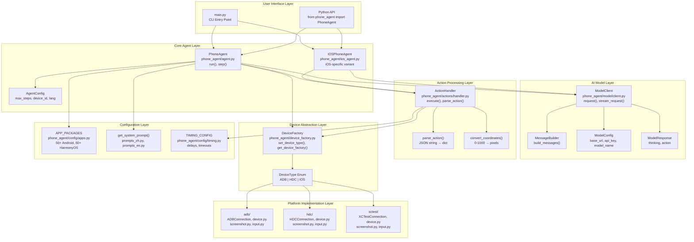
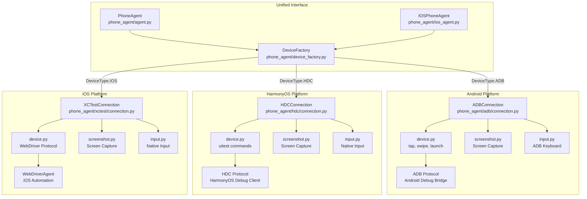
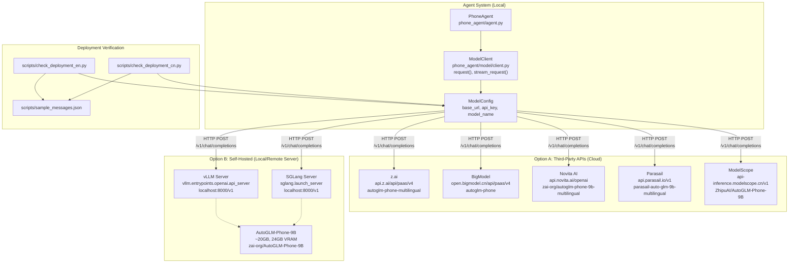

<!-- source: DeepWiki mcp.deepwiki.com · repo zai-org/Open-AutoGLM · page 1 Overview · fetched 2026-10-29 -->

# Overview

<details>
<summary>Relevant source files</summary>

The following files were used as context for generating this wiki page:

- [README.md](README.md)
- [README_coding_agent.md](README_coding_agent.md)
- [README_en.md](README_en.md)

</details>


This document provides a comprehensive introduction to Open-AutoGLM, explaining its purpose, architecture, and core components. It serves as the entry point for understanding the entire system.

For installation instructions, see [Getting Started](#2). For detailed architecture documentation, see [Architecture](#3). For usage guides, see [User Guide](#5).

## Purpose

Open-AutoGLM is an AI-powered mobile automation framework that enables natural language control of Android, HarmonyOS, and iOS devices. Users describe tasks in plain language (e.g., "Open Maps and search for nearby coffee shops"), and the system uses vision-language models to understand screen content, plan actions, and execute them through device automation protocols.

**Key capabilities:**
- Multi-platform support: Android (ADB), HarmonyOS (HDC), iOS (WebDriverAgent)
- Vision-based screen understanding using AutoGLM-Phone-9B models
- Natural language task execution with iterative refinement
- Safe operation with confirmation callbacks for sensitive actions
- Remote device control over WiFi/network

Sources: [README.md:27-33](), [README_en.md:21-23]()

## System Architecture

Open-AutoGLM is organized into six architectural layers, each with clear responsibilities. The following diagram maps the complete system architecture to concrete code entities:



**Architecture Layers:**

| Layer | Purpose | Key Components | Primary Files |
|-------|---------|----------------|---------------|
| User Interface | Entry points for task execution | `main.py`, `PhoneAgent`, `IOSPhoneAgent` | [main.py](), [phone_agent/__init__.py]() |
| Core Agent | Task orchestration, perception-action loop | `PhoneAgent.run()`, `PhoneAgent.step()`, `AgentConfig` | [phone_agent/agent.py](), [phone_agent/ios_agent.py]() |
| AI Model | Vision-language model integration | `ModelClient.request()`, `MessageBuilder`, `ModelResponse` | [phone_agent/model/client.py](), [phone_agent/model/config.py]() |
| Action Processing | Action parsing, validation, execution dispatch | `ActionHandler.execute()`, `parse_action()` | [phone_agent/actions/handler.py]() |
| Device Abstraction | Platform-agnostic device interface | `DeviceFactory`, `DeviceType`, lazy loading | [phone_agent/device_factory.py]() |
| Platform Implementation | Platform-specific protocols | ADB/HDC/WDA command execution | [phone_agent/adb/](), [phone_agent/hdc/](), [phone_agent/xctest/]() |
| Configuration | App mappings, prompts, timing | `APP_PACKAGES`, `get_system_prompt()`, `TIMING_CONFIG` | [phone_agent/config/]() |

Sources: [README.md:668-687](), [README_en.md:605-624](), [phone_agent/agent.py](), [phone_agent/device_factory.py]()

## Core Workflow

The system implements a perception-action loop where the agent iteratively observes the screen, reasons about the next action, and executes it. The following sequence diagram shows the complete execution flow from user request to device action:

```mermaid
sequenceDiagram
    participant User
    participant main_py as "main.py"
    participant PhoneAgent as "PhoneAgent<br/>phone_agent/agent.py"
    participant Config as "get_system_prompt()<br/>APP_PACKAGES"
    participant ModelClient as "ModelClient<br/>phone_agent/model/client.py"
    participant ModelAPI as "AI Model Service<br/>AutoGLM-Phone-9B"
    participant ActionHandler as "ActionHandler<br/>phone_agent/actions/handler.py"
    participant DeviceFactory as "DeviceFactory<br/>device_factory.py"
    participant Device as "Device<br/>ADB/HDC/WDA"
    
    User->>main_py: "Open Maps, search coffee"
    main_py->>PhoneAgent: run(task)
    activate PhoneAgent
    
    PhoneAgent->>Config: get_system_prompt(lang)
    Config-->>PhoneAgent: system_prompt, app_packages
    
    loop "Until task complete or max_steps reached (default: 100)"
        PhoneAgent->>DeviceFactory: get_screenshot()
        DeviceFactory->>Device: screencap / snapshot_display
        Device-->>DeviceFactory: PNG screenshot
        DeviceFactory-->>PhoneAgent: PIL.Image
        
        PhoneAgent->>DeviceFactory: get_current_app()
        DeviceFactory->>Device: dumpsys / uitest / WDA query
        Device-->>DeviceFactory: package/bundle identifier
        DeviceFactory-->>PhoneAgent: app_name string
        
        PhoneAgent->>ModelClient: request(messages, images)
        ModelClient->>ModelAPI: POST /v1/chat/completions
        ModelAPI-->>ModelClient: Stream: &lt;think&gt;...&lt;/think&gt;&lt;answer&gt;...&lt;/answer&gt;
        ModelClient-->>PhoneAgent: ModelResponse(thinking, action)
        
        PhoneAgent->>ActionHandler: execute(action, screen_size, callbacks)
        ActionHandler->>ActionHandler: parse_action(action_str)
        ActionHandler->>ActionHandler: convert_coordinates(element, dims)
        
        alt "Sensitive Operation (e.g., Payment)"
            ActionHandler->>User: confirmation_callback(message)
            User-->>ActionHandler: True/False
        end
        
        alt "Manual Task (e.g., Login, Captcha)"
            ActionHandler->>User: takeover_callback(message)
            User->>Device: Manual operation
            User-->>ActionHandler: Continue
        end
        
        alt "Normal Action"
            ActionHandler->>DeviceFactory: tap() / swipe() / type_text() / launch_app()
            DeviceFactory->>Device: ADB/HDC/WDA command
            Device-->>DeviceFactory: Command result
            DeviceFactory-->>ActionHandler: Success/Failure
        end
        
        ActionHandler-->>PhoneAgent: ActionResult
        
        alt "Task Complete (finish() action)"
            PhoneAgent-->>main_py: Success message
        end
        
        alt "Max Steps Reached"
            PhoneAgent-->>main_py: Timeout message
        end
    end
    
    deactivate PhoneAgent
    main_py-->>User: Display result
```

**Detailed Workflow Steps:**

| Step | Code Entity | Description |
|------|-------------|-------------|
| 1. Initialization | `PhoneAgent.__init__()` | Load `AgentConfig`, `ModelConfig`, initialize `ModelClient` and `ActionHandler` |
| 2. System Prompt | `get_system_prompt(lang)` | Load bilingual prompts from [phone_agent/config/prompts_zh.py]() or [phone_agent/config/prompts_en.py]() |
| 3. Screen Capture | `DeviceFactory.get_screenshot()` | Call platform-specific screenshot: `adb exec-out screencap`, `hdc shell snapshot_display`, or WDA API |
| 4. App Detection | `DeviceFactory.get_current_app()` | Query foreground app via `dumpsys window`, `uitest dumpLayout`, or WDA session |
| 5. Model Request | `ModelClient.request()` | Build message with `MessageBuilder`, send to OpenAI-compatible endpoint |
| 6. Response Parsing | `ModelResponse.parse()` | Extract `<think>` and `<answer>` tags, parse action JSON |
| 7. Action Dispatch | `ActionHandler.execute()` | Validate action type, convert coordinates, apply timing delays |
| 8. Safety Callbacks | `confirmation_callback()`, `takeover_callback()` | Optional user intervention for sensitive or manual operations |
| 9. Device Execution | Platform-specific modules | Execute via `adb shell input`, `hdc shell uitest`, or WDA WebDriver protocol |
| 10. Loop Condition | `PhoneAgent.run()` | Continue until `finish()` action or `max_steps` (default: 100) reached |

**Key Functions:**

- **`PhoneAgent.run(task: str)`**: Main entry point, executes full task with automatic loop
- **`PhoneAgent.step()`**: Single iteration of perception-action loop, useful for debugging
- **`ModelClient.request(messages, images)`**: Sends request to vision-language model
- **`ActionHandler.execute(action, screen_size, callbacks)`**: Parses and executes single action
- **`DeviceFactory.get_device_factory(device_type)`**: Returns platform-specific device instance

Sources: [README.md:27-32](), [phone_agent/agent.py](), [phone_agent/model/client.py](), [phone_agent/actions/handler.py]()

## Platform Support Matrix

Open-AutoGLM supports three mobile platforms through a unified interface:



**Platform-Specific Features:**

| Platform | Protocol | Connection Types | Text Input | Screen Capture | Launch Apps |
|----------|----------|------------------|------------|----------------|-------------|
| Android 7.0+ | ADB | USB, WiFi (TCP/IP) | ADB Keyboard | `adb exec-out screencap` | Package name |
| HarmonyOS NEXT+ | HDC | USB, WiFi (`hdc tconn`) | Native input | `hdc shell snapshot_display` | Bundle identifier |
| iOS 14.0+ | WebDriverAgent | USB (iproxy), WiFi | Native input | WDA screenshot API | Bundle identifier |

For detailed platform setup, see [Android (ADB)](#4.1), [HarmonyOS (HDC)](#4.2), and [iOS (WebDriverAgent)](#4.3).

Sources: [README.md:46-111](), [README_en.md:36-93](), [phone_agent/device_factory.py]()

## Model Deployment Options

The `ModelClient` ([phone_agent/model/client.py]()) communicates with vision-language models via OpenAI-compatible API. The system supports both cloud-hosted services and self-hosted inference servers:



**Deployment Comparison:**

| Approach | Hardware Requirements | Setup Complexity | Configuration | Use Case |
|----------|----------------------|------------------|---------------|----------|
| Third-Party API | None (cloud-based) | Low (API key only) | `--base-url`, `--apikey` | Quick start, production, no GPU |
| Self-Hosted (vLLM) | 24GB+ VRAM GPU, ~20GB disk | High (model download, vLLM setup) | `--base-url` only | Research, privacy, high volume |
| Self-Hosted (SGLang) | 24GB+ VRAM GPU, ~20GB disk | High (model download, SGLang setup) | `--base-url` only | Research, privacy, high volume |

**Configuration Methods:**

| Method | Example | Primary File |
|--------|---------|--------------|
| CLI Arguments | `python main.py --base-url URL --model NAME --apikey KEY` | [main.py:1-100]() |
| Environment Variables | `export PHONE_AGENT_BASE_URL="https://api.z.ai/api/paas/v4"` | N/A |
| Python API | `ModelConfig(base_url="...", api_key="...", model_name="...")` | [phone_agent/model/config.py]() |

**Self-Hosted Startup Commands:**

```bash
# vLLM (strict parameters required)
python3 -m vllm.entrypoints.openai.api_server \
  --served-model-name autoglm-phone-9b \
  --allowed-local-media-path / \
  --mm-encoder-tp-mode data \
  --mm_processor_cache_type shm \
  --mm_processor_kwargs "{\"max_pixels\":5000000}" \
  --max-model-len 25480 \
  --chat-template-content-format string \
  --limit-mm-per-prompt "{\"image\":10}" \
  --model zai-org/AutoGLM-Phone-9B \
  --port 8000

# SGLang
python3 -m sglang.launch_server \
  --model-path zai-org/AutoGLM-Phone-9B \
  --served-model-name autoglm-phone-9b \
  --context-length 25480 \
  --mm-enable-dp-encoder \
  --mm-process-config '{"image":{"max_pixels":5000000}}' \
  --port 8000
```

**Deployment Verification:**

Use the provided scripts to validate your deployment:

```bash
# Test Chinese model
python scripts/check_deployment_cn.py \
  --base-url http://localhost:8000/v1 \
  --model autoglm-phone-9b

# Test English model with API key
python scripts/check_deployment_en.py \
  --base-url https://api.z.ai/api/paas/v4 \
  --model autoglm-phone-multilingual \
  --apikey sk-xxxxx
```

Expected output includes structured thinking process and valid action JSON. Short thinking chains or garbled output indicate deployment issues.

For detailed deployment instructions, see [Using Third-Party APIs](#8.1), [Self-Hosting Models](#8.2), and [Deployment Verification](#8.3).

Sources: [README.md:154-283](), [README_en.md:134-222](), [phone_agent/model/client.py](), [scripts/check_deployment_cn.py](), [scripts/check_deployment_en.py]()

## Key Components and Code Entities

The following tables map system concepts to concrete code entities, organized by architectural layer:

### Core Agent Components

| Component | File Path | Key Methods/Attributes | Purpose |
|-----------|-----------|------------------------|---------|
| `PhoneAgent` | [phone_agent/agent.py]() | `run(task)`, `step()`, `reset()` | Main agent for Android/HarmonyOS, orchestrates perception-action loop |
| `IOSPhoneAgent` | [phone_agent/ios_agent.py]() | `run(task)`, `step()` | iOS-specific agent variant, handles WDA protocol differences |
| `AgentConfig` | [phone_agent/agent.py]() | `max_steps`, `device_id`, `lang`, `verbose` | Configuration dataclass for agent initialization |

### Model Integration Components

| Component | File Path | Key Methods/Attributes | Purpose |
|-----------|-----------|------------------------|---------|
| `ModelClient` | [phone_agent/model/client.py]() | `request(messages, images)`, `stream_request()` | OpenAI-compatible API client, manages HTTP communication |
| `ModelConfig` | [phone_agent/model/config.py]() | `base_url`, `api_key`, `model_name`, `temperature` | Model service configuration |
| `ModelResponse` | [phone_agent/model/types.py]() | `thinking`, `action`, `parse()` | Parses `<think>` and `<answer>` tags from model output |
| `MessageBuilder` | [phone_agent/model/client.py]() | `build_messages(history, screenshot)` | Constructs OpenAI-format message arrays with images |

### Action Processing Components

| Component | File Path | Key Methods/Attributes | Purpose |
|-----------|-----------|------------------------|---------|
| `ActionHandler` | [phone_agent/actions/handler.py]() | `execute(action, screen_size)`, `parse_action()` | Main action dispatcher, handles all 15+ action types |
| `parse_action()` | [phone_agent/actions/handler.py]() | Returns `dict` | Parses JSON action string into structured dictionary |
| `convert_coordinates()` | [phone_agent/actions/handler.py]() | Converts 0-1000 → pixels | Normalizes coordinates across different screen sizes |
| Action Types | [phone_agent/actions/handler.py]() | `Launch`, `Tap`, `Type`, `Swipe`, `Back`, `Home`, `Long_press`, `Double_tap`, `Wait`, `Take_over`, `Note`, `Call_API`, `Interact`, `finish()` | Supported action primitives |

### Device Abstraction Components

| Component | File Path | Key Methods/Attributes | Purpose |
|-----------|-----------|------------------------|---------|
| `DeviceFactory` | [phone_agent/device_factory.py]() | `set_device_type()`, `get_device_factory()` | Factory pattern for device instantiation |
| `DeviceType` | [phone_agent/device_factory.py]() | `ADB`, `HDC`, `IOS` enum values | Platform enumeration for routing |

### Android Platform Components (ADB)

| Component | File Path | Key Methods | Purpose |
|-----------|-----------|-------------|---------|
| `ADBConnection` | [phone_agent/adb/connection.py]() | `connect()`, `disconnect()`, `enable_tcpip()` | Manages ADB connections (USB/WiFi) |
| `list_devices()` | [phone_agent/adb/connection.py]() | Returns `List[DeviceInfo]` | Enumerates connected Android devices |
| `tap()`, `swipe()`, `launch_app()` | [phone_agent/adb/device.py]() | Platform operations | Executes `adb shell input` and `monkey` commands |
| `get_screenshot()` | [phone_agent/adb/screenshot.py]() | Returns `PIL.Image` | Executes `adb exec-out screencap -p` |
| `ADBKeyboard` | [phone_agent/adb/input.py]() | `type_text()`, `switch_to_adb_keyboard()` | Text input via ADB Keyboard app |

### HarmonyOS Platform Components (HDC)

| Component | File Path | Key Methods | Purpose |
|-----------|-----------|-------------|---------|
| `HDCConnection` | [phone_agent/hdc/connection.py]() | `connect()`, `disconnect()` | Manages HDC connections (USB/WiFi via `hdc tconn`) |
| `list_devices()` | [phone_agent/hdc/connection.py]() | Returns `List[DeviceInfo]` | Enumerates connected HarmonyOS devices |
| `tap()`, `swipe()`, `launch_app()` | [phone_agent/hdc/device.py]() | Platform operations | Executes `hdc shell uitest uiInput` and `aa start` commands |
| `get_screenshot()` | [phone_agent/hdc/screenshot.py]() | Returns `PIL.Image` | Executes `hdc shell snapshot_display` |
| Native input | [phone_agent/hdc/input.py]() | `type_text()` | Text input via `uitest uiInput text` (no keyboard app needed) |

### iOS Platform Components (WebDriverAgent)

| Component | File Path | Key Methods | Purpose |
|-----------|-----------|-------------|---------|
| `XCTestConnection` | [phone_agent/xctest/connection.py]() | `connect()`, `disconnect()` | Manages WebDriverAgent HTTP connections |
| `tap()`, `swipe()`, `launch_app()` | [phone_agent/xctest/device.py]() | Platform operations | Executes WebDriver protocol HTTP requests |
| `get_screenshot()` | [phone_agent/xctest/screenshot.py]() | Returns `PIL.Image` | Fetches screenshot via WDA API |
| Native input | [phone_agent/xctest/input.py]() | `type_text()` | Text input via WDA keyboard API |

### Configuration Components

| Component | File Path | Key Attributes | Purpose |
|-----------|-----------|----------------|---------|
| `APP_PACKAGES` | [phone_agent/config/apps.py]() | Dict mapping app names → package IDs | 50+ Android apps (e.g., `"微信": "com.tencent.mm"`) |
| `APP_PACKAGES_HARMONYOS` | [phone_agent/config/apps_harmonyos.py]() | Dict mapping app names → bundle IDs | 60+ HarmonyOS apps (e.g., `"微信": "com.tencent.wechat"`) |
| `APP_PACKAGES_IOS` | [phone_agent/config/apps_ios.py]() | Dict mapping app names → bundle IDs | iOS apps (e.g., `"Safari": "com.apple.mobilesafari"`) |
| `get_system_prompt()` | [phone_agent/config/prompts_zh.py](), [phone_agent/config/prompts_en.py]() | Returns prompt string | Bilingual system prompts with action definitions |
| `TIMING_CONFIG` | [phone_agent/config/timing.py]() | `ActionTimingConfig`, `DeviceTimingConfig` | Configurable delays and timeouts for all operations |
| `get_messages()` | [phone_agent/config/i18n.py]() | Returns UI strings | Bilingual UI messages for CLI output |

### Entry Points and Utilities

| Component | File Path | Key Functions | Purpose |
|-----------|-----------|---------------|---------|
| `main()` | [main.py]() | CLI entry point | Argument parsing, device selection, task execution |
| Package exports | [phone_agent/__init__.py]() | `__all__` list | Exports `PhoneAgent`, `IOSPhoneAgent`, `ModelConfig`, `AgentConfig` |
| Deployment checks | [scripts/check_deployment_cn.py](), [scripts/check_deployment_en.py]() | Validation scripts | Tests model service with sample messages |

Sources: [phone_agent/agent.py](), [phone_agent/model/client.py](), [phone_agent/actions/handler.py](), [phone_agent/device_factory.py](), [phone_agent/adb/](), [phone_agent/hdc/](), [phone_agent/xctest/](), [phone_agent/config/]()

## Usage Examples

### CLI Usage

```bash
# Single task execution (Android)
python main.py --base-url http://localhost:8000/v1 \
               --model autoglm-phone-9b \
               "Open Maps and search for nearby coffee shops"

# Single task execution (HarmonyOS)
python main.py --device-type hdc \
               --base-url http://localhost:8000/v1 \
               "Open Maps and search for nearby coffee shops"

# Single task execution (iOS)
python main.py --device-type ios \
               --base-url http://localhost:8000/v1 \
               "Open Maps and search for nearby coffee shops"

# Interactive mode
python main.py --base-url http://localhost:8000/v1 --model autoglm-phone-9b

# List supported applications
python main.py --list-apps
python main.py --device-type hdc --list-apps
```

### Python API Usage

```python
from phone_agent import PhoneAgent, IOSPhoneAgent
from phone_agent.model import ModelConfig
from phone_agent.agent import AgentConfig

# Configure model
model_config = ModelConfig(
    base_url="http://localhost:8000/v1",
    model_name="autoglm-phone-9b",
    api_key="EMPTY",
    temperature=0.1,
)

# Configure agent
agent_config = AgentConfig(
    max_steps=100,
    device_id=None,  # Auto-detect
    lang="en",
    verbose=True,
)

# Create agent (Android/HarmonyOS)
agent = PhoneAgent(
    model_config=model_config,
    agent_config=agent_config,
)

# Create agent (iOS)
ios_agent = IOSPhoneAgent(
    model_config=model_config,
    agent_config=agent_config,
)

# Execute task
result = agent.run("Open Maps and search for nearby coffee shops")
print(result)
```

### Custom Callbacks

```python
def my_confirmation(message: str) -> bool:
    """Called before sensitive operations (payments, etc.)"""
    return input(f"Confirm: {message}? (y/n): ").lower() == "y"

def my_takeover(message: str) -> None:
    """Called when manual intervention needed (login, captcha)"""
    print(f"Manual intervention required: {message}")
    input("Press Enter after completing manually...")

agent = PhoneAgent(
    confirmation_callback=my_confirmation,
    takeover_callback=my_takeover,
)
```

For detailed usage guides, see [Command-Line Interface](#5.1), [Python API](#5.2), and [Custom Callbacks](#6.3).

Sources: [README.md:286-333](), [README.md:621-641](), [README_en.md:223-273](), [README_en.md:558-578]()

## Application Support

Open-AutoGLM includes pre-configured mappings for 130+ Android apps, 60+ HarmonyOS apps, and 50+ iOS apps in the `APP_PACKAGES` dictionary:

**Android Example Apps:**
- Social: WeChat, QQ, Weibo, WhatsApp, Telegram, Instagram
- Shopping: Taobao, JD.com, Amazon, eBay, Temu
- Utilities: Chrome, Gmail, Google Maps, Google Calendar
- Entertainment: TikTok, YouTube, Netflix, Spotify

**HarmonyOS Example Apps:**
- Social: WeChat, QQ, Weibo, Feishu
- Shopping: Taobao, JD.com, Pinduoduo
- Utilities: Browser, Calendar, File Manager
- System: Settings, Camera, Contacts

**iOS Example Apps:**
- Social: WhatsApp, Telegram, Instagram, Facebook
- Productivity: Gmail, Google Calendar, Notes
- Shopping: Amazon, eBay
- Utilities: Safari, Maps, Calendar

To view the complete list:

```bash
python main.py --list-apps                    # Android
python main.py --device-type hdc --list-apps  # HarmonyOS
python main.py --device-type ios --list-apps  # iOS
```

For application configuration details, see [Application Packages](#7.1).

Sources: [README.md:567-602](), [README_en.md:506-539]()

## Development and Quality Assurance

The project includes comprehensive development tooling:

**Code Quality:**
- Pre-commit hooks with Ruff (linter/formatter), typos, and PyMarkdown
- Type hints throughout the codebase
- Automated formatting on commit

**Testing:**
- Unit tests via pytest
- Deployment verification scripts: [scripts/check_deployment_cn.py](), [scripts/check_deployment_en.py]()
- System requirement checks for ADB/HDC/WDA

**Documentation:**
- Bilingual documentation (Chinese and English)
- Comprehensive README files
- API documentation via docstrings

For development setup, see [Development Guide](#9).

Sources: [README.md:652-667](), [README_en.md:589-604]()

## Related Resources

- **Getting Started**: Installation, quick start, and basic configuration - see [Getting Started](#2)
- **Architecture Details**: Deep dive into system design and components - see [Architecture](#3)
- **Device Setup**: Platform-specific setup guides - see [Device Support](#4)
- **Usage Guides**: CLI, API, and advanced features - see [User Guide](#5)
- **Action Reference**: Complete action type documentation - see [Action System](#6)
- **Configuration**: Environment variables, prompts, and app packages - see [Configuration Reference](#7)
- **Model Deployment**: Self-hosting and third-party services - see [Model Deployment](#8)

Sources: [README.md:1-981](), [README_en.md:1-923]()

---

