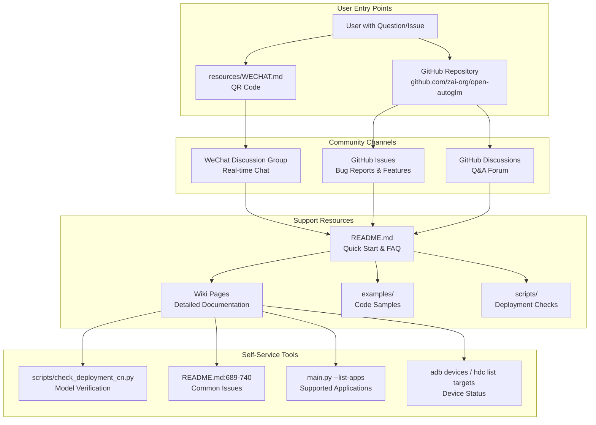
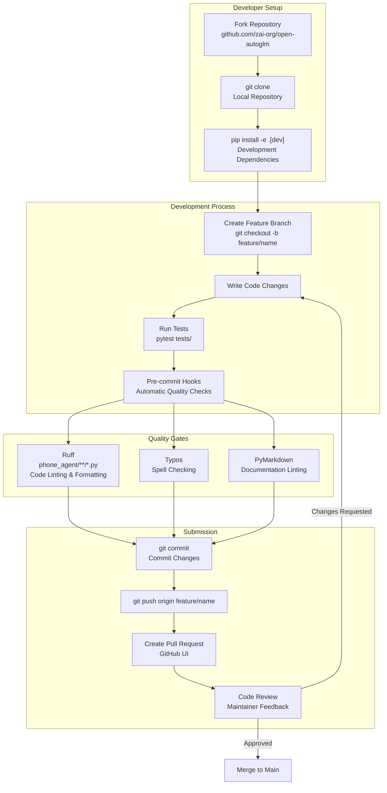
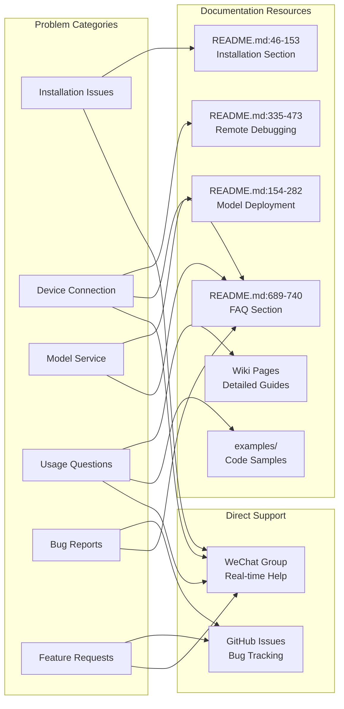

<!-- source: DeepWiki mcp.deepwiki.com · repo zai-org/Open-AutoGLM · page 10 Community and Support · fetched 2026-10-29 -->

# Community and Support

<details>
<summary>Relevant source files</summary>

The following files were used as context for generating this wiki page:

- [README_coding_agent.md](README_coding_agent.md)
- [README_en.md](README_en.md)
- [resources/WECHAT.md](resources/WECHAT.md)
- [resources/wechat.jpeg](resources/wechat.jpeg)

</details>


This document describes how to get help, engage with the Open-AutoGLM community, report issues, and contribute to the project. It covers available support channels, documentation resources, and contribution workflows.

For technical usage questions, see the [User Guide](#5). For development environment setup and contributing code changes, see the [Development Guide](#9).

---

## Community Channels

Open-AutoGLM provides multiple channels for community engagement and support.

### WeChat Community

The primary community channel is the **WeChat discussion group** for Chinese-speaking users.

**Accessing the WeChat Group:**
1. The QR code is available at [resources/WECHAT.md:1-6]()
2. Scan the QR code to follow the official account
3. Request to join the "Open-AutoGLM 交流群" (Open-AutoGLM Discussion Group)

The WeChat community provides:
- Real-time discussions with other users
- Direct support from community members
- Sharing of use cases and tips
- Early announcements of updates

**Sources:** [README.md:9-10](), [resources/WECHAT.md:1-6]()

### GitHub Repository

The official repository serves as the primary platform for technical discussions and contributions:

**Repository URL:** `https://github.com/zai-org/open-autoglm`

GitHub provides:
- **Issues:** Bug reports, feature requests, and technical questions
- **Discussions:** General conversations and Q&A
- **Pull Requests:** Code contributions and documentation improvements
- **Releases:** Version tracking and release notes

**Sources:** [README.md:1]()

### Official Product Integration

Users can also experience AutoGLM technology in production through:
- **智谱 AI 输入法 (Zhipu AI Input Method):** A commercial product featuring voice-command functionality
- **Access:** `https://autoglm.zhipuai.cn/autotyper/`

**Sources:** [README.md:12-13]()

---

## Community Support Architecture



**Sources:** [README.md:9-10](), [README.md:689-740](), [resources/WECHAT.md:1-6]()

---

## Getting Help

### Self-Service Diagnostic Tools

Before reaching out to the community, users can run diagnostic tools to identify common issues:

| Tool | Command | Purpose |
|------|---------|---------|
| Deployment Check | `python scripts/check_deployment_cn.py --base-url <url> --model <model>` | Verify model service connectivity and response quality |
| Device List | `adb devices` (Android)<br/>`hdc list targets` (HarmonyOS)<br/>`iproxy 8100 8100` (iOS) | Check device connectivity |
| Application List | `python main.py --list-apps` | Show all supported applications for the platform |
| ADB Service Reset | `adb kill-server && adb start-server` | Resolve device detection issues |

**Deployment Verification Example:**

The script [scripts/check_deployment_cn.py:1-100]() sends a test request with a sample screenshot and validates the model's response. Expected output includes:

```

<answer>do(action="Launch", app="京东")
```

If the output is corrupted or very short, the model deployment may have failed.

**Sources:** [README.md:252-276](), [README.md:689-740]()

### FAQ Reference

Common issues and solutions are documented in the FAQ section:

| Issue Category | Location | Description |
|----------------|----------|-------------|
| Device Not Found | [README.md:693-708]() | ADB/HDC connection troubleshooting |
| Click Actions Fail | [README.md:710-717]() | USB debugging security settings |
| Text Input Issues | [README.md:719-723]() | ADB Keyboard configuration |
| Screenshot Failures | [README.md:725-727]() | Sensitive page detection |
| Encoding Errors (Windows) | [README.md:729-733]() | `PYTHONIOENCODING=utf-8` environment variable |
| Interactive Mode Issues | [README.md:735-739]() | TTY environment requirements |

**Sources:** [README.md:689-740]()

### Reporting Issues

When self-service tools don't resolve the problem:

**Information to Include:**
1. **Environment Details:**
   - Operating system (Windows/macOS/Linux)
   - Python version (`python --version`)
   - Device type (Android/HarmonyOS/iOS)
   - Device model and OS version

2. **Connection Status:**
   - Output of `adb devices` or `hdc list targets`
   - Device ID being used

3. **Error Details:**
   - Full error message and stack trace
   - Command executed
   - Expected vs. actual behavior

4. **Model Configuration:**
   - Model service URL (base_url)
   - Model name
   - Whether using self-hosted or third-party API

**Where to Report:**
- **GitHub Issues:** For bugs and technical problems
- **WeChat Group:** For general questions and discussion
- **GitHub Discussions:** For feature requests and design discussions

**Sources:** [README.md:689-740]()

---

## Third-Party Support Resources

### Model Service Providers

Several third-party platforms provide hosted AutoGLM model services with their own support channels:

#### Zhipu BigModel (智谱 BigModel)

- **Documentation:** `https://docs.bigmodel.cn/cn/api/introduction`
- **Configuration:**
  - `--base-url`: `https://open.bigmodel.cn/api/paas/v4`
  - `--model`: `autoglm-phone`
  - `--apikey`: Obtained from Zhipu platform
- **Support:** Platform-specific documentation and customer service

#### ModelScope (魔搭社区)

- **Documentation:** `https://modelscope.cn/models/ZhipuAI/AutoGLM-Phone-9B`
- **Configuration:**
  - `--base-url`: `https://api-inference.modelscope.cn/v1`
  - `--model`: `ZhipuAI/AutoGLM-Phone-9B`
  - `--apikey`: Obtained from ModelScope platform
- **Support:** ModelScope community and documentation

**Sources:** [README.md:158-184](), [README.md:868-890]()

### Inference Engine Documentation

For self-hosted deployments, refer to official inference engine documentation:

| Engine | Documentation URL | Open-AutoGLM Configuration |
|--------|------------------|----------------------------|
| vLLM | `https://docs.vllm.ai/` | [README.md:220-234]() |
| SGLang | `https://sglang.readthedocs.io/` | [README.md:236-244]() |

**Sources:** [README.md:186-248]()

---

## Contributing to Open-AutoGLM

### Contribution Workflow



**Sources:** [README.md:652-686]()

### Development Environment Setup

Install development dependencies to enable code quality tools:

```bash
pip install -e ".[dev]"
```

This installs additional packages required for:
- **pytest:** Running test suite
- **pre-commit:** Automatic code quality checks
- **ruff:** Python linting and formatting
- **typos:** Spell checking
- **pymarkdown:** Markdown linting

**Sources:** [README.md:656-660]()

### Pre-commit Hooks

Pre-commit hooks automatically enforce code quality standards before commits are created. These hooks run:

1. **Ruff** - Lints and formats Python code in `phone_agent/` directory
2. **Typos** - Checks for spelling errors in all text files
3. **PyMarkdown** - Validates markdown formatting in documentation

Hooks are configured automatically after installing development dependencies.

**Manual Execution:**
```bash
# Run all checks manually
pre-commit run --all-files

# Run specific check
pre-commit run ruff --all-files
```

**Sources:** [README.md:652-686]()

### Testing

Run the test suite to verify changes don't break existing functionality:

```bash
pytest tests/
```

Test coverage includes:
- Unit tests for core components
- Integration tests for device operations
- Model client communication tests

**Sources:** [README.md:662-665]()

### Code Structure Reference

Contributors should familiarize themselves with the project structure:

```
phone_agent/
├── agent.py              # PhoneAgent, IOSPhoneAgent classes
├── adb/                  # Android device operations
│   ├── connection.py     # ADBConnection class
│   ├── device.py         # Device control operations
│   ├── screenshot.py     # Screenshot capture
│   └── input.py          # Text input via ADB Keyboard
├── hdc/                  # HarmonyOS device operations
│   ├── connection.py     # HDCConnection class
│   └── device.py         # HDC device control
├── xctest/               # iOS device operations
│   ├── connection.py     # XCTestConnection class
│   └── device.py         # WebDriverAgent operations
├── actions/              # Action parsing and execution
│   └── handler.py        # ActionHandler class
├── config/               # Configuration files
│   ├── apps.py           # APP_PACKAGES dictionary
│   ├── prompts_zh.py     # Chinese system prompts
│   └── prompts_en.py     # English system prompts
└── model/                # AI model integration
    └── client.py         # ModelClient class
```

For detailed architecture documentation, see [Architecture](#3).

**Sources:** [README.md:668-686]()

---

## Contributing Pathways

### Code Contributions

| Contribution Type | Entry Point | Key Files |
|-------------------|-------------|-----------|
| New device platform support | [phone_agent/device_factory.py]() | Device factory pattern |
| Additional applications | [phone_agent/config/apps.py]() | `APP_PACKAGES` dictionary |
| New actions | [phone_agent/actions/handler.py]() | `ActionHandler` class |
| Model client improvements | [phone_agent/model/client.py]() | `ModelClient` class |
| System prompt optimization | [phone_agent/config/prompts_zh.py](), [phone_agent/config/prompts_en.py]() | Prompt templates |

**Sources:** [README.md:668-686]()

### Documentation Contributions

Documentation improvements are welcome in several areas:

1. **README enhancements:** [README.md:1-981](), [README_en.md]()
2. **Setup guides:** [docs/ios_setup/]()
3. **Code examples:** [examples/]()
4. **Wiki pages:** This wiki documentation

**Sources:** [README.md:1-981]()

### Community Contributions

Non-code contributions are equally valuable:

- Answering questions in WeChat group or GitHub Discussions
- Reporting and reproducing bugs
- Testing on different device models and OS versions
- Translating documentation
- Creating tutorials and blog posts

**Sources:** [README.md:9-10]()

---

## Community Events and Programs

### AutoGLM 实战派 Developer Incentive Program

An active community program encouraging developers to:
- Deploy and run Open-AutoGLM
- Create derivative works and applications
- Share implementation experiences

**Details:**
- Activity announcement: [README.md:14-16]()
- Cash prize pool for qualified submissions
- Submission portal: `https://zhipu-ai.feishu.cn/share/base/form/shrcnE3ZuPD5tlOyVJ7d5Wtir8c`
- Official announcement: `https://mp.weixin.qq.com/s/wRp22dmRVF23ySEiATiWIQ`

**Sources:** [README.md:14-16]()

---

## Terms of Use and Privacy

Users and contributors must review and comply with the project's terms of use:

**Location:** [resources/privacy_policy.txt]()

**Key Points:**
- The project is for research and learning purposes only
- Prohibited uses include illegal information access, system interference, or unlawful activities
- Users must carefully review all terms before using the software

**Sources:** [README.md:34-35]()

---

## Citation and Academic Recognition

If using Open-AutoGLM in academic work, cite the following papers:

```bibtex
@article{liu2024autoglm,
  title={Autoglm: Autonomous foundation agents for guis},
  author={Liu, Xiao and Qin, Bo and Liang, Dongzhu and Dong, Guang and Lai, Hanyu and Zhang, Hanchen and Zhao, Hanlin and Iong, Iat Long and Sun, Jiadai and Wang, Jiaqi and others},
  journal={arXiv preprint arXiv:2411.00820},
  year={2024}
}

@article{xu2025mobilerl,
  title={MobileRL: Online Agentic Reinforcement Learning for Mobile GUI Agents},
  author={Xu, Yifan and Liu, Xiao and Liu, Xinghan and Fu, Jiaqi and Zhang, Hanchen and Jing, Bohao and Zhang, Shudan and Wang, Yuting and Zhao, Wenyi and Dong, Yuxiao},
  journal={arXiv preprint arXiv:2509.18119},
  year={2025}
}
```

**Sources:** [README.md:741-758]()

---

## Support Resource Mapping



**Sources:** [README.md:1-981](), [resources/WECHAT.md:1-6]()

---

## Quick Reference

### Get Help Fast

| Situation | Best Channel | Response Time |
|-----------|--------------|---------------|
| Quick question about usage | WeChat Group | Minutes to hours |
| Device not connecting | [FAQ](#689-740) → WeChat | Self-service first |
| Model service error | [check_deployment_cn.py]() → WeChat | Diagnostic first |
| Found a bug | GitHub Issues | Days to weeks |
| Feature idea | GitHub Discussions | Varies |
| Contributing code | GitHub Pull Request | Review within weeks |

### Essential Commands

```bash
# Check community resources
cat resources/WECHAT.md  # WeChat group QR code

# Diagnostic commands
python scripts/check_deployment_cn.py --base-url <url> --model <name>
adb devices
python main.py --list-apps

# Get help with CLI
python main.py --help

# Development setup
pip install -e ".[dev]"
pre-commit run --all-files
```

**Sources:** [README.md:1-981](), [resources/WECHAT.md:1-6]()