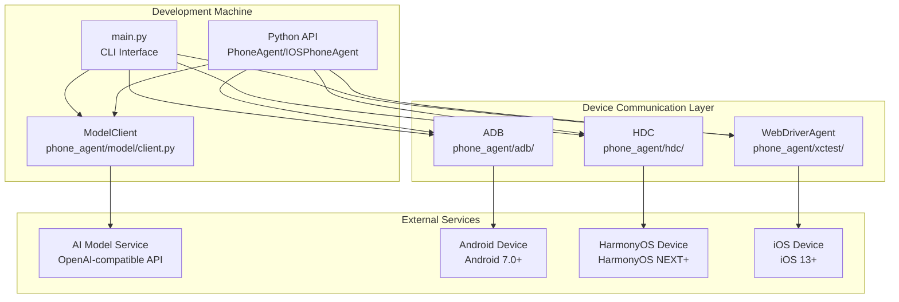
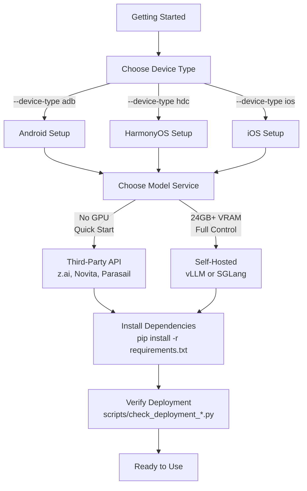
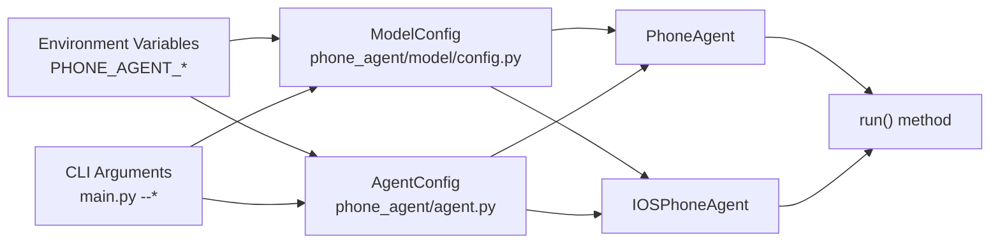

<!-- source: DeepWiki mcp.deepwiki.com · repo zai-org/Open-AutoGLM · page 2 Getting Started · fetched 2026-10-29 -->

# Getting Started

<details>
<summary>Relevant source files</summary>

The following files were used as context for generating this wiki page:

- [README.md](README.md)
- [README_coding_agent.md](README_coding_agent.md)
- [README_en.md](README_en.md)

</details>


This page provides an overview of the initial setup process for Open-AutoGLM, an AI-powered mobile automation framework. It covers system requirements, deployment options, and the basic workflow to get your first automation task running.

For detailed installation instructions, see [Installation](#2.1). For step-by-step usage examples, see [Quick Start](#2.2). For configuration options, see [Configuration Basics](#2.3).

## Overview

Open-AutoGLM enables AI-driven control of mobile devices through a three-component architecture:

1. **Agent Code** (this repository) - Runs on your computer
2. **Device Connection** - ADB/HDC/WebDriverAgent for device communication
3. **AI Model Service** - Vision-language model for decision-making

The setup process involves preparing your development environment, connecting your device, configuring a model service, and verifying the deployment.

## System Architecture Overview



**Component Mapping**

This diagram maps the system's natural language components to their code locations:

- `main.py` - Entry point for CLI usage [main.py]()
- `PhoneAgent` - Android/HarmonyOS agent class [phone_agent/agent.py]()
- `IOSPhoneAgent` - iOS agent class [phone_agent/ios_agent.py]()
- `ModelClient` - AI model communication [phone_agent/model/client.py]()
- Device modules - Platform-specific implementations in [phone_agent/adb/](), [phone_agent/hdc/](), [phone_agent/xctest/]()

**Sources:** [README.md:1-980](), [README_en.md:1-923](), [phone_agent/agent.py](), [phone_agent/ios_agent.py](), [main.py]()

## Prerequisites Checklist

Before beginning installation, ensure you have the following:

### Hardware Requirements

| Requirement | Android | HarmonyOS | iOS |
|------------|---------|-----------|-----|
| Device OS | Android 7.0+ | HarmonyOS NEXT+ | iOS 13+ |
| Connection Cable | USB data cable | USB data cable | USB data cable or WiFi |
| Computer OS | Windows/macOS/Linux | Windows/macOS/Linux | macOS only |

### Software Requirements

| Component | Purpose | Installation Link |
|-----------|---------|------------------|
| Python 3.10+ | Runtime environment | https://www.python.org/downloads/ |
| ADB Tools | Android device control | https://developer.android.com/tools/releases/platform-tools |
| HDC Tools | HarmonyOS device control | https://developer.huawei.com/consumer/en/download/ |
| Xcode + WDA | iOS device control | See [iOS Setup](#4.3) |
| ADB Keyboard | Text input on Android | https://github.com/senzhk/ADBKeyBoard |

### Device Configuration

**Android Devices:**
- Developer Mode enabled (Settings → About Phone → tap Build Number 7 times)
- USB Debugging enabled (Settings → Developer Options → USB Debugging)
- USB Debugging (Security Settings) enabled on some devices
- ADB Keyboard installed and enabled

**HarmonyOS Devices:**
- Developer Mode enabled
- USB Debugging enabled
- No ADB Keyboard required (uses native input)

**iOS Devices:**
- Developer account (free or paid)
- Xcode installed
- WebDriverAgent configured
- Device trusted in Xcode

**Sources:** [README.md:46-112](), [README_en.md:36-93](), [docs/ios_setup/ios_setup.md]()

## Deployment Decision Tree



**Configuration Mapping**

The deployment choices map to these configuration points:

- **Device Type**: `--device-type` CLI argument or `DeviceType` enum [phone_agent/device_factory.py:15-18]()
- **Model Service**: `--base-url` and `--apikey` CLI arguments or `ModelConfig` class [phone_agent/model/config.py:8-23]()
- **Agent Settings**: `--max-steps`, `--lang`, `--verbose` arguments or `AgentConfig` class [phone_agent/agent.py:25-50]()

**Sources:** [README.md:134-283](), [README_en.md:134-222](), [phone_agent/device_factory.py](), [phone_agent/model/config.py](), [phone_agent/agent.py]()

## Setup Process

### Step 1: Environment Preparation

Install Python 3.10+ and the appropriate device debug tools for your platform:

**For Android:**
```bash
# Download ADB from https://developer.android.com/tools/releases/platform-tools
# Add to PATH environment variable
export PATH=${PATH}:/path/to/platform-tools
```

**For HarmonyOS:**
```bash
# Download HDC from HarmonyOS SDK
# Add to PATH environment variable
export PATH=${PATH}:/path/to/harmonyos-sdk/toolchains
```

**For iOS:**
```bash
# Install Xcode from App Store
# Configure WebDriverAgent (see iOS Setup guide)
```

Verify device tool installation:
```bash
# Android
adb version

# HarmonyOS
hdc version
```

**Sources:** [README.md:46-104](), [README_en.md:36-74]()

### Step 2: Device Connection

Connect your device via USB and enable debugging:

**Android/HarmonyOS:**
1. Connect device with USB data cable (not charging-only cable)
2. Approve USB debugging authorization on device
3. Verify connection:

```bash
# Android
adb devices

# HarmonyOS
hdc list targets
```

**iOS:**
1. Connect device via USB or WiFi
2. Trust device in Xcode
3. Start WebDriverAgent
4. Verify connection at http://localhost:8100/status

See [Remote Device Connection](#5.3) for WiFi debugging setup.

**Sources:** [README.md:124-153](), [README_en.md:103-133](), [docs/ios_setup/ios_setup.md]()

### Step 3: Install Dependencies

Clone the repository and install Python dependencies:

```bash
git clone https://github.com/zai-org/Open-AutoGLM.git
cd Open-AutoGLM

# Create virtual environment (recommended)
python -m venv venv
source venv/bin/activate  # Windows: venv\Scripts\activate

# Install dependencies
pip install -r requirements.txt
pip install -e .
```

**For Android only:** Install ADB Keyboard APK on your device from https://github.com/senzhk/ADBKeyBoard and enable it in device settings.

**Sources:** [README.md:117-121](), [README_en.md:96-101](), [requirements.txt]()

### Step 4: Configure Model Service

Choose a model deployment option:

#### Option A: Third-Party API (Recommended for Quick Start)

Use a hosted model service with no local GPU requirements:

| Service | base-url | model | Notes |
|---------|----------|-------|-------|
| z.ai | `https://api.z.ai/api/paas/v4` | `autoglm-phone-multilingual` | Requires API key |
| Novita AI | `https://api.novita.ai/openai` | `zai-org/autoglm-phone-9b-multilingual` | Requires API key |
| Parasail | `https://api.parasail.io/v1` | `parasail-auto-glm-9b-multilingual` | Requires API key |
| BigModel (CN) | `https://open.bigmodel.cn/api/paas/v4` | `autoglm-phone` | Chinese optimized |
| ModelScope (CN) | `https://api-inference.modelscope.cn/v1` | `ZhipuAI/AutoGLM-Phone-9B` | Chinese optimized |

**Sources:** [README.md:158-184](), [README_en.md:138-174]()

#### Option B: Self-Hosted Model (Advanced)

Deploy the model locally using vLLM or SGLang:

**Requirements:**
- NVIDIA GPU with 24GB+ VRAM
- CUDA-compatible drivers

**vLLM Deployment:**
```bash
pip install vllm

python3 -m vllm.entrypoints.openai.api_server \
 --served-model-name autoglm-phone-9b-multilingual \
 --allowed-local-media-path / \
 --mm-encoder-tp-mode data \
 --mm_processor_cache_type shm \
 --mm_processor_kwargs "{\"max_pixels\":5000000}" \
 --max-model-len 25480 \
 --chat-template-content-format string \
 --limit-mm-per-prompt "{\"image\":10}" \
 --model zai-org/AutoGLM-Phone-9B-Multilingual \
 --port 8000
```

Service will be available at `http://localhost:8000/v1`.

**Sources:** [README.md:186-250](), [README_en.md:176-202]()

### Step 5: Verify Deployment

Test your configuration using the deployment check script:

```bash
# For self-hosted models
python scripts/check_deployment_en.py \
  --base-url http://localhost:8000/v1 \
  --model autoglm-phone-9b-multilingual

# For third-party APIs
python scripts/check_deployment_en.py \
  --base-url https://api.novita.ai/openai \
  --model zai-org/autoglm-phone-9b-multilingual \
  --apikey your-api-key
```

Expected output should include a coherent thinking process (`<think>`) and an action (`<answer>`). If the output is truncated or contains garbled text, the model deployment may have failed.

**Sources:** [README.md:252-277](), [README_en.md:203-221](), [scripts/check_deployment_en.py](), [scripts/check_deployment_cn.py]()

## First Task Execution

### Command Line Interface

Execute your first automation task:

```bash
# Android device
python main.py \
  --base-url http://localhost:8000/v1 \
  --model autoglm-phone-9b-multilingual \
  "Open Chrome and search for weather"

# HarmonyOS device
python main.py \
  --device-type hdc \
  --base-url http://localhost:8000/v1 \
  --model autoglm-phone-9b-multilingual \
  "Open browser and search for weather"

# iOS device
python main.py \
  --device-type ios \
  --base-url http://localhost:8000/v1 \
  --model autoglm-phone-9b-multilingual \
  "Open Safari and search for weather"
```

The agent will:
1. Capture a screenshot of the device
2. Send it to the AI model with your task description
3. Receive thinking process and action from the model
4. Execute the action on the device
5. Repeat until task completion or max steps reached

**Sources:** [README.md:284-313](), [README_en.md:223-253](), [main.py:1-200]()

### Python API

Alternatively, use the Python API for programmatic control:

```python
from phone_agent import PhoneAgent, IOSPhoneAgent
from phone_agent.model import ModelConfig

# Configure model
model_config = ModelConfig(
    base_url="http://localhost:8000/v1",
    model_name="autoglm-phone-9b-multilingual",
    api_key="your-api-key"  # if required
)

# Create agent for Android/HarmonyOS
agent = PhoneAgent(model_config=model_config)

# Or for iOS
# agent = IOSPhoneAgent(model_config=model_config)

# Execute task
result = agent.run("Open Gmail and check inbox")
print(result)
```

**Sources:** [README.md:315-333](), [README_en.md:255-273](), [phone_agent/agent.py:100-300](), [phone_agent/ios_agent.py:50-250]()

## Configuration Files and Environment Variables

### Key Configuration Classes



**Configuration Sources Priority (highest to lowest):**
1. Explicit parameters to `PhoneAgent()` or `IOSPhoneAgent()` constructor
2. CLI arguments in `main.py`
3. Environment variables (`PHONE_AGENT_*`)
4. Default values in configuration classes

**Important Environment Variables:**

| Variable | Purpose | Default | File Reference |
|----------|---------|---------|----------------|
| `PHONE_AGENT_BASE_URL` | Model API endpoint | `http://localhost:8000/v1` | [phone_agent/model/config.py:8-10]() |
| `PHONE_AGENT_MODEL` | Model name | `autoglm-phone-9b` | [phone_agent/model/config.py:11-13]() |
| `PHONE_AGENT_API_KEY` | API authentication | `EMPTY` | [phone_agent/model/config.py:14-16]() |
| `PHONE_AGENT_MAX_STEPS` | Max steps per task | `100` | [phone_agent/agent.py:30-32]() |
| `PHONE_AGENT_DEVICE_ID` | Specific device ID | Auto-detect | [phone_agent/agent.py:35-37]() |
| `PHONE_AGENT_DEVICE_TYPE` | Device type | `adb` | [phone_agent/agent.py:38-40]() |
| `PHONE_AGENT_LANG` | System prompt language | `cn` | [phone_agent/agent.py:41-43]() |

**Sources:** [README.md:476-524](), [README_en.md:415-464](), [phone_agent/model/config.py](), [phone_agent/agent.py:25-50]()

## Interactive Mode

For exploratory testing, use interactive mode:

```bash
python main.py \
  --base-url http://localhost:8000/v1 \
  --model autoglm-phone-9b-multilingual
```

The agent will prompt for tasks continuously:

```
请输入任务(输入 'quit' 退出):
> Open Settings and check battery status
[Agent executes task...]
✅ Task completed

请输入任务(输入 'quit' 退出):
> Open Gallery and view recent photos
[Agent executes task...]
✅ Task completed

请输入任务(输入 'quit' 退出):
> quit
```

For more details on interactive mode features, see [Interactive Mode](#5.5).

**Sources:** [README.md:284-313](), [README_en.md:223-253](), [main.py:150-200]()

## Troubleshooting Quick Reference

| Issue | Quick Fix | Detailed Info |
|-------|-----------|---------------|
| Device not found | `adb kill-server && adb start-server` | See [Installation](#2.1) |
| Can open apps but can't tap | Enable "USB Debugging (Security Settings)" | See [Installation](#2.1) |
| Text input fails | Install and enable ADB Keyboard | See [Installation](#2.1) |
| Model returns gibberish | Check model deployment parameters | See [Model Deployment](#8) |
| Connection timeout | Check WiFi connection or USB cable | See [Remote Device Connection](#5.3) |
| `ModuleNotFoundError` | Run `pip install -r requirements.txt` | See [Installation](#2.1) |

**Sources:** [README.md:689-740](), [README_en.md:626-673]()

## Next Steps

After successful setup:

1. **Learn CLI options:** See [Command-Line Interface](#5.1) for all available arguments
2. **Explore Python API:** See [Python API](#5.2) for programmatic usage patterns
3. **Configure remote debugging:** See [Remote Device Connection](#5.3) for WiFi setup
4. **Understand actions:** See [Action Types Reference](#6.1) for available device operations
5. **Customize behavior:** See [Configuration Management](#5.4) for advanced settings
6. **Review examples:** Check the `examples/` directory for sample implementations

For platform-specific details, see:
- [Android (ADB)](#4.1)
- [HarmonyOS (HDC)](#4.2)
- [iOS (WebDriverAgent)](#4.3)

**Sources:** [README.md:1-980](), [README_en.md:1-923](), [examples/]()

---

