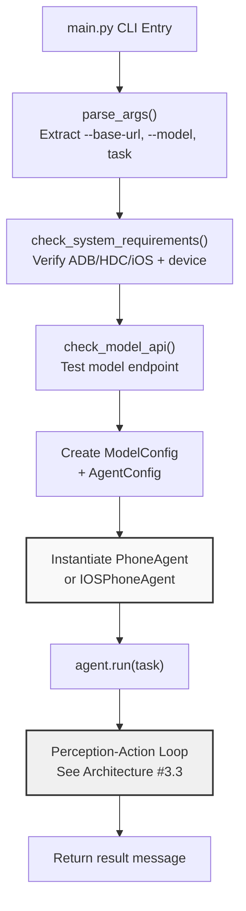
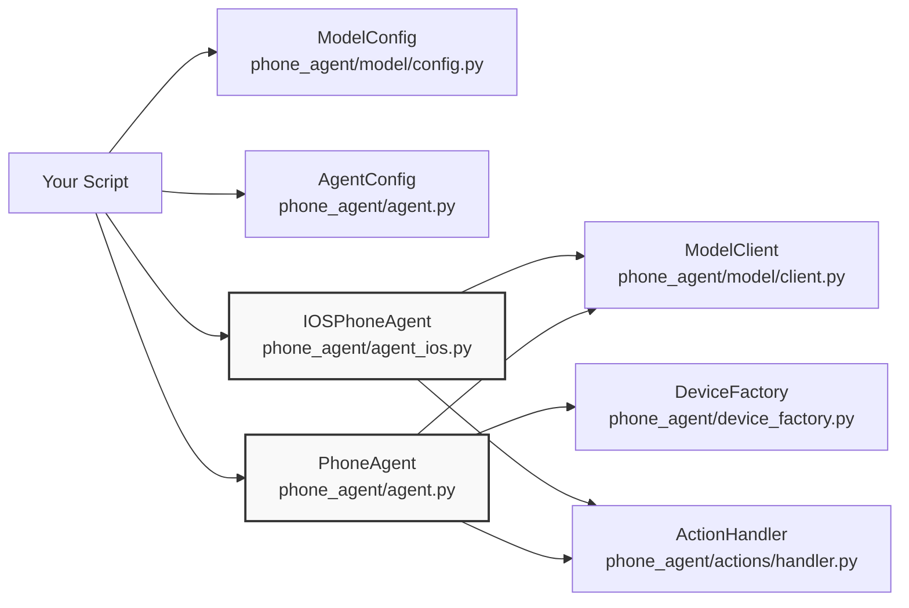
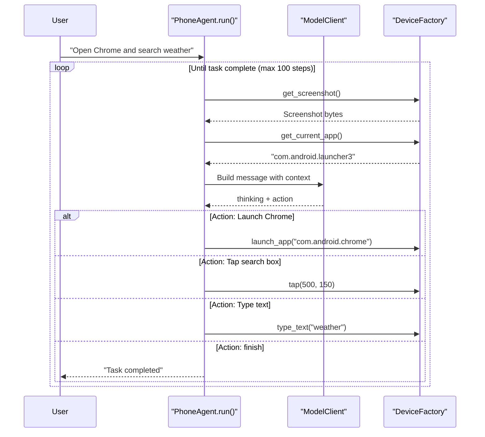

<!-- source: DeepWiki mcp.deepwiki.com · repo zai-org/Open-AutoGLM · page 2.2 Quick Start · fetched 2026-10-29 -->

# Quick Start

<details>
<summary>Relevant source files</summary>

The following files were used as context for generating this wiki page:

- [README.md](README.md)
- [README_coding_agent.md](README_coding_agent.md)
- [README_en.md](README_en.md)
- [examples/basic_usage.py](examples/basic_usage.py)
- [examples/demo_thinking.py](examples/demo_thinking.py)
- [main.py](main.py)
- [phone_agent/config/prompts.py](phone_agent/config/prompts.py)

</details>


This page walks you through running your first automated phone task with Open-AutoGLM. It assumes you have completed the installation steps described in [Installation](#2.1) and are ready to execute tasks on a connected device.

For detailed configuration options, see [Configuration Basics](#2.3). For advanced Python API usage patterns, see [Python API](#5.2).

---

## Prerequisites Verification

Before executing tasks, the system must verify two critical requirements: device connectivity and model service availability.

### System Requirements Check

The `main.py` CLI automatically runs `check_system_requirements()` to verify:

| Check | Android (ADB) | HarmonyOS (HDC) | iOS |
|-------|--------------|-----------------|-----|
| Tool installed | `adb version` | `hdc -v` | `idevice_id -ln` |
| Device connected | `adb devices` shows device | `hdc list targets` shows device | `idevice_id -l` shows UUID |
| Input method | ADB Keyboard installed | Native input (no check) | WebDriverAgent accessible |

The check runs automatically when you execute `main.py` without special flags. You can trigger it manually:

```bash
# Android device check
python main.py --list-devices

# HarmonyOS device check
python main.py --device-type hdc --list-devices

# iOS device check
python main.py --device-type ios --list-devices
```

**Expected output** for a successful Android check:

```
🔍 Checking system requirements...
--------------------------------------------------
1. Checking ADB installation... ✅ OK (Android Debug Bridge version 1.0.41)
2. Checking connected devices... ✅ OK (1 device(s): emulator-5554)
3. Checking ADB Keyboard... ✅ OK
--------------------------------------------------
✅ All system checks passed!
```

Sources: [main.py:37-269]()

### Model API Verification

The system calls `check_model_api()` to verify connectivity to the model service:

```bash
# Test model endpoint connectivity
python main.py --base-url http://localhost:8000/v1 --model autoglm-phone-9b
```

This sends a minimal chat completion request to verify the endpoint is responsive. For third-party services:

```bash
# Test z.ai endpoint
python main.py --base-url https://api.z.ai/api/paas/v4 \
               --model autoglm-phone-multilingual \
               --apikey your-api-key
```

**Expected output:**

```
🔍 Checking model API...
--------------------------------------------------
1. Checking API connectivity (http://localhost:8000/v1)... ✅ OK
--------------------------------------------------
✅ Model API checks passed!
```

Sources: [main.py:272-352]()

---

## First Task Execution Flow

The following diagram illustrates the complete execution path from command invocation to device action:



Sources: [main.py:684-798](), [README.md:294-324]()

---

## Command Line Usage

### Basic Command Structure

The `main.py` script accepts tasks in two modes:

**Interactive Mode** (no task argument):
```bash
python main.py --base-url <MODEL_URL> --model <MODEL_NAME>
```

The agent prompts for tasks in a loop until you type `exit`.

**Single Task Mode** (task argument provided):
```bash
python main.py --base-url <MODEL_URL> --model <MODEL_NAME> "Your task description"
```

The agent executes the task once and exits.

Sources: [main.py:1-14](), [main.py:517-522]()

### Platform-Specific Examples

#### Android Device

```bash
# Self-hosted model (local vLLM/SGLang server)
python main.py --base-url http://localhost:8000/v1 \
               --model autoglm-phone-9b \
               "Open Chrome and search for weather"

# Third-party API (z.ai)
python main.py --base-url https://api.z.ai/api/paas/v4 \
               --model autoglm-phone-multilingual \
               --apikey sk-your-api-key \
               "Open Maps and find nearby coffee shops"

# Chinese prompt with ModelScope
python main.py --base-url https://api-inference.modelscope.cn/v1 \
               --model ZhipuAI/AutoGLM-Phone-9B \
               --apikey your-modelscope-key \
               "打开微信发消息给文件传输助手"
```

#### HarmonyOS Device

```bash
# Specify device type as hdc
python main.py --device-type hdc \
               --base-url http://localhost:8000/v1 \
               --model autoglm-phone-9b \
               "打开美团搜索附近的火锅店"
```

#### iOS Device

```bash
# Default WebDriverAgent URL (localhost:8100)
python main.py --device-type ios \
               --base-url http://localhost:8000/v1 \
               --model autoglm-phone-9b-multilingual \
               "Open Safari and search for iPhone tips"

# WiFi connection (custom WDA URL)
python main.py --device-type ios \
               --wda-url http://192.168.1.100:8100 \
               --base-url http://localhost:8000/v1 \
               "Open Photos and show recent images"
```

Sources: [README.md:294-324](), [README_en.md:234-264](), [main.py:355-524]()

### Understanding Verbose Output

When a task executes, the `PhoneAgent` (with `verbose=True` by default in CLI) outputs structured information at each step:

```
==================================================
💭 Thinking Process:
--------------------------------------------------
Currently on system desktop, need to launch Chrome app first
--------------------------------------------------
🎯 Executing Action:
{
  "_metadata": "do",
  "action": "Launch",
  "app": "Chrome"
}
==================================================
```

After action execution:

```
==================================================
💭 Thinking Process:
--------------------------------------------------
Chrome is now open, need to tap the search bar at top
--------------------------------------------------
🎯 Executing Action:
{
  "_metadata": "do",
  "action": "Tap",
  "element": [500, 150]
}
==================================================
```

Upon task completion:

```
🎉 ================================================
✅ Task Completed: Successfully opened Chrome and searched for 'weather'
==================================================
```

This output is controlled by the `AgentConfig.verbose` parameter. See [Configuration Basics](#2.3) for details.

Sources: [README.md:537-575](), [phone_agent/agent.py:1-100]() (inferred structure)

---

## Python API Usage

### Basic Script Structure

The following diagram maps Python API components to their implementation files:



Sources: [examples/basic_usage.py:1-191](), Project structure analysis

### Minimal Example (Android/HarmonyOS)

```python
from phone_agent import PhoneAgent
from phone_agent.model import ModelConfig

# Configure model endpoint
model_config = ModelConfig(
    base_url="http://localhost:8000/v1",
    model_name="autoglm-phone-9b",
)

# Create agent (defaults: max_steps=100, verbose=True, lang="cn")
agent = PhoneAgent(model_config=model_config)

# Execute task
result = agent.run("打开淘宝搜索无线耳机")
print(result)
```

The `PhoneAgent` constructor automatically:
- Detects the device type (ADB or HDC) via `DeviceFactory`
- Selects the appropriate system prompt based on `AgentConfig.lang`
- Initializes the `ModelClient` with the provided `ModelConfig`
- Sets up default `ActionHandler` for action execution

Sources: [examples/basic_usage.py:15-42](), [README.md:326-344]()

### Minimal Example (iOS)

```python
from phone_agent.agent_ios import IOSPhoneAgent
from phone_agent.model import ModelConfig

# Configure model endpoint
model_config = ModelConfig(
    base_url="http://localhost:8000/v1",
    model_name="autoglm-phone-9b-multilingual",
)

# Create iOS agent (defaults: wda_url="http://localhost:8100")
agent = IOSPhoneAgent(model_config=model_config)

# Execute task
result = agent.run("Open Safari and search for iPhone tips")
print(result)
```

The `IOSPhoneAgent` differs from `PhoneAgent` in that it:
- Uses `XCTestConnection` instead of `ADBConnection` or `HDCConnection`
- Communicates via WebDriverAgent HTTP API
- Requires `wda_url` parameter for custom WDA endpoints

Sources: [main.py:27](), [README_en.md:266-284]()

### Configuration Options

Both `ModelConfig` and `AgentConfig` support customization:

```python
from phone_agent import PhoneAgent
from phone_agent.agent import AgentConfig
from phone_agent.model import ModelConfig

# Detailed model configuration
model_config = ModelConfig(
    base_url="http://localhost:8000/v1",
    api_key="your-api-key",           # For third-party services
    model_name="autoglm-phone-9b",
    max_tokens=3000,                  # Maximum response tokens
    temperature=0.1,                  # Sampling temperature
    frequency_penalty=0.2,            # Repetition penalty
)

# Detailed agent configuration
agent_config = AgentConfig(
    max_steps=50,                     # Maximum steps per task
    device_id="192.168.1.100:5555",   # Specific device ID
    lang="en",                        # System prompt language
    verbose=True,                     # Enable detailed output
)

# Create agent with both configs
agent = PhoneAgent(
    model_config=model_config,
    agent_config=agent_config,
)

# Execute task
result = agent.run("Open eBay and search for wireless earphones")
```

For a complete list of configuration parameters, see [Configuration Basics](#2.3).

Sources: [examples/basic_usage.py:15-42](), [README.md:509-535]()

---

## Common First-Run Issues

### Device Not Detected

**Symptom:** System check fails at step 2 (no devices connected)

**Solution:**
```bash
# Restart ADB server
adb kill-server
adb start-server
adb devices

# For HarmonyOS
hdc kill
hdc start
hdc list targets
```

Verify:
- USB debugging is enabled on the device
- USB cable supports data transfer (not charging-only)
- Device authorization popup was approved

Sources: [README.md:704-719]()

### ADB Keyboard Not Installed (Android only)

**Symptom:** System check fails at step 3

**Solution:**
1. Download [ADBKeyboard.apk](https://github.com/senzhk/ADBKeyBoard/blob/master/ADBKeyboard.apk)
2. Install: `adb install ADBKeyboard.apk`
3. Enable in device settings: `Settings > System > Languages & Input > Virtual Keyboard > ADB Keyboard`
4. Or via command: `adb shell ime enable com.android.adbkeyboard/.AdbIME`

Sources: [README.md:108-115](), [main.py:194-228]()

### Model API Connection Failed

**Symptom:** API check fails with connection refused or timeout

**Solution:**
1. Verify the model server is running:
   ```bash
   curl http://localhost:8000/v1/models
   ```
2. Check firewall settings are not blocking the port
3. For remote servers, verify the IP address is correct
4. Test with a simple HTTP request:
   ```bash
   curl -X POST http://localhost:8000/v1/chat/completions \
     -H "Content-Type: application/json" \
     -d '{"model":"autoglm-phone-9b","messages":[{"role":"user","content":"Hi"}],"max_tokens":5}'
   ```

Sources: [README.md:262-272](), [main.py:272-352]()

### WebDriverAgent Not Running (iOS only)

**Symptom:** iOS system check fails at step 3

**Solution:**
1. Open WebDriverAgent project in Xcode
2. Select your iOS device as the target
3. Run the WebDriverAgentRunner scheme (Product > Test or Cmd+U)
4. For USB connections, set up port forwarding:
   ```bash
   iproxy 8100 8100
   ```
5. Verify in browser: open `http://localhost:8100/status`

For detailed iOS setup, see [iOS Setup Guide](#4.3).

Sources: [README_en.md:105-124](), [main.py:234-260]()

---

## Task Execution Patterns

### Understanding the Agent Loop

When you call `agent.run(task)`, the agent enters a perception-action loop that continues until either:
- The task completes successfully (`finish()` action)
- Maximum steps are reached (`max_steps` from `AgentConfig`)
- An unrecoverable error occurs



For a detailed breakdown of the perception-action loop, see [Agent Execution Loop](#3.3).

Sources: [phone_agent/agent.py]() (inferred from README descriptions), Diagram 2 from system overview

### Step-by-Step Debugging

For debugging or observing individual steps, use the `step()` method instead of `run()`:

```python
from phone_agent import PhoneAgent
from phone_agent.model import ModelConfig

model_config = ModelConfig(
    base_url="http://localhost:8000/v1",
    model_name="autoglm-phone-9b",
)

agent = PhoneAgent(model_config=model_config)

# Initialize with task
result = agent.step("Open Maps and find nearby coffee shops")
print(f"Step 1: {result.action}")

# Continue step-by-step
while not result.finished and agent.step_count < 10:
    result = agent.step()
    print(f"Step {agent.step_count}: {result.action}")
    print(f"  Thinking: {result.thinking[:100]}...")

print(f"\nFinal result: {result.message}")
```

The `step()` method returns a result object containing:
- `result.action`: The action dictionary executed
- `result.thinking`: The model's reasoning process
- `result.finished`: Boolean indicating task completion
- `result.message`: Final message (if finished)

Sources: [examples/basic_usage.py:73-91]()

---

## Next Steps

After successfully executing your first task, explore:

- **[Configuration Basics](#2.3)**: Customize model parameters, timing settings, and system prompts
- **[Command-Line Interface](#5.1)**: Full reference of CLI arguments and environment variables
- **[Python API](#5.2)**: Advanced usage patterns, callbacks, and multi-task workflows
- **[Action Types Reference](#6.1)**: Complete list of available actions (Launch, Tap, Type, Swipe, etc.)
- **[Remote Device Connection](#5.3)**: Connect to devices over WiFi for wireless debugging

For troubleshooting specific platforms:
- **[Android (ADB)](#4.1)**: Android-specific device setup and debugging
- **[HarmonyOS (HDC)](#4.2)**: HarmonyOS-specific configuration
- **[iOS (WebDriverAgent)](#4.3)**: iOS device pairing and WDA setup

Sources: Table of contents structure

---

