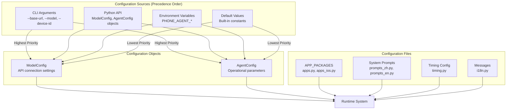
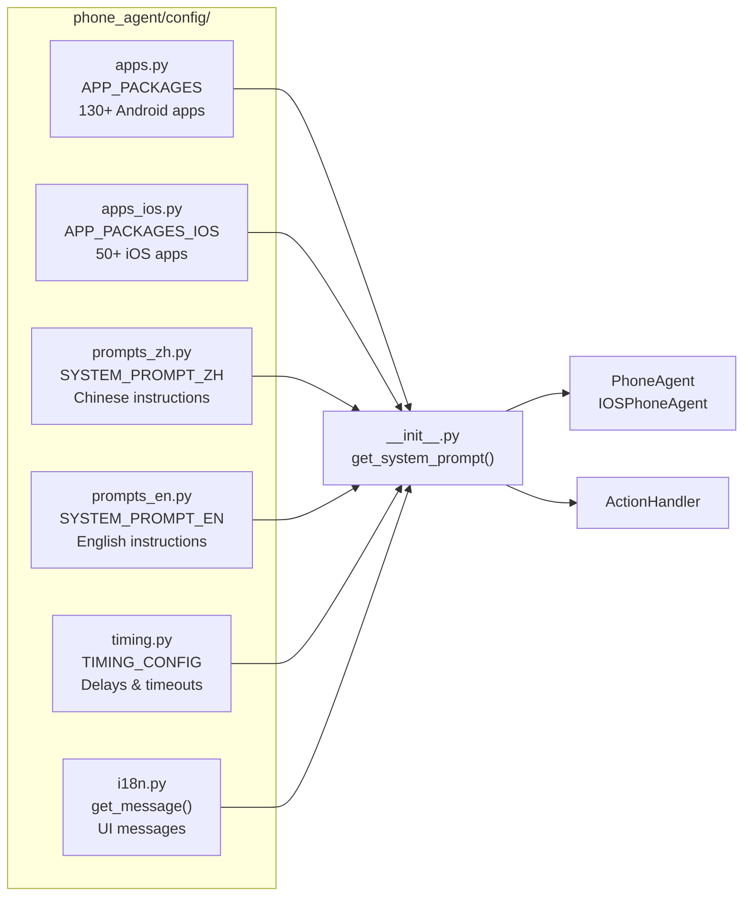
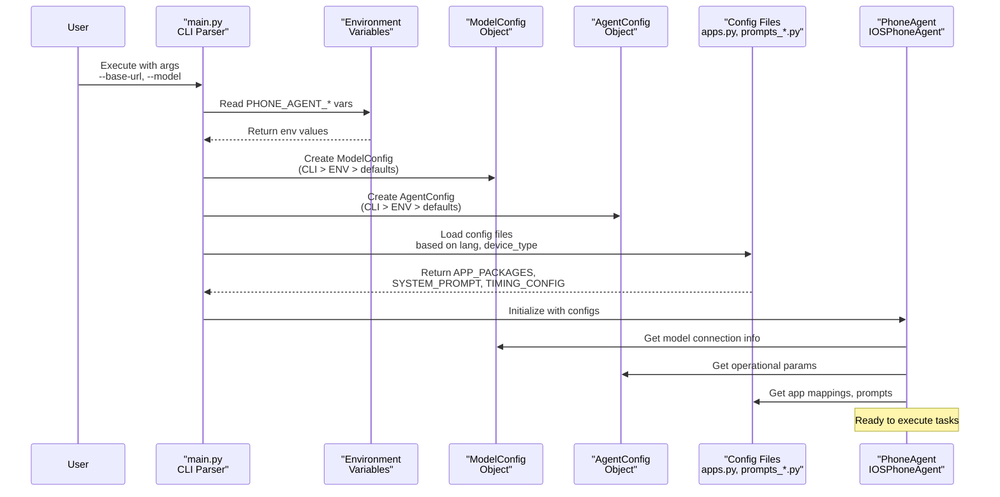

<!-- source: DeepWiki mcp.deepwiki.com · repo zai-org/Open-AutoGLM · page 2.3 Configuration Basics · fetched 2026-10-29 -->

# Configuration Basics

<details>
<summary>Relevant source files</summary>

The following files were used as context for generating this wiki page:

- [main.py](main.py)
- [phone_agent/agent.py](phone_agent/agent.py)
- [phone_agent/config/__init__.py](phone_agent/config/__init__.py)

</details>


This page provides an overview of the essential configuration options in Open-AutoGLM. It covers the basic configuration patterns needed to get started with the framework, including environment variables, model settings, and agent behavior options. For detailed configuration management and advanced options, see [Configuration Management](#5.4). For complete reference documentation on specific configuration files, see the [Configuration Reference](#7) section.

## Configuration Architecture

Open-AutoGLM uses a layered configuration system where settings can be specified through multiple sources with a clear precedence order:



**Sources:** [README.md:476-524](), [phone_agent/config/__init__.py:1-54]()

The configuration system follows this precedence (highest to lowest):
1. **CLI Arguments** - Override all other settings for quick testing
2. **Python API** - Explicit configuration objects in code
3. **Environment Variables** - System-wide defaults
4. **Built-in Defaults** - Fallback values

## Model Configuration

The `ModelConfig` class controls how the agent communicates with the AI model service. This is required for all operations as the model provides the intelligence for screen understanding and action planning.

### ModelConfig Class Structure

| Parameter | Type | Default | Description |
|-----------|------|---------|-------------|
| `base_url` | `str` | `"http://localhost:8000/v1"` | OpenAI-compatible API endpoint |
| `api_key` | `str` | `"EMPTY"` | API key for authentication |
| `model_name` | `str` | `"autoglm-phone-9b"` | Model identifier |
| `max_tokens` | `int` | `3000` | Maximum tokens in model response |
| `temperature` | `float` | `0.1` | Sampling temperature (0.0-1.0) |
| `frequency_penalty` | `float` | `0.2` | Frequency penalty for token generation |

**Sources:** [README.md:498-511]()

### Usage Examples

**Via Environment Variables:**
```bash
export PHONE_AGENT_BASE_URL="https://api.example.com/v1"
export PHONE_AGENT_MODEL="autoglm-phone-9b"
export PHONE_AGENT_API_KEY="sk-xxxxx"

python main.py "打开美团"
```

**Via CLI Arguments:**
```bash
python main.py \
  --base-url "https://api.example.com/v1" \
  --model "autoglm-phone-9b" \
  --apikey "sk-xxxxx" \
  "打开美团"
```

**Via Python API:**
```python
from phone_agent.model import ModelConfig

config = ModelConfig(
    base_url="https://api.example.com/v1",
    api_key="sk-xxxxx",
    model_name="autoglm-phone-9b",
    max_tokens=3000,
    temperature=0.1
)
```

**Sources:** [README.md:317-333](), [README.md:498-511]()

## Agent Configuration

The `AgentConfig` class controls operational behavior of the phone agent, including execution limits, device selection, and output verbosity.

### AgentConfig Class Structure

| Parameter | Type | Default | Description |
|-----------|------|---------|-------------|
| `max_steps` | `int` | `100` | Maximum steps per task execution |
| `device_id` | `Optional[str]` | `None` | Specific device ID (auto-detect if None) |
| `device_type` | `str` | `"adb"` | Device protocol: `"adb"`, `"hdc"`, or `"ios"` |
| `lang` | `str` | `"cn"` | System prompt language: `"cn"` or `"en"` |
| `verbose` | `bool` | `True` | Print detailed execution information |

**Sources:** [README.md:513-524]()

### Usage Examples

**Via Environment Variables:**
```bash
export PHONE_AGENT_MAX_STEPS=50
export PHONE_AGENT_DEVICE_TYPE="hdc"
export PHONE_AGENT_LANG="en"

python main.py "Open Maps"
```

**Via CLI Arguments:**
```bash
# Android device with English prompts
python main.py --lang en --device-type adb "Open Chrome browser"

# HarmonyOS device, specific device ID
python main.py --device-type hdc --device-id "192.168.1.100:5555" "打开抖音"

# iOS device
python main.py --device-type ios "Open Safari"
```

**Via Python API:**
```python
from phone_agent.agent import AgentConfig, PhoneAgent
from phone_agent.model import ModelConfig

agent_config = AgentConfig(
    max_steps=50,
    device_id="192.168.1.100:5555",
    device_type="hdc",
    lang="en",
    verbose=True
)

model_config = ModelConfig(base_url="http://localhost:8000/v1")
agent = PhoneAgent(model_config=model_config, agent_config=agent_config)
```

**Sources:** [README.md:513-524]()

## Environment Variables Reference

All configuration parameters can be set via environment variables with the `PHONE_AGENT_` prefix. This is useful for setting system-wide defaults or for CI/CD environments.

| Variable | Maps To | Default Value | Example |
|----------|---------|---------------|---------|
| `PHONE_AGENT_BASE_URL` | `ModelConfig.base_url` | `http://localhost:8000/v1` | `https://api.z.ai/v1` |
| `PHONE_AGENT_MODEL` | `ModelConfig.model_name` | `autoglm-phone-9b` | `autoglm-phone` |
| `PHONE_AGENT_API_KEY` | `ModelConfig.api_key` | `EMPTY` | `sk-abc123` |
| `PHONE_AGENT_MAX_STEPS` | `AgentConfig.max_steps` | `100` | `50` |
| `PHONE_AGENT_DEVICE_ID` | `AgentConfig.device_id` | (auto-detect) | `emulator-5554` |
| `PHONE_AGENT_DEVICE_TYPE` | `AgentConfig.device_type` | `adb` | `hdc`, `ios` |
| `PHONE_AGENT_LANG` | `AgentConfig.lang` | `cn` | `en` |

**Sources:** [README.md:486-496]()

### Setting Environment Variables

**Linux/macOS:**
```bash
# Temporary (current session only)
export PHONE_AGENT_BASE_URL="https://api.example.com/v1"
export PHONE_AGENT_MODEL="autoglm-phone-9b"

# Permanent (add to ~/.bashrc or ~/.zshrc)
echo 'export PHONE_AGENT_BASE_URL="https://api.example.com/v1"' >> ~/.bashrc
```

**Windows (Command Prompt):**
```cmd
# Temporary
set PHONE_AGENT_BASE_URL=https://api.example.com/v1
set PHONE_AGENT_MODEL=autoglm-phone-9b

# Permanent (System Properties > Environment Variables)
setx PHONE_AGENT_BASE_URL "https://api.example.com/v1"
```

**Windows (PowerShell):**
```powershell
# Temporary
$env:PHONE_AGENT_BASE_URL = "https://api.example.com/v1"
$env:PHONE_AGENT_MODEL = "autoglm-phone-9b"

# Permanent
[System.Environment]::SetEnvironmentVariable("PHONE_AGENT_BASE_URL", "https://api.example.com/v1", "User")
```

**Sources:** [README.md:486-496]()

## Configuration Files Overview

Open-AutoGLM includes several configuration files that define supported applications, system prompts, timing parameters, and localized messages. These files are typically not modified during normal usage but can be customized for specific needs.



**Sources:** [phone_agent/config/__init__.py:1-54]()

### Configuration File Purposes

| File | Purpose | Typical Usage | Reference |
|------|---------|---------------|-----------|
| `apps.py` | Maps app names to Android/HarmonyOS package IDs | Auto-loaded by agent | [Application Packages](#7.1) |
| `apps_ios.py` | Maps app names to iOS bundle IDs | Auto-loaded by iOS agent | [Application Packages](#7.1) |
| `prompts_zh.py` | Chinese system prompt template | Selected via `--lang cn` | [System Prompts](#7.2) |
| `prompts_en.py` | English system prompt template | Selected via `--lang en` | [System Prompts](#7.2) |
| `timing.py` | Action delays, connection timeouts | Auto-loaded, customizable | [Timing Configuration](#7.3) |
| `i18n.py` | Localized UI messages | Auto-loaded based on `lang` | [System Prompts](#7.2) |

**Sources:** [phone_agent/config/__init__.py:3-16]()

### Accessing Configuration Files

The configuration module provides convenient access functions:

```python
from phone_agent.config import (
    APP_PACKAGES,           # Android/HarmonyOS app mappings
    APP_PACKAGES_IOS,       # iOS app mappings
    get_system_prompt,      # Get prompt by language
    TIMING_CONFIG,          # Timing parameters
    get_message,            # Get localized message
)

# Get system prompt for specific language
prompt_cn = get_system_prompt("cn")
prompt_en = get_system_prompt("en")

# Access app package mappings
wechat_package = APP_PACKAGES.get("微信")  # Returns package ID
safari_bundle = APP_PACKAGES_IOS.get("Safari")  # Returns bundle ID

# Access timing config
action_delay = TIMING_CONFIG.action.tap_delay
```

**Sources:** [phone_agent/config/__init__.py:19-53]()

## Configuration Flow Diagram

This diagram shows how configuration flows from user input through the system to the runtime components:



**Sources:** [README.md:476-524](), [phone_agent/config/__init__.py:1-54]()

## Practical Configuration Scenarios

### Scenario 1: Using Third-Party API Service

When using a hosted model service like z.ai or ModelScope:

```bash
# Set via environment for persistent use
export PHONE_AGENT_BASE_URL="https://api.z.ai/v1"
export PHONE_AGENT_API_KEY="sk-your-api-key-here"
export PHONE_AGENT_MODEL="autoglm-phone-9b"

# Now all commands use these settings
python main.py "打开美团"
python main.py "搜索附近的咖啡店"
```

**Sources:** [README.md:158-184]()

### Scenario 2: Self-Hosted Model

When running a local model service:

```bash
# Start model service first (in separate terminal)
python3 -m vllm.entrypoints.openai.api_server \
  --model zai-org/AutoGLM-Phone-9B \
  --port 8000

# Configure agent to use local service
export PHONE_AGENT_BASE_URL="http://localhost:8000/v1"
export PHONE_AGENT_MODEL="autoglm-phone-9b"
export PHONE_AGENT_API_KEY="EMPTY"

python main.py "打开美团"
```

**Sources:** [README.md:186-250]()

### Scenario 3: Multi-Device Setup

When working with multiple devices connected:

```bash
# List available devices
adb devices
# Output:
# emulator-5554    device
# 192.168.1.100:5555    device

# Specify device via CLI
python main.py --device-id "emulator-5554" "打开微信"

# Or set via environment
export PHONE_AGENT_DEVICE_ID="192.168.1.100:5555"
python main.py "打开抖音"
```

**Sources:** [README.md:374-406]()

### Scenario 4: HarmonyOS Device

When using a HarmonyOS device instead of Android:

```bash
# Set device type
export PHONE_AGENT_DEVICE_TYPE="hdc"
export PHONE_AGENT_BASE_URL="http://localhost:8000/v1"

# Verify HDC connection
hdc list targets

# Run agent
python main.py "打开美团"
```

**Sources:** [README.md:287-313]()

### Scenario 5: iOS Device

When using an iOS device with WebDriverAgent:

```bash
# Set device type to iOS
export PHONE_AGENT_DEVICE_TYPE="ios"
export PHONE_AGENT_BASE_URL="http://localhost:8000/v1"
export PHONE_AGENT_LANG="en"

# Run agent
python main.py "Open Safari and search for coffee shops"
```

**Sources:** [README.md:106-112]()

## Configuration Best Practices

### 1. Environment Variables for Defaults

Set frequently used values as environment variables:

```bash
# Add to ~/.bashrc or ~/.zshrc
export PHONE_AGENT_BASE_URL="https://api.example.com/v1"
export PHONE_AGENT_API_KEY="sk-your-key"
export PHONE_AGENT_MODEL="autoglm-phone-9b"
export PHONE_AGENT_LANG="cn"
```

This allows commands like `python main.py "任务描述"` without repeating configuration.

### 2. CLI Overrides for Testing

Use CLI arguments to temporarily override defaults during testing:

```bash
# Test with different model
python main.py --model "autoglm-phone-9b-multilingual" "Open Chrome"

# Test with verbose output disabled
python main.py --no-verbose "打开微信"
```

### 3. Python API for Programmatic Control

Use explicit configuration objects when embedding in Python applications:

```python
from phone_agent import PhoneAgent
from phone_agent.model import ModelConfig
from phone_agent.agent import AgentConfig

# Explicit configuration - no environment dependencies
model_config = ModelConfig(
    base_url="https://api.example.com/v1",
    api_key="sk-key-from-secrets-manager",
    model_name="autoglm-phone-9b"
)

agent_config = AgentConfig(
    max_steps=50,
    verbose=False  # Reduce output in production
)

agent = PhoneAgent(
    model_config=model_config,
    agent_config=agent_config
)
```

### 4. Separate Configurations per Environment

Use different configuration sets for development, testing, and production:

```bash
# dev.env
PHONE_AGENT_BASE_URL=http://localhost:8000/v1
PHONE_AGENT_VERBOSE=true
PHONE_AGENT_MAX_STEPS=100

# production.env
PHONE_AGENT_BASE_URL=https://api.production.com/v1
PHONE_AGENT_API_KEY=sk-prod-key
PHONE_AGENT_VERBOSE=false
PHONE_AGENT_MAX_STEPS=50

# Load specific environment
source dev.env && python main.py "test task"
```

**Sources:** [README.md:476-524]()

## Next Steps

- For detailed configuration management including callbacks and advanced options, see [Configuration Management](#5.4)
- For complete reference on application package mappings, see [Application Packages](#7.1)
- For customizing system prompts and AI behavior, see [System Prompts](#7.2)
- For timing and delay configuration, see [Timing Configuration](#7.3)
- For model deployment options, see [Model Deployment](#8)

---

