<!-- source: DeepWiki mcp.deepwiki.com · repo zai-org/Open-AutoGLM · page 3 Architecture · fetched 2026-10-29 -->

# Architecture

<details>
<summary>Relevant source files</summary>

The following files were used as context for generating this wiki page:

- [README_coding_agent.md](README_coding_agent.md)
- [README_en.md](README_en.md)
- [phone_agent/agent.py](phone_agent/agent.py)
- [phone_agent/device_factory.py](phone_agent/device_factory.py)

</details>


This document describes the high-level architecture of Open-AutoGLM, a multi-platform mobile automation framework powered by vision-language models. It covers the system's layered design, core components, data flow patterns, and abstraction mechanisms that enable cross-platform device control.

For detailed implementation of specific subsystems, see [System Overview](#3.1), [Core Components](#3.2), [Agent Execution Loop](#3.3), [AI Model Integration](#3.4), and [Device Communication Layer](#3.5).

For practical usage information, see [Getting Started](#2) and [User Guide](#5).

## System Layers

Open-AutoGLM is organized into five distinct architectural layers, each with specific responsibilities:

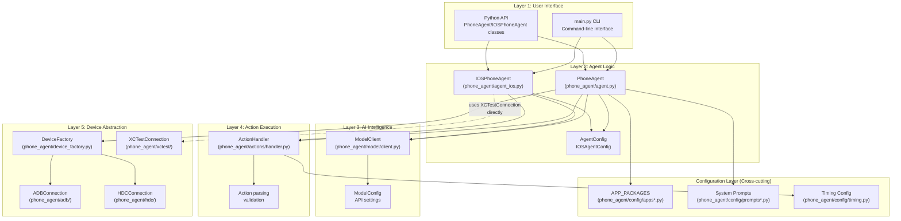

**Sources:** [main.py:1-854](), [phone_agent/agent.py](), [phone_agent/agent_ios.py](), [phone_agent/model/client.py](), [phone_agent/actions/handler.py](), [phone_agent/device_factory.py]()

### Layer Responsibilities

| Layer | Components | Responsibilities |
|-------|-----------|------------------|
| **User Interface** | `main.py`, Python API | Command parsing, interactive mode, system checks |
| **Agent Logic** | `PhoneAgent`, `IOSPhoneAgent`, configs | Task orchestration, message management, callback handling |
| **AI Intelligence** | `ModelClient`, `ModelConfig` | OpenAI-compatible API communication, response parsing |
| **Action Execution** | `ActionHandler` | Action validation, coordinate transformation, device operation dispatch |
| **Device Abstraction** | `DeviceFactory`, connection classes | Platform-specific device control, screenshot capture, input methods |
| **Configuration** | `APP_PACKAGES`, prompts, timing | Application mappings, system prompts, operational parameters |

**Sources:** [main.py:1-854](), [phone_agent/agent.py](), [phone_agent/actions/handler.py](), [phone_agent/device_factory.py]()

## Core Component Interaction

The following diagram shows how the primary code entities interact during task execution:

```mermaid
sequenceDiagram
    participant User
    participant main["main.py"]
    participant PA["PhoneAgent<br/>(agent.py)"]
    participant MC["ModelClient<br/>(model/client.py)"]
    participant AH["ActionHandler<br/>(actions/handler.py)"]
    participant DF["DeviceFactory<br/>(device_factory.py)"]
    participant Device["Device Module<br/>(adb/hdc/xctest)"]
    
    User->>main: python main.py "task"
    main->>main: parse_args()
    main->>main: check_system_requirements()
    main->>main: check_model_api()
    
    main->>PA: PhoneAgent(model_config, agent_config)
    main->>PA: run(task)
    
    loop "max_steps iterations"
        PA->>DF: capture_screenshot()
        DF->>Device: screenshot command
        Device-->>DF: image bytes
        DF-->>PA: screenshot image
        
        PA->>PA: _build_messages(screenshot)
        PA->>MC: request(messages)
        MC->>MC: _prepare_request()
        MC-->>PA: ModelResponse(thinking, action)
        
        PA->>PA: _parse_action(response)
        PA->>AH: execute(action, screen_size, device_id)
        
        alt "Normal Action"
            AH->>DF: device operation
            DF->>Device: adb/hdc/wda command
            Device-->>DF: result
            DF-->>AH: execution result
        else "Sensitive Action"
            AH->>User: confirmation_callback()
            User-->>AH: approval
        else "Take_over Action"
            AH->>User: takeover_callback()
            User-->>AH: completion signal
        end
        
        AH-->>PA: ActionResult
        
        alt "Task Complete"
            PA-->>main: success message
        else "Max Steps"
            PA-->>main: max steps reached
        end
    end
    
    main-->>User: display result
```

**Sources:** [main.py:684-853](), [phone_agent/agent.py](), [phone_agent/model/client.py](), [phone_agent/actions/handler.py](), [phone_agent/device_factory.py]()

## Device Factory Pattern

Open-AutoGLM uses the Factory pattern to abstract device-specific implementations behind a unified interface. This enables the same agent logic to control Android, HarmonyOS, and iOS devices.

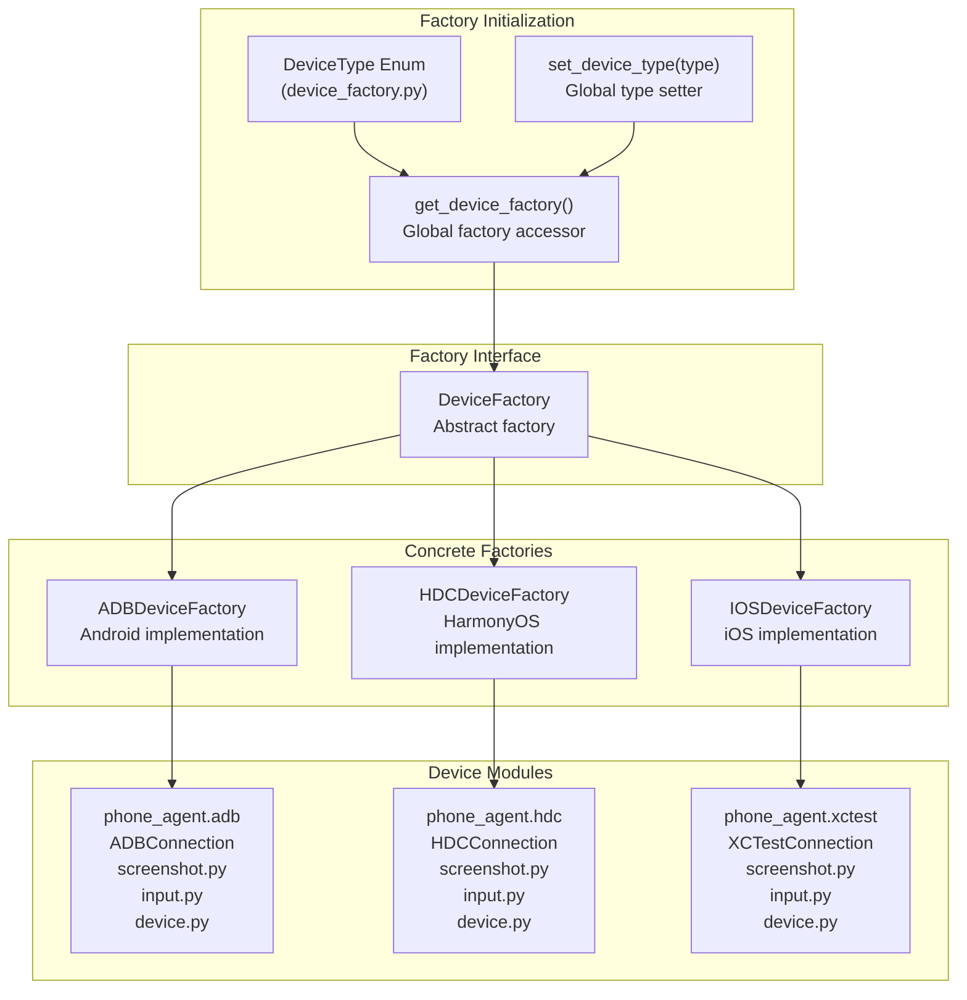

**Sources:** [phone_agent/device_factory.py](), [phone_agent/adb/__init__.py](), [phone_agent/hdc/__init__.py](), [phone_agent/xctest/__init__.py]()

### Factory Methods

Each factory implementation provides standardized methods:

| Method | Return Type | Purpose |
|--------|-------------|---------|
| `get_connection_class()` | `Type[Connection]` | Returns connection class for device type |
| `list_devices()` | `List[DeviceInfo]` | Enumerates connected devices |
| `capture_screenshot(device_id)` | `bytes` | Captures device screen |
| `get_screen_size(device_id)` | `Tuple[int, int]` | Returns screen dimensions |
| `get_current_app(device_id)` | `str` | Gets foreground app package/bundle ID |
| `launch_app(app_name, device_id)` | `bool` | Launches application |
| `tap(x, y, device_id)` | `bool` | Performs tap at coordinates |
| `swipe(start, end, duration, device_id)` | `bool` | Performs swipe gesture |
| `type_text(text, device_id)` | `bool` | Inputs text |
| `press_back(device_id)` | `bool` | Presses back button |
| `press_home(device_id)` | `bool` | Returns to home screen |

**Sources:** [phone_agent/device_factory.py]()

## Agent Configuration Architecture

Configuration flows from multiple sources into structured configuration objects:

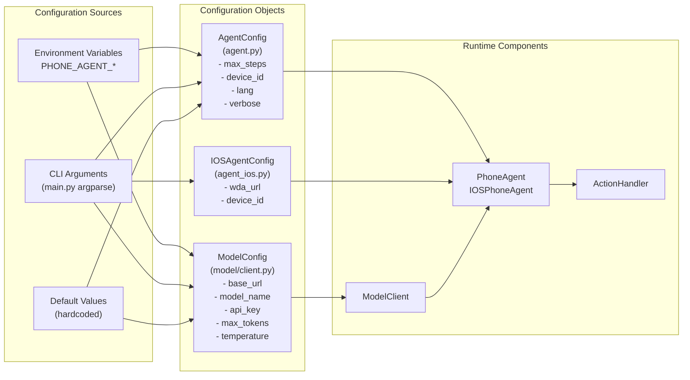

**Sources:** [main.py:355-524](), [phone_agent/model/client.py](), [phone_agent/agent.py](), [phone_agent/agent_ios.py]()

### Configuration Precedence

Configuration values are resolved in the following order (highest to lowest priority):

1. CLI arguments (e.g., `--base-url`, `--model`)
2. Environment variables (e.g., `PHONE_AGENT_BASE_URL`)
3. Default values in code

**Sources:** [main.py:405-524]()

## Data Flow: Screenshot to Action

The core automation loop transforms visual observations into device actions:

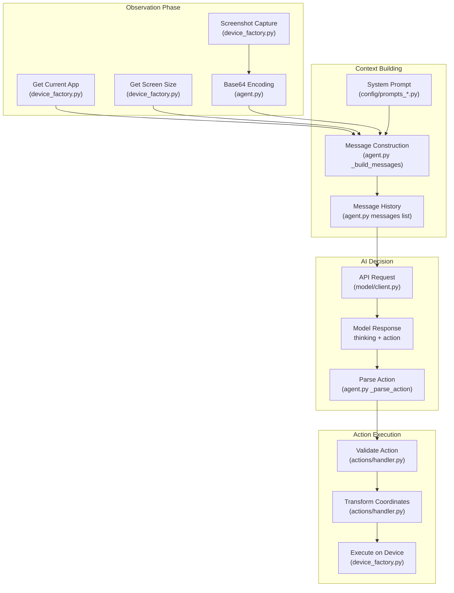

**Sources:** [phone_agent/agent.py](), [phone_agent/model/client.py](), [phone_agent/actions/handler.py](), [phone_agent/device_factory.py]()

## Platform-Specific Implementation Details

Each platform has distinct implementation characteristics:

### Android (ADB)

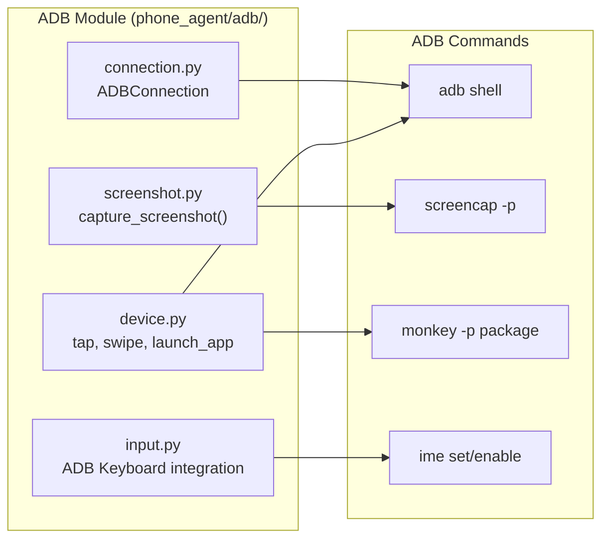

**Key characteristics:**
- Uses `adb shell` for command execution
- Requires ADB Keyboard app for text input [phone_agent/adb/input.py]()
- Screenshot via `screencap -p` command [phone_agent/adb/screenshot.py]()
- Supports USB and WiFi connections [phone_agent/adb/connection.py]()

**Sources:** [phone_agent/adb/]()

### HarmonyOS (HDC)

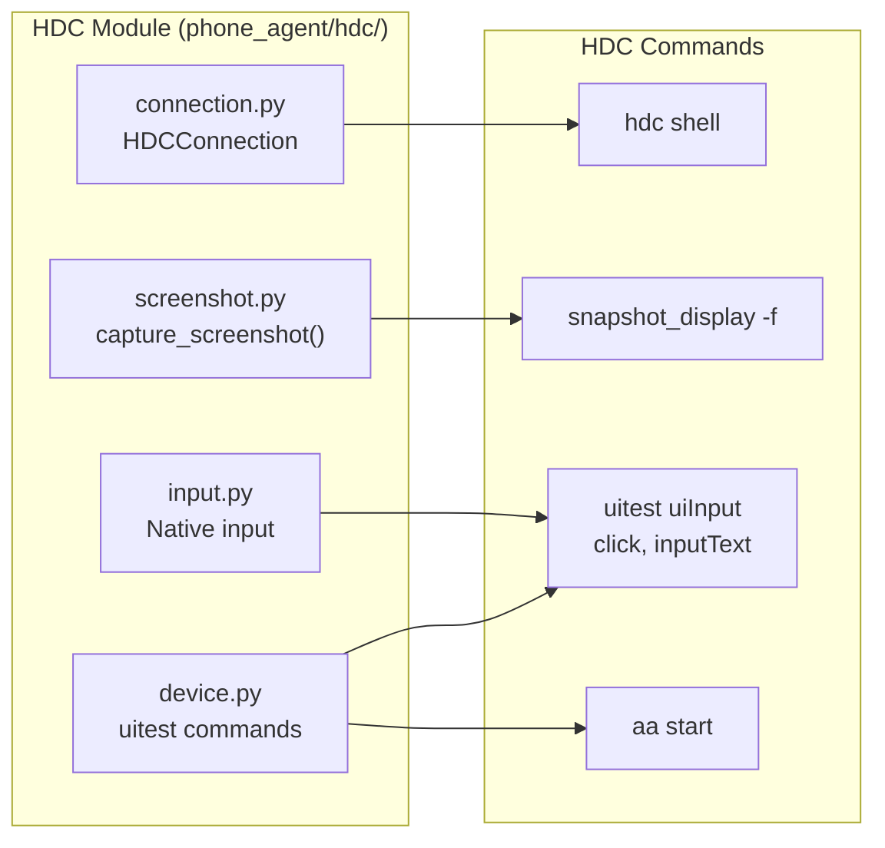

**Key characteristics:**
- Uses `hdc shell` for command execution
- Native input via `uitest uiInput` (no keyboard app needed) [phone_agent/hdc/input.py]()
- Screenshot via `snapshot_display` command [phone_agent/hdc/screenshot.py]()
- App launch via `aa start` (Ability Manager) [phone_agent/hdc/device.py]()

**Sources:** [phone_agent/hdc/]()

### iOS (WebDriverAgent)

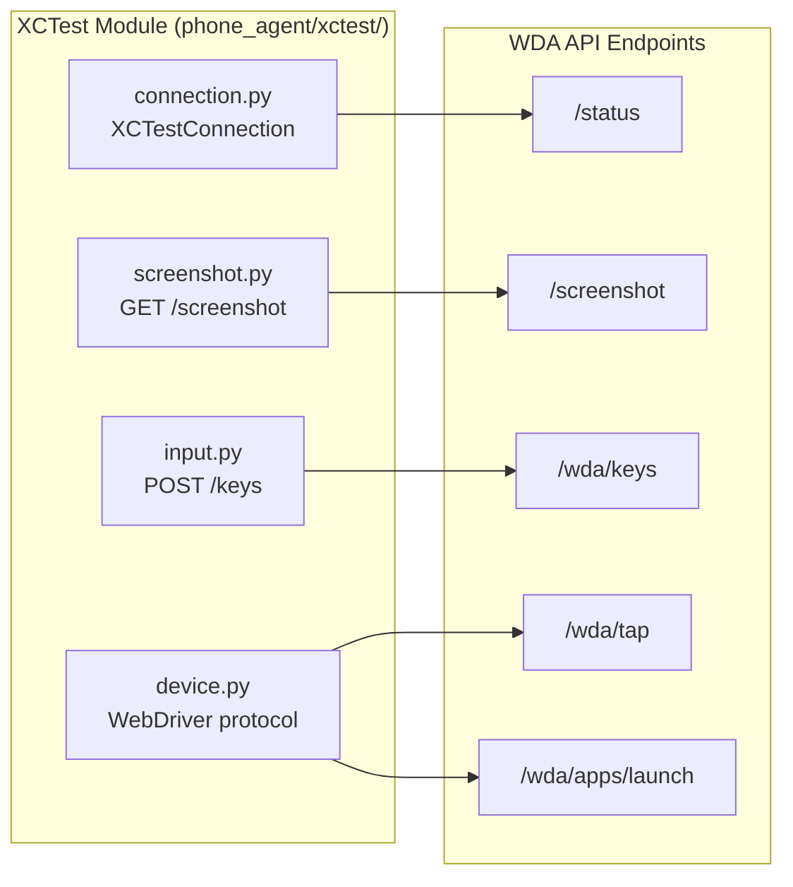

**Key characteristics:**
- Uses WebDriverAgent HTTP API (WebDriver protocol) [phone_agent/xctest/connection.py]()
- No external keyboard app needed (native iOS input) [phone_agent/xctest/input.py]()
- Screenshot via HTTP GET endpoint [phone_agent/xctest/screenshot.py]()
- Requires WebDriverAgent running on device [docs/ios_setup/]()

**Sources:** [phone_agent/xctest/](), [docs/ios_setup/ios_setup.md]()

## Action Handling Pipeline

The `ActionHandler` validates and executes actions through a multi-stage pipeline:

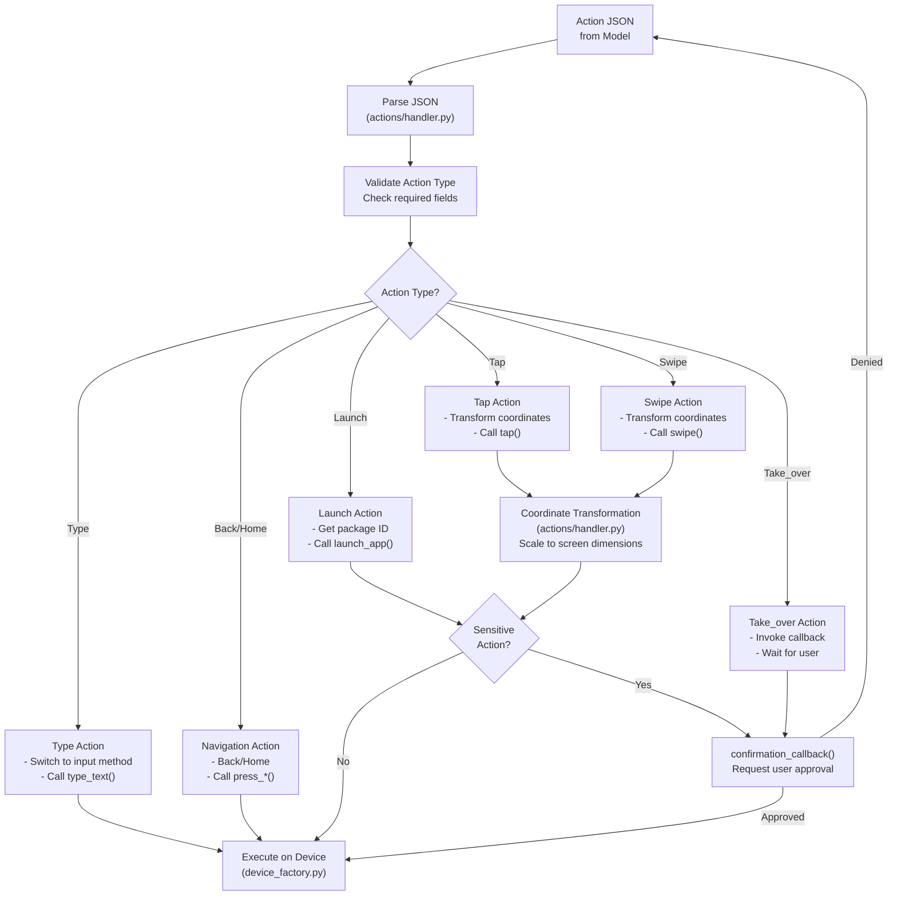

**Sources:** [phone_agent/actions/handler.py]()

### Coordinate Transformation

The model outputs coordinates in normalized space, which `ActionHandler` transforms to device-specific pixel coordinates:

```python
# Normalized coordinates (0-1000 range) from model
model_x, model_y = action["element"]

# Transform to actual screen pixels
screen_width, screen_height = get_screen_size()
actual_x = int((model_x / 1000.0) * screen_width)
actual_y = int((model_y / 1000.0) * screen_height)
```

**Sources:** [phone_agent/actions/handler.py]()

## Application Package Resolution

The system maintains platform-specific application mappings:

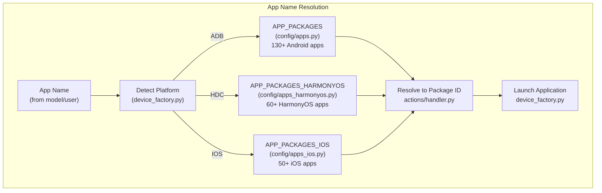

**Example mappings:**

| App Name | Android Package | HarmonyOS Bundle | iOS Bundle ID |
|----------|----------------|------------------|---------------|
| 微信 (WeChat) | `com.tencent.mm` | `com.tencent.wechat` | `com.tencent.xin` |
| 淘宝 (Taobao) | `com.taobao.taobao` | `com.taobao.taobao` | `com.taobao.taobao4iphone` |
| 抖音 (Douyin) | `com.ss.android.ugc.aweme` | `com.ss.android.ugc.aweme` | `com.ss.iphone.ugc.Aweme` |

**Sources:** [phone_agent/config/apps.py](), [phone_agent/config/apps_harmonyos.py](), [phone_agent/config/apps_ios.py](), [phone_agent/actions/handler.py]()

## System Prompt Architecture

System prompts guide the model's behavior and are language-specific:

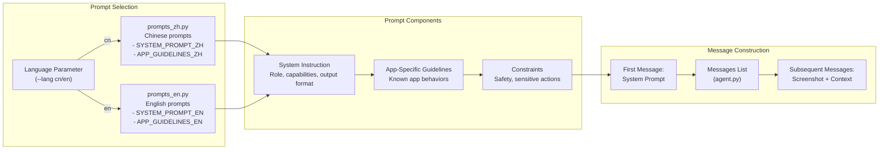

**Sources:** [phone_agent/config/prompts_zh.py](), [phone_agent/config/prompts_en.py](), [phone_agent/agent.py]()

## Model Integration Architecture

Open-AutoGLM uses OpenAI-compatible APIs for model interaction:

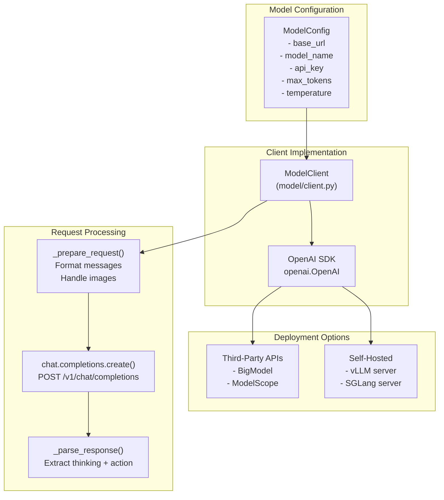

**API Request Format:**
```json
{
  "model": "autoglm-phone-9b",
  "messages": [
    {"role": "system", "content": "..."},
    {
      "role": "user",
      "content": [
        {"type": "text", "text": "Current app: com.example"},
        {"type": "image_url", "image_url": {"url": "data:image/jpeg;base64,..."}}
      ]
    }
  ],
  "max_tokens": 3000,
  "temperature": 0.1
}
```

**Sources:** [phone_agent/model/client.py](), [main.py:272-352]()

## Error Handling and Callbacks

The agent provides extension points for custom behavior:

| Callback | Signature | Purpose | Invoked By |
|----------|-----------|---------|------------|
| `confirmation_callback` | `(message: str) -> bool` | User approval for sensitive actions | `ActionHandler` |
| `takeover_callback` | `(message: str) -> None` | Manual intervention request | `ActionHandler` |

**Default Implementations:**
- `confirmation_callback`: CLI prompt with "yes/no" input [phone_agent/agent.py]()
- `takeover_callback`: CLI prompt to wait for user completion [phone_agent/agent.py]()

**Custom Implementation Example:**
```python
def custom_confirm(message: str) -> bool:
    # Custom logic (e.g., GUI dialog, logging)
    return user_approval

agent = PhoneAgent(
    confirmation_callback=custom_confirm,
    takeover_callback=custom_takeover
)
```

**Sources:** [phone_agent/agent.py](), [phone_agent/actions/handler.py](), [examples/basic_usage.py]()

## Threading and Concurrency

Open-AutoGLM follows a synchronous, single-threaded execution model:

- **No Concurrent Operations**: Each task executes sequentially in the main thread
- **Blocking API Calls**: Model requests block until response received
- **Sequential Device Commands**: Device operations execute one at a time
- **Stateful Message History**: Maintains conversation context across steps

This design prioritizes simplicity and predictability over throughput, suitable for interactive automation scenarios.

**Sources:** [phone_agent/agent.py](), [phone_agent/model/client.py]()

---

