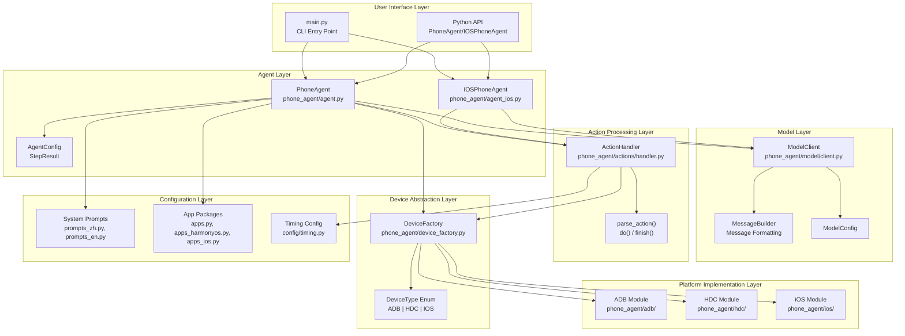
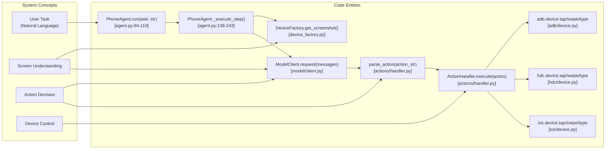
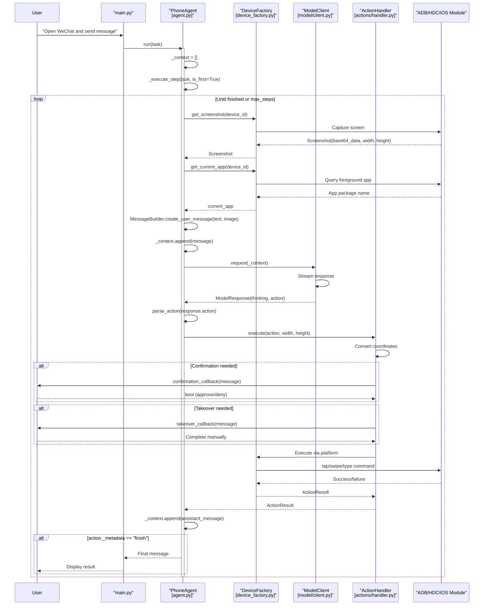
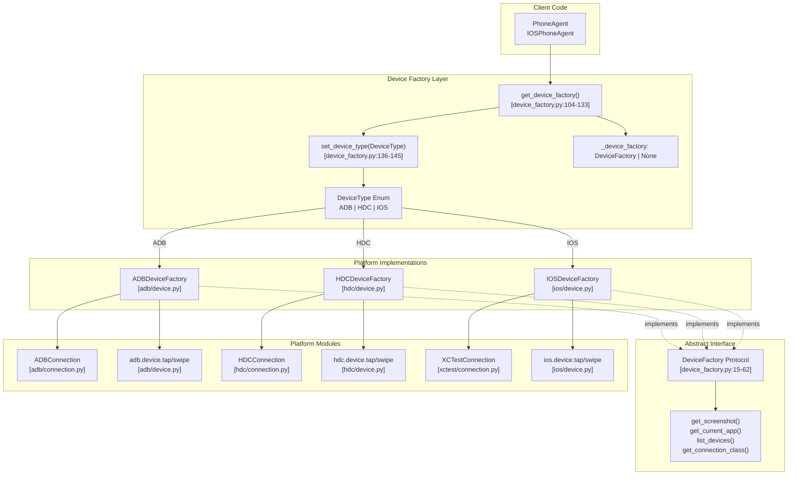
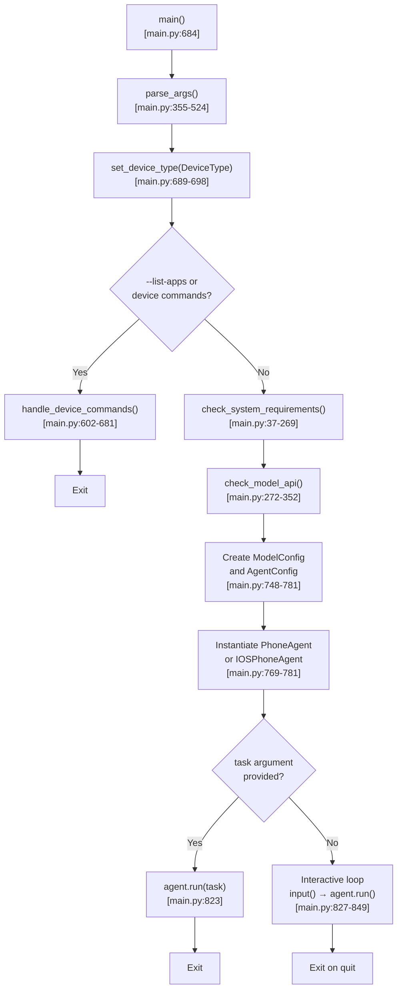

<!-- source: DeepWiki mcp.deepwiki.com · repo zai-org/Open-AutoGLM · page 3.1 System Overview · fetched 2026-10-29 -->

# System Overview

<details>
<summary>Relevant source files</summary>

The following files were used as context for generating this wiki page:

- [README.md](README.md)
- [README_coding_agent.md](README_coding_agent.md)
- [README_en.md](README_en.md)
- [main.py](main.py)
- [phone_agent/agent.py](phone_agent/agent.py)

</details>


## Purpose and Scope

This document provides a high-level architectural overview of the Open-AutoGLM Phone Agent system, describing the major components, their interactions, and the overall system design. It serves as a conceptual map for understanding how natural language commands are transformed into device actions through multiple processing layers.

For detailed information about specific components, see:
- Core component implementations: [Core Components](#3.2)
- Execution loop mechanics: [Agent Execution Loop](#3.3)
- AI model integration details: [AI Model Integration](#3.4)
- Device communication protocols: [Device Communication Layer](#3.5)

For usage instructions and practical examples, see:
- Command-line usage: [Command-Line Interface](#5.1)
- Programmatic usage: [Python API](#5.2)

---

## System Architecture

Open-AutoGLM implements a **layered architecture** that separates concerns across six distinct layers, enabling platform-agnostic phone automation through AI-powered decision making.

### Architecture Layers



**Sources:** [README.md:1-772](), [main.py:1-854](), [phone_agent/agent.py:1-254]()

### Component Responsibilities

| Layer | Primary Components | Responsibility |
|-------|-------------------|----------------|
| **User Interface** | `main.py`, `PhoneAgent`, `IOSPhoneAgent` | Accept user commands via CLI or API; parse arguments; initialize agent |
| **Agent** | `PhoneAgent`, `IOSPhoneAgent`, `AgentConfig` | Orchestrate task execution; manage conversation context; coordinate between model and actions |
| **Model** | `ModelClient`, `MessageBuilder`, `ModelConfig` | Communicate with AI model; build multimodal messages; stream and parse responses |
| **Action Processing** | `ActionHandler`, `parse_action()`, `do()`, `finish()` | Parse action strings; validate actions; execute via device abstraction; handle callbacks |
| **Device Abstraction** | `DeviceFactory`, `DeviceType` | Provide platform-agnostic interface; lazy-load platform modules; route operations |
| **Platform Implementation** | `adb/`, `hdc/`, `ios/` modules | Implement device-specific protocols; handle screenshots, input, app launching |
| **Configuration** | `prompts_*.py`, `apps*.py`, `timing.py` | Define system behavior; map app names to packages; configure timing parameters |

**Sources:** [phone_agent/agent.py:1-254](), [phone_agent/model/client.py](), [phone_agent/actions/handler.py](), [phone_agent/device_factory.py]()

---

## Core Component Mapping

The following diagram maps high-level system concepts to concrete code entities, bridging natural language descriptions to implementation details.



**Sources:** [phone_agent/agent.py:84-243](), [phone_agent/model/client.py](), [phone_agent/actions/handler.py](), [phone_agent/device_factory.py]()

### Key Classes and Their Roles

| Class | Location | Primary Responsibility | Key Methods |
|-------|----------|----------------------|-------------|
| `PhoneAgent` | [phone_agent/agent.py:42-254]() | Task orchestration and loop management | `run()`, `step()`, `_execute_step()` |
| `IOSPhoneAgent` | [phone_agent/agent_ios.py]() | iOS-specific task orchestration | `run()`, `step()` |
| `ModelClient` | [phone_agent/model/client.py]() | AI model communication | `request()`, stream handling |
| `MessageBuilder` | [phone_agent/model/client.py]() | Multimodal message construction | `create_user_message()`, `build_screen_info()` |
| `ActionHandler` | [phone_agent/actions/handler.py]() | Action execution and validation | `execute()`, coordinate conversion |
| `DeviceFactory` | [phone_agent/device_factory.py]() | Platform abstraction | `get_screenshot()`, `get_current_app()` |
| `AgentConfig` | [phone_agent/agent.py:16-29]() | Agent behavior configuration | `max_steps`, `device_id`, `lang` |
| `ModelConfig` | [phone_agent/model/__init__.py]() | Model connection configuration | `base_url`, `model_name`, `api_key` |

**Sources:** [phone_agent/agent.py:16-254](), [phone_agent/model/client.py](), [phone_agent/actions/handler.py]()

---

## Execution Flow

The system operates as a **perception-action loop** where each iteration captures device state, queries the AI model, and executes the resulting action.

### Task Execution Sequence



**Sources:** [phone_agent/agent.py:84-243](), [main.py:684-850]()

### Execution Loop Mechanics

The `PhoneAgent._execute_step()` method implements the core loop:

1. **State Capture** ([agent.py:143-145]()): Call `DeviceFactory.get_screenshot()` and `get_current_app()` to capture current device state
2. **Message Building** ([agent.py:149-169]()): Use `MessageBuilder` to construct multimodal messages with text and screenshot
3. **Model Inference** ([agent.py:172-177]()): Send messages to `ModelClient.request()` for AI reasoning
4. **Action Parsing** ([agent.py:190-196]()): Parse structured action from `<answer>` tag using `parse_action()`
5. **Action Execution** ([agent.py:208-217]()): Execute action via `ActionHandler.execute()` with coordinate conversion
6. **Context Update** ([agent.py:220-224]()): Append assistant response to conversation context
7. **Completion Check** ([agent.py:227]()): Check if `_metadata == "finish"` or `result.should_finish`

**Sources:** [phone_agent/agent.py:136-243]()

---

## Platform Abstraction Strategy

The system supports three device platforms through a **factory pattern** with lazy loading.

### Device Abstraction Architecture



**Sources:** [phone_agent/device_factory.py:1-145](), [phone_agent/adb/device.py](), [phone_agent/hdc/device.py](), [phone_agent/ios/device.py]()

### Factory Pattern Implementation

The abstraction is implemented through:

1. **DeviceType Enum** ([device_factory.py:10-13]()): Defines `ADB`, `HDC`, `IOS` types
2. **Protocol Definition** ([device_factory.py:15-62]()): `DeviceFactory` protocol specifies required methods
3. **Global Factory** ([device_factory.py:65-133]()): Singleton pattern via `_device_factory` module variable
4. **Lazy Loading** ([device_factory.py:104-133]()): Platform modules imported only when needed via `get_device_factory()`
5. **Type Setting** ([device_factory.py:136-145]()): `set_device_type()` configures platform at runtime

Each platform implementation provides:
- Connection management (`ADBConnection`, `HDCConnection`, `XCTestConnection`)
- Screenshot capture (`screenshot.py` in each module)
- Input methods (`input.py` for text entry)
- Device control (`device.py` for tap/swipe/launch operations)
- App configuration (`apps.py`, `apps_harmonyos.py`, `apps_ios.py`)

**Sources:** [phone_agent/device_factory.py:1-145](), [phone_agent/adb/](), [phone_agent/hdc/](), [phone_agent/ios/]()

---

## Configuration System

The system uses a **modular configuration architecture** with separate concerns for prompts, app mappings, and timing parameters.

### Configuration Components

| Configuration Type | Files | Purpose | Runtime Selection |
|-------------------|-------|---------|-------------------|
| **System Prompts** | `prompts_zh.py`, `prompts_en.py` | Define AI model instructions and action definitions | `get_system_prompt(lang)` [config/__init__.py]() |
| **App Packages** | `apps.py`, `apps_harmonyos.py`, `apps_ios.py` | Map natural language app names to package identifiers | Platform-specific module import |
| **Timing Parameters** | `timing.py` | Configure delays for actions, device operations, connections | `TIMING_CONFIG` singleton [config/timing.py]() |
| **UI Messages** | `i18n.py` | Localized user-facing strings | `get_messages(lang)` [config/i18n.py]() |

**Sources:** [phone_agent/config/prompts_zh.py](), [phone_agent/config/prompts_en.py](), [phone_agent/config/apps.py](), [phone_agent/config/timing.py]()

### Configuration Loading

Configuration is loaded at different stages:

1. **Agent Initialization** ([agent.py:26-28]()): System prompt loaded via `get_system_prompt(lang)` if not provided
2. **First Step** ([agent.py:149-150]()): System prompt added to context as first message
3. **Action Execution**: Timing config accessed via `TIMING_CONFIG` singleton
4. **App Name Resolution**: App packages imported based on device type (lazy loading)

**Sources:** [phone_agent/agent.py:26-28](), [phone_agent/config/__init__.py](), [phone_agent/config/timing.py]()

---

## Entry Points and Usage Modes

The system provides two primary entry points for different usage scenarios.

### Entry Point Comparison

| Entry Point | Location | Use Case | Initialization |
|-------------|----------|----------|----------------|
| **CLI** | [main.py:684-853]() | Command-line usage, interactive mode, system checks | Parse args → check requirements → create Agent → run/loop |
| **Python API** | `from phone_agent import PhoneAgent` | Programmatic integration, custom workflows | Direct instantiation with config objects |

### CLI Entry Point Flow



**Sources:** [main.py:684-853](), [main.py:355-524](), [main.py:37-352]()

### Python API Usage Pattern

Direct instantiation allows custom configuration and integration:

```python
# Typical usage pattern
model_config = ModelConfig(base_url, model_name, api_key)
agent_config = AgentConfig(max_steps, device_id, lang)
agent = PhoneAgent(model_config, agent_config, callbacks...)
result = agent.run("task description")
```

The `PhoneAgent.__init__()` ([agent.py:64-82]()) creates:
- `ModelClient` for AI communication
- `ActionHandler` for action execution
- Internal state (`_context`, `_step_count`)

**Sources:** [phone_agent/agent.py:64-82](), [README.md:328-344]()

---

## Design Patterns

The system employs several key design patterns:

| Pattern | Implementation | Benefit |
|---------|----------------|---------|
| **Factory Pattern** | `DeviceFactory` with `get_device_factory()` | Platform abstraction, lazy loading |
| **Singleton Pattern** | `_device_factory` global variable | Single device factory per process |
| **Strategy Pattern** | Platform-specific modules (adb, hdc, ios) | Interchangeable device control implementations |
| **Builder Pattern** | `MessageBuilder` for constructing messages | Consistent multimodal message creation |
| **Callback Pattern** | `confirmation_callback`, `takeover_callback` | User intervention for sensitive operations |

**Sources:** [phone_agent/device_factory.py:65-145](), [phone_agent/model/client.py](), [phone_agent/actions/handler.py]()

---

