<!-- source: DeepWiki mcp.deepwiki.com · repo zai-org/Open-AutoGLM · page 3.2 Core Components · fetched 2026-10-29 -->

# Core Components

<details>
<summary>Relevant source files</summary>

The following files were used as context for generating this wiki page:

- [phone_agent/actions/handler.py](phone_agent/actions/handler.py)
- [phone_agent/agent.py](phone_agent/agent.py)
- [phone_agent/device_factory.py](phone_agent/device_factory.py)
- [phone_agent/model/client.py](phone_agent/model/client.py)
- [scripts/check_deployment_cn.py](scripts/check_deployment_cn.py)
- [scripts/sample_messages.json](scripts/sample_messages.json)

</details>


## Purpose and Scope

This document provides detailed technical documentation for the five core components that constitute the Open-AutoGLM framework:

| Component | Module | Purpose |
|-----------|--------|---------|
| **PhoneAgent** | `phone_agent.agent` | Orchestrates task execution, manages conversation context, coordinates all subsystems |
| **IOSPhoneAgent** | `phone_agent.agent_ios` | iOS-specific variant using WebDriverAgent instead of ADB/HDC |
| **ModelClient** | `phone_agent.model.client` | Communicates with AI models via OpenAI-compatible API, handles streaming inference |
| **ActionHandler** | `phone_agent.actions.handler` | Parses model responses, dispatches actions to device layer, manages callbacks |
| **DeviceFactory** | `phone_agent.device_factory` | Abstracts device operations across Android/HarmonyOS/iOS platforms |

For system-level architecture and component interactions, see [System Overview](#3.1). For the agent execution loop details, see [Agent Execution Loop](#3.3). For AI model integration patterns, see [AI Model Integration](#3.4).

**Sources:** [phone_agent/__init__.py:1-12](), [phone_agent/agent.py:1-254](), [phone_agent/model/client.py:1-291](), [phone_agent/actions/handler.py:1-400](), [phone_agent/device_factory.py:1-168]()

## Component Interaction Overview

The following diagram illustrates how the five core components interact during task execution:

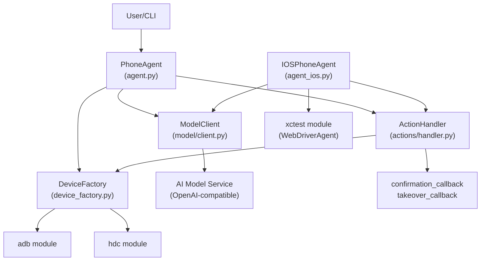

**Sources:** [phone_agent/agent.py:42-254](), [phone_agent/model/client.py:41-217](), [phone_agent/actions/handler.py:24-330](), [phone_agent/device_factory.py:15-168]()

## PhoneAgent

`PhoneAgent` is the primary orchestrator class for Android and HarmonyOS automation tasks. It manages the perception-action loop, maintains conversation context, and coordinates all subsystems.

### Class Structure

```python
class PhoneAgent:
    def __init__(
        self,
        model_config: ModelConfig | None = None,
        agent_config: AgentConfig | None = None,
        confirmation_callback: Callable[[str], bool] | None = None,
        takeover_callback: Callable[[str], None] | None = None,
    )
```

**Key Attributes:**
- `model_client`: `ModelClient` instance for AI inference
- `action_handler`: `ActionHandler` instance for executing actions
- `model_config`: Configuration for AI model (base URL, API key, model name)
- `agent_config`: Configuration for agent behavior (max steps, language, device ID)
- `_context`: List of conversation messages in OpenAI format
- `_step_count`: Current execution step counter

**Sources:** [phone_agent/agent.py:42-82]()

### Configuration Objects

Two configuration dataclasses control agent behavior:

```python
@dataclass
class ModelConfig:
    base_url: str = "http://localhost:8000/v1"
    api_key: str = "EMPTY"
    model_name: str = "autoglm-phone-9b"
    max_tokens: int = 3000
    temperature: float = 0.0
    top_p: float = 0.85
    frequency_penalty: float = 0.2
    extra_body: dict[str, Any] = field(default_factory=dict)
    lang: str = "cn"  # 'cn' or 'en'

@dataclass
class AgentConfig:
    max_steps: int = 100
    device_id: str | None = None
    lang: str = "cn"
    system_prompt: str | None = None
    verbose: bool = True
```

**Sources:** [phone_agent/model/client.py:14-26](), [phone_agent/agent.py:17-29]()

### Core Methods

| Method | Signature | Purpose |
|--------|-----------|---------|
| `run(task: str)` | → `str` | Execute complete task until finished or max steps reached |
| `step(task: str \| None)` | → `StepResult` | Execute single agent step; useful for debugging/manual control |
| `reset()` | → `None` | Clear context and step count for new task |
| `context` | property → `list[dict]` | Get current conversation history |
| `step_count` | property → `int` | Get current step number |

**Sources:** [phone_agent/agent.py:84-253]()

### Task Execution Flow

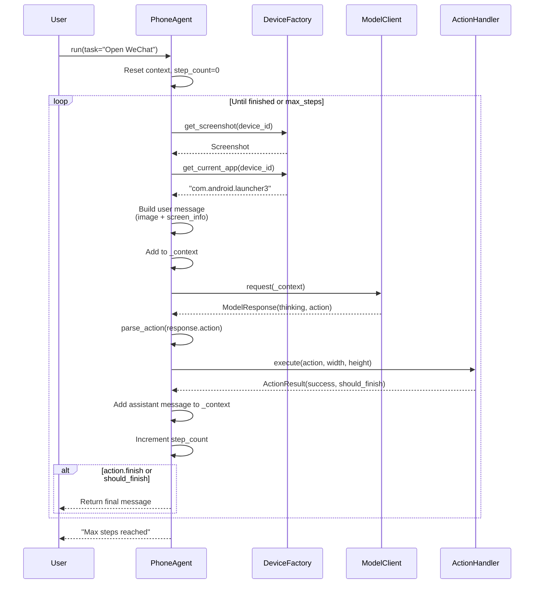

**Sources:** [phone_agent/agent.py:84-243]()

### Context Management

`PhoneAgent` maintains conversation history in OpenAI message format:

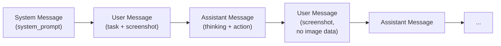

After each step, images are removed from previous user messages to conserve context window space (see [phone_agent/agent.py:205]()). This allows the agent to maintain longer interaction histories without exceeding token limits.

**Sources:** [phone_agent/agent.py:136-224](), [phone_agent/model/client.py:261-275]()

## IOSPhoneAgent

`IOSPhoneAgent` is a specialized variant for iOS automation that uses WebDriverAgent instead of ADB/HDC. It maintains API compatibility with `PhoneAgent` for task execution but uses different device communication mechanisms internally.

### Key Differences

| Aspect | PhoneAgent | IOSPhoneAgent |
|--------|------------|---------------|
| **Device Layer** | `DeviceFactory` with `adb`/`hdc` modules | Direct `xctest` module imports |
| **Protocol** | Shell commands via ADB/HDC | HTTP requests to WebDriverAgent |
| **Connection** | USB/TCP via debug bridges | USB with XCTest session |
| **Screen Capture** | `adb screencap` / `hdc shell snapshot` | WebDriverAgent screenshot endpoint |
| **Input Methods** | Native shell input commands | XCTest touch/keyboard APIs |

Despite these differences, both agent classes expose identical `run()` and `step()` methods, allowing users to write platform-independent automation scripts at the API level.

**Sources:** [phone_agent/__init__.py:9]()

## ModelClient

`ModelClient` handles all communication with vision-language models via OpenAI-compatible APIs. It supports streaming inference, response parsing, and performance metrics tracking.

### Class Structure

```python
class ModelClient:
    def __init__(self, config: ModelConfig | None = None):
        self.config = config or ModelConfig()
        self.client = OpenAI(base_url=self.config.base_url, api_key=self.config.api_key)
    
    def request(self, messages: list[dict[str, Any]]) -> ModelResponse:
        # Sends streaming request, parses response
```

**Sources:** [phone_agent/model/client.py:41-217]()

### Response Parsing

The client extracts thinking and action components from model output using marker-based parsing:

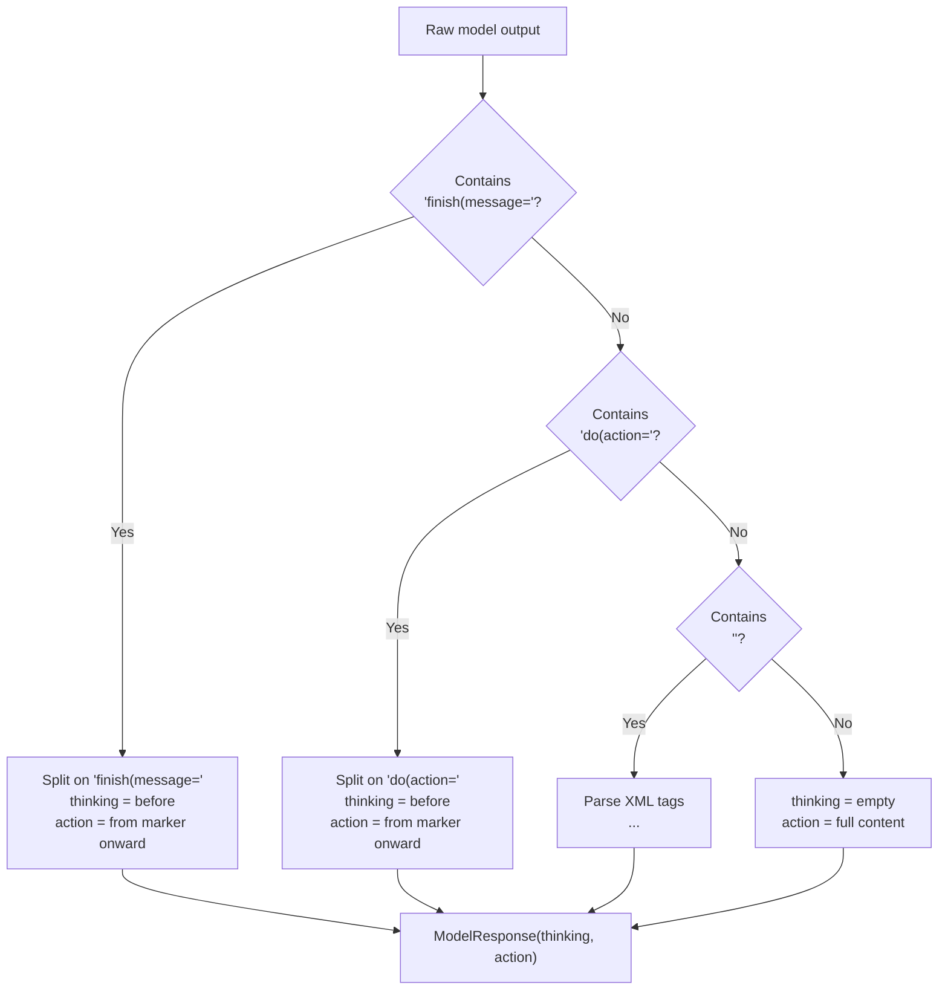

**Sources:** [phone_agent/model/client.py:176-216]()

### Streaming Display

During inference, the client streams thinking content to stdout in real-time while buffering action content:

1. Accumulate tokens in `buffer`
2. Check if any action marker (`finish(message=`, `do(action=`) is present
3. If marker found, print thinking portion and enter action phase
4. If no marker, check for partial marker prefix at buffer end
5. Print buffer only when safe (no potential marker)

This provides live feedback to users while ensuring actions aren't prematurely displayed.

**Sources:** [phone_agent/model/client.py:82-174]()

### ModelResponse Dataclass

```python
@dataclass
class ModelResponse:
    thinking: str                         # Model's reasoning process
    action: str                          # Generated action string
    raw_content: str                     # Full unprocessed response
    time_to_first_token: float | None   # TTFT in seconds
    time_to_thinking_end: float | None  # Time to complete thinking
    total_time: float | None            # Total inference time
```

Performance metrics are calculated during streaming and displayed after each inference.

**Sources:** [phone_agent/model/client.py:28-39](), [phone_agent/model/client.py:148-174]()

### MessageBuilder Helper

The `MessageBuilder` class provides static methods for constructing OpenAI-format messages:

```python
class MessageBuilder:
    @staticmethod
    def create_system_message(content: str) -> dict[str, Any]
    
    @staticmethod
    def create_user_message(text: str, image_base64: str | None = None) -> dict[str, Any]
    
    @staticmethod
    def create_assistant_message(content: str) -> dict[str, Any]
    
    @staticmethod
    def remove_images_from_message(message: dict[str, Any]) -> dict[str, Any]
    
    @staticmethod
    def build_screen_info(current_app: str, **extra_info) -> str
```

These methods standardize message creation and ensure proper multimodal content structure (images + text).

**Sources:** [phone_agent/model/client.py:219-291]()

## ActionHandler

`ActionHandler` translates AI model outputs into executable device operations. It parses action strings, validates parameters, converts coordinates, invokes user callbacks, and dispatches to the device layer.

### Class Structure

```python
class ActionHandler:
    def __init__(
        self,
        device_id: str | None = None,
        confirmation_callback: Callable[[str], bool] | None = None,
        takeover_callback: Callable[[str], None] | None = None,
    ):
        self.device_id = device_id
        self.confirmation_callback = confirmation_callback or self._default_confirmation
        self.takeover_callback = takeover_callback or self._default_takeover
    
    def execute(
        self, action: dict[str, Any], screen_width: int, screen_height: int
    ) -> ActionResult
```

**Sources:** [phone_agent/actions/handler.py:24-88]()

### ActionResult Dataclass

```python
@dataclass
class ActionResult:
    success: bool                    # Whether action executed successfully
    should_finish: bool              # Whether to terminate task
    message: str | None = None       # Optional result/error message
    requires_confirmation: bool = False  # (not currently used)
```

**Sources:** [phone_agent/actions/handler.py:14-22]()

### Action Dispatch Mechanism

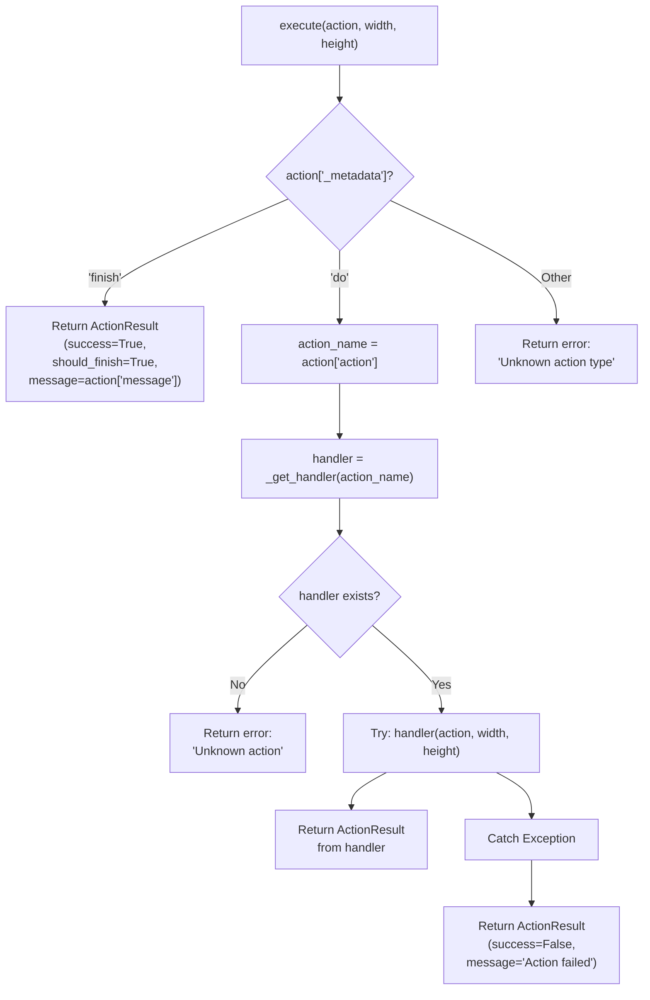

The handler registry maps action names to methods:

```python
handlers = {
    "Launch": self._handle_launch,
    "Tap": self._handle_tap,
    "Type": self._handle_type,
    "Type_Name": self._handle_type,
    "Swipe": self._handle_swipe,
    "Back": self._handle_back,
    "Home": self._handle_home,
    "Double Tap": self._handle_double_tap,
    "Long Press": self._handle_long_press,
    "Wait": self._handle_wait,
    "Take_over": self._handle_takeover,
    "Note": self._handle_note,
    "Call_API": self._handle_call_api,
    "Interact": self._handle_interact,
}
```

**Sources:** [phone_agent/actions/handler.py:45-108]()

### Coordinate Conversion

Actions specify coordinates in a normalized 0-1000 space, which are converted to absolute pixels:

```python
def _convert_relative_to_absolute(
    self, element: list[int], screen_width: int, screen_height: int
) -> tuple[int, int]:
    """Convert relative coordinates (0-1000) to absolute pixels."""
    x = int(element[0] / 1000 * screen_width)
    y = int(element[1] / 1000 * screen_height)
    return x, y
```

This normalization allows the AI model to work with consistent coordinates regardless of device resolution.

**Sources:** [phone_agent/actions/handler.py:110-116]()

### Callback Integration

The handler supports two user-defined callbacks:

| Callback | Trigger | Return Type | Purpose |
|----------|---------|-------------|---------|
| `confirmation_callback` | Tap action with `message` field | `bool` | Confirm sensitive operations (e.g., "Confirm payment?") |
| `takeover_callback` | `Take_over` action | `None` | Pause for manual intervention (e.g., login, CAPTCHA) |

Default implementations use console `input()` for CLI interaction. Custom callbacks enable GUI integrations or automated approval logic.

**Sources:** [phone_agent/actions/handler.py:35-43](), [phone_agent/actions/handler.py:139-146](), [phone_agent/actions/handler.py:235-239](), [phone_agent/actions/handler.py:320-329]()

### Action Parsing

The `parse_action()` function converts model output strings into action dictionaries:

```mermaid
flowchart TD
    Start["parse_action(response)"] --> Strip["response = response.strip()"]
    
    Strip --> CheckType{"Check action type"}
    
    CheckType -->|"Starts with 'do(action=\"Type\"'"| TypeSpecial["Extract text from string<br/>Return {'_metadata': 'do',<br/>'action': 'Type',<br/>'text': extracted_text}"]
    
    CheckType -->|"Starts with 'do'"| ParseAST["Parse with ast.parse()<br/>Extract keyword arguments<br/>Return {'_metadata': 'do',<br/>...keyword args}"]
    
    CheckType -->|"Starts with 'finish'"| ParseFinish["Extract message string<br/>Return {'_metadata': 'finish',<br/>'message': extracted_message}"]
    
    CheckType -->|Other| Error["raise ValueError"]
    
    ParseAST --> CheckSyntax{"Valid syntax?"}
    CheckSyntax -->|Yes| Return["Return action dict"]
    CheckSyntax -->|No| Error
```

AST parsing is used instead of `eval()` for security. Special handling for `Type` actions accommodates newlines and special characters in text content.

**Sources:** [phone_agent/actions/handler.py:332-388]()

### Type Action Implementation

The `Type` action has special handling for keyboard switching and text input:

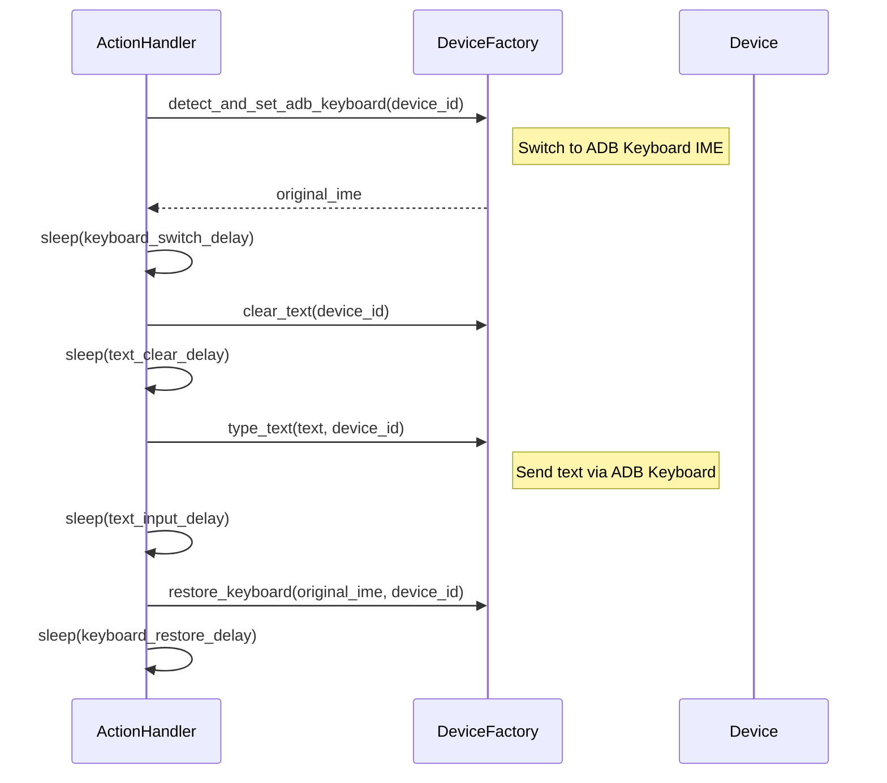

This sequence ensures reliable text input by using ADB Keyboard (Android) or native input methods (HarmonyOS), with configurable timing delays from `TIMING_CONFIG`.

**Sources:** [phone_agent/actions/handler.py:151-173]()

## DeviceFactory Pattern

The `DeviceFactory` class provides a unified abstraction layer that enables the same agent logic to work across multiple mobile platforms. This factory pattern isolates platform-specific device communication code from the core agent logic.

### Class Structure

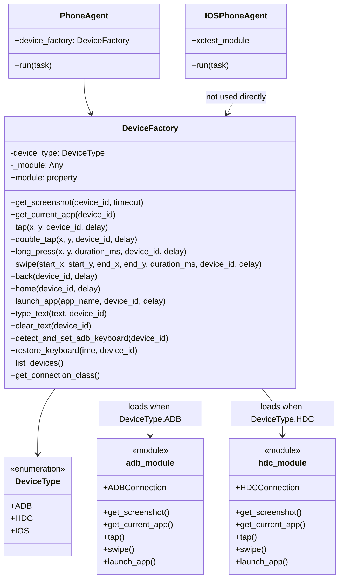

**Sources:** [phone_agent/device_factory.py:1-168]()

### DeviceType Enumeration

The `DeviceType` enum defines the supported device platforms:

```python
class DeviceType(Enum):
    ADB = "adb"      # Android devices via Android Debug Bridge
    HDC = "hdc"      # HarmonyOS devices via HarmonyOS Debug Client  
    IOS = "ios"      # iOS devices via WebDriverAgent
```

This enum is used to configure the `DeviceFactory` at initialization and determines which platform-specific module gets loaded. See [phone_agent/device_factory.py:7-12]().

**Sources:** [phone_agent/device_factory.py:7-12]()

### Factory Method Resolution

The `DeviceFactory` uses lazy module loading to import platform-specific implementations only when needed:

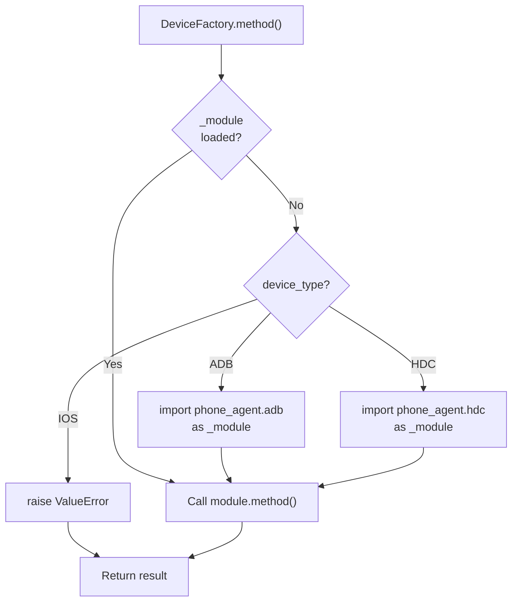

The lazy loading mechanism is implemented in the `module` property at [phone_agent/device_factory.py:32-46](). Each method call on `DeviceFactory` (e.g., `tap()`, `swipe()`) delegates to the corresponding method in the loaded module, as shown in methods like [phone_agent/device_factory.py:56-60]().

**Sources:** [phone_agent/device_factory.py:32-46](), [phone_agent/device_factory.py:48-123]()

### Supported Operations

The `DeviceFactory` exposes a comprehensive set of device operations:

| Category | Methods | Description |
|----------|---------|-------------|
| **Observation** | `get_screenshot()`, `get_current_app()` | Capture device state |
| **Touch Input** | `tap()`, `double_tap()`, `long_press()`, `swipe()` | Simulate touch gestures |
| **Navigation** | `back()`, `home()`, `launch_app()` | Navigate device UI |
| **Text Input** | `type_text()`, `clear_text()` | Enter and manage text |
| **Keyboard** | `detect_and_set_adb_keyboard()`, `restore_keyboard()` | Manage input methods (Android/HarmonyOS) |
| **Device Management** | `list_devices()`, `get_connection_class()` | Enumerate and connect to devices |

All operations accept optional `device_id` and `delay` parameters to support multi-device scenarios and action timing control.

**Sources:** [phone_agent/device_factory.py:48-140]()

## Global Factory Instance

The framework maintains a global `DeviceFactory` instance that can be configured at runtime:

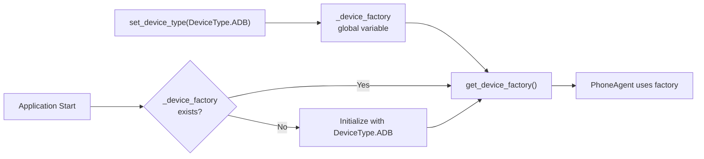

The global instance management is implemented in [phone_agent/device_factory.py:142-167]():

- **`_device_factory`**: Module-level variable storing the singleton instance
- **`set_device_type(device_type)`**: Configure the global factory with a specific device type
- **`get_device_factory()`**: Retrieve the global factory, creating it with `DeviceType.ADB` as default if not already initialized

This pattern allows agent classes and other components to access a consistent device factory without explicit dependency injection.

**Sources:** [phone_agent/device_factory.py:142-167]()

## Component Initialization Sequence

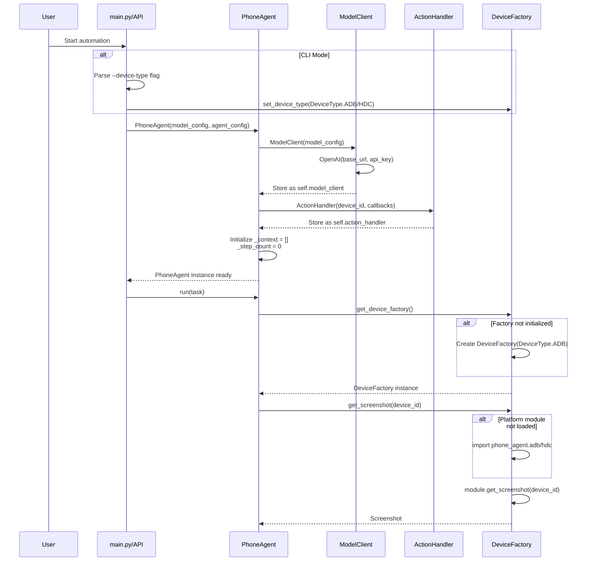

**Key initialization steps:**
1. Device type configuration (CLI or API)
2. `PhoneAgent` construction with configs
3. `ModelClient` instantiation with OpenAI client
4. `ActionHandler` creation with callback functions
5. Global `DeviceFactory` retrieval (lazy creation)
6. Platform module import on first device operation

**Sources:** [phone_agent/agent.py:64-82](), [phone_agent/model/client.py:49-51](), [phone_agent/actions/handler.py:35-43](), [phone_agent/device_factory.py:146-167]()

## Design Principles

The core component architecture embodies several design principles:

| Principle | Implementation | Benefit |
|-----------|---------------|---------|
| **Single Responsibility** | Each component has one primary function | Clear code organization; easier testing and maintenance |
| **Dependency Injection** | Configs and callbacks passed to constructors | Flexible configuration; testability without mocks |
| **Platform Abstraction** | `DeviceFactory` with `DeviceType` enum | Agent logic works across platforms without platform-specific code |
| **Lazy Loading** | Platform modules imported on first use | Fast startup; run without installing all platform tools |
| **Streaming Processing** | `ModelClient` streams tokens, prints thinking in real-time | Better user experience; no waiting for full response |
| **Coordinate Normalization** | Actions use 0-1000 space, converted to pixels | Model works with consistent coordinates across device resolutions |
| **Safe Parsing** | `ast.parse()` instead of `eval()` | Security: no arbitrary code execution from model output |

**Sources:** [phone_agent/agent.py:42-82](), [phone_agent/model/client.py:82-141](), [phone_agent/actions/handler.py:110-116](), [phone_agent/actions/handler.py:356-376](), [phone_agent/device_factory.py:32-46]()

## Component Dependencies

The following diagram shows import dependencies between core components:

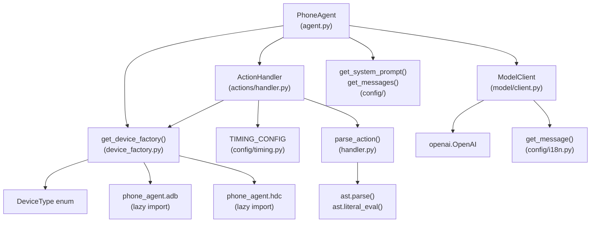

All core components are imported and instantiated by `PhoneAgent` during initialization. The device factory uses lazy loading to defer platform-specific imports until first device operation.

**Sources:** [phone_agent/agent.py:1-14](), [phone_agent/actions/handler.py:1-11](), [phone_agent/model/client.py:1-10](), [phone_agent/device_factory.py:1-46]()

## Configuration Integration

The core components integrate with the framework's configuration system:

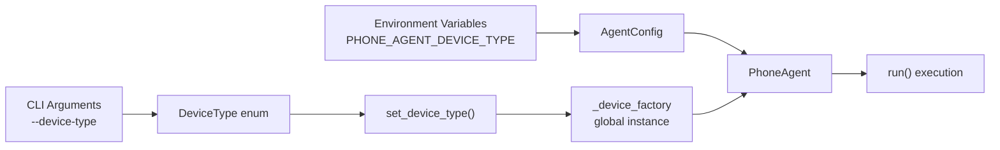

Device type can be configured via:
- Environment variable `PHONE_AGENT_DEVICE_TYPE` (read by configuration layer)
- CLI argument `--device-type adb|hdc` (parsed by [main.py]())
- Direct API call to `set_device_type()` in Python scripts

For comprehensive configuration options, see [Configuration Management](#5.4).

**Sources:** [phone_agent/device_factory.py:146-154]()

---

