<!-- source: DeepWiki mcp.deepwiki.com · repo zai-org/Open-AutoGLM · page 3.3 Agent Execution Loop · fetched 2026-10-29 -->

# Agent Execution Loop

<details>
<summary>Relevant source files</summary>

The following files were used as context for generating this wiki page:

- [README_coding_agent.md](README_coding_agent.md)
- [README_en.md](README_en.md)
- [phone_agent/actions/handler.py](phone_agent/actions/handler.py)
- [phone_agent/agent.py](phone_agent/agent.py)

</details>


This page explains the core execution loop that powers task automation in Open-AutoGLM. The loop implements the observe-think-act cycle where the agent repeatedly captures the device screen, reasons about the next action using an AI model, and executes that action until the task is complete.

For information about the AI model integration specifically, see [AI Model Integration](#3.4). For details on how actions are executed, see [ActionHandler Architecture](#6.2). For configuration of loop parameters, see [Agent Configuration](#7).

## Loop Architecture

The agent execution loop is implemented in the `PhoneAgent` class and follows a cyclic pattern of observation, reasoning, and action. Each iteration captures the current device state, sends it to a vision-language model for decision-making, parses the model's response, and executes the resulting action.

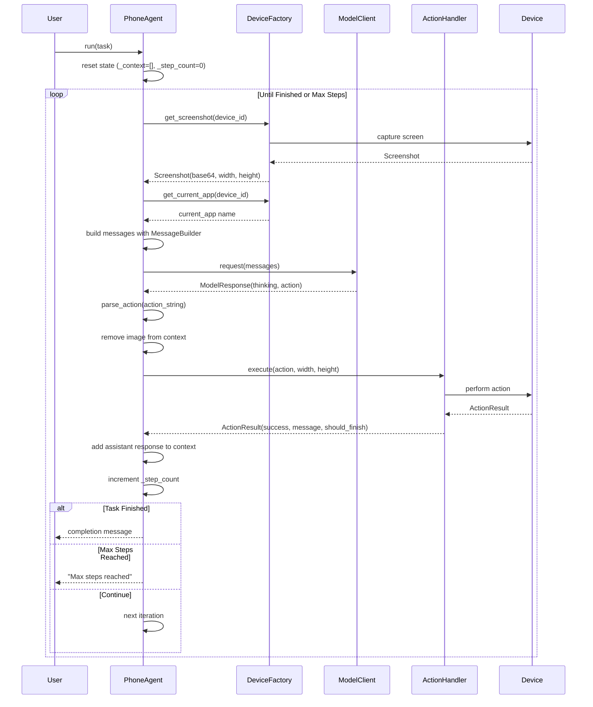

Sources: [phone_agent/agent.py:84-110](), [phone_agent/agent.py:136-243]()

## Loop Entry Point

The primary entry point for the execution loop is the `run()` method, which initializes the agent state and begins the iterative process.

### Initialization Sequence

When `run(task)` is called, the following initialization occurs:

1. **State Reset**: Context and step count are cleared
2. **First Step Execution**: Initial step with user task prompt
3. **Early Exit Check**: If task completes in first step, return immediately
4. **Loop Continuation**: Otherwise, enter main execution loop

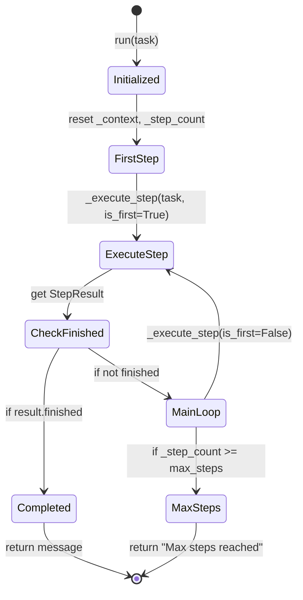

**Key Method**: The `run()` method orchestrates this flow:

| Line Range | Responsibility |
|------------|---------------|
| [phone_agent/agent.py:94-95]() | Reset context and step count |
| [phone_agent/agent.py:98]() | Execute first step with user task |
| [phone_agent/agent.py:100-101]() | Early return if task completes immediately |
| [phone_agent/agent.py:104-108]() | Main loop until finished or max steps |

Sources: [phone_agent/agent.py:84-110]()

## Core Loop Iteration

Each iteration of the loop follows a consistent pattern implemented in the `_execute_step()` method. The method takes an optional user prompt (only used on first step) and the `is_first` flag to control initialization behavior.

### Observation Phase

The agent captures the current state of the device:

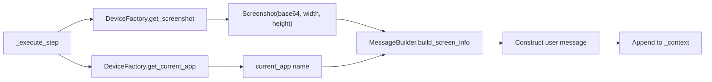

**Implementation Details**:

| Component | Location | Purpose |
|-----------|----------|---------|
| `get_device_factory()` | [phone_agent/agent.py:143]() | Retrieves device interface |
| `get_screenshot()` | [phone_agent/agent.py:144]() | Captures screen as base64 image |
| `get_current_app()` | [phone_agent/agent.py:145]() | Identifies foreground application |
| `build_screen_info()` | [phone_agent/model/client.py:278-290]() | Constructs JSON screen metadata |

For the first step, the system prompt and user task are included:

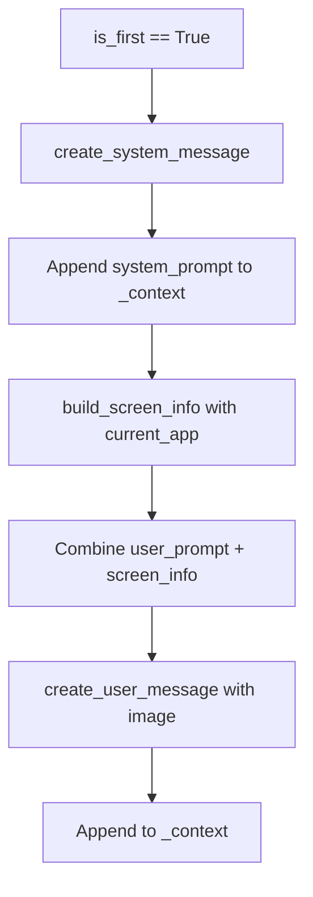

For subsequent steps, only screen info is provided:

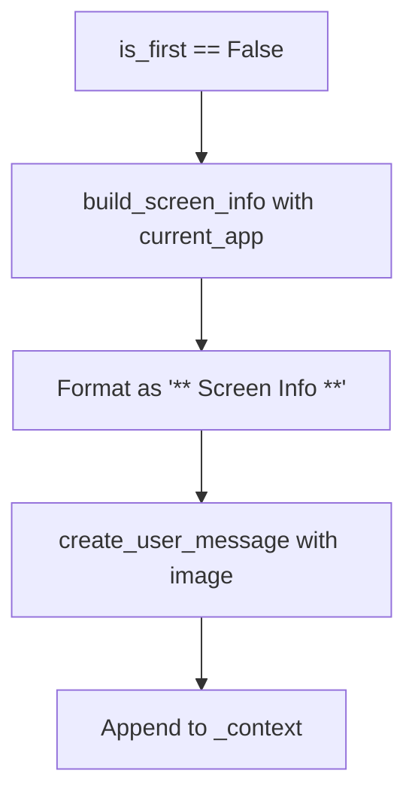

Sources: [phone_agent/agent.py:142-169](), [phone_agent/model/client.py:228-253](), [phone_agent/model/client.py:278-290]()

### Reasoning Phase

The agent sends the accumulated context to the AI model for decision-making:

**Request Flow**:

| Step | Code Location | Description |
|------|---------------|-------------|
| 1. Get localized messages | [phone_agent/agent.py:173]() | Retrieve UI strings for current language |
| 2. Print thinking header | [phone_agent/agent.py:174-176]() | Display visual separator and "Thinking" label |
| 3. Send model request | [phone_agent/agent.py:177]() | `ModelClient.request(_context)` |
| 4. Stream response | [phone_agent/model/client.py:71-141]() | Stream tokens and detect thinking/action boundary |
| 5. Parse response | [phone_agent/model/client.py:176-216]() | Extract thinking and action from response |
| 6. Return response | [phone_agent/model/client.py:167-174]() | Package as `ModelResponse` with metrics |

**Error Handling**: If model request fails, the loop catches the exception and returns a `StepResult` with `finished=True` and error message:

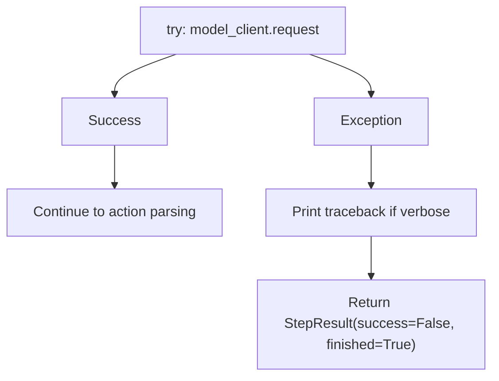

Sources: [phone_agent/agent.py:172-187](), [phone_agent/model/client.py:53-174]()

### Action Phase

The agent parses the model's response and executes the determined action:

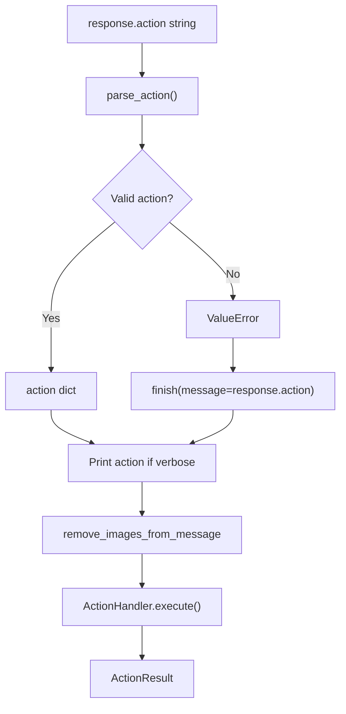

**Parsing Logic**: The `parse_action()` function recognizes two formats:

| Format | Example | Handler |
|--------|---------|---------|
| Function call | `do(action="Tap", element=[100, 200])` | [phone_agent/actions/handler.py:36-98]() |
| JSON dict | `{"action": "Tap", "element": [100, 200]}` | [phone_agent/actions/handler.py:100-120]() |

**Context Optimization**: Before action execution, images are removed from the last message to save memory:

```python
self._context[-1] = MessageBuilder.remove_images_from_message(self._context[-1])
```

This keeps only text content while preserving conversation history.

**Action Execution**: The `ActionHandler.execute()` method translates the parsed action into device commands. If execution fails, the agent wraps the error in a `finish()` action:

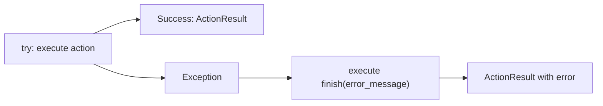

Sources: [phone_agent/agent.py:190-218](), [phone_agent/actions/handler.py:36-120](), [phone_agent/model/client.py:261-275]()

### Context Update

After action execution, the agent updates the conversation context with the model's response:

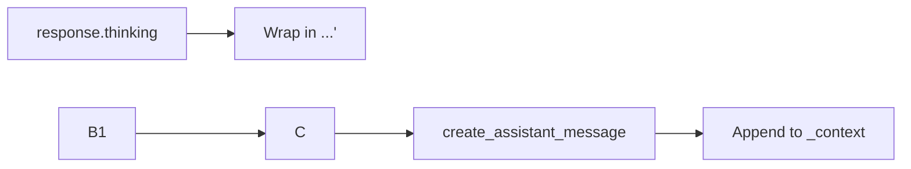

This preserves the full reasoning trace for future iterations, allowing the model to reference previous decisions.

**Context Structure Example**:

```json
[
  {"role": "system", "content": "You are a phone automation assistant..."},
  {"role": "user", "content": [{"type": "text", "text": "Open WeChat..."}, {"type": "image_url", "image_url": {...}}]},
  {"role": "assistant", "content": "<answer>do(action=\"Launch\", app=\"WeChat\")</answer>"},
  {"role": "user", "content": [{"type": "text", "text": "** Screen Info **\n{\"current_app\": \"WeChat\"}"}]},
  ...
]
```

Sources: [phone_agent/agent.py:220-224]()

## State Management

The `PhoneAgent` maintains two critical state variables throughout the execution loop:

### Internal State Variables

| Variable | Type | Purpose | Initialization | Update Location |
|----------|------|---------|----------------|-----------------|
| `_context` | `list[dict]` | Conversation history with model | `[]` in `run()` | [phone_agent/agent.py:149-168](), [phone_agent/agent.py:220-224]() |
| `_step_count` | `int` | Current iteration number | `0` in `run()` | [phone_agent/agent.py:140]() |

### Context Management Strategy

The context list grows with each iteration but uses optimization strategies:

1. **Image Removal**: After model processes each screenshot, the base64 image data is stripped from the message while preserving text content ([phone_agent/agent.py:205]())
2. **Incremental Appending**: New observations and model responses are appended sequentially
3. **No Sliding Window**: All messages are retained (future optimization opportunity)

**Context Access**: The agent exposes read-only access to state via properties:

```python
@property
def context(self) -> list[dict[str, Any]]:
    """Get the current conversation context."""
    return self._context.copy()

@property
def step_count(self) -> int:
    """Get the current step count."""
    return self._step_count
```

These properties enable external monitoring and debugging without allowing direct state mutation.

Sources: [phone_agent/agent.py:81-82](), [phone_agent/agent.py:94-95](), [phone_agent/agent.py:140](), [phone_agent/agent.py:245-253]()

## Loop Termination

The execution loop terminates under three conditions:

### Termination Conditions

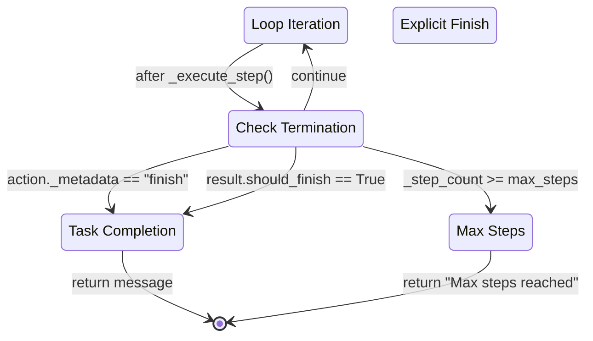

**Condition Details**:

| Condition | Detection Point | Code Location | Result |
|-----------|----------------|---------------|--------|
| Explicit finish | Action metadata | [phone_agent/agent.py:227]() | Task completed successfully |
| Action handler finish | Result flag | [phone_agent/agent.py:227]() | Action handler requests termination |
| Max steps exceeded | Step counter | [phone_agent/agent.py:104]() | Loop timeout |

### Finish Action

When the model determines the task is complete, it outputs a `finish(message=...)` action:

```python
# Model outputs this format
"finish(message=\"Successfully opened WeChat and sent message\")"

# Parsed into action dict
{
    "_metadata": "finish",
    "message": "Successfully opened WeChat and sent message"
}
```

The action handler processes finish actions without performing device operations and returns an `ActionResult` with relevant completion information.

### Should Finish Flag

The `ActionHandler` can request early termination via the `should_finish` flag in `ActionResult`. This occurs when:

- A takeover callback is invoked (manual intervention required)
- A critical error occurs that prevents continuation
- A sensitive action is rejected by confirmation callback

Sources: [phone_agent/agent.py:104-110](), [phone_agent/agent.py:227-235](), [phone_agent/actions/handler.py:242-278]()

## Manual Step Control

In addition to the automatic `run()` method, the agent provides a `step()` method for manual, single-step execution:

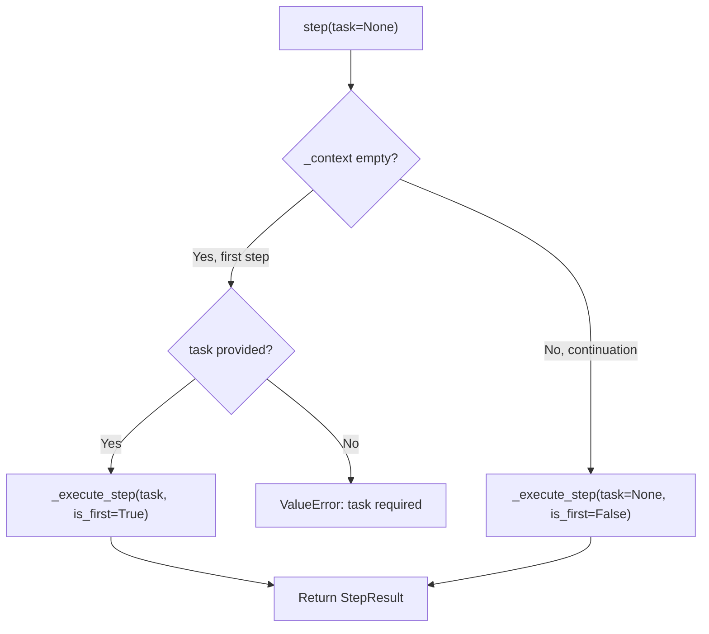

**Use Cases**:

1. **Debugging**: Execute one step at a time to inspect state
2. **Interactive Mode**: Allow user to approve each action before continuation
3. **Custom Control Flow**: Implement specialized loop logic outside the agent
4. **Testing**: Validate individual step behavior

**StepResult Structure**:

| Field | Type | Description |
|-------|------|-------------|
| `success` | `bool` | Whether action executed successfully |
| `finished` | `bool` | Whether task is complete |
| `action` | `dict` | Parsed action that was executed |
| `thinking` | `str` | Model's reasoning process |
| `message` | `str \| None` | Completion or error message |

Sources: [phone_agent/agent.py:112-129](), [phone_agent/agent.py:31-40]()

## Error Recovery

The execution loop includes multiple error handling layers to maintain robustness:

### Error Handling Hierarchy

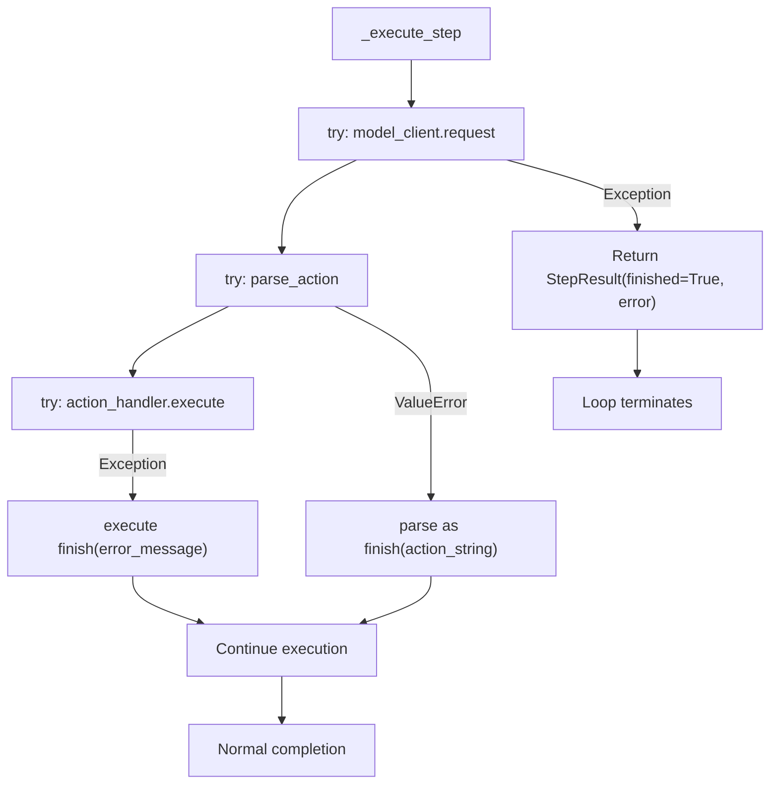

**Error Handling Strategies**:

| Error Type | Location | Strategy | Result |
|------------|----------|----------|--------|
| Model request failure | [phone_agent/agent.py:172-187]() | Catch exception, return finished | Immediate termination with error |
| Action parsing failure | [phone_agent/agent.py:190-195]() | Wrap in finish() action | Graceful completion with raw response |
| Action execution failure | [phone_agent/agent.py:208-217]() | Execute finish() with error | Converts failure to clean exit |

### Verbose Error Reporting

When `AgentConfig.verbose=True`, the agent prints full stack traces for all exceptions using `traceback.print_exc()`. This aids debugging while keeping the loop structure intact.

Sources: [phone_agent/agent.py:172-217]()

## Performance Tracking

The execution loop tracks performance metrics at both the model inference level and overall loop level.

### Model Inference Metrics

The `ModelClient` measures three timing points during each request:

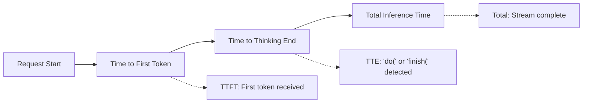

**Metrics in ModelResponse**:

| Metric | Field | Description | Measured At |
|--------|-------|-------------|-------------|
| Time to First Token | `time_to_first_token` | Latency until first token arrives | [phone_agent/model/client.py:96-98]() |
| Time to Thinking End | `time_to_thinking_end` | Duration until action phase begins | [phone_agent/model/client.py:118-119]() |
| Total Inference Time | `total_time` | Complete request-response cycle | [phone_agent/model/client.py:143]() |

These metrics are printed after each model response:

```
==================================================
⏱️  Performance Metrics:
--------------------------------------------------
Time to First Token: 0.234s
Time to Thinking End:        1.567s
Total Inference Time:          2.143s
==================================================
```

### Step Count Tracking

The `_step_count` variable tracks the number of iterations, which is useful for:

- Enforcing `max_steps` limit
- Monitoring task complexity
- Debugging infinite loops
- Performance analysis

The step count is incremented at the beginning of each `_execute_step()` call and is accessible via the `step_count` property.

Sources: [phone_agent/model/client.py:66-174](), [phone_agent/agent.py:140](), [phone_agent/agent.py:245-253]()

---

