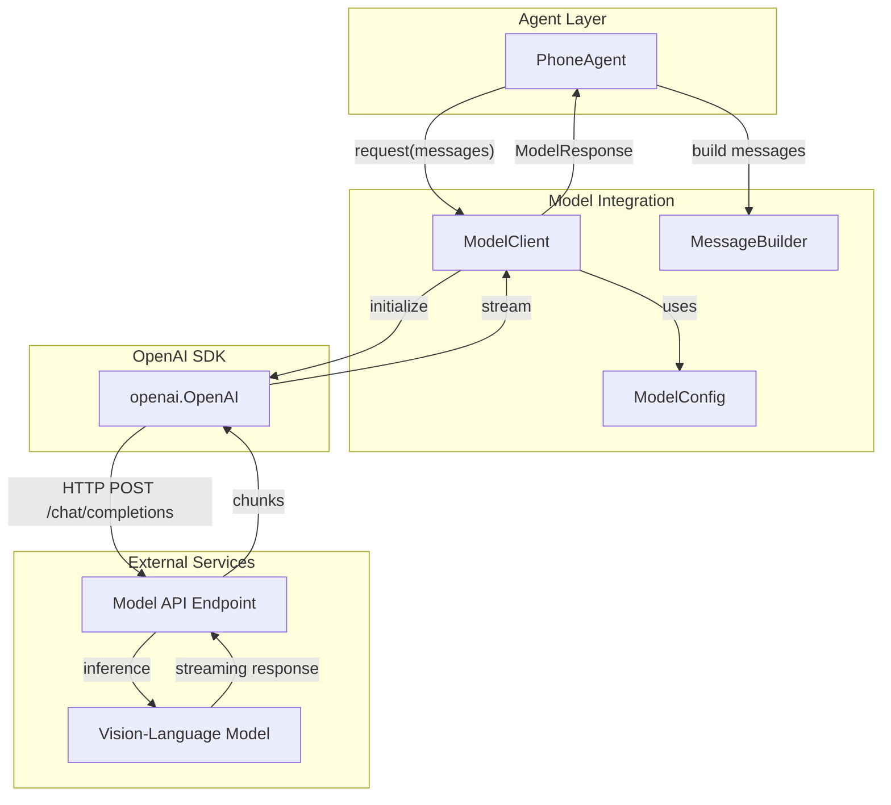
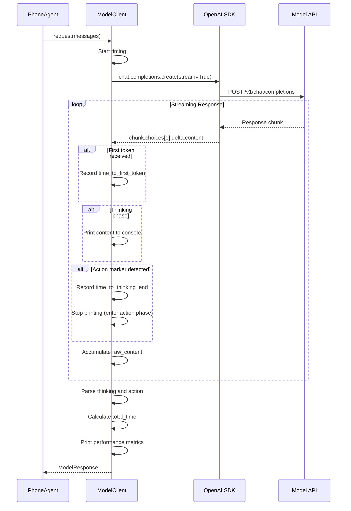
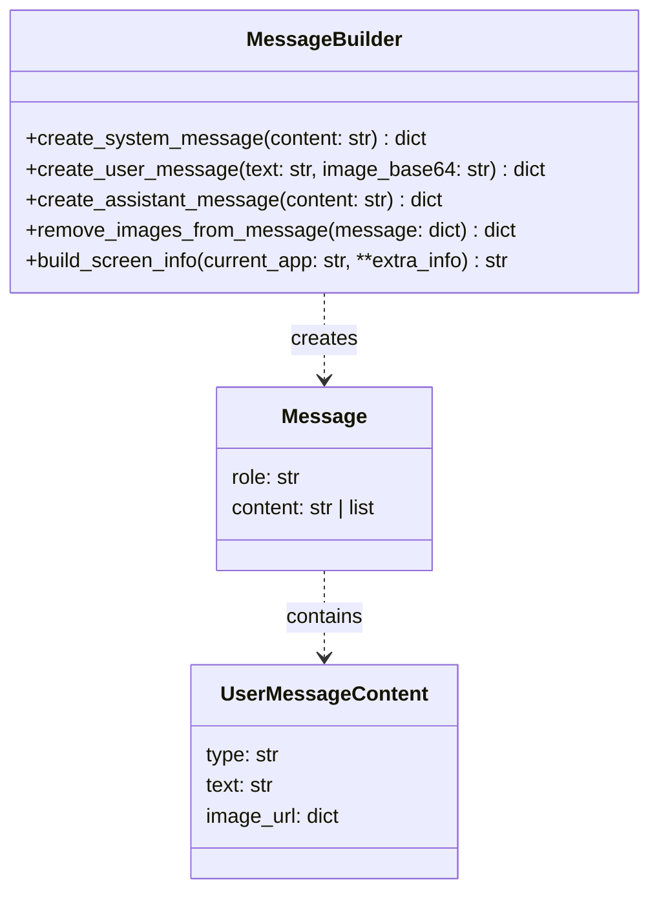
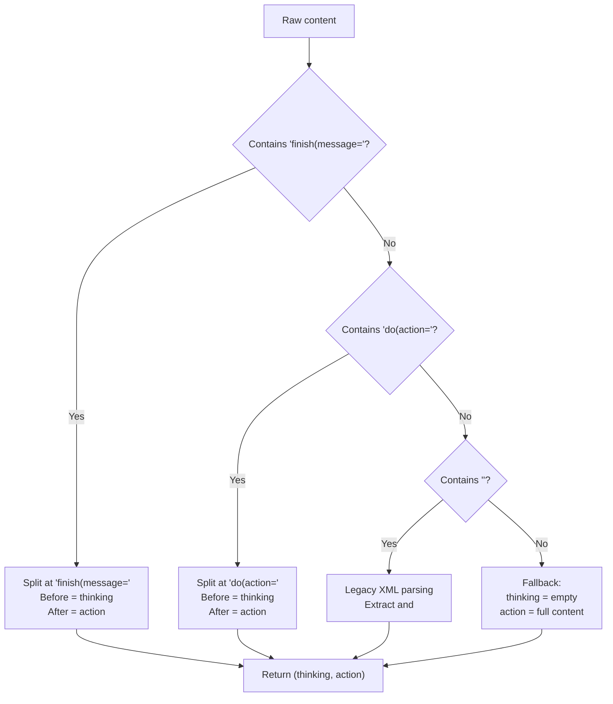
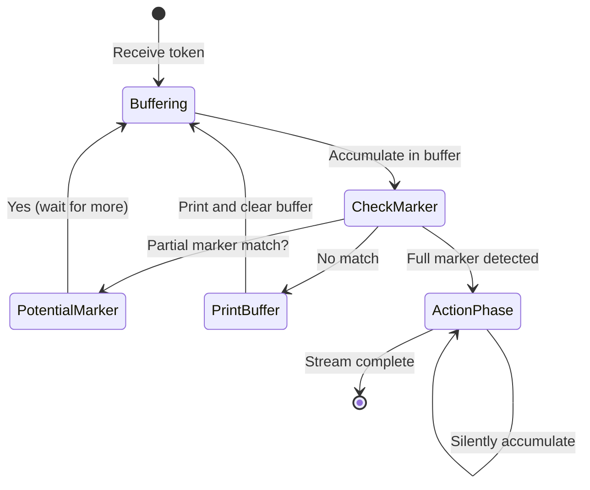
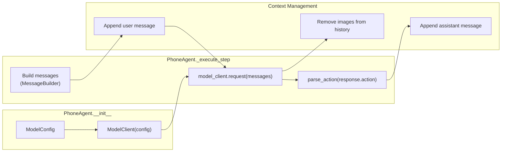
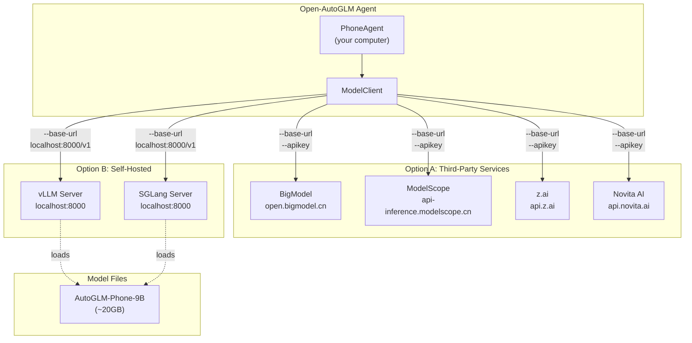

<!-- source: DeepWiki mcp.deepwiki.com · repo zai-org/Open-AutoGLM · page 3.4 AI Model Integration · fetched 2026-10-29 -->

# AI Model Integration

<details>
<summary>Relevant source files</summary>

The following files were used as context for generating this wiki page:

- [README.md](README.md)
- [README_coding_agent.md](README_coding_agent.md)
- [README_en.md](README_en.md)
- [phone_agent/model/client.py](phone_agent/model/client.py)
- [scripts/check_deployment_cn.py](scripts/check_deployment_cn.py)
- [scripts/sample_messages.json](scripts/sample_messages.json)

</details>


## Purpose and Scope

This document describes how Open-AutoGLM integrates with vision-language models (VLMs) to enable AI-powered decision-making for mobile automation. It covers the model client architecture, request/response format, message building, response parsing, and deployment options.

For information about how the agent orchestrates model calls within the execution loop, see [Agent Execution Loop](#3.3). For details on the core agent classes, see [Core Components](#3.2). For model deployment procedures, see [Model Deployment](#8).

---

## Model Configuration

The system uses `ModelConfig` to control AI model behavior and API connection parameters.

### Configuration Parameters

| Parameter | Type | Default | Description |
|-----------|------|---------|-------------|
| `base_url` | `str` | `http://localhost:8000/v1` | OpenAI-compatible API endpoint |
| `api_key` | `str` | `EMPTY` | API authentication key |
| `model_name` | `str` | `autoglm-phone-9b` | Model identifier for inference |
| `max_tokens` | `int` | `3000` | Maximum tokens in model response |
| `temperature` | `float` | `0.0` | Sampling temperature (0.0 = deterministic) |
| `top_p` | `float` | `0.85` | Nucleus sampling threshold |
| `frequency_penalty` | `float` | `0.2` | Repetition penalty |
| `extra_body` | `dict` | `{}` | Additional parameters for specific providers |
| `lang` | `str` | `cn` | Language for UI messages (`cn` or `en`) |

### Usage Example

```python
from phone_agent.model import ModelConfig

config = ModelConfig(
    base_url="http://localhost:8000/v1",
    model_name="autoglm-phone-9b",
    temperature=0.1,
    lang="en"
)
```

**Sources:** [phone_agent/model/client.py:14-26]()

---

## Model Client Architecture

The `ModelClient` class provides a standardized interface for interacting with OpenAI-compatible vision-language models.

### Architecture Overview



### Client Initialization

The `ModelClient` initializes an OpenAI client with the configured endpoint and credentials:

[phone_agent/model/client.py:49-51]()

The client abstracts away provider-specific differences, allowing the same code to work with:
- Self-hosted vLLM or SGLang servers
- Third-party APIs (BigModel, ModelScope, etc.)
- Any OpenAI-compatible service

**Sources:** [phone_agent/model/client.py:41-51](), [README.md:156-184]()

---

## Request and Response Flow

### Request Method

The `request()` method sends messages to the model and processes the streaming response:



### Performance Metrics Collection

The client tracks three timing metrics during inference:

| Metric | Description | Recorded At |
|--------|-------------|-------------|
| `time_to_first_token` | Latency before first token arrives | First non-empty chunk |
| `time_to_thinking_end` | Time until action marker detected | When `finish(` or `do(` found |
| `total_time` | Complete inference duration | Stream exhausted |

**Sources:** [phone_agent/model/client.py:53-174](), [phone_agent/model/client.py:66-143]()

---

## Message Format and Building

### MessageBuilder Utility

The `MessageBuilder` class provides static methods for constructing OpenAI-compatible message dictionaries:



### Message Types

#### System Message
Contains the system prompt that defines agent behavior:
[phone_agent/model/client.py:223-225]()

#### User Message with Vision
Combines text and base64-encoded screenshot:
[phone_agent/model/client.py:227-253]()

Format:
```json
{
  "role": "user",
  "content": [
    {
      "type": "image_url",
      "image_url": {
        "url": "data:image/png;base64,iVBORw0KG..."
      }
    },
    {
      "type": "text",
      "text": "Open WeChat\n\n{\"current_app\": \"com.android.launcher\"}"
    }
  ]
}
```

#### Assistant Message
Records model's previous responses in context:
[phone_agent/model/client.py:256-258]()

### Screen Info Building

The `build_screen_info()` method creates JSON metadata about the current device state:
[phone_agent/model/client.py:278-290]()

Typical output:
```json
{
  "current_app": "com.tencent.mm",
  "timestamp": "2024-01-15T10:30:00Z"
}
```

### Context Management

To prevent context window overflow, images are removed from historical messages after processing:
[phone_agent/model/client.py:261-275]()

This is invoked by the agent after each step:
[phone_agent/agent.py:205]()

**Sources:** [phone_agent/model/client.py:219-291](), [phone_agent/agent.py:148-169](), [phone_agent/agent.py:205]()

---

## Response Parsing

### Response Structure

The model generates responses in two phases:
1. **Thinking**: Reasoning about the current screen and task
2. **Action**: Executable command (function call format)

### ModelResponse Object

[phone_agent/model/client.py:28-39]()

| Field | Type | Description |
|-------|------|-------------|
| `thinking` | `str` | Model's reasoning process |
| `action` | `str` | Executable action string |
| `raw_content` | `str` | Complete unprocessed response |
| `time_to_first_token` | `float` | Latency metric (seconds) |
| `time_to_thinking_end` | `float` | Thinking duration (seconds) |
| `total_time` | `float` | Total inference time (seconds) |

### Parsing Rules

The `_parse_response()` method applies these rules in order:



### Example Parsing

**Input:**
```
User wants to search for coffee shops. Currently on home screen.
Need to launch Maps app first.
finish(message="Task completed successfully")
```

**Output:**
- `thinking`: `"User wants to search for coffee shops. Currently on home screen.\nNeed to launch Maps app first."`
- `action`: `"finish(message=\"Task completed successfully\")"`

**Input:**
```
Current screen shows the search bar. Need to tap it.
do(action="Tap", element=[540, 120])
```

**Output:**
- `thinking`: `"Current screen shows the search bar. Need to tap it."`
- `action`: `"do(action=\"Tap\", element=[540, 120])"`

**Sources:** [phone_agent/model/client.py:176-216]()

---

## Streaming and Console Output

### Incremental Thinking Display

The client streams the model's thinking process in real-time to provide user feedback:



### Marker Detection

The system detects two action markers to transition from thinking to action phase:
- `"finish(message="`
- `"do(action="`

Once a marker is detected:
1. Everything before the marker is printed as thinking
2. Everything from the marker onwards is accumulated silently
3. A newline is printed to separate thinking from action

**Incremental Detection Logic:**
[phone_agent/model/client.py:104-141]()

This provides immediate feedback to users while keeping action details clean for parsing.

**Sources:** [phone_agent/model/client.py:82-141]()

---

## Integration with PhoneAgent

### Model Client Lifecycle



### Message Flow in Agent

The agent constructs messages differently for first and subsequent steps:

**First Step:**
[phone_agent/agent.py:148-160]()
- System prompt
- User task + screen info + screenshot

**Subsequent Steps:**
[phone_agent/agent.py:161-169]()
- Screen info + screenshot only
- Previous conversation in context

### Error Handling

The agent wraps model calls in try-except blocks to gracefully handle inference failures:
[phone_agent/agent.py:172-187]()

If the model response cannot be parsed, the agent defaults to a finish action:
[phone_agent/agent.py:190-195]()

**Sources:** [phone_agent/agent.py:64-79](), [phone_agent/agent.py:136-224]()

---

## Deployment Options

### Architecture Overview



### Third-Party API Services

These services provide hosted AutoGLM models without requiring local GPU resources:

| Provider | Base URL | Model Name | Authentication |
|----------|----------|------------|----------------|
| BigModel | `https://open.bigmodel.cn/api/paas/v4` | `autoglm-phone` | API Key required |
| ModelScope | `https://api-inference.modelscope.cn/v1` | `ZhipuAI/AutoGLM-Phone-9B` | API Key required |
| z.ai | `https://api.z.ai/v1` | Provider-specific | API Key required |
| Novita AI | `https://api.novita.ai/v1` | Provider-specific | API Key required |

**Configuration Example:**
```bash
python main.py \
  --base-url https://open.bigmodel.cn/api/paas/v4 \
  --model autoglm-phone \
  --apikey sk-xxxxxxxxxxxxx \
  "Open WeChat"
```

### Self-Hosted Deployment

#### vLLM Deployment

```bash
python3 -m vllm.entrypoints.openai.api_server \
  --served-model-name autoglm-phone-9b \
  --allowed-local-media-path / \
  --mm-encoder-tp-mode data \
  --mm_processor_cache_type shm \
  --mm_processor_kwargs '{"max_pixels":5000000}' \
  --max-model-len 25480 \
  --chat-template-content-format string \
  --limit-mm-per-prompt '{"image":10}' \
  --model zai-org/AutoGLM-Phone-9B \
  --port 8000
```

#### SGLang Deployment

```bash
python3 -m sglang.launch_server \
  --model-path zai-org/AutoGLM-Phone-9B \
  --served-model-name autoglm-phone-9b \
  --context-length 25480 \
  --mm-enable-dp-encoder \
  --mm-process-config '{"image":{"max_pixels":5000000}}' \
  --port 8000
```

#### Hardware Requirements

- **GPU:** NVIDIA GPU with 24GB+ VRAM
- **Model Size:** ~20GB disk space
- **Memory:** 32GB+ RAM recommended

**Configuration Example:**
```bash
python main.py \
  --base-url http://localhost:8000/v1 \
  --model autoglm-phone-9b \
  "Open WeChat"
```

### Deployment Verification

Use the check deployment script to verify model service functionality:

```bash
python scripts/check_deployment_cn.py \
  --base-url http://localhost:8000/v1 \
  --model autoglm-phone-9b
```

Expected output should include coherent thinking and valid action syntax. Gibberish or very short responses indicate deployment issues.

**Sources:** [README.md:156-262](), [README.md:869-915]()

---

## Configuration via Environment Variables

Model configuration can be set through environment variables as an alternative to CLI arguments:

| Environment Variable | Equivalent CLI Argument | Default |
|---------------------|------------------------|---------|
| `PHONE_AGENT_BASE_URL` | `--base-url` | `http://localhost:8000/v1` |
| `PHONE_AGENT_MODEL` | `--model` | `autoglm-phone-9b` |
| `PHONE_AGENT_API_KEY` | `--apikey` | `EMPTY` |

**Example:**
```bash
export PHONE_AGENT_BASE_URL="https://open.bigmodel.cn/api/paas/v4"
export PHONE_AGENT_MODEL="autoglm-phone"
export PHONE_AGENT_API_KEY="sk-xxxxxxxxxxxxx"

python main.py "Open WeChat"
```

**Sources:** [README.md:486-496]()

---

## Performance Considerations

### Context Window Management

The agent removes images from historical messages to conserve context window space:
[phone_agent/model/client.py:261-275]()

This allows longer task execution without exceeding model context limits.

### Streaming Benefits

Streaming provides:
1. **Real-time feedback:** Users see thinking process immediately
2. **Lower latency perception:** Time to first token < total time
3. **Interruptibility:** Can cancel long-running requests

### Temperature and Sampling

Default configuration uses low temperature (`0.0`) for deterministic behavior:
[phone_agent/model/client.py:21]()

This reduces randomness in action selection, making agent behavior more predictable and reproducible.

**Sources:** [phone_agent/model/client.py:14-26](), [phone_agent/model/client.py:261-275](), [phone_agent/agent.py:205]()

---

