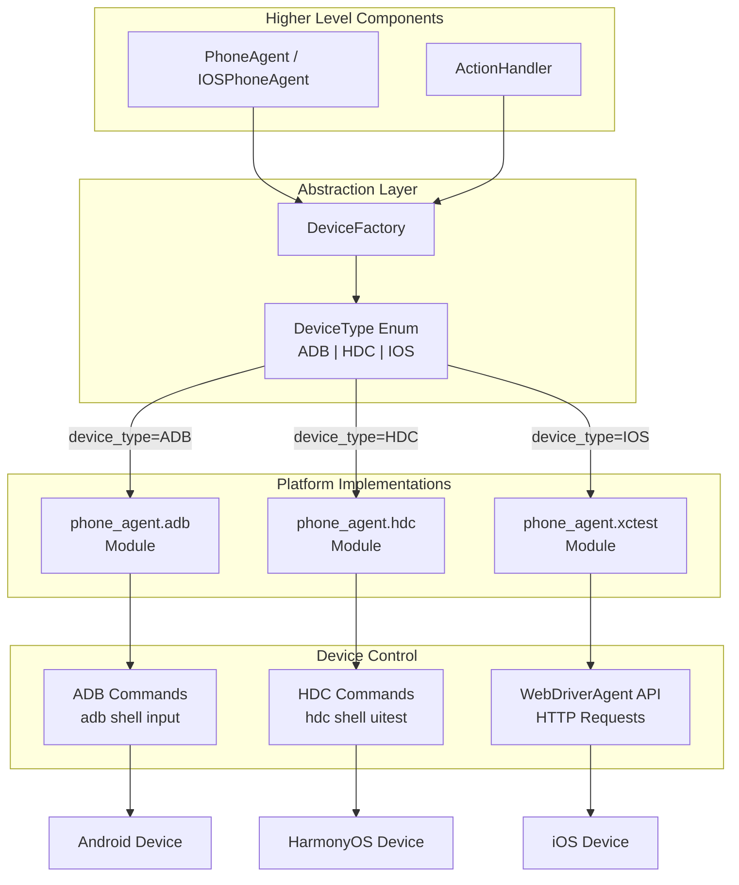
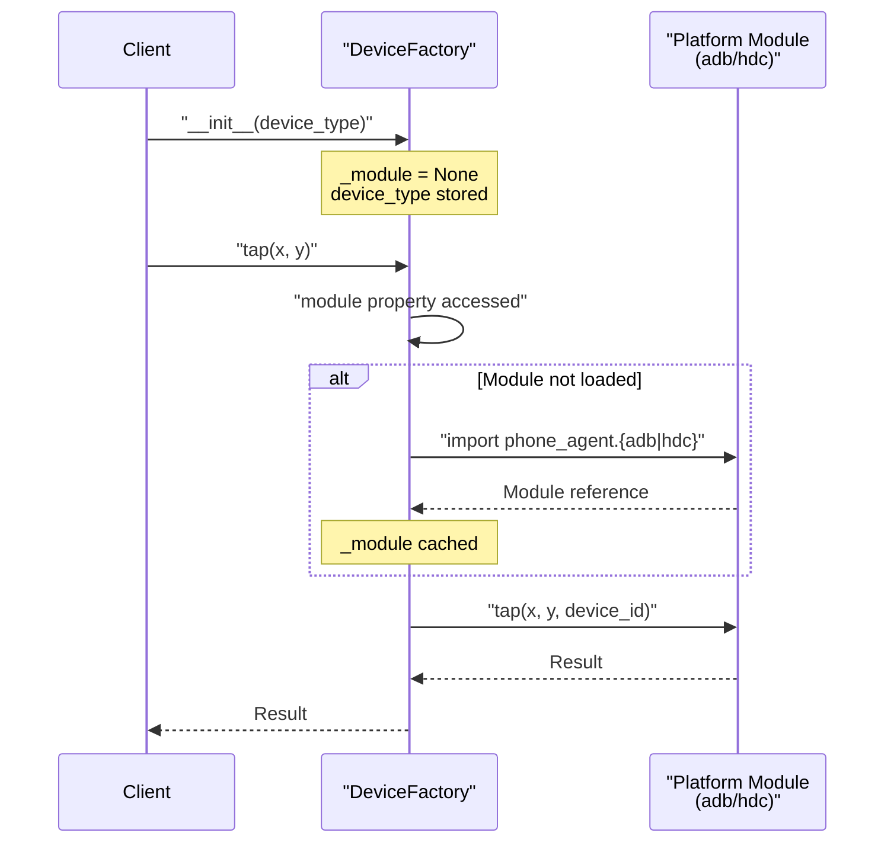
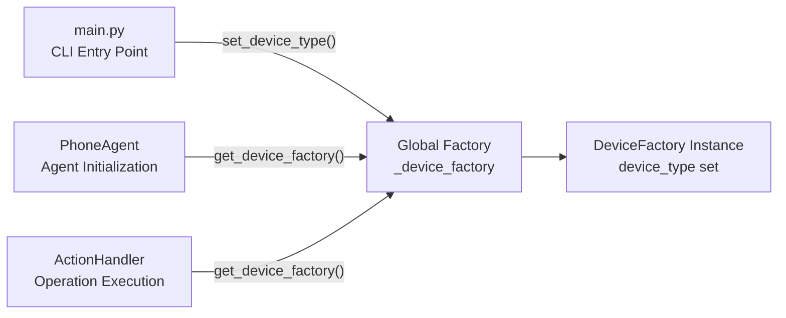
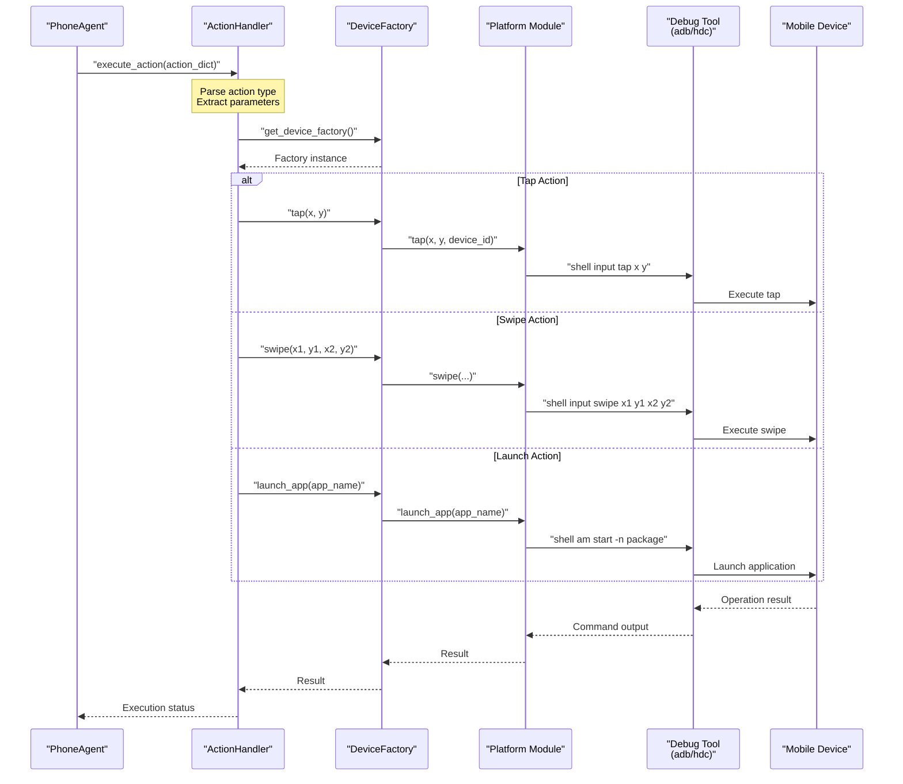
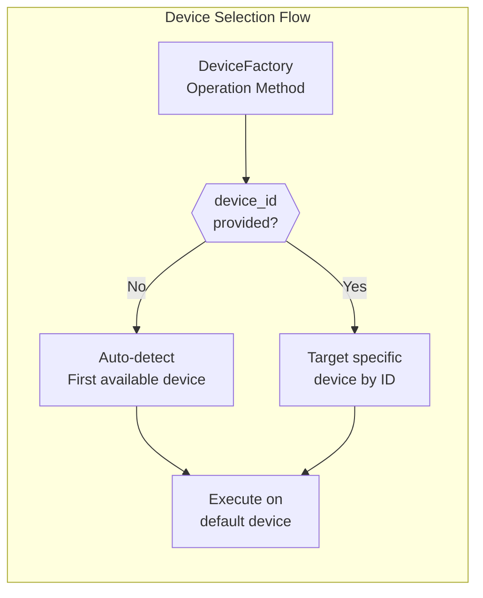
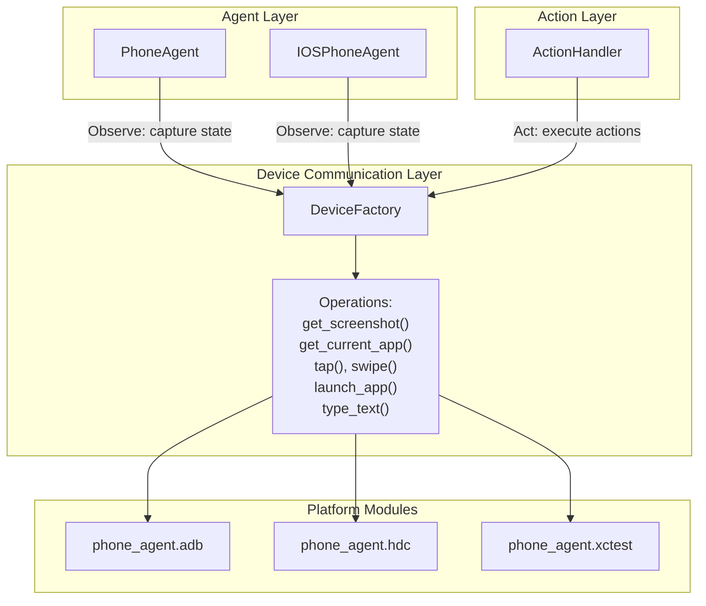

<!-- source: DeepWiki mcp.deepwiki.com · repo zai-org/Open-AutoGLM · page 3.5 Device Communication Layer · fetched 2026-10-29 -->

# Device Communication Layer

<details>
<summary>Relevant source files</summary>

The following files were used as context for generating this wiki page:

- [phone_agent/adb/connection.py](phone_agent/adb/connection.py)
- [phone_agent/adb/device.py](phone_agent/adb/device.py)
- [phone_agent/config/apps_harmonyos.py](phone_agent/config/apps_harmonyos.py)
- [phone_agent/config/timing.py](phone_agent/config/timing.py)
- [phone_agent/device_factory.py](phone_agent/device_factory.py)
- [phone_agent/hdc/device.py](phone_agent/hdc/device.py)

</details>


## Purpose and Scope

The Device Communication Layer provides a unified abstraction for controlling mobile devices across multiple platforms (Android, HarmonyOS, and iOS). This layer implements the factory pattern to route device operations to platform-specific implementations while presenting a consistent interface to higher-level components.

This page focuses on the abstraction mechanism and common interface. For platform-specific setup and operations, see:
- Android (ADB): [4.1](#4.1)
- HarmonyOS (HDC): [4.2](#4.2)
- iOS (WebDriverAgent): [4.3](#4.3)

For how this layer is used by the agent execution loop, see [Agent Execution Loop](#3.3).

---

## Architecture Overview

The Device Communication Layer uses the **Factory Pattern** to abstract away platform differences. The `DeviceFactory` class serves as the central abstraction, dynamically loading the appropriate platform module and routing all device operations accordingly.



**Sources:** [phone_agent/device_factory.py:1-168](), [README.md:56-84]()

---

## DeviceType Enumeration

The `DeviceType` enum defines the three supported platforms. This enum is the primary discriminator for selecting the appropriate device module.

| DeviceType Value | Platform | Debug Tool | Module Path |
|-----------------|----------|------------|-------------|
| `DeviceType.ADB` | Android | Android Debug Bridge | `phone_agent.adb` |
| `DeviceType.HDC` | HarmonyOS | HarmonyOS Debug Client | `phone_agent.hdc` |
| `DeviceType.IOS` | iOS | WebDriverAgent | `phone_agent.xctest` |

**Sources:** [phone_agent/device_factory.py:7-12]()

---

## DeviceFactory Class

### Factory Initialization and Module Loading

The `DeviceFactory` class implements lazy loading of platform modules. The module is not imported until the first operation is requested, reducing startup time and allowing the system to work even if some platform dependencies are not installed.



The module loading logic is implemented in the `module` property:

[phone_agent/device_factory.py:32-46]()

**Sources:** [phone_agent/device_factory.py:22-46]()

### Global Factory Instance

The system maintains a global `DeviceFactory` instance to ensure consistent device type selection across all components. This is managed through module-level functions:

- **`set_device_type(device_type)`**: Initializes the global factory with the specified device type
- **`get_device_factory()`**: Returns the global factory instance, defaulting to ADB if not set



**Sources:** [phone_agent/device_factory.py:142-167]()

---

## Common Operations Interface

The `DeviceFactory` provides a unified interface for all device operations. Each method delegates to the corresponding function in the loaded platform module.

### Screen Capture Operations

| Method | Parameters | Returns | Platform Module Function |
|--------|------------|---------|--------------------------|
| `get_screenshot()` | `device_id`, `timeout` | Screenshot bytes or image | `module.get_screenshot()` |
| `get_current_app()` | `device_id` | App package name (str) | `module.get_current_app()` |

**Sources:** [phone_agent/device_factory.py:48-54]()

### Touch Operations

| Method | Parameters | Description | Platform Module Function |
|--------|------------|-------------|--------------------------|
| `tap()` | `x`, `y`, `device_id`, `delay` | Single tap at coordinates | `module.tap()` |
| `double_tap()` | `x`, `y`, `device_id`, `delay` | Double tap at coordinates | `module.double_tap()` |
| `long_press()` | `x`, `y`, `duration_ms`, `device_id`, `delay` | Long press with duration | `module.long_press()` |
| `swipe()` | `start_x`, `start_y`, `end_x`, `end_y`, `duration_ms`, `device_id`, `delay` | Swipe gesture | `module.swipe()` |

**Sources:** [phone_agent/device_factory.py:56-92]()

### Navigation Operations

| Method | Parameters | Description | Platform Module Function |
|--------|------------|-------------|--------------------------|
| `back()` | `device_id`, `delay` | Press back button | `module.back()` |
| `home()` | `device_id`, `delay` | Press home button | `module.home()` |

**Sources:** [phone_agent/device_factory.py:94-100]()

### Application Control

| Method | Parameters | Returns | Platform Module Function |
|--------|------------|---------|--------------------------|
| `launch_app()` | `app_name`, `device_id`, `delay` | Success (bool) | `module.launch_app()` |

**Sources:** [phone_agent/device_factory.py:102-106]()

### Text Input Operations

| Method | Parameters | Description | Platform Module Function |
|--------|------------|-------------|--------------------------|
| `type_text()` | `text`, `device_id` | Type text string | `module.type_text()` |
| `clear_text()` | `device_id` | Clear current text input | `module.clear_text()` |
| `detect_and_set_adb_keyboard()` | `device_id` | Detect and activate keyboard | `module.detect_and_set_adb_keyboard()` |
| `restore_keyboard()` | `ime`, `device_id` | Restore original keyboard | `module.restore_keyboard()` |

**Note:** The keyboard methods are named generically but may have platform-specific behavior. Android uses ADB Keyboard, HarmonyOS uses native input, and iOS uses native input through WebDriverAgent.

**Sources:** [phone_agent/device_factory.py:108-122]()

### Device Management

| Method | Parameters | Returns | Description |
|--------|------------|---------|-------------|
| `list_devices()` | None | List of device objects | List all connected devices |
| `get_connection_class()` | None | Connection class | Returns `ADBConnection` or `HDCConnection` |

**Sources:** [phone_agent/device_factory.py:124-139]()

---

## Operation Flow: From Agent to Device

This diagram shows the complete flow of a typical device operation from the agent layer down to the physical device:



**Sources:** [phone_agent/device_factory.py:48-122]()

---

## Platform-Specific Implementations

Each platform module must implement all the operations defined in the `DeviceFactory` interface. The factory dynamically imports the appropriate module based on the `device_type`.

### Module Structure

```mermaid
graph TB
    subgraph "phone_agent.adb (Android)"
        ADB_CONN["connection.py<br/>ADBConnection"]
        ADB_DEV["device.py<br/>tap, swipe, home, back"]
        ADB_SCR["screenshot.py<br/>get_screenshot, get_current_app"]
        ADB_INP["input.py<br/>type_text, ADB Keyboard"]
    end
    
    subgraph "phone_agent.hdc (HarmonyOS)"
        HDC_CONN["connection.py<br/>HDCConnection"]
        HDC_DEV["device.py<br/>tap, swipe, uitest commands"]
        HDC_SCR["screenshot.py<br/>get_screenshot, get_current_app"]
        HDC_INP["input.py<br/>type_text, native input"]
    end
    
    subgraph "phone_agent.xctest (iOS)"
        WDA_CONN["connection.py<br/>XCTestConnection"]
        WDA_DEV["device.py<br/>WebDriver operations"]
        WDA_SCR["screenshot.py<br/>get_screenshot via WDA"]
        WDA_INP["input.py<br/>type_text via WDA"]
    end
    
    FACTORY["DeviceFactory"] -->|"device_type=ADB"| ADB_CONN
    FACTORY -->|"device_type=HDC"| HDC_CONN
    FACTORY -->|"device_type=IOS"| WDA_CONN
```



**Sources:** [README.md:674-686]()

### Implementation Differences

| Operation | Android (ADB) | HarmonyOS (HDC) | iOS (WebDriverAgent) |
|-----------|---------------|-----------------|----------------------|
| **Tap** | `adb shell input tap x y` | `hdc shell uitest uiInput click x y` | HTTP POST to `/session/{id}/wda/tap` |
| **Type Text** | ADB Keyboard app | Native input via HDC | Native keyboard via WDA |
| **Screenshot** | `adb exec-out screencap -p` | `hdc shell snapshot_display` | HTTP GET to `/screenshot` endpoint |
| **Launch App** | `adb shell am start -n package/activity` | `hdc shell aa start -a action -b bundle` | HTTP POST to `/session/{id}/wda/apps/launch` |
| **Connection** | USB or TCP/IP (port 5555) | USB or TCP/IP (port 5555) | USB via iproxy or WiFi |

**Sources:** [README.md:56-152]()

---

## Connection Management

Each platform has its own connection management class that handles device discovery, connection establishment, and network debugging.

### Connection Class Access

The factory provides access to the appropriate connection class through the `get_connection_class()` method:

```python
# Get the connection class for the current device type
connection_class = factory.get_connection_class()

# Returns: ADBConnection or HDCConnection
conn = connection_class()
```

[phone_agent/device_factory.py:128-139]()

### Connection Classes

| Device Type | Connection Class | Module Path |
|-------------|-----------------|-------------|
| Android | `ADBConnection` | `phone_agent.adb.connection` |
| HarmonyOS | `HDCConnection` | `phone_agent.hdc.connection` |
| iOS | `XCTestConnection` | `phone_agent.xctest.connection` |

These classes provide methods for:
- Listing connected devices
- Establishing network connections (WiFi debugging)
- Managing connection state
- Device discovery

**Sources:** [phone_agent/device_factory.py:128-139](), [README.md:336-455]()

---

## Device Selection and Multi-Device Support

The `device_id` parameter, present in all operation methods, allows the system to target specific devices when multiple devices are connected.



### Device ID Formats

| Platform | Device ID Format | Example |
|----------|-----------------|---------|
| Android (USB) | Serial number | `emulator-5554` |
| Android (WiFi) | IP:Port | `192.168.1.100:5555` |
| HarmonyOS (USB) | Hardware identifier | `7001005458323933328a01bce01c2500` |
| HarmonyOS (WiFi) | IP:Port | `192.168.1.100:5555` |
| iOS | UDID or localhost:port | `00008030-001234567890001E` |

**Sources:** [README.md:336-406](), [phone_agent/device_factory.py:48-122]()

---

## Usage Examples

### Basic Factory Usage

```python
from phone_agent.device_factory import DeviceFactory, DeviceType, set_device_type, get_device_factory

# Option 1: Direct instantiation
factory = DeviceFactory(DeviceType.ADB)

# Option 2: Using global factory
set_device_type(DeviceType.HDC)
factory = get_device_factory()

# Perform operations
screenshot = factory.get_screenshot()
factory.tap(100, 200)
factory.launch_app("微信")
```

### Multi-Device Operations

```python
from phone_agent.device_factory import get_device_factory

factory = get_device_factory()

# List all connected devices
devices = factory.list_devices()
for device in devices:
    print(f"{device.device_id} - {device.connection_type.value}")

# Operate on specific device
factory.tap(100, 200, device_id="192.168.1.100:5555")
```

### Platform-Specific Connection Management

```python
# Get the connection class for current device type
ConnectionClass = factory.get_connection_class()

# Create connection manager
conn = ConnectionClass()

# Connect to remote device (WiFi debugging)
success, message = conn.connect("192.168.1.100:5555")

# List devices
devices = factory.list_devices()
```

**Sources:** [phone_agent/device_factory.py:1-168](), [README.md:408-455]()

---

## Integration with Other Components

The Device Communication Layer is primarily consumed by two higher-level components:

1. **PhoneAgent / IOSPhoneAgent** (see [Core Components](#3.2)): Uses the factory to capture screenshots and retrieve current app information during the observe phase of the execution loop.

2. **ActionHandler** (see [ActionHandler Architecture](#6.2)): Uses the factory to execute parsed actions (tap, swipe, launch, etc.) on the device during the act phase of the execution loop.



**Sources:** [phone_agent/device_factory.py:1-168]()

---

