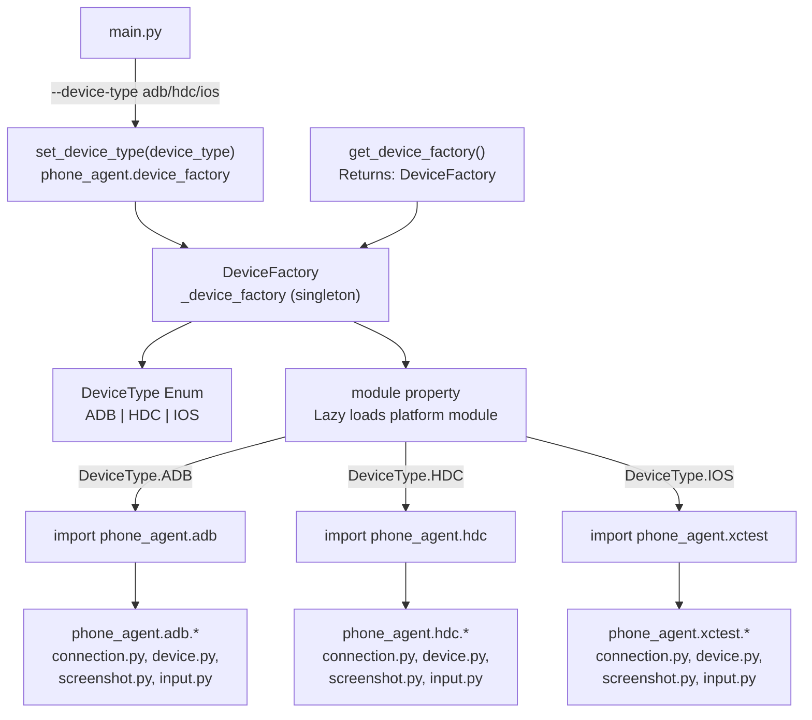
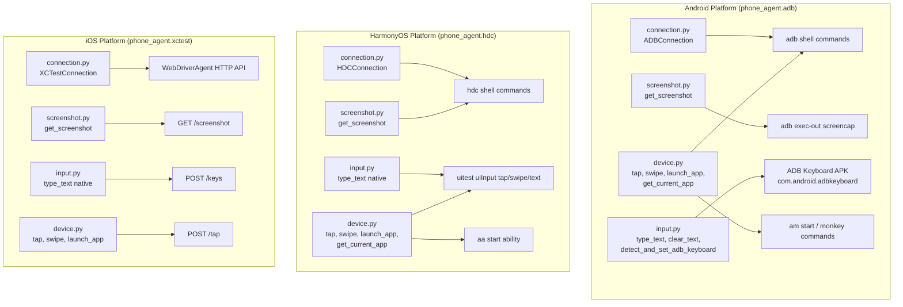
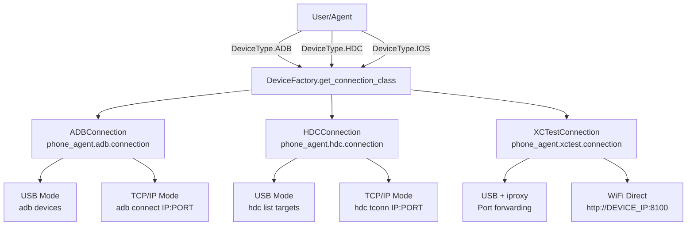
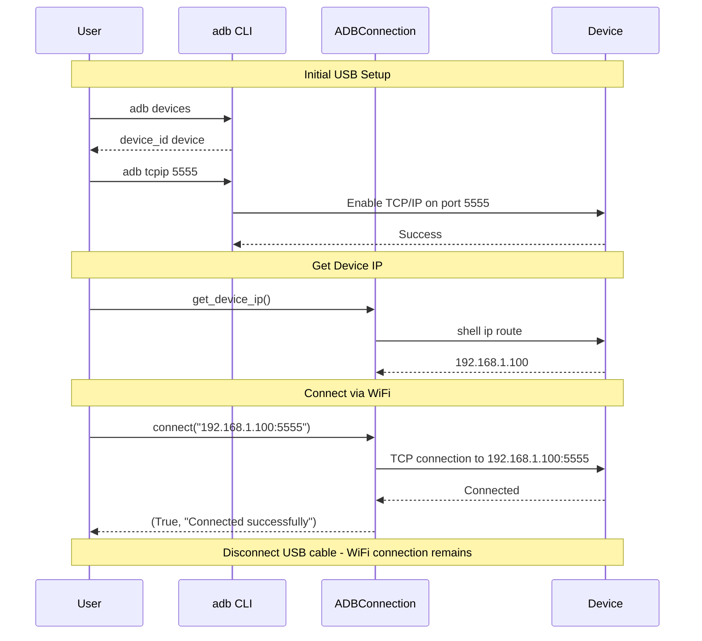

<!-- source: DeepWiki mcp.deepwiki.com · repo zai-org/Open-AutoGLM · page 4 Device Support · fetched 2026-10-29 -->

# Device Support

<details>
<summary>Relevant source files</summary>

The following files were used as context for generating this wiki page:

- [README.md](README.md)
- [README_coding_agent.md](README_coding_agent.md)
- [README_en.md](README_en.md)
- [phone_agent/device_factory.py](phone_agent/device_factory.py)

</details>


**Purpose:** This page provides an overview of the mobile platforms supported by Open-AutoGLM and the architecture that enables cross-platform device control. It covers the three supported platforms (Android, HarmonyOS, and iOS), their connection methods, and the abstraction layer that unifies device operations.

**Scope:** This page focuses on the high-level device support architecture and platform comparison. For detailed platform-specific setup instructions and operations, see:
- [Android (ADB)](#4.1) - Android device setup and ADB operations
- [HarmonyOS (HDC)](#4.2) - HarmonyOS device setup and HDC operations  
- [iOS (WebDriverAgent)](#4.3) - iOS device setup and WebDriverAgent configuration

---

## Supported Platforms

Open-AutoGLM supports three mobile platforms through their respective debug protocols:

| Platform | Debug Tool | Module Path | Minimum Version | Text Input Method |
|----------|-----------|-------------|-----------------|-------------------|
| **Android** | ADB (Android Debug Bridge) | `phone_agent.adb` | Android 7.0+ | ADB Keyboard (external app) |
| **HarmonyOS** | HDC (HarmonyOS Debug Client) | `phone_agent.hdc` | HarmonyOS NEXT+ | Native input |
| **iOS** | WebDriverAgent (XCTest) | `phone_agent.xctest` | iOS (version TBD) | Native input |

Each platform requires its respective debug tool to be installed and configured on the host machine. The system communicates with mobile devices using these tools to capture screenshots, execute actions, and manage device state.

**Sources:** [README.md:46-104](), [README.md:106-112](), [README_en.md:42-93]()

---

## Device Factory Architecture

The system uses a factory pattern implemented in [phone_agent/device_factory.py]() to abstract platform-specific implementations behind a unified interface. The `DeviceFactory` class dynamically loads the appropriate device module based on the `DeviceType` enum value.

### DeviceFactory Implementation



**Key Implementation Details:**

The `DeviceFactory` class provides a unified API surface through delegation:

```
DeviceFactory methods (delegates to platform module):
- get_screenshot(device_id, timeout) -> PIL.Image
- get_current_app(device_id) -> str
- tap(x, y, device_id, delay)
- double_tap(x, y, device_id, delay)
- long_press(x, y, duration_ms, device_id, delay)
- swipe(start_x, start_y, end_x, end_y, duration_ms, device_id, delay)
- back(device_id, delay)
- home(device_id, delay)
- launch_app(app_name, device_id, delay) -> bool
- type_text(text, device_id)
- clear_text(device_id)
- detect_and_set_adb_keyboard(device_id) -> str
- restore_keyboard(ime, device_id)
- list_devices()
- get_connection_class() -> ADBConnection | HDCConnection | XCTestConnection
```

The global singleton instance is managed through `set_device_type()` and `get_device_factory()` functions, defaulting to `DeviceType.ADB` if not explicitly configured.

**Sources:** [phone_agent/device_factory.py:1-168](), [README.md:298-312](), [README_en.md:238-252]()

---

## Platform Architecture Comparison

Each platform module implements a consistent interface through platform-specific implementations. The following diagram maps the module structure to underlying command execution mechanisms:

### Platform Module Structure



### Platform-Specific Command Translation

| Operation | Android (ADB) | HarmonyOS (HDC) | iOS (WebDriverAgent) |
|-----------|---------------|-----------------|----------------------|
| **Screenshot** | `adb exec-out screencap -p` | `hdc shell snapshot_screen` | `GET http://localhost:8100/screenshot` |
| **Tap** | `adb shell input tap x y` | `hdc shell uitest uiInput tap x y` | `POST /session/{id}/wda/tap/0` |
| **Type Text** | Switch to ADB Keyboard APK<br/>`adb shell am broadcast -a ADB_INPUT_TEXT` | `hdc shell uitest uiInput text "content"` | `POST /session/{id}/wda/keys` |
| **Swipe** | `adb shell input swipe x1 y1 x2 y2 ms` | `hdc shell uitest uiInput swipe x1 y1 x2 y2 ms` | `POST /session/{id}/wda/dragfromtoforduration` |
| **Launch App** | `adb shell monkey -p package.name -c android.intent.category.LAUNCHER 1` | `hdc shell aa start -b bundle.name -a ability.name` | `POST /session/{id}/wda/apps/launch` |
| **Get Current App** | `adb shell dumpsys window` | `hdc shell aa dump -a` | `GET /session/{id}/wda/activeAppInfo` |

**Key Architectural Differences:**

- **Android**: Requires external ADB Keyboard APK installation (`com.android.adbkeyboard/.AdbIME`) for text input. Commands executed via `adb shell` subprocess calls. Connection management handles USB and TCP/IP modes.

- **HarmonyOS**: Uses HarmonyOS's native `uitest` framework for all UI operations. Text input works natively without external dependencies. Ability launching uses the `aa` (Ability Assistant) tool with bundle and ability names.

- **iOS**: Communicates over HTTP with WebDriverAgent (WDA) running on the device. Uses WebDriver protocol JSON payloads. Requires initial Xcode setup and WDA installation. Connection can be USB-forwarded (via `iproxy`) or direct WiFi.

**Sources:** [phone_agent/device_factory.py:48-127](), [README.md:108-116](), [README_en.md:96-103](), [docs/ios_setup/ios_setup.md]()

---

## Connection Methods

All three platforms support both USB and network-based connections through their respective connection management classes: `ADBConnection`, `HDCConnection`, and `XCTestConnection`.

### Connection Management Flow



### Connection API Methods

Each connection class provides these methods for connection management:

```
ADBConnection / HDCConnection:
- list_devices() -> List[DeviceInfo]
- connect(address: str) -> Tuple[bool, str]
- disconnect(address: str) -> Tuple[bool, str]
- enable_tcpip(port: int) -> Tuple[bool, str]  (Android only)
- get_device_ip() -> str

XCTestConnection:
- connect(wda_url: str) -> bool
- get_session_id() -> str
```

### USB Connection Setup

USB connections require a data-capable USB cable (not charging-only) and device authorization:

| Platform | List Command | Expected Output Format | Authorization Required |
|----------|--------------|------------------------|------------------------|
| Android | `adb devices` | `<serial>    device` | Yes - "Allow USB debugging" popup |
| HarmonyOS | `hdc list targets` | `<serial>` or `IP:PORT` | Yes - Developer options consent |
| iOS | Xcode device list | Device appears in WDA | Yes - Trust this computer |

**Connection State Enumeration:**

Android/HarmonyOS devices can be in these states:
- `device` - Connected and authorized
- `unauthorized` - Connected but not authorized
- `offline` - Device not responsive
- `no devices` - No devices detected

**Sources:** [README.md:136-163](), [README_en.md:114-143]()

### Network Connection Setup

Network connections enable remote device control without physical USB:

| Platform | Enable Method | Connect Command | Python API |
|----------|--------------|-----------------|------------|
| Android | `adb tcpip 5555` (USB first) | `adb connect 192.168.1.100:5555` | `conn.enable_tcpip(5555)`<br/>`conn.connect("192.168.1.100:5555")` |
| HarmonyOS | Settings → Developer Options → Wireless Debugging | `hdc tconn 192.168.1.100:5555` | `conn.connect("192.168.1.100:5555")` |
| iOS | WebDriverAgent config | Direct HTTP to `http://IP:8100` | `conn.connect("http://192.168.1.100:8100")` |

**Network Connection Workflow (Android):**



Both the device and host computer must be on the same local network. For Android and HarmonyOS, wireless debugging must be enabled in device developer settings.

**Sources:** [README.md:347-466](), [README_en.md:286-407](), [phone_agent/device_factory.py:124-140]()

---

## Core Device Capabilities

The `DeviceFactory` class provides a unified interface to device operations across all platforms. Each method delegates to the appropriate platform module.

### Device Operations Interface

```mermaid
graph TD
    Factory[DeviceFactory]
    
    subgraph Screenshot["Screenshot Operations"]
        GetSS[get_screenshot<br/>device_id, timeout]
        ADB_SS["adb.screenshot.get_screenshot"]
        HDC_SS["hdc.screenshot.get_screenshot"]
        IOS_SS["xctest.screenshot.get_screenshot"]
    end
    
    subgraph Input["Input Operations"]
        Tap[tap<br/>x, y, device_id, delay]
        DoubleTap[double_tap<br/>x, y, device_id, delay]
        LongPress[long_press<br/>x, y, duration_ms, device_id, delay]
        Swipe[swipe<br/>start_x, start_y, end_x, end_y,<br/>duration_ms, device_id, delay]
        TypeText[type_text<br/>text, device_id]
        ClearText[clear_text<br/>device_id]
    end
    
    subgraph Navigation["Navigation Operations"]
        Back[back<br/>device_id, delay]
        Home[home<br/>device_id, delay]
        LaunchApp[launch_app<br/>app_name, device_id, delay]
    end
    
    subgraph System["System Query Operations"]
        GetApp[get_current_app<br/>device_id]
        ListDev[list_devices]
        GetConn[get_connection_class]
    end
    
    Factory --> GetSS
    Factory --> Tap
    Factory --> DoubleTap
    Factory --> LongPress
    Factory --> Swipe
    Factory --> TypeText
    Factory --> ClearText
    Factory --> Back
    Factory --> Home
    Factory --> LaunchApp
    Factory --> GetApp
    Factory --> ListDev
    Factory --> GetConn
    
    GetSS --> ADB_SS
    GetSS --> HDC_SS
    GetSS --> IOS_SS
```



### Method Signatures and Behavior

**Screenshot Capture:**
```python
get_screenshot(device_id: str | None = None, timeout: int = 10) -> PIL.Image
```
Captures the current device screen and returns a PIL Image object. The `timeout` parameter specifies maximum wait time in seconds.

**Touch Input:**
```python
tap(x: int, y: int, device_id: str | None = None, delay: float | None = None)
double_tap(x: int, y: int, device_id: str | None = None, delay: float | None = None)
long_press(x: int, y: int, duration_ms: int = 3000, device_id: str | None = None, delay: float | None = None)
```
Coordinates are absolute screen pixels. The `delay` parameter adds a wait period after the action. Long press duration defaults to 3000ms.

**Swipe/Gesture:**
```python
swipe(start_x: int, start_y: int, end_x: int, end_y: int, 
      duration_ms: int | None = None, device_id: str | None = None, delay: float | None = None)
```
Performs a swipe gesture from start coordinates to end coordinates. Duration controls swipe speed.

**Text Input:**
```python
type_text(text: str, device_id: str | None = None)
clear_text(device_id: str | None = None)
```
For Android, automatically switches to ADB Keyboard before typing. HarmonyOS and iOS use native input.

**Navigation:**
```python
back(device_id: str | None = None, delay: float | None = None)
home(device_id: str | None = None, delay: float | None = None)
launch_app(app_name: str, device_id: str | None = None, delay: float | None = None) -> bool
```
Navigation commands control system-level actions. `launch_app` uses app names from `phone_agent/config/apps.py` or `apps_harmonyos.py` or `apps_ios.py`.

**System Queries:**
```python
get_current_app(device_id: str | None = None) -> str
list_devices() -> List[DeviceInfo]
get_connection_class() -> Type[ADBConnection | HDCConnection | XCTestConnection]
```
Returns current foreground application package/bundle name, list of connected devices, or the appropriate connection class.

### Keyboard Management (Android Only)

Android requires ADB Keyboard for text input:

```python
detect_and_set_adb_keyboard(device_id: str | None = None) -> str
restore_keyboard(ime: str, device_id: str | None = None)
```

The system automatically switches to ADB Keyboard (`com.android.adbkeyboard/.AdbIME`) before text input and restores the original keyboard afterward. This is handled transparently by the `type_text()` method.

**Sources:** [phone_agent/device_factory.py:48-140](), [README.md:615-631](), [README_en.md:552-568]()

---

## Application Support

Each platform maintains application name-to-identifier mappings in the `phone_agent/config/` directory. These mappings enable the agent to translate natural language app names into platform-specific package or bundle identifiers.

### Application Configuration Files

| Platform | Configuration File | Variable Name | Format |
|----------|-------------------|---------------|--------|
| Android | `phone_agent/config/apps.py` | `APP_PACKAGES` (Android section) | `"App Name": "com.package.name"` |
| HarmonyOS | `phone_agent/config/apps_harmonyos.py` | `APP_PACKAGES` | `"App Name": "com.bundle.name"` |
| iOS | `phone_agent/config/apps_ios.py` | `APP_PACKAGES` | `"App Name": "com.bundle.id"` |

### Configuration API

```python
# Defined in phone_agent/config/apps.py, apps_harmonyos.py, apps_ios.py
get_package_name(app_name: str, device_type: str = "adb") -> str | None
get_app_name(package_name: str, device_type: str = "adb") -> str | None
list_supported_apps(device_type: str = "adb") -> List[str]
```

**Usage Example:**
```python
from phone_agent.config.apps import get_package_name, list_supported_apps

# Get package identifier for an app
package = get_package_name("WeChat", device_type="adb")  # Returns: "com.tencent.mm"
package = get_package_name("微信", device_type="hdc")     # Returns: "com.tencent.wechat"

# List all supported apps for a platform
apps = list_supported_apps(device_type="hdc")  # Returns list of 60+ app names
```

### Supported Application Summary

| Platform | Total Apps | Categories |
|----------|-----------|------------|
| **Android** | 50+ apps | Social (X, WhatsApp, Telegram)<br/>Shopping (Amazon, eBay, Temu)<br/>Productivity (Gmail, Google Drive)<br/>Navigation (Google Maps)<br/>Media (Chrome, YouTube) |
| **HarmonyOS** | 60+ apps | Social (微信, QQ, 微博)<br/>E-commerce (淘宝, 京东, 拼多多)<br/>Food (美团, 饿了么)<br/>Travel (12306, 滴滴出行)<br/>Entertainment (抖音, bilibili)<br/>System (浏览器, 日历, 相机) |
| **iOS** | 50+ apps | Social & messaging apps<br/>Productivity tools<br/>System applications |

### Viewing Supported Apps

Command-line interface to list all supported applications:

```bash
# Android apps (default)
python main.py --list-apps

# HarmonyOS apps
python main.py --device-type hdc --list-apps

# iOS apps
python main.py --device-type ios --list-apps
```

**Adding Custom Applications:**

Edit the appropriate configuration file to add new applications:

```python
# In phone_agent/config/apps.py (Android section)
APP_PACKAGES = {
    # ... existing apps ...
    "Custom App": "com.company.customapp",
}

# In phone_agent/config/apps_harmonyos.py
APP_PACKAGES = {
    # ... existing apps ...
    "自定义应用": "com.company.customapp",
}
```

**Sources:** [README.md:577-613](), [README_en.md:517-550](), [phone_agent/config/apps.py](), [phone_agent/config/apps_harmonyos.py](), [phone_agent/config/apps_ios.py]()

---

## Device Selection

When multiple devices are connected, users can specify which device to control using the `--device-id` parameter:

```bash
# Android device
python main.py --device-id 192.168.1.100:5555 "task description"

# HarmonyOS device
python main.py --device-type hdc --device-id 192.168.1.100:5555 "task description"

# iOS device
python main.py --device-type ios --device-id <device-udid> "task description"
```

If `--device-id` is not specified, the system automatically selects the first available device of the specified type.

**Sources:** [README.md:388-405](), [README_en.md:328-345]()

---

## Environment Variables

Device-related environment variables:

| Variable | Description | Default | Platforms |
|----------|-------------|---------|-----------|
| `PHONE_AGENT_DEVICE_TYPE` | Device type (`adb`, `hdc`, or `ios`) | `adb` | All |
| `PHONE_AGENT_DEVICE_ID` | Specific device identifier | (auto-detect) | All |

These can be set to avoid specifying command-line arguments repeatedly:

```bash
export PHONE_AGENT_DEVICE_TYPE=hdc
export PHONE_AGENT_DEVICE_ID=192.168.1.100:5555
```

**Sources:** [README.md:488-496](), [README_en.md:427-436]()

---

## Platform Requirements Summary

### Android Requirements

1. **Host machine**: ADB tools installed and added to PATH
2. **Device settings**: Developer mode enabled, USB debugging enabled
3. **Additional software**: ADB Keyboard APK installed and enabled
4. **Connection**: USB data cable or WiFi with same network

### HarmonyOS Requirements

1. **Host machine**: HDC tools installed and added to PATH
2. **Device settings**: Developer mode enabled, USB debugging enabled
3. **Additional software**: None (uses native input)
4. **Connection**: USB data cable or WiFi with same network

### iOS Requirements

1. **Host machine**: Xcode installed, WebDriverAgent configured
2. **Device settings**: Developer mode enabled, device registered in Xcode
3. **Additional software**: WebDriverAgent running on device
4. **Connection**: USB with iproxy or WiFi direct to WDA

For detailed setup instructions for each platform, refer to the platform-specific pages listed at the beginning of this document.

**Sources:** [README.md:46-112](), [README_en.md:36-93](), [docs/ios_setup/ios_setup.md]()

---

