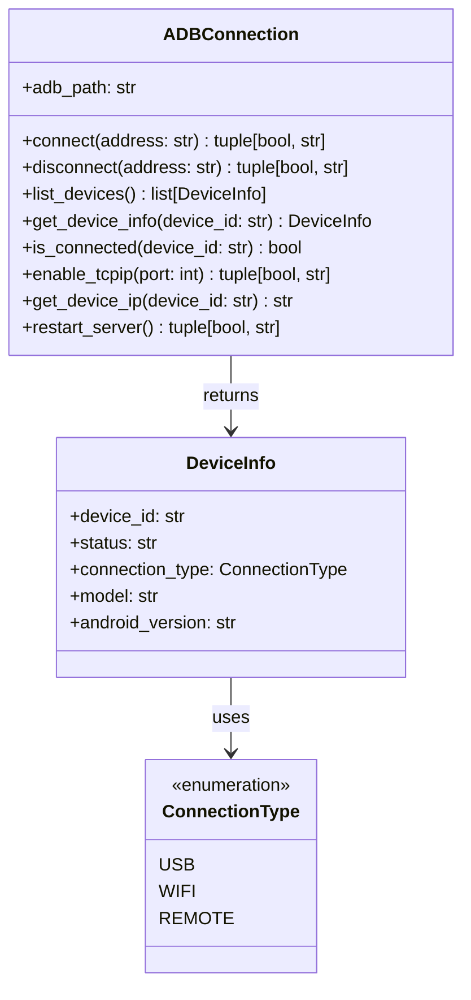
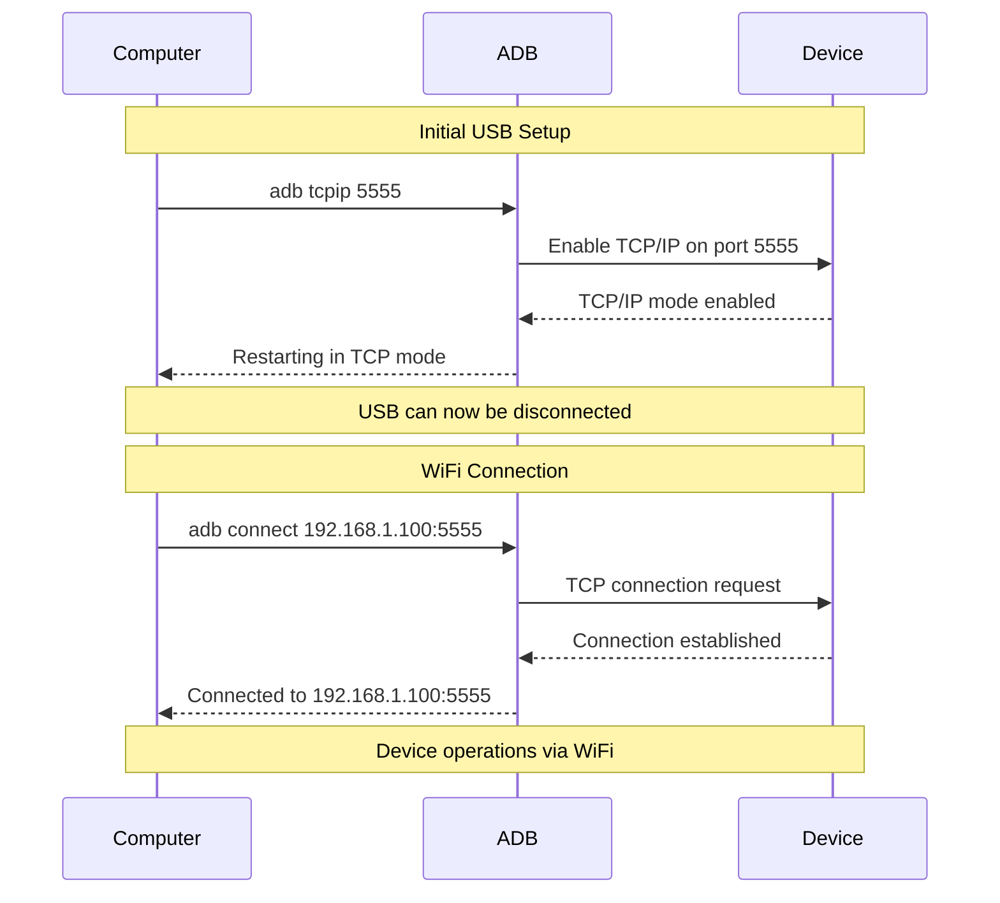
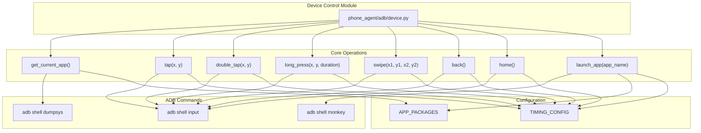
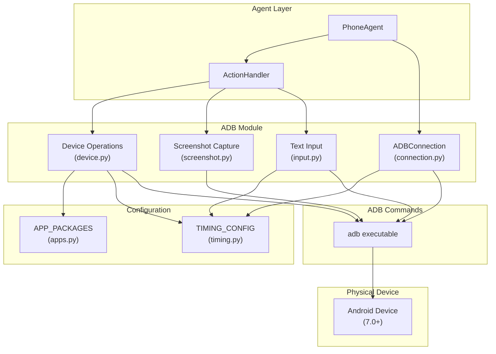

<!-- source: DeepWiki mcp.deepwiki.com · repo zai-org/Open-AutoGLM · page 4.1 Android (ADB) · fetched 2026-10-29 -->

# Android (ADB)

<details>
<summary>Relevant source files</summary>

The following files were used as context for generating this wiki page:

- [LICENSE](LICENSE)
- [README.md](README.md)
- [README_coding_agent.md](README_coding_agent.md)
- [README_en.md](README_en.md)
- [phone_agent/adb/connection.py](phone_agent/adb/connection.py)
- [phone_agent/adb/device.py](phone_agent/adb/device.py)
- [phone_agent/adb/screenshot.py](phone_agent/adb/screenshot.py)
- [phone_agent/config/timing.py](phone_agent/config/timing.py)
- [setup.py](setup.py)

</details>


This document covers the setup, connection management, and device operations for Android devices using ADB (Android Debug Bridge). ADB is the primary communication protocol for controlling Android devices in the Open-AutoGLM framework.

For HarmonyOS devices, see [HarmonyOS (HDC)](#4.2). For iOS devices, see [iOS (WebDriverAgent)](#4.3). For information about remote device connections via WiFi, see [Remote Device Connection](#5.3).

---

## Overview

ADB (Android Debug Bridge) is a command-line tool that enables communication between a computer and Android devices. Open-AutoGLM uses ADB to:

- Capture screenshots of the device screen
- Execute touch gestures (tap, swipe, long press)
- Input text via ADB Keyboard
- Launch applications
- Query device state and current application

The ADB implementation in Open-AutoGLM supports both USB and WiFi connections, allowing flexible device control for local and remote scenarios.

**Sources:** [README.md:46-105](), [README.md:336-474]()

---

## Prerequisites

### System Requirements

| Requirement | Details |
|-------------|---------|
| **Android Version** | Android 7.0 (API level 24) or higher |
| **USB Cable** | Must support data transfer, not charging-only |
| **ADB Tool** | Platform Tools from Android SDK |
| **Python** | Python 3.10 or higher |

**Sources:** [README.md:46-51](), [README.md:85-92]()

### ADB Installation

#### macOS

```bash
# Option 1: Using Homebrew
brew install android-platform-tools

# Option 2: Manual installation
# Download from https://developer.android.com/tools/releases/platform-tools
# Extract and add to PATH
export PATH=${PATH}:~/Downloads/platform-tools
```

#### Windows

1. Download the [Platform Tools package](https://developer.android.com/tools/releases/platform-tools)
2. Extract to a directory (e.g., `C:\platform-tools`)
3. Add the directory to your system PATH environment variable

#### Verification

```bash
adb version
# Expected output: Android Debug Bridge version X.X.X
```

**Sources:** [README.md:56-68]()

---

## Device Configuration

### Enable Developer Mode

1. Navigate to **Settings → About Phone → Build Number**
2. Tap the build number **7-10 times** until "Developer Mode Enabled" appears
3. Different manufacturers may have slightly different paths

### Enable USB Debugging

1. Navigate to **Settings → Developer Options**
2. Enable **USB Debugging**
3. For certain devices, also enable **USB Debugging (Security Settings)**

**Important:** Some devices require enabling both "USB Debugging" and "USB Debugging (Security Settings)" for full functionality.

### Authorize Computer

When connecting via USB, the device will display an authorization dialog:

1. Check "Always allow from this computer" (recommended)
2. Tap "Allow"

**Sources:** [README.md:85-96](), [README.md:710-717]()

### Install ADB Keyboard

ADB Keyboard is required for text input on Android devices. The native keyboard cannot be controlled via ADB commands.

1. Download [ADB Keyboard APK](https://github.com/senzhk/ADBKeyBoard/blob/master/ADBKeyboard.apk)
2. Install on the Android device
3. Navigate to **Settings → System → Languages & Input → Virtual Keyboard**
4. Enable **ADB Keyboard**

Alternatively, enable via command:
```bash
adb shell ime enable com.android.adbkeyboard/.AdbIME
```

**Sources:** [README.md:97-104](), [README.md:720-723]()

---

## Connection Management

### ADBConnection Class

The `ADBConnection` class in [phone_agent/adb/connection.py]() provides comprehensive connection management for Android devices.



**ADBConnection Class Diagram**

**Sources:** [phone_agent/adb/connection.py:31-329]()

### USB Connection

USB connections are the default and most reliable method for controlling Android devices.

#### Verify USB Connection

```bash
# List connected devices
adb devices

# Expected output:
# List of devices attached
# ABC123DEF456    device
```

#### Python API

```python
from phone_agent.adb import ADBConnection, list_devices

# List all connected devices
devices = list_devices()
for device in devices:
    print(f"{device.device_id} - {device.connection_type.value}")

# Check if device is connected
conn = ADBConnection()
if conn.is_connected():
    print("Device connected via USB")
```

**Sources:** [README.md:125-138](), [phone_agent/adb/connection.py:120-173]()

### WiFi/TCP Connection

WiFi connections enable wireless device control without a USB cable. The device and computer must be on the same network.



**WiFi Connection Flow**

#### Enable TCP/IP Mode

```bash
# Enable TCP/IP debugging (device must be connected via USB)
adb tcpip 5555

# Get device IP address
adb shell ip route | grep "src"
# Or check in device Settings → About Phone → Status → IP Address

# Disconnect USB cable
# Connect via WiFi
adb connect 192.168.1.100:5555

# Verify connection
adb devices
# Output: 192.168.1.100:5555    device
```

#### Python API

```python
from phone_agent.adb import ADBConnection

conn = ADBConnection()

# Enable TCP/IP on USB-connected device
success, message = conn.enable_tcpip(5555)
print(message)  # "TCP/IP mode enabled on port 5555"

# Get device IP
ip = conn.get_device_ip()
print(f"Device IP: {ip}")

# Connect via WiFi
success, message = conn.connect(f"{ip}:5555")
print(message)  # "Connected to 192.168.1.100:5555"

# Disconnect
conn.disconnect(f"{ip}:5555")
```

**Sources:** [README.md:336-434](), [phone_agent/adb/connection.py:56-96](), [phone_agent/adb/connection.py:219-256]()

### Device Discovery

The `list_devices()` function and `ADBConnection.list_devices()` method enumerate all connected devices with detailed information.

```python
from phone_agent.adb import list_devices, ConnectionType

devices = list_devices()
for device in devices:
    print(f"ID: {device.device_id}")
    print(f"Status: {device.status}")
    print(f"Type: {device.connection_type.value}")
    print(f"Model: {device.model}")
    print("---")
```

**Device Identification:**
- USB devices: Serial number (e.g., `ABC123DEF456`)
- WiFi devices: IP address with port (e.g., `192.168.1.100:5555`)
- Emulators: Identifier like `emulator-5554`

**Sources:** [phone_agent/adb/connection.py:120-173](), [phone_agent/adb/connection.py:345-353]()

### Connection Troubleshooting

| Issue | Cause | Solution |
|-------|-------|----------|
| No devices listed | USB debugging disabled or cable issue | Enable USB debugging, try different cable/port |
| Device shows "unauthorized" | Computer not authorized on device | Check device screen for authorization dialog |
| TCP connection refused | TCP/IP mode not enabled | Run `adb tcpip 5555` while connected via USB |
| Connection drops frequently | WiFi instability or device sleep | Keep device screen on, use stable WiFi |
| Multiple devices conflict | Device ID not specified | Use `--device-id` or `-s` flag |

**Restart ADB Server:**
```bash
adb kill-server
adb start-server
adb devices
```

**Python API:**
```python
conn = ADBConnection()
success, message = conn.restart_server()
print(message)  # "ADB server restarted"
```

**Sources:** [README.md:457-473](), [README.md:693-709](), [phone_agent/adb/connection.py:305-328]()

---

## Device Operations

The `phone_agent.adb.device` module provides functions for controlling Android devices through ADB commands.



**Device Operations Module Structure**

**Sources:** [phone_agent/adb/device.py:1-253]()

### Basic Operations

#### Tap

Simulates a touch at specific screen coordinates.

```python
from phone_agent.adb.device import tap

# Tap at coordinates (500, 800)
tap(x=500, y=800, device_id=None, delay=1.0)
```

**Implementation:** Uses `adb shell input tap x y` command. Default delay is 1.0 seconds after tap.

**Sources:** [phone_agent/adb/device.py:41-62]()

#### Double Tap

Executes two taps in rapid succession.

```python
from phone_agent.adb.device import double_tap

# Double tap at coordinates
double_tap(x=500, y=800, device_id=None, delay=1.0)
```

**Implementation:** Two `input tap` commands with 0.1 second interval between taps.

**Sources:** [phone_agent/adb/device.py:64-89]()

#### Long Press

Simulates a long press gesture.

```python
from phone_agent.adb.device import long_press

# Long press for 3 seconds (3000ms)
long_press(x=500, y=800, duration_ms=3000, device_id=None, delay=1.0)
```

**Implementation:** Uses `adb shell input swipe x y x y duration` with identical start/end coordinates.

**Sources:** [phone_agent/adb/device.py:91-119]()

#### Swipe

Executes a swipe gesture from one point to another.

```python
from phone_agent.adb.device import swipe

# Swipe from (500, 1000) to (500, 300) - scroll up
swipe(start_x=500, start_y=1000, end_x=500, end_y=300, 
      duration_ms=1000, device_id=None, delay=1.0)
```

**Auto-calculated Duration:** If `duration_ms` is None, it's calculated based on distance:
```
duration_ms = int(distance_squared / 1000)
clamped to [1000, 2000] milliseconds
```

**Sources:** [phone_agent/adb/device.py:121-168]()

### Navigation Operations

#### Back Button

```python
from phone_agent.adb.device import back

# Press back button
back(device_id=None, delay=1.0)
```

**Implementation:** Sends keycode 4 (`KEYCODE_BACK`) via `adb shell input keyevent 4`.

**Sources:** [phone_agent/adb/device.py:170-187]()

#### Home Button

```python
from phone_agent.adb.device import home

# Return to home screen
home(device_id=None, delay=1.0)
```

**Implementation:** Sends `KEYCODE_HOME` via `adb shell input keyevent KEYCODE_HOME`.

**Sources:** [phone_agent/adb/device.py:189-206]()

### Application Control

#### Launch App

```python
from phone_agent.adb.device import launch_app

# Launch WeChat
success = launch_app("微信", device_id=None, delay=1.0)
if success:
    print("App launched")
else:
    print("App not found in APP_PACKAGES")
```

**Implementation:** 
1. Looks up package name in `APP_PACKAGES` dictionary
2. Uses `adb shell monkey -p <package> -c android.intent.category.LAUNCHER 1`
3. Returns `False` if app name not found in package mapping

**Sources:** [phone_agent/adb/device.py:208-246](), [phone_agent/config/apps.py]()

#### Get Current App

```python
from phone_agent.adb.device import get_current_app

# Query currently focused app
current_app = get_current_app(device_id=None)
print(f"Current app: {current_app}")  # e.g., "微信" or "System Home"
```

**Implementation:**
1. Executes `adb shell dumpsys window`
2. Parses output for `mCurrentFocus` or `mFocusedApp` lines
3. Matches package name against `APP_PACKAGES` dictionary
4. Returns app name if recognized, otherwise "System Home"

**Sources:** [phone_agent/adb/device.py:12-39]()

---

## Timing Configuration

All device operations include configurable delays to ensure UI stability. The timing system is defined in [phone_agent/config/timing.py]().

### Default Timing Values

| Operation | Default Delay | Environment Variable |
|-----------|--------------|---------------------|
| Tap | 1.0s | `PHONE_AGENT_TAP_DELAY` |
| Double Tap | 1.0s | `PHONE_AGENT_DOUBLE_TAP_DELAY` |
| Long Press | 1.0s | `PHONE_AGENT_LONG_PRESS_DELAY` |
| Swipe | 1.0s | `PHONE_AGENT_SWIPE_DELAY` |
| Back | 1.0s | `PHONE_AGENT_BACK_DELAY` |
| Home | 1.0s | `PHONE_AGENT_HOME_DELAY` |
| Launch App | 1.0s | `PHONE_AGENT_LAUNCH_DELAY` |

**Additional Timing:**
- Double tap interval: 0.1s between taps
- TCP/IP restart delay: 2.0s after enabling tcpip mode
- Server restart delay: 1.0s between kill and start

**Sources:** [phone_agent/config/timing.py:37-77]()

### Custom Timing Configuration

```python
from phone_agent.config.timing import DeviceTimingConfig, update_timing_config

# Create custom timing
custom_timing = DeviceTimingConfig(
    default_tap_delay=0.5,  # Faster taps
    default_swipe_delay=1.5,  # Slower swipes for animations
    default_launch_delay=2.0  # More time for apps to start
)

# Apply globally
update_timing_config(device=custom_timing)
```

**Environment Variable Method:**
```bash
export PHONE_AGENT_TAP_DELAY=0.5
export PHONE_AGENT_LAUNCH_DELAY=2.0
python main.py --base-url http://localhost:8000/v1 "打开微信"
```

**Sources:** [phone_agent/config/timing.py:37-77](), [phone_agent/config/timing.py:129-156]()

---

## Architecture Integration

### ADB in the System Architecture



**ADB Integration in Open-AutoGLM Architecture**

**Sources:** [phone_agent/adb/connection.py:1-354](), [phone_agent/adb/device.py:1-253]()

### Module Structure

The ADB implementation is organized into specialized modules:

| Module | Purpose | Key Functions |
|--------|---------|---------------|
| `connection.py` | Connection management | `connect()`, `disconnect()`, `list_devices()`, `enable_tcpip()` |
| `device.py` | Device control | `tap()`, `swipe()`, `launch_app()`, `get_current_app()` |
| `screenshot.py` | Screen capture | `capture_screenshot()` (not shown in provided files) |
| `input.py` | Text input via ADB Keyboard | Text input operations (not shown in provided files) |

### Device ID Handling

All device operation functions accept an optional `device_id` parameter for multi-device scenarios:

```python
def _get_adb_prefix(device_id: str | None) -> list:
    """Get ADB command prefix with optional device specifier."""
    if device_id:
        return ["adb", "-s", device_id]
    return ["adb"]
```

When `device_id` is specified, all ADB commands are prefixed with `-s <device_id>` to target the specific device.

**Sources:** [phone_agent/adb/device.py:248-253]()

### Error Handling

The ADB implementation uses return tuples for connection operations:

```python
# Connection methods return (success: bool, message: str)
success, message = conn.connect("192.168.1.100:5555")
if success:
    print(f"✓ {message}")
else:
    print(f"✗ {message}")
```

Device operation functions either:
- Return void (tap, swipe, etc.) and assume success
- Return boolean (launch_app) to indicate success/failure
- Return data (get_current_app) and raise exceptions on error

**Sources:** [phone_agent/adb/connection.py:56-96](), [phone_agent/adb/device.py:208-246]()

---

## Usage Examples

### Single Device Operation

```python
from phone_agent import PhoneAgent
from phone_agent.model import ModelConfig

# Configure model
model_config = ModelConfig(
    base_url="http://localhost:8000/v1",
    model_name="autoglm-phone-9b",
)

# Create agent (automatically detects connected Android device)
agent = PhoneAgent(model_config=model_config)

# Execute task
result = agent.run("打开微信给文件传输助手发消息")
print(result)
```

**Sources:** [README.md:315-333]()

### Multi-Device Scenario

```python
from phone_agent.adb import list_devices
from phone_agent import PhoneAgent

# List all connected devices
devices = list_devices()
for device in devices:
    print(f"Found: {device.device_id} ({device.connection_type.value})")

# Use specific device
agent = PhoneAgent(
    model_config=model_config,
    device_id="192.168.1.100:5555"  # Specify device ID
)
```

**Sources:** [README.md:375-406](), [phone_agent/adb/connection.py:345-353]()

### Remote WiFi Setup

```python
from phone_agent.adb import ADBConnection

conn = ADBConnection()

# Step 1: Enable TCP/IP on USB-connected device
success, msg = conn.enable_tcpip(5555)
print(msg)

# Step 2: Get device IP
ip = conn.get_device_ip()
print(f"Device IP: {ip}")

# Step 3: Disconnect USB and connect via WiFi
success, msg = conn.connect(f"{ip}:5555")
print(msg)

# Step 4: Verify connection
devices = conn.list_devices()
for d in devices:
    if d.connection_type.value == "remote":
        print(f"✓ WiFi connected: {d.device_id}")
```

**Sources:** [README.md:410-434](), [phone_agent/adb/connection.py:219-256]()

---

## Command-Line Interface

The CLI automatically detects and uses connected Android devices when `--device-type adb` is specified (default).

```bash
# Interactive mode (default device type is adb)
python main.py --base-url http://localhost:8000/v1 --model "autoglm-phone-9b"

# Single task
python main.py --base-url http://localhost:8000/v1 "打开抖音刷视频"

# Specify device ID for multi-device setups
python main.py --device-id 192.168.1.100:5555 \
    --base-url http://localhost:8000/v1 "打开美团"

# List supported Android apps
python main.py --list-apps
```

**Sources:** [README.md:287-313](), [README.md:375-390]()

---

## Best Practices

### Connection Stability

1. **USB Connections:**
   - Use high-quality data cables
   - Avoid USB hubs when possible
   - Keep devices plugged in during long operations

2. **WiFi Connections:**
   - Ensure stable network connection
   - Keep device screen on to prevent sleep
   - Use static IP or DHCP reservation
   - Re-enable TCP/IP mode after device reboot

### Performance Optimization

1. **Reduce Timing Delays:** Lower delays for faster operation (test stability first)
   ```python
   custom_timing = DeviceTimingConfig(
       default_tap_delay=0.5,
       default_swipe_delay=0.7
   )
   update_timing_config(device=custom_timing)
   ```

2. **Minimize Screenshots:** Screenshots are expensive operations
3. **Batch Operations:** Group multiple device commands when possible

### Security Considerations

1. **Authorization:** Always review and authorize computers on device
2. **TCP/IP Mode:** Disable when not needed for security
3. **Public Networks:** Avoid using WiFi debugging on public networks
4. **Screen Lock:** Temporarily disable screen lock during automation

**Sources:** [README.md:457-473](), [phone_agent/config/timing.py:129-156]()

---

